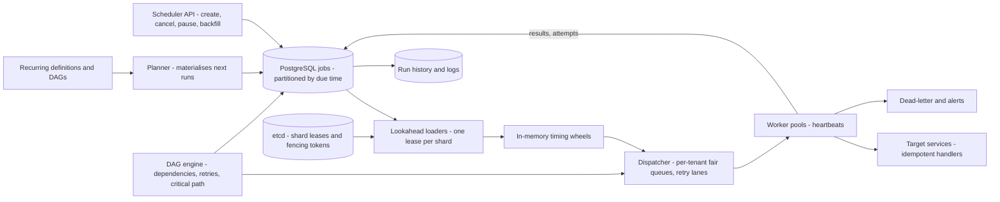
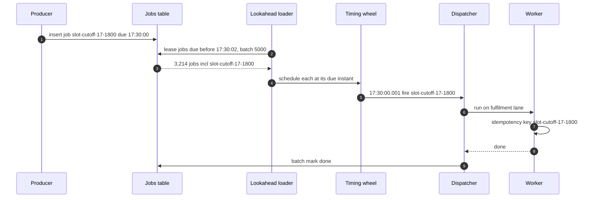
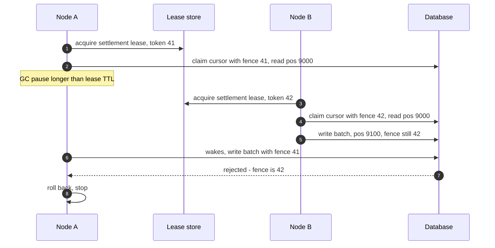
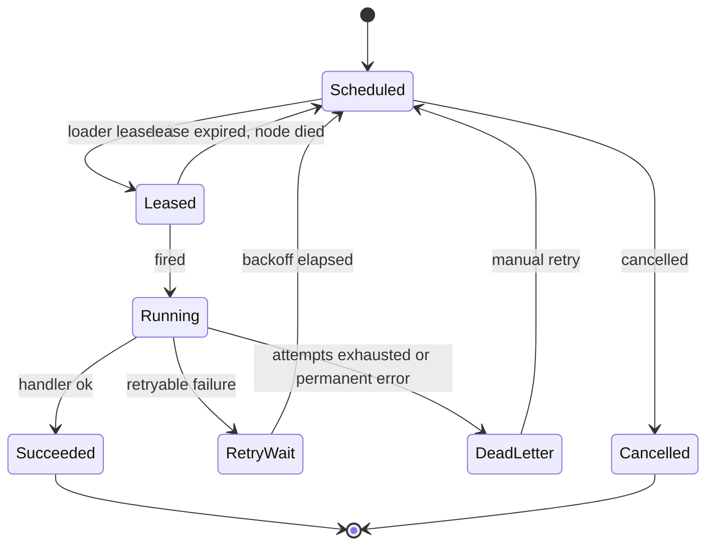

# 50. Case Study: Distributed Job Scheduler

!!! abstract "Chapter at a glance"
    **Reader bands:** B2 → B4 · **Prerequisites:** [Ch 09](../01-foundations/09-scalability-fundamentals.md) (run-once jobs), [Ch 12](../02-distributed-core/12-consistency-time-and-consensus.md) (leases, fencing, clocks), [Ch 14](../02-distributed-core/14-messaging-and-event-streaming.md) (queues), [Ch 40](40-notification-system.md) (SKIP LOCKED workers) · **What you will build:** the platform that runs everything *not* triggered by a user request. That includes nightly settlement, reconciliation and GST reports, slot cut-offs, payment-status checks, cart nudges, campaign sends and re-indexing. You need four pieces: run-once coordination that survives paused processes; firing millions of delayed jobs on time; dependency-aware pipelines; and a shared worker fleet that one team's flood can't take down. This is the "design a distributed cron / task scheduler / Airflow" interview question.

    **The four labs, with their measured results:**

    - **L1: run once, really.** Five nodes over 100 ticks, real Redis and PostgreSQL:
        - No coordination processed **40,400** events more than once.
        - A Redis lock with plain DEL still duplicated 1,400.
        - An owner-token lock duplicated 900.
        - A **fencing token claimed on read and checked on write** duplicated **0**, and rejected 9 stale batches.
        - A first version that checked the token only on the write *still* double-processed. The reason is explained in §2.4.
    - **L2: firing delayed jobs** (real PostgreSQL, 120,000 jobs, 30% due in the same second):
        - Pollers with a 1 s tick reached **~0.5–0.9 s** p99 lateness. A 100 ms tick reached 83 ms, at 7,878 queries.
        - A 2 s lookahead leased into an in-memory timer reached **2 ms** p99 with **46** queries.
    - **L3: pipelines as a DAG (simulation).** Cron-chained nightly finance tasks started **1,371** runs on bad inputs and needed a manual re-run on **60 of 60** nights. A DAG scheduler with automatic retries had 0 bad runs and was correct by 06:00 on **58 of 60** nights.
    - **L4: shared fleet fairness (simulation).**
        - One FIFO queue gave every tenant a **22-minute** p99 wait during a marketing dump.
        - Priority classes broke when a payments retry storm flooded the critical class.
        - Per-tenant fair queuing, with retries in their own lane, kept first attempts at **0.1–1.6 s** p99.

    · **Reading time:** 100 min + code

---

## 1. Introduction & Why It Matters

### 1.1 A story: the settlement that ran three times

The first scheduler was Spring's `@Scheduled(cron = "0 0 * * * *")` on the settlement service. It worked until the service scaled to five pods, and then settlement ran five times an hour. Someone added a Redis lock. For a month it was fine. Then:

1. **A pod stalled** for 40 seconds (a full GC during a heap-heavy reconciliation). Its lock expired and another pod took over. The first pod woke up and posted the same batch again: ₹38 lakh of duplicate seller payouts, clawed back over two weeks.
2. **Reminder jobs fired late.** "Your slot closes in 10 minutes" arrived after the slot had closed, because a single poller scanned a 40-million-row table once a minute.
3. **The nightly pipeline was a chain of cron times.** GST reports started at 02:30 "because settlement is usually done by 02:15". On month-end nights it wasn't, and the reports went out wrong.
4. **Marketing enqueued 5 million notification jobs** into the same queue as payment-status checks. Payments sat pending for 40 minutes, and customers were charged twice when they retried.

A scheduler looks like a `while (true) { sleep; run(); }`. In practice it is a **distributed-systems problem** (leases, fencing, clocks), a **database problem** (queue tables at high churn), a **workflow problem** (dependencies, retries, backfills), and a **multi-tenant capacity problem**.

!!! quote "The thesis of this chapter"
    **"Run exactly once" is a lease plus a check at the resource.** Locks expire under paused processes, so the store must reject stale holders using a fencing token that is checked on **read and write**, or the work must be idempotent (L1). **Delayed jobs** are fired from a **durable table plus an in-memory timer** with short lookahead leases, not from tight polling (L2). **Pipelines declare dependencies**; the scheduler starts work when inputs are ready, retries automatically, and prioritises the critical path (L3). **A shared fleet isolates tenants, not priorities**: fair queuing, retry lanes and weights keep one team's flood from becoming everyone's outage (L4).

### 1.2 What runs on the scheduler

| Job | Kind | Volume | Timeliness | Owner |
|---|---|---|---|---|
| Hourly settlement batch | Recurring, singleton | 24/day | Minutes | Payments ([Ch 45](45-payment-system.md)) |
| Nightly finance pipeline (40 tasks) | DAG | Nightly | Done by 06:00 | Finance platform |
| Payment-status checks | Delayed, per payment | ~2M/day | Seconds | Payments |
| Slot cut-offs, hold expiries | Delayed, per slot/hold | ~3M/day | Seconds ([Ch 48](48-delivery-slot-booking-and-capacity.md)) | Fulfilment |
| Cart nudges, reminders | Delayed, per customer | ~5M/day | Minutes | Growth |
| Campaign sends | Bulk | Millions per campaign | Hours | Marketing ([Ch 40](40-notification-system.md)) |
| Re-index, compaction, cleanup | Recurring | Continuous | Hours | Search, data |

### 1.3 Learning objectives

By the end you will be able to:

- **Coordinate singleton jobs** with leases, owner tokens and fencing (L1).
- **Store and fire delayed jobs** at scale on time (L2).
- **Run workflows** as DAGs with retries, backfills and critical-path priority (L3).
- **Share a worker fleet** fairly across tenants (L4).
- Design misfire and catch-up policies, idempotency, observability and time-zone handling.

---

## 2. Core Concepts — Beginner to Deep

### 2.1 Intuition: a hospital's duty roster <span class="band b2">B2</span>

Think of a hospital's duty roster:

- One nurse holds the medication keys per shift. If she's delayed, the next shift can't take the keys *and* have her still dispensing: the keys have a numbered tag, and the pharmacy only honours the newest tag.
- Appointment reminders go out from a card index sorted by time. Someone pulls the next hour's cards each hour and calls exactly on time.
- Surgery, recovery and discharge happen when the previous step is done, not at fixed hours.
- When one ward floods the lab with samples, the lab keeps separate queues so the emergency ward's samples aren't stuck behind them.

That is a scheduler: leases with tokens, a time-sorted index plus a timer, dependency-driven workflows, and fair queues.

### 2.2 Requirements <span class="band b2">B2</span>

**Functional**

- Recurring jobs (cron expressions with time zones), one-off delayed jobs ("run at T"), and workflows (DAGs).
- At-least-once execution with idempotency support, or exactly-once *effects* via fencing.
- Retries with backoff, timeouts, dead-letter handling; manual re-run and backfill.
- Tenants with quotas, priorities and isolation; pause/resume per job or tenant.
- History: every run, its inputs, outcome and logs.

**Non-functional**

- Delayed jobs fire within 1 s of due (p99) at millions per day and bursts of tens of thousands per second.
- No lost jobs across node failures; no double effects from paused or partitioned nodes.
- Scheduler availability 99.95%, since many business processes depend on it.

### 2.3 Estimation <span class="band b2">B2</span>

| Quantity | Estimate |
|---|---|
| Delayed jobs | ~10M/day ≈ 115/s average, bursts of 30–50k at round times (18:00:00) |
| Stored pending jobs | Up to ~50M (nudges days ahead), ~200 B each → ~10 GB |
| Recurring jobs | ~2,000 definitions |
| DAG runs | ~50 pipelines/night, 10–200 tasks each |
| Workers | Hundreds, shared across ~30 tenants |

Storage is modest. The hard parts are the **burst at round times**, **churn** (every job is inserted, claimed, updated and deleted), and **correctness under failure**.

### 2.4 Run-once coordination: leases and fencing ⭐ <span class="band b4">B4</span>

Every "lock" with a timeout is a **lease**: it expires whether or not the holder is finished. A process can pause (GC, VM steal, a slow disk) past its lease and then act as if it still holds it. L1 measured this with real Redis locks and real PostgreSQL writes:

| Strategy | Runs | Overlapping | Events processed twice | Cursor went backwards | Fenced off |
|---|---|---|---|---|---|
| Every node runs every tick | 500 | 448 | 40,400 | 343 | 0 |
| Redis lock, release with plain DEL | 114 | 21 | 1,400 | 12 | 0 |
| Redis lock with owner token | 99 | 11 | 900 | 9 | 0 |
| **+ fencing token claimed on read, checked on write** | 101 | 10 | **0** | **0** | 9 |

- **Plain DEL** deletes whatever lock is there, including the *next* holder's. That caused more runs (114 for 100 ticks) and more overlap.
- **An owner token** (compare-and-delete in Lua) stops that, but a paused holder still wakes up and writes its stale batch.
- **Fencing tokens**: a monotonically increasing number issued with each lease (Redis `INCR`, etcd revision, ZooKeeper zxid). The resource rejects anything older than the newest it has seen.
- **Check the token on the read too.** A first version of L1 checked the token only on the write, and still duplicated 100 events. The new holder had *read* the cursor before the old holder's late (and still-valid-looking) write landed. The fix is to claim the row with your token before reading it (`UPDATE … SET fence = token WHERE fence < token RETURNING pos`), then write only while the fence is still yours.
- **Alternatives**:
    - Make the effect idempotent (a unique key per event or per period).
    - Use a single-writer design, such as a Kafka partition owner with epoch fencing ([Ch 14](../02-distributed-core/14-messaging-and-event-streaming.md)).
    - Keep the lease in the same database as the effect, e.g. `SELECT … FOR UPDATE` on a job row held for the transaction.
- **Where leases live**: etcd/ZooKeeper (consensus-backed, with revisions as tokens), the database (row leases), or Redis (fast, but a single primary; Redlock's guarantees are debated, [Ch 12](../02-distributed-core/12-consistency-time-and-consensus.md)).

### 2.5 Storing and firing delayed jobs ⭐ <span class="band b3">B3</span>

A durable store holds `(id, due_at, status, lease_until, attempts, payload, tenant)`. Workers find due jobs, lease them, run them, and mark them done. L2, on a real PostgreSQL:

| Design | p50 late | p99 late | Max | Claim queries | Time in them |
|---|---|---|---|---|---|
| Poll on 1 s ticks, no index | 28 ms | 527 ms | 544 ms | 2,691 | 51.9 s |
| Poll on 1 s ticks, partial index | 17 ms | 892 ms | 1,015 ms | 3,392 | 40.9 s |
| Poll on 100 ms ticks, partial index | 13 ms | 83 ms | 107 ms | 7,878 | 91.0 s |
| **Index + 2 s lookahead into an in-memory timer** | **0 ms** | **2 ms** | 145 ms | **46** | **2.4 s** |

- **The tick bounds lateness.** Work that falls due while pollers sleep waits up to a whole interval.
    - Poller p99s varied between runs (W1 from 175 to 527 ms across our runs; W2 from 337 to 892 ms). The max column is the stable bound.
    - W1's full-scan claims were so slow that the queue was rarely empty, so it hardly ever slept. It was effectively continuous polling, paid for with a table scan per query.
- **Queue tables churn.** Every claim is an UPDATE and a commit, and the head of a `due_at` index fills with dead entries for jobs just claimed. We verified this with `EXPLAIN (ANALYZE, BUFFERS)`: a clean index read 8 buffers in 0.2 ms, and after 60k claims it read 718 buffers in 10.5 ms, until index hint bits cleaned it up. Remedies: aggressive autovacuum on the table, partitioning by due time (drop old partitions instead of deleting rows), or moving done rows to a history table.
- **Lookahead + timer**:
    - Lease the next few seconds of jobs in large batches (`status = 'L', lease_until = now() + 30 s`).
    - Hold them in a `DelayQueue` or hashed timing wheel, and fire each at its due instant.
    - Write results back in batches.
    - If the node dies, the leases expire and another node picks the jobs up. This is at-least-once, so the jobs must be idempotent.
- **Sharding**: partition jobs by `hash(id) % N` or by tenant, with one lookahead loader per partition (lease the partition itself). **Hierarchical timing wheels** (Kafka's purgatory, Netty's `HashedWheelTimer`) make in-memory timers O(1) per job.
- **Round-time bursts** (everything due at 18:00:00) are the real test. They need batch claims, parallel fire workers, and, where the business allows, **jittering due times** by a few seconds.

### 2.6 Recurring jobs, misfires and time <span class="band b3">B3</span>

- **Cron in a time zone**: store the zone. Daylight-saving transitions (not in India, but in other markets) create skipped and repeated local times; define the behaviour.
- **Materialise the next run** as a delayed job (`next_fire_at`). When it fires, compute the following one. This way recurring jobs reuse §2.5's machinery.
- **Misfire policy** after downtime: *fire once now* (coalesce), *fire all missed* (catch-up, e.g. hourly settlements must all happen), or *skip to the next* (a dashboard refresh). Choose per job.
- **Clock skew**: fire based on the scheduler's clock, not the workers'. Use leases with generous margins, and never compare timestamps from different machines for correctness.

### 2.7 Workflows as DAGs ⭐ <span class="band b3">B3</span>

L3 simulated a 40-task nightly finance pipeline on 6 slots:

| Scheduling | Runs on bad inputs | Nights needing manual re-run | Avg finish | p95 finish | Correct by 06:00 |
|---|---|---|---|---|---|
| Cron times from average durations | 1,371 | 60 | 03:13 | 04:28 | 0 |
| Cron times padded 50% | 974 | 60 | 03:55 | 04:30 | 0 |
| DAG: inputs ready + auto-retry | 0 | 0 | 03:46 | 05:40 | 57 |
| **+ longest critical path first** | 0 | 0 | **03:33** | **05:15** | **58** |

- **Time-based chaining** "finishes" early because it doesn't wait. With 40 tasks, variable durations and a 4% failure rate per task, some task runs long or fails every night.
- **A DAG scheduler** (Airflow, Argo Workflows, Temporal, Dagster):
    - It starts a task when its inputs succeeded, and retries with backoff.
    - It records every run.
    - It supports **backfills** (re-run for past dates) and **idempotent tasks** keyed by the logical date.
- **The critical path first** shortens the night when slots are limited. The remaining misses are heavy nights, a capacity-planning problem.
- **Data-aware triggers**: start a task when its input partition lands (a file, a table partition), not just when the upstream task reports success.
- **Durable execution** (Temporal, AWS Step Functions): long-running workflows with timers and retries persisted by the engine. It is useful for sagas ([Ch 46](46-grocery-checkout-and-inventory-reservation.md)) as well as for batch.

### 2.8 Multi-tenant fairness ⭐ <span class="band b4">B4</span>

L4 ran 50 shared workers, a marketing dump of 200,000 jobs, and a payments retry storm of 30,000 jobs:

| Queueing | Payments p99 | Slots p99 | Search p99 | Analytics p99 | Marketing | Retry storm p99 |
|---|---|---|---|---|---|---|
| One FIFO queue | 22 min | 22 min | 22 min | 22 min | done 32:35 | 12 min |
| Strict priority classes | 2 min | 2 min | 2 min | 2 min | 84% by 60:00 | 2 min |
| Fair queuing across tenants | 8 min | 0.2 s | 1.4 s | 9.2 s | 84% | 9 min |
| **+ retry lane, bulk lanes at half weight** | **0.1 s** | **0.1 s** | **0.3 s** | **1.6 s** | 84% | 11 min |

- **FIFO** turns one tenant's dump into everyone's outage.
- **Priority classes** protect against bulk, but a flood *inside* a class (the payments bug) hurts every tenant in that class and below.
- **Fair queuing** (deficit round robin, weighted fair queuing) isolates tenants from each other. It doesn't isolate a tenant from itself: payments' fresh checks waited behind its own retries.
- **Retry lanes** (separate queues for retries, as in [Ch 40](40-notification-system.md)), **weights**, **per-tenant concurrency caps** and **quotas** keep first attempts fast while floods drain.
- **Admission control**: reject or defer at enqueue when a tenant exceeds its quota, and tell the producer ([Ch 46](46-grocery-checkout-and-inventory-reservation.md) waiting room).
- **Physical isolation** for the most critical work: separate worker pools (a cell or bulkhead, [Ch 18](../02-distributed-core/18-resilience-patterns.md)).

### 2.9 Execution semantics <span class="band b3">B3</span>

- **At-least-once** is the practical default: a job may run again after a lease expiry, a crash, or a timeout followed by a late completion. **Jobs must be idempotent** (keys per logical run, e.g. `settlement:2026-09-29T18`), or fenced (§2.4).
- **Timeouts**: a heartbeat extends the lease while working. Without heartbeats, the lease must exceed the worst-case duration.
- **Retries**: exponential backoff with jitter, a max attempt count, then dead-letter with alerting. Distinguish retryable errors from permanent ones.
- **Cancellation**: cooperative. The job checks a flag, or checks its fencing token at its next step.

### 2.10 Interview framing <span class="band b4">B4</span>

"Design a distributed job scheduler." Clarify the job types (recurring, delayed, workflows), volumes, timeliness and semantics. Then:

- the storage model and firing mechanism;
- leases and fencing;
- idempotency;
- retries and dead letters;
- DAGs;
- multi-tenancy;
- observability.

Staff-level signals include saying "a lock is a lease, so fence at the resource", addressing queue-table churn, and isolating tenants rather than priorities.

---

## 3. Architecture & Diagrams

### 3.1 Component view



### 3.2 Sequence: happy path, delayed job fired on time



### 3.3 Sequence: failure path, a paused holder is fenced



### 3.4 State: a job's lifecycle



---

## 4. Design Document Excerpt: Job Platform v2

!!! note "Design Document (excerpt) — Job Platform v2"
    **Status:** Accepted · **Authors:** Platform infrastructure team · **Reviewers:** Payments, Finance, Fulfilment, Growth, SRE

    | Field | Value |
    |---|---|
    | Context | `@Scheduled` on every pod ran jobs N times. Redis locks without fencing double-posted settlements. A single poller fired reminders late. Cron chaining produced wrong reports. One shared FIFO queue let campaign floods block payments. |
    | Decision | Shard leases in etcd, whose revisions serve as fencing tokens; job effects are fenced or idempotent. Delayed jobs are stored in PostgreSQL partitioned by due hour, fired by lookahead loaders into timing wheels. Recurring jobs are materialised as delayed jobs, with per-job misfire policies. The DAG engine handles pipelines. Dispatch uses per-tenant weighted fair queues with retry lanes, quotas and caps. |
    | Related ADRs | ADR-360 Fencing tokens claimed on read and checked on write for all singleton jobs, or keys per logical run (L1). ADR-361 Jobs table partitioned hourly by `due_at`; done rows moved to history; lookahead 2 s, lease 30 s (L2). ADR-362 Due-time jitter of ±5 s for bulk jobs at round times (L2). ADR-363 Finance pipeline on the DAG engine, critical-path priority, 3 retries with backoff, backfill by logical date (L3). ADR-364 Weighted fair queuing per tenant, retry lanes, bulk weight 0.5, quotas at enqueue (L4). |

    **Requirements.**

    - **R1:** 0 duplicate effects for singleton jobs under node pauses and failovers (chaos-tested).
    - **R2:** Delayed jobs fire within 1 s of due at p99, including 50k-job round-time bursts.
    - **R3:** Nightly payouts are correct and complete by 06:00 on ≥ 97% of nights. Heavy nights get extra slots.
    - **R4:** Critical tenants' first attempts wait < 2 s at p99 regardless of other tenants' load.
    - **R5:** Every run is recorded (inputs, attempts, outcome) for 90 days.

    **Decisions in detail.**

    1. **Leases (ADR-360).** Each job shard is a lease in etcd with TTL 10 s and heartbeats every 3 s. The revision is passed to handlers as the fencing token, and handlers write `fence` columns.
    2. **Storage (ADR-361).** Hourly partitions. Loaders own shards `hash(id) % 64`. Batches are written back every 100 ms.
    3. **Bursts (ADR-362).** Producers declare jitter tolerance, and the API spreads due times within it.
    4. **DAGs (ADR-363).** Tasks are idempotent by logical date. SLAs are defined per DAG, with early alerts from critical-path projections.
    5. **Fairness (ADR-364).** Quotas per tenant in worker-seconds per minute. Excess is deferred, not dropped.

    **Consequences.**

    - Costs: etcd operations, partition management, a DAG engine to run, and tenant quota governance.
    - Benefits: single-effect singletons, on-time firing at bursts, correct nightly pipelines, and tenant isolation.

---

## 5. Hands-On Code — Level Ladder

!!! info "What's real here"
    - **L1** runs real Redis locks (SET NX PX, Lua compare-and-delete, INCR fencing) and real PostgreSQL writes, with five concurrent node threads and injected pauses.
    - **L2** runs a real PostgreSQL job table (fsync on) with 120,000 jobs, SKIP LOCKED claims, a partial index, and leases into a JDK `DelayQueue`. Poller p99s vary between runs; the max column is the stable bound.
    - **L3 and L4** are deterministic simulations. Durations, failure rates, loads and weights are stated assumptions.

L1 needs Redis on port 6390 and PostgreSQL on port 5581. L2 needs PostgreSQL. Run the JDBC labs with `-Duser.timezone=UTC -cp postgresql-42.7.4.jar`.

### L1 — Run once, really <span class="band b3">B3</span>

**Requirement:** "The incremental batch job runs once per tick on one of five nodes, and every event is processed exactly once, even when a node freezes."

Five node threads, real Redis locks, a real PostgreSQL cursor and events table, and injected freezes longer than the lock's lifetime.

```java title="LeaderLockL1.java"
// LeaderLockL1.java — run with (Redis on :6390, PostgreSQL on :5581 db shop):
//   java -Duser.timezone=UTC -cp /tmp/eslab/postgresql-42.7.4.jar LeaderLockL1.java   (JDK 21)
// "RUN THIS JOB ONCE EVERY TICK, ON ONE OF FIVE NODES." The job is an incremental batch: read a cursor from PostgreSQL,
// process the next 100 events (insert them into `processed`), advance the cursor. Every event must be processed exactly
// once. Five node threads tick every 300 ms (clocks skewed 0–60 ms); the job takes 60–120 ms; with 8% probability a node
// freezes for 400–900 ms mid-job (a GC pause, a VM steal, a slow disk) — longer than the lock's lifetime. REAL Redis locks,
// REAL PostgreSQL writes. Four strategies:
//   S1 no coordination: every node runs the job every tick (the "@Scheduled on every pod" bug)
//   S2 Redis SET lock NX PX 500; release with DEL when done (no owner check)
//   S3 S2 with an owner token: release only if the lock is still ours (Lua compare-and-delete)
//   S4 S3 + a fencing token: INCR on acquire; the job first CLAIMS the cursor row with its token (UPDATE ... SET fence =
//      token WHERE fence < token RETURNING pos) and later writes only if the fence is still its own; otherwise the
//      batch rolls back. (A first version checked the token only on the write — see the chapter for why that failed.)
// Measured over 100 ticks: job runs, runs that overlapped another run, events processed more than once, cursor moved
// backwards, and batches rejected by the fence.
import java.io.*;
import java.net.Socket;
import java.nio.charset.StandardCharsets;
import java.sql.*;
import java.util.*;
import java.util.concurrent.*;
import java.util.concurrent.atomic.*;

public class LeaderLockL1 {
    static final String URL = "jdbc:postgresql://localhost:5581/shop?user=claude";
    static final int NODES = 5, TICKS = 100, TICK_MS = 300;
    static final String RELEASE = "if redis.call('GET', KEYS[1]) == ARGV[1] then return redis.call('DEL', KEYS[1]) else return 0 end";

    public static void main(String[] args) throws Exception {
        System.out.println("5 nodes, 100 ticks of 300 ms, job 60–120 ms, 8% of runs freeze 400–900 ms; lock TTL 500 ms. Real Redis + PostgreSQL.\n");
        System.out.printf("   %-58s %6s %11s %14s %12s %11s%n", "strategy", "runs", "overlapping", "events done", "cursor went", "fenced off");
        System.out.printf("   %-58s %6s %11s %14s %12s %11s%n", "", "", "runs", "more than once", "backwards", "");
        String[] names = {"S1) every node runs every tick", "S2) Redis lock, release with plain DEL", "S3) Redis lock with owner token (compare-and-delete)", "S4) S3 + fencing token claimed on read, checked on write"};
        for (int s = 0; s < 4; s++) run(s, names[s]);
        System.out.println("\n   → a lock with a timeout is a lease, and a paused process doesn't know its lease ran out. When it wakes it");
        System.out.println("     finishes a batch built on a cursor it read long ago, and the events are processed twice. A plain DEL can also");
        System.out.println("     delete the NEXT holder's lock; an owner token stops that, but not the stale write. What closes the gap is a check");
        System.out.println("     at the resource: a monotonically increasing fencing token the database compares — on the READ as well as the");
        System.out.println("     write, or a new holder can read before the old one's late write lands. (Or make the work idempotent, e.g. a");
        System.out.println("     unique key per event, so duplicates bounce.)");
    }

    static void run(int strategy, String name) throws Exception {
        try (Connection c = DriverManager.getConnection(URL); Statement st = c.createStatement()) {
            st.execute("DROP TABLE IF EXISTS processed, job_cursor");
            st.execute("CREATE TABLE processed (event_id bigint NOT NULL, node int, ts timestamptz DEFAULT clock_timestamp())");
            st.execute("CREATE TABLE job_cursor (id int PRIMARY KEY, pos bigint NOT NULL, fence bigint NOT NULL)");
            st.execute("INSERT INTO job_cursor VALUES (1, 0, 0)");
        }
        try (Redis r = new Redis()) { r.cmd("DEL", "lock:batch", "fence:batch"); }
        AtomicInteger runs = new AtomicInteger(), overlapping = new AtomicInteger(), regress = new AtomicInteger(), fenced = new AtomicInteger(), active = new AtomicInteger();
        long start = System.currentTimeMillis() + 200;
        ExecutorService ex = Executors.newFixedThreadPool(NODES); List<Future<?>> fs = new ArrayList<>();
        for (int n = 0; n < NODES; n++) { final int node = n; fs.add(ex.submit(() -> {
            Random rnd = new Random(50 + node * 7919L); long skew = rnd.nextInt(61);
            try (Connection c = DriverManager.getConnection(URL); Redis r = new Redis()) {
                for (int t = 0; t < TICKS; t++) {
                    long at = start + (long) t * TICK_MS + skew; long now = System.currentTimeMillis(); if (at > now) Thread.sleep(at - now);
                    String owner = "n" + node + "-" + t; long token = 0;
                    if (strategy >= 1) {
                        Object ok = r.cmd("SET", "lock:batch", owner, "NX", "PX", "500");
                        if (ok == null) continue;
                        if (strategy == 3) token = (Long) r.cmd("INCR", "fence:batch");
                    }
                    runs.incrementAndGet(); if (active.incrementAndGet() > 1) overlapping.incrementAndGet();
                    try {
                        long pos;
                        if (strategy == 3) {                                                           // fence the READ: claim the cursor with our token first
                            try (PreparedStatement p = c.prepareStatement("UPDATE job_cursor SET fence = ? WHERE id = 1 AND fence < ? RETURNING pos")) {
                                p.setLong(1, token); p.setLong(2, token); try (ResultSet rs = p.executeQuery()) { if (!rs.next()) { fenced.incrementAndGet(); continue; } pos = rs.getLong(1); }
                            }
                        } else try (Statement s = c.createStatement(); ResultSet rs = s.executeQuery("SELECT pos FROM job_cursor WHERE id = 1")) { rs.next(); pos = rs.getLong(1); }
                        Thread.sleep(60 + rnd.nextInt(61));
                        if (rnd.nextDouble() < 0.08) Thread.sleep(400 + rnd.nextInt(501));          // the freeze
                        c.setAutoCommit(false);
                        try (PreparedStatement p = c.prepareStatement("INSERT INTO processed (event_id, node) SELECT g, ? FROM generate_series(?::bigint, ?::bigint) g")) {
                            p.setInt(1, node); p.setLong(2, pos + 1); p.setLong(3, pos + 100); p.executeUpdate();
                        }
                        int updated;
                        try (PreparedStatement p = c.prepareStatement(strategy == 3 ? "UPDATE job_cursor SET pos = ? WHERE id = 1 AND fence = ? AND ? > 0" : "UPDATE job_cursor SET pos = ? WHERE id = 1 RETURNING (SELECT pos FROM job_cursor WHERE id = 1)")) {
                            p.setLong(1, pos + 100); if (strategy == 3) { p.setLong(2, token); p.setLong(3, token); updated = p.executeUpdate(); }
                            else { try (ResultSet rs = p.executeQuery()) { rs.next(); if (rs.getLong(1) > pos) regress.incrementAndGet(); updated = 1; } }
                        }
                        if (updated == 0) { c.rollback(); fenced.incrementAndGet(); } else c.commit();
                        c.setAutoCommit(true);
                    } finally {
                        active.decrementAndGet();
                        if (strategy == 1) r.cmd("DEL", "lock:batch");
                        else if (strategy >= 2) r.cmd("EVAL", RELEASE, "1", "lock:batch", owner);
                    }
                }
            }
            return null; })); }
        for (Future<?> f : fs) f.get(); ex.shutdown();
        long dup;
        try (Connection c = DriverManager.getConnection(URL); Statement s = c.createStatement(); ResultSet rs = s.executeQuery("SELECT count(*) - count(DISTINCT event_id) FROM processed")) { rs.next(); dup = rs.getLong(1); }
        System.out.printf("   %-58s %6d %11d %,14d %12d %11d%n", name, runs.get(), overlapping.get(), dup, regress.get(), fenced.get());
    }

    static final class Redis implements Closeable {
        final Socket s; final OutputStream out; final InputStream in;
        Redis() throws IOException { s = new Socket("127.0.0.1", 6390); s.setTcpNoDelay(true); out = new BufferedOutputStream(s.getOutputStream()); in = new BufferedInputStream(s.getInputStream()); }
        Object cmd(String... parts) throws IOException {
            StringBuilder sb = new StringBuilder("*").append(parts.length).append("\r\n");
            for (String p : parts) { byte[] b = p.getBytes(StandardCharsets.UTF_8); sb.append('$').append(b.length).append("\r\n").append(p).append("\r\n"); }
            out.write(sb.toString().getBytes(StandardCharsets.UTF_8)); out.flush(); return read();
        }
        Object read() throws IOException {
            int type = in.read(); String line = line();
            return switch (type) {
                case '+' -> line; case ':' -> Long.parseLong(line);
                case '$' -> { int n = Integer.parseInt(line); if (n < 0) yield null; byte[] b = in.readNBytes(n); line(); yield new String(b, StandardCharsets.UTF_8); }
                case '*' -> { int n = Integer.parseInt(line); List<Object> l = new ArrayList<>(); for (int i = 0; i < n; i++) l.add(read()); yield l; }
                case '-' -> throw new IOException(line);
                default -> throw new IOException("unexpected " + (char) type);
            };
        }
        String line() throws IOException { StringBuilder sb = new StringBuilder(); int c; while ((c = in.read()) != '\r') sb.append((char) c); in.read(); return sb.toString(); }
        public void close() throws IOException { s.close(); }
    }
}
```

```text title="java -Duser.timezone=UTC -cp postgresql-42.7.4.jar LeaderLockL1.java"
5 nodes, 100 ticks of 300 ms, job 60–120 ms, 8% of runs freeze 400–900 ms; lock TTL 500 ms. Real Redis + PostgreSQL.

   strategy                                                     runs overlapping    events done  cursor went  fenced off
                                                                            runs more than once    backwards            
   S1) every node runs every tick                                500         448         40,400          343           0
   S2) Redis lock, release with plain DEL                        114          21          1,400           12           0
   S3) Redis lock with owner token (compare-and-delete)           99          11            900            9           0
   S4) S3 + fencing token claimed on read, checked on write      101          10              0            0           9

   → a lock with a timeout is a lease, and a paused process doesn't know its lease ran out. When it wakes it
     finishes a batch built on a cursor it read long ago, and the events are processed twice. A plain DEL can also
     delete the NEXT holder's lock; an owner token stops that, but not the stale write. What closes the gap is a check
     at the resource: a monotonically increasing fencing token the database compares — on the READ as well as the
     write, or a new holder can read before the old one's late write lands. (Or make the work idempotent, e.g. a
     unique key per event, so duplicates bounce.)
```

**Reading it:**

- **S1** is what `@Scheduled` on every pod does. Almost every run overlaps another, and 40,400 events are processed twice.
- **S2's plain DEL** released other holders' locks, which gave 114 runs for 100 ticks.
- **S3** fixes the release, but frozen holders still wake up and write stale batches: 9 batches, 900 events.
- **S4's fence** turned exactly those 9 stale batches into rejections, with 0 duplicates.
- **Why the fence is claimed on read.** The first S4 checked the token only on the write and still duplicated 100 events. A new holder had read the cursor before the old holder's late write landed. Claiming the row with the token before reading closes that window.

### L2 — Firing delayed jobs on time <span class="band b3">B3</span>

**Requirement:** "Fire 120,000 jobs within a second of their due time, including 36,000 due in the same second."

A real PostgreSQL job table, four workers, and four designs.

```java title="DueJobsL2.java"
// DueJobsL2.java — run with (PostgreSQL on :5581 db shop):
//   java -Duser.timezone=UTC -cp /tmp/eslab/postgresql-42.7.4.jar DueJobsL2.java   (JDK 21)
// FIRING 120,000 DELAYED JOBS ON TIME. Slot cut-offs, cart nudges, payment-status checks: each job has a due time. We
// schedule 120,000 jobs over a 40-second window (fixed seed); 30% of them are due in the SAME second (an 18:00:00
// campaign). 4 worker threads fire them from a REAL PostgreSQL table (fsync on). "Firing" = claiming the job and
// recording when it started. Four designs:
//   W1 poll on every 1 s tick (all workers wake on the tick and drain together): claim due jobs (status = pending AND due_at <= now) in batches of 500 with FOR UPDATE SKIP LOCKED,
//      no index on due_at
//   W2 W1 + a partial index on due_at WHERE status = 'P'
//   W3 W2, polling every 100 ms
//   W4 W2 + lookahead: every 1 s, claim jobs due in the next 2 s (lease them) into an in-memory DelayQueue and fire
//      each at its due instant; results written back in batches
// Measured: lateness (start − due) p50 / p99 / max, claim queries run, and total time spent inside them.
import java.sql.*;
import java.util.*;
import java.util.concurrent.*;
import java.util.concurrent.atomic.*;

public class DueJobsL2 {
    static final String URL = "jdbc:postgresql://localhost:5581/shop?user=claude&reWriteBatchedInserts=true";
    static final int JOBS = 120_000, WORKERS = 4;

    public static void main(String[] args) throws Exception {
        System.out.println("120,000 jobs due over 40 s (30% in one second); 4 workers; real PostgreSQL.\n");
        System.out.printf("   %-54s %10s %10s %10s %14s %14s%n", "design", "late p50", "late p99", "late max", "claim queries", "time in them");
        String[] names = {"W1) poll 1 s, no index", "W2) poll 1 s, partial index on due_at", "W3) poll 100 ms, partial index", "W4) index + 2 s lookahead into an in-memory timer"};
        for (int w = 0; w < 4; w++) run(w, names[w]);
        System.out.println("\n   → with pollers, the tick bounds the lateness: work that falls due while the pollers sleep waits up to a whole");
        System.out.println("     interval (the p99 and max columns), plus however long a burst takes to drain. W1's full-scan claims were so");
        System.out.println("     slow the queue was rarely empty, so it hardly slept: near-continuous polling, paid for with a table scan per");
        System.out.println("     query. Faster ticks cost more queries and more database time. The index helps less than you'd expect: each");
        System.out.println("     claim is also an UPDATE + commit, and the head of a queue index fills with dead entries for jobs just claimed");
        System.out.println("     (queue tables need vacuum tuning, time partitioning, or moving done rows out). A short lookahead decouples");
        System.out.println("     lateness from database load: lease what's due in the next seconds in big batches, fire it from an in-memory");
        System.out.println("     timer at the right instant, and let the lease expire back to the table if the node dies.");
    }

    static void run(int design, String name) throws Exception {
        long t0 = System.currentTimeMillis() + 5_000;
        try (Connection c = DriverManager.getConnection(URL); Statement s = c.createStatement()) {
            s.execute("DROP TABLE IF EXISTS job");
            s.execute("CREATE TABLE job (id bigint PRIMARY KEY, due_at timestamptz NOT NULL, status char NOT NULL DEFAULT 'P', lease_until timestamptz, started_at timestamptz, payload text)");
            c.setAutoCommit(false);
            Random r = new Random(50);
            try (PreparedStatement p = c.prepareStatement("INSERT INTO job (id, due_at, payload) VALUES (?,?,?)")) {
                for (int i = 0; i < JOBS; i++) {
                    long due = r.nextDouble() < 0.3 ? t0 + 20_000 + r.nextInt(1000) : t0 + r.nextInt(40_000);
                    p.setLong(1, i); p.setTimestamp(2, new Timestamp(due)); p.setString(3, "reminder-" + i); p.addBatch();
                    if (i % 5000 == 4999) p.executeBatch();
                }
                p.executeBatch();
            }
            c.commit(); c.setAutoCommit(true);
            if (design >= 1) s.execute("CREATE INDEX job_due ON job (due_at) WHERE status = 'P'");
            s.execute("VACUUM ANALYZE job");
        }
        AtomicLong queries = new AtomicLong(), queryNanos = new AtomicLong();
        long now = System.currentTimeMillis(); if (t0 > now) Thread.sleep(t0 - now);
        AtomicBoolean stop = new AtomicBoolean(); ExecutorService ex = Executors.newFixedThreadPool(WORKERS + 2); List<Future<?>> fs = new ArrayList<>();
        if (design < 3) {
            long interval = design == 2 ? 100 : 1000;
            for (int w = 0; w < WORKERS; w++) fs.add(ex.submit(() -> {
                try (Connection c = DriverManager.getConnection(URL); PreparedStatement p = c.prepareStatement(
                        "UPDATE job SET status = 'D', started_at = clock_timestamp() WHERE id IN (SELECT id FROM job WHERE status = 'P' AND due_at <= now() ORDER BY due_at LIMIT 500 FOR UPDATE SKIP LOCKED)")) {
                    while (!stop.get()) { long q0 = System.nanoTime(); int n = p.executeUpdate(); queryNanos.addAndGet(System.nanoTime() - q0); queries.incrementAndGet(); if (n == 0) { long nw = System.currentTimeMillis(); Thread.sleep(interval - nw % interval); } }   // drain, then sleep to the next tick
                }
                return null; }));
        } else {
            DelayQueue<Due> q = new DelayQueue<>(); ConcurrentLinkedQueue<long[]> done = new ConcurrentLinkedQueue<>();
            fs.add(ex.submit(() -> {                                                             // lease loader
                try (Connection c = DriverManager.getConnection(URL); PreparedStatement p = c.prepareStatement(
                        "UPDATE job SET status = 'L', lease_until = now() + interval '30 seconds' WHERE id IN (SELECT id FROM job WHERE status = 'P' AND due_at <= now() + interval '2 seconds' ORDER BY due_at LIMIT 5000 FOR UPDATE SKIP LOCKED) RETURNING id, due_at")) {
                    while (!stop.get()) { int n = 0; long q0 = System.nanoTime(); try (ResultSet rs = p.executeQuery()) { while (rs.next()) { q.add(new Due(rs.getLong(1), rs.getTimestamp(2).getTime())); n++; } } queryNanos.addAndGet(System.nanoTime() - q0); queries.incrementAndGet(); if (n < 5000) Thread.sleep(1000); }
                }
                return null; }));
            for (int w = 0; w < WORKERS; w++) fs.add(ex.submit(() -> {                               // timer workers
                while (!stop.get()) { Due d = q.poll(50, TimeUnit.MILLISECONDS); if (d != null) done.add(new long[]{d.id, System.currentTimeMillis()}); }
                return null; }));
            fs.add(ex.submit(() -> {                                                             // batched write-back
                try (Connection c = DriverManager.getConnection(URL); PreparedStatement p = c.prepareStatement("UPDATE job SET status = 'D', started_at = to_timestamp(x.t / 1000.0) FROM unnest(?::bigint[], ?::bigint[]) AS x(id, t) WHERE job.id = x.id")) {
                    while (!stop.get() || !done.isEmpty()) {
                        List<Long> ids = new ArrayList<>(), ts = new ArrayList<>(); long[] e; while ((e = done.poll()) != null && ids.size() < 20_000) { ids.add(e[0]); ts.add(e[1]); }
                        if (!ids.isEmpty()) { p.setArray(1, c.createArrayOf("bigint", ids.toArray())); p.setArray(2, c.createArrayOf("bigint", ts.toArray())); p.executeUpdate(); } else Thread.sleep(100);
                    }
                }
                return null; }));
        }
        // wait until all done (or 90 s)
        try (Connection c = DriverManager.getConnection(URL); Statement s = c.createStatement()) {
            long deadline = System.currentTimeMillis() + 90_000;
            while (System.currentTimeMillis() < deadline) { try (ResultSet rs = s.executeQuery("SELECT count(*) FROM job WHERE status <> 'D'")) { rs.next(); if (rs.getLong(1) == 0) break; } Thread.sleep(500); }
            stop.set(true); for (Future<?> f : fs) f.get(); ex.shutdown();
            try (ResultSet rs = s.executeQuery("SELECT percentile_cont(0.5) WITHIN GROUP (ORDER BY ms), percentile_cont(0.99) WITHIN GROUP (ORDER BY ms), max(ms), count(*) FILTER (WHERE status <> 'D') FROM (SELECT extract(epoch FROM started_at - due_at) * 1000 AS ms, status FROM job) x")) {
                rs.next();
                System.out.printf("   %-54s %7.0f ms %7.0f ms %7.0f ms %,14d %,11.1f s%s%n", name, rs.getDouble(1), rs.getDouble(2), rs.getDouble(3), queries.get(), queryNanos.get() / 1e9, rs.getLong(4) > 0 ? "  (" + rs.getLong(4) + " not fired)" : "");
            }
        }
    }
    record Due(long id, long at) implements Delayed {
        public long getDelay(TimeUnit u) { return u.convert(at - System.currentTimeMillis(), TimeUnit.MILLISECONDS); }
        public int compareTo(Delayed o) { return Long.compare(at, ((Due) o).at); }
    }
}
```

```text title="java -Duser.timezone=UTC -cp postgresql-42.7.4.jar DueJobsL2.java"
120,000 jobs due over 40 s (30% in one second); 4 workers; real PostgreSQL.

   design                                                   late p50   late p99   late max  claim queries   time in them
   W1) poll 1 s, no index                                      28 ms     527 ms     544 ms          2,691        51.9 s
   W2) poll 1 s, partial index on due_at                       17 ms     892 ms    1015 ms          3,392        40.9 s
   W3) poll 100 ms, partial index                              13 ms      83 ms     107 ms          7,878        91.0 s
   W4) index + 2 s lookahead into an in-memory timer            0 ms       2 ms     145 ms             46         2.4 s

   → with pollers, the tick bounds the lateness: work that falls due while the pollers sleep waits up to a whole
     interval (the p99 and max columns), plus however long a burst takes to drain. W1's full-scan claims were so
     slow the queue was rarely empty, so it hardly slept: near-continuous polling, paid for with a table scan per
     query. Faster ticks cost more queries and more database time. The index helps less than you'd expect: each
     claim is also an UPDATE + commit, and the head of a queue index fills with dead entries for jobs just claimed
     (queue tables need vacuum tuning, time partitioning, or moving done rows out). A short lookahead decouples
     lateness from database load: lease what's due in the next seconds in big batches, fire it from an in-memory
     timer at the right instant, and let the lease expire back to the table if the node dies.
```

**Reading it:**

- **Pollers** are late by up to one tick: the max column is about 1 s at 1 s ticks and about 0.1 s at 100 ms ticks. Their p99 varied from run to run; we saw W1 between 175 and 527 ms and W2 between 337 and 892 ms.
- **The partial index** reduced time in queries less than expected, because claims are writes and the head of the index is full of just-claimed dead entries. §2.5 has the EXPLAIN evidence.
- **Lookahead leasing plus an in-memory timer** fires on time (2 ms p99) with 46 queries instead of thousands. Its max is the burst draining.

### L3 — Pipelines as DAGs <span class="band b3">B3</span>

**Requirement:** "Seller payouts are correct and complete by 06:00."

A 40-task nightly pipeline over 60 nights, with variable durations, heavy nights and 4% failures.

```java title="DagL3.java"
// DagL3.java — run with: java DagL3.java   (JDK 21, no dependencies)
// THE NIGHTLY FINANCE PIPELINE. 40 tasks (settlement files → ledger postings → reconciliation → GST reports → seller
// payouts → dashboards) with dependencies, run every night from 00:00 on 6 worker slots, for 60 nights (fixed seed).
// Durations vary night to night (lognormal, σ 0.35) and on heavy nights (month-end, sales: 1 in 6) everything takes 60%
// longer; each attempt fails 4% of the time (a flaky SFTP drop, a lock timeout) after running half its time.
// Payouts must be done by 06:00.
//   D1 cron: each task has a fixed start time = the planned schedule from AVERAGE durations; it starts then (or when a
//      slot frees) whether or not its inputs are ready; a failed task is not retried until someone notices in the morning
//   D2 cron with 50% padding between planned starts (the usual fix)
//   D3 a DAG scheduler: a task starts when all its inputs have succeeded; failed attempts retry after 5 minutes (max 3);
//      free slots go to ready tasks in FIFO order
//   D4 D3, but free slots go to the ready task with the longest remaining critical path
// Measured: task runs that started on missing/incomplete inputs, nights where payouts had to be re-run by hand, average
// and p95 finish time, and nights whose payouts were correct and done by 06:00.
import java.util.*;

public class DagL3 {
    static final int N = 40, SLOTS = 6;
    static int[][] deps = new int[N][]; static double[] base = new double[N];

    public static void main(String[] args) {
        Random r = new Random(50);
        for (int i = 0; i < N; i++) {                                                        // layered DAG, 1–3 deps from earlier layers
            base[i] = 8 + r.nextInt(30); int layer = i / 6; List<Integer> d = new ArrayList<>();
            if (layer > 0) { int k = 1 + r.nextInt(3); for (int j = 0; j < k; j++) { int dep = Math.max(0, (layer - 1) * 6 - r.nextInt(3) * 6) + r.nextInt(6); if (dep < i && !d.contains(dep)) d.add(dep); } }
            deps[i] = d.stream().mapToInt(Integer::intValue).toArray();
        }
        double[] crit = new double[N];                                                       // longest remaining path (by base) incl. self
        for (int i = N - 1; i >= 0; i--) { double m = 0; for (int j = i + 1; j < N; j++) for (int d : deps[j]) if (d == i) m = Math.max(m, crit[j]); crit[i] = base[i] + m; }
        double cp = 0; for (double c : crit) cp = Math.max(cp, c); double work = Arrays.stream(base).sum();
        System.out.printf("40 tasks, 6 slots; critical path %.0f min, total work %.0f min on an average night; deadline 06:00 (360 min).%n%n", cp, work);
        System.out.printf("   %-52s %14s %12s %11s %11s %13s%n", "scheduling", "runs on bad", "nights with", "avg finish", "p95 finish", "correct by");
        System.out.printf("   %-52s %14s %12s %11s %11s %13s%n", "", "inputs", "manual rerun", "", "", "06:00 (of 60)");
        String[] names = {"D1) cron times from average durations", "D2) cron times padded 50%", "D3) DAG: start when inputs succeed, auto-retry", "D4) D3 + longest critical path first"};
        for (int p = 0; p < 4; p++) run(p, names[p], crit);
        System.out.println("\n   → time-based chaining encodes a guess about durations. It 'finishes' early because it doesn't wait: on any");
        System.out.println("     night where a task runs long or fails, downstream tasks run on missing inputs, and with 40 tasks and no retries");
        System.out.println("     that is every night — someone re-runs payouts by hand each morning. Padding cuts the bad runs and still fails.");
        System.out.println("     Declaring dependencies and retrying automatically removes the bad runs; the pipeline then takes as long as the");
        System.out.println("     work really takes, so heavy nights can still miss 06:00. With limited slots, feeding the critical path first");
        System.out.println("     shortens the night. What's left is capacity planning for the heavy nights.");
    }

    static void run(int policy, String name, double[] crit) {
        Random r = new Random(5050); int badRuns = 0, manual = 0, correct = 0; double[] finish = new double[60];
        // planned start times from average durations (earliest start respecting deps, unlimited slots)
        double[] plan = new double[N];
        for (int i = 0; i < N; i++) { double s = 0; for (int d : deps[i]) s = Math.max(s, plan[d] + base[d] * (policy == 1 ? 1.5 : 1.0)); plan[i] = s; }
        for (int night = 0; night < 60; night++) {
            boolean heavy = r.nextInt(6) == 0; boolean nightBad; double[] dur = new double[N]; boolean[][] fails = new boolean[N][3];
            for (int i = 0; i < N; i++) { dur[i] = base[i] * Math.exp(0.35 * r.nextGaussian()) * (heavy ? 1.6 : 1); for (int a = 0; a < 3; a++) fails[i][a] = r.nextDouble() < 0.04; }
            double[] end = new double[N]; boolean[] ok = new boolean[N], bad = new boolean[N]; double[] slot = new double[SLOTS];
            if (policy <= 1) {
                Integer[] order = new Integer[N]; for (int i = 0; i < N; i++) order[i] = i; Arrays.sort(order, Comparator.comparingDouble(i -> plan[i]));
                for (int i : order) {
                    int sl = 0; for (int k = 1; k < SLOTS; k++) if (slot[k] < slot[sl]) sl = k;
                    double start = Math.max(plan[i], slot[sl]);
                    boolean inputsBad = false; for (int d : deps[i]) if (!ok[d] || end[d] > start || bad[d]) inputsBad = true;
                    if (inputsBad) { badRuns++; bad[i] = true; }
                    if (fails[i][0]) { end[i] = start + dur[i] / 2; ok[i] = false; } else { end[i] = start + dur[i]; ok[i] = true; }
                    slot[sl] = end[i];
                }
                boolean rerun = false; for (int i = 0; i < N; i++) if (bad[i] || !ok[i]) rerun = true; if (rerun) manual++; nightBad = rerun;
            } else {
                int[] attempts = new int[N]; boolean[] started = new boolean[N]; double[] readyAt = new double[N]; Arrays.fill(readyAt, -1);
                int done = 0; double now = 0; PriorityQueue<double[]> running = new PriorityQueue<>(Comparator.comparingDouble(x -> x[0])); int free = SLOTS;
                boolean gaveUp = false;
                while (done < N && !gaveUp) {
                    List<Integer> ready = new ArrayList<>();
                    for (int i = 0; i < N; i++) if (!ok[i] && !started[i] && readyAt[i] <= now + 1e-9) { boolean all = true; for (int d : deps[i]) if (!ok[d]) all = false; if (all) { if (readyAt[i] < 0) readyAt[i] = now; ready.add(i); } }
                    if (policy == 3) ready.sort((a, b) -> Double.compare(crit[b], crit[a])); else ready.sort(Comparator.comparingDouble((Integer i) -> readyAt[i]).thenComparingInt(i -> i));
                    while (free > 0 && !ready.isEmpty()) { int i = ready.remove(0); started[i] = true; free--;
                        boolean f = fails[i][attempts[i]]; running.add(new double[]{now + (f ? dur[i] / 2 : dur[i]), i, f ? 1 : 0}); }
                    if (running.isEmpty()) { double nxt = Double.MAX_VALUE; for (int i = 0; i < N; i++) if (!ok[i] && !started[i] && readyAt[i] > now) nxt = Math.min(nxt, readyAt[i]); if (nxt == Double.MAX_VALUE) { gaveUp = true; break; } now = nxt; continue; }
                    double[] ev = running.poll(); now = ev[0]; free++; int i = (int) ev[1];
                    if (ev[2] == 1) { attempts[i]++; started[i] = false; if (attempts[i] >= 3) { gaveUp = true; } else readyAt[i] = now + 5; }
                    else { ok[i] = true; end[i] = now; done++; }
                }
                if (gaveUp) manual++; nightBad = gaveUp;
            }
            double fin = 0; for (int i = 0; i < N; i++) fin = Math.max(fin, end[i]); finish[night] = fin; if (fin <= 360 && !nightBad) correct++;
        }
        double[] f = finish.clone(); Arrays.sort(f); double avg = Arrays.stream(f).average().orElse(0);
        System.out.printf("   %-52s %,14d %12d %8s %11s %13d%n", name, badRuns, manual, hhmm(avg), hhmm(f[56]), correct);
    }
    static String hhmm(double min) { return String.format("%02d:%02d", (int) min / 60, (int) min % 60); }
}
```

```text title="java -Dstdout.encoding=UTF-8 DagL3.java"
40 tasks, 6 slots; critical path 158 min, total work 915 min on an average night; deadline 06:00 (360 min).

   scheduling                                              runs on bad  nights with  avg finish  p95 finish    correct by
                                                                inputs manual rerun                         06:00 (of 60)
   D1) cron times from average durations                         1,371           60    03:13       04:28             0
   D2) cron times padded 50%                                       974           60    03:55       04:30             0
   D3) DAG: start when inputs succeed, auto-retry                    0            0    03:46       05:40            57
   D4) D3 + longest critical path first                              0            0    03:33       05:15            58

   → time-based chaining encodes a guess about durations. It 'finishes' early because it doesn't wait: on any
     night where a task runs long or fails, downstream tasks run on missing inputs, and with 40 tasks and no retries
     that is every night — someone re-runs payouts by hand each morning. Padding cuts the bad runs and still fails.
     Declaring dependencies and retrying automatically removes the bad runs; the pipeline then takes as long as the
     work really takes, so heavy nights can still miss 06:00. With limited slots, feeding the critical path first
     shortens the night. What's left is capacity planning for the heavy nights.
```

**Reading it:**

- **Cron chaining** looks fast because it never waits. Every night some task ran on missing inputs, or failed with no retry.
- **The DAG scheduler** is slower on paper and correct: 57 of 60 nights by 06:00, with no bad runs.
- **Critical-path priority** reclaims 13 minutes on average and 25 at p95.
- **The remaining misses** are heavy nights: capacity, not scheduling.

### L4 — Fair sharing of a worker fleet <span class="band b4">B4</span>

**Requirement:** "No tenant's flood delays another tenant's critical work, including a tenant's own retries."

50 workers, five tenants, a marketing dump, and a payments retry storm.

```java title="FairnessL4.java"
// FairnessL4.java — run with: java FairnessL4.java   (JDK 21, no dependencies)
// ONE JOB PLATFORM, MANY TEAMS. 50 workers shared by five tenants for one hour (fixed seed, 50 ms time steps):
//   payments   20 jobs/s × 0.2 s  (critical: payment-status checks)      slots      5 jobs/s × 0.5 s  (critical: cut-offs)
//   search     10 jobs/s × 1 s    (normal: re-index)                      analytics  2 jobs/s × 5 s    (normal)
//   marketing  200,000 jobs × 0.3 s dumped at 10:00 (bulk campaign)
// Steady load uses ~53% of the workers. At 40:00 a bug makes payments enqueue 30,000 retries at once (still "critical").
//   F1 one FIFO queue for everything
//   F2 strict priority classes: critical before normal before bulk
//   F3 fair queuing across tenants (deficit round robin, equal weights), FIFO within a tenant
//   F4 F3, but retries go to a separate lane ("payments-retries") that competes as its own tenant, and bulk lanes
//      (marketing, retries) get half the weight of critical and normal tenants
// Measured: p99 wait (enqueue → start) per tenant for normal traffic, when the marketing campaign finished, and the
// p99 wait of the retry-storm jobs themselves.
import java.util.*;

public class FairnessL4 {
    static final String[] T = {"payments", "slots", "search", "analytics", "marketing", "payments-retries"};
    static final double[] RATE = {20, 5, 10, 2, 0, 0}, DUR = {0.2, 0.5, 1.0, 5.0, 0.3, 0.2};
    static final int[] CLASS = {0, 0, 1, 1, 2, 2};                                                // 0 critical, 1 normal, 2 bulk

    public static void main(String[] args) {
        System.out.println("50 workers, 1 hour; marketing dumps 200,000 jobs at 10:00; payments bug enqueues 30,000 retries at 40:00.\n");
        System.out.printf("   %-48s %11s %11s %11s %11s %13s %12s%n", "queueing", "payments", "slots", "search", "analytics", "marketing", "payments");
        System.out.printf("   %-48s %11s %11s %11s %11s %13s %12s%n", "", "p99 wait", "p99 wait", "p99 wait", "p99 wait", "finished at", "retry storm");
        String[] names = {"F1) one FIFO queue", "F2) strict priority classes", "F3) fair queuing across tenants", "F4) F3 + retry lane, bulk lanes at half weight"};
        for (int p = 0; p < 4; p++) run(p, names[p]);
        System.out.println("\n   → with one FIFO queue, one tenant's bulk dump becomes everyone's 22-minute outage. Priority classes protect");
        System.out.println("     everyone from the marketing dump — until the payments bug floods the critical class, and every tenant behind");
        System.out.println("     it waits minutes. Fair queuing isolates tenants from each other, but not a tenant from");
        System.out.println("     itself: payments' normal checks queue behind its own 30,000 retries. Giving retries their own lane, and bulk");
        System.out.println("     lanes half the weight, keeps every first attempt fast while the campaign and the storm drain in the background.");
        System.out.println("     The price: bulk finishes later than under FIFO (which gave it everything first) — which is what 'bulk' means.");
    }

    static void run(int policy, String name) {
        Random r = new Random(50); double dt = 0.05; int steps = (int) (3600 / dt);
        List<ArrayDeque<double[]>> q = new ArrayList<>(); for (int i = 0; i < T.length; i++) q.add(new ArrayDeque<>());   // {enqueueTime, duration}
        ArrayDeque<double[]> fifo = new ArrayDeque<>();                                          // {enqueue, dur, tenant}
        List<List<Double>> waits = new ArrayList<>(); for (int i = 0; i < T.length; i++) waits.add(new ArrayList<>());
        PriorityQueue<double[]> running = new PriorityQueue<>(Comparator.comparingDouble(x -> x[0])); int[] runningPer = new int[T.length]; List<Double> stormWait = new ArrayList<>();
        double[] deficit = new double[T.length]; boolean[] visited = new boolean[T.length]; int rr = 0; double mktDone = -1; int mktLeft = 200_000;
        for (int s = 0; s < steps; s++) {
            double now = s * dt;
            while (!running.isEmpty() && running.peek()[0] <= now) { double[] j = running.poll(); runningPer[(int) j[1]]--; if ((int) j[1] == 4 && --mktLeft == 0) mktDone = j[0]; }
            for (int t = 0; t < 5; t++) {
                int n = poisson(r, RATE[t] * dt);
                if (t == 4 && s == (int) (600 / dt)) n = 200_000;
                int storm = (t == 0 && s == (int) (2400 / dt)) ? 30_000 : 0;
                for (int k = 0; k < n + storm; k++) { double d = DUR[t] * Math.exp(0.3 * r.nextGaussian()); double tag = k >= n ? 1 : 0; if (policy == 0) fifo.add(new double[]{now, d, t, tag}); else q.get(policy == 3 && tag == 1 ? 5 : t).add(new double[]{now, d, tag}); }
            }
            int free = 50 - running.size();
            while (free > 0) {
                int t = -1; double[] job = null;
                if (policy == 0) { job = fifo.poll(); if (job != null) t = (int) job[2]; }
                else if (policy == 1) { for (int c = 0; c <= 2 && t < 0; c++) { double best = Double.MAX_VALUE; for (int i = 0; i < T.length; i++) if (CLASS[i] == c && !q.get(i).isEmpty() && q.get(i).peek()[0] < best) { best = q.get(i).peek()[0]; t = i; } } if (t >= 0) job = q.get(t).poll(); }
                else {                                                                        // deficit round robin
                    boolean any = false; for (int i = 0; i < T.length; i++) if (!q.get(i).isEmpty()) any = true;
                    if (!any) break;
                    for (int tries = 0; tries < 10_000 && t < 0; tries++) {
                        int i = rr; boolean eligible = !q.get(i).isEmpty();
                        if (eligible) {
                            if (!visited[i]) { deficit[i] += (policy == 3 && CLASS[i] < 2 ? 2 : 1); visited[i] = true; }
                            if (deficit[i] >= q.get(i).peek()[1]) { deficit[i] -= q.get(i).peek()[1]; t = i; break; }
                        } else if (q.get(i).isEmpty()) deficit[i] = 0;
                        visited[i] = false; rr = (rr + 1) % T.length;                                // quantum used up: next tenant
                    }
                    if (t >= 0) job = q.get(t).poll();
                }
                if (job == null) break;
                if (job[job.length - 1] == 0) waits.get(t).add(now - job[0]);                   // storm retries are reported separately
                else stormWait.add(now - job[0]); running.add(new double[]{now + job[1], t}); runningPer[t]++; free--;
            }
        }
        String[] p99 = new String[4];
        for (int t = 0; t < 4; t++) { List<Double> w = waits.get(t); Collections.sort(w); double v = w.isEmpty() ? 0 : w.get((int) (w.size() * 0.99)); p99[t] = v < 60 ? String.format("%.1f s", v) : String.format("%.0f min", v / 60); }
        String mk = mktDone < 0 ? String.format("%.0f%% by 60:00", 100.0 * (200_000 - mktLeft) / 200_000) : String.format("%02d:%02d", (int) mktDone / 60, (int) mktDone % 60);
        Collections.sort(stormWait); double sw = stormWait.isEmpty() ? 0 : stormWait.get((int) (stormWait.size() * 0.99));
        System.out.printf("   %-48s %11s %11s %11s %11s %13s %12s%n", name, p99[0], p99[1], p99[2], p99[3], mk, sw < 60 ? String.format("%.1f s", sw) : String.format("%.0f min", sw / 60));
    }
    static int poisson(Random r, double mu) { double l = Math.exp(-mu), p = 1; int k = 0; do { k++; p *= r.nextDouble(); } while (p > l); return k - 1; }
}
```

```text title="java -Dstdout.encoding=UTF-8 FairnessL4.java"
50 workers, 1 hour; marketing dumps 200,000 jobs at 10:00; payments bug enqueues 30,000 retries at 40:00.

   queueing                                            payments       slots      search   analytics     marketing     payments
                                                       p99 wait    p99 wait    p99 wait    p99 wait   finished at  retry storm
   F1) one FIFO queue                                    22 min      22 min      22 min      22 min         32:35       12 min
   F2) strict priority classes                            2 min       2 min       2 min       2 min  84% by 60:00        2 min
   F3) fair queuing across tenants                        8 min       0.2 s       1.4 s       9.2 s  84% by 60:00        9 min
   F4) F3 + retry lane, bulk lanes at half weight         0.1 s       0.1 s       0.3 s       1.6 s  84% by 60:00       11 min

   → with one FIFO queue, one tenant's bulk dump becomes everyone's 22-minute outage. Priority classes protect
     everyone from the marketing dump — until the payments bug floods the critical class, and every tenant behind
     it waits minutes. Fair queuing isolates tenants from each other, but not a tenant from
     itself: payments' normal checks queue behind its own 30,000 retries. Giving retries their own lane, and bulk
     lanes half the weight, keeps every first attempt fast while the campaign and the storm drain in the background.
     The price: bulk finishes later than under FIFO (which gave it everything first) — which is what 'bulk' means.
```

**Reading it:**

- **FIFO**: everyone waits 22 minutes behind the dump.
- **Priority classes** fail when the flood is critical-class.
- **Fair queuing** protects slots and search, but not payments from its own retries.
- **A retry lane with bulk weights** fixes that. Marketing reaches the same 84% by 60:00 under all three non-FIFO policies, because the fleet is work-conserving. Under FIFO it finished at 32:35 by taking everything first.


---

## 6. Production Concerns

### 6.1 Failure modes

| Failure | Symptom | Mitigation |
|---|---|---|
| Scheduler on every pod | N executions (L1) | Leases |
| Lock without fencing | Duplicate effects after pauses (L1) | Fencing tokens on read and write; idempotency |
| Plain DEL release | Deletes the next holder's lock (L1) | Owner-checked release |
| Tight polling | DB load, still late (L2) | Lookahead + timers |
| Queue table churn | Slow claims, bloat (L2) | Partitioning, history tables, vacuum tuning |
| Round-time bursts | Late jobs at 18:00:00 | Batch claims, parallel fire, jitter |
| Cron chaining | Wrong reports on slow nights (L3) | DAG dependencies, retries |
| Shared FIFO | Cross-tenant outages (L4) | Fair queuing, retry lanes, quotas |
| Misfire after downtime | Floods or missed runs | Per-job misfire policy |

### 6.2 Observability

- Lateness (start − due) per tenant and job type; backlog by due time.
- Lease churn, fenced writes (should be rare but non-zero), duplicate-effect detectors.
- DAG critical-path projection vs SLA ("payouts projected 06:20"), with early paging.
- Per-tenant queue depth, wait p99, worker-seconds used vs quota; dead-letter counts.
- Run history with inputs and logs; searchable by logical date.

### 6.3 Security

- Jobs run with the tenant's service identity, not the scheduler's; least privilege.
- Payloads carry references, not secrets; secrets come from the vault at execution time.
- Manual re-runs and backfills are audited, and need approval for financial jobs.

### 6.4 Performance

- Batch everything: claims, write-backs, history inserts.
- Timing wheels for millions of in-memory timers.
- Shard loaders by partition; scale workers per tenant lane.

### 6.5 Cost

- Workers are the cost. Quotas and weights turn contention into policy.
- Partition dropping is far cheaper than DELETE and VACUUM on hot queue tables.
- Heavy nights need extra slots: autoscale the DAG workers on the critical-path projection.

---

## 7. Anti-Patterns & Pitfalls

!!! danger "1. `@Scheduled` on every replica"
    Every pod runs the job (L1: 500 runs for 100 ticks).

!!! danger "2. Locks treated as mutual exclusion"
    A lock with a TTL is a lease; paused holders don't know it expired.

!!! danger "3. Releasing with plain DEL"
    It deletes the next holder's lock.

!!! danger "4. Fencing only the write"
    A new holder can read before the stale write lands (L1's first version).

!!! danger "5. Polling a big table without an index"
    A full scan per poll (L2).

!!! danger "6. Treating a queue table like any other table"
    Dead tuples at the head, bloat, slow claims.

!!! danger "7. Everything due at :00"
    Round-time bursts. Jitter when allowed.

!!! danger "8. Chaining pipelines by clock time"
    Wrong outputs on slow nights (L3).

!!! danger "9. Non-idempotent jobs"
    At-least-once execution will duplicate them.

!!! danger "10. One FIFO queue for all tenants"
    One flood blocks everyone (L4).

!!! danger "11. Retries in the same lane as first attempts"
    A tenant's own storm blocks its fresh work (L4).

!!! danger "12. No misfire policy"
    After an outage, either a flood of catch-up runs or silently missed ones.

---

## 8. Interview Q&A

### Beginner <span class="band b2">B2</span>

??? question "Q1 [B2] ⭐ How do you make a scheduled job run on only one of many instances?"

    **30-second answer:** Acquire a lease (a lock with a TTL) before running: a DB row lock or lease, etcd/ZooKeeper, or Redis `SET NX PX` with an owner token and compare-and-delete release. Because leases can expire under paused processes, also fence the effect (a token the resource checks) or make the job idempotent.

    **Deep answer:** L1: no coordination processed 40,400 events twice; a lock with owner token 900; fenced 0.

    **Trade-offs I'd call out:** Redis speed vs etcd's consensus-backed guarantees.

    **Follow-ups:**
    1. ShedLock? → A DB/Redis lease with lock-at-most/least-for; still add idempotency.
    2. Leader election? → Same leases, longer-lived.

    **Red flags:** "A Redis lock guarantees exactly once."

??? question "Q2 [B2] ⭐ How would you store millions of delayed jobs?"

    **30-second answer:** A durable table (or log) keyed by due time: `(id, due_at, status, lease_until, attempts, payload, tenant)`, indexed or partitioned by due time; loaders lease upcoming jobs in batches into in-memory timers; workers run them and write results back in batches; leases expire if nodes die.

    **Deep answer:** L2: lookahead + timer gave 2 ms p99 with 46 queries vs pollers' 0.5–0.9 s p99 at 1 s ticks.

    **Trade-offs I'd call out:** Lookahead window vs cancellation latency.

    **Follow-ups:**
    1. Cancel a leased job? → Cancel flag checked at fire time.
    2. Redis sorted set instead? → Fine for moderate volume, with durability caveats.

    **Red flags:** One thread polling the whole table.

??? question "Q3 [B2] What execution guarantee should a scheduler offer?"

    **30-second answer:** At-least-once, with idempotency keys per logical run; exactly-once *effects* come from idempotent handlers or fencing, not from the scheduler alone.

    **Deep answer:** §2.9.

    **Trade-offs I'd call out:** At-most-once loses work; exactly-once delivery is impossible in general.

    **Follow-ups:**
    1. Idempotency key? → job id or logical run id.
    2. External side effects? → Pass the key to the provider.

    **Red flags:** Promising exactly-once delivery.

??? question "Q4 [B2] How do retries work in a scheduler?"

    **30-second answer:** Classify errors as retryable vs permanent; retry with exponential backoff and jitter up to a max; then dead-letter with alerting; keep retries in their own lane so they don't block fresh work.

    **Deep answer:** L4: retries in the same tenant lane made payments' fresh checks wait 8 min at p99; a separate lane made it 0.1 s.

    **Trade-offs I'd call out:** Fast recovery vs downstream load.

    **Follow-ups:**
    1. Poison jobs? → DLQ after N.
    2. Retry storms? → Backoff, circuit breakers.

    **Red flags:** Immediate infinite retries.

### Intermediate <span class="band b2">B2</span>

??? question "Q5 [B2] ⭐ What is a fencing token and why is it needed?"

    **30-second answer:** A monotonically increasing number issued with each lease; the protected resource records the highest token it has seen and rejects operations with older ones. Needed because a lease holder can pause past expiry and act on stale authority.

    **Deep answer:** L1: owner-token locks still duplicated 900 events; fencing 0. It must cover the read (claim) too, or a new holder reads stale state before the old write lands.

    **Trade-offs I'd call out:** The resource must support conditional writes.

    **Follow-ups:**
    1. Source of tokens? → etcd revision, ZooKeeper zxid, DB sequence.
    2. Resource can't check? → Idempotency, or a proxy that checks.

    **Red flags:** Relying on TTL tuning.

??? question "Q6 [B2] How do you handle recurring jobs after scheduler downtime?"

    **30-second answer:** A per-job misfire policy: fire once (coalesce), fire every missed run (catch-up, for things like hourly settlements), or skip to the next (refreshes). Materialise the next fire time so the scheduler knows what was missed.

    **Deep answer:** §2.6.

    **Trade-offs I'd call out:** Catch-up floods vs missed business events.

    **Follow-ups:**
    1. Rate-limit catch-up? → Yes, through fair queues.
    2. Time zones? → Store the zone with the definition.

    **Red flags:** Ignoring misfires.

??? question "Q7 [B2] Why are queue tables in a relational database tricky?"

    **30-second answer:** High churn: every job is inserted, claimed (UPDATE), completed and deleted; dead tuples accumulate, especially at the head of the due-time index where claims happen; claims contend. Use SKIP LOCKED, batching, partitioning by time (drop old partitions), history tables, and vacuum tuning.

    **Deep answer:** L2 + the EXPLAIN check: 0.2 ms clean vs 10.5 ms after 60k claims.

    **Trade-offs I'd call out:** One database for jobs and effects (transactional) vs a dedicated queue.

    **Follow-ups:**
    1. When to move to Kafka/SQS? → Very high throughput, no per-job due times.
    2. Delayed delivery in brokers? → Limited; many use a scheduler in front.

    **Red flags:** "Just add an index."

??? question "Q8 [B2] How would you design cron for many teams?"

    **30-second answer:** Definitions with cron expression + time zone + misfire policy + owner; a planner materialises next runs as delayed jobs; firing goes through the same delayed-job path; tenant quotas and lanes; run history and alerting per owner.

    **Deep answer:** §2.6, L4.

    **Trade-offs I'd call out:** Central platform vs per-team schedulers.

    **Follow-ups:**
    1. Changes to definitions? → Versioned; take effect at next materialisation.
    2. Pause a team? → Tenant-level pause.

    **Red flags:** Kubernetes CronJobs for everything without concurrency policy.

??? question "Q9 [B2] How do you fire 50,000 jobs due at exactly 18:00:00?"

    **30-second answer:** Lease them ahead (lookahead), fire from in-memory timers across parallel workers, batch write-backs, and where allowed, jitter due times by a few seconds; ensure downstream capacity or rate limits for the burst.

    **Deep answer:** L2's burst of 36,000 in one second: max lateness ~0.15 s with lookahead.

    **Trade-offs I'd call out:** Exact time vs downstream overload.

    **Follow-ups:**
    1. Downstream can't take it? → Token bucket per target.
    2. Why jitter? → Nobody needs the reminder at exactly :00.

    **Red flags:** Firing them all through one thread.

### Senior <span class="band b3">B3</span>

??? question "Q10 [B3] ⭐ Cron chaining vs a DAG engine for batch pipelines?"

    **30-second answer:** Cron chaining encodes duration guesses; slow nights and failures make downstream tasks run on missing inputs. A DAG engine starts tasks when inputs are ready, retries automatically, records runs, supports backfills, and can prioritise the critical path.

    **Deep answer:** L3: cron 1,371 bad runs and manual re-runs every night; DAG 0 and correct by 06:00 on 58 of 60 nights.

    **Trade-offs I'd call out:** Operating the engine vs simplicity.

    **Follow-ups:**
    1. Data-aware triggers? → Partition-arrival sensors.
    2. Backfills? → Idempotent tasks by logical date.

    **Red flags:** "Add more buffer between cron times."

??? question "Q11 [B3] How do you keep one tenant from starving others?"

    **30-second answer:** Per-tenant queues with weighted fair queuing (DRR), per-tenant concurrency caps and quotas, admission control at enqueue, separate retry lanes, and physical pools for the most critical work.

    **Deep answer:** L4: FIFO 22-min waits for all; fair + retry lanes 0.1–1.6 s p99 for first attempts.

    **Trade-offs I'd call out:** Isolation vs utilisation.

    **Follow-ups:**
    1. Why not priority classes alone? → Floods within a class.
    2. Weights? → By business criticality, reviewed.

    **Red flags:** One FIFO queue.

??? question "Q12 [B3] How do you scale the scheduler itself?"

    **30-second answer:** Shard jobs by hash or tenant; each shard is owned by one loader via a lease; loaders scale horizontally; workers scale per lane; the DB is partitioned by time; the DAG engine's metadata DB is separate from job execution.

    **Deep answer:** §4.

    **Trade-offs I'd call out:** Shard count vs rebalancing.

    **Follow-ups:**
    1. Rebalance? → Leases released and re-acquired.
    2. Hot shard? → Split by hash.

    **Red flags:** A single scheduler node.

??? question "Q13 [B3] How do you make long-running jobs safe?"

    **30-second answer:** Heartbeats extend leases; checkpoints let restarts resume; each step checks its fencing token; cancellation is cooperative; timeouts are set per job type; effects are idempotent per step.

    **Deep answer:** §2.9; durable execution engines persist progress.

    **Trade-offs I'd call out:** Checkpoint overhead vs rework.

    **Follow-ups:**
    1. Heartbeat fails? → Stop work.
    2. Partial failure? → Resume from checkpoint.

    **Red flags:** One lease covering an unknown duration.

??? question "Q14 [B3] What would you monitor on a scheduler?"

    **30-second answer:** Lateness per tenant and job type; backlog by due time; leases and fenced writes; retries and DLQ; DAG SLA projections; per-tenant waits and quota use; worker utilisation; run failures by owner.

    **Deep answer:** §6.2.

    **Trade-offs I'd call out:** Alert noise vs coverage.

    **Follow-ups:**
    1. Page on? → Critical lateness, DAG SLA projection breach.
    2. Owner routing? → Alerts to job owners.

    **Red flags:** Only "scheduler up".

### Architect <span class="band b4">B4</span>

??? question "Q15 [B4] ⭐ Design a distributed job scheduler end to end."

    **30-second answer:** API and definitions; delayed-job store partitioned by due time; sharded lookahead loaders with leases and timing wheels; fair per-tenant dispatch with retry lanes; idempotent/fenced handlers with heartbeats; DAG engine for workflows; misfire policies; run history; observability and quotas.

    **Deep answer:** §3.1, §4, L1–L4.

    **Trade-offs I'd call out:** Build vs buy (Temporal, Airflow, Quartz cluster, cloud schedulers).

    **Follow-ups:**
    1. Which store? → PostgreSQL to tens of millions; Cassandra/DynamoDB with time buckets beyond.
    2. Exactly-once? → Effects via idempotency/fencing.

    **Red flags:** No discussion of leases or idempotency.

??? question "Q16 [B4] Build vs buy: Quartz, Airflow, Temporal, cloud schedulers?"

    **30-second answer:** Quartz (clustered, JDBC store) suits in-app recurring jobs; Airflow/Dagster suit batch DAGs; Temporal/Step Functions suit durable workflows and sagas; cloud schedulers (EventBridge Scheduler, Cloud Tasks) suit delayed triggers at scale. Build only the multi-tenant glue and policies you need.

    **Deep answer:** Map needs (L1–L4) to tools.

    **Trade-offs I'd call out:** Operational burden vs lock-in.

    **Follow-ups:**
    1. Mixed? → Common: Temporal + Airflow + a delayed-job service.
    2. Migration? → Run both, compare outputs.

    **Red flags:** Writing a custom workflow engine by default.

??? question "Q17 [B4] How do you test a scheduler's correctness?"

    **30-second answer:** Chaos tests: pause processes past lease TTLs (SIGSTOP), kill nodes, partition networks, skew clocks; assert invariants (no duplicate effects, no lost jobs, lateness bounds). Deterministic simulation for timing logic; load tests with round-time bursts.

    **Deep answer:** L1 is exactly such a test; [Ch 29](../03-production/29-testing-distributed-systems.md).

    **Trade-offs I'd call out:** Test realism vs cost.

    **Follow-ups:**
    1. Jepsen-style? → For the lease store.
    2. Production checks? → Duplicate-effect detectors.

    **Red flags:** Happy-path tests only.

??? question "Q18 [B4] How do time zones and DST affect scheduling?"

    **30-second answer:** Store schedules in the owner's zone; compute fire times in UTC; on DST gaps skip or shift, on overlaps run once or twice by policy; business days and holidays from calendars; never rely on server local time.

    **Deep answer:** §2.6.

    **Trade-offs I'd call out:** Business expectations vs simplicity.

    **Follow-ups:**
    1. India? → No DST, but global expansion.
    2. Month-end jobs? → Calendar-aware expressions.

    **Red flags:** Cron in server local time.

??? question "Q19 [B4] How does the scheduler interact with sagas and events?"

    **30-second answer:** Timers drive saga timeouts (payment pending 15 min → expire), reservation expiries and follow-ups; jobs publish events via outbox; durable execution engines combine both. The scheduler must be as reliable as the flows that depend on it.

    **Deep answer:** [Ch 46](46-grocery-checkout-and-inventory-reservation.md), [Ch 48](48-delivery-slot-booking-and-capacity.md) holds.

    **Trade-offs I'd call out:** Central scheduler vs timers embedded in services.

    **Follow-ups:**
    1. Scheduler outage? → Timers delayed, not lost.
    2. Ordering? → Per-key sequencing.

    **Red flags:** In-memory timers for business deadlines.

??? question "Q20 [B4] What does 'healthy' look like for the job platform?"

    **30-second answer:** Lateness within SLO per tenant; zero duplicate effects; DAG SLAs met with early warnings; per-tenant waits within budgets during floods; DLQ small and owned; run history complete; leases stable.

    **Deep answer:** §6.2.

    **Trade-offs I'd call out:** Platform vs tenant responsibility.

    **Follow-ups:**
    1. Weekly review? → DLQ owners, quota breaches.
    2. Capacity? → Heavy-night plans.

    **Red flags:** Scheduler health = process up.

---

## 9. Summary & Practice

### Key takeaways

1. **Locks are leases**. Fence at the resource on **read and write**, or make effects idempotent (L1).
2. **Delayed jobs**: a durable table partitioned by time, plus lookahead leases into in-memory timers (L2).
3. **Pipelines are DAGs** with retries and critical-path priority, not clock chains (L3).
4. **Isolate tenants, not priorities**: fair queues, retry lanes, quotas (L4).
5. **Idempotency, misfire policies and time zones** are part of every job definition.

### Decision cheat sheet

| Need | Choice |
|---|---|
| Singleton job | Lease + fencing token (etcd revision) or idempotent effects |
| Delayed jobs | Partitioned table + lookahead + timing wheel |
| Recurring | Materialised next run + misfire policy + zone |
| Workflows | DAG engine; durable execution for sagas |
| Multi-tenant | Weighted fair queues, retry lanes, quotas, caps |
| Bursts | Batch claims, parallel fire, jitter |

### Exercises

1. **(B2)** In L1, set the pause probability to 0 and compare S2 and S3. Which failure disappears?
2. **(B3)** In L2, partition the job table by due second and delete by dropping partitions. Compare claim times.
3. **(B3)** In L3, give heavy nights 8 slots instead of 6. How many 06:00 misses remain?
4. **(B4)** In L4, add per-tenant quotas at enqueue (reject above a rate) and measure the marketing campaign's completion.
5. **(B4)** Design a scheduler for 1 billion delayed jobs a day across regions.

### Further reading

- Martin Kleppmann, *How to do distributed locking* (fencing tokens).
- Varghese & Lauck, *Hashed and Hierarchical Timing Wheels* (1987).
- Apache Airflow, Temporal, and Quartz documentation.
- Shreedhar & Varghese, *Efficient Fair Queuing using Deficit Round Robin* (1995).

### Related chapters

- [Ch 12 — Consistency, Time & Consensus](../02-distributed-core/12-consistency-time-and-consensus.md): leases and clocks.
- [Ch 40 — Notification System](40-notification-system.md): SKIP LOCKED workers, retry lanes.
- [Ch 45 — Payment System](45-payment-system.md): settlement and reconciliation jobs.
- [Ch 48 — Delivery Slot Booking](48-delivery-slot-booking-and-capacity.md): hold expiries.
