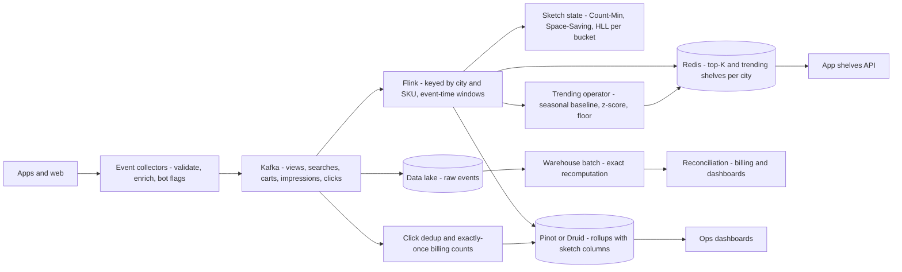
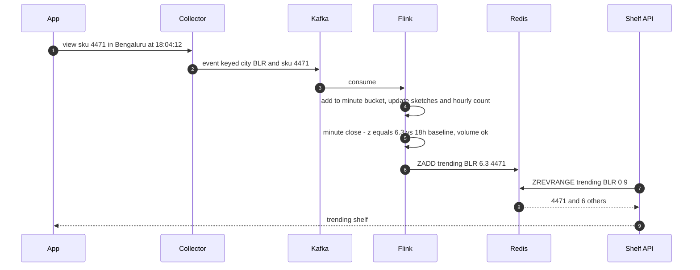
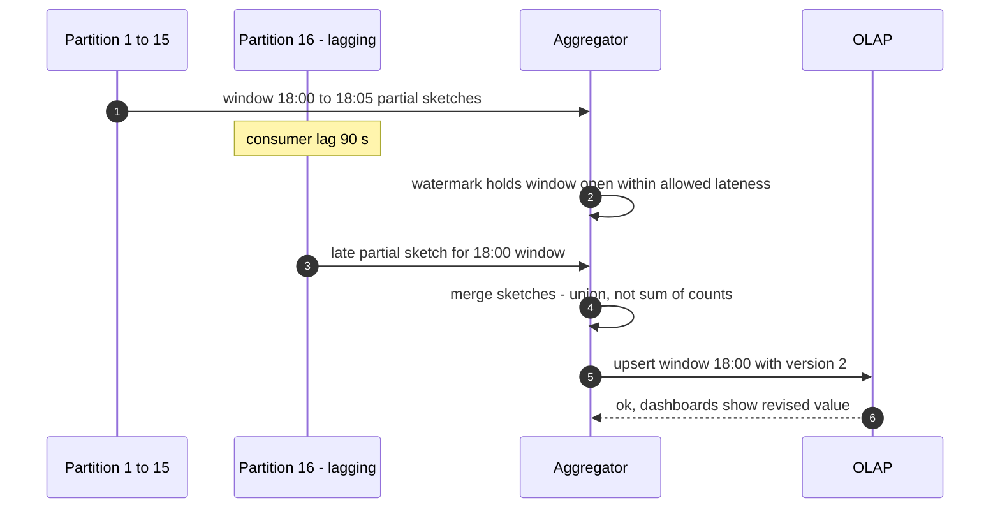
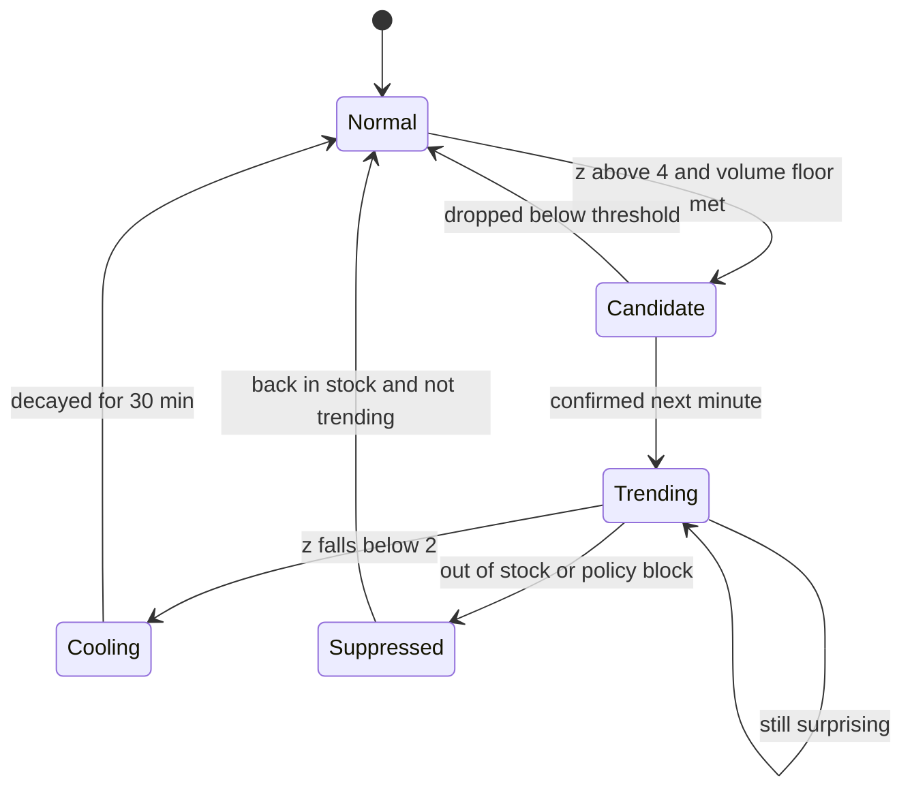

# 51. Case Study: Real-time Analytics & Top-K (Trending)

!!! abstract "Chapter at a glance"
    **Reader bands:** B2 → B4 · **Prerequisites:** [Ch 11](../02-distributed-core/11-partitioning-and-sharding.md) (scatter-gather top-K), [Ch 14](../02-distributed-core/14-messaging-and-event-streaming.md) (Kafka), [Ch 21](../03-production/21-data-at-scale.md) (event-time windows, watermarks, OLAP)

    **What you will build:** the live numbers behind the platform:

    - "top products right now" per city;
    - a "trending" shelf in the app;
    - live dashboards of orders, active customers and store load;
    - ad and promotion click counts that finance will reconcile.

    This is the classic "design top-K / trending / ad-click aggregation" interview question. [Ch 21](../03-production/21-data-at-scale.md) covered event-time windows and batch-vs-stream correctness. This chapter is about **counting at scale with bounded memory, merging partial answers correctly, and defining "trending"**.

    **What the labs measured:**

    - **L1: heavy hitters.** 20M views over 845k distinct SKUs:
        - An exact hash map needed ~64.5 MB of state.
        - **Count-Min + heap** found the true top-100 with **0.12%** count error in **2 MB**.
        - **Space-Saving** found it exactly in **47 KB**.
        - A 1% sample found 99/100 with 5% error.
    - **L2: merging across partitions.** 16 city partitions:
        - Merging local top-10s found only **6 of the true national top-10**, with 5 wrong counts.
        - **TPUT** (a three-phase threshold algorithm) was exact while sending **4,950** pairs instead of **1.51M** for a full shuffle.
    - **L3: unique counts (real Redis).** Daily active customers across 1,200 store-hour keys:
        - Exact sets: **366.7 MB**, and a **3.96 s** union.
        - HyperLogLog: **16.5 MB**, **24 ms**, **+0.51%** error.
        - Adding up per-key unique counts overstated the truth by **+316%**.
    - **L4: trending ≠ popular.**
        - The most-viewed shelf was 8% real trends.
        - Growth-ratio ranking was 5% real trends.
        - A seasonality-aware z-score with a volume floor was **92%** real trends, catching 31 of 40 injected trends with a **1-hour** median delay.

    · **Reading time:** 100 min + code

---

## 1. Introduction & Why It Matters

### 1.1 A story: the trending shelf that only sold milk

The first "Trending near you" shelf ran `SELECT sku, count(*) FROM views WHERE ts > now() - interval '1 hour' GROUP BY sku ORDER BY 2 DESC LIMIT 10` on the analytics replica every minute. It went wrong in several ways:

1. **It always showed milk, bread, onions, tomatoes and eggs.** They were popular, not trending. The mango-festival spike a marketing team had paid for never appeared.
2. **The query slowed down.** At 50k views per second, the hourly GROUP BY scanned 180M rows. It took 40 seconds, then 3 minutes, and then the replica fell behind.
3. **The rewrite split counting across 16 stream partitions, each keeping its own top-10, and merged them.** Items popular *everywhere but top nowhere* vanished. Finance noticed the numbers didn't match the warehouse.
4. **"Daily active customers" on the ops dashboard was the sum of hourly store-level uniques.** It said 6 million on a day the platform had 1.5 million customers.
5. **The fix for (2) switched to growth ratios.** The shelf filled with items that went from 1 view to 4.

Real-time analytics is **stream processing plus counting theory**: what you can count exactly, what you must approximate, what merges correctly, and what question you are actually asking.

!!! quote "The thesis of this chapter"
    **Count with sketches** when the key space is large. Heavy hitters (Count-Min, Space-Saving) and distinct counts (HyperLogLog) give bounded-memory answers with known error (L1, L3).

    **Partial answers must merge correctly.** Local top-K lists don't merge. Partition by the ranking key or use threshold algorithms (L2). Distinct counts don't add, but sketches merge (L3).

    **Define the question.** "Trending" is per-item anomaly detection against a seasonal baseline, with a volume floor, not "most views" (L4).

    **Serve** pre-aggregated rollups and sketches from a store built for it, and reconcile the streaming numbers with batch.

### 1.2 What we compute, and where

| Metric | Question | Freshness | Technique | Serving |
|---|---|---|---|---|
| Top products per city | Heavy hitters in a sliding hour | ~10 s | Space-Saving / Count-Min per city partition | Redis sorted sets |
| Trending shelf | Items surging vs their own baseline | ~1 min | Per-SKU seasonal baseline + z-score | Redis → app |
| Active customers | Distinct users per store/hour/day | ~1 min | HyperLogLog per store-hour, merged | Redis / OLAP |
| Orders & GMV dashboards | Sums by store, city, minute | ~5 s | Windowed aggregation, rollups | Pinot / Druid / ClickHouse |
| Ad and promo clicks | Exact counts for billing | Minutes, and exact | Dedup by click id, exactly-once sinks, batch reconcile | OLAP + warehouse |

### 1.3 Learning objectives

By the end you will be able to:

- **Find heavy hitters** with bounded memory and known error (L1).
- **Merge distributed partial aggregates** correctly (L2).
- **Count distinct users** at scale and roll counts up across dimensions (L3).
- **Detect trends** rather than popularity (L4).
- Design the streaming pipeline, OLAP serving, exactly-once counting for billing, and reconciliation.

---

## 2. Core Concepts — Beginner to Deep

### 2.1 Intuition: counting cars on a highway <span class="band b2">B2</span>

You can't write down every car's number plate to answer "which car models are most common today?", but you can keep tallies for the models you see most. "How many different cars passed?" can be estimated from the rarest patterns in the plates, without storing every plate. Tallies from two toll booths add up. Distinct cars across the two booths don't, because the same car passes both. And "unusual traffic" means more than normal for *this road at this hour*, not the busiest road. This chapter is those four ideas.

### 2.2 Requirements <span class="band b2">B2</span>

**Functional**

- Top-K products by views/orders per city and nationally, over sliding windows (5 min, 1 h, 24 h).
- Trending items per city, refreshed every minute.
- Distinct counts (active customers, unique viewers per product) by any combination of store, city and time range.
- Dashboards: orders, GMV, store load by minute; drill-down by dimension.
- Click and impression counts for sponsored listings, exact for billing.

**Non-functional**

- Ingest ~50k events/s (peaks 200k/s); dashboard freshness < 10 s.
- Query p99 < 200 ms for dashboards; < 20 ms for app-facing shelves (precomputed).
- Bounded memory per operator; horizontally scalable.
- Billing counts exact and reconciled daily.

### 2.3 Estimation <span class="band b2">B2</span>

| Quantity | Estimate |
|---|---|
| Events | ~4 billion/day (views, searches, adds-to-cart, impressions) ≈ 50k/s |
| Keys | 50k SKUs × 300 stores; 30M customers; ad impressions with click ids |
| Exact per-SKU-per-store counters | 15M counters per window: fine in a stream processor, heavy in a DB |
| Distinct users per store-hour as sets | 1,200 keys held 367 MB for one city-day in L3; days × cities → tens of GB |
| HLL per store-hour | ≤ 12 KB each; L3: 16.5 MB for the city-day |

### 2.4 Heavy hitters ⭐ <span class="band b3">B3</span>

L1 results:

| Method | Top-100 recall | Count error | State | Throughput |
|---|---|---|---|---|
| Exact hash map | 100% | 0% | ~64.5 MB (845k keys) | 6.8 M/s |
| **Count-Min 4×65,536 + heap** | 100% | 0.12% | **2.0 MB** | 9.8 M/s |
| **Space-Saving, 1,000 counters** | 100% | 0.00% | **47 KB** | 4.2 M/s |
| 1% sample × 100 | 99% | 5.05% | 4.0 MB | 84.6 M/s |

- **Count-Min sketch**:
    - *d* rows of *w* counters. Each event increments one counter per row, and the estimate is the minimum across rows.
    - It only **over-estimates**, by at most εN with probability 1−δ, for w = e/ε and d = ln(1/δ).
    - Pair it with a heap to track candidates.
    - It **merges** by adding counters, so partitions and time buckets combine.
- **Space-Saving / Misra–Gries**:
    - *k* counters. A new key replaces the smallest counter and inherits its count.
    - It guarantees any item with frequency > N/k is present, with error ≤ N/k.
    - Here N/k = 20,000, larger than item #100's count, so the guarantee is loose. On a skewed stream the real error was zero.
- **Sampling** is cheap and surprisingly good for the head of the distribution, but noisy near the cut-off. It is fine for dashboards and not for billing.
- **Sliding windows**: keep sketches per small bucket (e.g. 1 minute), and merge the last 60 for an hour. Count-Min merges exactly. Space-Saving merges approximately.

### 2.5 Merging partial answers ⭐ <span class="band b3">B3</span>

Counting is partitioned (Kafka partitions, cities, shards), so the global answer is a merge. L2:

| Method | True top-10 found | Wrong counts | Pairs sent |
|---|---|---|---|
| Merge local top-10s | 6/10 | 5/10 | 160 |
| Merge local top-100s | 10/10 | 0/10 | 1,600 |
| **TPUT (three-phase threshold)** | 10/10 | 0/10 | 4,950 |
| Shuffle all counts by product | 10/10 | 0/10 | 1,509,929 |

- **Local top-K lists don't merge.** An item can be high in every partition without being top in any, and partitions that didn't list it contribute zero to its count.
- **Asking for more (c·K)** often works but carries no guarantee.
- **TPUT** is exact:
    1. Collect local top-K lists and use them to set a lower bound τ.
    2. Fetch every item with a local count ≥ τ/m.
    3. Get exact counts for the survivors.
- **Partition by the ranking key** (shuffle by SKU) when you can. Then each SKU is counted in one place, and the global top-K is a merge of disjoint local top-Ks. That merge is exact.
- **Sketches that add** (Count-Min, HLL) merge exactly by construction. This is one reason to prefer them for distributed pipelines.

### 2.6 Distinct counts ⭐ <span class="band b3">B3</span>

L3, on a real Redis:

| | Exact SETs | HyperLogLog |
|---|---|---|
| Memory (1,200 store-hour keys) | 366.7 MB | **16.5 MB** |
| Load (6.75M events, pipelined) | 18.2 s | 8.3 s |
| One store-hour | exact | −0.60% |
| City, whole day | exact, **3,956 ms** (SUNIONSTORE) | **+0.51%, 24.3 ms** (PFCOUNT over 1,200 keys) |
| Sum of per-key uniques | **+316%** | +316% |

- **Distinct counts don't add.** The same customer appears in many store-hours. This is a very common dashboard bug.
- **HLL** estimates cardinality from the maximum run of leading zeros in hashed values, in registers (Redis: 16,384 registers, ~0.81% standard error, ≤ 12 KB, sparse for small sets). Crucially, **merging sketches = the sketch of the union**. Store HLLs at the finest grain (store × hour) and roll up to any combination.
- **Where HLL isn't enough**:
    - Intersections ("customers who visited both stores") are inaccurate via inclusion–exclusion. Use Theta sketches (Apache DataSketches).
    - Exact billing counts need exact dedup.
- **OLAP stores** support these natively: Druid, Pinot and ClickHouse all have HLL or Theta sketch columns. Store sketches in rollups, not counts.

### 2.7 Trending ⭐ <span class="band b4">B4</span>

L4, with 40 injected trends and a 10-slot shelf every hour for a week:

| Detector | Precision (slots) | Recall (trends) | Median delay |
|---|---|---|---|
| Most views last hour | 8% | 20/40 | 0 h |
| Growth vs same hour yesterday | 5% | 25/40 | 2 h |
| z-score vs seasonal baseline | 14% | 39/40 | 1 h |
| **+ volume floor (μ ≥ 2/h) and z > 4** | **92%** | 31/40 | 1 h |

- **Popularity ≠ trend.** The most-viewed list is the same staples every hour.
- **Growth ratios reward noise** in the long tail (0 → 3 is "4×").
- **The surprise score** compares an item with its own expected level for this hour of day, scaled by Poisson noise (√μ). It finds real surges anywhere in the catalogue.
- **A floor and a threshold** make the shelf trustworthy. Almost all the misses were SKUs expecting under 2 views/hour, which is too small to separate from noise within hours. A shelf that shows fewer than 10 items is fine; a shelf of noise is not.
- **Production additions**:
    - Decay, so trends fade.
    - Per-city baselines.
    - Suppressing items that are out of stock, or not allowed on the shelf (alcohol rules, recalls).
    - Bot filtering, because fake views create fake trends.
    - Editorial overrides.

### 2.8 The streaming pipeline <span class="band b3">B3</span>

- **Ingest**: apps → collectors → Kafka (keyed by the aggregation key where possible, e.g. `city:sku` for top-K). Schema-managed events ([Ch 28](../03-production/28-schema-and-data-evolution.md)).
- **Process**: Flink or Kafka Streams with event-time windows, watermarks and allowed lateness ([Ch 21](../03-production/21-data-at-scale.md)). Keyed state holds sketches per key and bucket. Checkpoints give exactly-once state.
- **Serve**:
    - App-facing shelves are **precomputed** into Redis (a sorted set per city).
    - Dashboards use an OLAP store (Pinot/Druid/ClickHouse) with rollups and sketch columns.
    - Nothing app-facing runs ad-hoc aggregation.
- **Lambda vs Kappa**: streaming gives fresh approximate numbers; batch (the warehouse) gives the reconciled truth. Many teams run both, and label the dashboards "live (approx.)" vs "final".

### 2.9 Exactly-once counts for billing <span class="band b4">B4</span>

Sponsored-listing clicks are billed to brands, so they must be exact:

- **Dedup** by click id (the client generates a UUID; the server signs impression ids) in a keyed state with a TTL longer than the maximum lateness.
- **Filter bots and fraud** (rate, device and pattern checks) before counting. Publish the rules.
- **Exactly-once sinks**: transactional writes (Kafka transactions, idempotent upserts keyed by window and campaign).
- **Reconcile** daily against the batch recomputation from raw logs, with any difference explained ([Ch 45](45-payment-system.md) reconciliation style).

### 2.10 Interview framing <span class="band b4">B4</span>

"Design a system to show the top-K most viewed products / trending items / count ad clicks." Clarify:

- window;
- exact vs approximate;
- freshness;
- per-dimension breakdowns.

Then cover:

- partitioning by key;
- sketches (Count-Min, Space-Saving, HLL) and their errors;
- window mechanics;
- precomputed serving;
- merge correctness;
- reconciliation.

Staff-level signals: saying "local top-K doesn't merge" and "distinct counts don't add", and defining trending as a baseline anomaly.

---

## 3. Architecture & Diagrams

### 3.1 Component view



### 3.2 Sequence: happy path, a view becomes part of the trending shelf



### 3.3 Sequence: failure path, a late partition and a bad merge avoided



### 3.4 State: a SKU on the trending shelf



---

## 4. Design Document Excerpt: Live Analytics v2

!!! note "Design Document (excerpt) — Live Analytics v2: sketches, merges and trending"
    **Status:** Accepted · **Authors:** Data platform team · **Reviewers:** Growth, Ads, Finance, SRE

    | Field | Value |
    |---|---|
    | Context | The replica GROUP BY couldn't keep up. Merging local top-10s lost items. Dashboards summed distinct counts. The trending shelf showed staples, then noise. |
    | Decision | Flink keyed by (city, SKU) for exact per-city counts. Space-Saving and Count-Min for national and long-window heavy hitters. HLL per store-hour as the only distinct-count primitive. Trending as a seasonal z-score with a volume floor. Shelves precomputed in Redis. Pinot for dashboards with sketch columns. Billing clicks exactly-once and reconciled. |
    | Related ADRs | **ADR-370:** partition by the ranking key; national top-K merges disjoint per-key results. TPUT where re-keying isn't possible (L2). **ADR-371:** sketches per 1-minute bucket, merged for windows (L1). **ADR-372:** distinct counts only via HLL/Theta sketches; summing uniques is blocked in the semantic layer (L3). **ADR-373:** trending: EWMA baseline per SKU × hour-of-day × city, z > 4, μ ≥ 2/h, confirm for 2 minutes, decay 30 min (L4). **ADR-374:** click billing: dedup by signed click id, exactly-once sink, daily reconciliation. |

    **Requirements.**

    - **R1:** Top-K per city within 10 s. National top-100 recall ≥ 99% vs batch.
    - **R2:** Distinct counts within 2% of exact for any store/city/time combination.
    - **R3:** Trending shelf precision ≥ 85% in offline replays with labelled events.
    - **R4:** Billing counts match batch recomputation exactly, or the difference is explained, daily.
    - **R5:** Dashboard queries p99 < 200 ms.

    **Decisions in detail.**

    1. **Keys (ADR-370):** Kafka topic `analytics.view.v1` keyed by `city:sku`. The national rollup consumes per-city top-1000 lists and exact counts for the candidates.
    2. **Windows (ADR-371):** 1-minute tumbling buckets with 2-minute allowed lateness. Sliding hours are merged from the buckets.
    3. **Sketches (ADR-372):** HLL precision 14 (Redis default). Theta sketches where intersections are needed (campaign overlap).
    4. **Trending (ADR-373):** Baselines are checkpointed with Flink state, and a new SKU starts with its category's mean. The trending list is suppressed for out-of-stock SKUs via the inventory stream.
    5. **Billing (ADR-374):** click ids are signed by the ad server, kept in a 24 h dedup state, and written via transactional Kafka → Pinot upsert.

    **Consequences.**

    - We accept approximate numbers on dashboards (labelled), more state in the stream processor, and baseline tuning per city.
    - In return we get bounded memory, correct merges, honest distinct counts, a useful trending shelf, and billing that finance trusts.

---

## 5. Hands-On Code — Level Ladder

!!! info "What's real here"
    - **L1 and L2** are real algorithms run over synthetic streams, with measured throughput.
    - **L3** runs against a **real Redis 7**: SADD/SUNIONSTORE vs PFADD/PFCOUNT, with memory read from `INFO memory`.
    - **L4** is a deterministic simulation with injected trends. Popularity, seasonality and trend shapes are stated assumptions.
    - Timings vary by machine.

L3 needs Redis 7 on port 6390. Run L1 and L3 with `-Xmx3g`, and every lab with `-Dstdout.encoding=UTF-8`.

### L1 — Heavy hitters with bounded memory <span class="band b2">B2</span>

**Requirement:** "Know the 100 most-viewed products without keeping a counter for every product ever viewed."

20M Zipf-distributed views, counted four ways.

```java title="HeavyHittersL1.java"
// HeavyHittersL1.java — run with: java -Xmx2g HeavyHittersL1.java   (JDK 21, no dependencies)
// "WHAT ARE THE 100 MOST-VIEWED PRODUCTS RIGHT NOW?" 20,000,000 product-view events over 1,000,000 SKUs, Zipf-distributed
// (s = 1.05, fixed seed) — a few staples get most views, a long tail gets a handful. One counting node, four methods:
//   H1 exact: a hash map of every SKU's count
//   H2 Count-Min sketch (4 rows × 65,536 counters) + a 100-entry heap of candidates by estimated count
//   H3 Space-Saving with 1,000 counters (when full, the smallest counter is evicted and its count inherited)
//   H4 1% sampling, counts scaled × 100
// Measured: recall of the true top-100, mean relative error of the reported counts for those items, memory for the
// counting state, and real throughput.
import java.util.*;

public class HeavyHittersL1 {
    static final int SKUS = 1_000_000, EVENTS = 20_000_000, K = 100;

    public static void main(String[] args) {
        double[] cdf = new double[SKUS]; double sum = 0;
        for (int i = 0; i < SKUS; i++) { sum += 1 / Math.pow(i + 1, 1.05); cdf[i] = sum; }
        for (int i = 0; i < SKUS; i++) cdf[i] /= sum;
        int[] perm = new int[SKUS]; for (int i = 0; i < SKUS; i++) perm[i] = i;
        Random r = new Random(51); for (int i = SKUS - 1; i > 0; i--) { int j = r.nextInt(i + 1); int t = perm[i]; perm[i] = perm[j]; perm[j] = t; }   // popular SKUs get random ids
        int[] stream = new int[EVENTS];
        for (int e = 0; e < EVENTS; e++) { int k = Arrays.binarySearch(cdf, r.nextDouble()); if (k < 0) k = -k - 1; stream[e] = perm[Math.min(k, SKUS - 1)]; }
        // ground truth
        int[] truth = new int[SKUS]; for (int s : stream) truth[s]++;
        Integer[] ids = new Integer[SKUS]; for (int i = 0; i < SKUS; i++) ids[i] = i;
        Arrays.sort(ids, (a, b) -> Integer.compare(truth[b], truth[a]));
        Set<Integer> top = new HashSet<>(); for (int i = 0; i < K; i++) top.add(ids[i]);
        int distinct = 0; for (int c : truth) if (c > 0) distinct++;
        System.out.printf("%,d events, %,d distinct SKUs seen; the top-100 hold %.1f%% of views; #100 has %,d views, #101 has %,d.%n%n",
                EVENTS, distinct, 100.0 * Arrays.stream(ids, 0, K).mapToLong(i -> truth[i]).sum() / EVENTS, truth[ids[K - 1]], truth[ids[K]]);
        System.out.printf("   %-52s %12s %16s %14s %14s%n", "method", "top-100", "count error", "state size", "throughput");
        System.out.printf("   %-52s %12s %16s %14s %14s%n", "", "recall", "(mean, top-100)", "", "(M events/s)");
        for (int m = 0; m < 4; m++) {
            long t0 = System.nanoTime(); Map<Integer, Long> est; long bytes;
            switch (m) {
                case 0 -> { HashMap<Integer, Long> h = new HashMap<>(); for (int s : stream) h.merge(s, 1L, Long::sum); est = topOf(h); bytes = (long) h.size() * 80; }  // ~80 B per boxed entry
                case 1 -> { CountMin cm = new CountMin(4, 1 << 16); TopHeap th = new TopHeap(K); for (int s : stream) { long e = cm.add(s); th.offer(s, e); } est = th.map(); bytes = 4L * (1 << 16) * 8 + K * 48; }
                case 2 -> { SpaceSaving ss = new SpaceSaving(1000); for (int s : stream) ss.add(s); est = ss.top(K); bytes = 1000L * 48; }
                default -> { HashMap<Integer, Long> h = new HashMap<>(); Random sr = new Random(7); for (int s : stream) if (sr.nextInt(100) == 0) h.merge(s, 100L, Long::sum); est = topOf(h); bytes = (long) h.size() * 80; }
            }
            double secs = (System.nanoTime() - t0) / 1e9;
            int hit = 0; double err = 0; for (int id : top) { if (est.containsKey(id)) hit++; }
            for (int i = 0; i < K; i++) { int id = ids[i]; long e = m == 1 ? est.getOrDefault(id, 0L) : est.getOrDefault(id, 0L); err += Math.abs(e - truth[id]) / (double) truth[id]; }
            String[] names = {"H1) exact hash map of every SKU", "H2) Count-Min 4×65,536 + top-100 heap", "H3) Space-Saving, 1,000 counters", "H4) 1% sample × 100"};
            System.out.printf("   %-52s %11d%% %15.2f%% %14s %14.1f%n", names[m], hit, 100 * err / K, human(bytes), EVENTS / secs / 1e6);
        }
        System.out.println("\n   → exact counting needs state for every distinct key ever seen in the window (state size for H1 is an estimate:");
        System.out.println("     ~80 bytes per boxed map entry). Sketches keep a small, fixed state: Count-Min only over-estimates (collisions");
        System.out.println("     add), and Space-Saving keeps just the candidates that could be heavy. On a skewed stream like this both find");
        System.out.println("     the true top-100 exactly or nearly so — heavy hitters sit far above the noise. Their errors live in the tail,");
        System.out.println("     where Space-Saving's bound is N/1,000 = 20,000 views, larger than item #100's whole count. Sampling is the");
        System.out.println("     fastest but noisy near the cut. (An item missing from a method's list counts as 100% error.)");
    }

    static Map<Integer, Long> topOf(Map<Integer, Long> h) {
        return h.entrySet().stream().sorted(Map.Entry.<Integer, Long>comparingByValue().reversed()).limit(K).collect(HashMap::new, (m, e) -> m.put(e.getKey(), e.getValue()), HashMap::putAll);
    }
    static String human(long b) { return b >= 1 << 20 ? String.format("%.1f MB", b / 1048576.0) : String.format("%.0f KB", b / 1024.0); }

    static final class CountMin {
        final long[][] t; final int w; final int[] seeds;
        CountMin(int d, int w) { this.w = w; t = new long[d][w]; seeds = new int[d]; Random r = new Random(99); for (int i = 0; i < d; i++) seeds[i] = r.nextInt() | 1; }
        long add(int key) { long min = Long.MAX_VALUE; for (int i = 0; i < t.length; i++) { int h = mix(key * seeds[i] + i) & (w - 1); long v = ++t[i][h]; if (v < min) min = v; } return min; }
        static int mix(int x) { x ^= x >>> 16; x *= 0x7feb352d; x ^= x >>> 15; x *= 0x846ca68b; x ^= x >>> 16; return x; }
    }
    // indexed min-heap keyed by count, size-bounded: holds the K largest estimates seen
    static final class TopHeap {
        final int cap; final int[] key; final long[] val; int n; final HashMap<Integer, Integer> pos = new HashMap<>();
        TopHeap(int cap) { this.cap = cap; key = new int[cap]; val = new long[cap]; }
        void offer(int k, long v) {
            Integer p = pos.get(k);
            if (p != null) { val[p] = v; down(p); return; }
            if (n < cap) { key[n] = k; val[n] = v; pos.put(k, n); up(n++); return; }
            if (v > val[0]) { pos.remove(key[0]); key[0] = k; val[0] = v; pos.put(k, 0); down(0); }
        }
        void up(int i) { while (i > 0) { int p = (i - 1) / 2; if (val[p] <= val[i]) break; swap(i, p); i = p; } }
        void down(int i) { while (true) { int l = 2 * i + 1, rr = l + 1, m = i; if (l < n && val[l] < val[m]) m = l; if (rr < n && val[rr] < val[m]) m = rr; if (m == i) return; swap(i, m); i = m; } }
        void swap(int a, int b) { int k = key[a]; key[a] = key[b]; key[b] = k; long v = val[a]; val[a] = val[b]; val[b] = v; pos.put(key[a], a); pos.put(key[b], b); }
        Map<Integer, Long> map() { Map<Integer, Long> m = new HashMap<>(); for (int i = 0; i < n; i++) m.put(key[i], val[i]); return m; }
    }
    static final class SpaceSaving {
        final TopHeap h;                                                                        // reuse: min-heap of counters
        SpaceSaving(int k) { h = new TopHeap(k); }
        void add(int key) {
            Integer p = h.pos.get(key);
            if (p != null) { h.val[p]++; h.down(p); return; }
            if (h.n < h.cap) { h.key[h.n] = key; h.val[h.n] = 1; h.pos.put(key, h.n); h.up(h.n++); return; }
            h.pos.remove(h.key[0]); h.key[0] = key; h.val[0] = h.val[0] + 1; h.pos.put(key, 0); h.down(0);   // evict min, inherit its count
        }
        Map<Integer, Long> top(int k) { return topOf(h.map()); }
    }
}
```

```text title="java -Xmx3g -Dstdout.encoding=UTF-8 HeavyHittersL1.java"
20,000,000 events, 845,461 distinct SKUs seen; the top-100 hold 44.5% of views; #100 has 15,104 views, #101 has 14,743.

   method                                                    top-100      count error     state size     throughput
                                                              recall  (mean, top-100)                  (M events/s)
   H1) exact hash map of every SKU                              100%            0.00%        64.5 MB            6.8
   H2) Count-Min 4×65,536 + top-100 heap                        100%            0.12%         2.0 MB            9.8
   H3) Space-Saving, 1,000 counters                             100%            0.00%          47 KB            4.2
   H4) 1% sample × 100                                           99%            5.05%         4.0 MB           84.6

   → exact counting needs state for every distinct key ever seen in the window (state size for H1 is an estimate:
     ~80 bytes per boxed map entry). Sketches keep a small, fixed state: Count-Min only over-estimates (collisions
     add), and Space-Saving keeps just the candidates that could be heavy. On a skewed stream like this both find
     the true top-100 exactly or nearly so — heavy hitters sit far above the noise. Their errors live in the tail,
     where Space-Saving's bound is N/1,000 = 20,000 views, larger than item #100's whole count. Sampling is the
     fastest but noisy near the cut. (An item missing from a method's list counts as 100% error.)
```

**Reading it:**

- **The sketches match the exact answer on the head.** Count-Min uses 1/30th of the memory, and Space-Saving 1/1,400th.
- **The top-100 cut is tight** (15,104 views vs 14,743), yet both sketches found it exactly.
- **Sampling** misses one item near the cut and is about 5% off on counts. That is fine for a dashboard and not for billing.
- **Throughput** in this single-threaded lab is dominated by map lookups. The sampler is fastest because it skips 99% of events.

### L2 — Merging top-K across partitions <span class="band b3">B3</span>

**Requirement:** "National top-10 from 16 city partitions, exact, without shipping every count."

Cities share national tastes but each has local favourites.

```java title="MergeTopKL2.java"
// MergeTopKL2.java — run with: java MergeTopKL2.java   (JDK 21, no dependencies)
// "TOP-10 PRODUCTS ACROSS THE COUNTRY" when the counting is spread over 16 partitions. Views are partitioned by city
// (16 cities, 8,000,000 events, fixed seed): every city likes the national staples, but each also has local favourites
// (a regional atta brand, a local sweet), so local rankings differ from the national one. Four ways to get the answer:
//   M1 each partition sends its local top-10; the coordinator adds them up and ranks
//   M2 each partition sends its local top-100 (10× K)
//   M3 TPUT (three-phase uniform threshold): phase 1 local top-10 → a lower bound τ for the national #10; phase 2 each
//      partition sends every item with local count ≥ τ / 16; phase 3 fetch exact counts for the survivors — exact
//   M4 re-partition by product (shuffle every (product, count) pair to the product's owner) and count exactly
// Measured: how many of the true top-10 are reported, how many reported counts are wrong, and (product, count) pairs
// sent over the network.
import java.util.*;

public class MergeTopKL2 {
    static final int P = 16, SKUS = 200_000, EVENTS = 8_000_000, K = 10;

    public static void main(String[] args) {
        Random r = new Random(51);
        double[] w = new double[SKUS]; double sw = 0; for (int i = 0; i < SKUS; i++) { w[i] = 1 / Math.pow(i + 1, 1.0); sw += w[i]; }
        int[][] counts = new int[P][SKUS];
        for (int p = 0; p < P; p++) {
            int[] local = new int[SKUS]; for (int i = 0; i < SKUS; i++) local[i] = i;                  // city-specific favourites
            for (int i = SKUS - 1; i > 0; i--) { int j = r.nextInt(i + 1); int t = local[i]; local[i] = local[j]; local[j] = t; }
            double[] cdf = new double[SKUS]; double acc = 0; for (int i = 0; i < SKUS; i++) { acc += w[i] / sw; cdf[i] = acc; }
            for (int e = 0; e < EVENTS / P; e++) {
                int k = Arrays.binarySearch(cdf, r.nextDouble()); if (k < 0) k = -k - 1; k = Math.min(k, SKUS - 1);
                counts[p][r.nextDouble() < 0.55 ? k : local[k]]++;                                       // 55% national taste, 45% local
            }
        }
        long[] total = new long[SKUS]; for (int p = 0; p < P; p++) for (int i = 0; i < SKUS; i++) total[i] += counts[p][i];
        Integer[] ids = new Integer[SKUS]; for (int i = 0; i < SKUS; i++) ids[i] = i; Arrays.sort(ids, (a, b) -> Long.compare(total[b], total[a]));
        Set<Integer> truth = new HashSet<>(Arrays.asList(ids).subList(0, K));
        System.out.printf("%,d events in 16 city partitions; national #10 has %,d views, #11 has %,d.%n%n", EVENTS, total[ids[K - 1]], total[ids[K]]);
        System.out.printf("   %-56s %12s %16s %16s%n", "method", "true top-10", "reported counts", "pairs sent");
        System.out.printf("   %-56s %12s %16s %16s%n", "", "found", "wrong", "");
        String[] names = {"M1) merge each partition's local top-10", "M2) merge each partition's local top-100", "M3) TPUT three-phase threshold (exact)", "M4) shuffle all counts by product (exact)"};
        for (int m = 0; m < 4; m++) {
            Map<Integer, Long> agg = new HashMap<>(); long sent = 0;
            if (m <= 1) {
                int kk = m == 0 ? K : 10 * K;
                for (int p = 0; p < P; p++) for (int id : localTop(counts[p], kk)) { agg.merge(id, (long) counts[p][id], Long::sum); sent++; }
            } else if (m == 2) {
                Map<Integer, Long> partial = new HashMap<>();
                for (int p = 0; p < P; p++) for (int id : localTop(counts[p], K)) { partial.merge(id, (long) counts[p][id], Long::sum); sent++; }
                long tau = partial.values().stream().sorted(Comparator.reverseOrder()).skip(K - 1).findFirst().orElse(0L);   // lower bound on national #10
                Set<Integer> cand = new HashSet<>(); Map<Integer, Long> upper = new HashMap<>();
                for (int p = 0; p < P; p++) for (int i = 0; i < SKUS; i++) if (counts[p][i] >= tau / (double) P) { cand.add(i); sent++; }
                for (int id : cand) { long c = 0; for (int p = 0; p < P; p++) c += counts[p][id]; agg.put(id, c); }
                sent += (long) cand.size() * P;                                                        // phase 3: exact fetch
            } else {
                for (int p = 0; p < P; p++) for (int i = 0; i < SKUS; i++) if (counts[p][i] > 0) { agg.merge(i, (long) counts[p][i], Long::sum); sent++; }
            }
            List<Map.Entry<Integer, Long>> top = agg.entrySet().stream().sorted(Map.Entry.<Integer, Long>comparingByValue().reversed()).limit(K).toList();
            int found = 0, wrong = 0; for (var e : top) { if (truth.contains(e.getKey())) found++; if (e.getValue() != total[e.getKey()]) wrong++; }
            System.out.printf("   %-56s %9d/10 %13d/10 %,16d%n", names[m], found, wrong, sent);
        }
        System.out.println("\n   → an item that is, say, #12 in every city can be near the top nationally, yet appears in nobody's local top-10.");
        System.out.println("     Merging local top lists misses such items (4 of the true 10 here) and under-counts the ones it does report,");
        System.out.println("     because partitions that didn't list an item contribute nothing for it. Asking each partition for 10× K happened");
        System.out.println("     to be exact on this data, but carries no guarantee. A threshold algorithm (TPUT) is provably exact and ships");
        System.out.println("     ~300x less than a full shuffle. Or partition by the key you rank on, so each product is counted in one place.");
    }

    static int[] localTop(int[] c, int k) {
        PriorityQueue<Integer> pq = new PriorityQueue<>(Comparator.comparingInt(i -> c[i]));
        for (int i = 0; i < c.length; i++) { if (pq.size() < k) pq.add(i); else if (c[i] > c[pq.peek()]) { pq.poll(); pq.add(i); } }
        return pq.stream().mapToInt(Integer::intValue).toArray();
    }
}
```

```text title="java -Dstdout.encoding=UTF-8 MergeTopKL2.java"
8,000,000 events in 16 city partitions; national #10 has 34,374 views, #11 has 31,562.

   method                                                    true top-10  reported counts       pairs sent
                                                                   found            wrong                 
   M1) merge each partition's local top-10                          6/10             5/10              160
   M2) merge each partition's local top-100                        10/10             0/10            1,600
   M3) TPUT three-phase threshold (exact)                          10/10             0/10            4,950
   M4) shuffle all counts by product (exact)                       10/10             0/10        1,509,929

   → an item that is, say, #12 in every city can be near the top nationally, yet appears in nobody's local top-10.
     Merging local top lists misses such items (4 of the true 10 here) and under-counts the ones it does report,
     because partitions that didn't list an item contribute nothing for it. Asking each partition for 10× K happened
     to be exact on this data, but carries no guarantee. A threshold algorithm (TPUT) is provably exact and ships
     ~300x less than a full shuffle. Or partition by the key you rank on, so each product is counted in one place.
```

**Reading it:**

- **Merging local top-10s** misses 4 of the true top-10 and gets half the counts wrong.
- **Local top-100s** happened to work here, with no guarantee.
- **TPUT** is exact at 4,950 pairs, about 300x less than shuffling everything.
- **In production, key by SKU** so the problem disappears. Use TPUT where you can't.

### L3 — Unique customers: sets vs HyperLogLog <span class="band b3">B3</span>

**Requirement:** "Daily active customers for any combination of stores and hours, on a dashboard, in milliseconds."

6.75M app opens written to a real Redis as exact sets and as HLLs.

```java title="UniquesL3.java"
// UniquesL3.java — run with (Redis 7 on :6390): java UniquesL3.java   (JDK 21, no dependencies)
// "HOW MANY DIFFERENT CUSTOMERS OPENED THE APP TODAY — PER STORE, PER HOUR, AND CITY-WIDE?" 1,500,000 customers, 50
// dark stores, 24 hours (fixed seed). Each customer has a home store (90% of visits) and opens the app 1–8 times at
// random hours: ~6.8M events. Written to a REAL Redis two ways, 1,200 keys each (store × hour):
//   exact: a SET of customer ids per key (SADD)
//   HyperLogLog: PFADD per key (≈0.81% standard error, ≤12 KB per key)
// Then three questions: uniques for one store-hour, uniques for the whole city today, and the tempting shortcut of
// adding up the per-store-hour unique counts.
// Measured: Redis memory, real query time, and the answers against the exact truth.
import java.io.*;
import java.net.Socket;
import java.nio.charset.StandardCharsets;
import java.util.*;

public class UniquesL3 {
    public static void main(String[] args) throws Exception {
        Random r = new Random(51); int customers = 1_500_000, stores = 50;
        List<int[]> events = new ArrayList<>();                                                  // {customer, store, hour}
        for (int c = 0; c < customers; c++) { int home = r.nextInt(stores), n = 1 + r.nextInt(8);
            for (int k = 0; k < n; k++) events.add(new int[]{c, r.nextDouble() < 0.9 ? home : r.nextInt(stores), r.nextInt(24)}); }
        Set<Integer> dayTruth = new HashSet<>(); Map<String, Set<Integer>> keyTruth = new HashMap<>();
        for (int[] e : events) { dayTruth.add(e[0]); keyTruth.computeIfAbsent(e[1] + ":" + e[2], k -> new HashSet<>()).add(e[0]); }
        long sumOfKeys = keyTruth.values().stream().mapToLong(Set::size).sum();
        System.out.printf("%,d events from %,d customers across 50 stores × 24 hours (1,200 keys).%n%n", events.size(), dayTruth.size());
        try (Redis red = new Redis()) {
            red.cmd("FLUSHALL");
            for (String kind : new String[]{"set", "hll"}) {
                long m0 = usedMemory(red); long t0 = System.nanoTime(); List<String[]> batch = new ArrayList<>();
                for (int[] e : events) { String key = kind + ":" + e[1] + ":" + e[2];
                    batch.add(kind.equals("set") ? new String[]{"SADD", key, String.valueOf(e[0])} : new String[]{"PFADD", key, String.valueOf(e[0])});
                    if (batch.size() == 2000) { red.pipeline(batch); batch.clear(); } }
                red.pipeline(batch);
                double loadS = (System.nanoTime() - t0) / 1e9; long mem = usedMemory(red) - m0;
                String[] keys = new String[1200]; int i = 0; for (int s = 0; s < stores; s++) for (int h = 0; h < 24; h++) keys[i++] = kind + ":" + s + ":" + h;
                // one store-hour
                long tq = System.nanoTime(); long one = (Long) red.cmd(kind.equals("set") ? "SCARD" : "PFCOUNT", kind + ":17:19"); double oneMs = (System.nanoTime() - tq) / 1e6;
                // city-wide day
                tq = System.nanoTime(); long day;
                if (kind.equals("set")) { String[] c = new String[keys.length + 2]; c[0] = "SUNIONSTORE"; c[1] = "tmp:day"; System.arraycopy(keys, 0, c, 2, keys.length); day = (Long) red.cmd(c); red.cmd("DEL", "tmp:day"); }
                else { String[] c = new String[keys.length + 1]; c[0] = "PFCOUNT"; System.arraycopy(keys, 0, c, 1, keys.length); day = (Long) red.cmd(c); }
                double dayMs = (System.nanoTime() - tq) / 1e6;
                // tempting shortcut: sum per-key counts
                long sum = 0; for (String k : keys) sum += (Long) red.cmd(kind.equals("set") ? "SCARD" : "PFCOUNT", k);
                long trueOne = keyTruth.get("17:19").size();
                System.out.printf("   %s (%s)%n", kind.equals("set") ? "EXACT SETS" : "HYPERLOGLOG", kind.equals("set") ? "SADD / SCARD / SUNIONSTORE" : "PFADD / PFCOUNT over 1,200 keys");
                System.out.printf("      memory in Redis %12s   load %5.1f s%n", String.format("%.1f MB", mem / 1048576.0), loadS);
                System.out.printf("      store 17, 19:00  %,10d (truth %,d, %+.2f%%) in %.2f ms%n", one, trueOne, 100.0 * (one - trueOne) / trueOne, oneMs);
                System.out.printf("      city, today      %,10d (truth %,d, %+.2f%%) in %.1f ms%n", day, dayTruth.size(), 100.0 * (day - dayTruth.size()) / dayTruth.size(), dayMs);
                System.out.printf("      sum of the 1,200 per-store-hour counts: %,d (%+.0f%% vs truth) ← not a unique count%n%n", sum, 100.0 * (sum - dayTruth.size()) / dayTruth.size());
            }
            red.cmd("FLUSHALL");
        }
        System.out.println("   → distinct counts don't add: the same customer appears in many store-hours, so summing them counts people");
        System.out.println("     several times over. Exact sets answer correctly but hold every id in every key and must union big sets at");
        System.out.println("     query time. HyperLogLog keeps a small fixed-size sketch per key and MERGES correctly (the union of sketches");
        System.out.println("     is the sketch of the union), so hourly per-store sketches roll up to any store set and any time range, with");
        System.out.println("     about 1% error. Pre-aggregate sketches, not counts.");
    }

    static long usedMemory(Redis r) throws IOException {
        String info = (String) r.cmd("INFO", "memory");
        for (String line : info.split("\r\n")) if (line.startsWith("used_memory:")) return Long.parseLong(line.substring(12));
        return 0;
    }

    static final class Redis implements Closeable {
        final Socket s; final OutputStream out; final InputStream in;
        Redis() throws IOException { s = new Socket("127.0.0.1", 6390); s.setTcpNoDelay(true); out = new BufferedOutputStream(s.getOutputStream(), 1 << 16); in = new BufferedInputStream(s.getInputStream(), 1 << 16); }
        void write(String... parts) throws IOException { StringBuilder sb = new StringBuilder("*").append(parts.length).append("\r\n"); for (String p : parts) { byte[] b = p.getBytes(StandardCharsets.UTF_8); sb.append('$').append(b.length).append("\r\n").append(p).append("\r\n"); } out.write(sb.toString().getBytes(StandardCharsets.UTF_8)); }
        Object cmd(String... parts) throws IOException { write(parts); out.flush(); return read(); }
        void pipeline(List<String[]> cmds) throws IOException { for (String[] c : cmds) write(c); out.flush(); for (int i = 0; i < cmds.size(); i++) read(); }
        Object read() throws IOException {
            int type = in.read(); String line = line();
            return switch (type) {
                case '+' -> line; case ':' -> Long.parseLong(line);
                case '$' -> { int n = Integer.parseInt(line); if (n < 0) yield null; byte[] b = in.readNBytes(n); line(); yield new String(b, StandardCharsets.UTF_8); }
                case '*' -> { int n = Integer.parseInt(line); List<Object> l = new ArrayList<>(); for (int i = 0; i < n; i++) l.add(read()); yield l; }
                case '-' -> throw new IOException(line);
                default -> throw new IOException("unexpected " + (char) type);
            };
        }
        String line() throws IOException { StringBuilder sb = new StringBuilder(); int c; while ((c = in.read()) != '\r') sb.append((char) c); in.read(); return sb.toString(); }
        public void close() throws IOException { s.close(); }
    }
}
```

```text title="java -Xmx3g -Dstdout.encoding=UTF-8 UniquesL3.java"
6,749,510 events from 1,500,000 customers across 50 stores × 24 hours (1,200 keys).

   EXACT SETS (SADD / SCARD / SUNIONSTORE)
      memory in Redis     366.7 MB   load  18.2 s
      store 17, 19:00       5,040 (truth 5,040, +0.00%) in 5.35 ms
      city, today       1,500,000 (truth 1,500,000, +0.00%) in 3956.3 ms
      sum of the 1,200 per-store-hour counts: 6,243,573 (+316% vs truth) ← not a unique count

   HYPERLOGLOG (PFADD / PFCOUNT over 1,200 keys)
      memory in Redis      16.5 MB   load   8.3 s
      store 17, 19:00       5,010 (truth 5,040, -0.60%) in 0.11 ms
      city, today       1,507,654 (truth 1,500,000, +0.51%) in 24.3 ms
      sum of the 1,200 per-store-hour counts: 6,244,980 (+316% vs truth) ← not a unique count

   → distinct counts don't add: the same customer appears in many store-hours, so summing them counts people
     several times over. Exact sets answer correctly but hold every id in every key and must union big sets at
     query time. HyperLogLog keeps a small fixed-size sketch per key and MERGES correctly (the union of sketches
     is the sketch of the union), so hourly per-store sketches roll up to any store set and any time range, with
     about 1% error. Pre-aggregate sketches, not counts.
```

**Reading it:**

- **Exact sets** are right, but take 367 MB and a 4-second union for one city-day.
- **HLL** is within about 0.6%, at 16.5 MB and 24 ms, and it merges to any rollup.
- **Summing the per-key counts** is wrong in both, by +316%. That isn't a storage problem; it's a definition error.

### L4 — Trending vs popular <span class="band b4">B4</span>

**Requirement:** "A 'trending' shelf that shows real surges, not staples or noise."

Three weeks of hourly views, with 40 injected trends and four detectors.

```java title="TrendingL4.java"
// TrendingL4.java — run with: java TrendingL4.java   (JDK 21, no dependencies)
// "TRENDING NOW" IS NOT "MOST POPULAR". 5,000 SKUs, 21 days of hourly views (fixed seed): Zipf popularity, a daily
// cycle (evenings 3× nights), Poisson noise. On days 15–21 we inject 40 real trends — a SKU's demand ramps to 3–8× its
// normal level for 4–12 hours (a viral recipe, a festival item, a price drop) — on SKUs of every popularity. Each hour a
// detector publishes a 10-item "trending" shelf; days 1–14 are warm-up (baseline learning).
//   T1 top-10 by views in the last hour
//   T2 top-10 by growth: views this hour / views same hour yesterday
//   T3 top-10 by surprise: z = (x − μ) / √(μ + 1), where μ is an exponentially weighted baseline for this SKU at this
//      hour of day (seasonality-aware, Poisson-scaled)
//   T4 T3, only SKUs with μ ≥ 2 views/hour, and z must exceed 4
// Measured over days 15–21: share of shelf slots showing a real trend (precision), share of trends that made the shelf
// while active (recall), and median hours from trend start to first appearance.
import java.util.*;

public class TrendingL4 {
    public static void main(String[] args) {
        int skus = 5000, days = 21, H = days * 24; Random r = new Random(51);
        double[] pop = new double[skus]; for (int i = 0; i < skus; i++) pop[i] = 400.0 / Math.pow(i + 1, 0.9);   // views/hour at average hour
        double[] hourShape = new double[24]; for (int h = 0; h < 24; h++) hourShape[h] = h < 6 ? 0.3 : h < 17 ? 1.0 : h < 22 ? 2.2 : 0.8;
        double norm = Arrays.stream(hourShape).average().orElse(1); for (int h = 0; h < 24; h++) hourShape[h] /= norm;
        double[][] mult = new double[skus][H]; for (double[] m : mult) Arrays.fill(m, 1.0);
        int[] trendSku = new int[40], trendStart = new int[40], trendEnd = new int[40];
        for (int t = 0; t < 40; t++) {
            int s = (int) Math.min(skus - 1, Math.pow(10, r.nextDouble() * Math.log10(skus)));        // log-uniform popularity rank
            int start = 14 * 24 + r.nextInt(7 * 24 - 12), len = 4 + r.nextInt(9); double peak = 3 + r.nextInt(6);
            trendSku[t] = s; trendStart[t] = start; trendEnd[t] = start + len;
            for (int h = start; h < start + len; h++) { double ramp = Math.min(1.0, (h - start + 1) / 3.0); mult[s][h] = Math.max(mult[s][h], 1 + (peak - 1) * ramp); }
        }
        int[][] x = new int[skus][H];
        for (int s = 0; s < skus; s++) for (int h = 0; h < H; h++) x[s][h] = poisson(r, pop[s] * hourShape[h % 24] * mult[s][h]);
        System.out.println("5,000 SKUs × 21 days hourly; 40 injected trends on days 15–21; a 10-slot 'trending' shelf each hour.\n");
        System.out.printf("   %-58s %11s %9s %16s%n", "detector", "precision", "recall", "median hours to");
        System.out.printf("   %-58s %11s %9s %16s%n", "", "(slots)", "(trends)", "first appearance");
        String[] names = {"T1) most views in the last hour", "T2) growth vs same hour yesterday", "T3) surprise vs seasonal baseline (z-score)", "T4) T3 + minimum volume (μ ≥ 2/h) and z > 4"};
        for (int d = 0; d < 4; d++) {
            double[][] base = new double[skus][24]; for (int s = 0; s < skus; s++) for (int h = 0; h < 24; h++) base[s][h] = x[s][h];   // day-1 seed
            int slots = 0, good = 0; boolean[] found = new boolean[40]; int[] firstAt = new int[40]; Arrays.fill(firstAt, -1);
            for (int h = 24; h < H; h++) {
                int hod = h % 24; double[] score = new double[skus]; boolean[] ok = new boolean[skus];
                for (int s = 0; s < skus; s++) {
                    double mu = base[s][hod];
                    switch (d) {
                        case 0 -> { score[s] = x[s][h]; ok[s] = true; }
                        case 1 -> { score[s] = (x[s][h] + 1.0) / (x[s][h - 24] + 1.0); ok[s] = true; }
                        default -> { score[s] = (x[s][h] - mu) / Math.sqrt(mu + 1); ok[s] = d == 2 || (mu >= 2 && score[s] > 4); }
                    }
                }
                if (h >= 14 * 24) {
                    Integer[] ids = new Integer[skus]; for (int s = 0; s < skus; s++) ids[s] = s;
                    Arrays.sort(ids, (a, b) -> Double.compare(score[b], score[a]));
                    int shown = 0;
                    for (int k = 0; k < skus && shown < 10; k++) { int s = ids[k]; if (!ok[s]) continue; shown++; slots++;
                        boolean real = false;
                        for (int t = 0; t < 40; t++) if (trendSku[t] == s && h >= trendStart[t] && h < trendEnd[t]) { real = true; if (!found[t]) { found[t] = true; firstAt[t] = h - trendStart[t]; } }
                        if (real) good++; }
                }
                for (int s = 0; s < skus; s++) base[s][hod] = 0.8 * base[s][hod] + 0.2 * x[s][h];     // EWMA per hour-of-day (after scoring)
            }
            int rec = 0; List<Integer> delays = new ArrayList<>(); for (int t = 0; t < 40; t++) if (found[t]) { rec++; delays.add(firstAt[t]); }
            Collections.sort(delays);
            System.out.printf("   %-58s %10.0f%% %6d/40 %16s%n", names[d], 100.0 * good / Math.max(1, slots), rec, delays.isEmpty() ? "—" : delays.get(delays.size() / 2) + " h");
        }
        System.out.println("\n   → the most-viewed list is the same staples every hour — popular, not trending; it only 'finds' trends on");
        System.out.println("     items that were popular anyway. Raw growth rewards noise: a SKU going from 0 to 3 views 'grew 4×'. Comparing");
        System.out.println("     each SKU with its own expected level for this hour, scaled by how noisy a count of that size is, catches almost");
        System.out.println("     every real surge — but a shelf that must always show 10 items fills up with noise. A volume floor and a");
        System.out.println("     significance bar make the shelf trustworthy (92% real); the trends it misses are almost all on SKUs that");
        System.out.println("     expect under 2 views an hour, too small to tell from noise within hours. Trending is per-item anomaly");
        System.out.println("     detection with a time-of-day baseline — and it's fine to show fewer than 10.");
    }
    static int poisson(Random r, double mu) {
        if (mu > 50) return (int) Math.max(0, Math.round(mu + Math.sqrt(mu) * r.nextGaussian()));
        double l = Math.exp(-mu), p = 1; int k = 0; do { k++; p *= r.nextDouble(); } while (p > l); return k - 1;
    }
}
```

```text title="java -Dstdout.encoding=UTF-8 TrendingL4.java"
5,000 SKUs × 21 days hourly; 40 injected trends on days 15–21; a 10-slot 'trending' shelf each hour.

   detector                                                     precision    recall  median hours to
                                                                  (slots)  (trends) first appearance
   T1) most views in the last hour                                     8%     20/40              0 h
   T2) growth vs same hour yesterday                                   5%     25/40              2 h
   T3) surprise vs seasonal baseline (z-score)                        14%     39/40              1 h
   T4) T3 + minimum volume (μ ≥ 2/h) and z > 4                        92%     31/40              1 h

   → the most-viewed list is the same staples every hour — popular, not trending; it only 'finds' trends on
     items that were popular anyway. Raw growth rewards noise: a SKU going from 0 to 3 views 'grew 4×'. Comparing
     each SKU with its own expected level for this hour, scaled by how noisy a count of that size is, catches almost
     every real surge — but a shelf that must always show 10 items fills up with noise. A volume floor and a
     significance bar make the shelf trustworthy (92% real); the trends it misses are almost all on SKUs that
     expect under 2 views an hour, too small to tell from noise within hours. Trending is per-item anomaly
     detection with a time-of-day baseline — and it's fine to show fewer than 10.
```

**Reading it:**

- **Popularity and growth ratios** give shelves that are 92–95% not-trends.
- **The seasonal z-score** catches 39 of 40 trends but fills the rest of the shelf with noise.
- **Adding a volume floor and a significance bar** makes the shelf 92% real trends, at the cost of the smallest SKUs' trends.


---

## 6. Production Concerns

### 6.1 Failure modes

| Failure | Symptom | Mitigation |
|---|---|---|
| GROUP BY on raw events | Slow, replica lag | Stream pre-aggregation, OLAP rollups |
| Exact counters for huge key spaces | Memory blow-up (L1) | Sketches, bounded state |
| Merging local top-K | Missing items, wrong counts (L2) | Partition by key, TPUT |
| Summing distinct counts | Wildly inflated uniques (L3) | HLL/Theta merges |
| Popularity as trending | Staples every hour (L4) | Baseline anomaly score |
| Growth ratios | Tail noise (L4) | Poisson-scaled z, volume floor |
| Late events | Under-counts | Watermarks, allowed lateness, revisions |
| Bots | Fake trends, inflated clicks | Filtering before counting |
| Stream vs batch mismatch | Distrust | Reconciliation, labels |

### 6.2 Observability

- Consumer lag per partition, watermark delay, late-event rate.
- Sketch error checks: periodic exact counts on samples vs sketch estimates.
- Trending shelf precision from labelled replays; editorial feedback.
- Billing reconciliation diffs per campaign.

### 6.3 Security and privacy

- Aggregate before exposing: dashboards show counts, not user-level trails.
- HLL registers can leak membership in small sets. Don't expose raw sketches publicly, and apply minimum-count thresholds (k-anonymity) on breakdowns.
- Signed click ids to prevent billing fraud.

### 6.4 Performance

- Key streams by aggregation key to avoid shuffles later.
- Pre-aggregate at the edge (collector-side micro-batches) for very hot keys.
- Precompute app-facing lists and keep them in Redis sorted sets.

### 6.5 Cost

- Sketches cut state and storage by one to two orders of magnitude (L1, L3).
- Keep raw events in cheap storage for batch truth; keep only rollups hot.
- Sampling for exploratory dashboards; exact only where money depends on it.

---

## 7. Anti-Patterns & Pitfalls

!!! danger "1. Ad-hoc GROUP BY on raw events for live views"
    Scans grow with traffic.

!!! danger "2. Exact counters for every key forever"
    State grows with the key space (L1).

!!! danger "3. Merging local top-K lists"
    Items that are high everywhere but top nowhere disappear (L2).

!!! danger "4. Assuming c·K is enough"
    It usually works, with no guarantee.

!!! danger "5. Summing distinct counts"
    +316% in L3.

!!! danger "6. Exact sets for uniques at scale"
    Hundreds of MB and seconds-long unions (L3).

!!! danger "7. HLL for intersections"
    Inclusion–exclusion error explodes. Use Theta sketches.

!!! danger "8. Trending = most viewed"
    Staples every hour (L4).

!!! danger "9. Trending = growth ratio"
    Tail noise (L4).

!!! danger "10. Always filling the shelf"
    Forcing 10 items forces noise.

!!! danger "11. Approximate counts for billing"
    Finance needs exact, deduplicated, reconciled numbers.

!!! danger "12. Unlabelled approximate dashboards"
    People make decisions on numbers they assume are exact.

---

## 8. Interview Q&A

### Beginner <span class="band b2">B2</span>

??? question "Q1 [B2] ⭐ Design 'top 10 most viewed products in the last hour'."

    **30-second answer:** Stream view events through Kafka keyed by product (or city:product); a stream processor keeps per-minute counts per key and maintains a top-K per window by merging the last 60 buckets; results are written to a Redis sorted set that the app reads. For huge key spaces, use Space-Saving or Count-Min + heap to bound memory.

    **Deep answer:** L1: Count-Min 2 MB, Space-Saving 47 KB, both 100% recall of the top-100.

    **Trade-offs I'd call out:** Exact per-key state vs sketches; window granularity.

    **Follow-ups:**
    1. Sliding vs tumbling? → Buckets merged for sliding.
    2. Per city? → Key by city:product.

    **Red flags:** Querying the OLTP database.

??? question "Q2 [B2] ⭐ What is a Count-Min sketch?"

    **30-second answer:** A d × w array of counters with d hash functions; each event increments one counter per row; the estimate is the minimum across rows. It never under-estimates, over-estimates by at most εN with probability 1−δ (w = e/ε, d = ln 1/δ), and sketches merge by adding.

    **Deep answer:** L1: 0.12% error on the top-100 with 2 MB.

    **Trade-offs I'd call out:** Width vs error; tail items are dominated by collisions.

    **Follow-ups:**
    1. Finding the top? → Keep a heap of candidates.
    2. Conservative update? → Reduces over-estimation.

    **Red flags:** Thinking it gives exact counts.

??? question "Q3 [B2] Why can't you sum unique-user counts across hours?"

    **30-second answer:** The same user appears in many hours (and stores); summing counts them repeatedly. Store mergeable sketches (HLL) at the finest grain and union them for any range.

    **Deep answer:** L3: the sum was +316% vs the true daily uniques.

    **Trade-offs I'd call out:** Exact sets are correct but huge.

    **Follow-ups:**
    1. Weekly uniques? → PFMERGE the daily sketches.
    2. Error? → ~0.81% standard error at precision 14.

    **Red flags:** "Average the hourly uniques."

??? question "Q4 [B2] What is HyperLogLog?"

    **30-second answer:** A cardinality estimator that hashes items and tracks, per register, the maximum number of leading zeros seen; the harmonic mean across registers estimates the count. Fixed small memory (≤ 12 KB in Redis), ~0.8% error, and union by taking register maxima.

    **Deep answer:** L3: 16.5 MB vs 366.7 MB; +0.51% error; 24 ms vs 3.96 s.

    **Trade-offs I'd call out:** No membership queries, poor intersections.

    **Follow-ups:**
    1. Small sets? → Sparse representation, near exact.
    2. Intersections? → Theta sketches.

    **Red flags:** Using it for billing.

### Intermediate <span class="band b2">B2</span>

??? question "Q5 [B2] ⭐ How do you merge top-K results from many partitions?"

    **30-second answer:** Local top-K lists don't merge correctly. Either partition by the ranking key so each item lives in one partition (then merging disjoint local top-Ks is exact), or use a threshold algorithm like TPUT that fetches all items above a bound, or merge mergeable sketches.

    **Deep answer:** L2: local top-10s found 6/10; TPUT exact with 4,950 pairs vs 1.5M for a full shuffle.

    **Trade-offs I'd call out:** Network vs exactness.

    **Follow-ups:**
    1. Why did 10× K work? → Luck of the distribution.
    2. Kafka keying? → By SKU for this aggregation.

    **Red flags:** "Just take each shard's top 10."

??? question "Q6 [B2] What is Space-Saving (or Misra–Gries)?"

    **30-second answer:** Keep k counters; increment if the item has one; otherwise replace the minimum counter and inherit its count (+1). Every item with frequency > N/k is guaranteed to be present, with over-estimation ≤ N/k.

    **Deep answer:** L1: 47 KB found the top-100 exactly on a skewed stream.

    **Trade-offs I'd call out:** k vs guarantee; merging is approximate.

    **Follow-ups:**
    1. Data structure? → Stream-summary or indexed heap.
    2. Vs Count-Min? → Keeps identities; smaller.

    **Red flags:** Using it for the long tail.

??? question "Q7 [B2] How do you define 'trending'?"

    **30-second answer:** Items whose current activity is surprisingly high relative to their own baseline for this time of day and place: a z-score like (x − μ)/√(μ+1) with a seasonal EWMA baseline, a minimum volume, a significance threshold, confirmation and decay.

    **Deep answer:** L4: popularity 8% precision; growth 5%; z + floor 92%.

    **Trade-offs I'd call out:** Sensitivity vs noise; delay.

    **Follow-ups:**
    1. New SKUs? → Category priors.
    2. Manipulation? → Bot filters.

    **Red flags:** "Top by views."

??? question "Q8 [B2] How do windows work in streaming aggregation?"

    **30-second answer:** Tumbling (fixed, non-overlapping), sliding/hopping (overlapping), and session windows; computed in event time with watermarks and allowed lateness; sliding windows are usually built from small tumbling buckets merged.

    **Deep answer:** [Ch 21](../03-production/21-data-at-scale.md).

    **Trade-offs I'd call out:** Lateness vs freshness.

    **Follow-ups:**
    1. Late data? → Revisions with versioned upserts.
    2. Processing time? → Wrong under lag.

    **Red flags:** Processing-time windows for business metrics.

??? question "Q9 [B2] Where should live dashboards query from?"

    **30-second answer:** An OLAP store designed for real-time ingest and aggregation (Pinot, Druid, ClickHouse) with rollups and sketch columns, not the OLTP database or raw logs; app-facing lists precomputed into a cache.

    **Deep answer:** §2.8.

    **Trade-offs I'd call out:** Rollup granularity vs query flexibility.

    **Follow-ups:**
    1. Ad hoc exploration? → Warehouse.
    2. Freshness? → Seconds via stream ingest.

    **Red flags:** Dashboards on the primary DB.

### Senior <span class="band b3">B3</span>

??? question "Q10 [B3] ⭐ Design ad-click aggregation that finance can bill on."

    **30-second answer:** Signed impression and click ids; collectors → Kafka; dedup by click id in keyed state with TTL; bot/fraud filtering; windowed exact counts per campaign; exactly-once sink (transactions or idempotent upserts by window and campaign); OLAP for reporting; daily batch recomputation from raw logs and reconciliation with explained diffs.

    **Deep answer:** §2.9.

    **Trade-offs I'd call out:** Latency vs exactness; dedup state size.

    **Follow-ups:**
    1. Late clicks? → Allowed lateness, then batch corrections.
    2. Disputes? → Raw logs retained.

    **Red flags:** Approximate billing counts.

??? question "Q11 [B3] How do you roll up distinct counts across arbitrary dimensions?"

    **30-second answer:** Store HLL (or Theta) sketches at the finest grain (store × hour × segment); union sketches at query time for any combination; OLAP stores support sketch columns natively.

    **Deep answer:** L3: PFCOUNT over 1,200 keys in 24 ms.

    **Trade-offs I'd call out:** Grain vs storage.

    **Follow-ups:**
    1. Intersections? → Theta.
    2. Precision? → Tune registers.

    **Red flags:** Storing counts per rollup.

??? question "Q12 [B3] How do you handle a very hot key in stream aggregation?"

    **30-second answer:** Pre-aggregate before the shuffle (local combiners / micro-batches at collectors), split the key with salting and merge (two-stage aggregation), and give the hot key more parallelism; sketches merge naturally.

    **Deep answer:** [Ch 11](../02-distributed-core/11-partitioning-and-sharding.md) hot keys.

    **Trade-offs I'd call out:** Extra stage vs skew.

    **Follow-ups:**
    1. Salting and exactness? → Sums merge exactly.
    2. Detect hot keys? → Count-Min on the input.

    **Red flags:** One task for the whole hot key.

??? question "Q13 [B3] How do you verify approximate numbers?"

    **30-second answer:** Compare against exact batch recomputation on samples or daily; monitor error distributions; label dashboards as approximate; set error budgets per metric; alert on drift.

    **Deep answer:** §6.2.

    **Trade-offs I'd call out:** Verification cost.

    **Follow-ups:**
    1. Which metrics must be exact? → Money.
    2. Error budget? → e.g. 2% for uniques.

    **Red flags:** Never checking.

??? question "Q14 [B3] How would you build 'trending near you' per city at scale?"

    **30-second answer:** Key events by city:SKU; per-key minute counts and seasonal baselines in Flink state; z-score with volume floor per minute; confirmation and decay; filter out-of-stock and policy items; write per-city sorted sets to Redis; replay-based evaluation with labelled events.

    **Deep answer:** §2.7, L4.

    **Trade-offs I'd call out:** State size (cities × SKUs × 24 baselines).

    **Follow-ups:**
    1. Cold start? → Category priors.
    2. Editorial? → Pinning and blocking.

    **Red flags:** No baseline.

### Architect <span class="band b4">B4</span>

??? question "Q15 [B4] ⭐ Design the real-time analytics platform end to end."

    **30-second answer:** Collectors → Kafka (keyed by aggregation keys) → Flink with event-time windows and sketch state → Redis for app-facing lists, OLAP for dashboards, exactly-once billing path; raw to the lake; batch warehouse as truth; reconciliation; governance of metric definitions.

    **Deep answer:** §3.1, §4.

    **Trade-offs I'd call out:** Freshness vs exactness vs cost.

    **Follow-ups:**
    1. Kappa only? → Reprocessing via replay; batch still useful for audits.
    2. Semantic layer? → One definition per metric.

    **Red flags:** Every team computing its own numbers.

??? question "Q16 [B4] Lambda or Kappa?"

    **30-second answer:** Kappa (one streaming codebase, reprocess by replaying Kafka) is simpler when retention allows replay and the stream processor is exact enough; Lambda (stream for fresh, batch for truth) persists where money or audits need batch recomputation. Many run Kappa for features and Lambda-style reconciliation for billing.

    **Deep answer:** [Ch 21](../03-production/21-data-at-scale.md).

    **Trade-offs I'd call out:** Two codebases vs replay cost.

    **Follow-ups:**
    1. Replay months? → Tiered storage.
    2. Schema changes? → Versioned events.

    **Red flags:** Dogma either way.

??? question "Q17 [B4] How do you choose between Pinot, Druid, ClickHouse and a warehouse?"

    **30-second answer:** Pinot/Druid excel at real-time ingest with low-latency, high-QPS aggregations (user-facing analytics); ClickHouse at fast analytical SQL with flexible schemas; warehouses (BigQuery, Snowflake) at ad hoc and batch. Choose by freshness, QPS, query shapes, and operations skills.

    **Deep answer:** Benchmark your queries.

    **Trade-offs I'd call out:** Operational burden vs managed services.

    **Follow-ups:**
    1. Sketches? → All support HLL-type functions.
    2. Upserts? → Pinot supports upserts for corrections.

    **Red flags:** Choosing by popularity.

??? question "Q18 [B4] How can analytics be manipulated, and how do you defend?"

    **30-second answer:** Bots inflate views to fake trends or clicks to drain competitors' ad budgets; defend with device and behaviour signals, rate limits, signed ids, anomaly detection on traffic sources, excluding flagged traffic before counting, and auditing trending changes.

    **Deep answer:** [Ch 39](39-distributed-rate-limiter.md).

    **Trade-offs I'd call out:** False positives vs fraud.

    **Follow-ups:**
    1. Refunding advertisers? → Invalid-traffic credits.
    2. Transparency? → Published policy.

    **Red flags:** Counting everything.

??? question "Q19 [B4] How do you keep metric definitions consistent across teams?"

    **30-second answer:** A semantic layer / metrics catalogue with owned definitions (e.g., "active customer = opened app, excluding bots, per IST day"), computed once centrally, versioned, documented; dashboards reference metrics, not raw SQL; enforce that distinct counts come from sketches.

    **Deep answer:** Governance ([Ch 36](../04-architect/36-compliance-governance-and-data-residency.md)).

    **Trade-offs I'd call out:** Central control vs team speed.

    **Follow-ups:**
    1. Changes? → Versioned with backfills.
    2. Time zones? → Defined per metric.

    **Red flags:** Five definitions of "active".

??? question "Q20 [B4] What makes real-time analytics trustworthy?"

    **30-second answer:** Correct merges and distinct counts, known and monitored error for approximations, clear labels, reconciliation with batch, controlled definitions, bot filtering, and lag/lateness visibility.

    **Deep answer:** L1–L4, §6.

    **Trade-offs I'd call out:** Speed vs certainty.

    **Follow-ups:**
    1. First fix in a messy system? → Distinct count bugs.
    2. Proof? → Reconciliation reports.

    **Red flags:** "The dashboard says so."

---

## 9. Summary & Practice

### Key takeaways

1. **Heavy hitters with sketches**: Count-Min + heap, Space-Saving (L1).
2. **Merge correctly**: partition by the ranking key, or use TPUT. Local top-Ks don't merge (L2).
3. **Distinct counts don't add. HLL sketches merge** (L3).
4. **Trending is a baseline anomaly** with a volume floor (L4).
5. **Precompute, label, reconcile.** Exact paths for money.

### Decision cheat sheet

| Need | Choice |
|---|---|
| Top-K, big key space | Space-Saving / Count-Min + heap, per bucket |
| Global top-K | Key by item; else TPUT |
| Distinct counts | HLL at finest grain; Theta for intersections |
| Trending | Seasonal EWMA baseline, Poisson z, floor, decay |
| Dashboards | OLAP with rollups + sketches |
| Billing counts | Dedup, exactly-once sink, batch reconciliation |

### Exercises

1. **(B2)** In L1, reduce the Count-Min width to 4,096. What happens to the top-100 error?
2. **(B3)** In L2, make city preferences more local (80%). Does 10× K still work?
3. **(B3)** In L3, compute weekly uniques by PFMERGE of daily sketches, and compare with an exact union.
4. **(B4)** In L4, add bots that inflate 5 random SKUs, and design a filter.
5. **(B4)** Design exactly-once click counting with Kafka transactions and Pinot upserts.

### Further reading

- Cormode & Muthukrishnan, *An Improved Data Stream Summary: The Count-Min Sketch* (2005).
- Metwally, Agrawal & El Abbadi, *Efficient Computation of Frequent and Top-k Elements in Data Streams* (Space-Saving, 2005).
- Flajolet et al., *HyperLogLog* (2007); Heule et al., *HyperLogLog in Practice* (2013).
- Cao & Wang, *Efficient Top-K Query Calculation in Distributed Networks* (TPUT, 2004).
- Apache DataSketches documentation.

### Related chapters

- [Ch 21 — Data at Scale](../03-production/21-data-at-scale.md): windows and watermarks.
- [Ch 11 — Partitioning & Sharding](../02-distributed-core/11-partitioning-and-sharding.md): hot keys, scatter-gather.
- [Ch 42 — Search Autocomplete](42-search-autocomplete.md): popularity signals.
- [Ch 43 — Home Feed & Recommendations](43-home-feed-and-recommendations.md): trending as a candidate source.
