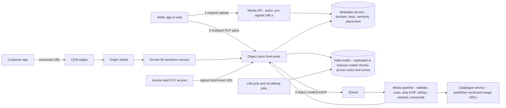
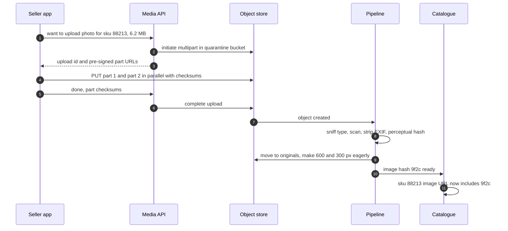
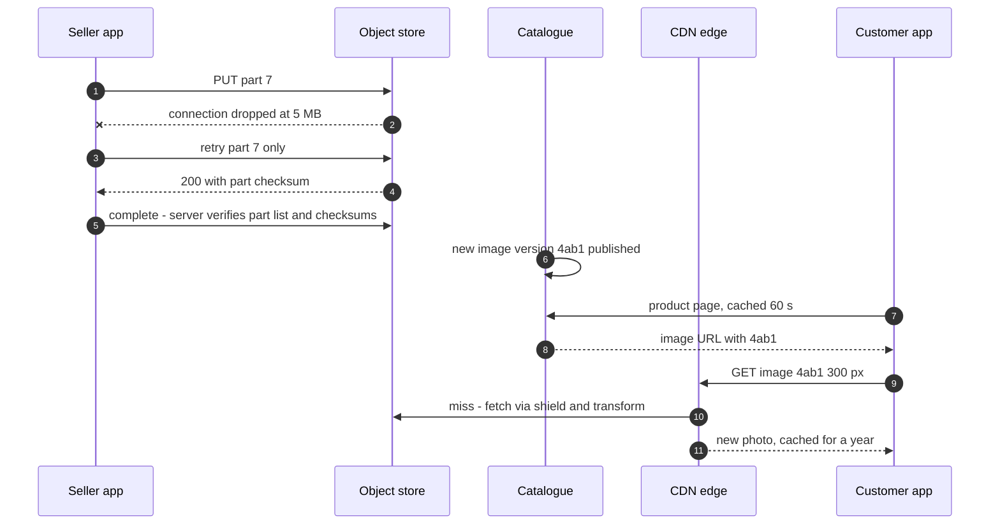
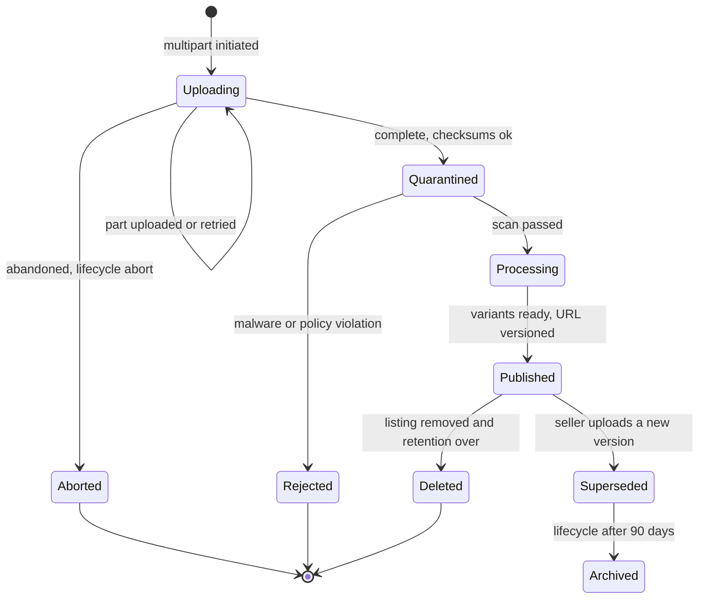

# 52. Case Study: Object Storage & Media Pipeline

!!! abstract "Chapter at a glance"
    **Reader bands:** B2 → B4 · **Prerequisites:** [Ch 03](../01-foundations/03-networking-essentials.md) (HTTP, CDNs), [Ch 07](../01-foundations/07-caching.md) (caching, invalidation), [Ch 10](../02-distributed-core/10-replication.md) (replication) · **What you will build:** the storage and delivery path for every file on the platform: product photos and videos from sellers, invoice PDFs, KYC documents, delivery-proof photos, bulk price files, data-lake files. It covers how an object store keeps data durable without three full copies, how large uploads survive bad networks, how images become the right size for each screen, and how a CDN serves them fresh. This is the "design S3 / Dropbox / an image service" interview question, applied to a grocery marketplace.

    **Results from the four labs:**

    - **L1, erasure coding:**
        - A real Reed–Solomon codec destroyed 3 of 9 (and 4 of 14) shards per object, including data shards, and rebuilt **16/16** objects bit-for-bit (SHA-256 verified) at ~290–340 MB/s.
        - In a durability model for 10 PB, **RS(10,4) at 1.4× storage** has a lower yearly loss probability (**3.3e-5**) than **3 replicas at 3×** (1.3e-2).
        - The cost is 10× repair reads.
    - **L2, uploads (real HTTP, 0.4% drop per 64 KB):**
        - A 160 MB single PUT **never finished** in 5 tries.
        - An 8 MB multipart upload finished with 9 part retries, and in **5.0 s** with 4 parallel parts. Every object was verified intact.
    - **L3, image variants (real JDK resize + JPEG):**
        - The 300 px variant is **1.6%** of the original's bytes.
        - Serving variants instead of originals cut a day's egress from **5.6 TB to 132 GB**.
        - A CDN kept **92%** of requests off the origin.
        - On a busy catalogue, eager vs lazy variants mattered less than expected: 97% of variants get requested within a month.
    - **L4, CDN freshness:**
        - Mutable URLs with 7-day TTLs served **81,271** outdated photos.
        - 5-minute TTLs multiplied origin traffic **46×**.
        - Purges failed silently for days.
        - **Content-hashed URLs** gave 99.1% hit ratio and a worst staleness of **54 s**.

    · **Reading time:** 100 min + code

---

## 1. Introduction & Why It Matters

### 1.1 A story: the photo of last year's packaging

The first media setup was a `/uploads` directory on two app servers, synced by rsync, behind nginx. This is how it went wrong:

1. **Seller uploads failed.** Sellers in Tier-2 towns uploaded 200 MB catalogue videos over mobile data. The single POST through the app server failed at 70% and restarted from zero. Support tickets said "upload stuck".
2. **The app servers ran out of disk and threads.** Every upload tied up a worker for minutes. One disk filled, and uploads started failing platform-wide.
3. **A disk died.** rsync had been failing quietly for a week, and 40,000 product photos were gone. Sellers were asked to re-upload.
4. **Phones downloaded 2400-pixel originals** to show 300-pixel thumbnails. The app felt slow on 4G, and the CDN bill tripled.
5. **Stale photos.** After moving to a CDN with a 7-day cache, a brand changed its packaging, and customers saw the old pack for a week and complained "wrong product delivered".

Files look simple, but at scale they are a **durability problem** (disks die, in racks, in batches), a **transfer problem** (large objects over bad networks), a **processing problem** (variants, formats, scanning) and a **delivery problem** (caching and freshness).

!!! quote "The thesis of this chapter"
    **Durability comes from redundancy you can afford.** Erasure coding survives more failures than triple replication at half the storage, and pays for it in repair traffic (L1). **Large objects move in parts**: multipart uploads direct to storage via pre-signed URLs, with per-part retries and end-to-end checksums (L2). **Serve the right bytes**: size and format variants made lazily or eagerly, cached in the object store and at the edge (L3). **Never change content under a URL**: versioned, content-hashed URLs make CDN caching both long and correct (L4).

### 1.2 What we store

| Object | Size | Volume | Access | Retention | Class |
|---|---|---|---|---|---|
| Product photos (originals) | 0.5–5 MB | ~5M | Written once, read to make variants | Life of listing | Standard → infrequent |
| Photo variants | 3–150 KB | ~25M | Very hot via CDN | Regenerable | Standard (or cache only) |
| Seller videos | 50–500 MB | ~200k | Warm | Life of listing | Standard |
| Invoice PDFs | 50–200 KB | ~1.5M/day | Rare reads, legal | Years (VERIFY GST retention) | Infrequent → archive |
| Delivery-proof photos | ~300 KB | ~1.5M/day | Disputes only | 90 days | Infrequent, lifecycle delete |
| KYC documents | 1–5 MB | ~50k sellers | Restricted | Regulatory | Encrypted, locked |
| Data lake (Parquet) | 128 MB–1 GB files | Petabytes | Analytics scans | Tiered | Standard → archive |

### 1.3 Learning objectives

By the end you will be able to:

- **Explain object-store internals**: metadata vs data, replication vs erasure coding, durability math (L1).
- **Design uploads** for large files and unreliable networks (L2).
- **Build a media pipeline**: variants, formats, lazy vs eager, security scanning (L3).
- **Serve through a CDN** with correct caching and invalidation (L4).
- Handle lifecycle, cost tiers, access control, signed URLs and compliance.

---

## 2. Core Concepts — Beginner to Deep

### 2.1 Intuition: a warehouse with a ledger <span class="band b2">B2</span>

An object store is a warehouse and a ledger:

- **The warehouse** (data nodes) holds sealed boxes split into pieces across many shelves. You don't need every piece to rebuild the box: any 10 of 14 will do.
- **The ledger** (the metadata service) knows which box is where, who owns it, and what version it is.
- **Big deliveries arrive in several trucks** (multipart). The warehouse only signs for the box when every truck has arrived and the manifest checks out.
- **Customers never come to the warehouse.** They go to local shops (CDN edges) that stock popular boxes. When the product changes, you give it a new label (versioned URL), instead of chasing every shop to swap stock.

### 2.2 Requirements <span class="band b2">B2</span>

**Functional**

- PUT/GET/DELETE objects by bucket and key. Multipart upload for large objects. Pre-signed URLs for direct client upload and download.
- Versioning; lifecycle rules (transition to cheaper classes, expiry); object lock for legal holds.
- Media pipeline: validate, scan (malware, forbidden content), extract metadata, make variants, publish.
- Delivery through a CDN; private objects (invoices, KYC) only via short-lived signed URLs.

**Non-functional**

- Durability ≥ 11 nines per object per year (design target); availability 99.9–99.99%.
- Uploads survive network drops without restarting; throughput scales with parallelism.
- Image p95 < 100 ms at the edge; correct content after updates within a minute.
- Cost per GB-month and per GB of egress minimised with tiers and caching.

### 2.3 Estimation <span class="band b2">B2</span>

| Quantity | Estimate |
|---|---|
| New objects | Invoices 1.5M + proofs 1.5M + photos 10k + videos 1k per day ≈ 3M/day |
| Stored | Photos 5M × 2 MB = 10 TB; proofs 90 d × 1.5M × 0.3 MB = 40 TB; invoices 7 y × ~100 TB; lake PBs |
| Image requests | ~5M/day per 200k-image catalogue slice (L3); tens of millions platform-wide |
| Egress | Originals: 5.6 TB/day; variants: 132 GB/day (L3). Format and size decide the CDN bill |

### 2.4 Object-store internals ⭐ <span class="band b3">B3</span>

- **Metadata service**: `(bucket, key, version) → {size, checksum, placement, ACL, class}`. It is a strongly consistent, sharded key-value store, and the part that gives read-after-write consistency and fast listing.
- **Data nodes** hold chunks (e.g. 64 MB) placed across disks, racks and zones. Placement is chosen by the metadata service, and rebalanced as disks come and go.
- **Replication vs erasure coding.** L1 ran a real RS codec and a durability model:

    | Scheme | Raw bytes stored | Survives | Repair reads | P(any loss)/yr, 10 PB (model) |
    |---|---|---|---|---|
    | 2 replicas | 2.0× | 1 failure | 1× | ≈ 1 (expect losses) |
    | 3 replicas | 3.0× | 2 | 1× | 1.3e-2 |
    | RS(6,3) | 1.5× | 3 | 6× | 1.5e-3 |
    | **RS(10,4)** | **1.4×** | **4** | 10× | **3.3e-5** |

- **Erasure coding** splits an object into *k* data shards and computes *m* parity shards. Any *k* rebuild it. L1 rebuilt 16/16 objects after wiping data shards, verified by SHA-256.
- **Repair is the price.** Rebuilding one shard reads *k*, which is more network and longer repair windows. So stores replicate small, hot or freshly written data and erasure-code larger, colder data, often converting in the background.
- **The model assumes independent failures.** Real losses come from correlated ones (a rack, a firmware batch, a zone), so shards are spread across failure domains. Scrubbing (reading and verifying checksums periodically) finds silent corruption before a second failure makes it unrecoverable.

### 2.5 Uploads ⭐ <span class="band b3">B3</span>

L2 ran over real HTTP, with 16 MB/s per connection, a 64 MB/s link, and a 0.4% drop chance per 64 KB:

| Strategy | Result | Time | MB received | Intact |
|---|---|---|---|---|
| Single PUT, restart on failure (max 5) | **Failed** | 2.8 s | 34 | — |
| Multipart 8 MB, sequential | ok (9 part retries) | 12.3 s | 182 | yes |
| Multipart 8 MB, 4 parallel | ok (11 part retries) | **5.0 s** | 202 | yes |
| Multipart 8 MB, 8 parallel | ok (15 part retries) | 5.1 s | 223 | yes |

- **Multipart**:
    - `initiate` returns an upload id.
    - Parts (5 MB–5 GB on S3; VERIFY limits for your store) are uploaded independently, in parallel, and retried alone. Each part has a checksum.
    - `complete` assembles them atomically. `abort` or lifecycle rules clean up abandoned uploads.
- **Pre-signed URLs**: the app authorises the upload and hands the client URLs for direct PUTs. The bytes never pass through application servers. Scope them tightly (key, size, content type, a few minutes' expiry).
- **Resumable uploads**: persist the upload id and completed parts on the client, and continue after an app restart or a network change (tus protocol or the store's native API).
- **Integrity**: per-part checksums and an end-to-end checksum. Reject anything that doesn't match.
- **Parallelism** helps until the link or the per-prefix request rate is the limit. L2 gained nothing past 4.

### 2.6 The media pipeline ⭐ <span class="band b3">B3</span>

The path an uploaded image takes:

1. The upload lands in a **quarantine bucket**.
2. An event triggers **validation**: type sniffing (not just the extension), size limits, EXIF stripping (location privacy), malware scanning, and content moderation.
3. It moves to the **originals bucket**.
4. **Variants** are made, and metadata (dimensions, dominant colour, perceptual hash for duplicates) is published.
5. The product becomes visible.

L3 measured real transforms, and then modelled a day of traffic:

| Variant | Bytes | Resize + encode | vs original |
|---|---|---|---|
| 1200 px | 156.5 KB | 86.9 ms | 14.3% |
| 600 px | 52.1 KB | 22.7 ms | 4.8% |
| 300 px | 18.1 KB | 6.8 ms | 1.6% |
| 80 px | 2.8 KB | 1.0 ms | 0.3% |

| Strategy (one day) | Bytes to users | Transform CPU | Origin requests | Variants stored |
|---|---|---|---|---|
| Original to everyone | 5,613 GB | 0 | 5,000,000 | 0 |
| Eager 5 variants | 132 GB | 358 s | 5,000,000 | 1,000,000 |
| Lazy, kept | 132 GB | 177 s | 5,000,000 | 973,789 |
| **Lazy + 20 GB CDN** | 132 GB | 177 s | **400,890** | 973,789 |

- **Right-size first.** It is the biggest win: ~40× less egress.
- **Formats**: WebP and AVIF are typically much smaller than JPEG at similar quality (VERIFY on your images). Negotiate with `Accept` and cache with `Vary: Accept`, or put the format in the URL. Quality 0.8 vs 0.95 was 2.8× smaller in L3.
- **Eager vs lazy**: on a busy catalogue nearly every variant is requested anyway (97%). Lazy wins for sparse catalogues and for new sizes, because there is no backfill. Common design: an on-the-fly transform service behind the CDN (URL like `/img/{id}/{hash}/w_300.webp`), results cached in the object store, and the top sizes made eagerly.
- **Deduplicate** by content hash (the same image uploaded by many sellers) and near-duplicate perceptual hashes.
- **Video**: transcode to adaptive bitrate (HLS/DASH) renditions with a job queue ([Ch 50](50-distributed-job-scheduler.md)). It is much more expensive: do it eagerly for published videos, and track the job state.

### 2.7 CDN caching and invalidation ⭐ <span class="band b4">B4</span>

L4, over 3 days with 600 photo updates a day:

| Caching | Outdated photos served | CDN hit | Origin requests | Worst staleness |
|---|---|---|---|---|
| Mutable URL, TTL 7 days | 81,271 | 99.2% | 50,000 | 3.0 days |
| Mutable URL, TTL 5 min | 43 | 61.2% | **2,325,117** | 4 min |
| Mutable URL, 7 days + purge | 4,310 | 99.1% | 51,587 | **2.8 days** (failed purge) |
| **Versioned (content-hash) URL, 1 year** | **14** | **99.1%** | 51,620 | **54 s** |

- **With mutable URLs, the TTL is a trade-off** between freshness and origin load.
- **Purges** are asynchronous, rate-limited and occasionally fail.
- **Versioned URLs** make objects immutable. The API returns the current URL; old URLs keep working, and eventually age out of caches. Staleness is bounded by how long the *referring* page or API is cached.
- **Headers**:
    - Versioned assets: `Cache-Control: public, max-age=31536000, immutable`.
    - Pages that reference them: short TTLs or `stale-while-revalidate`.
    - Private objects: `private, no-store`, served via signed URLs.
- **Origin shield**: a mid-tier cache in front of the origin collapses misses from many edges into one fetch, and protects the transform service from stampedes.

### 2.8 Access control and privacy <span class="band b3">B3</span>

- **Public product media**: public via the CDN, with origin access restricted to the CDN (origin access identity/control).
- **Invoices, KYC, delivery proofs**: private buckets, encryption at rest with KMS keys ([Ch 36](../04-architect/36-compliance-governance-and-data-residency.md)), and access via **short-lived signed URLs** issued after an authorisation check. Log access.
- **Strip EXIF** from customer and rider photos: GPS coordinates are personal data.
- **Retention**: lifecycle rules delete delivery proofs after 90 days, and object lock (WORM) protects invoices for their legal retention period (VERIFY).

### 2.9 Lifecycle and cost <span class="band b3">B3</span>

- **Storage classes**: standard → infrequent access → archive (e.g. Glacier-like), with retrieval costs and delays for the colder tiers. Lifecycle rules move objects by age.
- **Egress usually dominates** for media. CDN offload, right-sizing and modern formats are the levers.
- **Request costs**: many tiny objects (thumbnails, logs) cost more in requests than in bytes. Batch small files (e.g. Parquet), or keep variants cache-only and regenerate them.
- **Abandoned multipart uploads** silently cost storage. Add a lifecycle rule to abort them after N days.

### 2.10 Interview framing <span class="band b4">B4</span>

"Design an object store" or "design an image hosting/upload service". Cover:

- the metadata/data split;
- placement and durability (replication vs erasure coding with numbers);
- consistency;
- the multipart upload flow with pre-signed URLs;
- the processing pipeline;
- CDN delivery with versioned URLs;
- access control;
- lifecycle and cost.

Staff-level signals: correlated failures and scrubbing, repair traffic, "never mutate content under a URL", and egress economics.

---

## 3. Architecture & Diagrams

### 3.1 Component view



### 3.2 Sequence: happy path, a seller uploads a product photo



### 3.3 Sequence: failure path, a part fails and a purge is not needed



### 3.4 State: an uploaded media object



---

## 4. Design Document Excerpt: Media Platform v2

!!! note "Design Document (excerpt) — Media Platform v2"
    **Status:** Accepted · **Authors:** Storage & media team · **Reviewers:** Catalogue, Seller experience, Security, Finance, SRE

    | Field | Value |
    |---|---|
    | Context | Uploads went through app servers and failed on mobile networks. rsync-replicated disks lost 40k photos. Originals were served to phones. A 7-day CDN TTL showed old packaging for a week. Invoices sat in a public bucket path. |
    | Decision | Managed object storage (erasure-coded, multi-AZ) with versioning. Direct multipart uploads via pre-signed URLs into a quarantine bucket. An event-driven pipeline (scan, EXIF strip, dedup, variants). Content-hashed image URLs with 1-year immutable caching behind a CDN and origin shield. Lazy transforms with the top two sizes eager. Private classes with KMS and signed URLs. Lifecycle tiers. |
    | Related ADRs | ADR-380 Object store: erasure-coded across 3 AZs; scrubbing on; cross-region copy for invoices (L1). ADR-381 Uploads: 8 MB parts, 4 parallel, per-part and end-to-end checksums, pre-signed URLs valid 15 min, abandoned uploads aborted after 2 days (L2). ADR-382 Images: WebP/AVIF with JPEG fallback, sizes 80/150/300/600/1200, 300 and 600 eager, others lazy; perceptual-hash dedup (L3). ADR-383 URLs `/img/{sku}/{contenthash}/w_{n}.{fmt}`, `immutable`, 1 year; product API TTL 60 s; no purges in the normal path (L4). ADR-384 Invoices: private, KMS, object lock for the retention period, signed URLs 5 min, access logged. |

    **Requirements.**

    - **R1:** No object loss from single-AZ failure; durability design target 11 nines.
    - **R2:** 200 MB uploads complete on networks dropping every ~16 MB, without restarting from zero.
    - **R3:** Image bytes per product view ≤ 100 KB at p95; CDN hit ratio ≥ 95%.
    - **R4:** A photo update visible to all customers within 2 minutes.
    - **R5:** Private documents never reachable without an authorised, time-limited URL.

    **Decisions in detail.**

    1. **Storage (ADR-380):** use the provider's erasure-coded standard class. Don't build our own store. Invoices are also copied to a second region under object lock.
    2. **Uploads (ADR-381):** the client SDK handles part retries and resume. The server validates declared size and type before issuing URLs.
    3. **Pipeline (ADR-382):** Kafka-driven workers with idempotent processing keyed by content hash. The transform service runs behind the shield, with request coalescing.
    4. **Delivery (ADR-383):** URLs change on content change. Purges are kept only for takedowns (legal, safety).
    5. **Private (ADR-384):** signed URL issuance is audited, and downloads are rate-limited per user.

    **Consequences.** We depend on a managed store and CDN, run a pipeline, and need URL versioning in the catalogue. In return: durable storage at ~1.4× raw, uploads that finish, 40× less egress, and fresh images without purges.

---

## 5. Hands-On Code — Level Ladder

!!! info "What's real here"
    - **L1's codec is a real Reed–Solomon implementation.** Shards are actually wiped and rebuilt, with SHA-256 verified. Its durability table comes from a Markov model with stated assumptions (independent failures, fixed repair times).
    - **L2 is a real HTTP object-store stub** (JDK `HttpServer` and `HttpClient`) with throttled, randomly dropped connections.
    - **L3's resizes and JPEG encodes are real JDK ImageIO operations**, measured. Its one-day traffic model is a simulation.
    - **L4 is a simulation.**
    - Timings vary by machine.

All four labs are single-file JDK 21 programs. Run L2 with `-Dsun.net.httpserver.nodelay=true`, and L3 with `-Djava.awt.headless=true`.

### L1 — Erasure coding and durability <span class="band b3">B3</span>

**Requirement:** "Keep 10 PB durable without paying for three full copies."

A real Reed–Solomon codec over GF(2^8), followed by a Markov durability model.

```java title="ErasureL1.java"
// ErasureL1.java — run with: java ErasureL1.java   (JDK 21, no dependencies)
// HOW OBJECT STORES KEEP DATA WITHOUT KEEPING THREE COPIES. Part 1 is a REAL Reed–Solomon codec over GF(2^8)
// (systematic, Cauchy parity matrix): 96 MB of random bytes (product images, invoices) is split into 16 objects, each
// encoded as k data shards + m parity shards; we destroy m shards per object — including data shards — rebuild the
// object from any k survivors and check its SHA-256. Part 2 computes durability with a Markov model of disk failures
// (AFR 2%, repair times as stated) for 10 PB of user data, and the storage and repair-traffic cost of each scheme.
import java.security.MessageDigest;
import java.util.*;

public class ErasureL1 {
    static final int[] EXP = new int[512], LOG = new int[256];
    static { int x = 1; for (int i = 0; i < 255; i++) { EXP[i] = x; LOG[x] = i; x <<= 1; if ((x & 0x100) != 0) x ^= 0x11d; } for (int i = 255; i < 512; i++) EXP[i] = EXP[i - 255]; }
    static int mul(int a, int b) { return a == 0 || b == 0 ? 0 : EXP[LOG[a] + LOG[b]]; }
    static int inv(int a) { return EXP[255 - LOG[a]]; }

    public static void main(String[] args) throws Exception {
        Random r = new Random(52); int objects = 16, objSize = 6 * 1024 * 1024; byte[][] data = new byte[objects][objSize];
        for (byte[] d : data) r.nextBytes(d);
        System.out.println("PART 1 — real Reed–Solomon over GF(2^8): 16 objects × 6 MB, destroy m shards each, rebuild, verify SHA-256.\n");
        System.out.printf("   %-12s %10s %14s %16s %16s %10s%n", "scheme", "overhead", "shards lost", "encode MB/s", "rebuild MB/s", "verified");
        for (int[] km : new int[][]{{6, 3}, {10, 4}}) {
            int k = km[0], m = km[1]; int[][] enc = matrix(k, m);
            long encNs = 0, decNs = 0; int ok = 0;
            for (byte[] obj : data) {
                int shard = (obj.length + k - 1) / k; byte[][] sh = new byte[k + m][shard];
                for (int i = 0; i < k; i++) System.arraycopy(obj, i * shard, sh[i], 0, Math.min(shard, obj.length - i * shard));
                long t0 = System.nanoTime(); encode(enc, sh, k, m); encNs += System.nanoTime() - t0;
                // destroy m shards: always some data shards
                Set<Integer> lost = new HashSet<>(); lost.add(0);                                   // always lose data shard 0 ...
                while (lost.size() < m) lost.add(r.nextInt(k + m));                                  // ... plus random others
                for (int i : lost) Arrays.fill(sh[i], (byte) 0);                                    // really wipe them
                int[] survivors = new int[k]; int c = 0; for (int i = 0; i < k + m && c < k; i++) if (!lost.contains(i)) survivors[c++] = i;
                t0 = System.nanoTime(); byte[][] rebuilt = decode(enc, sh, survivors, k, shard); decNs += System.nanoTime() - t0;
                byte[] out = new byte[obj.length]; for (int i = 0; i < k; i++) System.arraycopy(rebuilt[i], 0, out, i * shard, Math.min(shard, obj.length - i * shard));
                if (Arrays.equals(sha(out), sha(obj))) ok++;
            }
            double mb = objects * objSize / 1048576.0;
            System.out.printf("   %-12s %9.2fx %11d/%d %16.0f %16.0f %7d/%d%n", "RS(" + k + "," + m + ")", (k + m) / (double) k, m, k + m, mb / (encNs / 1e9), mb / (decNs / 1e9), ok, objects);
        }
        System.out.println("\nPART 2 — durability for 10 PB of user data (Markov model: disk AFR 2%, one repair at a time per group).\n");
        System.out.printf("   %-26s %10s %12s %14s %22s %20s%n", "scheme", "raw bytes", "repair time", "repair reads", "P(any data loss)/year", "MTTDL per group");
        System.out.printf("   %-26s %10s %12s %14s %22s %20s%n", "", "stored", "(assumed)", "per lost byte", "across 10 PB", "");
        Object[][] schemes = {{"2 replicas", 2, 1, 1, 12.0}, {"3 replicas", 3, 2, 1, 12.0}, {"RS(6,3)", 9, 3, 6, 24.0}, {"RS(10,4)", 14, 4, 10, 36.0}};
        for (Object[] s : schemes) {
            int n = (int) s[1], tol = (int) s[2], k = n - tol, reads = (int) s[3]; double repairH = (double) s[4];
            double lambda = 0.02 / (365 * 24), mu = 1 / repairH;                                   // per hour
            double mttdlH = mttdl(n, tol, lambda, mu), years = mttdlH / (365 * 24);
            double groupBytes = 64L << 20;                                                       // 64 MB of user data per group (stripe/chunk)
            double groups = 10e15 / groupBytes; double pLoss = 1 - Math.exp(-groups / years);
            System.out.printf("   %-26s %9.2fx %9.0f h %13dx %22s %17.2e y%n", s[0], n / (double) k, repairH, reads, String.format("%.2e", pLoss), years);
        }
        System.out.println("\n   → any k of the k + m shards rebuild the object bit-for-bit: the SHA-256 checks above are real, including");
        System.out.println("     lost data shards. RS(10,4) survives 4 simultaneous losses at 1.4x storage; three replicas survive 2 at 3x.");
        System.out.println("     The price is repair: rebuilding one lost shard reads k shards (6–10x the bytes), so repairs take longer and");
        System.out.println("     use more network — which is why stores keep hot, small or recent objects replicated and erasure-code the rest.");
        System.out.println("     The durability figures are a model (independent failures, fixed repair times); correlated failures — a rack,");
        System.out.println("     a bad firmware batch, a zone — dominate real losses, so shards are also spread across racks and zones.");
    }

    // expected hours to data loss for n devices tolerating tol failures; birth-death chain, single repairer
    static double mttdl(int n, int tol, double lambda, double mu) {
        int S = tol + 1; double[][] A = new double[S][S + 1];                                   // T_i = 1/out + sum p*T_j
        for (int i = 0; i < S; i++) {
            double up = (n - i) * lambda, down = i > 0 ? mu : 0, out = up + down;
            A[i][i] = 1; if (i + 1 < S) A[i][i + 1] -= up / out; if (i > 0) A[i][i - 1] -= down / out; A[i][S] = 1 / out;
        }
        for (int c = 0; c < S; c++) { int p = c; for (int i = c + 1; i < S; i++) if (Math.abs(A[i][c]) > Math.abs(A[p][c])) p = i; double[] t = A[c]; A[c] = A[p]; A[p] = t;
            for (int i = 0; i < S; i++) if (i != c) { double f = A[i][c] / A[c][c]; for (int j = c; j <= S; j++) A[i][j] -= f * A[c][j]; } }
        return A[0][S] / A[0][0];
    }
    static int[][] matrix(int k, int m) {                                                       // parity rows: Cauchy 1/(x_i + y_j)
        int[][] c = new int[m][k]; for (int i = 0; i < m; i++) for (int j = 0; j < k; j++) c[i][j] = inv((i + k) ^ j); return c;
    }
    static void encode(int[][] c, byte[][] sh, int k, int m) {
        int len = sh[0].length;
        for (int i = 0; i < m; i++) { byte[] p = sh[k + i];
            for (int j = 0; j < k; j++) { int coef = c[i][j]; byte[] d = sh[j]; int lc = LOG[coef];
                for (int b = 0; b < len; b++) { int v = d[b] & 0xff; if (v != 0) p[b] ^= EXP[lc + LOG[v]]; } } }
    }
    static byte[][] decode(int[][] c, byte[][] sh, int[] rows, int k, int len) {
        int[][] M = new int[k][k];                                                              // rows of [I ; C] for the survivors
        for (int i = 0; i < k; i++) { int r = rows[i]; if (r < k) M[i][r] = 1; else M[i] = c[r - k].clone(); }
        int[][] Inv = invert(M, k); byte[][] out = new byte[k][len];
        for (int i = 0; i < k; i++) for (int j = 0; j < k; j++) { int coef = Inv[i][j]; if (coef == 0) continue; byte[] s = sh[rows[j]], o = out[i]; int lc = LOG[coef];
            for (int b = 0; b < len; b++) { int v = s[b] & 0xff; if (v != 0) o[b] ^= EXP[lc + LOG[v]]; } }
        return out;
    }
    static int[][] invert(int[][] a, int n) {
        int[][] m = new int[n][2 * n]; for (int i = 0; i < n; i++) { System.arraycopy(a[i], 0, m[i], 0, n); m[i][n + i] = 1; }
        for (int c = 0; c < n; c++) { int p = c; while (m[p][c] == 0) p++; int[] t = m[c]; m[c] = m[p]; m[p] = t;
            int iv = inv(m[c][c]); for (int j = 0; j < 2 * n; j++) m[c][j] = mul(m[c][j], iv);
            for (int i = 0; i < n; i++) if (i != c && m[i][c] != 0) { int f = m[i][c]; for (int j = 0; j < 2 * n; j++) m[i][j] ^= mul(f, m[c][j]); } }
        int[][] r = new int[n][n]; for (int i = 0; i < n; i++) System.arraycopy(m[i], n, r[i], 0, n); return r;
    }
    static byte[] sha(byte[] b) throws Exception { return MessageDigest.getInstance("SHA-256").digest(b); }
}
```

```text title="java -Dstdout.encoding=UTF-8 ErasureL1.java"
PART 1 — real Reed–Solomon over GF(2^8): 16 objects × 6 MB, destroy m shards each, rebuild, verify SHA-256.

   scheme         overhead    shards lost      encode MB/s     rebuild MB/s   verified
   RS(6,3)           1.50x           3/9              395              342      16/16
   RS(10,4)          1.40x           4/14              405              288      16/16

PART 2 — durability for 10 PB of user data (Markov model: disk AFR 2%, one repair at a time per group).

   scheme                      raw bytes  repair time   repair reads  P(any data loss)/year      MTTDL per group
                                  stored    (assumed)  per lost byte           across 10 PB                     
   2 replicas                      2.00x        12 h             1x               1.00e+00          9.13e+05 y
   3 replicas                      3.00x        12 h             1x               1.33e-02          1.11e+10 y
   RS(6,3)                         1.50x        24 h             6x               1.48e-03          1.01e+11 y
   RS(10,4)                        1.40x        36 h            10x               3.26e-05          4.57e+12 y

   → any k of the k + m shards rebuild the object bit-for-bit: the SHA-256 checks above are real, including
     lost data shards. RS(10,4) survives 4 simultaneous losses at 1.4x storage; three replicas survive 2 at 3x.
     The price is repair: rebuilding one lost shard reads k shards (6–10x the bytes), so repairs take longer and
     use more network — which is why stores keep hot, small or recent objects replicated and erasure-code the rest.
     The durability figures are a model (independent failures, fixed repair times); correlated failures — a rack,
     a bad firmware batch, a zone — dominate real losses, so shards are also spread across racks and zones.
```

**Reading it:**

- **The rebuilds are real.** Every object lost data shard 0 plus other shards, was rebuilt from exactly *k* survivors, and matched its SHA-256.
- **Coding speed** is a few hundred MB/s per core in plain Java. Production codecs use SIMD (e.g. Intel ISA-L) and are much faster.
- **The durability table is a model.** Two replicas at 10 PB means expected losses. RS(10,4) beats three replicas at less than half the storage, but repairs read 10× the bytes.

### L2 — Uploads over a flaky network <span class="band b3">B3</span>

**Requirement:** "A seller's 160 MB upload completes on a connection that drops every ~16 MB, without restarting from zero."

A real HTTP object-store stub with throttling and random drops.

```java title="UploadL2.java"
// UploadL2.java — run with: java -Dsun.net.httpserver.nodelay=true UploadL2.java   (JDK 21, no dependencies)
// UPLOADING A 160 MB FILE OVER A FLAKY MOBILE/SELLER NETWORK — a seller's catalogue video, a day's CCTV clip for a
// dispute, a bulk price file. A REAL HTTP object-store stub (JDK HttpServer) with realistic limits: each connection is
// throttled to 16 MB/s, the whole link to 64 MB/s, and the network drops a connection with probability 0.4% per 64 KB
// sent (on average one drop every ~16 MB). Four client strategies, all over real HTTP on localhost:
//   U1 one PUT of the whole file; on failure start again from byte 0 (max 5 attempts)
//   U2 multipart: 8 MB parts, one at a time; a failed part is retried alone; then "complete" assembles the parts
//   U3 multipart, 4 parts in parallel
//   U4 multipart, 8 parts in parallel
// The server stores parts, assembles on complete and returns the SHA-256 of the object, which the client checks.
// Measured: success, wall time, MB the server actually received, and whether the stored object is byte-identical.
import com.sun.net.httpserver.*;
import java.io.*;
import java.net.*;
import java.net.http.*;
import java.security.MessageDigest;
import java.util.*;
import java.util.concurrent.*;
import java.util.concurrent.atomic.*;

public class UploadL2 {
    static final int CHUNK = 64 * 1024; static final double DROP = 0.004;
    static final Map<String, byte[]> parts = new ConcurrentHashMap<>(); static final Random rnd = new Random(52);
    static final Object linkLock = new Object(); static long linkNextFree = 0;                   // global 64 MB/s link

    public static void main(String[] args) throws Exception {
        HttpServer srv = HttpServer.create(new InetSocketAddress("127.0.0.1", 0), 128);
        srv.setExecutor(Executors.newFixedThreadPool(16));
        srv.createContext("/", UploadL2::handle); srv.start(); int port = srv.getAddress().getPort();
        byte[] file = new byte[160 * 1024 * 1024]; new Random(7).nextBytes(file); String want = hex(sha(file));
        HttpClient http = HttpClient.newBuilder().version(HttpClient.Version.HTTP_1_1).executor(Executors.newFixedThreadPool(16)).build();
        System.out.println("160 MB upload; 16 MB/s per connection, 64 MB/s link; 0.4% drop chance per 64 KB. Real HTTP.\n");
        System.out.printf("   %-50s %-24s %8s %12s %10s%n", "strategy", "result", "time", "MB received", "intact");
        String[] names = {"U1) single PUT, restart from 0 on failure (max 5)", "U2) multipart 8 MB, sequential, retry the part", "U3) multipart 8 MB, 4 in parallel", "U4) multipart 8 MB, 8 in parallel"};
        for (int s = 0; s < 4; s++) {
            parts.clear(); bytesIn.set(0); AtomicLong sent = new AtomicLong(); long t0 = System.nanoTime(); String result, intact = "—";
            String base = "http://127.0.0.1:" + port;
            if (s == 0) {
                result = "FAILED";
                for (int a = 0; a < 5; a++) {
                    HttpResponse<String> resp = send(http, base + "/put/obj" + s, file, 0, file.length, sent);
                    if (resp != null && resp.statusCode() == 200) { result = "ok (" + (a + 1) + " tries)"; intact = resp.body().equals(want) ? "yes" : "NO"; break; } }
            } else {
                int partSize = 8 << 20, n = file.length / partSize, par = s == 1 ? 1 : s == 2 ? 4 : 8;
                ExecutorService ex = Executors.newFixedThreadPool(par); List<Future<Integer>> fs = new ArrayList<>(); final int ss = s;
                for (int p = 0; p < n; p++) { final int pn = p; fs.add(ex.submit(() -> {
                    for (int a = 1; a <= 20; a++) { HttpResponse<String> resp = send(http, base + "/part/obj" + ss + "/" + pn, file, pn * partSize, partSize, sent);
                        if (resp != null && resp.statusCode() == 200) return a; }
                    return -1; })); }
                int retries = 0; boolean ok = true; for (Future<Integer> f : fs) { int a = f.get(); if (a < 0) ok = false; else retries += a - 1; } ex.shutdown();
                HttpResponse<String> done = http.send(HttpRequest.newBuilder(URI.create(base + "/complete/obj" + s + "/" + n)).POST(HttpRequest.BodyPublishers.noBody()).build(), HttpResponse.BodyHandlers.ofString());
                result = ok && done.statusCode() == 200 ? "ok (" + retries + " part retries)" : "FAILED"; intact = done.statusCode() == 200 && done.body().equals(want) ? "yes" : "NO";
            }
            System.out.printf("   %-50s %-24s %6.1f s %12.0f %10s%n", names[s], result, (System.nanoTime() - t0) / 1e9, bytesIn.get() / 1048576.0, intact);
        }
        System.out.println("\n   → with a drop every ~16 MB on average, a 160 MB single request almost never survives, and every retry starts");
        System.out.println("     again from zero. Splitting the object into parts turns one fragile transfer into many small, independently");
        System.out.println("     retryable ones: the re-sent bytes are bounded by the part size. Parallel parts use more of the link; past");
        System.out.println("     4 connections the 64 MB/s cap limits the gain. The server assembles parts only on 'complete', and the");
        System.out.println("     end-to-end checksum proves the object is intact. Uploads go straight to the object store with pre-signed URLs");
        System.out.println("     — the application servers never carry the bytes.");
        srv.stop(0); System.exit(0);
    }

    static HttpResponse<String> send(HttpClient http, String url, byte[] file, int off, int len, AtomicLong sent) {
        try {
            HttpRequest req = HttpRequest.newBuilder(URI.create(url)).PUT(HttpRequest.BodyPublishers.ofByteArray(file, off, len)).timeout(java.time.Duration.ofSeconds(60)).build();
            HttpResponse<String> resp = http.send(req, HttpResponse.BodyHandlers.ofString());
            return resp;
        } catch (Exception e) { return null; }
    }
    static final AtomicLong bytesIn = new AtomicLong();

    static void handle(HttpExchange ex) throws IOException {
        String[] p = ex.getRequestURI().getPath().split("/");
        try (ex) {
            if (p[1].equals("complete")) {
                int n = Integer.parseInt(p[3]); ByteArrayOutputStream all = new ByteArrayOutputStream();
                for (int i = 0; i < n; i++) { byte[] b = parts.get(p[2] + "/" + i); if (b == null) { ex.sendResponseHeaders(400, -1); return; } all.write(b); }
                byte[] body = hex(sha(all.toByteArray())).getBytes(); ex.sendResponseHeaders(200, body.length); ex.getResponseBody().write(body); return;
            }
            InputStream in = ex.getRequestBody(); ByteArrayOutputStream buf = new ByteArrayOutputStream(); byte[] chunk = new byte[CHUNK];
            long connStart = System.nanoTime(); long got = 0; int k;
            while ((k = in.readNBytes(chunk, 0, CHUNK)) > 0) {
                buf.write(chunk, 0, k); got += k; counted(k);
                pace(connStart, got);
                boolean drop; synchronized (rnd) { drop = rnd.nextDouble() < DROP; }
                if (drop) { ex.sendResponseHeaders(503, -1); return; }                        // connection lost mid-body
            }
            byte[] body = buf.toByteArray();
            if (p[1].equals("put")) { byte[] h = hex(sha(body)).getBytes(); ex.sendResponseHeaders(200, h.length); ex.getResponseBody().write(h); }
            else { parts.put(p[2] + "/" + p[3], body); ex.sendResponseHeaders(200, -1); }
        } catch (Exception e) { /* client side sees failure */ }
    }
    static void counted(int k) { bytesIn.addAndGet(k); }
    static void pace(long connStart, long got) throws InterruptedException {
        long perConnDue = connStart + (long) (got / (16.0 * 1048576) * 1e9);                    // 16 MB/s per connection
        long linkDue; synchronized (linkLock) { long now = System.nanoTime(); linkNextFree = Math.max(linkNextFree, now) + (long) (CHUNK / (64.0 * 1048576) * 1e9); linkDue = linkNextFree; }
        long wait = Math.max(perConnDue, linkDue) - System.nanoTime(); if (wait > 0) Thread.sleep(wait / 1_000_000, (int) (wait % 1_000_000));
    }
    static byte[] sha(byte[] b) { try { return MessageDigest.getInstance("SHA-256").digest(b); } catch (Exception e) { throw new RuntimeException(e); } }
    static String hex(byte[] b) { StringBuilder sb = new StringBuilder(); for (byte x : b) sb.append(String.format("%02x", x)); return sb.toString(); }
}
```

```text title="java -Dsun.net.httpserver.nodelay=true UploadL2.java"
160 MB upload; 16 MB/s per connection, 64 MB/s link; 0.4% drop chance per 64 KB. Real HTTP.

   strategy                                           result                       time  MB received     intact
   U1) single PUT, restart from 0 on failure (max 5)  FAILED                      2.8 s           34          —
   U2) multipart 8 MB, sequential, retry the part     ok (9 part retries)        12.3 s          182        yes
   U3) multipart 8 MB, 4 in parallel                  ok (11 part retries)        5.0 s          202        yes
   U4) multipart 8 MB, 8 in parallel                  ok (15 part retries)        5.1 s          223        yes

   → with a drop every ~16 MB on average, a 160 MB single request almost never survives, and every retry starts
     again from zero. Splitting the object into parts turns one fragile transfer into many small, independently
     retryable ones: the re-sent bytes are bounded by the part size. Parallel parts use more of the link; past
     4 connections the 64 MB/s cap limits the gain. The server assembles parts only on 'complete', and the
     end-to-end checksum proves the object is intact. Uploads go straight to the object store with pre-signed URLs
     — the application servers never carry the bytes.
```

**Reading it:**

- **The single PUT** got 34 MB through in five attempts and gave up. Its chance of surviving 160 MB is effectively zero.
- **Multipart** re-sends only failed parts: 182–223 MB were received in total for a 160 MB object.
- **Four parallel parts** cut the time from 12.3 s to 5.0 s. Eight parallel parts didn't help, because the 64 MB/s link is the limit.
- **The assembled object's SHA-256** matched the original every time.

### L3 — Image variants: real transforms, modelled traffic <span class="band b2">B2</span>

**Requirement:** "Serve each screen the bytes it needs, and spend CPU only where it pays."

Real JDK resizing and JPEG encoding, followed by a one-day serving model.

```java title="ImageVariantsL3.java"
// ImageVariantsL3.java — run with: java -Djava.awt.headless=true ImageVariantsL3.java   (JDK 21, no dependencies)
// PRODUCT IMAGES: RESIZE ONCE, OR ON DEMAND? Part 1 is REAL: a 2400×2400 synthetic product photo (gradients, shapes,
// texture, sensor noise — so it compresses like a photo) is resized with bicubic interpolation and JPEG-encoded by
// the JDK's ImageIO at the sizes the apps use. Part 2 uses those measured costs in a one-day model of a 200,000-image
// catalogue: 3,000 new images, 5,000,000 image requests (Zipf over images; 5 sizes by device mix; fixed seed), and
// compares serving strategies. CDN = an LRU cache holding 20 GB at the edge.
//   S1 serve the original 2400 px JPEG to everyone
//   S2 eager: make all 5 variants at upload, serve the right one
//   S3 lazy: make a variant on its first request, keep it in the object store
//   S4 S3 behind the CDN
import javax.imageio.*;
import javax.imageio.stream.*;
import java.awt.*;
import java.awt.geom.*;
import java.awt.image.*;
import java.io.*;
import java.util.*;

public class ImageVariantsL3 {
    static final int[] SIZES = {1200, 600, 300, 150, 80};

    public static void main(String[] args) throws Exception {
        BufferedImage orig = photo(2400, 52);
        byte[] origJpeg = jpeg(orig, 0.85f);
        System.out.printf("PART 1 — real resize + JPEG encode (JDK ImageIO, bicubic). Original 2400×2400: %,d KB at q=0.85.%n%n", origJpeg.length / 1024);
        System.out.printf("   %-10s %12s %16s %20s%n", "variant", "bytes", "resize+encode", "vs original bytes");
        double[] ms = new double[SIZES.length]; long[] bytes = new long[SIZES.length];
        for (int i = 0; i < SIZES.length; i++) {
            for (int w = 0; w < 3; w++) jpeg(resize(orig, SIZES[i]), 0.8f);                       // warm-up
            long t0 = System.nanoTime(); byte[] b = null; for (int rep = 0; rep < 5; rep++) b = jpeg(resize(orig, SIZES[i]), 0.8f);
            ms[i] = (System.nanoTime() - t0) / 5e6; bytes[i] = b.length;
            System.out.printf("   %-10s %9.1f KB %13.1f ms %19.1f%%%n", SIZES[i] + " px", b.length / 1024.0, ms[i], 100.0 * b.length / origJpeg.length);
        }
        System.out.printf("%n   JPEG quality at 600 px: ");
        for (float q : new float[]{0.95f, 0.8f, 0.6f}) System.out.printf("q=%.2f → %.1f KB   ", q, jpeg(resize(orig, 600), q).length / 1024.0);
        System.out.println("\n");
        // PART 2 — one-day model
        int catalogue = 200_000, uploads = 3_000, requests = 5_000_000; Random r = new Random(52);
        double[] cdf = new double[catalogue]; double acc = 0; for (int i = 0; i < catalogue; i++) { acc += 1 / Math.pow(i + 1, 1.1); cdf[i] = acc; } for (int i = 0; i < catalogue; i++) cdf[i] /= acc;
        double[] mix = {0.05, 0.15, 0.45, 0.25, 0.10};                                             // share of requests per size
        int[] reqImg = new int[requests], reqSize = new int[requests]; boolean[] isNew = new boolean[catalogue]; for (int u = 0; u < uploads; ) { int x = r.nextInt(catalogue); if (!isNew[x]) { isNew[x] = true; u++; } }
        for (int q = 0; q < requests; q++) { int k = Arrays.binarySearch(cdf, r.nextDouble()); reqImg[q] = Math.min(catalogue - 1, k < 0 ? -k - 1 : k);
            double x = r.nextDouble(), c = 0; int s = 0; while (s < 4 && x > (c += mix[s])) s++; reqSize[q] = s; }
        System.out.println("PART 2 — one day: 200,000 images, 3,000 of them uploaded today, 5,000,000 requests (same traffic on the 29 days before).\n");
        System.out.printf("   %-42s %14s %14s %16s %16s%n", "strategy", "bytes to users", "transform CPU", "origin requests", "variants stored");
        System.out.printf("   %-42s %14s %14s %16s %16s%n", "", "", "today", "", "(catalogue)");
        String[] names = {"S1) original 2400 px to everyone", "S2) eager: 5 variants at upload", "S3) lazy: variant on first request, kept", "S4) S3 behind a 20 GB CDN (LRU)"};
        long totalVariantBytes = Arrays.stream(bytes).sum();
        for (int st = 0; st < 4; st++) {
            double toUsers = 0, cpu = 0; long origin = 0, stored;
            if (st == 0) { toUsers = (double) requests * origJpeg.length; origin = requests; stored = 0; }
            else if (st == 1) { for (int q = 0; q < requests; q++) toUsers += bytes[reqSize[q]]; cpu = uploads * Arrays.stream(ms).sum(); origin = requests; stored = (long) catalogue * SIZES.length; }
            else {
                // lazy: a variant exists today if it was requested at least once in the previous 29 days (same traffic),
                // except for today's 3,000 new uploads, which have no variants yet
                HashSet<Long> made = new HashSet<>(); Random rr = new Random(9);
                for (int img = 0; img < catalogue; img++) { if (isNew[img]) continue; double pImg = cdf[img] - (img > 0 ? cdf[img - 1] : 0);
                    for (int s = 0; s < 5; s++) if (rr.nextDouble() < 1 - Math.exp(-29.0 * requests * pImg * mix[s])) made.add((long) img * 8 + s); }
                long existing = made.size();
                LinkedHashMap<Long, Integer> lru = new LinkedHashMap<>(16, 0.75f, true); long lruBytes = 0, cap = 20L << 30;
                for (int q = 0; q < requests; q++) {
                    int img = reqImg[q], s = reqSize[q]; long key = (long) img * 8 + s; toUsers += bytes[s];
                    if (st == 3) { if (lru.get(key) != null) continue; lru.put(key, (int) bytes[s]); lruBytes += bytes[s];
                        while (lruBytes > cap) { var it = lru.entrySet().iterator(); lruBytes -= it.next().getValue(); it.remove(); } }
                    origin++;
                    if (made.add(key)) cpu += ms[s];
                }
                stored = made.size();
                if (st == 2) System.out.printf("   (lazy: %,d of %,d possible variants existed before today)%n", existing, (long) catalogue * 5);
            }
            System.out.printf("   %-42s %11.0f GB %11.0f s %,16d %,16d%n", names[st], toUsers / 1e9, cpu / 1000, origin, stored);
        }
        System.out.printf("%n   (variant bytes per image, all 5 sizes: %.0f KB; a 5-variant catalogue = %.0f GB; S2 transforms every upload.)%n", totalVariantBytes / 1024.0, (double) catalogue * totalVariantBytes / 1e9);
        System.out.println("\n   → the big wins are the first and the last: serving the right-sized variant instead of the original cuts bytes");
        System.out.println("     to users ~40x, and a CDN keeps ~92% of requests off the origin. Eager vs lazy matters less than it sounds on a");
        System.out.println("     busy catalogue: with this traffic almost every variant is requested within a month (97% existed), so lazy saves");
        System.out.println("     little storage and about half of today's transform CPU. Lazy wins when catalogues are huge and sparse (millions");
        System.out.println("     of seller images) and when you add a new size — nothing to backfill. Common design: lazy transforms + object-store");
        System.out.println("     cache + CDN, with the one or two most-used sizes made eagerly so a new product's first viewers don't wait.");
    }

    static BufferedImage photo(int n, long seed) {
        BufferedImage img = new BufferedImage(n, n, BufferedImage.TYPE_INT_RGB); Graphics2D g = img.createGraphics(); Random r = new Random(seed);
        g.setRenderingHint(RenderingHints.KEY_ANTIALIASING, RenderingHints.VALUE_ANTIALIAS_ON);
        g.setPaint(new GradientPaint(0, 0, new Color(245, 240, 230), n, n, new Color(210, 205, 200))); g.fillRect(0, 0, n, n);
        for (int i = 0; i < 40; i++) { g.setPaint(new GradientPaint(r.nextInt(n), r.nextInt(n), new Color(r.nextInt(256), r.nextInt(256), r.nextInt(256), 180), r.nextInt(n), r.nextInt(n), new Color(r.nextInt(256), r.nextInt(256), r.nextInt(256), 180)));
            g.fill(new Ellipse2D.Double(r.nextInt(n), r.nextInt(n), 100 + r.nextInt(900), 100 + r.nextInt(900))); }
        g.setFont(new Font(Font.SANS_SERIF, Font.BOLD, 140)); g.setColor(new Color(40, 60, 120)); g.drawString("ORGANIC ATTA 5 kg", 200, 1300);
        int[] px = ((DataBufferInt) img.getRaster().getDataBuffer()).getData();
        for (int i = 0; i < px.length; i++) { int c = px[i], d = (int) (r.nextGaussian() * 6);                  // sensor noise + texture
            int rr = clamp(((c >> 16) & 255) + d), gg = clamp(((c >> 8) & 255) + d), bb = clamp((c & 255) + d); px[i] = (rr << 16) | (gg << 8) | bb; }
        g.dispose(); return img;
    }
    static int clamp(int v) { return Math.max(0, Math.min(255, v)); }
    static BufferedImage resize(BufferedImage src, int w) {
        BufferedImage out = new BufferedImage(w, w, BufferedImage.TYPE_INT_RGB); Graphics2D g = out.createGraphics();
        g.setRenderingHint(RenderingHints.KEY_INTERPOLATION, RenderingHints.VALUE_INTERPOLATION_BICUBIC); g.drawImage(src, 0, 0, w, w, null); g.dispose(); return out;
    }
    static byte[] jpeg(BufferedImage img, float q) throws IOException {
        ImageWriter w = ImageIO.getImageWritersByFormatName("jpg").next(); ImageWriteParam p = w.getDefaultWriteParam();
        p.setCompressionMode(ImageWriteParam.MODE_EXPLICIT); p.setCompressionQuality(q);
        ByteArrayOutputStream bos = new ByteArrayOutputStream(); try (ImageOutputStream ios = ImageIO.createImageOutputStream(bos)) { w.setOutput(ios); w.write(null, new IIOImage(img, null, null), p); } w.dispose();
        return bos.toByteArray();
    }
}
```

```text title="java -Djava.awt.headless=true ImageVariantsL3.java"
PART 1 — real resize + JPEG encode (JDK ImageIO, bicubic). Original 2400×2400: 1,096 KB at q=0.85.

   variant           bytes    resize+encode    vs original bytes
   1200 px        156.5 KB          86.9 ms                14.3%
   600 px          52.1 KB          22.7 ms                 4.8%
   300 px          18.1 KB           6.8 ms                 1.6%
   150 px           6.7 KB           2.0 ms                 0.6%
   80 px            2.8 KB           1.0 ms                 0.3%

   JPEG quality at 600 px: q=0.95 → 144.5 KB   q=0.80 → 52.1 KB   q=0.60 → 29.3 KB   

PART 2 — one day: 200,000 images, 3,000 of them uploaded today, 5,000,000 requests (same traffic on the 29 days before).

   strategy                                   bytes to users  transform CPU  origin requests  variants stored
                                                                      today                       (catalogue)
   S1) original 2400 px to everyone                  5613 GB           0 s        5,000,000                0
   S2) eager: 5 variants at upload                    132 GB         358 s        5,000,000        1,000,000
   (lazy: 966,441 of 1,000,000 possible variants existed before today)
   S3) lazy: variant on first request, kept           132 GB         177 s        5,000,000          973,789
   S4) S3 behind a 20 GB CDN (LRU)                    132 GB         177 s          400,890          973,789

   (variant bytes per image, all 5 sizes: 236 KB; a 5-variant catalogue = 48 GB; S2 transforms every upload.)

   → the big wins are the first and the last: serving the right-sized variant instead of the original cuts bytes
     to users ~40x, and a CDN keeps ~92% of requests off the origin. Eager vs lazy matters less than it sounds on a
     busy catalogue: with this traffic almost every variant is requested within a month (97% existed), so lazy saves
     little storage and about half of today's transform CPU. Lazy wins when catalogues are huge and sparse (millions
     of seller images) and when you add a new size — nothing to backfill. Common design: lazy transforms + object-store
     cache + CDN, with the one or two most-used sizes made eagerly so a new product's first viewers don't wait.
```

**Reading it:**

- **Variants** are 0.3–14% of the original's bytes, and each costs 1–90 ms of CPU to make.
- **Serving variants** cuts daily bytes 42×.
- **The CDN** absorbs 92% of requests.
- **Lazy vs eager**: nearly every variant is requested within a month, so lazy saves little storage on a busy catalogue. It halves today's CPU because it makes new uploads' variants only on demand.

### L4 — CDN freshness: TTLs, purges, versioned URLs <span class="band b4">B4</span>

**Requirement:** "A replaced product photo is what customers see within minutes, with a high CDN hit ratio."

Three days of traffic with photo updates, under four caching strategies.

```java title="CdnL4.java"
// CdnL4.java — run with: java CdnL4.java   (JDK 21, no dependencies)
// A SELLER REPLACES A PRODUCT PHOTO. How long do customers keep seeing the old one, and what does freshness cost?
// 50,000 product images, 3 days, 2,000,000 image requests a day (Zipf; fixed seed), 600 photo updates a day at random
// times. The CDN edge caches without size limits here (to isolate the effect of TTLs and invalidation). The product
// API that hands out image URLs is itself cached for 60 s.
//   C1 mutable URL (/img/{sku}/600.jpg), CDN TTL 7 days
//   C2 mutable URL, TTL 5 minutes
//   C3 mutable URL, TTL 7 days + a purge call on every update (purge takes 30 s–5 min to reach all edges; 2% of purges fail)
//   C4 immutable, versioned URL (/img/{sku}/{content-hash}/600.jpg), TTL 1 year; an update changes the URL
// Measured: requests served an outdated photo, CDN hit ratio, origin requests, and the worst staleness seen.
import java.util.*;

public class CdnL4 {
    public static void main(String[] args) {
        int imgs = 50_000, days = 3; long perDay = 2_000_000; Random r = new Random(52);
        double[] cdf = new double[imgs]; double acc = 0; for (int i = 0; i < imgs; i++) { acc += 1 / Math.pow(i + 1, 1.0); cdf[i] = acc; } for (int i = 0; i < imgs; i++) cdf[i] /= acc;
        int n = (int) (perDay * days); double[] rt = new double[n]; int[] ri = new int[n];
        for (int q = 0; q < n; q++) { rt[q] = r.nextDouble() * days * 86400; int k = Arrays.binarySearch(cdf, r.nextDouble()); ri[q] = Math.min(imgs - 1, k < 0 ? -k - 1 : k); }
        Integer[] ord = new Integer[n]; for (int q = 0; q < n; q++) ord[q] = q; Arrays.sort(ord, Comparator.comparingDouble(q -> rt[q]));
        int ups = 600 * days; double[] ut = new double[ups]; int[] ui = new int[ups]; for (int u = 0; u < ups; u++) { ut[u] = r.nextDouble() * days * 86400; ui[u] = r.nextInt(imgs); }
        Integer[] uord = new Integer[ups]; for (int u = 0; u < ups; u++) uord[u] = u; Arrays.sort(uord, Comparator.comparingDouble(u -> ut[u]));
        double[] purgeDelay = new double[ups]; boolean[] purgeFail = new boolean[ups]; for (int u = 0; u < ups; u++) { purgeDelay[u] = 30 + r.nextDouble() * 270; purgeFail[u] = r.nextDouble() < 0.02; }
        System.out.println("50,000 images, 3 days, 2M requests/day, 600 photo updates/day; product API cached 60 s.\n");
        System.out.printf("   %-48s %14s %11s %16s %16s%n", "caching", "outdated photo", "CDN hit", "origin requests", "worst staleness");
        String[] names = {"C1) mutable URL, TTL 7 days", "C2) mutable URL, TTL 5 minutes", "C3) mutable URL, TTL 7 days + purge on update", "C4) versioned (content-hash) URL, TTL 1 year"};
        for (int c = 0; c < 4; c++) {
            double ttl = c == 1 ? 300 : c == 3 ? 365 * 86400.0 : 7 * 86400.0;
            int[] version = new int[imgs]; double[] versionAt = new double[imgs];               // latest version and when it was published
            int[] cachedVer = new int[imgs]; double[] cachedAt = new double[imgs]; Arrays.fill(cachedVer, -1);
            HashSet<Long> cachedVersioned = new HashSet<>();                                    // C4: cache key includes the version
            double[] purgeAt = new double[imgs]; Arrays.fill(purgeAt, Double.MAX_VALUE);
            // for C4: the version a client asks for is what the product API (cached 60 s) told it
            long stale = 0, hits = 0, origin = 0; double worst = 0; int up = 0;
            Map<Integer, List<double[]>> hist = new HashMap<>();
            for (int qi : ord) {
                double t = rt[qi]; int img = ri[qi];
                while (up < ups && ut[uord[up]] <= t) { int u = uord[up++]; int im = ui[u]; version[im]++; versionAt[im] = ut[u]; hist.computeIfAbsent(im, k -> new ArrayList<>()).add(new double[]{ut[u], version[im]});
                    if (c == 2 && !purgeFail[u]) purgeAt[im] = Math.min(purgeAt[im], ut[u] + purgeDelay[u]); }
                int served;
                if (c == 3) {
                    int asked = version[img]; List<double[]> h = hist.get(img);                  // API cache: client may hold a URL up to 60 s old
                    if (h != null) { asked = 0; for (double[] e : h) if (e[0] <= t - 60 * r.nextDouble()) asked = (int) e[1]; }
                    long key = (long) img * 100_000 + asked;
                    if (cachedVersioned.contains(key)) hits++; else { cachedVersioned.add(key); origin++; }
                    served = asked;
                } else {
                    if (purgeAt[img] <= t) { cachedVer[img] = -1; purgeAt[img] = Double.MAX_VALUE; }
                    if (cachedVer[img] >= 0 && t - cachedAt[img] < ttl) { hits++; served = cachedVer[img]; }
                    else { origin++; cachedVer[img] = version[img]; cachedAt[img] = t; served = version[img]; }
                }
                if (served < version[img]) { stale++; worst = Math.max(worst, t - versionAt[img]); }
            }
            System.out.printf("   %-48s %,14d %10.1f%% %,16d %16s%n", names[c], stale, 100.0 * hits / n, origin, human(worst));
        }
        System.out.println("\n   → with mutable URLs you choose between long TTLs (great hit ratio, customers see an old photo for days) and");
        System.out.println("     short TTLs (fresh, but the origin serves many times more requests). Purging on update narrows the gap, but");
        System.out.println("     purges are asynchronous and sometimes fail — and a failed purge means days of staleness. Versioned URLs");
        System.out.println("     remove the dilemma: content never changes under a URL, so it can be cached for a year, and an update is a");
        System.out.println("     new URL. What remains is how stale the page that hands out the URL is (60 s here).");
    }
    static String human(double s) { return s == 0 ? "—" : s < 120 ? String.format("%.0f s", s) : s < 7200 ? String.format("%.0f min", s / 60) : s < 172800 ? String.format("%.1f h", s / 3600) : String.format("%.1f days", s / 86400); }
}
```

```text title="java -Dstdout.encoding=UTF-8 CdnL4.java"
50,000 images, 3 days, 2M requests/day, 600 photo updates/day; product API cached 60 s.

   caching                                          outdated photo     CDN hit  origin requests  worst staleness
   C1) mutable URL, TTL 7 days                              81,271       99.2%           50,000         3.0 days
   C2) mutable URL, TTL 5 minutes                               43       61.2%        2,325,117            4 min
   C3) mutable URL, TTL 7 days + purge on update             4,310       99.1%           51,587         2.8 days
   C4) versioned (content-hash) URL, TTL 1 year                 14       99.1%           51,620             54 s

   → with mutable URLs you choose between long TTLs (great hit ratio, customers see an old photo for days) and
     short TTLs (fresh, but the origin serves many times more requests). Purging on update narrows the gap, but
     purges are asynchronous and sometimes fail — and a failed purge means days of staleness. Versioned URLs
     remove the dilemma: content never changes under a URL, so it can be cached for a year, and an update is a
     new URL. What remains is how stale the page that hands out the URL is (60 s here).
```

**Reading it:**

- **A 7-day TTL** means days of old photos.
- **A 5-minute TTL** means 46× the origin requests.
- **Purges** mostly work. The ones that fail leave a photo stale for up to the full TTL.
- **Versioned URLs** keep the 99% hit ratio. Their only staleness comes from the 60-second product-API cache.


---

## 6. Production Concerns

### 6.1 Failure modes

| Failure | Symptom | Mitigation |
|---|---|---|
| Local disks + rsync | Silent replication failure, data loss | Managed object store, versioning |
| Too little redundancy | Expected losses at scale (L1: 2 replicas) | 3 replicas or erasure coding |
| Correlated failures | Losses despite redundancy | Spread across racks and AZs; scrubbing |
| Uploads through app servers | Thread and disk exhaustion | Pre-signed direct uploads |
| Single-request uploads | Never finish on bad networks (L2) | Multipart, resumable |
| Originals to phones | Slow app, egress bill (L3) | Variants, modern formats |
| Mutable URLs + long TTL | Stale content for days (L4) | Versioned URLs |
| Purge-dependent freshness | Silent purge failures (L4) | Versioned URLs; purges for takedowns only |
| Abandoned multipart uploads | Hidden storage cost | Lifecycle abort rule |
| Public private data | Breach | Private buckets, signed URLs, scanning for public ACLs |

### 6.2 Observability

- Upload success rate, part retry rate, and time to complete by network type.
- Pipeline lag per stage, rejection reasons, variant generation latency.
- CDN hit ratio, origin shield hit ratio, transform service load, bytes per view.
- Storage by class and age; abandoned multipart bytes; scrub errors.
- Signed URL issuance and access logs for private buckets.

### 6.3 Security

- Validate type by content (magic bytes), cap sizes, scan for malware, and moderate content before publishing.
- Strip metadata (EXIF GPS).
- Block public ACLs on private buckets (account-level policies), use KMS encryption, and log access.
- Pre-signed URLs are scoped (key, method, size, content type) and short-lived.

### 6.4 Performance

- Parallel multipart for large uploads and downloads (range GETs).
- Key naming that spreads load across partitions (VERIFY your store's request-rate-per-prefix behaviour).
- Origin shield and request coalescing for transform misses.

### 6.5 Cost

- Egress via the CDN (L3: 5.6 TB → 132 GB per day).
- Lifecycle tiers for proofs and invoices. Archive retrieval costs must be planned for.
- Erasure coding (1.4×) vs replication (3×) for bulk data (L1). Managed stores hide this, but it shows in price per class.

---

## 7. Anti-Patterns & Pitfalls

!!! danger "1. Files on application servers' disks"
    No durability, no scale.

!!! danger "2. Two replicas at petabyte scale"
    Expect losses (L1).

!!! danger "3. Ignoring correlated failures"
    Rack and zone events dominate.

!!! danger "4. Uploading through the app"
    The app becomes a bandwidth bottleneck and a single point of failure.

!!! danger "5. One big PUT over mobile networks"
    It never finishes (L2).

!!! danger "6. No checksums"
    Silent corruption.

!!! danger "7. Serving originals"
    ~40× the bytes (L3).

!!! danger "8. Trusting file extensions"
    Malware as `.jpg`.

!!! danger "9. Mutable URLs with long TTLs"
    Days of stale content (L4).

!!! danger "10. Freshness that depends on purges"
    They fail silently (L4).

!!! danger "11. Public links to invoices and KYC"
    Data breach.

!!! danger "12. No lifecycle rules"
    Storage and abandoned uploads grow forever.

---

## 8. Interview Q&A

### Beginner <span class="band b2">B2</span>

??? question "Q1 [B2] ⭐ Design an image upload and hosting service — main components?"

    **30-second answer:** An API that authorises uploads and issues pre-signed URLs; clients upload directly (multipart) to object storage; an event-driven pipeline validates, scans, strips metadata and makes variants; the catalogue stores versioned URLs; a CDN with an origin shield serves images; private objects use signed URLs.

    **Deep answer:** §3.1, L2–L4.

    **Trade-offs I'd call out:** Eager vs lazy variants; managed vs self-built storage.

    **Follow-ups:**
    1. Why pre-signed? → Bytes bypass app servers.
    2. Why versioned URLs? → Long caching and correct freshness.

    **Red flags:** Storing images in the database.

??? question "Q2 [B2] ⭐ How do large uploads survive bad networks?"

    **30-second answer:** Multipart uploads: split into parts, upload in parallel, retry failed parts only, verify per-part and final checksums, assemble on complete; persist the upload id to resume after app restarts; abort abandoned uploads with lifecycle rules.

    **Deep answer:** L2: single PUT never completed in 5 tries; multipart finished in 5.0 s with 4 parallel parts.

    **Trade-offs I'd call out:** Part size vs overhead and retry cost.

    **Follow-ups:**
    1. Part size? → 8–64 MB typical.
    2. Resumable protocol? → tus or native APIs.

    **Red flags:** Retrying the whole file.

??? question "Q3 [B2] Why not serve the original image?"

    **30-second answer:** Screens show 80–600 px; a 2400 px original is 30–400× the bytes of the displayed size; it slows the app, costs egress and battery. Serve right-sized variants in modern formats.

    **Deep answer:** L3: the 300 px variant is 1.6% of the original; daily egress 5.6 TB → 132 GB.

    **Trade-offs I'd call out:** Number of sizes vs cache fragmentation.

    **Follow-ups:**
    1. Retina? → srcset with 2×.
    2. Formats? → WebP/AVIF with fallback.

    **Red flags:** Client-side resizing.

??? question "Q4 [B2] What is a pre-signed URL?"

    **30-second answer:** A URL containing a signature over the method, key, expiry (and optionally headers like content type and length), created with the server's credentials, that lets a client perform exactly that operation directly on the object store for a short time.

    **Deep answer:** §2.5, §2.8.

    **Trade-offs I'd call out:** Expiry vs usability; leakage risk.

    **Follow-ups:**
    1. Limit size? → Signed content-length or POST policy.
    2. Downloads? → Short-lived signed GETs.

    **Red flags:** Long-lived or unscoped URLs.

### Intermediate <span class="band b2">B2</span>

??? question "Q5 [B2] ⭐ Replication vs erasure coding?"

    **30-second answer:** Replication stores full copies (3× for two failures) and repairs by copying one replica; erasure coding stores k data + m parity shards (1.4× for RS(10,4), surviving four failures) but repairs by reading k shards. Use replication for small/hot/fresh data, erasure coding for large/colder data.

    **Deep answer:** L1: real RS rebuilt 16/16 objects; model: RS(10,4) 3.3e-5 yearly loss vs 1.3e-2 for 3 replicas across 10 PB.

    **Trade-offs I'd call out:** Storage vs repair bandwidth and latency.

    **Follow-ups:**
    1. Small objects? → Pack into larger chunks first.
    2. Degraded reads? → Reconstruct on the fly.

    **Red flags:** "Three copies is always safest."

??? question "Q6 [B2] How do you keep CDN content fresh?"

    **30-second answer:** Make content immutable per URL: version URLs by content hash, cache for a year with `immutable`, and change the URL when content changes; keep the referring API/page TTL short. Use purges for takedowns, not normal updates.

    **Deep answer:** L4: versioned URLs worst staleness 54 s at 99.1% hit; mutable 7-day TTL 3 days of staleness; 5-min TTL 46× origin traffic.

    **Trade-offs I'd call out:** URL churn vs freshness.

    **Follow-ups:**
    1. Emails with image links? → Old URLs keep working.
    2. Legal takedown? → Purge + delete origin.

    **Red flags:** "Set a short TTL."

??? question "Q7 [B2] How do you secure private documents like invoices?"

    **30-second answer:** Private bucket with public access blocked, encryption with KMS, access only through short-lived signed URLs issued after an authorisation check, access logging, retention and object lock where required.

    **Deep answer:** §2.8, ADR-384.

    **Trade-offs I'd call out:** Convenience vs exposure window.

    **Follow-ups:**
    1. Sharing with accountants? → Audited links.
    2. Deletion requests? → Legal retention wins; document it.

    **Red flags:** Guessable public paths.

??? question "Q8 [B2] What does a media processing pipeline do?"

    **30-second answer:** Validates type and size, scans for malware, moderates content, strips EXIF, deduplicates by hash, extracts metadata, makes variants or transcodes, and publishes versioned URLs — event-driven, idempotent, with quarantine before publication.

    **Deep answer:** §2.6.

    **Trade-offs I'd call out:** Latency to publish vs thoroughness.

    **Follow-ups:**
    1. Idempotency? → Keyed by content hash.
    2. Video? → Transcoding jobs, ABR renditions.

    **Red flags:** Publishing before scanning.

??? question "Q9 [B2] How do lifecycle rules save money?"

    **30-second answer:** They move objects to cheaper classes as they age (infrequent, archive), delete them at the end of retention, and abort abandoned multipart uploads; they encode the retention policy as data.

    **Deep answer:** §2.9.

    **Trade-offs I'd call out:** Retrieval costs and delays in cold tiers.

    **Follow-ups:**
    1. Minimum storage durations? → Check class rules.
    2. Legal holds? → Object lock overrides deletion.

    **Red flags:** Everything in the standard class forever.

### Senior <span class="band b3">B3</span>

??? question "Q10 [B3] ⭐ Design an object store like S3."

    **30-second answer:** A front-end API tier (auth, routing); a strongly consistent sharded metadata service (bucket/key/version → placement, checksums, ACL); data nodes storing chunks, replicated then erasure-coded across racks and zones; background repair, rebalancing, scrubbing and lifecycle; multipart upload support; events for notifications.

    **Deep answer:** §2.4, L1.

    **Trade-offs I'd call out:** Metadata consistency vs scale; EC repair traffic.

    **Follow-ups:**
    1. Listing at scale? → Sorted metadata partitions.
    2. Small objects? → Packing.

    **Red flags:** No metadata/data separation.

??? question "Q11 [B3] Eager or lazy image variants?"

    **30-second answer:** Eager costs CPU and storage for every size of every upload; lazy costs latency on the first request and needs a transform service behind the CDN. With heavy traffic nearly all variants get requested anyway; lazy wins for sparse catalogues and adding new sizes. Common: eager for top sizes, lazy for the rest.

    **Deep answer:** L3: 97% of variants existed after a month of traffic; lazy halved today's transform CPU.

    **Trade-offs I'd call out:** First-view latency.

    **Follow-ups:**
    1. Stampede on a new product? → Shield + coalescing.
    2. New format rollout? → Lazy avoids backfill.

    **Red flags:** Generating on every request without caching.

??? question "Q12 [B3] How do correlated failures change durability design?"

    **30-second answer:** Independent-failure models underestimate risk; spread replicas/shards across racks, power domains and zones; stagger firmware and hardware batches; scrub to detect latent errors; keep repair fast; consider cross-region copies for critical data.

    **Deep answer:** L1's caveat.

    **Trade-offs I'd call out:** Cross-zone traffic cost.

    **Follow-ups:**
    1. Placement constraints? → At most one shard per rack.
    2. Region loss? → Cross-region replication.

    **Red flags:** Durability math with independent failures only.

??? question "Q13 [B3] How do you deduplicate uploaded images?"

    **30-second answer:** Exact duplicates via content hash (SHA-256) as the storage key; near-duplicates via perceptual hashes (pHash/dHash) with a Hamming-distance threshold, used for catalogue quality (same product listed twice) rather than storage.

    **Deep answer:** §2.6.

    **Trade-offs I'd call out:** False matches; privacy of cross-tenant dedup.

    **Follow-ups:**
    1. Reference counting? → Delete when no listings reference it.
    2. Scale? → LSH for near-dup search.

    **Red flags:** Byte-by-byte comparison at scale.

??? question "Q14 [B3] What do an origin shield and request coalescing do?"

    **30-second answer:** The shield is a central cache tier between edges and origin; on a miss, many edges share one fetch. Coalescing makes concurrent requests for the same missing object wait for a single origin fetch. Together they protect origins and transform services from stampedes.

    **Deep answer:** [Ch 07](../01-foundations/07-caching.md) stampedes.

    **Trade-offs I'd call out:** Extra hop latency on misses.

    **Follow-ups:**
    1. Where? → Near the origin region.
    2. Hit ratio gain? → Big for the long tail.

    **Red flags:** Edges hammering the origin directly.

### Architect <span class="band b4">B4</span>

??? question "Q15 [B4] ⭐ Design the media platform for a marketplace end to end."

    **30-second answer:** Managed erasure-coded object storage with versioning; pre-signed multipart uploads into quarantine; event-driven pipeline (scan, strip, dedup, variants, transcode); versioned URLs in the catalogue; CDN with shield and on-the-fly transforms; private classes with KMS and signed URLs; lifecycle tiers; observability of uploads, pipeline and delivery.

    **Deep answer:** §3.1, §4, L1–L4.

    **Trade-offs I'd call out:** Managed vs self-hosted (MinIO/Ceph) on cost and control.

    **Follow-ups:**
    1. Multi-region? → CDN global; origins per region; replicate critical buckets.
    2. Cost owner? → Egress dashboards per feature.

    **Red flags:** Building your own object store without need.

??? question "Q16 [B4] When would you self-host object storage?"

    **30-second answer:** When egress or storage pricing dominates at massive scale, data residency or on-prem requirements apply, or special performance is needed — with MinIO or Ceph and a team to operate durability, repair, upgrades and security. Otherwise managed storage is cheaper in total.

    **Deep answer:** [Ch 35](../04-architect/35-cost-engineering-and-finops.md).

    **Trade-offs I'd call out:** Operational risk vs unit cost.

    **Follow-ups:**
    1. Hybrid? → Hot data managed, archive self-hosted or vice versa.
    2. Durability proof? → Scrub and repair metrics.

    **Red flags:** Underestimating operations.

??? question "Q17 [B4] How do you design for egress cost?"

    **30-second answer:** CDN offload with high hit ratios (versioned immutable URLs), right-sized variants, modern formats, compression, cache-friendly URL design, regional origins, and monitoring bytes per view by client and feature.

    **Deep answer:** L3, L4.

    **Trade-offs I'd call out:** Image quality vs bytes.

    **Follow-ups:**
    1. Video? → ABR with sensible ladders.
    2. Negotiation? → Committed CDN contracts.

    **Red flags:** Serving from the origin region globally.

??? question "Q18 [B4] How do you handle content moderation and takedowns?"

    **30-second answer:** Automated scanning (malware, prohibited content, counterfeit/brand signals) in quarantine, human review queues for borderline cases, fast takedown path that deletes origins, purges CDN caches and removes references, with an audit trail and legal hold support.

    **Deep answer:** §2.6, §2.7.

    **Trade-offs I'd call out:** Speed to publish vs safety.

    **Follow-ups:**
    1. False positives? → Appeals.
    2. Evidence retention? → Legal hold bucket.

    **Red flags:** No takedown process.

??? question "Q19 [B4] How does the data lake use object storage well?"

    **30-second answer:** Large columnar files (Parquet 128 MB–1 GB) rather than many tiny ones; partitioned by date and key; table formats (Iceberg/Delta/Hudi) for transactions, schema evolution and compaction; lifecycle to colder tiers; request costs matter.

    **Deep answer:** [Ch 21](../03-production/21-data-at-scale.md).

    **Trade-offs I'd call out:** Latency of ingestion vs file size.

    **Follow-ups:**
    1. Small-files problem? → Compaction jobs.
    2. Consistency? → Table format commits.

    **Red flags:** Millions of tiny JSON files.

??? question "Q20 [B4] What are the health metrics of a media platform?"

    **30-second answer:** Upload completion rate and time; pipeline lag and rejection rates; CDN and shield hit ratios; bytes per view; image latency at the edge; stale-content incidents; storage growth by class; abandoned uploads; scrub/repair status; private-object access anomalies.

    **Deep answer:** §6.2.

    **Trade-offs I'd call out:** Cost vs experience metrics.

    **Follow-ups:**
    1. Page on? → Upload success drop, pipeline stall.
    2. Monthly? → Egress and storage review.

    **Red flags:** Only storage size.

---

## 9. Summary & Practice

### Key takeaways

1. **Erasure coding** gives more durability than replication at less than half the storage, and pays in repair traffic (L1).
2. **Multipart, direct, checksummed uploads** survive bad networks (L2).
3. **Right-size and cache** images. That is where the bytes and the bill are (L3).
4. **Versioned, immutable URLs** make CDN caching long and correct (L4).
5. **Private data** stays behind signed URLs, KMS and lifecycle rules.

### Decision cheat sheet

| Need | Choice |
|---|---|
| Durable bulk storage | Erasure coding across racks and AZs; scrubbing |
| Large uploads | Pre-signed multipart, 8 MB parts, parallel, checksums, resume |
| Images | Variants (WebP/AVIF + JPEG), top sizes eager, rest lazy |
| Delivery | CDN + shield, content-hash URLs, `immutable` |
| Private docs | Private bucket, KMS, signed URLs, object lock |
| Cost | Lifecycle tiers, egress reduction, abort abandoned uploads |

### Exercises

1. **(B2)** In L1, rebuild with RS(4,2) and compare the durability numbers.
2. **(B3)** In L2, make parts 32 MB. What happens to re-sent bytes and time?
3. **(B3)** In L3, halve the traffic. How many variants does lazy save now?
4. **(B4)** In L4, add a 10% purge failure rate and a 1-hour API cache. Which strategy degrades most?
5. **(B4)** Design video upload and adaptive streaming for seller product videos.

### Further reading

- Huang et al., *Erasure Coding in Windows Azure Storage* (2012).
- AWS S3 documentation: multipart upload, pre-signed URLs, storage classes, object lock (VERIFY current limits).
- The tus resumable upload protocol.
- web.dev guidance on image formats and responsive images.

### Related chapters

- [Ch 07 — Caching](../01-foundations/07-caching.md): stampedes and invalidation.
- [Ch 36 — Compliance & Data Residency](../04-architect/36-compliance-governance-and-data-residency.md): retention, encryption.
- [Ch 50 — Distributed Job Scheduler](50-distributed-job-scheduler.md): transcoding jobs.
- [Ch 21 — Data at Scale](../03-production/21-data-at-scale.md): the lake on object storage.
