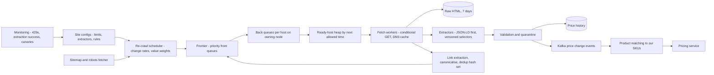
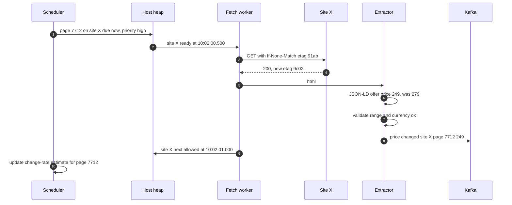
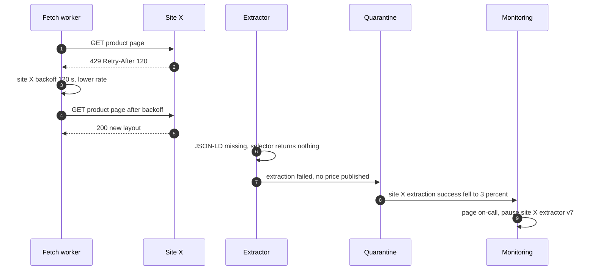
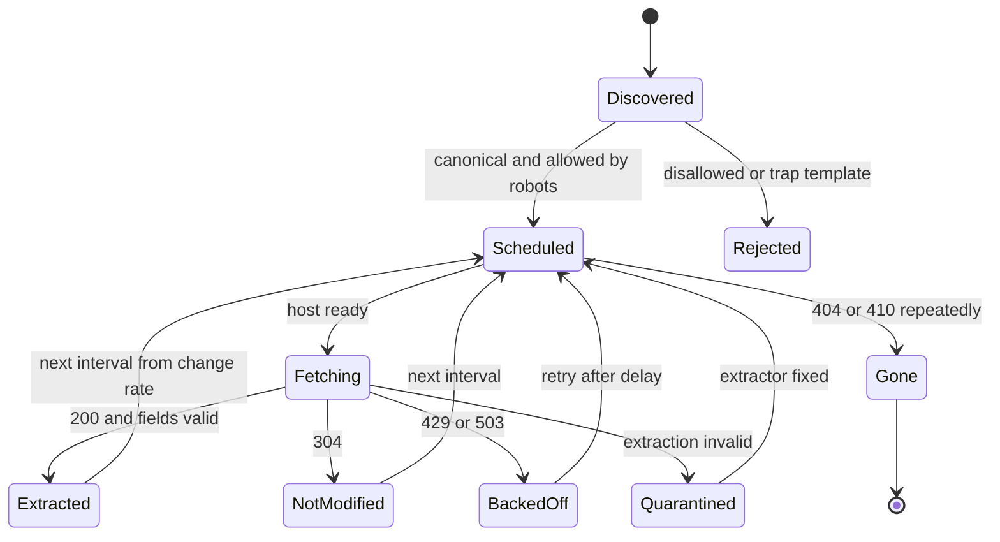

# 53. Case Study: Web Crawler (Competitor Price Monitoring)

!!! abstract "Chapter at a glance"
    **Reader bands:** B2 → B4 · **Prerequisites:** [Ch 11](../02-distributed-core/11-partitioning-and-sharding.md) (partitioning), [Ch 14](../02-distributed-core/14-messaging-and-event-streaming.md) (queues), [Ch 39](39-distributed-rate-limiter.md) (rate limiting), [Ch 50](50-distributed-job-scheduler.md) (scheduling) · **What you will build:** a crawler that keeps our view of public competitor prices, product availability and catalogue changes fresh, politely, legally and within a budget. This is the classic "design a web crawler" interview question. We answer it for a job with sharper requirements than a search engine's: **every product matters**, and **prices go stale in hours**.

    **Lab results:**

    - **L1, the frontier.** A real HTTP server simulated 100 sites, each allowing one request every 500 ms:
        - A global FIFO that fetched immediately got **307** HTTP 429 responses, was **banned by 4 sites**, and fetched 49 pages.
        - Waiting politely in place fetched only 625 pages.
        - **Per-host queues with a ready-host scheduler** fetched **3,826** of a 4,000-page ceiling, with zero 429s.
    - **L2, dedup.** 12M links pointed to 2M real pages:
        - Without canonicalisation the crawler made **8.77M duplicate fetches**.
        - A set of canonical 64-bit hashes gave exact dedup in **64 MB**, against 1.47 GB for raw URL strings.
        - A Bloom filter used **2.3 MB**, but silently never fetched **3,380** real pages.
    - **L3, re-crawl scheduling.**
        - A whole-page hash "learns" nothing, because every page looks changed on every fetch.
        - Price-based proportional allocation lifted flash-deal freshness from **34% to 86%**, but lowered overall freshness below uniform.
        - Optimal allocation beats uniform only with good rate estimates: **94.9%** with true rates against 92.5% for uniform.
    - **L4, traps.**
        - Breadth-first crawling spent **17,449 of 20,000** fetches on facets, calendars and session-id duplicates, and found 2,823 of 5,000 products.
        - **robots.txt plus sitemap.xml** found all **5,000** products in **5,301** fetches.

    · **Reading time:** 100 min + code

!!! warning "Legal and ethical scope (VERIFY with counsel)"
    Collecting competitors' public prices is common, but terms of service, copyright and database rights, anti-circumvention and computer-misuse laws, and data-protection rules vary by jurisdiction and change over time. This chapter assumes:

    - public pages only;
    - `robots.txt` honoured;
    - identified user agents;
    - conservative rate limits;
    - no login, CAPTCHA or anti-bot circumvention;
    - no personal data.

    Where available, prefer official feeds, affiliate APIs or partnerships. Nothing here is legal advice.

---

## 1. Introduction & Why It Matters

### 1.1 A story: the crawler that got us blocked

The first price monitor was a Python script on a cron job. For each of 40,000 tracked products on six competitor sites, it fetched the page every hour with 50 threads, parsed the price with a CSS selector, and wrote it to a table. Four things went wrong:

1. **Two sites blocked the office IP range within a week.** Fifty threads had been hitting the same site at once. The platform's own marketing team, on the same IPs, lost access to those sites too.
2. **Half the fetches were duplicates.** Links carried `utm_*` and session parameters. The same product was fetched under six spellings, and each spelling had a different "last price".
3. **Prices were stale where it mattered.** Flash deals changed hourly and were checked hourly at best. Staple products that changed monthly were also checked hourly, using up the budget.
4. **A redesign broke everything.** One site redesigned its product page. The selector returned nothing, the pipeline stored `null` prices as `0`, and the pricing engine ([Ch 49](49-pricing-promotions-and-coupons.md)) nearly matched "₹0".

A crawler is a **distributed scheduler with manners**: a frontier that respects every site's limits, dedup at URL and content level, re-crawl policies that spend a budget where freshness pays, robust extraction with validation, and trap avoidance, all under legal constraints.

!!! quote "The thesis of this chapter"
    **The frontier is per host.** Separate queues per site, scheduled by when each site may next be contacted, maximise throughput *and* politeness (L1). **Dedup canonical URLs** with compact exact structures. A probabilistic structure's false positives are pages you never see (L2). **Re-crawl on the signal you care about**: extract the price, estimate *its* change rate, and weight by business value. A uniform schedule is a strong baseline (L3). **Use what sites publish**: sitemaps and robots.txt beat heuristics against traps (L4).

### 1.2 What we crawl

| Target | Pages | What we extract | Freshness need |
|---|---|---|---|
| Competitor product pages (tracked SKUs) | ~100k | Price, MRP, availability, pack size | Hours; minutes for flash deals |
| Competitor category/listing pages | ~20k | New products, ranking | Daily |
| Brand sites and official catalogues | ~5k | MRP, pack changes, images | Weekly |
| Sitemaps and feeds | Hundreds | URL discovery, lastmod | Daily |

### 1.3 Learning objectives

By the end you will be able to:

- **Design a polite, high-throughput frontier** (L1).
- **Deduplicate URLs and content** at scale (L2).
- **Schedule re-crawls** to maximise the freshness that matters (L3).
- **Avoid traps** and use sitemaps and robots.txt (L4).
- Build robust extraction, change detection and validation, and scale a crawler horizontally.

---

## 2. Core Concepts — Beginner to Deep

### 2.1 Intuition: a courteous mystery shopper <span class="band b2">B2</span>

A mystery shopper visits many shops. They don't send fifty people into one shop at once. They don't visit the same shop's aisle twice because the aisle sign was spelled differently. They visit the flash-sale shelf more often than the rice aisle. They ignore "staff only" signs never, and they don't wander into the infinite storeroom. When a shop publishes a price list at the door, they read it instead of walking every aisle.

### 2.2 Requirements <span class="band b2">B2</span>

**Functional**

- Discover and track product URLs on configured sites. Fetch, extract structured fields (price, MRP, availability, pack size), and store the history.
- Re-crawl on schedules driven by change rate and business value; detect changes; publish events for price changes.
- Respect `robots.txt`, crawl-delay and site-specific limits; identify ourselves (user agent, contact URL).
- Match competitor products to our SKUs (brand, pack size, barcode where present). This matching feeds pricing.

**Non-functional**

- Politeness: never exceed per-site limits. Back off on 429/503. Circuit-break on errors.
- Scale: millions of fetches a day across hundreds of sites; horizontal scaling.
- Freshness targets per class (flash deals < 1 h, staples < 1 day).
- Robustness: extraction failures are detected, not silently stored.

### 2.3 Estimation <span class="band b2">B2</span>

| Quantity | Estimate |
|---|---|
| Tracked pages | ~125k |
| Fetch budget | ~400k/day (L3), limited by politeness: 200 sites × 1 req/s ≈ 17M/day theoretical, far below in practice |
| Page size | ~150 KB HTML → 60 GB/day raw; store extracted fields, keep raw HTML for 7 days (debugging and re-extraction) |
| URL seen-set | 2M canonical URLs × 8 B hashes ≈ 16 MB of hashes (64 MB table, L2) |
| Extracted rows | 400k/day → price history of ~150M rows/year |

### 2.4 The frontier ⭐ <span class="band b3">B3</span>

L1 ran against a real HTTP server simulating 100 sites, each allowing 1 request per 500 ms, with 64 threads for 20 s:

| Frontier | Pages OK | 429s | Sites that banned us | Sites crawled |
|---|---|---|---|---|
| Global FIFO, fetch immediately | 49 | 307 | 4 | 49 |
| Global FIFO, wait for the host's turn | 625 | 15 | 0 | 55 |
| **Per-host queues + ready-host scheduler** | **3,826** | **0** | 0 | **100** |

- **Links are skewed.** A few sites hold most links, so a global FIFO is dominated by a few hosts.
- **The Mercator design** (Heydon & Najork) splits the frontier in two:
    - *Front queues* order URLs by priority.
    - *Back queues* hold URLs per host.
    - A heap of hosts, keyed by their next-allowed time, hands workers only ready hosts.
- **Politeness state per host**: crawl-delay from robots.txt, adaptive backoff on 429/503 (honour `Retry-After`), concurrent-connection limits, and error-rate circuit breakers ([Ch 18](../02-distributed-core/18-resilience-patterns.md)).
- **Distribution**: partition hosts across crawler nodes (consistent hashing by host). Each node owns its hosts' back queues and politeness state, so there is no cross-node coordination per fetch. DNS caching is per node.

### 2.5 URL and content dedup ⭐ <span class="band b3">B3</span>

L2 used 12M links pointing to 2M real pages:

| Seen-set | Fetches | Duplicate fetches | Pages never fetched | Memory |
|---|---|---|---|---|
| Exact URL strings as written | 10,767,117 | **8,767,117** | 0 | 1,474.5 MB |
| Canonicalised, exact strings | 2,000,000 | 0 | 0 | 258.7 MB |
| **Canonicalised, 64-bit hash set** | 2,000,000 | 0 | 0 | **64.0 MB** |
| Canonicalised, Bloom filter (1% FP) | 1,996,620 | 0 | **3,380** | 2.3 MB |

- **Canonicalisation**:
    - Lower-case the scheme and host, and drop default ports and fragments.
    - Remove tracking and session parameters (`utm_*`, `gclid`, `fbclid`, `sid`), and sort query parameters.
    - Normalise trailing slashes.
    - Prefer the page's `<link rel="canonical">` once fetched.
    - Keep **site-specific rules** (which parameters matter: `size` does, `ref` doesn't).
- **Hash sets** of 64-bit fingerprints are exact for practical purposes at millions of URLs (collision probability ~n²/2⁶⁵).
- **Bloom filters** are right for web-scale discovery, where missing 0.2% is fine. They are wrong for a price monitor that must see every product: a false positive is a product we never fetch.
- **Content dedup**:
    - Exact duplicates: hash of the extracted content.
    - Near-duplicates (mirror pages, printer versions): **SimHash / MinHash**.
    - Hash the *extracted fields*, not the raw HTML, because of timestamps and ads (L3).

### 2.6 Re-crawl scheduling ⭐ <span class="band b4">B4</span>

L3 simulated 100k price pages with a budget of 400k fetches/day:

| Policy | Prices current | Mean age of a wrong price | Flash-deal pages current |
|---|---|---|---|
| Uniform, every 6 h | 92.5% | 1.6 h | 33.5% |
| Proportional, from whole-page hash | 92.5% | 1.6 h | 33.5% |
| Proportional, from extracted price | 89.0% | 13.0 h | **85.7%** |
| Optimal, price-based estimates | 89.9% | 13.6 h | 74.3% |
| **Optimal, true rates (ceiling)** | **94.9%** | 1.7 h | 70.8% |

- **Change detection must use the field you care about.** Whole-page hashes change on every fetch (timestamps, counters, ads), so learning from them is learning nothing.
- **Estimating change rates** from few observations is noisy. Cho & Garcia-Molina's estimator corrects for missed changes, but three days can't tell weekly pages from monthly ones.
- **Proportional allocation** chases fast-changing pages, and starves the rest.
- **The freshness-optimal allocation** (equalising marginal freshness per fetch) is the right objective, but only with good estimates. Keep estimating continuously, use priors from similar pages (category, site), and weight by business value (top sellers, flash deals) explicitly.
- **Cheap checks**:
    - Conditional GETs (`If-None-Match`/`If-Modified-Since` → 304).
    - Sitemap `lastmod`.
    - Listing pages that show prices for many products at once (one fetch updates 40 prices).
- **Push beats pull**: official feeds or partner APIs, where they exist.

### 2.7 Traps and site signals ⭐ <span class="band b3">B3</span>

L4 used one generated site with a budget of 20,000 fetches:

| Crawl policy | Products found | Fetches on traps | Fetches used |
|---|---|---|---|
| Breadth-first, every new URL | 2,823 | 17,449 | 20,000 |
| + depth limit 4 | 2,823 | 17,449 | 20,000 |
| Canonicalise + per-template cap | 4,307 | 15,492 | 20,000 |
| **+ robots.txt + sitemap.xml** | **5,000** | **0** | **5,301** |

- **Traps**:
    - Faceted navigation (combinatorial filters).
    - Calendars.
    - Session ids in URLs.
    - Infinite pagination.
    - Soft 404s (a "not found" page with status 200).
    - Spider traps that are deliberate.
- **Guards**:
    - Canonicalisation.
    - URL-template detection with budgets that continue only while a template yields new content.
    - Per-host page budgets.
    - Soft-404 detection.
    - Depth limits (which did nothing here: the traps are shallow).
- **Site signals**: robots.txt (Disallow, Crawl-delay), sitemaps with `lastmod`, canonical links, and structured data (JSON-LD `Product`/`Offer`) for extraction.

### 2.8 Extraction and validation <span class="band b3">B3</span>

- **Prefer structured data** (JSON-LD `schema.org/Product` with `offers.price`) over CSS selectors. It is designed for machines and changes less often.
- **Validate** every extraction:
    - The price is positive and within a plausible range of the last price.
    - The currency is present, and pack size is parsed.
    - Availability is one of a known set of values.
- **Quarantine suspicious values** instead of publishing them. A redesign should produce "extraction failed: 100% of site X", not "price = 0".
- **Per-site extractors are versioned**, with synthetic monitoring on known pages ("canary products") and alerts on the extraction success rate per site.
- **Rendering**: some sites need JavaScript rendering. Headless browsers cost 10–50× more than plain fetches, so use them only where needed, and cache static resources.

### 2.9 Product matching <span class="band b3">B3</span>

A competitor price is useful only if it is linked to *our* SKU. Match by:

1. Barcode (EAN/GTIN) when exposed.
2. Brand + normalised name + pack size.
3. ML similarity with human review for low confidence.

Store the match confidence, and let pricing ([Ch 49](49-pricing-promotions-and-coupons.md)) use only high-confidence matches.

### 2.10 Interview framing <span class="band b4">B4</span>

"Design a web crawler." Clarify scope (a search-engine crawl vs a focused crawl like price monitoring), scale, freshness and politeness. Then cover:

- a frontier with per-host queues;
- distribution by host;
- DNS caching;
- robots.txt;
- dedup (URL canonicalisation, fingerprints, content hashes);
- storage;
- re-crawl scheduling;
- traps;
- extraction and validation;
- monitoring.

Staff-level signals: the Mercator frontier, the Bloom-filter trade-off for focused crawls, change-rate estimation, and legal/ethical constraints.

---

## 3. Architecture & Diagrams

### 3.1 Component view



### 3.2 Sequence: happy path, re-crawl a flash-deal page



### 3.3 Sequence: failure path, a site redesign and rate limiting



### 3.4 State: a tracked page



---

## 4. Design Document Excerpt: Price Intelligence Crawler v2

!!! note "Design Document (excerpt) — Price Intelligence Crawler v2"
    **Status:** Accepted · **Authors:** Pricing data team · **Reviewers:** Legal, Pricing, SRE, Security

    | Field | Value |
    |---|---|
    | Context | Hourly scripts with 50 threads got us blocked. Duplicate URLs wasted half the fetches. The re-crawl policy ignored change rates. A redesign published ₹0 prices. |
    | Decision | Mercator-style frontier with per-host back queues and adaptive politeness. Hosts are partitioned across nodes. URLs are canonicalised with site rules and stored as a 64-bit fingerprint set. Re-crawl uses price-based change-rate estimates with priors and value weights, plus a uniform floor. Sitemaps and robots.txt are first-class. Extraction prefers JSON-LD, with validation, quarantine and canaries. Legal review per site. |
    | Related ADRs | ADR-390 Frontier: per-host queues, ready-host heap, default 1 request / 2 s per site, Retry-After honoured, circuit breaker at 5% errors (L1). ADR-391 Dedup: canonical URL rules per site, exact 64-bit fingerprints (no Bloom filters for tracked pages) (L2). ADR-392 Re-crawl: every page at least every 72 h; the remaining budget uses optimal allocation on continuously updated estimates with category priors; flash-deal list weighted ×5 (L3). ADR-393 Discovery: sitemaps + robots.txt; template budgets; soft-404 detection (L4). ADR-394 Legal: public pages only, identified UA, no circumvention, per-site approval recorded. |

    **Requirements.**

    - **R1:** Zero requests above a site's configured rate. 429s below 0.1% of fetches.
    - **R2:** ≥ 90% of tracked prices current (time-averaged); flash-deal pages ≥ 80%.
    - **R3:** No invalid price is ever published. An extraction failure alerts within 15 minutes.
    - **R4:** New products on sitemaps are discovered within 24 hours.
    - **R5:** A per-site kill switch takes effect in under a minute.

    **Decisions in detail.**

    1. **Frontier (ADR-390):** hosts are consistent-hashed to 8 nodes. Each node keeps back queues in memory, persisted to RocksDB, and the host heap in memory.
    2. **Dedup (ADR-391):** 64-bit xxHash of the canonical URL, kept in a partitioned hash set with a Redis-backed snapshot.
    3. **Scheduling (ADR-392):** change events update the estimates, and a nightly job recomputes allocations. The job scheduler ([Ch 50](50-distributed-job-scheduler.md)) fires due fetches through the frontier.
    4. **Discovery (ADR-393):** a daily sitemap diff feeds new URLs to the frontier.
    5. **Legal (ADR-394):** a site config can't be enabled without a recorded approval.

    **Consequences.**

    - Costs: per-site configuration and extractor maintenance, legal reviews, and estimation infrastructure.
    - Benefits: no blocks, no wasted duplicate fetches, fresher prices where they matter, and no ₹0 incidents.

---

## 5. Hands-On Code — Level Ladder

!!! info "What's real here"
    - **L1** crawls a **real local HTTP server** with per-site rate limiting and bans, using 64 real threads.
    - **L2** runs real canonicalisation, hash sets and a Bloom filter over 12M synthetic links.
    - **L3 and L4** are deterministic simulations. Change rates, budgets and site structures are stated assumptions.
    - None of the labs touch the internet.

All four labs are single-file JDK 21 programs. Run L1 with `-Dsun.net.httpserver.nodelay=true`, and L2 with `-Xmx4g`.

### L1 — A polite frontier <span class="band b3">B3</span>

**Requirement:** "Crawl as fast as the sites allow — and never faster."

A real local HTTP server stands in for 100 sites. Each site allows one request per 500 ms, answers faster requests with 429, and bans us after ten 429s.

```java title="FrontierL1.java"
// FrontierL1.java — run with: java -Dsun.net.httpserver.nodelay=true FrontierL1.java   (JDK 21, no dependencies)
// A POLITE CRAWLER'S URL FRONTIER. A REAL local HTTP server plays 100 websites (/h{host}/p{page}); each host has 300
// pages; every page links to 8 others (70% same host, 30% other hosts, host popularity Zipf — a few big sites get most
// links). Each site allows ONE request per 500 ms from us: faster requests get HTTP 429, and after 10 of those the site
// bans us (403 for everything). 64 crawler threads, 20 seconds per strategy, same seed URLs.
//   C1 one global FIFO queue; fetch immediately
//   C2 one global FIFO queue; before fetching, wait until that host's next allowed time (be polite in place)
//   C3 a queue per host + a scheduler that hands out only hosts whose next allowed time has come (Mercator-style
//      back queues); a worker takes a ready host, fetches one URL, reschedules the host 500 ms later
// Measured: pages fetched successfully, 429s sent to sites, sites that banned us, distinct sites crawled.
import com.sun.net.httpserver.*;
import java.net.*;
import java.net.http.*;
import java.util.*;
import java.util.concurrent.*;
import java.util.concurrent.atomic.*;

public class FrontierL1 {
    static final int HOSTS = 100, PAGES = 300, GAP_MS = 500, WORKERS = 64, RUN_S = 20;
    static final ConcurrentHashMap<Integer, Long> lastHit = new ConcurrentHashMap<>();
    static final ConcurrentHashMap<Integer, AtomicInteger> strikes = new ConcurrentHashMap<>();
    static double[] hostCdf = new double[HOSTS];

    public static void main(String[] args) throws Exception {
        double acc = 0; for (int h = 0; h < HOSTS; h++) { acc += 1 / Math.pow(h + 1, 1.2); hostCdf[h] = acc; } for (int h = 0; h < HOSTS; h++) hostCdf[h] /= acc;
        HttpServer srv = HttpServer.create(new InetSocketAddress("127.0.0.1", 0), 512);
        srv.setExecutor(Executors.newVirtualThreadPerTaskExecutor()); srv.createContext("/", FrontierL1::page); srv.start();
        String base = "http://127.0.0.1:" + srv.getAddress().getPort();
        HttpClient http = HttpClient.newBuilder().executor(Executors.newVirtualThreadPerTaskExecutor()).build();
        System.out.println("100 sites × 300 pages, 1 request / 500 ms per site allowed (429 otherwise, ban after 10); 64 threads, 20 s.\n");
        System.out.printf("   %-62s %10s %8s %12s %10s%n", "frontier", "pages ok", "429s", "sites that", "sites");
        System.out.printf("   %-62s %10s %8s %12s %10s%n", "", "", "", "banned us", "crawled");
        String[] names = {"C1) global FIFO, fetch immediately", "C2) global FIFO, wait for the host's turn before fetching", "C3) per-host queues + ready-host scheduler (back queues)"};
        for (int s = 0; s < 3; s++) run(s, names[s], base, http);
        System.out.println("\n   → the web is lopsided: a few sites hold most links, so a global FIFO is mostly URLs of the same few sites.");
        System.out.println("     Fetching them immediately hammers those sites until they ban us, and banned sites stop yielding new links.");
        System.out.println("     Waiting for each site's turn in place mostly fixes the manners (a few 429s still slip through from timing");
        System.out.println("     jitter) but not the throughput: threads sit blocked on the busy sites while other sites' URLs wait behind");
        System.out.println("     them. Separate queues per site, and a scheduler that hands out SITES when they may next be contacted, keep");
        System.out.println("     every thread on a ready site: close to the 4,000-page politeness ceiling (100 sites × 2/s × 20 s), no 429s.");
        srv.stop(0); System.exit(0);
    }

    static void page(HttpExchange ex) throws java.io.IOException {
        String[] p = ex.getRequestURI().getPath().split("/"); int host = Integer.parseInt(p[1].substring(1)), pg = Integer.parseInt(p[2].substring(1));
        String run = ex.getRequestURI().getQuery(); int key = host * 10 + (run == null ? 0 : run.charAt(run.length() - 1) - '0');
        long now = System.nanoTime(); int code = 200;
        AtomicInteger st = strikes.computeIfAbsent(key, k -> new AtomicInteger());
        if (st.get() >= 10) code = 403;
        else { Long prev = lastHit.put(key, now); if (prev != null && now - prev < GAP_MS * 1_000_000L) { st.incrementAndGet(); code = 429; } }
        StringBuilder b = new StringBuilder();
        if (code == 200) { Random r = new Random(host * 100_003L + pg);
            for (int i = 0; i < 8; i++) { int h = r.nextDouble() < 0.7 ? host : pickHost(r); b.append("<a href=\"/h").append(h).append("/p").append(r.nextInt(PAGES)).append("\">x</a>\n"); } }
        byte[] out = b.toString().getBytes(); ex.sendResponseHeaders(code, out.length == 0 ? -1 : out.length); if (out.length > 0) ex.getResponseBody().write(out); ex.close();
    }
    static int pickHost(Random r) { int k = Arrays.binarySearch(hostCdf, r.nextDouble()); return Math.min(HOSTS - 1, k < 0 ? -k - 1 : k); }

    static void run(int strategy, String name, String base, HttpClient http) throws Exception {
        Set<String> seen = ConcurrentHashMap.newKeySet(); AtomicInteger ok = new AtomicInteger(), tooMany = new AtomicInteger(); Set<Integer> crawled = ConcurrentHashMap.newKeySet();
        LinkedBlockingDeque<String> fifo = new LinkedBlockingDeque<>();
        ConcurrentHashMap<Integer, ConcurrentLinkedQueue<String>> perHost = new ConcurrentHashMap<>();
        DelayQueue<HostTurn> ready = new DelayQueue<>(); Set<Integer> scheduled = ConcurrentHashMap.newKeySet();
        ConcurrentHashMap<Integer, Long> nextAllowed = new ConcurrentHashMap<>();
        java.util.function.Consumer<String> add = url -> { if (!seen.add(url)) return; if (strategy < 2) fifo.add(url); else {
            int h = hostOf(url); perHost.computeIfAbsent(h, k -> new ConcurrentLinkedQueue<>()).add(url); if (scheduled.add(h)) ready.add(new HostTurn(h, nextAllowed.getOrDefault(h, 0L))); } };
        for (int h = 0; h < HOSTS; h += 10) add.accept("/h" + h + "/p0");                            // 10 seed sites
        long end = System.currentTimeMillis() + RUN_S * 1000L; ExecutorService ex = Executors.newFixedThreadPool(WORKERS); List<Future<?>> fs = new ArrayList<>();
        for (int w = 0; w < WORKERS; w++) fs.add(ex.submit(() -> {
            while (System.currentTimeMillis() < end) {
                String url; int h;
                if (strategy < 2) { url = fifo.poll(100, TimeUnit.MILLISECONDS); if (url == null) continue; h = hostOf(url);
                    if (strategy == 1) { long wait; synchronized (nextAllowed) { long na = Math.max(nextAllowed.getOrDefault(h, 0L), System.currentTimeMillis()); nextAllowed.put(h, na + GAP_MS + 5); wait = na - System.currentTimeMillis(); }
                        if (wait > 0) Thread.sleep(wait); } }
                else { HostTurn t = ready.poll(100, TimeUnit.MILLISECONDS); if (t == null) continue; h = t.host; url = perHost.get(h).poll();
                    if (url == null) { scheduled.remove(h); if (!perHost.get(h).isEmpty() && scheduled.add(h)) ready.add(new HostTurn(h, System.currentTimeMillis())); continue; } }
                try {
                    HttpResponse<String> resp = http.send(HttpRequest.newBuilder(URI.create(base + url + "?run=" + strategy)).build(), HttpResponse.BodyHandlers.ofString());
                    if (resp.statusCode() == 200) { ok.incrementAndGet(); crawled.add(h);
                        for (String line : resp.body().split("\n")) { int i = line.indexOf("href=\""); if (i >= 0) add.accept(line.substring(i + 6, line.indexOf('"', i + 6))); } }
                    else if (resp.statusCode() == 429) tooMany.incrementAndGet();
                } catch (Exception e) { }
                if (strategy == 2) { long na = System.currentTimeMillis() + GAP_MS + 5; nextAllowed.put(h, na);
                    if (!perHost.get(h).isEmpty()) ready.add(new HostTurn(h, na)); else { scheduled.remove(h); if (!perHost.get(h).isEmpty() && scheduled.add(h)) ready.add(new HostTurn(h, na)); } }
            }
            return null; }));
        for (Future<?> f : fs) f.get(); ex.shutdown();
        int banned = 0; for (int h = 0; h < HOSTS; h++) { AtomicInteger st = strikes.get(h * 10 + strategy); if (st != null && st.get() >= 10) banned++; }
        System.out.printf("   %-62s %,10d %,8d %12d %10d%n", name, ok.get(), tooMany.get(), banned, crawled.size());
    }
    static int hostOf(String url) { return Integer.parseInt(url.substring(2, url.indexOf('/', 1))); }
    record HostTurn(int host, long at) implements Delayed {
        public long getDelay(TimeUnit u) { return u.convert(at - System.currentTimeMillis(), TimeUnit.MILLISECONDS); }
        public int compareTo(Delayed o) { return Long.compare(at, ((HostTurn) o).at); }
    }
}
```

```text title="java -Dsun.net.httpserver.nodelay=true FrontierL1.java"
100 sites × 300 pages, 1 request / 500 ms per site allowed (429 otherwise, ban after 10); 64 threads, 20 s.

   frontier                                                         pages ok     429s   sites that      sites
                                                                                         banned us    crawled
   C1) global FIFO, fetch immediately                                     49      307            4         49
   C2) global FIFO, wait for the host's turn before fetching             625       15            0         55
   C3) per-host queues + ready-host scheduler (back queues)            3,826        0            0        100

   → the web is lopsided: a few sites hold most links, so a global FIFO is mostly URLs of the same few sites.
     Fetching them immediately hammers those sites until they ban us, and banned sites stop yielding new links.
     Waiting for each site's turn in place mostly fixes the manners (a few 429s still slip through from timing
     jitter) but not the throughput: threads sit blocked on the busy sites while other sites' URLs wait behind
     them. Separate queues per site, and a scheduler that hands out SITES when they may next be contacted, keep
     every thread on a ready site: close to the 4,000-page politeness ceiling (100 sites × 2/s × 20 s), no 429s.
```

**Reading it:**

- **C1** is banned by the busiest sites within seconds. Banned sites return no links, so its crawl dies at 49 pages.
- **C2** is polite, apart from a few timing-jitter 429s, but slow: most threads sleep on the same hot sites.
- **C3** reaches 96% of the politeness ceiling, with every site crawled and no violations.

### L2 — URL dedup at scale <span class="band b2">B2</span>

**Requirement:** "Fetch every product page exactly once, whatever spelling the link used, in bounded memory."

12M links to 2M pages, with realistic URL variants.

```java title="DedupL2.java"
// DedupL2.java — run with: java -Xmx3g DedupL2.java   (JDK 21, no dependencies)
// "HAVE WE ALREADY FETCHED THIS URL?" 2,000,000 real pages across 5,000 competitor/catalogue sites, discovered through
// 12,000,000 links (fixed seed). Links to the same page come in many spellings: http vs https, upper-case host,
// default port, trailing slash, #fragments, utm_* tracking parameters, session ids, and query parameters in any order.
//   D1 exact string set of URLs as written
//   D2 canonicalise (lower-case scheme/host, drop default port, fragment, tracking and session params, sort query,
//      strip trailing slash), then an exact string set
//   D3 canonicalise, then a set of 64-bit hashes (open addressing)
//   D4 canonicalise, then a Bloom filter sized for 1% false positives
// Measured: fetches, duplicate fetches of the same page, real pages never fetched (skipped by a false positive), and
// the memory of the "seen" structure.
import java.nio.charset.StandardCharsets;
import java.security.MessageDigest;
import java.util.*;

public class DedupL2 {
    public static void main(String[] args) throws Exception {
        int pages = 2_000_000, links = 12_000_000; Random r = new Random(53);
        String[] canon = new String[pages]; for (int p = 0; p < pages; p++) { int site = r.nextInt(5000);
            canon[p] = "https://shop" + site + ".example.in/c/" + (p % 97) + "/product/" + p + (r.nextBoolean() ? "?size=" + (1 + r.nextInt(5)) + "&variant=" + r.nextInt(4) : ""); }
        String[] linkUrl = new String[links]; int[] linkPage = new int[links];
        for (int i = 0; i < links; i++) { int p = i < pages ? i : r.nextInt(pages); linkPage[i] = p; linkUrl[i] = mangle(canon[p], r); }
        System.out.printf("%,d pages, %,d links; e.g. %s%n                              → %s%n%n", pages, links, linkUrl[pages + 7], canonicalise(linkUrl[pages + 7]));
        System.out.printf("   %-52s %12s %16s %16s %12s%n", "seen-set", "fetches", "duplicate", "pages never", "memory");
        System.out.printf("   %-52s %12s %16s %16s %12s%n", "", "", "fetches", "fetched", "");
        String[] names = {"D1) exact URL strings as written", "D2) canonicalised URLs, exact string set", "D3) canonicalised, 64-bit hash set", "D4) canonicalised, Bloom filter (1% FP)"};
        for (int d = 0; d < 4; d++) {
            long fetches = 0; boolean[] fetched = new boolean[pages]; long dup = 0, mem;
            if (d <= 1) { HashSet<String> seen = new HashSet<>(); long chars = 0;
                for (int i = 0; i < links; i++) { String u = d == 0 ? linkUrl[i] : canonicalise(linkUrl[i]); if (seen.add(u)) { chars += u.length(); fetches++; if (fetched[linkPage[i]]) dup++; fetched[linkPage[i]] = true; } }
                mem = seen.size() * (48L + 32) + chars; }                                          // ~String + node overhead + Latin-1 bytes
            else if (d == 2) { LongSet seen = new LongSet(1 << 23);
                for (int i = 0; i < links; i++) { if (seen.add(hash64(canonicalise(linkUrl[i])))) { fetches++; if (fetched[linkPage[i]]) dup++; fetched[linkPage[i]] = true; } }
                mem = seen.bytes(); }
            else { Bloom b = new Bloom(pages, 0.01);
                for (int i = 0; i < links; i++) { if (b.addIfAbsent(canonicalise(linkUrl[i]))) { fetches++; if (fetched[linkPage[i]]) dup++; fetched[linkPage[i]] = true; } }
                mem = b.bytes(); }
            int never = 0; for (boolean f : fetched) if (!f) never++;
            System.out.printf("   %-52s %,12d %,16d %,16d %9.1f MB%n", names[d], fetches, dup, never, mem / 1048576.0);
        }
        System.out.println("\n   → without canonicalisation the crawler fetches the same page under every spelling it finds — here more");
        System.out.println("     fetches go to duplicates than to new pages, and every one costs the site a request. Canonicalising first makes");
        System.out.println("     dedup exact; storing 8-byte hashes instead of strings cuts the seen-set several-fold with no practical collision");
        System.out.println("     risk at this scale. A Bloom filter is smaller still, but its false positives are pages we silently NEVER");
        System.out.println("     fetch — acceptable for a web-scale crawl, not for a price monitor that must see every product.");
    }

    static final String[] TRACK = {"utm_source=app", "utm_medium=cpc", "utm_campaign=diwali", "gclid=Cj0K9x", "fbclid=IwAR2", "sid=8f3a9c", "ref=home"};
    static String mangle(String u, Random r) {
        String s = u;
        if (r.nextDouble() < 0.3) s = s.replace("https://", "http://");
        if (r.nextDouble() < 0.2) s = s.replace(".example.in", ".EXAMPLE.in").replace("https://shop", "https://SHOP");
        if (r.nextDouble() < 0.1) s = s.replace(".in/", ".in:443/");
        String path = s, query = ""; int q = s.indexOf('?'); if (q >= 0) { path = s.substring(0, q); query = s.substring(q + 1); }
        if (r.nextDouble() < 0.3) path = path + "/";
        List<String> params = new ArrayList<>(query.isEmpty() ? List.of() : Arrays.asList(query.split("&")));
        if (r.nextDouble() < 0.4) params.add(TRACK[r.nextInt(TRACK.length)]);
        if (r.nextDouble() < 0.5) Collections.shuffle(params, r);
        String out = path + (params.isEmpty() ? "" : "?" + String.join("&", params));
        if (r.nextDouble() < 0.15) out += "#reviews";
        return out;
    }
    static String canonicalise(String u) {
        int h = u.indexOf('#'); if (h >= 0) u = u.substring(0, h);
        int se = u.indexOf("://"); String scheme = u.substring(0, se).toLowerCase(Locale.ROOT); String rest = u.substring(se + 3);
        int slash = rest.indexOf('/'); String host = (slash < 0 ? rest : rest.substring(0, slash)).toLowerCase(Locale.ROOT); String pathq = slash < 0 ? "/" : rest.substring(slash);
        if (host.endsWith(":443") || host.endsWith(":80")) host = host.substring(0, host.lastIndexOf(':'));
        scheme = "https";                                                                         // site serves both; https is canonical
        String path = pathq, query = ""; int q = pathq.indexOf('?'); if (q >= 0) { path = pathq.substring(0, q); query = pathq.substring(q + 1); }
        if (path.length() > 1 && path.endsWith("/")) path = path.substring(0, path.length() - 1);
        List<String> keep = new ArrayList<>(); if (!query.isEmpty()) for (String p : query.split("&")) { String k = p.split("=")[0];
            if (k.startsWith("utm_") || k.equals("gclid") || k.equals("fbclid") || k.equals("sid") || k.equals("ref")) continue; keep.add(p); }
        Collections.sort(keep);
        return scheme + "://" + host + path + (keep.isEmpty() ? "" : "?" + String.join("&", keep));
    }
    static long hash64(String s) { byte[] b = s.getBytes(StandardCharsets.UTF_8); long h = 0xcbf29ce484222325L; for (byte x : b) { h ^= x; h *= 0x100000001b3L; } h ^= h >>> 33; h *= 0xff51afd7ed558ccdL; h ^= h >>> 33; return h == 0 ? 1 : h; }
    static final class LongSet { long[] t; int n; LongSet(int cap) { t = new long[cap]; }
        boolean add(long k) { if (n * 2 > t.length) grow(); int m = t.length - 1, i = (int) (k ^ (k >>> 32)) & m; while (t[i] != 0) { if (t[i] == k) return false; i = (i + 1) & m; } t[i] = k; n++; return true; }
        void grow() { long[] old = t; t = new long[old.length * 2]; n = 0; for (long k : old) if (k != 0) add(k); }
        long bytes() { return t.length * 8L; } }
    static final class Bloom { final long[] bits; final int k; final long m;
        Bloom(int n, double fp) { m = (long) Math.ceil(-n * Math.log(fp) / (Math.log(2) * Math.log(2))); k = (int) Math.round(m / (double) n * Math.log(2)); bits = new long[(int) ((m + 63) / 64)]; }
        boolean addIfAbsent(String s) { long h1 = hash64(s), h2 = hash64(s + "#") | 1; boolean all = true;
            for (int i = 0; i < k; i++) { long idx = Math.floorMod(h1 + i * h2, m); int w = (int) (idx >>> 6); long bit = 1L << (idx & 63); if ((bits[w] & bit) == 0) { all = false; bits[w] |= bit; } }
            return !all; }
        long bytes() { return bits.length * 8L; } }
}
```

```text title="java -Xmx4g DedupL2.java"
2,000,000 pages, 12,000,000 links; e.g. http://shop1834.example.in/c/28/product/1432233?size=4&variant=3&utm_medium=cpc
                              → https://shop1834.example.in/c/28/product/1432233?size=4&variant=3

   seen-set                                                  fetches        duplicate      pages never       memory
                                                                              fetches          fetched             
   D1) exact URL strings as written                       10,767,117        8,767,117                0    1474.5 MB
   D2) canonicalised URLs, exact string set                2,000,000                0                0     258.7 MB
   D3) canonicalised, 64-bit hash set                      2,000,000                0                0      64.0 MB
   D4) canonicalised, Bloom filter (1% FP)                 1,996,620                0            3,380       2.3 MB

   → without canonicalisation the crawler fetches the same page under every spelling it finds — here more
     fetches go to duplicates than to new pages, and every one costs the site a request. Canonicalising first makes
     dedup exact; storing 8-byte hashes instead of strings cuts the seen-set several-fold with no practical collision
     risk at this scale. A Bloom filter is smaller still, but its false positives are pages we silently NEVER
     fetch — acceptable for a web-scale crawl, not for a price monitor that must see every product.
```

**Reading it:**

- **Without canonicalisation**, four of every five fetches are duplicates.
- **Canonical fingerprints** are exact at 64 MB, against about 1.5 GB for raw strings. The string memory figures are estimates.
- **The Bloom filter** is about 28× smaller again, but 3,380 products are never fetched. That is below its 1% design rate, because the filter fills gradually.

### L3 — Re-crawl scheduling <span class="band b4">B4</span>

**Requirement:** "With 400,000 fetches a day, keep as many competitor prices current as possible, especially flash deals."

100k pages with different price-change rates. Days 1–3 are for learning; days 4–10 are evaluated.

```java title="RecrawlL3.java"
// RecrawlL3.java — run with: java RecrawlL3.java   (JDK 21, no dependencies)
// HOW OFTEN TO RE-FETCH EACH COMPETITOR PRICE PAGE? 100,000 product pages; each page's PRICE changes as a Poisson
// process with its own rate (fixed seed): 5% flash-deal pages ~every 2 h, 25% ~daily, 50% ~weekly, 20% ~monthly. Every
// page's HTML also changes on every fetch for reasons that don't matter (timestamps, "12 people viewing", ad slots).
// Budget: 400,000 fetches a day (4 per page on average). Days 1–3: fetch every page every 6 h and learn change rates;
// days 4–10: each policy sets a fixed re-fetch interval per page.
//   R1 uniform: every page every 6 hours
//   R2 proportional to change rate estimated from the whole-page hash
//   (R2–R4 first give every page one fetch per 72 h, then allocate the rest of the budget by the policy)
//   R3 proportional to change rate estimated from the extracted PRICE
//   R4 freshness-optimal allocation (Cho & Garcia-Molina) using the price-based estimates
//   R5 R4 with the TRUE change rates — the ceiling that better estimates could reach
// Measured on days 4–10 (sampled every 15 min): share of pages whose stored price is current, mean age of a wrong
// price, and freshness of the fast-changing (flash-deal) pages.
import java.util.*;

public class RecrawlL3 {
    public static void main(String[] args) {
        int N = 100_000; double budgetPerHour = 400_000 / 24.0; Random r = new Random(53);
        double[] lambda = new double[N]; int[] cls = new int[N];                                   // price changes per hour
        for (int i = 0; i < N; i++) { double x = r.nextDouble(); cls[i] = x < 0.05 ? 0 : x < 0.30 ? 1 : x < 0.80 ? 2 : 3;
            double mean = cls[i] == 0 ? 2 : cls[i] == 1 ? 24 : cls[i] == 2 ? 168 : 720; lambda[i] = 1 / (mean * Math.exp(0.5 * r.nextGaussian())); }
        double H = 240; List<double[]> changes = new ArrayList<>();
        for (int i = 0; i < N; i++) { List<Double> c = new ArrayList<>(); double t = 0; while ((t += -Math.log(1 - r.nextDouble()) / lambda[i]) < H) c.add(t); changes.add(c.stream().mapToDouble(Double::doubleValue).toArray()); }
        // learning (days 1–3): fetch every 6 h, 12 fetches; count intervals in which the price changed / the page hash changed
        double[] estPrice = new double[N], estHash = new double[N]; int n = 12; double I = 6;
        for (int i = 0; i < N; i++) { int x = 0; double[] c = changes.get(i); for (int k = 0; k < n; k++) { double a = k * I, b = (k + 1) * I; for (double t : c) if (t > a && t <= b) { x++; break; } }
            estPrice[i] = -Math.log((n - x + 0.5) / (n + 0.5)) / I;                                  // Cho's estimator
            estHash[i] = -Math.log((n - n + 0.5) / (n + 0.5)) / I; }                                   // whole-page hash: "changed" every time
        System.out.println("100,000 price pages, 400,000 fetches/day; learn rates on days 1–3, evaluate days 4–10.\n");
        System.out.printf("   %-60s %16s %16s %18s%n", "re-crawl policy", "prices current", "mean age of a", "flash-deal pages");
        System.out.printf("   %-60s %16s %16s %18s%n", "", "(time-avg)", "wrong price", "current");
        String[] names = {"R1) uniform: every page every 6 h", "R2) proportional to change rate from whole-page hash", "R3) proportional to change rate from the extracted price", "R4) freshness-optimal allocation (price-based estimates)", "R5) freshness-optimal allocation with the TRUE rates (oracle)"};
        for (int p = 0; p < 5; p++) {
            double[] freq = new double[N];                                                          // fetches per hour
            if (p == 0) Arrays.fill(freq, budgetPerHour / N);
            else {                                                                                   // every page at least every 72 h (a page that showed no change
                double floor = 1 / 72.0, rest = budgetPerHour - N * floor;                           // while learning is not a page that never changes), rest by policy
                if (p == 1 || p == 2) { double[] e = p == 1 ? estHash : estPrice; double s = 0; for (double v : e) s += v; for (int i = 0; i < N; i++) freq[i] = floor + rest * e[i] / s; }
                else { freq = optimal(p == 4 ? lambda : estPrice, rest); for (int i = 0; i < N; i++) freq[i] += floor; }
            }
            double fresh = 0, cnt = 0, ageSum = 0, ageCnt = 0, flashFresh = 0, flashCnt = 0; Random ph = new Random(1);
            for (int i = 0; i < N; i++) {
                double interval = 1 / Math.max(freq[i], 1e-6), phase = ph.nextDouble() * interval; double[] c = changes.get(i);
                for (double t = 72; t < H; t += 0.25) {
                    double lastFetch = t < 72 + phase ? 72 : 72 + phase + Math.floor((t - 72 - phase) / interval) * interval;   // last learning fetch was at hour 72
                    double lastChange = -1; int lo = 0, hi = c.length - 1; while (lo <= hi) { int m = (lo + hi) >>> 1; if (c[m] <= t) { lastChange = c[m]; lo = m + 1; } else hi = m - 1; }
                    boolean ok = lastChange < lastFetch; fresh += ok ? 1 : 0; cnt++;
                    if (!ok) { ageSum += t - lastChange; ageCnt++; }
                    if (cls[i] == 0) { flashFresh += ok ? 1 : 0; flashCnt++; }
                }
            }
            System.out.printf("   %-60s %15.1f%% %13.1f h %17.1f%%%n", names[p], 100 * fresh / cnt, ageSum / Math.max(1, ageCnt), 100 * flashFresh / flashCnt);
        }
        System.out.println("\n   → a whole-page hash says every page changes on every visit (timestamps, counters, ads), so 'learning' from it");
        System.out.println("     changes nothing (R2 = R1). Learning from the extracted price does move the budget: proportional allocation");
        System.out.println("     lifts flash-deal pages from 34% to 86% current, but three days of observations can't tell a weekly page from");
        System.out.println("     a monthly one, slow pages drop to the 72-hour floor, and overall freshness FALLS below uniform. The optimal");
        System.out.println("     allocation beats uniform only with good rate estimates (R5: 94.9%). So: extract the field, keep re-estimating");
        System.out.println("     continuously (with priors from similar pages), and weight pages by business value explicitly — a uniform");
        System.out.println("     schedule is a stronger baseline than it looks.");
    }

    // maximise Σ F(λ_i, f_i) with F = (f/λ)(1 − e^{−λ/f}) subject to Σ f_i = B: equalise ∂F/∂f = μ (bisection on μ)
    static double[] optimal(double[] lam, double B) {
        int n = lam.length; double[] f = new double[n]; double lo = 1e-12, hi = 1e3;
        for (int it = 0; it < 80; it++) { double mu = Math.sqrt(lo * hi), s = 0; for (int i = 0; i < n; i++) { f[i] = fFor(lam[i], mu); s += f[i]; } if (s > B) lo = mu; else hi = mu; }
        return f;
    }
    static double dF(double l, double f) { double x = l / f; return (1 - Math.exp(-x)) / l - Math.exp(-x) / f; }  // derivative of F wrt f
    static double fFor(double l, double mu) {
        if (l < 1e-6) return 1e-6; double lo = 1e-7, hi = 1e3;                                    // dF decreasing in f; if dF(lo) < mu → 0
        if (dF(l, lo) < mu) return 0; for (int it = 0; it < 60; it++) { double m = Math.sqrt(lo * hi); if (dF(l, m) > mu) lo = m; else hi = m; } return lo;
    }
}
```

```text title="java RecrawlL3.java"
100,000 price pages, 400,000 fetches/day; learn rates on days 1–3, evaluate days 4–10.

   re-crawl policy                                                prices current    mean age of a   flash-deal pages
                                                                      (time-avg)      wrong price            current
   R1) uniform: every page every 6 h                                       92.5%           1.6 h              33.5%
   R2) proportional to change rate from whole-page hash                    92.5%           1.6 h              33.5%
   R3) proportional to change rate from the extracted price                89.0%          13.0 h              85.7%
   R4) freshness-optimal allocation (price-based estimates)                89.9%          13.6 h              74.3%
   R5) freshness-optimal allocation with the TRUE rates (oracle)            94.9%           1.7 h              70.8%

   → a whole-page hash says every page changes on every visit (timestamps, counters, ads), so 'learning' from it
     changes nothing (R2 = R1). Learning from the extracted price does move the budget: proportional allocation
     lifts flash-deal pages from 34% to 86% current, but three days of observations can't tell a weekly page from
     a monthly one, slow pages drop to the 72-hour floor, and overall freshness FALLS below uniform. The optimal
     allocation beats uniform only with good rate estimates (R5: 94.9%). So: extract the field, keep re-estimating
     continuously (with priors from similar pages), and weight pages by business value explicitly — a uniform
     schedule is a stronger baseline than it looks.
```

**Reading it:**

- **The whole-page hash** gives exactly the uniform result: it contains no information.
- **Price-based estimates** move the budget toward flash deals, which go from 34% to 74–86% current. Overall freshness drops, though, because three days can't estimate slow pages.
- **The optimal allocation with true rates** (R5) shows the ceiling: better estimates are worth pursuing.
- **A development note.** The first version gave pages with zero observed changes zero fetches. Freshness collapsed to 44%, and that is why every policy now has a 72-hour floor.

### L4 — Traps, robots.txt and sitemaps <span class="band b3">B3</span>

**Requirement:** "Find every product on a competitor's site within a 20,000-fetch budget."

A generated site with facets, a calendar and session ids.

```java title="TrapsL4.java"
// TrapsL4.java — run with: java TrapsL4.java   (JDK 21, no dependencies)
// CRAWLER TRAPS. A competitor's site (generated, fixed seed) has 5,000 product pages in 50 categories; each category is
// paginated 10 pages deep. It also has what real sites have: faceted navigation (every filter combination is a new
// URL: brand × pack size × price band × diet × offer × rating), an events calendar with endless "next day" links,
// and some links that carry a fresh session id on every page view. The crawl budget is 20,000 fetches for this site.
//   T1 breadth-first, every new URL string
//   T2 T1 with a depth limit of 4 (a common trap guard)
//   T3 canonicalise (drop session ids) + cap fetches per URL TEMPLATE (path with ids → {n}, query parameter names)
//      at 300, unless the template keeps yielding new products
//   T4 T3 + read robots.txt (facets and calendar disallowed) and seed from sitemap.xml (lists product URLs)
// Measured: product pages found, fetches spent on traps (facets, calendar, session duplicates), fetches used.
import java.util.*;

public class TrapsL4 {
    static final String[] FACETS = {"brand", "size", "price", "diet", "offer", "rating"};

    public static void main(String[] args) {
        System.out.println("5,000 products in 50 paginated categories + facets, calendar, session ids; budget 20,000 fetches.\n");
        System.out.printf("   %-66s %16s %16s %12s%n", "crawl policy", "products found", "fetches on traps", "fetches");
        String[] names = {"T1) breadth-first, every new URL", "T2) T1 + depth limit 4", "T3) canonicalise + per-template cap (300) unless it yields products", "T4) T3 + robots.txt + sitemap.xml seeding"};
        for (int p = 0; p < 4; p++) run(p, names[p]);
        System.out.println("\n   → breadth-first crawling of a real site is mostly spent in its infinite corners: every filter combination,");
        System.out.println("     every calendar day and every session-id spelling is a new URL. A depth limit changed nothing here — the facet");
        System.out.println("     explosion lives at shallow depth, and the budget ran out before depth 4. Recognising URL templates and capping");
        System.out.println("     the ones that stop yielding products helps (4,307 products), but facet combinations create dozens of templates.");
        System.out.println("     The decisive move is to use what the site publishes: robots.txt says what not to crawl, sitemap.xml lists what");
        System.out.println("     exists — every product in about a quarter of the budget. Honouring robots.txt is also a legal and ethical");
        System.out.println("     baseline, not just an optimisation.");
    }

    static void run(int policy, String name) {
        Random sid = new Random(7); Set<String> seen = new HashSet<>(); ArrayDeque<String[]> q = new ArrayDeque<>();   // {url, depth}
        Set<Integer> products = new HashSet<>(); int fetches = 0, trap = 0;
        Map<String, int[]> tmpl = new HashMap<>();                                                  // template → {fetches, newProductsFromIt}
        java.util.function.BiConsumer<String, Integer> add = (u, d) -> {
            String c = policy >= 2 ? u.replaceAll("[;&?]sid=\\d+", "") : u;
            if (policy == 3 && (isFacet(c) || c.contains("/events"))) return;                          // robots.txt: Disallow facets and /events
            if (policy == 1 && d > 4) return;
            if (seen.add(c)) q.add(new String[]{c, String.valueOf(d)}); };
        add.accept("/", 0);
        if (policy == 3) for (int i = 0; i < 5000; i++) add.accept("/p/" + i, 1);                     // sitemap.xml
        while (!q.isEmpty() && fetches < 20_000) {
            String[] e = q.poll(); String u = e[0]; int d = Integer.parseInt(e[1]);
            String t = template(u);
            if (policy >= 2) { int[] s = tmpl.computeIfAbsent(t, k -> new int[2]); if (s[0] >= 300 && s[1] * 20 < s[0]) continue; s[0]++; }
            fetches++; boolean isTrap = isFacet(u) || u.contains("/events") || u.contains("sid=");
            if (isTrap) trap++;
            int before = products.size();
            for (String link : links(u, sid)) add.accept(link, d + 1);
            if (u.startsWith("/p/")) products.add(Integer.parseInt(u.substring(3).split("[;?]")[0]));
            if (policy >= 2 && products.size() > before) tmpl.get(t)[1]++;
        }
        System.out.printf("   %-66s %,16d %,16d %,12d%n", name, products.size(), trap, fetches);
    }

    static boolean isFacet(String u) { for (String f : FACETS) if (u.contains("?" + f + "=") || u.contains("&" + f + "=")) return true; return false; }

    static String template(String u) {
        String path = u.split("\\?")[0].replaceAll(";sid=\\d+", "").replaceAll("\\d+", "{n}");
        String q = u.contains("?") ? u.substring(u.indexOf('?') + 1) : ""; List<String> keys = new ArrayList<>();
        for (String kv : q.split("&")) if (!kv.isEmpty()) keys.add(kv.split("=")[0]); Collections.sort(keys);
        return path + "?" + String.join("&", keys);
    }

    // the site: links on each page (session ids appear on 30% of links, fresh on each view)
    static List<String> links(String u, Random sid) {
        List<String> out = new ArrayList<>(); String base = u.replaceAll("[;&?]sid=\\d+", "");
        if (base.equals("/")) { for (int c = 0; c < 50; c++) out.add("/cat/" + c + "?page=1"); out.add("/events?date=0"); for (String f : FACETS) out.add("/cat/0?" + f + "=1"); }
        else if (base.startsWith("/events")) { int d = Integer.parseInt(base.split("=")[1]); out.add("/events?date=" + (d + 1)); out.add("/events?date=" + (d - 1)); }
        else if (base.startsWith("/p/")) { int id = Integer.parseInt(base.substring(3)); Random r = new Random(id); for (int i = 0; i < 3; i++) out.add("/p/" + ((id / 100) * 100 + r.nextInt(100))); out.add("/cat/" + id / 100 + "?page=1"); }
        else if (base.startsWith("/cat/")) {
            int c = Integer.parseInt(base.substring(5, base.indexOf('?'))); String qs = base.substring(base.indexOf('?') + 1);
            if (qs.startsWith("page=")) { int pg = Integer.parseInt(qs.substring(5)); for (int i = 0; i < 10; i++) out.add("/p/" + (c * 100 + (pg - 1) * 10 + i)); if (pg < 10) out.add("/cat/" + c + "?page=" + (pg + 1));
                for (String f : FACETS) out.add("/cat/" + c + "?" + f + "=1"); }
            else {                                                                                   // facet page: 10 products (mostly the first pages') + deeper filters
                Random r = new Random(base.hashCode()); for (int i = 0; i < 10; i++) out.add("/p/" + (c * 100 + r.nextInt(40)));
                for (String f : FACETS) if (!qs.contains(f + "=")) for (int v = 1; v <= 3; v++) out.add("/cat/" + c + "?" + qs + "&" + f + "=" + v);
                for (int v = 1; v <= 3; v++) out.add("/cat/" + c + "?" + qs.replaceAll("=\\d+", "=" + v)); }
        }
        List<String> withSid = new ArrayList<>(); for (String l : out) withSid.add(sid.nextDouble() < 0.3 ? l + (l.contains("?") ? "&" : "?") + "sid=" + sid.nextInt(1_000_000) : l);
        return withSid;
    }
}
```

```text title="java TrapsL4.java"
5,000 products in 50 paginated categories + facets, calendar, session ids; budget 20,000 fetches.

   crawl policy                                                         products found fetches on traps      fetches
   T1) breadth-first, every new URL                                              2,823           17,449       20,000
   T2) T1 + depth limit 4                                                        2,823           17,449       20,000
   T3) canonicalise + per-template cap (300) unless it yields products            4,307           15,492       20,000
   T4) T3 + robots.txt + sitemap.xml seeding                                     5,000                0        5,301

   → breadth-first crawling of a real site is mostly spent in its infinite corners: every filter combination,
     every calendar day and every session-id spelling is a new URL. A depth limit changed nothing here — the facet
     explosion lives at shallow depth, and the budget ran out before depth 4. Recognising URL templates and capping
     the ones that stop yielding products helps (4,307 products), but facet combinations create dozens of templates.
     The decisive move is to use what the site publishes: robots.txt says what not to crawl, sitemap.xml lists what
     exists — every product in about a quarter of the budget. Honouring robots.txt is also a legal and ethical
     baseline, not just an optimisation.
```

**Reading it:**

- **Breadth-first crawling** spends 87% of the budget in traps.
- **The depth limit** changes nothing, because the traps are shallow.
- **Template caps** recover 1,500 more products.
- **The site's own robots.txt and sitemap** give every product in about a quarter of the budget.


---

## 6. Production Concerns

### 6.1 Failure modes

| Failure | Symptom | Mitigation |
|---|---|---|
| Global queue, no per-host limits | 429s, bans (L1) | Per-host back queues, adaptive politeness |
| Polite waiting in place | Low throughput (L1) | Ready-host scheduling |
| No canonicalisation | Duplicate fetches (L2) | Site rules, canonical links |
| Bloom filter for tracked pages | Products never fetched (L2) | Exact fingerprint sets |
| Whole-page change detection | Wasted budget (L3) | Hash extracted fields |
| Proportional re-crawl | Starved slow pages (L3) | Optimal allocation, floors, weights |
| Traps | Budget exhausted (L4) | Templates, robots, sitemaps |
| Site redesign | Wrong or empty prices | Validation, quarantine, canaries |
| JavaScript-only pages | Empty extraction | Selective headless rendering |

### 6.2 Observability

- Per site: request rate vs limit, 429/503 rates, bans (sudden 403s), latency, error circuit state.
- Extraction success per site and extractor version; quarantine volume; canary results.
- Freshness per class; mean age of wrong prices (estimated from change detection).
- Frontier depth per host; throughput; DNS errors.

### 6.3 Security, legal and ethics

- Identified user agent with a contact URL. Honour robots.txt and opt-outs. Public pages only, and no personal data.
- No circumvention of access controls, CAPTCHAs or bot defences. If a site blocks us, stop and escalate to legal or business, don't evade.
- Crawlers fetch untrusted content: sandbox parsers and headless browsers, and protect against SSRF (resolve and block internal IP ranges).

### 6.4 Performance

- Async I/O fetchers (thousands of concurrent connections per node across hosts).
- Connection reuse per host within politeness limits, and compression.
- Listing pages as a cheap way to update many prices per fetch.

### 6.5 Cost

- Headless rendering is the expensive tier. Minimise it.
- Store raw HTML briefly, and keep only extracted fields long-term.
- The re-crawl budget is the main cost lever (L3).

---

## 7. Anti-Patterns & Pitfalls

!!! danger "1. Many threads against one site"
    Bans and harm to the site (L1).

!!! danger "2. Sleeping in place for politeness"
    Head-of-line blocking (L1).

!!! danger "3. Deduplicating raw URL strings"
    8.8M duplicate fetches (L2).

!!! danger "4. Bloom filters where completeness matters"
    Silent misses (L2).

!!! danger "5. Whole-page hashes for change detection"
    Everything always "changes" (L3).

!!! danger "6. Re-crawling in proportion to change rate"
    Starves most pages (L3).

!!! danger "7. Breadth-first on faceted sites"
    The budget goes to traps (L4).

!!! danger "8. Relying on depth limits"
    Traps are shallow (L4).

!!! danger "9. Ignoring robots.txt and sitemaps"
    Unethical and inefficient.

!!! danger "10. Publishing unvalidated extractions"
    ₹0 prices.

!!! danger "11. Circumventing blocks"
    Legal risk. Stop instead.

!!! danger "12. No product matching confidence"
    Pricing against the wrong product.

---

## 8. Interview Q&A

### Beginner <span class="band b2">B2</span>

??? question "Q1 [B2] ⭐ Design a web crawler — main components?"

    **30-second answer:** Seed URLs and sitemaps; a frontier (priority + per-host queues with politeness); fetchers with DNS caching and robots.txt handling; parsers and link extraction; URL canonicalisation and dedup; content storage and extraction; re-crawl scheduler; monitoring; all partitioned by host across nodes.

    **Deep answer:** §3.1, L1–L4.

    **Trade-offs I'd call out:** Breadth vs freshness; politeness vs throughput.

    **Follow-ups:**
    1. Distribution? → Consistent hashing by host.
    2. Storage? → Raw short-term, extracted long-term.

    **Red flags:** A single global queue.

??? question "Q2 [B2] ⭐ How do you make a crawler polite?"

    **30-second answer:** Per-host queues and rate limits (crawl-delay, conservative defaults), a scheduler that only hands out hosts whose next-allowed time has come, backoff on 429/503 with Retry-After, connection limits, robots.txt compliance, an identifying user agent, and circuit breakers.

    **Deep answer:** L1: global FIFO got 307 429s and 4 bans; per-host scheduling 0 429s at 96% of the ceiling.

    **Trade-offs I'd call out:** Speed vs site load.

    **Follow-ups:**
    1. Shared hosting (many hosts, one IP)? → Limit per IP too.
    2. Adaptive rates? → Increase slowly, back off fast.

    **Red flags:** Politeness as an afterthought.

??? question "Q3 [B2] Why canonicalise URLs?"

    **30-second answer:** The same page appears under many spellings (tracking params, session ids, case, ports, fragments, parameter order); without canonicalisation you fetch it repeatedly and store conflicting data.

    **Deep answer:** L2: 8.77M duplicate fetches for 2M pages.

    **Trade-offs I'd call out:** Aggressive rules can merge genuinely different pages (size variants).

    **Follow-ups:**
    1. rel=canonical? → Use after fetching.
    2. Site rules? → Which params matter per site.

    **Red flags:** Deduping raw strings.

??? question "Q4 [B2] What is robots.txt and what does it mean for design?"

    **30-second answer:** A per-site file listing paths crawlers may not fetch (by user agent), sometimes a crawl-delay and sitemap locations. Fetch and cache it per host, check every URL against it, re-fetch periodically, and treat it as a hard rule.

    **Deep answer:** L4: honouring it plus sitemaps found all products in 5,301 fetches with zero trap fetches.

    **Trade-offs I'd call out:** None worth taking.

    **Follow-ups:**
    1. robots.txt unavailable? → Conservative default.
    2. Legal status? → VERIFY; ethics regardless.

    **Red flags:** Ignoring it.

### Intermediate <span class="band b2">B2</span>

??? question "Q5 [B2] ⭐ How do you know if you've seen a URL before, at scale?"

    **30-second answer:** Canonicalise, then store 64-bit fingerprints in a partitioned hash set (exact for practical purposes, ~8 B each); Bloom filters are smaller but their false positives are URLs never fetched — fine for web-scale discovery, wrong for must-see pages.

    **Deep answer:** L2: strings 1.47 GB vs hashes 64 MB vs Bloom 2.3 MB with 3,380 pages missed.

    **Trade-offs I'd call out:** Memory vs completeness.

    **Follow-ups:**
    1. Billions of URLs? → Partitioned on disk (RocksDB), Bloom as a front filter.
    2. Collisions? → ~n²/2⁶⁵; negligible.

    **Red flags:** Storing full URLs in memory forever.

??? question "Q6 [B2] How do you detect that a page changed?"

    **30-second answer:** Conditional GETs (ETag/Last-Modified), sitemap lastmod, and hashing the extracted fields you care about — not the whole HTML, which changes every visit due to timestamps and ads; near-duplicate detection with SimHash for content.

    **Deep answer:** L3: whole-page hash made learning useless.

    **Trade-offs I'd call out:** Extraction cost vs precision.

    **Follow-ups:**
    1. 304 support? → Varies by site.
    2. Boilerplate? → Template-aware extraction.

    **Red flags:** md5 of the page.

??? question "Q7 [B2] How do you avoid crawler traps?"

    **30-second answer:** Canonicalisation, URL-template detection with budgets that continue only while templates yield new content, per-host page budgets, soft-404 detection, robots.txt, sitemap seeding; depth limits alone are weak.

    **Deep answer:** L4: BFS spent 17,449 of 20,000 fetches in traps; depth limit changed nothing.

    **Trade-offs I'd call out:** Budgets can cut real content.

    **Follow-ups:**
    1. Calendars? → Template cap.
    2. Facets? → robots or param rules.

    **Red flags:** "Depth limit solves it."

??? question "Q8 [B2] How do you extract prices robustly?"

    **30-second answer:** Prefer structured data (JSON-LD Product/Offer), fall back to versioned per-site selectors; validate values (range vs last price, currency, pack size); quarantine failures; monitor extraction success and canary pages per site.

    **Deep answer:** §2.8.

    **Trade-offs I'd call out:** Maintenance per site.

    **Follow-ups:**
    1. Redesign? → Alert on success-rate drop.
    2. ML extraction? → With validation.

    **Red flags:** Writing nulls as zeros.

??? question "Q9 [B2] How do you distribute a crawler?"

    **30-second answer:** Partition by host (consistent hashing) so each node owns a host's queue and politeness state; URLs discovered for other hosts are routed to their owners; shared dedup via partitioned fingerprint sets; node failures reassign hosts.

    **Deep answer:** [Ch 11](../02-distributed-core/11-partitioning-and-sharding.md).

    **Trade-offs I'd call out:** Hot hosts vs even load.

    **Follow-ups:**
    1. Rebalancing? → Move back queues with ownership.
    2. DNS? → Per-node cache.

    **Red flags:** Random URL partitioning.

### Senior <span class="band b3">B3</span>

??? question "Q10 [B3] ⭐ How should re-crawl frequency be decided?"

    **30-second answer:** Estimate each page's change rate for the extracted fields (correcting for missed changes), allocate the budget to maximise freshness (optimal allocation, not proportional), add floors so no page starves, weight by business value, use priors for new pages, keep re-estimating.

    **Deep answer:** L3: proportional lowered overall freshness; optimal with true rates 94.9% vs uniform 92.5%; noisy estimates erased the gain.

    **Trade-offs I'd call out:** Estimation quality vs complexity.

    **Follow-ups:**
    1. Why can proportional be bad? → Chases pages you can't keep fresh.
    2. Business weights? → Revenue at risk per stale price.

    **Red flags:** "Crawl more often what changes more."

??? question "Q11 [B3] Design the Mercator frontier."

    **30-second answer:** Front queues by priority feed back queues, one per host (bounded number, mapped to hosts); a heap of back queues keyed by next-allowed time; workers pop the earliest ready host, fetch one URL, and reinsert the host with its next time; empty back queues get refilled from front queues.

    **Deep answer:** L1 C3.

    **Trade-offs I'd call out:** Memory for queues vs disk spill.

    **Follow-ups:**
    1. Priority? → Front queue selection weights.
    2. Persistence? → Disk-backed queues.

    **Red flags:** Sleeping workers.

??? question "Q12 [B3] How do you handle JavaScript-heavy sites?"

    **30-second answer:** First look for structured data or APIs the page calls (publicly, within terms); otherwise render with headless browsers in a separate, sandboxed, rate-limited pool, caching static resources; decide per site; it's 10–50× costlier.

    **Deep answer:** §2.8.

    **Trade-offs I'd call out:** Cost vs coverage.

    **Follow-ups:**
    1. Detection? → Empty extraction without render.
    2. Security? → Sandbox.

    **Red flags:** Rendering everything.

??? question "Q13 [B3] How do you match competitor products to your SKUs?"

    **30-second answer:** Barcodes when present; otherwise brand + normalised name + pack size with fuzzy matching and ML similarity; confidence scores; human review queue; pricing uses only high-confidence matches.

    **Deep answer:** §2.9.

    **Trade-offs I'd call out:** Coverage vs precision.

    **Follow-ups:**
    1. Pack size normalisation? → Units parsing.
    2. Drift? → Re-verify on changes.

    **Red flags:** Name string equality.

??? question "Q14 [B3] What should you monitor on a crawler?"

    **30-second answer:** Per-site request rates vs limits, 429/403/503 rates, bans, extraction success and quarantine rates, canary pages, freshness per class, frontier depth, throughput, DNS errors, cost per fetch.

    **Deep answer:** §6.2.

    **Trade-offs I'd call out:** Alert noise.

    **Follow-ups:**
    1. Ban detection? → Sudden 403s or CAPTCHAs.
    2. Kill switch? → Per site.

    **Red flags:** Only total pages crawled.

### Architect <span class="band b4">B4</span>

??? question "Q15 [B4] ⭐ Design a price-monitoring crawler end to end."

    **30-second answer:** Site configs with legal approval; sitemap/robots ingestion; Mercator frontier partitioned by host; canonical fingerprint dedup; fetchers with conditional GETs; JSON-LD-first extraction with validation and quarantine; price history and change events; product matching; re-crawl scheduling with change-rate estimates, floors and business weights; monitoring and kill switches.

    **Deep answer:** §3.1, §4.

    **Trade-offs I'd call out:** Freshness vs politeness vs cost.

    **Follow-ups:**
    1. First build? → Politeness and validation.
    2. Scale? → Add nodes by host partition.

    **Red flags:** No legal consideration.

??? question "Q16 [B4] How does a search-engine crawler differ from a focused crawler?"

    **30-second answer:** Search engines optimise coverage and importance over billions of pages (Bloom filters, PageRank-like priorities, massive distribution); focused crawlers target known sites and fields with completeness and freshness requirements (exact dedup, per-page schedules, extraction quality).

    **Deep answer:** L2, L3.

    **Trade-offs I'd call out:** Approximation acceptable vs not.

    **Follow-ups:**
    1. Discovery? → Links vs sitemaps and configs.
    2. Storage? → Index vs structured history.

    **Red flags:** Same design for both.

??? question "Q17 [B4] What are the legal and ethical guardrails?"

    **30-second answer:** Public pages only, robots.txt honoured, identified user agent, conservative rates, no circumvention of blocks or logins, no personal data, per-site legal review, prefer feeds/partnerships; stop when asked. Laws and terms vary — verify with counsel.

    **Deep answer:** Scope box at the top.

    **Trade-offs I'd call out:** Coverage vs risk.

    **Follow-ups:**
    1. Site blocks us? → Stop, escalate.
    2. Data retention? → Only what's needed.

    **Red flags:** Proxy rotation to evade blocks.

??? question "Q18 [B4] How do you make crawler output trustworthy for pricing decisions?"

    **30-second answer:** Validation and quarantine, match confidence, freshness timestamps on every price, outlier detection, human review for large moves, and the pricing engine only reacting to fresh, confident, validated data within guardrails.

    **Deep answer:** [Ch 49](49-pricing-promotions-and-coupons.md).

    **Trade-offs I'd call out:** Responsiveness vs safety.

    **Follow-ups:**
    1. Stale data? → Expire prices after N hours.
    2. Adversarial prices? → Anomaly checks.

    **Red flags:** Auto-matching any competitor price.

??? question "Q19 [B4] How would you scale to 100 million pages?"

    **30-second answer:** Many fetch nodes partitioned by host; disk-backed frontier queues; fingerprint sets partitioned and on disk with Bloom front filters; async fetchers; DNS resolvers; content stored in object storage ([Ch 52](52-object-storage-and-media-pipeline.md)); extraction as a stream; scheduling sharded.

    **Deep answer:** §2.4, §2.5.

    **Trade-offs I'd call out:** Throughput vs politeness limits of each site.

    **Follow-ups:**
    1. Bottleneck? → Usually politeness, not hardware.
    2. Storage? → Compressed WARC files.

    **Red flags:** Scaling threads per site.

??? question "Q20 [B4] What makes a crawler a good citizen and a good system?"

    **30-second answer:** Measurably polite (zero violations, fast backoff), efficient (no duplicate or trap fetches), fresh where it matters, correct (validated, matched), observable, legal, and easy to stop per site.

    **Deep answer:** L1–L4.

    **Trade-offs I'd call out:** None between citizenship and quality — they align.

    **Follow-ups:**
    1. Proof? → Per-site dashboards.
    2. Review cadence? → Monthly per site.

    **Red flags:** "More threads."

---

## 9. Summary & Practice

### Key takeaways

1. **The frontier is per host**, scheduled by next-allowed time (L1).
2. **Canonicalise and fingerprint.** Use Bloom filters only where misses are acceptable (L2).
3. **Re-crawl on the extracted field**, with good estimates, floors and value weights. Uniform is a strong baseline (L3).
4. **Sitemaps and robots.txt** beat trap heuristics (L4).
5. **Validate extractions**, match products carefully, and stay legal.

### Decision cheat sheet

| Need | Choice |
|---|---|
| Politeness + throughput | Per-host back queues + ready-host heap |
| URL dedup | Site-aware canonicalisation + 64-bit fingerprints |
| Change detection | Conditional GET + hash of extracted fields |
| Re-crawl | Optimal allocation on continuously estimated rates + floors + weights |
| Discovery | Sitemaps, robots.txt, template budgets |
| Extraction | JSON-LD first, validation, quarantine, canaries |

### Exercises

1. **(B2)** In L1, give one site a 2-second limit. How does each frontier cope?
2. **(B3)** In L2, add a rule that wrongly drops the `size` parameter. How many distinct pages merge?
3. **(B3)** In L3, add category priors to the estimator and see if R4 beats uniform.
4. **(B4)** In L4, add soft-404 pages that return 200. Design their detection.
5. **(B4)** Design the product-matching service with confidence scores and a review loop.

### Further reading

- Heydon & Najork, *Mercator: A Scalable, Extensible Web Crawler* (1999).
- Cho & Garcia-Molina, *Effective Page Refresh Policies for Web Crawlers* (2003) and *Estimating Frequency of Change* (2003).
- Manku, Jain & Das Sarma, *Detecting Near-Duplicates for Web Crawling* (SimHash, 2007).
- RFC 9309, *Robots Exclusion Protocol*.
- schema.org `Product` and `Offer` documentation.

### Related chapters

- [Ch 39 — Distributed Rate Limiter](39-distributed-rate-limiter.md): politeness limits.
- [Ch 49 — Pricing, Promotions & Coupons](49-pricing-promotions-and-coupons.md): consumer of competitor prices.
- [Ch 50 — Distributed Job Scheduler](50-distributed-job-scheduler.md): re-crawl timing.
- [Ch 52 — Object Storage & Media Pipeline](52-object-storage-and-media-pipeline.md): raw page storage.
