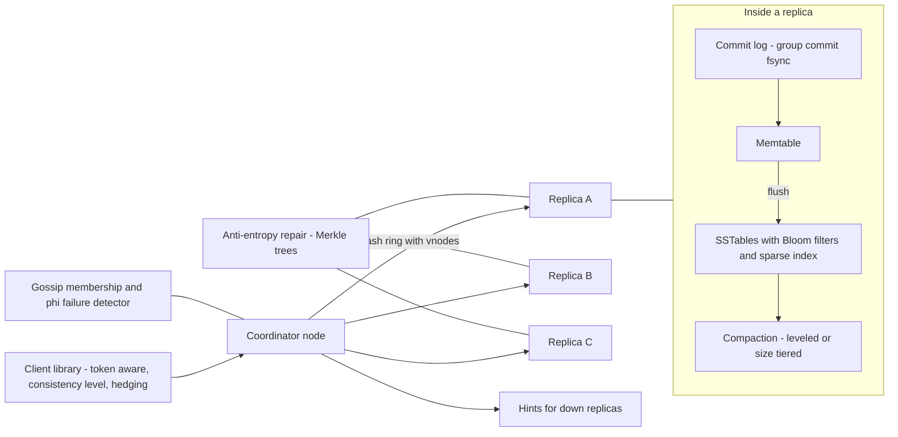
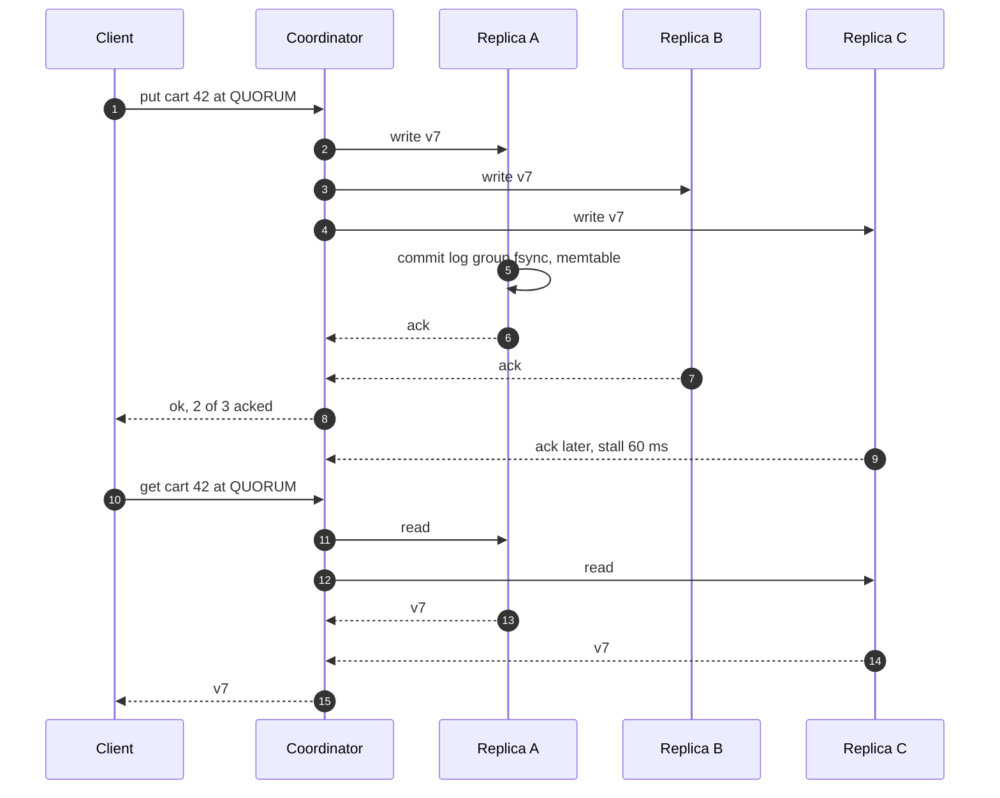
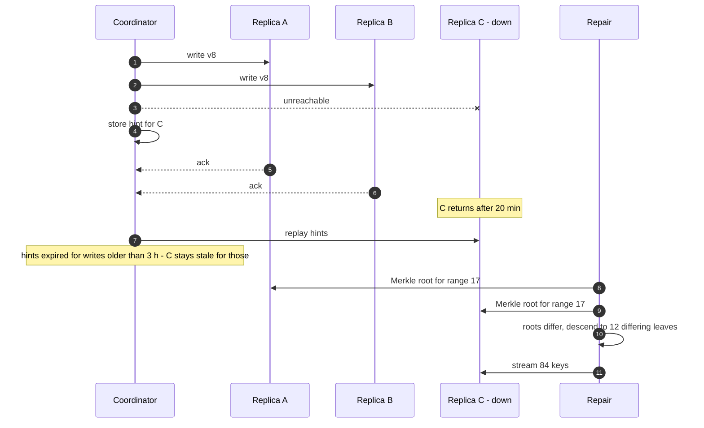
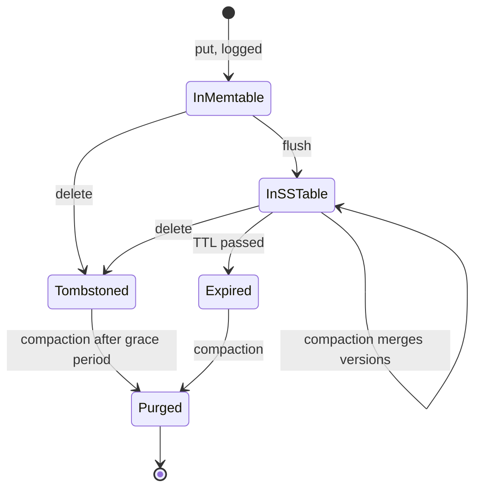

# 54. Case Study: Distributed Key-Value Store

!!! abstract "Chapter at a glance"
    **Reader bands:** B2 → B4 · **Prerequisites:** [Ch 10](../02-distributed-core/10-replication.md) (quorums, LWW, CRDTs), [Ch 11](../02-distributed-core/11-partitioning-and-sharding.md) (consistent hashing), [Ch 12](../02-distributed-core/12-consistency-time-and-consensus.md) (clocks, Raft), [Ch 44](44-distributed-cache.md) (caches)

    **What you will build:** the inside of a Dynamo/Cassandra-style store that could hold the platform's carts, sessions, order-status timelines and device tokens. It has four parts:

    - a **storage engine** that turns random writes into sequential ones;
    - a **write-ahead log** whose acknowledgements mean something;
    - **anti-entropy** that finds divergent replicas cheaply;
    - **tunable consistency** and its latency cost.

    Earlier chapters covered partitioning, quorum arithmetic and conflict resolution. This chapter opens the box. It is the "design a key-value store" interview question at depth.

    **Lab results:**

    - **L1: storage engines (real, on disk).**
        - Bitcask reads in 1 disk access (p50 2.8 µs, page-cached), but keeps **101 MB of keys in RAM**.
        - An LSM tree with 72 SSTables and no Bloom filters read **30 files per hit and 72 per miss** (p99 1.3 ms).
        - Bloom filters cut this to **1.24 and 0.59**.
        - Compaction cut space amplification from **1.91× to 1.05×** and brought every read to 1 file.
    - **L2: write-ahead log vs a real SIGKILL.**
        - Acking from a user-space buffer **lost 100 acknowledged writes**.
        - write()-then-ack lost none, but only survives a process crash, not a power loss.
        - fsync per record: **8,818 acks/s**. Group commit: **28,750/s**, with the same guarantee.
    - **L3: Merkle anti-entropy (real SHA-256, 2M keys).**
        - Finding 10 divergent keys took **13.7 KB** instead of a 91.6 MB full comparison.
        - Finding 1,000 took 0.9 MB.
        - At 200,000 differences (10%), the saving mostly disappears.
    - **L4: tunable consistency (simulation).**
        - R=1/W=1 returned the value from before the client's own acknowledged write **~3%** of the time.
        - R=2/W=2 returned **0%** stale reads, at a read p99 of 25.8 ms vs 3.0 ms.
        - W=3 put every replica stall into the write p99 (**194 ms**).
        - Hedging fixes tails, not staleness.

    · **Reading time:** 110 min + code

---

## 1. Introduction & Why It Matters

### 1.1 A story: the carts that came back

The cart service moved from PostgreSQL to a self-managed, Dynamo-style key-value store for write throughput during sales. Within a quarter:

1. **Nodes kept running out of disk.** Every cart update was a new version on disk. Compaction had been tuned down to "save I/O during sales", so old versions piled up. One node hit 100% disk and stopped accepting writes.
2. **"Removed" items came back.** A customer removed an item. The replica that took the write stalled, and the read went to another replica, which still had the old cart. That was R=1, W=1. The customer checked out with the removed item.
3. **Acknowledged writes vanished after a crash.** A node was killed by the OOM killer. The client library had been configured to ack after the write reached the commit-log buffer, not after fsync. The last second of cart updates on that node disappeared.
4. **Repair took the cluster down.** After a node was replaced, a full repair streamed entire token ranges between replicas. The network saturated during the evening peak.

Key-value stores look simple (`get`, `put`), but each one is a small database. It has a storage engine with amplification trade-offs, a durability contract, replication with repair, and consistency you choose per request.

!!! quote "The thesis of this chapter"
    **Log-structured storage** makes writes cheap and moves the cost to reads and space. Bloom filters and compaction pay it back, and compaction tuning is the core operational trade-off (L1). **An acknowledgement is a durability promise**: fsync, or group commit, before acking, and detect torn records on recovery (L2). **Replicas diverge**, so repair must be cheap to run continuously. Merkle trees find small differences in kilobytes (L3). **Consistency is per request**: R + W > N gives read-your-writes, and costs you the tail of the slower replicas (L4).

### 1.2 What we'd keep in it

| Data | Access | Consistency need | Why a KV store |
|---|---|---|---|
| Carts | Read/write by customer, high write rate in sales | Read-your-writes | Per-key access, scale-out writes |
| Sessions, device tokens | Get/put by id | Eventual is fine | Simple, huge volume |
| Order-status timeline | Append by order id | Monotonic per order | Wide-row append |
| Feature flags, config | Read-heavy | Fresh within seconds | Small, replicated everywhere |
| Idempotency keys | Put-if-absent | Linearizable per key | Needs CAS (lightweight transactions) |

### 1.3 Learning objectives

By the end you will be able to:

- **Explain storage engines**: Bitcask, LSM trees, B-trees, and read/write/space amplification (L1).
- **Design the durability path**: WAL, fsync, group commit, recovery (L2).
- **Design replication maintenance**: hinted handoff, read repair, Merkle anti-entropy (L3).
- **Choose consistency levels per operation** and understand the tail-latency cost (L4).
- Put it together: partitioning, membership (gossip), failure detection, and compare-and-set.

---

## 2. Core Concepts — Beginner to Deep

### 2.1 Intuition: a ledger, not a whiteboard <span class="band b2">B2</span>

A whiteboard lets you erase and rewrite (update in place), but erasing is slow when the board is huge and crowded. A ledger only lets you append: writing is fast, and the latest line for an account wins. To read an account, you search from the newest pages backwards, and every so often you copy the ledger into a clean new book with only the latest lines (compaction). Clerks in three branches keep copies. To check they agree, they compare page totals, then line totals only on pages that differ (Merkle trees). How many branches must confirm before you trust a balance is up to you (R and W).

### 2.2 Requirements <span class="band b2">B2</span>

**Functional**

- `get(key)`, `put(key, value)`, `delete(key)`; optional TTL; conditional put (compare-and-set) for some keys.
- Per-request consistency level (ONE, QUORUM, ALL).
- Range scans within a partition (for timelines).

**Non-functional**

- Scale horizontally to tens of TB and hundreds of thousands of ops/s.
- p99 < 10 ms for QUORUM ops in-region.
- Survive node loss without data loss (RF=3). Keep serving during a single-AZ outage.
- Acknowledged writes are durable according to the chosen durability level.

### 2.3 Estimation <span class="band b2">B2</span>

| Quantity | Estimate |
|---|---|
| Carts | 5M active × ~2 KB = 10 GB (tiny); writes ~50k/s in sales |
| Sessions/tokens | 50M × 500 B = 25 GB |
| Timelines | 1.5M orders/day × 10 events × 200 B = 3 GB/day |
| Replication | RF=3 → ~3× raw; LSM space amplification 1.1–2× on top (L1) |
| Nodes | Sized by IOPS and compaction headroom more than by bytes |

### 2.4 Storage engines ⭐ <span class="band b3">B3</span>

L1 used 2M puts (40% overwrites) and 100k deletes, with 122 MB of live data, on real files:

| Engine | Read hit p50/p99 | Read miss p50 | Files read per hit / miss | Space amplification | RAM for lookups |
|---|---|---|---|---|---|
| Bitcask (log + in-memory hash index) | 2.8/18 µs | 0.3 µs | 1.00 / 0 | 1.92× | **101 MB** |
| LSM, 72 SSTables, no Bloom | **114/1,340 µs** | 81.6 µs | **30.5 / 72** | 1.91× | 10 MB |
| LSM + Bloom filters | 7.6/45 µs | 4.0 µs | 1.24 / 0.59 | 1.91× | 12 MB |
| LSM + Bloom, after full compaction | 5.3/20 µs | 0.1 µs | 1.00 / 0.01 | **1.05×** | 7 MB |

(Reads here hit the OS page cache. On cold SSDs each file read costs ~100 µs, so the files-read columns are the portable result. Write throughput varied from run to run between 48 and 115 MB/s, so we don't compare engines on it.)

- **Bitcask**: one seek per read, and simple. Every key must fit in RAM, and a range scan is impossible.
- **The LSM tree** (LevelDB, RocksDB, Cassandra, ScyllaDB):
    - The write path is WAL → memtable → flush to immutable sorted SSTables.
    - Reads check the memtable, then SSTables newest-first.
    - Deletes are **tombstones**, which must survive until compaction has passed every older copy.
- **Bloom filters** make negative lookups nearly free. Without them, a missing key reads every SSTable.
- **Compaction**:
    - **Size-tiered** (write-optimised; higher space amplification).
    - **Leveled** (read- and space-optimised; higher write amplification).
    - **Time-window** (for TTL/time-series data).
    - It competes with foreground I/O, so it needs throttling and headroom. Turning it down during peaks is how the story's disks filled.
- **B-trees** (InnoDB, PostgreSQL) update in place: good reads and range scans, random writes, and write amplification from pages. The RUM conjecture says you can't minimise read, update and memory/space overheads all at once.

### 2.5 The durability path ⭐ <span class="band b3">B3</span>

L2 used a child JVM that acked each record, a parent that sent it SIGKILL, and then recovery with a CRC check:

| Ack policy | Acked | ACKED BUT LOST | Acks/s |
|---|---|---|---|
| Buffered in the process, ack at once | 3,381,860 | **100** | 2,254,050 |
| write() to the OS, no fsync | 1,158,499 | 0 (process crash only) | 772,250 |
| fsync every record | 13,228 | 0 | 8,818 |
| **Group commit (8 writers, one fsync per batch)** | 43,132 | 0 | **28,750** |

- **The three layers**:
    - Process buffers are lost on any crash.
    - The OS page cache survives a process crash, but not power loss or a kernel panic.
    - The device, after fsync, survives both. Check that the device honours flushes, and that its write cache is battery-backed where relevant.
- **Group commit** batches concurrent writes into one fsync. It is the reason databases and Kafka can be both durable and fast.
- **Replication as durability**: with RF=3 and W=QUORUM, a write is on two machines. Many stores then fsync the commit log periodically (e.g. every 10 s), betting that two machines won't lose power at once. That is a choice to make knowingly, per keyspace.
- **Recovery**: replay the WAL into the memtable, and stop at the first record with a bad length or CRC (a torn write).

### 2.6 Replication maintenance ⭐ <span class="band b3">B3</span>

- **Hinted handoff**: when a replica is down, a coordinator stores the write as a "hint" and delivers it later. With a sloppy quorum, stand-in nodes accept writes to keep W satisfiable. That keeps writes available, but a read quorum may not see them.
- **Read repair**: a read that sees divergent versions writes the newest back to the stale replicas.
- **Anti-entropy with Merkle trees**. L3 used real SHA-256 over 2M keys:

    | Differing keys | Full comparison | Merkle depth 15 (~61 keys/leaf) | Merkle depth 18 (~7 keys/leaf) |
    |---|---|---|---|
    | 10 | 91.6 MB | 36.9 KB | **13.7 KB** |
    | 1,000 | 91.6 MB | 3.1 MB | 0.9 MB |
    | 20,000 | 91.6 MB | 43.8 MB | 11.5 MB |
    | 200,000 | 91.6 MB | 93.6 MB | 56.5 MB |

- **Merkle trees** find small divergence cheaply. They cost round trips (17–20 here) and tree maintenance. When divergence is large (a replaced node), streaming the whole range is as cheap and simpler, so throttle it.
- **Incremental repair** (repair only data written since the last repair) keeps routine repairs small. Schedule repairs within the tombstone grace period, or deleted data can resurrect.

### 2.7 Tunable consistency ⭐ <span class="band b4">B4</span>

L4 modelled N=3 replicas, with a 3% chance of a stall per replica per request, and a read issued 0–20 ms after the client's own acknowledged write:

| Config | Write p99 | Read p99 | Stale reads |
|---|---|---|---|
| R=1, read sent to one replica | 3.0 ms | 173.7 ms | 2.97% |
| R=1 + hedge to a 2nd after 5 ms | 3.0 ms | 8.3 ms | 3.07% |
| R=1, read sent to all, first wins | 3.0 ms | 3.0 ms | 3.00% |
| W=1, R=2 | 3.0 ms | 25.8 ms | 0.08% |
| W=2, R=1 | 6.7 ms | 3.0 ms | 2.74% |
| **W=2, R=2 (quorum)** | 6.7 ms | 25.8 ms | **0.00%** |
| W=3, R=1 | **193.7 ms** | 3.0 ms | 0.00% |

- **R + W > N** guarantees the read set overlaps the write set, so read-your-writes holds, as long as there are no sloppy-quorum stand-ins. Otherwise, reads can miss the client's own write.
- **Tails**: waiting for more replicas means inheriting more stalls. W=ALL makes every replica's hiccup a write outage. Hedging or speculative retries fix tails, not staleness. Sending every read to all replicas triples read load.
- **Beyond quorums**:
    - **Linearizable per-key operations** (compare-and-set for idempotency keys, inventory counters) need consensus: Paxos/Raft, like Cassandra LWT or a Raft-based store such as etcd or TiKV ([Ch 12](../02-distributed-core/12-consistency-time-and-consensus.md)).
    - **Conflicts from concurrent writes** need LWW (clock-skew risk), vector clocks with siblings, or CRDTs ([Ch 10](../02-distributed-core/10-replication.md)).

### 2.8 Partitioning and membership <span class="band b3">B3</span>

- **Consistent hashing with virtual nodes** ([Ch 11](../02-distributed-core/11-partitioning-and-sharding.md)). Each key's N replicas are the next N distinct nodes on the ring, spread across racks/AZs (rack-aware placement).
- **Membership and failure detection**: gossip with phi-accrual failure detectors (Cassandra), or a coordination service. A node that is suspected isn't removed; it is routed around.
- **Hot partitions**: a single hot key (a viral cart? unlikely; a global counter, yes) needs key splitting or a different design.

### 2.9 Build, buy or configure <span class="band b4">B4</span>

- **Managed** (DynamoDB, Cosmos DB, Bigtable) removes storage-engine and repair operations. You pay per request and capacity, and keep your data-modelling responsibility.
- **Self-managed** (Cassandra/ScyllaDB, Riak) gives control, at the cost of operating compaction, repair and upgrades.
- **Raft-based KV** (etcd, TiKV, FoundationDB) gives linearizable operations and transactions at lower write throughput per key range.
- **Redis** is a cache or ephemeral store unless its persistence and replication settings are explicitly chosen for durability ([Ch 44](44-distributed-cache.md)).

### 2.10 Interview framing <span class="band b4">B4</span>

"Design a key-value store." Cover:

- API and consistency needs;
- partitioning (consistent hashing, vnodes);
- replication (N, placement);
- consistency (R, W, sloppy quorum, hinted handoff);
- conflict resolution;
- the storage engine (LSM, compaction, Bloom filters);
- durability (WAL, fsync, group commit);
- repair (read repair, Merkle trees);
- membership and failure detection.

Staff-level signals include amplification trade-offs, "ack means durable", tombstones and gc_grace, and tail latency vs consistency.

---

## 3. Architecture & Diagrams

### 3.1 Component view



### 3.2 Sequence: happy path, a QUORUM write then read



### 3.3 Sequence: failure path, a replica down, hints and repair



### 3.4 State: a key's lifecycle on one replica



---

## 4. Design Document Excerpt: Cart & Session Store

!!! note "Design Document (excerpt) — Cart & Session KV Store"
    **Status:** Accepted · **Authors:** Platform data team · **Reviewers:** Cart, Checkout, SRE, Security

    | Field | Value |
    |---|---|
    | Context | Disks filled when compaction was throttled. Stale reads at ONE resurrected removed items. Acks before fsync lost writes on crash. Full repairs saturated the network at peak. |
    | Decision | Carts at RF=3, QUORUM reads and writes, commit log group-committed with fsync before ack. Sessions at RF=3, ONE/ONE with periodic commit-log sync. Leveled compaction for carts, time-window for sessions (TTL). Compaction headroom enforced (disk ≤ 50%). Incremental Merkle repair nightly, within gc_grace. Throttled streaming for node replacement. Idempotency keys moved to a Raft-backed store with CAS. |
    | Related ADRs | ADR-400 Storage: leveled compaction for carts, TWCS for sessions, Bloom FP 1%, alerts at 50% disk (L1). ADR-401 Durability: carts `commitlog_sync=group`, sessions periodic 10 s; both RF=3 across 3 AZs (L2). ADR-402 Repair: incremental nightly, full weekly per range, throttled; replacement streams off-peak (L3). ADR-403 Consistency: carts QUORUM/QUORUM with speculative retry at p99; sessions ONE/ONE; idempotency keys in etcd-like Raft store (L4). |

    **Requirements.**

    - **R1:** Cart read-your-writes for the same customer across devices.
    - **R2:** No acknowledged cart write lost when a single node crashes or loses power.
    - **R3:** Cart p99 ≤ 10 ms for QUORUM ops in-region, including stall-prone replicas.
    - **R4:** Replica divergence repaired within 7 days (gc_grace 10 days).
    - **R5:** Disk usage never above 50% of capacity per node, so compaction always has room.

    **Decisions in detail.**

    1. **Storage (ADR-400).** Compaction throughput is capped at 30% of disk bandwidth. Never pause compaction during sales: pre-scale instead.
    2. **Durability (ADR-401).** Group commit window 2 ms. Measured cost: +0.8 ms p50 on writes.
    3. **Repair (ADR-402).** A repair scheduler (Reaper-style) runs per range. Its bytes are monitored.
    4. **Consistency (ADR-403).** The client library enforces a consistency level per table. The speculative retry threshold follows the p99.

    **Consequences.**

    - Costs: more disk headroom (cost), quorum tails, and a separate store for CAS.
    - Benefits: no resurrected items, durable acks, predictable repair, and disks that don't fill.

---

## 5. Hands-On Code — Level Ladder

!!! info "What's real here"
    - **L1** builds real engines on real files: an append log with a hash index, SSTables with sparse indexes and Bloom filters, and full compaction. Reads hit the OS page cache.
    - **L2** runs a real child JVM, a real `SIGKILL`, real `fsync`, and CRC-checked recovery. Power loss can't be simulated here, as the lab states.
    - **L3** computes real SHA-256 Merkle trees over 2M keys.
    - **L4** is a latency simulation with stated stall assumptions.

All four labs are JDK 21 with no dependencies.

- L1 writes about 1 GB under `/tmp/kvlab/data` and deletes it afterwards.
- L2 is two classes in one file, so compile it with `javac -d out WalL2.java` and run it with `java -cp out WalL2`.

### L1 — Storage engines on real files <span class="band b2">B2</span>

**Requirement:** "Absorb a heavy write load, and still answer point reads — including for keys that don't exist — fast."

Three engines, built here, run the same workload.

```java title="LsmL1.java"
// LsmL1.java — run with: java -Xmx2g LsmL1.java   (JDK 21, no dependencies; writes ~1 GB under /tmp/kvlab/data)
// HOW A KEY-VALUE STORE'S STORAGE ENGINE WORKS. 2,000,000 puts of 100-byte values (fixed seed): 1,200,000 distinct keys
// (so 40% are overwrites), then 100,000 deletes. Three REAL on-disk engines built here, same workload:
//   E1 Bitcask-style: append every write to a log file; an in-memory hash map points each key to its latest offset
//   E2 LSM tree: writes go to a sorted in-memory memtable; at 4 MB it is flushed as an immutable sorted file (SSTable)
//      with a sparse index (every 16th key) kept in memory; reads check memtable, then SSTables newest → oldest
//   E3 E2 + a Bloom filter per SSTable (1% false positives) so most SSTables are skipped without touching disk
//   E4 E3 after compaction: all SSTables merged into one, overwritten values and deleted keys dropped
// Measured: write throughput, point-read latency for existing and missing keys, SSTable files actually read per
// lookup (read amplification), bytes on disk per byte of live data (space amplification), and RAM held for lookups.
import java.io.*;
import java.nio.*;
import java.nio.channels.FileChannel;
import java.nio.file.*;
import java.util.*;

public class LsmL1 {
    static final Path DIR = Paths.get("/tmp/kvlab/data");
    static final int VAL = 100, PUTS = 2_000_000, KEYS = 1_200_000, DELS = 100_000;

    public static void main(String[] args) throws Exception {
        Random r = new Random(54); String[] ops = new String[PUTS + DELS]; boolean[] isDel = new boolean[PUTS + DELS];
        for (int i = 0; i < PUTS; i++) ops[i] = key(i < KEYS ? i : r.nextInt(KEYS));
        for (int i = 0; i < DELS; i++) { ops[PUTS + i] = key(r.nextInt(KEYS)); isDel[PUTS + i] = true; }
        List<Integer> shuffle = new ArrayList<>(); for (int i = 0; i < PUTS; i++) shuffle.add(i); Collections.shuffle(shuffle, r);
        String[] pk = new String[PUTS]; for (int i = 0; i < PUTS; i++) pk[i] = ops[shuffle.get(i)]; System.arraycopy(pk, 0, ops, 0, PUTS);
        Map<String, Integer> truth = new HashMap<>(); for (int i = 0; i < ops.length; i++) { if (isDel[i]) truth.remove(ops[i]); else truth.put(ops[i], i); }
        long live = (long) truth.size() * (16 + VAL);
        System.out.printf("%,d puts (%,d distinct keys) + %,d deletes; %,d live keys = %.0f MB of live data.%n%n", PUTS, KEYS, DELS, truth.size(), live / 1048576.0);
        System.out.printf("   %-42s %10s %11s %11s %12s %12s %10s %10s%n", "engine", "write", "read hit", "read miss", "files read", "files read", "space", "RAM for");
        System.out.printf("   %-42s %10s %11s %11s %12s %12s %10s %10s%n", "", "MB/s", "p50 / p99", "p50", "per hit", "per miss", "amplif.", "lookups");
        String[] probeHit = new String[20_000], probeMiss = new String[20_000]; List<String> liveKeys = new ArrayList<>(truth.keySet()); Collections.sort(liveKeys);
        for (int i = 0; i < probeHit.length; i++) { probeHit[i] = liveKeys.get(r.nextInt(liveKeys.size())); probeMiss[i] = "x" + key(r.nextInt(KEYS)).substring(1); }
        // E1
        clean(); Bitcask bc = new Bitcask(); long t0 = System.nanoTime(); for (int i = 0; i < ops.length; i++) { if (isDel[i]) bc.delete(ops[i]); else bc.put(ops[i], val(i)); } bc.sync();
        double wMB = (ops.length * (16.0 + VAL)) / 1048576 / ((System.nanoTime() - t0) / 1e9);
        report("E1) Bitcask: log + in-memory hash index", wMB, probeHit, probeMiss, k -> bc.get(k), () -> 1.0, () -> 0.0, bc.diskBytes() / (double) live, bc.ramBytes(), truth, ops);
        // E2/E3/E4
        for (int e = 2; e <= 4; e++) {
            clean(); Lsm lsm = new Lsm(e >= 3); t0 = System.nanoTime(); for (int i = 0; i < ops.length; i++) { if (isDel[i]) lsm.delete(ops[i]); else lsm.put(ops[i], val(i)); } lsm.flush();
            double w = (ops.length * (16.0 + VAL)) / 1048576 / ((System.nanoTime() - t0) / 1e9);
            if (e == 4) lsm.compactAll();
            String name = e == 2 ? "E2) LSM: memtable + " + lsm.tables.size() + " SSTables, no Bloom" : e == 3 ? "E3) LSM + Bloom filters (" + lsm.tables.size() + " SSTables)" : "E4) LSM + Bloom, after full compaction";
            final Lsm L = lsm;
            report(name, e == 4 ? Double.NaN : w, probeHit, probeMiss, k -> L.get(k), () -> L.lastProbesHit, () -> L.lastProbesMiss, L.diskBytes() / (double) live, L.ramBytes(), truth, ops);
        }
        clean();
        System.out.println("\n   → the log-structured designs never overwrite in place, so writes are sequential and fast. Bitcask reads are one");
        System.out.println("     disk access, but every key must fit in RAM. The LSM keeps only a sparse index in RAM and pays on reads: a key");
        System.out.println("     may be in any SSTable, and a MISSING key must check them all — Bloom filters turn that into almost no file");
        System.out.println("     reads. Old versions and tombstones pile up (space amplification) until compaction merges files, which also");
        System.out.println("     brings every read to one file. Compaction is the price: it rewrites data in the background, competing with");
        System.out.println("     foreground I/O — the core tuning problem of RocksDB, Cassandra and friends.");
    }

    static String key(int i) { return String.format("k%015d", i); }
    static byte[] val(int i) { byte[] b = new byte[VAL]; Arrays.fill(b, (byte) ('a' + i % 26)); ByteBuffer.wrap(b).putInt(i); return b; }
    static void clean() throws IOException { if (Files.exists(DIR)) try (var s = Files.walk(DIR)) { s.sorted(Comparator.reverseOrder()).forEach(p -> p.toFile().delete()); } Files.createDirectories(DIR); }

    interface Getter { byte[] get(String k) throws IOException; }
    interface D { double get(); }
    static void report(String name, double wMB, String[] hit, String[] miss, Getter g, D probesHit, D probesMiss, double spaceAmp, long ram, Map<String, Integer> truth, String[] ops) throws IOException {
        long[] lat = new long[hit.length]; double ph = 0, pm = 0; int wrong = 0;
        for (int i = 0; i < hit.length; i++) { long t = System.nanoTime(); byte[] v = g.get(hit[i]); lat[i] = System.nanoTime() - t; ph += probesHit.get();
            if (v == null || ByteBuffer.wrap(v).getInt() != truth.get(hit[i])) wrong++; }
        long[] ml = new long[miss.length];
        for (int i = 0; i < miss.length; i++) { long t = System.nanoTime(); if (g.get(miss[i]) != null) wrong++; ml[i] = System.nanoTime() - t; pm += probesMiss.get(); }
        Arrays.sort(lat); Arrays.sort(ml);
        System.out.printf("   %-42s %10s %5.1f/%4.0f µs %8.1f µs %12.2f %12.2f %9.2fx %7.0f MB%s%n", name, Double.isNaN(wMB) ? "—" : String.format("%.0f", wMB),
                lat[lat.length / 2] / 1e3, lat[(int) (lat.length * 0.99)] / 1e3, ml[ml.length / 2] / 1e3, ph / hit.length, pm / miss.length, spaceAmp, ram / 1048576.0, wrong > 0 ? "  WRONG=" + wrong : "");
    }

    // ---------------- E1: Bitcask ----------------
    static final class Bitcask {
        final FileChannel ch; final HashMap<String, Long> idx = new HashMap<>(); long pos = 0; final ByteBuffer buf = ByteBuffer.allocate(1 << 20);
        Bitcask() throws IOException { ch = FileChannel.open(DIR.resolve("bitcask.log"), StandardOpenOption.CREATE, StandardOpenOption.READ, StandardOpenOption.WRITE); }
        void put(String k, byte[] v) throws IOException { append(k, v); }
        void delete(String k) throws IOException { append(k, null); idx.remove(k); }
        void append(String k, byte[] v) throws IOException {
            byte[] kb = k.getBytes(); int len = 2 + kb.length + 4 + (v == null ? 0 : v.length); if (buf.remaining() < len) drain();
            long at = pos + buf.position(); buf.putShort((short) kb.length).put(kb).putInt(v == null ? -1 : v.length); if (v != null) { buf.put(v); idx.put(k, at); } }
        void drain() throws IOException { buf.flip(); while (buf.hasRemaining()) pos += ch.write(buf, pos); buf.clear(); }
        void sync() throws IOException { drain(); ch.force(false); }
        byte[] get(String k) throws IOException { Long at = idx.get(k); if (at == null) return null; ByteBuffer b = ByteBuffer.allocate(2 + k.length() + 4 + VAL); ch.read(b, at); b.flip(); int kl = b.getShort(); b.position(2 + kl); int vl = b.getInt(); byte[] v = new byte[vl]; b.get(v); return v; }
        long diskBytes() { return pos; }
        long ramBytes() { return idx.size() * 96L; }                                            // ~String + Long + map entry
    }

    // ---------------- E2–E4: LSM ----------------
    static final byte[] TOMB = new byte[0];
    static final class Lsm {
        final boolean bloom; TreeMap<String, byte[]> mem = new TreeMap<>(); long memBytes = 0; final List<SSTable> tables = new ArrayList<>(); int seq = 0; double lastProbesHit, lastProbesMiss;
        Lsm(boolean bloom) { this.bloom = bloom; }
        void put(String k, byte[] v) throws IOException { mem.put(k, v); memBytes += k.length() + v.length + 32; if (memBytes > 4 << 20) flush(); }
        void delete(String k) throws IOException { put(k, TOMB); }
        void flush() throws IOException { if (mem.isEmpty()) return; tables.add(SSTable.write(DIR.resolve("sst-" + (seq++)), mem, bloom)); mem = new TreeMap<>(); memBytes = 0; }
        byte[] get(String k) throws IOException {
            int probes = 0; byte[] v = mem.get(k);
            if (v == null) for (int i = tables.size() - 1; i >= 0; i--) { SSTable t = tables.get(i); if (t.bloom != null && !t.bloom.mightContain(k)) continue; probes++; v = t.get(k); if (v != null) break; }
            lastProbesHit = probes; lastProbesMiss = probes;
            return v == null || v.length == 0 ? null : v;
        }
        void compactAll() throws IOException {
            TreeMap<String, byte[]> merged = new TreeMap<>(); for (SSTable t : tables) t.scanInto(merged);           // oldest → newest: newer wins
            merged.values().removeIf(v -> v.length == 0);                                                            // drop tombstones (full compaction)
            for (SSTable t : tables) Files.delete(t.path); tables.clear(); tables.add(SSTable.write(DIR.resolve("sst-" + (seq++)), merged, bloom));
        }
        long diskBytes() throws IOException { long s = 0; for (SSTable t : tables) s += Files.size(t.path); return s; }
        long ramBytes() { long s = 0; for (SSTable t : tables) s += t.index.size() * 80L + (t.bloom == null ? 0 : t.bloom.bits.length * 8L); return s; }
    }
    static final class SSTable {
        Path path; FileChannel ch; TreeMap<String, Long> index = new TreeMap<>(); Bloom bloom; long size;
        static SSTable write(Path p, TreeMap<String, byte[]> data, boolean withBloom) throws IOException {
            SSTable t = new SSTable(); t.path = p; if (withBloom) t.bloom = new Bloom(data.size());
            try (FileChannel ch = FileChannel.open(p, StandardOpenOption.CREATE, StandardOpenOption.WRITE)) {
                ByteBuffer buf = ByteBuffer.allocate(1 << 20); long pos = 0; int n = 0;
                for (var e : data.entrySet()) { byte[] kb = e.getKey().getBytes(); byte[] v = e.getValue();
                    if (buf.remaining() < 2 + kb.length + 4 + v.length) { buf.flip(); while (buf.hasRemaining()) pos += ch.write(buf); buf.clear(); }
                    if (n++ % 16 == 0) t.index.put(e.getKey(), pos + buf.position());
                    buf.putShort((short) kb.length).put(kb).putInt(v.length).put(v); if (t.bloom != null) t.bloom.add(e.getKey()); }
                buf.flip(); while (buf.hasRemaining()) pos += ch.write(buf); ch.force(false); t.size = pos; }
            t.ch = FileChannel.open(p, StandardOpenOption.READ); return t;
        }
        byte[] get(String k) throws IOException {                                                 // one block read: from the index entry ≤ k, scan ≤ 16 records
            var fl = index.floorEntry(k); if (fl == null) return null; long start = fl.getValue();
            var hi = index.higherEntry(fl.getKey()); long end = hi == null ? size : hi.getValue();
            ByteBuffer b = ByteBuffer.allocate((int) (end - start)); ch.read(b, start); b.flip();
            while (b.hasRemaining()) { int kl = b.getShort(); byte[] kb = new byte[kl]; b.get(kb); int vl = b.getInt(); int c = new String(kb).compareTo(k);
                if (c == 0) { byte[] v = new byte[vl]; b.get(v); return v; } if (c > 0) return null; b.position(b.position() + vl); }
            return null;
        }
        void scanInto(TreeMap<String, byte[]> m) throws IOException {
            ByteBuffer b = ByteBuffer.allocate((int) size); ch.read(b, 0); b.flip();
            while (b.hasRemaining()) { int kl = b.getShort(); byte[] kb = new byte[kl]; b.get(kb); int vl = b.getInt(); byte[] v = new byte[vl]; b.get(v); m.put(new String(kb), v); }
            ch.close();
        }
    }
    static final class Bloom {
        final long[] bits; final int m, k = 7;
        Bloom(int n) { m = Math.max(64, n * 10); bits = new long[(m + 63) / 64]; }                  // ~10 bits/key → ~1% FP
        void add(String s) { int h1 = s.hashCode(), h2 = mix(h1); for (int i = 0; i < k; i++) { int b = Math.floorMod(h1 + i * h2, m); bits[b >>> 6] |= 1L << (b & 63); } }
        boolean mightContain(String s) { int h1 = s.hashCode(), h2 = mix(h1); for (int i = 0; i < k; i++) { int b = Math.floorMod(h1 + i * h2, m); if ((bits[b >>> 6] & (1L << (b & 63))) == 0) return false; } return true; }
        static int mix(int x) { x ^= x >>> 16; x *= 0x7feb352d; x ^= x >>> 15; x *= 0x846ca68b; x ^= x >>> 16; return x | 1; }
    }
}
```

```text title="java -Xmx3g LsmL1.java"
2,000,000 puts (1,200,000 distinct keys) + 100,000 deletes; 1,103,928 live keys = 122 MB of live data.

   engine                                          write    read hit   read miss   files read   files read      space    RAM for
                                                    MB/s   p50 / p99         p50      per hit     per miss    amplif.    lookups
   E1) Bitcask: log + in-memory hash index           115   2.8/  18 µs      0.3 µs         1.00         0.00      1.92x     101 MB
   E2) LSM: memtable + 72 SSTables, no Bloom          81 114.4/1340 µs     81.6 µs        30.48        72.00      1.91x      10 MB
   E3) LSM + Bloom filters (72 SSTables)              65   7.6/  45 µs      4.0 µs         1.24         0.59      1.91x      12 MB
   E4) LSM + Bloom, after full compaction              —   5.3/  20 µs      0.1 µs         1.00         0.01      1.05x       7 MB

   → the log-structured designs never overwrite in place, so writes are sequential and fast. Bitcask reads are one
     disk access, but every key must fit in RAM. The LSM keeps only a sparse index in RAM and pays on reads: a key
     may be in any SSTable, and a MISSING key must check them all — Bloom filters turn that into almost no file
     reads. Old versions and tombstones pile up (space amplification) until compaction merges files, which also
     brings every read to one file. Compaction is the price: it rewrites data in the background, competing with
     foreground I/O — the core tuning problem of RocksDB, Cassandra and friends.
```

**Reading it:**

- **Bitcask** reads fast, but its RAM grows with the number of keys (101 MB here).
- **The LSM tree** keeps a small in-memory index, but without Bloom filters a hit reads 30 files and a miss reads all 72.
- **Bloom filters** bring reads to about one file.
- **Compaction** drops the overwritten half of the data (1.91× → 1.05×) and the last extra probes.
- **Write MB/s** varied between runs (48–115) and is not a fair comparison here.

### L2 — What an acknowledgement survives <span class="band b3">B3</span>

**Requirement:** "No acknowledged write may be lost when the process dies."

A real child process is killed with SIGKILL mid-stream, and its log is then recovered with CRC checks.

```java title="WalL2.java"
// WalL2.java — run with: java WalL2.java   (JDK 21, no dependencies)
// "ACKNOWLEDGED" MUST MEAN "WILL SURVIVE". A child JVM appends 128-byte records (seq + payload + CRC32) to a write-ahead
// log and prints "A <seq>" to the parent the moment it considers each record durable. After 2.5 s the parent KILLS the
// child (SIGKILL — no shutdown hooks, no flush), reads the log back, stops at the first torn/corrupt record, and counts
// acknowledged records that are missing. Four ack policies:
// Acks go to a file (stdout redirected) so the parent sees exactly what was acknowledged before the kill.
//   M1 write into a 64 KB user-space buffer, ack immediately (no flush)
//   M2 write() each record to the OS (flush), ack — no fsync
//   M3 fsync (FileChannel.force) after every record, then ack
//   M4 group commit: 8 writer threads hand records to a committer that writes and fsyncs a batch, then acks the batch
// Note: SIGKILL loses what is still in the PROCESS; data already handed to the OS survives a process crash but NOT a
// power loss or kernel crash, which this lab cannot simulate — only fsync (M3, M4) is safe against those.
import java.io.*;
import java.nio.*;
import java.nio.channels.FileChannel;
import java.nio.file.*;
import java.util.*;
import java.util.concurrent.*;
import java.util.zip.CRC32;
import java.nio.channels.Channels;

public class WalL2 {
    static final int REC = 128;

    public static void main(String[] args) throws Exception {
        if (args.length > 0) { child(Integer.parseInt(args[0]), Paths.get(args[1])); return; }
        System.out.println("child JVM appends 128-byte records, acks each; parent SIGKILLs it after 2.5 s and recovers the log.\n");
        System.out.printf("   %-50s %12s %12s %14s %14s%n", "ack policy", "acked", "recovered", "ACKED BUT LOST", "acks/s");
        String[] names = {"M1) buffered in the process, ack at once", "M2) write() to the OS each record, no fsync", "M3) fsync every record", "M4) group commit: 8 writers, one fsync per batch"};
        for (int m = 1; m <= 4; m++) {
            Path log = Paths.get("/tmp/kvlab/wal-" + m + ".log"); Files.deleteIfExists(log);
            Path ackFile = Paths.get("/tmp/kvlab/acks-" + m + ".txt"); Files.deleteIfExists(ackFile);
            Process p = new ProcessBuilder(ProcessHandle.current().info().command().orElse("java"), "-cp", System.getProperty("java.class.path", "."), "WalL2Child", String.valueOf(m), log.toString())
                    .redirectOutput(ackFile.toFile()).redirectError(ProcessBuilder.Redirect.DISCARD).start();   // acks land in a file the parent reads after the kill
            long started = System.nanoTime(); Thread.sleep(2500); long killAt = System.nanoTime(); p.destroyForcibly(); p.waitFor();
            Set<Long> acked = new HashSet<>(); for (String line : Files.readAllLines(ackFile)) if (line.startsWith("A ") && line.length() > 2) acked.add(Long.parseLong(line.substring(2).trim()));
            long[] first = {started + 1_000_000_000L};                                               // child JVM start-up ≈ 1 s (excluded from the rate)
            Set<Long> recovered = recover(log); long lost = acked.stream().filter(s -> !recovered.contains(s)).count();
            double secs = (killAt - first[0]) / 1e9;
            System.out.printf("   %-50s %,12d %,12d %,14d %,14.0f%n", names[m - 1], acked.size(), recovered.size(), lost, acked.size() / secs);
        }
        System.out.println("\n   → an acknowledgement is a promise. Acking from a user-space buffer breaks it on any crash. Handing bytes to the");
        System.out.println("     OS survives a process kill (the kernel still has them) but not a power cut. fsync per record keeps the");
        System.out.println("     promise at the cost of one device flush per write; group commit keeps it too and amortises the flush over");
        System.out.println("     a batch — the technique behind database and Kafka durability settings. Recovery must also detect a torn");
        System.out.println("     last record (length + CRC) and stop there. (fsync speed depends heavily on the device; this sandbox's disk");
        System.out.println("     may be faster or slower than yours.)");
    }

    static Set<Long> recover(Path log) throws IOException {
        Set<Long> s = new HashSet<>(); if (!Files.exists(log)) return s; byte[] all = Files.readAllBytes(log); ByteBuffer b = ByteBuffer.wrap(all);
        while (b.remaining() >= REC) { int start = b.position(); long seq = b.getLong(); byte[] payload = new byte[REC - 16]; b.get(payload); long crc = b.getLong();
            CRC32 c = new CRC32(); c.update(all, start, REC - 8); if (c.getValue() != crc) break; s.add(seq); }
        return s;
    }

    static void child(int mode, Path log) throws Exception { WalL2Child.main(new String[]{String.valueOf(mode), log.toString()}); }
}

class WalL2Child {
    public static void main(String[] args) throws Exception {
        int mode = Integer.parseInt(args[0]); Path log = Paths.get(args[1]);
        PrintStream out = new PrintStream(new FileOutputStream(FileDescriptor.out), true);           // autoflush: ack lines leave immediately
        FileChannel ch = FileChannel.open(log, StandardOpenOption.CREATE, StandardOpenOption.WRITE, StandardOpenOption.APPEND);
        if (mode == 1) {
            BufferedOutputStream bos = new BufferedOutputStream(Channels.newOutputStream(ch), 64 * 1024);
            for (long seq = 1; ; seq++) { bos.write(record(seq)); out.println("A " + seq); }
        } else if (mode == 2 || mode == 3) {
            for (long seq = 1; ; seq++) { ByteBuffer b = ByteBuffer.wrap(record(seq)); while (b.hasRemaining()) ch.write(b); if (mode == 3) ch.force(false); out.println("A " + seq); }
        } else {
            BlockingQueue<long[]> q = new LinkedBlockingQueue<>(); java.util.concurrent.atomic.AtomicLong next = new java.util.concurrent.atomic.AtomicLong(1);
            Map<Long, CountDownLatch> waiting = new ConcurrentHashMap<>();
            for (int w = 0; w < 8; w++) new Thread(() -> { try { while (true) { long seq = next.getAndIncrement(); CountDownLatch l = new CountDownLatch(1); waiting.put(seq, l); q.put(new long[]{seq}); l.await(); out.println("A " + seq); } } catch (Exception e) { } }).start();
            List<long[]> batch = new ArrayList<>();
            while (true) { batch.clear(); batch.add(q.take()); q.drainTo(batch);
                ByteBuffer b = ByteBuffer.allocate(batch.size() * WalL2.REC); for (long[] s : batch) b.put(record(s[0])); b.flip(); while (b.hasRemaining()) ch.write(b); ch.force(false);
                for (long[] s : batch) waiting.remove(s[0]).countDown(); }
        }
    }
    static byte[] record(long seq) {
        ByteBuffer b = ByteBuffer.allocate(WalL2.REC); b.putLong(seq); for (int i = 0; i < WalL2.REC - 16; i++) b.put((byte) (seq + i));
        java.util.zip.CRC32 c = new java.util.zip.CRC32(); c.update(b.array(), 0, WalL2.REC - 8); b.putLong(c.getValue()); return b.array();
    }
}
```

```text title="javac -d out WalL2.java && java -cp out WalL2"
child JVM appends 128-byte records, acks each; parent SIGKILLs it after 2.5 s and recovers the log.

   ack policy                                                acked    recovered ACKED BUT LOST         acks/s
   M1) buffered in the process, ack at once              3,381,860    3,381,760            100      2,254,050
   M2) write() to the OS each record, no fsync           1,158,499    1,158,499              0        772,250
   M3) fsync every record                                   13,228       13,229              0          8,818
   M4) group commit: 8 writers, one fsync per batch         43,132       43,139              0         28,750

   → an acknowledgement is a promise. Acking from a user-space buffer breaks it on any crash. Handing bytes to the
     OS survives a process kill (the kernel still has them) but not a power cut. fsync per record keeps the
     promise at the cost of one device flush per write; group commit keeps it too and amortises the flush over
     a batch — the technique behind database and Kafka durability settings. Recovery must also detect a torn
     last record (length + CRC) and stop there. (fsync speed depends heavily on the device; this sandbox's disk
     may be faster or slower than yours.)
```

**Reading it:**

- **Acking from a user-space buffer** loses whatever was still buffered: 100 acknowledged records here.
- **write() without fsync** survives this process kill because the kernel holds the data. It would not survive a power cut.
- **fsync per record** is safe but slow.
- **Group commit** is 3.3× faster with the same guarantee.
- **A development note.** A first version read acks through a pipe. The parent lost the final ack lines when the child died, which hid the losses, so acks now go to a file.

### L3 — Merkle anti-entropy <span class="band b3">B3</span>

**Requirement:** "Find and fix the keys two replicas disagree on without shipping everything."

Real SHA-256 trees over 2M keys, with divergence from 10 to 200,000 keys.

```java title="MerkleL3.java"
// MerkleL3.java — run with: java -Xmx3g MerkleL3.java   (JDK 21, no dependencies)
// ANTI-ENTROPY: FINDING WHAT TWO REPLICAS DISAGREE ON. Replica A holds 2,000,000 keys; replica B is the same except for
// writes it missed while it was down (fixed seed). To repair, the replicas must find the differing keys. REAL hashing
// (SHA-256) of real key/value data:
//   F  full comparison: B sends every (key, value-hash) pair to A
//   M  Merkle trees over the key space (keys hashed into 2^depth leaf ranges; each inner node = hash of its children):
//      exchange root hashes, descend only into subtrees whose hashes differ, then exchange only the differing leaves
// Swept over the number of differing keys (10 → 200,000) and leaf sizes. After repair, both roots must match.
// Measured: bytes exchanged to find the differences, round trips, and real time to build a tree.
import java.nio.ByteBuffer;
import java.security.MessageDigest;
import java.util.*;

public class MerkleL3 {
    static final int KEYS = 2_000_000;

    public static void main(String[] args) throws Exception {
        String[] keys = new String[KEYS]; for (int i = 0; i < KEYS; i++) keys[i] = String.format("order:%010d", i);
        byte[][] valA = new byte[KEYS][]; for (int i = 0; i < KEYS; i++) valA[i] = sha(("v" + i).getBytes());
        long fullBytes = (long) KEYS * (16 + 32);
        System.out.printf("2,000,000 keys per replica; full comparison ships %.1f MB every time.%n%n", fullBytes / 1048576.0);
        System.out.printf("   %-18s %-22s %16s %12s %16s %12s%n", "differing keys", "method", "bytes exchanged", "round trips", "keys to repair", "roots equal");
        for (int diff : new int[]{10, 1_000, 20_000, 200_000}) {
            Random r = new Random(54 + diff); byte[][] valB = valA.clone(); Set<Integer> changed = new HashSet<>();
            while (changed.size() < diff) { int i = r.nextInt(KEYS); if (changed.add(i)) valB[i] = r.nextInt(5) == 0 ? new byte[32] : sha(("old" + i).getBytes()); }
            System.out.printf("   %,-18d %-22s %16s %12d %,16d %12s%n", diff, "F full pairs", human(fullBytes), 1, diff, "yes");
            for (int depth : new int[]{15, 18}) {
                long t0 = System.nanoTime(); byte[][][] ta = tree(keys, valA, depth); double buildMs = (System.nanoTime() - t0) / 1e6; byte[][][] tb = tree(keys, valB, depth);
                // descend: at each level, compare hashes of children of differing parents (each hash 32 B + 4 B id, both ways)
                long bytes = 32; int trips = 1; List<Integer> frontier = new ArrayList<>(); if (!Arrays.equals(ta[0][0], tb[0][0])) frontier.add(0);
                for (int lvl = 1; lvl <= depth && !frontier.isEmpty(); lvl++) { List<Integer> next = new ArrayList<>();
                    for (int p : frontier) for (int c = 2 * p; c <= 2 * p + 1; c++) { bytes += 36; if (!Arrays.equals(ta[lvl][c], tb[lvl][c])) next.add(c); }
                    frontier = next; trips++; }
                int leafSize = KEYS >> depth; long leafBytes = (long) frontier.size() * leafSize * (16 + 32); bytes += leafBytes; trips++;
                // repair: copy A's values for keys in differing leaves whose hash differs
                Set<Integer> dl = new HashSet<>(frontier); int repaired = 0; byte[][] valB2 = valB.clone();
                for (int i = 0; i < KEYS; i++) if (dl.contains(leafOf(keys[i], depth)) && !Arrays.equals(valA[i], valB2[i])) { valB2[i] = valA[i]; repaired++; }
                boolean equal = Arrays.equals(tree(keys, valB2, depth)[0][0], ta[0][0]);
                System.out.printf("   %-18s %-22s %16s %12d %,16d %12s%s%n", "", "M depth " + depth + " (~" + leafSize + "/leaf)", human(bytes), trips, repaired, equal ? "yes" : "NO",
                        diff == 10 ? String.format("   (tree build %.0f ms)", buildMs) : "");
            }
        }
        System.out.println("\n   → a Merkle tree lets two replicas agree that billions of bytes match by comparing one 32-byte hash, and find");
        System.out.println("     a few differences by walking only the branches that differ: kilobytes instead of 92 MB. The saving shrinks as");
        System.out.println("     divergence grows — when a large share of leaves differ, shipping everything is as cheap and needs one round");
        System.out.println("     trip. Deeper trees mean smaller leaves (less to ship per difference) but more levels and more tree to keep");
        System.out.println("     up to date. This is how Dynamo-style stores (Cassandra repair, Riak AAE) repair replicas in the background.");
    }

    static String human(long b) { return b < 1 << 20 ? String.format("%.1f KB", b / 1024.0) : String.format("%.1f MB", b / 1048576.0); }
    static int leafOf(String k, int depth) { return (k.hashCode() * 0x9E3779B9 >>> (32 - depth)); }
    static byte[][][] tree(String[] keys, byte[][] vals, int depth) throws Exception {
        MessageDigest[] mds = new MessageDigest[1 << depth]; byte[][][] t = new byte[depth + 1][][];
        for (int i = 0; i < keys.length; i++) { int l = leafOf(keys[i], depth); if (mds[l] == null) mds[l] = MessageDigest.getInstance("SHA-256"); mds[l].update(keys[i].getBytes()); mds[l].update(vals[i]); }
        t[depth] = new byte[1 << depth][]; for (int l = 0; l < (1 << depth); l++) t[depth][l] = mds[l] == null ? new byte[32] : mds[l].digest();
        MessageDigest md = MessageDigest.getInstance("SHA-256");
        for (int lvl = depth - 1; lvl >= 0; lvl--) { t[lvl] = new byte[1 << lvl][]; for (int i = 0; i < (1 << lvl); i++) { md.update(t[lvl + 1][2 * i]); md.update(t[lvl + 1][2 * i + 1]); t[lvl][i] = md.digest(); } }
        return t;
    }
    static byte[] sha(byte[] b) throws Exception { return MessageDigest.getInstance("SHA-256").digest(b); }
}
```

```text title="java -Xmx3g MerkleL3.java"
2,000,000 keys per replica; full comparison ships 91.6 MB every time.

   differing keys     method                  bytes exchanged  round trips   keys to repair  roots equal
   10                 F full pairs                    91.6 MB            1               10          yes
                      M depth 15 (~61/leaf)           36.9 KB           17               10          yes   (tree build 367 ms)
                      M depth 18 (~7/leaf)            13.7 KB           20               10          yes   (tree build 524 ms)
   1,000              F full pairs                    91.6 MB            1            1,000          yes
                      M depth 15 (~61/leaf)            3.1 MB           17            1,000          yes
                      M depth 18 (~7/leaf)           900.9 KB           20            1,000          yes
   20,000             F full pairs                    91.6 MB            1           20,000          yes
                      M depth 15 (~61/leaf)           43.8 MB           17           20,000          yes
                      M depth 18 (~7/leaf)            11.5 MB           20           20,000          yes
   200,000            F full pairs                    91.6 MB            1          200,000          yes
                      M depth 15 (~61/leaf)           93.6 MB           17          200,000          yes
                      M depth 18 (~7/leaf)            56.5 MB           20          200,000          yes

   → a Merkle tree lets two replicas agree that billions of bytes match by comparing one 32-byte hash, and find
     a few differences by walking only the branches that differ: kilobytes instead of 92 MB. The saving shrinks as
     divergence grows — when a large share of leaves differ, shipping everything is as cheap and needs one round
     trip. Deeper trees mean smaller leaves (less to ship per difference) but more levels and more tree to keep
     up to date. This is how Dynamo-style stores (Cassandra repair, Riak AAE) repair replicas in the background.
```

**Reading it:**

- **For small divergence**, the tree finds the differences in kilobytes.
- **As divergence grows**, the savings shrink. At 10% of keys, the shallower tree ships more than a full comparison.
- **After repair, every root matched**, which is the proof the replicas converged.

### L4 — Consistency levels and tail latency <span class="band b4">B4</span>

**Requirement:** "Read-your-writes for carts without blowing up p99."

N=3 with stall-prone replicas and write-then-read pairs.

```java title="QuorumL4.java"
// QuorumL4.java — run with: java QuorumL4.java   (JDK 21, no dependencies)
// TUNABLE CONSISTENCY: WHAT R AND W COST IN LATENCY AND BUY IN FRESHNESS. N = 3 replicas. One-way network+processing
// time per message: lognormal, median 1 ms; each replica independently has a 3% chance per request of a stall (GC,
// compaction, noisy neighbour) adding 20–200 ms (fixed seed). A client writes a key, gets its ack, then reads the key
// 0–20 ms later (read-your-write), 200,000 times. Writes go to all 3 replicas; the ack waits for W of them. Reads go to
// replicas and return when R have answered, choosing the newest version among them.
//   configs: R=1 read sent to one replica / to one + a hedged second after 5 ms / to all three (first answer wins);
//   then W=1/R=2, W=2/R=1, W=2/R=2 (quorum, R+W>N), W=3/R=1 (reads sent to all three, answer after R replies)
// Measured: write p50/p99, read p50/p99, and the share of reads that returned the value from BEFORE the acknowledged write.
import java.util.*;

public class QuorumL4 {
    public static void main(String[] args) {
        System.out.println("N=3, one-way latency median 1 ms, 3% stall chance per replica per request (+20–200 ms); 200,000 write→read pairs.\n");
        System.out.printf("   %-40s %9s %9s %9s %9s %14s%n", "config", "write p50", "write p99", "read p50", "read p99", "stale reads");
        Object[][] cfg = {{"W=1 R=1 (read sent to one replica)", 1, 1, 2}, {"W=1 R=1 + hedge to a 2nd after 5 ms", 1, 1, 1}, {"W=1 R=1 (read sent to all, first wins)", 1, 1, 0}, {"W=1 R=2", 1, 2, 0}, {"W=2 R=1", 2, 1, 0}, {"W=2 R=2 (quorum, R+W>N)", 2, 2, 0}, {"W=3 R=1", 3, 1, 0}};
        for (Object[] c : cfg) run((String) c[0], (int) c[1], (int) c[2], (int) c[3]);
        System.out.println("\n   → the tail comes from stalls, and how many replicas you wait for decides who pays for them. A read sent to one");
        System.out.println("     replica inherits its stalls; hedging to a second after 5 ms cuts that tail, and asking all three and taking the");
        System.out.println("     first answer cuts it further — none of these changes staleness (~3%). With R + W ≤ N a read can miss the write");
        System.out.println("     the client just made. R + W > N guarantees overlap: zero stale reads, paid for in the tail (read p99 ~26 ms at");
        System.out.println("     R=2 when two replicas are slow). W=3 puts every replica's stall into the write's p99. Choose per operation:");
        System.out.println("     carts and order status want quorum; a product-view counter is fine with ONE.");
    }
    static void run(String name, int W, int R, int mode) {                       // mode 0: to all, 1: one + hedge, 2: one
        Random r = new Random(54); int n = 200_000; double[] wl = new double[n], rl = new double[n]; int stale = 0;
        for (int i = 0; i < n; i++) {
            double[] applied = new double[3], ackBack = new double[3];
            for (int j = 0; j < 3; j++) { applied[j] = hop(r); ackBack[j] = applied[j] + hop(r); }
            double[] acks = ackBack.clone(); Arrays.sort(acks); double ackAt = acks[W - 1]; wl[i] = ackAt;
            double readAt = ackAt + r.nextDouble() * 20;
            double[] arrive = new double[3], respond = new double[3]; boolean[] fresh = new boolean[3];
            for (int j = 0; j < 3; j++) { arrive[j] = readAt + hop(r); respond[j] = arrive[j] + hop(r); fresh[j] = applied[j] <= arrive[j]; }
            double done; boolean gotFresh;
            if (mode == 2) { int a = r.nextInt(3); done = respond[a]; gotFresh = fresh[a]; }
            else if (mode == 1) { int a = r.nextInt(3), b = (a + 1 + r.nextInt(2)) % 3; double second = readAt + 5 + (respond[b] - readAt);
                if (respond[a] <= readAt + 5 || respond[a] <= second) { done = respond[a]; gotFresh = fresh[a]; } else { done = second; gotFresh = fresh[b]; } }
            else { Integer[] idx = {0, 1, 2}; final double[] rs = respond; Arrays.sort(idx, Comparator.comparingDouble(x -> rs[x])); done = respond[idx[R - 1]]; gotFresh = false; for (int k = 0; k < R; k++) gotFresh |= fresh[idx[k]]; }
            rl[i] = done - readAt; if (!gotFresh) stale++;
        }
        Arrays.sort(wl); Arrays.sort(rl);
        System.out.printf("   %-40s %6.1f ms %6.1f ms %6.1f ms %6.1f ms %13.2f%%%n", name, wl[n / 2], wl[(int) (n * 0.99)], rl[n / 2], rl[(int) (n * 0.99)], 100.0 * stale / n);
    }
    static double hop(Random r) { double t = Math.exp(0.5 * r.nextGaussian()); if (r.nextDouble() < 0.03) t += 20 + r.nextDouble() * 180; return t; }
}
```

```text title="java QuorumL4.java"
N=3, one-way latency median 1 ms, 3% stall chance per replica per request (+20–200 ms); 200,000 write→read pairs.

   config                                   write p50 write p99  read p50  read p99    stale reads
   W=1 R=1 (read sent to one replica)          1.6 ms    3.0 ms    2.2 ms  173.7 ms          2.97%
   W=1 R=1 + hedge to a 2nd after 5 ms         1.6 ms    3.0 ms    2.2 ms    8.3 ms          3.07%
   W=1 R=1 (read sent to all, first wins)      1.6 ms    3.0 ms    1.6 ms    3.0 ms          3.00%
   W=1 R=2                                     1.6 ms    3.0 ms    2.2 ms   25.8 ms          0.08%
   W=2 R=1                                     2.2 ms    6.7 ms    1.6 ms    3.0 ms          2.74%
   W=2 R=2 (quorum, R+W>N)                     2.2 ms    6.7 ms    2.2 ms   25.8 ms          0.00%
   W=3 R=1                                     3.1 ms  193.7 ms    1.6 ms    3.0 ms          0.00%

   → the tail comes from stalls, and how many replicas you wait for decides who pays for them. A read sent to one
     replica inherits its stalls; hedging to a second after 5 ms cuts that tail, and asking all three and taking the
     first answer cuts it further — none of these changes staleness (~3%). With R + W ≤ N a read can miss the write
     the client just made. R + W > N guarantees overlap: zero stale reads, paid for in the tail (read p99 ~26 ms at
     R=2 when two replicas are slow). W=3 puts every replica's stall into the write's p99. Choose per operation:
     carts and order status want quorum; a product-view counter is fine with ONE.
```

**Reading it:**

- **Staleness depends only on R + W vs N.** The three R=1 variants all show ~3% stale reads.
- **Tails depend on how many replicas you wait for, and whom.**
- **Quorum reads** cost a 26 ms p99 when two of three replicas are slow.
- **W=3** turns every stall into a slow write.


---

## 6. Production Concerns

### 6.1 Failure modes

| Failure | Symptom | Mitigation |
|---|---|---|
| Compaction starved | Disk fills, reads slow (L1) | Headroom, throttled but never paused compaction |
| No Bloom filters / too many SSTables | Slow misses (L1) | Blooms, compaction strategy |
| Tombstone pile-ups | Slow scans, resurrection after missed repair | gc_grace vs repair schedule; avoid delete-heavy patterns |
| Ack before fsync | Lost acknowledged writes (L2) | Group commit; documented durability levels |
| Divergent replicas | Stale reads | Hints, read repair, Merkle repair (L3) |
| Full-range repair at peak | Network saturation | Incremental, throttled, off-peak |
| R + W ≤ N for carts | Read-your-write violations (L4) | QUORUM for carts |
| W = ALL | Write outages on any stall (L4) | QUORUM + hints |
| Clock skew with LWW | Lost updates | Vector clocks/CRDTs or single writer |

### 6.2 Observability

- Per node: pending compactions, SSTables per read (histogram), Bloom false-positive rate, disk usage.
- Commit-log sync latency, group sizes, dropped mutations.
- Hints stored/replayed, read-repair rate, repair progress and bytes.
- Per table: latency by consistency level, speculative retries, timeouts.

### 6.3 Security

- Encryption in transit between nodes and clients; at rest on disks.
- Authentication and per-keyspace authorisation; no anonymous access.
- Backups via snapshots (SSTables are immutable, so hard-link snapshots are cheap), stored off-cluster and encrypted.

### 6.4 Performance

- Token-aware clients (send directly to a replica).
- Prepared statements/batching per partition; avoid multi-partition batches.
- Size partitions sensibly (e.g. < 100 MB each); split wide rows by time buckets.

### 6.5 Cost

- Replication factor × space amplification × compaction headroom = real disk per GB of data.
- Managed services trade operations for per-request pricing. Model both at peak and average.
- Tiered storage for cold SSTables where supported.

---

## 7. Anti-Patterns & Pitfalls

!!! danger "1. Treating the KV store like a relational DB"
    Joins and ad-hoc queries don't exist. Model by access pattern.

!!! danger "2. Throttling compaction to 'save I/O'"
    Space and read amplification explode (L1).

!!! danger "3. No Bloom filters on read-heavy tables"
    Misses read every SSTable (L1).

!!! danger "4. Acking before fsync without knowing it"
    Lost writes (L2).

!!! danger "5. Assuming write() means durable"
    Only the process crash is covered (L2).

!!! danger "6. Never running repair"
    Divergence and resurrected deletes.

!!! danger "7. Full repairs at peak"
    Network saturation (L3).

!!! danger "8. R=1/W=1 for read-your-write data"
    ~3% stale reads (L4).

!!! danger "9. W=ALL for 'safety'"
    Tail latency and outages (L4).

!!! danger "10. Quorums for compare-and-set"
    Quorums don't give linearizable CAS. Use consensus.

!!! danger "11. Delete-heavy queue patterns"
    Tombstones slow everything.

!!! danger "12. Huge partitions"
    Hotspots, slow compaction and repair.

---

## 8. Interview Q&A

### Beginner <span class="band b2">B2</span>

??? question "Q1 [B2] ⭐ Design a distributed key-value store — main components?"

    **30-second answer:** Consistent-hash partitioning with virtual nodes; N replicas per key across racks/AZs; coordinators that apply R/W consistency levels; hinted handoff, read repair and Merkle anti-entropy; per-node LSM storage (commit log, memtable, SSTables, Bloom filters, compaction); gossip membership and failure detection; conflict resolution by LWW, vector clocks or CRDTs.

    **Deep answer:** §3.1, L1–L4.

    **Trade-offs I'd call out:** Availability vs consistency per request.

    **Follow-ups:**
    1. CAS? → Consensus per key.
    2. Range scans? → Within a partition.

    **Red flags:** A single master for all keys.

??? question "Q2 [B2] ⭐ How does an LSM tree work?"

    **30-second answer:** Writes append to a commit log and update an in-memory sorted memtable; full memtables flush to immutable sorted SSTables; reads check memtable then SSTables newest-first, skipping via Bloom filters; deletes are tombstones; compaction merges SSTables, dropping old versions and expired tombstones.

    **Deep answer:** L1: 72 SSTables without Bloom = 72 file reads per miss; with Bloom 0.59; compaction 1.05× space.

    **Trade-offs I'd call out:** Write-optimised; read and space amplification until compaction.

    **Follow-ups:**
    1. Leveled vs size-tiered? → Read/space vs write amplification.
    2. Why immutable files? → Sequential writes, simple concurrency, cheap snapshots.

    **Red flags:** "Updates in place."

??? question "Q3 [B2] What does R + W > N guarantee?"

    **30-second answer:** Every read quorum overlaps every write quorum, so a read sees at least one replica with the latest acknowledged write (absent sloppy quorums and concurrent writes) — read-your-writes; it does not make operations linearizable.

    **Deep answer:** L4: W=2/R=2 had 0% stale reads vs ~3% at 1/1.

    **Trade-offs I'd call out:** Latency tails.

    **Follow-ups:**
    1. Sloppy quorum breaks it? → Yes, stand-ins aren't in the read set.
    2. Linearizable? → Needs consensus.

    **Red flags:** "QUORUM means strongly consistent."

??? question "Q4 [B2] What is a Bloom filter doing in a storage engine?"

    **30-second answer:** Per SSTable, a compact bit array answering "definitely not here" or "maybe here"; it lets reads skip SSTables that can't contain the key, making negative lookups nearly free at ~10 bits per key for 1% false positives.

    **Deep answer:** L1: misses 81.6 µs → 4.0 µs; files read per miss 72 → 0.59.

    **Trade-offs I'd call out:** Memory per key.

    **Follow-ups:**
    1. False negatives? → Never.
    2. Tuning? → Per table FP chance.

    **Red flags:** Confusing with caches.

### Intermediate <span class="band b2">B2</span>

??? question "Q5 [B2] ⭐ When is a write durable?"

    **30-second answer:** When it's on stable storage (fsynced) on as many machines as your durability promise requires. Process buffers die with the process, the OS page cache dies with power, fsync survives both; replication spreads risk across machines. Ack only after the promised level.

    **Deep answer:** L2: buffered acks lost 100 writes on SIGKILL; fsync per record 8.8k/s; group commit 28.8k/s with the same guarantee.

    **Trade-offs I'd call out:** Latency and throughput vs guarantee.

    **Follow-ups:**
    1. Group commit? → Batch fsync for concurrent writers.
    2. Periodic sync? → Relies on replicas not failing together.

    **Red flags:** "We use SSDs so it's durable."

??? question "Q6 [B2] What are hinted handoff and read repair?"

    **30-second answer:** Hinted handoff: coordinators store writes for unreachable replicas and replay them when they return (within a window). Read repair: when a read sees divergent versions, the newest is written back to stale replicas. Both reduce divergence; neither guarantees full convergence — anti-entropy does.

    **Deep answer:** §2.6.

    **Trade-offs I'd call out:** Hint storage vs availability.

    **Follow-ups:**
    1. Hint window expired? → Repair needed.
    2. Read repair cost? → Extra writes on reads.

    **Red flags:** Relying on hints alone.

??? question "Q7 [B2] How do Merkle trees help repair?"

    **30-second answer:** Each replica builds a hash tree over key ranges; comparing roots shows whether ranges match; descending only into differing subtrees locates divergent leaves; only those keys are exchanged — kilobytes for small divergence instead of whole ranges.

    **Deep answer:** L3: 10 differences in 13.7 KB vs 91.6 MB full.

    **Trade-offs I'd call out:** Round trips and tree maintenance; weak for large divergence.

    **Follow-ups:**
    1. Leaf size? → Smaller leaves, less shipping, more tree.
    2. Incremental repair? → Only new data.

    **Red flags:** Full dumps for routine repair.

??? question "Q8 [B2] What are tombstones and why do they matter?"

    **30-second answer:** Deletes in LSM/replicated stores are markers, not removals, so older copies elsewhere don't resurrect the data; they must persist until every replica has seen them (gc_grace) and compaction can drop both marker and data. Too many slow reads; purging before repair completes resurrects deletes.

    **Deep answer:** §2.4, §2.6.

    **Trade-offs I'd call out:** Grace period vs space.

    **Follow-ups:**
    1. Queue pattern? → Tombstone storms.
    2. TTLs? → Also tombstones.

    **Red flags:** Using the store as a queue.

??? question "Q9 [B2] Bitcask vs LSM vs B-tree?"

    **30-second answer:** Bitcask: append log + in-memory hash index, one-seek reads, all keys in RAM, no ranges. LSM: sequential writes, sparse in-memory index, Bloom filters and compaction, good for write-heavy. B-tree: in-place updates, great reads and ranges, random writes and page write amplification.

    **Deep answer:** L1: Bitcask 101 MB RAM vs LSM 7–12 MB for the same data.

    **Trade-offs I'd call out:** RUM trade-offs.

    **Follow-ups:**
    1. Which for carts? → LSM or managed.
    2. Time-series? → LSM with time-window compaction.

    **Red flags:** "B-trees are obsolete."

### Senior <span class="band b3">B3</span>

??? question "Q10 [B3] ⭐ How do you choose consistency levels per operation?"

    **30-second answer:** By what a stale or lost read/write costs: carts and order status need read-your-writes (QUORUM/QUORUM); sessions and counters tolerate ONE; compare-and-set needs consensus; consider tail latency (quorums inherit the second-slowest replica), availability during failures, and hedging/speculative retry for tails.

    **Deep answer:** L4.

    **Trade-offs I'd call out:** Latency, availability, freshness.

    **Follow-ups:**
    1. Multi-DC? → LOCAL_QUORUM.
    2. Monitoring? → Latency per level.

    **Red flags:** One level for everything.

??? question "Q11 [B3] How does compaction strategy affect a workload?"

    **30-second answer:** Size-tiered merges similar-sized files: low write amplification, high space/read amplification — good for write-heavy. Leveled keeps non-overlapping levels: reads touch ~1 file per level, low space amp, higher write amp — good for read-heavy/updates. Time-window groups by time for TTL data, dropping whole files.

    **Deep answer:** §2.4.

    **Trade-offs I'd call out:** Disk I/O budget.

    **Follow-ups:**
    1. Carts? → Leveled.
    2. Sessions with TTL? → TWCS.

    **Red flags:** Default everywhere.

??? question "Q12 [B3] How do you handle a node replacement safely?"

    **30-second answer:** Bootstrap the new node to stream its ranges from replicas (throttled), keep QUORUM consistency during streaming, run repair after, verify with Merkle roots, avoid doing it at peak, and ensure disk headroom on neighbours.

    **Deep answer:** L3 (large divergence ≈ stream everything).

    **Trade-offs I'd call out:** Speed vs impact.

    **Follow-ups:**
    1. Multiple failures? → Replace one at a time.
    2. Consistency during? → Stronger levels temporarily.

    **Red flags:** Unthrottled streaming at peak.

??? question "Q13 [B3] How do you implement compare-and-set in a leaderless store?"

    **30-second answer:** You can't with quorums alone — concurrent writers can both succeed. Use a consensus protocol per key (Paxos-based lightweight transactions in Cassandra, Raft in etcd/TiKV) at higher latency, or route the key to a single writer.

    **Deep answer:** [Ch 12](../02-distributed-core/12-consistency-time-and-consensus.md).

    **Trade-offs I'd call out:** Latency (multiple round trips).

    **Follow-ups:**
    1. Idempotency keys? → Consensus-backed store.
    2. Counters? → CRDT counters if approximate merges are OK.

    **Red flags:** Read-then-write at QUORUM.

??? question "Q14 [B3] What metrics reveal storage engine trouble?"

    **30-second answer:** Pending compactions, SSTables per read, Bloom false-positive rates, tombstones scanned per read, disk usage vs headroom, write stalls (memtable flush backpressure), p99 by operation.

    **Deep answer:** §6.2.

    **Trade-offs I'd call out:** Alert thresholds per table.

    **Follow-ups:**
    1. Write stalls? → Flush/compaction can't keep up.
    2. Fix? → Capacity, strategy, throttling.

    **Red flags:** Only CPU and memory.

### Architect <span class="band b4">B4</span>

??? question "Q15 [B4] ⭐ Design a Dynamo-style key-value store end to end."

    **30-second answer:** Ring with vnodes, rack-aware replicas, coordinator with per-request R/W, sloppy quorum + hinted handoff, read repair, Merkle anti-entropy, vector clocks/LWW/CRDT conflict handling, LSM storage with group-committed WAL, Bloom filters and tuned compaction, gossip membership with phi detectors, monitoring and repair scheduling.

    **Deep answer:** §3, L1–L4.

    **Trade-offs I'd call out:** Availability vs consistency; ops burden.

    **Follow-ups:**
    1. Multi-region? → Per-DC quorums, async cross-DC.
    2. Transactions? → Not in scope; use a different store.

    **Red flags:** Skipping durability or repair.

??? question "Q16 [B4] Managed (DynamoDB) or self-managed (Cassandra)?"

    **30-second answer:** Managed removes operations (compaction, repair, upgrades) and scales with pay-per-use; self-managed gives control, predictable cost at steady high throughput, and portability — at the price of expertise. Decide by team capacity, cost at your load, feature needs and lock-in tolerance.

    **Deep answer:** [Ch 35](../04-architect/35-cost-engineering-and-finops.md).

    **Trade-offs I'd call out:** Ops vs money vs control.

    **Follow-ups:**
    1. Hot partitions in DynamoDB? → Key design, adaptive capacity.
    2. Migration? → Dual writes, backfill, verify.

    **Red flags:** Choosing by hype.

??? question "Q17 [B4] How do you migrate carts from PostgreSQL to a KV store safely?"

    **30-second answer:** Model by access pattern; dual-write with the old store authoritative; backfill; compare reads (shadow reads) and fix differences; switch reads per cohort; switch authority; keep a rollback path; monitor consistency and latency.

    **Deep answer:** [Ch 28](../03-production/28-schema-and-data-evolution.md) expand-contract.

    **Trade-offs I'd call out:** Migration duration vs risk.

    **Follow-ups:**
    1. Consistency during dual-write? → Outbox or CDC.
    2. Rollback? → Keep writing both until confident.

    **Red flags:** Big-bang cutover.

??? question "Q18 [B4] What happens to a leaderless store during a network partition?"

    **30-second answer:** Each side may accept writes if it can form the requested quorum (or sloppy quorum); after healing, conflicting versions are reconciled by LWW (possible lost updates), siblings/vector clocks (app merge), or CRDTs; hints and repair converge replicas. QUORUM writes fail on the minority side.

    **Deep answer:** [Ch 10](../02-distributed-core/10-replication.md).

    **Trade-offs I'd call out:** Availability vs conflict handling.

    **Follow-ups:**
    1. Carts? → Merge (union with removes) or QUORUM.
    2. Detection? → Sibling counts.

    **Red flags:** Silent LWW for carts.

??? question "Q19 [B4] How do you size a KV cluster?"

    **30-second answer:** From data × RF × space amplification × headroom (≥ 2× for compaction), IOPS for reads/writes including compaction write amplification, latency targets with consistency levels, and failure tolerance (serve with one AZ down); validate with load tests including compaction and repair running.

    **Deep answer:** [Ch 02](../01-foundations/02-back-of-the-envelope-estimation.md).

    **Trade-offs I'd call out:** Cost vs headroom.

    **Follow-ups:**
    1. Per-node data limit? → Repair and streaming times.
    2. Growth? → Add nodes before 50% disk.

    **Red flags:** Sizing by raw data only.

??? question "Q20 [B4] What does 'healthy' look like for the KV platform?"

    **30-second answer:** Latency within SLO per consistency level; no dropped mutations; bounded pending compactions and SSTables per read; disk under headroom; repair completing within gc_grace; hints small; zero acknowledged-write loss in chaos tests.

    **Deep answer:** §6.2.

    **Trade-offs I'd call out:** Proactive ops vs cost.

    **Follow-ups:**
    1. Chaos tests? → Kill -9 and power-cut simulations in staging.
    2. Weekly review? → Repair and compaction dashboards.

    **Red flags:** No repair monitoring.

---

## 9. Summary & Practice

### Key takeaways

1. **LSM trees** trade read and space amplification for sequential writes. **Bloom filters and compaction** pay it back (L1).
2. **Ack means durable**: fsync, or group commit, before acknowledging (L2).
3. **Merkle trees** make routine repair cheap. Large divergence means streaming (L3).
4. **R + W > N** gives read-your-writes and costs tail latency. Consensus is needed for CAS (L4).
5. **Operations are the product**: headroom, repair and tombstones.

### Decision cheat sheet

| Need | Choice |
|---|---|
| Write-heavy per-key data | LSM (leveled for updates, TWCS for TTL) |
| Negative lookups | Bloom filters ~1% FP |
| Durable acks | Group-committed WAL with fsync |
| Replica convergence | Hints + read repair + incremental Merkle repair |
| Read-your-writes | QUORUM/QUORUM |
| CAS | Consensus (LWT/Raft) |
| Tails | Speculative retry / hedging |

### Exercises

1. **(B2)** In L1, flush at 16 MB instead of 4 MB. How do SSTable count and read amplification change?
2. **(B3)** In L2, change the group-commit batch to wait up to 2 ms. Measure acks/s and ack latency.
3. **(B3)** In L3, use 4-way fanout instead of binary. Compare bytes and round trips.
4. **(B4)** In L4, add a sloppy quorum: during a stall a stand-in accepts the write. Does QUORUM still give 0% stale reads?
5. **(B4)** Design leveled compaction and compute its write amplification for 10 levels with a ratio of 10.

### Further reading

- DeCandia et al., *Dynamo: Amazon's Highly Available Key-value Store* (2007).
- O'Neil et al., *The Log-Structured Merge-Tree* (1996); the RocksDB wiki on compaction.
- Lakshman & Malik, *Cassandra* (2010); the Bitcask paper (Basho, 2010).
- Athanassoulis et al., *Designing Access Methods: The RUM Conjecture* (2016).
- Kleppmann, *Designing Data-Intensive Applications*, chapters 3 and 5.

### Related chapters

- [Ch 10 — Replication](../02-distributed-core/10-replication.md): quorums and conflict resolution.
- [Ch 11 — Partitioning & Sharding](../02-distributed-core/11-partitioning-and-sharding.md): consistent hashing.
- [Ch 12 — Consistency, Time & Consensus](../02-distributed-core/12-consistency-time-and-consensus.md): CAS via Raft.
- [Ch 44 — Distributed Cache](44-distributed-cache.md): the cache in front.
