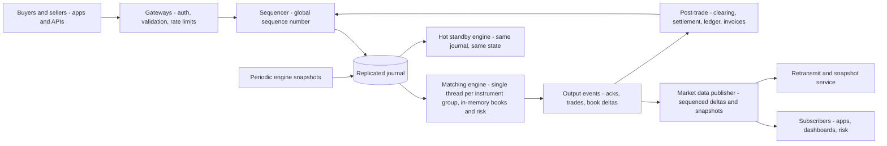
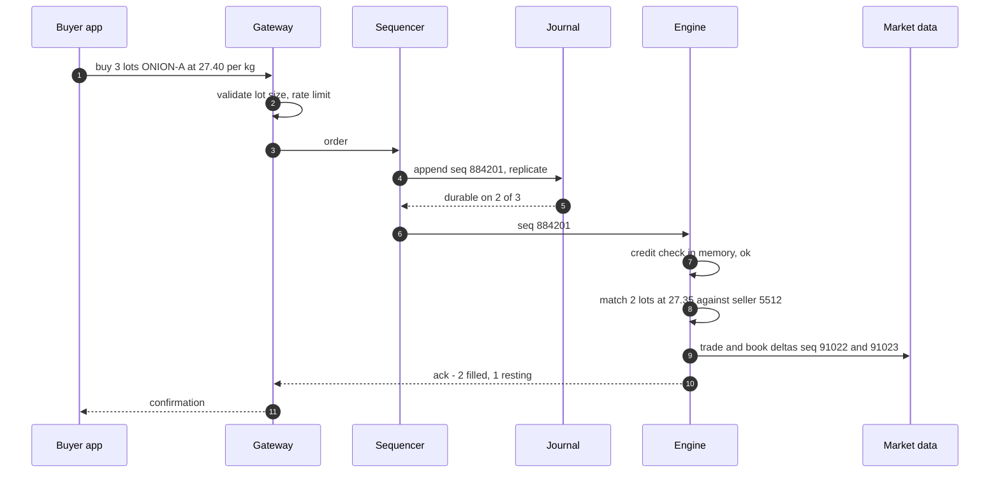
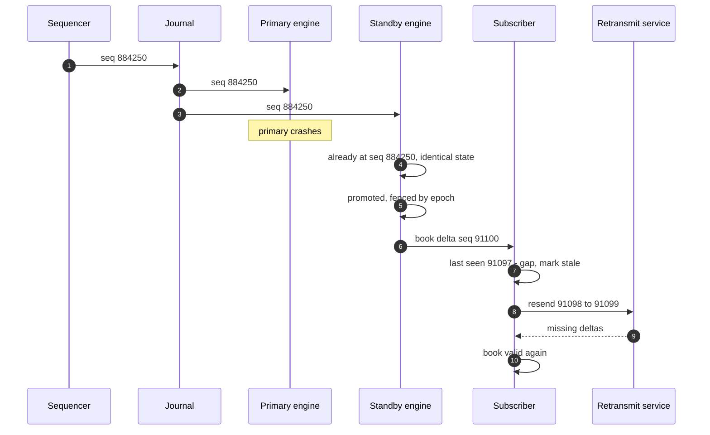
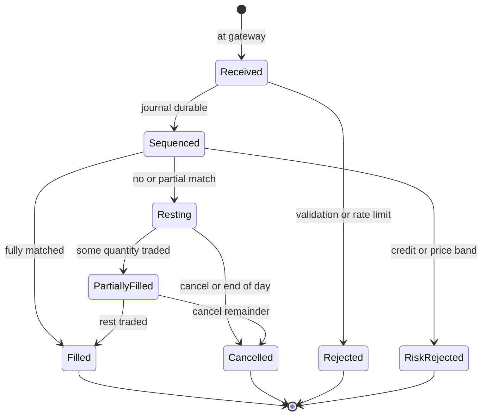

# 55. Case Study: Order Matching Engine

!!! abstract "Chapter at a glance"
    **Reader bands:** B3 → B4 · **Prerequisites:** [Ch 12](../02-distributed-core/12-consistency-time-and-consensus.md) (determinism, consensus), [Ch 15](../02-distributed-core/15-event-driven-architecture-cqrs-and-event-sourcing.md) (event sourcing), [Ch 19](../02-distributed-core/19-concurrency-at-scale-in-java.md) (Java concurrency), [Ch 45](45-payment-system.md) (ledgers, settlement)

    **What you will build:** the matching engine of a **B2B produce exchange**. Wholesalers and kirana buyers post bids and farmers and aggregators post offers for standardised lots (onion grade A, 10-tonne lots), and the engine matches them by price and time priority. It is the last and most "exotic" case study, and it gathers the handbook's themes:

    - data structures on the hot path;
    - a single-writer design for determinism;
    - event sourcing for recovery and replicas;
    - risk checks inside the critical path;
    - fan-out of a replicated state (market data) that must never be silently wrong.

    This is the "design a stock exchange / order matching system" interview question.

    **The four labs:**

    - **L1: order books (real, measured).** All three implementations produced the **identical trade stream** (1,752,321 trades, same hash) from 3M events:
        - A sorted list managed **14k events/s**, with a 540 µs p99.
        - A TreeMap of price levels managed **3.5M/s**.
        - A **tick-ladder array** managed **6.1M/s**, with a **0.51 µs** p99.
    - **L2: determinism (real threads and journal).**
        - Threads matching under a lock produced 3 different trade streams from the same input in 3 runs, with nothing recorded that could explain or replay them.
        - With a **sequencer + journal + single matcher**, replicas and crash recovery reproduced the live book **exactly in 3 of 3 runs**, at 4.0M orders/s.
    - **L3: pre-trade credit checks (simulation).**
        - Gateway-cached exposure let **392 accounts** exceed their limits, by up to **₹1.96 lakh**.
        - A central risk service was exact, but added **138 ms** at p99.
        - An in-path check was exact and cost microseconds.
    - **L4: market data (simulation).**
        - Unsequenced deltas left **18 of 200** subscribers with silently wrong books, and books were wrong **9.4%** of the time.
        - Sequenced deltas with retransmission gave **0** wrong books and 0.33% known-stale time.
        - Snapshot-only recovery gave 0 wrong books, but 7.8% stale time.

    · **Reading time:** 110 min + code

!!! warning "Regulatory scope (VERIFY)"
    Exchanges for securities and commodity derivatives are regulated. In India, that means SEBI rules for stock and commodity exchanges; e-NAM and state APMC rules govern agricultural produce trading. This chapter designs a hypothetical **B2B spot marketplace with exchange-style matching** and makes no claim about the licensing it would need.

---

## 1. Introduction & Why It Matters

### 1.1 A story: the auction that couldn't explain itself

The grocery platform's sourcing team ran morning auctions for produce lots. The first version was a Spring service with a REST endpoint per order. Orders were matched in a `@Transactional` method that loaded resting orders from PostgreSQL with `SELECT … FOR UPDATE ORDER BY price, created_at` and wrote the trades back. At 7:00 am, when 800 buyers bid for the day's onion lots:

1. **It fell over.** Row locks serialised everything. p99 went to seconds, and timeouts made clients retry, which added more orders.
2. **Nobody could explain an outcome.** A buyer asked why their earlier bid at the same price lost to a later one. `created_at` came from four app servers with slightly different clocks, and the lock order differed from both. No record existed of the order the engine actually used.
3. **A buyer overspent their credit line by ₹4 lakh.** Each app server checked credit against a cached balance.
4. **The price screen lied.** Dashboards built books from a WebSocket feed of changes. A dropped message left a phantom bid at ₹28/kg on some screens all morning. Sellers accepted lower prices because they believed a ₹28 bid existed.

A matching engine is small (a few thousand lines), but it is where **fairness, determinism, latency and correctness** are all non-negotiable at once.

!!! quote "The thesis of this chapter"
    **The book is a data-structure problem.** Price levels indexed by tick, and FIFO queues with O(1) cancel (L1). **The engine is a single-writer state machine behind a sequencer.** The sequenced journal is the truth, and determinism gives replicas, recovery and auditability for free (L2). **Risk checks belong in the sequenced path**, on in-memory state. Caches and remote calls make them wrong or slow (L3). **Market data is replicated state.** Sequence numbers, retransmission and snapshots make a subscriber's book either correct or known to be stale, never silently wrong (L4).

### 1.2 The exchange around the engine

| Component | Role | Notes |
|---|---|---|
| Gateways | Authenticate, validate, rate-limit, normalise orders | Stateless, horizontally scaled |
| Sequencer | Assign a global order, append to the journal (replicated) | The single point of ordering |
| Matching engine | Apply orders to books: risk check, match, emit events | Single-threaded per instrument group |
| Journal / event log | Durable, replicated record of inputs (and outputs) | Replay = recovery |
| Market data | Publish book deltas, trades, snapshots | Sequenced, fan-out |
| Post-trade | Clearing, settlement, invoices, ledger ([Ch 45](45-payment-system.md)) | Consumes trade events |
| Risk | Credit limits, position limits, circuit breakers | Pre-trade in path; post-trade monitoring |

### 1.3 Learning objectives

By the end you will be able to:

- **Design order books** for price-time priority with fast insert, cancel and match (L1).
- **Architect a deterministic engine**: sequencer, journal, single writer, replicas, recovery (L2).
- **Place risk checks correctly** (L3).
- **Design market-data distribution** with gap detection and recovery (L4).
- Handle order types, fairness, latency engineering in Java, and failover.

---

## 2. Core Concepts — Beginner to Deep

### 2.1 Intuition: an auctioneer with a numbered ticket roll <span class="band b3">B3</span>

In a busy market hall, every bid is written on a ticket torn from a single numbered roll: that's the sequencer. One auctioneer processes the tickets strictly in number order, matching the best price first and the earliest ticket first at the same price: that's the single-threaded engine with price-time priority. A clerk copies every ticket into a ledger: that's the journal. If the auctioneer faints, a colleague replays the ledger and arrives at exactly the same state. Before accepting a bid, the auctioneer checks the buyer's credit on the board beside them, not a note from yesterday. The price board outside is updated line by line with numbered updates, so anyone who missed a number knows they're out of date.

### 2.2 Requirements <span class="band b3">B3</span>

**Functional**

- Order types: limit, market, cancel, modify (cancel/replace); time-in-force (day, IOC, FOK); minimum lot sizes.
- Price-time priority matching per instrument (e.g. `ONION-A-NSK-10T-D1`).
- Pre-trade risk: credit limits for buyers, inventory attestations for sellers, price bands (circuit breakers).
- Market data: top of book, full depth, trades, snapshots.
- Post-trade: trade confirmations, settlement instructions, invoices.

**Non-functional**

- Deterministic and auditable: every outcome explainable from a durable, ordered record.
- Latency: order-to-ack p99 in the low milliseconds end to end (the engine itself in microseconds).
- Throughput: bursts of tens of thousands of orders per second at auction open.
- Availability: failover within seconds, without losing or duplicating acknowledged orders.

### 2.3 Estimation <span class="band b3">B3</span>

| Quantity | Estimate |
|---|---|
| Instruments | ~2,000 (commodity × grade × location × delivery date) |
| Participants | ~20,000 buyers and sellers |
| Orders | ~2M/day; burst of 30k/s at 7:00 open |
| Book depth | Hundreds of price levels per active instrument |
| Journal | 2M × ~100 B = 200 MB/day, replicated |
| Market data | Deltas × subscribers: fan-out dominates bandwidth |

One engine thread (L1: millions of events/s) is enough. **Correctness, not throughput, drives the design.**

### 2.4 The order book ⭐ <span class="band b3">B3</span>

L1 ran 3M events: 60% limit orders, 30% cancels, 10% market orders.

| Book | Events/s | p50 | p99 | p99.9 | Trades (hash) |
|---|---|---|---|---|---|
| Sorted ArrayList per side | 14,095 | 3.48 µs | **540 µs** | 801 µs | 1,752,321 (same) |
| TreeMap<price, FIFO> + id index | 3,481,981 | 0.13 µs | 1.55 µs | 5.0 µs | 1,752,321 (same) |
| **Tick-ladder array + intrusive lists** | **6,071,547** | 0.09 µs | **0.51 µs** | 0.8 µs | 1,752,321 (same) |

- **Price-time priority**: best price first, then earliest arrival within a price level (FIFO). Some markets use pro-rata allocation at a level.
- **The structures**:
    - Price levels are indexed by tick. Prices live on a grid inside a band, so an array works, with a tree as a fallback for out-of-band prices.
    - Each level has a FIFO of orders.
    - An id → order map gives O(1) cancel, with intrusive doubly-linked lists for O(1) unlink.
    - Best-bid and best-ask pointers are maintained.
- **Identical outputs** prove the rules, not the structures, define the result. That is also how to test a faster book: diff its trade stream against a simple reference implementation.
- **Tails matter.** A slow operation delays every order behind it in a single-threaded engine. Avoid allocation and GC on the hot path (object pools, primitive collections), and avoid unbounded scans. B1's cancel was a linear scan.

### 2.5 Determinism: sequencer, journal, single writer ⭐ <span class="band b4">B4</span>

L2 ran 4 gateways × 250k orders through each design, 3 runs each:

| Design | Distinct trade streams (3 runs) | Replica / recovery identical | Orders/s |
|---|---|---|---|
| Gateways call the book directly under a lock | 3 | n/a (no journal) | 3,012,088 |
| **Sequencer + journal + single matcher** | 3 | **yes, 3 of 3** | 3,953,355 |

- **The arrival race is real.** Different runs interleave differently, and no design removes that at the gateways.
- **What the sequencer changes** is that the race's outcome becomes a *fact*: a numbered, durable journal. Everything after it is a pure function of the journal.
- **Single-threaded matching per instrument group** removes locks and nondeterminism (hash iteration order, time-dependent logic and thread scheduling are all banned from the matcher), and is fast enough (L1).
- **Replicas** consume the same journal and hold identical state (hot standby). **Recovery** is snapshot + replay. **Audits** replay any day.
- **Journal durability and replication**: the sequencer replicates each entry before acknowledging it (Raft or a primary-backup pair), with group commit ([Ch 54](54-distributed-key-value-store.md) L2).
- **The pattern** is known as LMAX architecture / state-machine replication ([Ch 12](../02-distributed-core/12-consistency-time-and-consensus.md)).

### 2.6 Pre-trade risk ⭐ <span class="band b4">B4</span>

L3 checked 2,000 credit accounts against 200k orders arriving via 4 gateways:

| Where the check runs | Accounts over limit | Worst overspend | Added p99 latency | Ceiling |
|---|---|---|---|---|
| At each gateway, cached exposure (500 ms refresh) | **392** | ₹1,95,948 | 10 µs | not the limit |
| Central risk service, synchronous | 0 | ₹0 | **138.3 ms** | 4,000/s |
| **In the sequenced engine path** | 0 | ₹0 | **2 µs** | not the limit |

(K1 and K3 latencies are assumed in-process costs. K2 is modelled as a single queue of 0.25 ms checks.)

- **A check against a cache is a check against the past.** Each gateway grants the same headroom.
- **A remote synchronous check** is exact, but it puts a network hop and a queue on every order.
- **In-path risk**: exposure is kept in memory, updated deterministically on accept, fill, cancel and settlement events (settlements arrive as sequenced inputs), and rebuilt by replay.
- **Other controls**:
    - **Price bands and circuit breakers**: reject orders far from the reference price, and halt matching on extreme moves.
    - **Self-trade prevention.**
    - **Per-participant order-rate limits** at the gateways ([Ch 39](39-distributed-rate-limiter.md)).
    - **Kill switches** per participant.

### 2.7 Market data ⭐ <span class="band b4">B4</span>

L4 sent 500k deltas to 200 subscribers with ~0.1% loss in bursts:

| Feed | Books wrong at end | Time with a WRONG book | Time knowingly stale | MB per subscriber |
|---|---|---|---|---|
| Deltas, no sequence numbers | **18** | **9.44%** | 0% | 9.5 |
| **Sequenced deltas + retransmit** | 0 | 0% | **0.33%** | 9.6 |
| Sequenced deltas + 1 s snapshots | 0 | 0% | 7.84% | 10.9 |

- **Every message carries a sequence number.** A gap means stale: stop trusting the book and recover.
- **Recovery**: a retransmit service for small gaps, and snapshots (periodic, or on request) for big gaps and late joiners. Real feeds use both.
- **Conflation** for slow consumers (send the latest state, not every change) and **backpressure** handling: never let one slow subscriber slow the engine.
- **Transport**: multicast on exchange networks, WebSockets/SSE for apps ([Ch 03](../01-foundations/03-networking-essentials.md)) with the same sequencing discipline.

### 2.8 Order types and lifecycle <span class="band b3">B3</span>

- **Limit** (rests if not fully matched), **market** (matches against the book; unfilled remainder cancelled or protected by a price band), **IOC/FOK**, **cancel/replace** (replacing loses time priority if the price or size increases, per the rules).
- **Auctions**: a call auction at the open (collect orders, compute a single clearing price that maximises volume) avoids a chaotic first second. It suits a morning produce market well.
- **Trade events** feed settlement (payment from the buyer's credit line, delivery instructions for the seller) through the ledger ([Ch 45](45-payment-system.md)).

### 2.9 Latency engineering in Java <span class="band b4">B4</span>

- A single-threaded hot loop pinned to a core, avoiding context switches.
- No allocation on the hot path (pre-allocated order objects, primitive maps, off-heap buffers), so GC stays quiet. Otherwise use a low-pause collector (ZGC).
- Lock-free single-producer/single-consumer ring buffers between stages (LMAX Disruptor) instead of `BlockingQueue`.
- Measure with HDR histograms. Report p99.9 and max, not averages, and use coordinated-omission-aware load generators.
- Most end-to-end latency is network and gateway, not matching. Optimise the right stage.

### 2.10 Interview framing <span class="band b4">B4</span>

"Design a stock exchange / matching engine." Cover:

- order types and priority rules;
- the book data structures;
- the sequencer and journal;
- the single-threaded deterministic engine;
- replicas and failover by replay;
- pre-trade risk in path;
- market data with sequence numbers and snapshots;
- post-trade;
- latency engineering.

Staff-level signals include "determinism over parallelism", testing by diffing trade streams, risk in the sequenced path, and a feed that can't be silently wrong.

---

## 3. Architecture & Diagrams

### 3.1 Component view



### 3.2 Sequence: happy path, a bid that trades



### 3.3 Sequence: failure path, engine failover and a feed gap



### 3.4 State: an order's lifecycle



---

## 4. Design Document Excerpt: Produce Exchange Engine v2

!!! note "Design Document (excerpt) — Produce Exchange Matching Engine v2"
    **Status:** Accepted · **Authors:** Sourcing platform team · **Reviewers:** Finance, Risk, Legal/compliance, SRE

    | Field | Value |
    |---|---|
    | Context | DB-row-lock matching fell over at the open. Priority couldn't be explained. Gateway-cached credit checks were exceeded. Unsequenced WebSocket deltas left phantom bids on screens. |
    | Decision | Gateways → Raft-replicated sequencer journal → single-threaded engine per instrument group, with tick-ladder books and in-memory credit exposure → sequenced market data with retransmit and snapshots. A hot standby replays the same journal. Opening call auction at 07:00. Post-trade via ledger. |
    | Related ADRs | ADR-410 Books: tick ladder within a ±20% band, tree fallback; reference-implementation diff tests (L1). ADR-411 Determinism: sequencer + journal (group-committed, 3 replicas); no clocks, randomness or hash iteration in the matcher; snapshots every 100k events (L2). ADR-412 Risk: credit exposure in the engine; settlement and limit changes enter as sequenced events; price bands ±10% of reference (L3). ADR-413 Market data: seq per instrument; retransmit service (last 60 s); snapshots every 1 s and on request; conflated top-of-book for mobile (L4). ADR-414 Opening auction: single clearing price maximising volume. |

    **Requirements.**

    - **R1:** Any trade can be explained by replaying the journal. Replay output is identical to live output (daily check).
    - **R2:** Engine processing p99.9 < 50 µs. Order-to-ack p99 < 20 ms end to end.
    - **R3:** No account can exceed its credit limit, even transiently.
    - **R4:** No subscriber displays a book known to be inconsistent. Gaps are shown as stale within 100 ms.
    - **R5:** Failover to the standby in < 5 s with no lost or duplicated acknowledged orders.

    **Decisions in detail.**

    1. **Books (ADR-410).** Pre-allocated order pool; primitive long→order maps. Every release is diffed against the reference implementation on a replay of last month's journals.
    2. **Determinism (ADR-411).** "Time" inside the engine is the sequencer's timestamp on the input. Output events carry input sequence numbers.
    3. **Risk (ADR-412).** Credit updates from finance arrive as sequenced `LimitChanged` events. A risk kill switch is also a sequenced event.
    4. **Market data (ADR-413).** Mobile apps receive conflated snapshots every 500 ms. Professional terminals get full-depth deltas.
    5. **Auction (ADR-414).** Uncrossing runs in the engine at the scheduled sequence point.

    **Consequences.**

    - Costs: a specialised component with strict coding rules, a journal replication service, and market-data infrastructure.
    - Benefits: explainable, fair, fast, risk-safe matching, and screens that never lie silently.

---

## 5. Hands-On Code — Level Ladder

!!! info "What's real here"
    - **L1** runs three real order-book implementations, measured, with trade streams compared by hash.
    - **L2** uses real threads, a real journal file, and real replays.
    - **L3 and L4** are simulations. Credit limits, latencies and loss patterns are stated assumptions.
    - All latencies are single-machine, in-process numbers, not an exchange's end-to-end latency.

All four labs are single-file JDK 21 programs. Run them with `-Xmx3g` and `-Dstdout.encoding=UTF-8`.

### L1 — Order books <span class="band b3">B3</span>

**Requirement:** "Match 3 million events with price-time priority, fast, with microsecond tails — and prove the result is right."

Three books take the same input, and their trade streams are compared by hash.

```java title="OrderBookL1.java"
// OrderBookL1.java — run with: java -Xmx2g OrderBookL1.java   (JDK 21, no dependencies)
// THE ORDER BOOK. A B2B produce exchange (think a digital mandi for onion lots): buyers post bids, sellers post
// offers, the engine matches them by PRICE then TIME priority. 3,000,000 order events (fixed seed): 60% limit orders
// clustered around a drifting mid price, 30% cancels of resting orders, 10% market orders. Prices in paise, tick = 5
// paise. Three REAL book implementations, same input:
//   B1 one sorted ArrayList of resting orders per side (insert by binary search, match from the front)
//   B2 TreeMap<price, FIFO queue> per side + a HashMap from order id to its order for O(1) cancel lookup
//   B3 a price-indexed array of levels (tick ladder around the price band) with best-price pointers; intrusive
//      doubly-linked FIFO per level; cancel = unlink in O(1)
// Every engine must produce the SAME trade stream (checked by a hash). Measured: events/s, per-event latency
// p50/p99/p99.9, trades.
import java.util.*;

public class OrderBookL1 {
    static final int N = 3_000_000, TICK = 5, BASE = 100_000, BAND = 4_000;                    // ₹1,000.00 ± band ticks
    record Ev(int type, long id, boolean buy, int price, int qty, long cancelId) {}              // type 0 limit, 1 cancel, 2 market

    public static void main(String[] args) {
        Random r = new Random(55); Ev[] evs = new Ev[N]; List<Long> live = new ArrayList<>(); double mid = BASE; long nextId = 1;
        for (int i = 0; i < N; i++) {
            mid += r.nextGaussian() * 2; double x = r.nextDouble();
            if (x < 0.30 && !live.isEmpty()) { int k = r.nextInt(live.size()); long cid = live.get(k); live.set(k, live.get(live.size() - 1)); live.remove(live.size() - 1); evs[i] = new Ev(1, 0, false, 0, 0, cid); }
            else if (x < 0.40) evs[i] = new Ev(2, nextId++, r.nextBoolean(), 0, 1 + r.nextInt(20), 0);
            else { boolean buy = r.nextBoolean(); int off = (int) Math.abs(r.nextGaussian() * 15) * TICK; int p = (int) (Math.round(mid / TICK) * TICK) + (buy ? -off : off) + (r.nextDouble() < 0.1 ? (buy ? 2 : -2) * TICK : 0);
                long id = nextId++; evs[i] = new Ev(0, id, buy, p, 1 + r.nextInt(50), 0); live.add(id); }
        }
        System.out.println("3,000,000 events: 60% limit, 30% cancel, 10% market; price-time priority; tick 5 paise.\n");
        System.out.printf("   %-58s %12s %10s %10s %10s %11s %18s%n", "book", "events/s", "p50", "p99", "p99.9", "trades", "trade-stream hash");
        String[] names = {"B1) sorted ArrayList per side", "B2) TreeMap<price, FIFO> + id index", "B3) tick-ladder array of levels + intrusive lists"};
        for (int b = 0; b < 3; b++) {
            for (int warm = 0; warm < 2; warm++) run(b, names[b], evs, warm == 1);
        }
        System.out.println("\n   → all three books produce the identical trade stream — matching rules, not data structures, define the result.");
        System.out.println("     A sorted list pays for every insert and cancel by shifting elements. A tree of price levels makes inserts");
        System.out.println("     O(log levels) and matching O(1) at the best level. A tick ladder turns price → level into an array index and");
        System.out.println("     cancel into an unlink — the shape real exchange engines use, because prices live on a known grid in a narrow");
        System.out.println("     band. The tail (p99.9) matters as much as the average: one slow insert delays every order queued behind it.");
    }

    static void run(int b, String name, Ev[] evs, boolean print) {
        Book book = b == 0 ? new ListBook() : b == 1 ? new TreeBook() : new LadderBook(); long[] lat = new long[evs.length]; long t0 = System.nanoTime();
        for (int i = 0; i < evs.length; i++) { long s = System.nanoTime(); Ev e = evs[i];
            switch (e.type()) { case 0 -> book.limit(e.id(), e.buy(), e.price(), e.qty()); case 1 -> book.cancel(e.cancelId()); default -> book.market(e.id(), e.buy(), e.qty()); }
            lat[i] = System.nanoTime() - s; }
        double secs = (System.nanoTime() - t0) / 1e9; Arrays.sort(lat);
        if (print) System.out.printf("   %-58s %,12.0f %7.2f µs %7.2f µs %7.1f µs %,11d %18s%n", name, evs.length / secs, lat[lat.length / 2] / 1e3, lat[(int) (lat.length * 0.99)] / 1e3, lat[(int) (lat.length * 0.999)] / 1e3, book.trades(), Long.toHexString(book.hash()));
    }

    static abstract class Book {
        long trades = 0, hash = 1469598103934665603L;
        void trade(long aggressor, long resting, int price, int qty) { trades++; hash = (hash ^ (resting * 31 + price * 17L + qty)) * 1099511628211L; hash ^= aggressor; }
        long trades() { return trades; } long hash() { return hash; }
        abstract void limit(long id, boolean buy, int price, int qty); abstract void cancel(long id); abstract void market(long id, boolean buy, int qty);
    }
    static final class O { long id; boolean buy; int price, qty; O prev, next; Level level; O(long id, boolean buy, int price, int qty) { this.id = id; this.buy = buy; this.price = price; this.qty = qty; } }

    // ---- B1 ----
    static final class ListBook extends Book {
        final ArrayList<O> bids = new ArrayList<>(), asks = new ArrayList<>(); long seq = 0; final HashMap<Long, Long> seqOf = new HashMap<>();
        // bids sorted by price desc then time; asks by price asc then time — both with the best at index 0
        void limit(long id, boolean buy, int price, int qty) { qty = match(id, buy, price, qty); if (qty > 0) insert(new O(id, buy, price, qty)); }
        void market(long id, boolean buy, int qty) { match(id, buy, buy ? Integer.MAX_VALUE : Integer.MIN_VALUE, qty); }
        int match(long id, boolean buy, int limit, int qty) {
            ArrayList<O> opp = buy ? asks : bids;
            while (qty > 0 && !opp.isEmpty()) { O o = opp.get(0); if (buy ? o.price > limit : o.price < limit) break;
                int q = Math.min(qty, o.qty); trade(id, o.id, o.price, q); qty -= q; o.qty -= q; if (o.qty == 0) opp.remove(0); }
            return qty;
        }
        void insert(O o) { ArrayList<O> side = o.buy ? bids : asks; int lo = 0, hi = side.size();
            while (lo < hi) { int m = (lo + hi) >>> 1; O x = side.get(m); boolean before = o.buy ? x.price >= o.price : x.price <= o.price; if (before) lo = m + 1; else hi = m; }
            side.add(lo, o); }
        void cancel(long id) { for (ArrayList<O> side : List.of(bids, asks)) for (int i = 0; i < side.size(); i++) if (side.get(i).id == id) { side.remove(i); return; } }
    }
    // ---- B2 ----
    static final class TreeBook extends Book {
        final TreeMap<Integer, ArrayDeque<O>> bids = new TreeMap<>(Comparator.reverseOrder()), asks = new TreeMap<>(); final HashMap<Long, O> byId = new HashMap<>();
        void limit(long id, boolean buy, int price, int qty) { qty = match(id, buy, price, qty); if (qty > 0) { O o = new O(id, buy, price, qty); (buy ? bids : asks).computeIfAbsent(price, k -> new ArrayDeque<>()).addLast(o); byId.put(id, o); } }
        void market(long id, boolean buy, int qty) { match(id, buy, buy ? Integer.MAX_VALUE : Integer.MIN_VALUE, qty); }
        int match(long id, boolean buy, int limit, int qty) {
            TreeMap<Integer, ArrayDeque<O>> opp = buy ? asks : bids;
            while (qty > 0 && !opp.isEmpty()) { var e = opp.firstEntry(); int p = e.getKey(); if (buy ? p > limit : p < limit) break; ArrayDeque<O> q = e.getValue();
                while (qty > 0 && !q.isEmpty()) { O o = q.peekFirst(); if (o.qty == 0) { q.pollFirst(); continue; } int t = Math.min(qty, o.qty); trade(id, o.id, p, t); qty -= t; o.qty -= t; if (o.qty == 0) { q.pollFirst(); byId.remove(o.id); } }
                if (q.isEmpty()) opp.remove(p); }
            return qty;
        }
        void cancel(long id) { O o = byId.remove(id); if (o == null) return; o.qty = 0;                  // lazy delete: skipped when reached
            TreeMap<Integer, ArrayDeque<O>> side = o.buy ? bids : asks; ArrayDeque<O> q = side.get(o.price); if (q != null) { q.remove(o); if (q.isEmpty()) side.remove(o.price); } }
    }
    // ---- B3 ----
    static final class Level { O head, tail; int count; }
    static final class LadderBook extends Book {
        final int lo = BASE - BAND * TICK, levels = 2 * BAND + 1; final Level[] bid = new Level[levels], ask = new Level[levels]; int bestBid = -1, bestAsk = levels; final HashMap<Long, O> byId = new HashMap<>();
        { for (int i = 0; i < levels; i++) { bid[i] = new Level(); ask[i] = new Level(); } }
        int idx(int price) { return Math.max(0, Math.min(levels - 1, (price - lo) / TICK)); }
        void limit(long id, boolean buy, int price, int qty) { qty = match(id, buy, buy ? idx(price) : idx(price), qty); if (qty > 0) { O o = new O(id, buy, price, qty); int i = idx(price); Level l = buy ? bid[i] : ask[i]; append(l, o); byId.put(id, o);
            if (buy) bestBid = Math.max(bestBid, i); else bestAsk = Math.min(bestAsk, i); } }
        void market(long id, boolean buy, int qty) { match(id, buy, buy ? levels - 1 : 0, qty); }
        int match(long id, boolean buy, int limitIdx, int qty) {
            while (qty > 0) {
                if (buy) { while (bestAsk < levels && ask[bestAsk].count == 0) bestAsk++; if (bestAsk >= levels || bestAsk > limitIdx) break; }
                else { while (bestBid >= 0 && bid[bestBid].count == 0) bestBid--; if (bestBid < 0 || bestBid < limitIdx) break; }
                Level l = buy ? ask[bestAsk] : bid[bestBid]; O o = l.head; int t = Math.min(qty, o.qty); trade(id, o.id, o.price, t); qty -= t; o.qty -= t;
                if (o.qty == 0) { unlink(o); byId.remove(o.id); }
            }
            return qty;
        }
        void append(Level l, O o) { o.level = l; o.prev = l.tail; o.next = null; if (l.tail == null) l.head = o; else l.tail.next = o; l.tail = o; l.count++; }
        void unlink(O o) { Level l = o.level; if (o.prev == null) l.head = o.next; else o.prev.next = o.next; if (o.next == null) l.tail = o.prev; else o.next.prev = o.prev; l.count--; o.level = null; }
        void cancel(long id) { O o = byId.remove(id); if (o != null && o.level != null) unlink(o); }
    }
}
```

```text title="java -Xmx3g OrderBookL1.java"
3,000,000 events: 60% limit, 30% cancel, 10% market; price-time priority; tick 5 paise.

   book                                                           events/s        p50        p99      p99.9      trades  trade-stream hash
   B1) sorted ArrayList per side                                    14,095    3.48 µs  540.13 µs   801.2 µs   1,752,321   2740042cb83b9625
   B2) TreeMap<price, FIFO> + id index                           3,481,981    0.13 µs    1.55 µs     5.0 µs   1,752,321   2740042cb83b9625
   B3) tick-ladder array of levels + intrusive lists             6,071,547    0.09 µs    0.51 µs     0.8 µs   1,752,321   2740042cb83b9625

   → all three books produce the identical trade stream — matching rules, not data structures, define the result.
     A sorted list pays for every insert and cancel by shifting elements. A tree of price levels makes inserts
     O(log levels) and matching O(1) at the best level. A tick ladder turns price → level into an array index and
     cancel into an unlink — the shape real exchange engines use, because prices live on a known grid in a narrow
     band. The tail (p99.9) matters as much as the average: one slow insert delays every order queued behind it.
```

**Reading it:**

- **The hashes match**, so the three books agree trade for trade. That is the correctness oracle for any optimisation.
- **The sorted list** is dominated by shifting elements and its linear cancel scan.
- **The tree** is fast.
- **The ladder** is faster and has the tightest tail: array indexing and O(1) unlink.

### L2 — Determinism through sequencing <span class="band b4">B4</span>

**Requirement:** "Every outcome must be explainable and reproducible on a standby and after a crash."

Four gateway threads feed the same inputs to two designs, three times each.

```java title="DeterminismL2.java"
// DeterminismL2.java — run with: java -Xmx2g DeterminismL2.java   (JDK 21, no dependencies)
// WHY MATCHING ENGINES ARE SINGLE-THREADED BEHIND A SEQUENCER. 4 gateway threads each receive 250,000 orders (limit /
// cancel / market, fixed seed) and pass them to the engine. The same inputs are processed 3 times per design:
//   D1 the gateways call the shared order book directly, under a lock (the "obvious" multi-threaded design)
//   D2 the gateways hand orders to a SEQUENCER that stamps a global sequence number and appends them to a journal
//      file; ONE matcher thread consumes the journal in order. Then: (a) a standby replica replays the same journal,
//      (b) after a simulated crash, recovery replays the journal into a fresh book
// Measured: distinct trade streams across the 3 runs of the same input (by hash), whether a replica / recovery
// reproduces the live engine exactly, and throughput.
import java.io.*;
import java.nio.*;
import java.nio.channels.FileChannel;
import java.nio.file.*;
import java.util.*;
import java.util.concurrent.*;

public class DeterminismL2 {
    static final int TICK = 5, BASE = 100_000, BAND = 4_000, GATEWAYS = 4, PER = 250_000;
    record Ev(int type, long id, boolean buy, int price, int qty, long cancelId) {}

    public static void main(String[] args) throws Exception {
        Ev[][] input = new Ev[GATEWAYS][PER]; Random r = new Random(55); long nextId = 1;
        for (int g = 0; g < GATEWAYS; g++) { List<Long> live = new ArrayList<>(); double mid = BASE;
            for (int i = 0; i < PER; i++) { mid += r.nextGaussian() * 2; double x = r.nextDouble();
                if (x < 0.30 && !live.isEmpty()) { int k = r.nextInt(live.size()); long cid = live.get(k); live.set(k, live.get(live.size() - 1)); live.remove(live.size() - 1); input[g][i] = new Ev(1, 0, false, 0, 0, cid); }
                else if (x < 0.40) input[g][i] = new Ev(2, nextId++, r.nextBoolean(), 0, 1 + r.nextInt(20), 0);
                else { boolean buy = r.nextBoolean(); int off = (int) Math.abs(r.nextGaussian() * 15) * TICK; int p = (int) (Math.round(mid / TICK) * TICK) + (buy ? -off : off);
                    long id = nextId++; input[g][i] = new Ev(0, id, buy, p, 1 + r.nextInt(50), 0); live.add(id); } } }
        System.out.println("4 gateways × 250,000 orders; each design runs the same input 3 times.\n");
        System.out.printf("   %-52s %22s %24s %14s%n", "design", "distinct trade streams", "replica / recovery", "orders/s");
        System.out.printf("   %-52s %22s %24s %14s%n", "", "(of 3 runs)", "identical to live?", "");
        // D1
        Set<Long> hashes = new HashSet<>(); double rate = 0;
        for (int run = 0; run < 3; run++) { LadderBook book = new LadderBook(); long t0 = System.nanoTime(); ExecutorService ex = Executors.newFixedThreadPool(GATEWAYS); List<Future<?>> fs = new ArrayList<>();
            for (int g = 0; g < GATEWAYS; g++) { final int gg = g; fs.add(ex.submit(() -> { for (Ev e : input[gg]) synchronized (book) { apply(book, e); } })); }
            for (Future<?> f : fs) f.get(); ex.shutdown(); rate = GATEWAYS * PER / ((System.nanoTime() - t0) / 1e9); hashes.add(book.hash()); }
        System.out.printf("   %-52s %22d %24s %,14.0f%n", "D1) gateways call the book directly, under a lock", hashes.size(), "n/a (no journal)", rate);
        // D2
        hashes.clear(); boolean allReplay = true;
        for (int run = 0; run < 3; run++) {
            Path journal = Paths.get("/tmp/melab/journal-" + run + ".bin"); Files.deleteIfExists(journal);
            BlockingQueue<Ev> seqQ = new ArrayBlockingQueue<>(65_536); LadderBook live = new LadderBook(); long t0 = System.nanoTime();
            Thread sequencerAndMatcher = new Thread(() -> {                                     // one thread: sequence → journal → match
                try (FileChannel ch = FileChannel.open(journal, StandardOpenOption.CREATE, StandardOpenOption.WRITE)) {
                    ByteBuffer buf = ByteBuffer.allocate(1 << 20); long seq = 0;
                    for (int n = 0; n < GATEWAYS * PER; n++) { Ev e = seqQ.take(); seq++;
                        if (buf.remaining() < 40) { buf.flip(); while (buf.hasRemaining()) ch.write(buf); buf.clear(); }
                        buf.putLong(seq).putInt(e.type()).putLong(e.id()).put((byte) (e.buy() ? 1 : 0)).putInt(e.price()).putInt(e.qty()).putLong(e.cancelId());
                        apply(live, e); }
                    buf.flip(); while (buf.hasRemaining()) ch.write(buf); ch.force(false);
                } catch (Exception ex) { throw new RuntimeException(ex); } });
            sequencerAndMatcher.start();
            ExecutorService ex = Executors.newFixedThreadPool(GATEWAYS); List<Future<?>> fs = new ArrayList<>();
            for (int g = 0; g < GATEWAYS; g++) { final int gg = g; fs.add(ex.submit(() -> { for (Ev e : input[gg]) seqQ.put(e); return null; })); }
            for (Future<?> f : fs) f.get(); ex.shutdown(); sequencerAndMatcher.join(); rate = GATEWAYS * PER / ((System.nanoTime() - t0) / 1e9);
            hashes.add(live.hash());
            LadderBook replica = replay(journal); LadderBook recovered = replay(journal);
            allReplay &= replica.hash() == live.hash() && recovered.hash() == live.hash() && replica.trades == live.trades;
            Files.deleteIfExists(journal);
        }
        System.out.printf("   %-52s %22d %24s %,14.0f%n", "D2) sequencer + journal + single matcher thread", hashes.size(), allReplay ? "yes, 3 of 3" : "NO", rate);
        System.out.println("\n   → both designs see the same orders, but in whatever order the threads happen to interleave, so different");
        System.out.println("     runs produce different trades — that race is real and unavoidable at the gateways. The difference is what");
        System.out.println("     happens next. With threads matching under a lock, the order that decided priority exists nowhere: it can't be");
        System.out.println("     audited, replayed, or reproduced on a standby. A sequencer makes the race's outcome a FACT (a numbered journal),");
        System.out.println("     and a single-threaded, deterministic matcher turns that journal into the same book and the same trades on every");
        System.out.println("     replica and after every crash. Determinism, not parallelism, is the property the design protects.");
    }

    static void apply(LadderBook b, Ev e) { switch (e.type()) { case 0 -> b.limit(e.id(), e.buy(), e.price(), e.qty()); case 1 -> b.cancel(e.cancelId()); default -> b.market(e.id(), e.buy(), e.qty()); } }
    static LadderBook replay(Path journal) throws IOException {
        LadderBook b = new LadderBook(); ByteBuffer all = ByteBuffer.wrap(Files.readAllBytes(journal));
        while (all.remaining() >= 37) { all.getLong(); int type = all.getInt(); long id = all.getLong(); boolean buy = all.get() == 1; int price = all.getInt(); int qty = all.getInt(); long cid = all.getLong(); apply(b, new Ev(type, id, buy, price, qty, cid)); }
        return b;
    }

    static abstract class Book {
        long trades = 0, hash = 1469598103934665603L;
        void trade(long aggressor, long resting, int price, int qty) { trades++; hash = (hash ^ (resting * 31 + price * 17L + qty)) * 1099511628211L; hash ^= aggressor; }
        long trades() { return trades; } long hash() { return hash; }
        abstract void limit(long id, boolean buy, int price, int qty); abstract void cancel(long id); abstract void market(long id, boolean buy, int qty);
    }
    static final class O { long id; boolean buy; int price, qty; O prev, next; Level level; O(long id, boolean buy, int price, int qty) { this.id = id; this.buy = buy; this.price = price; this.qty = qty; } }

    // ---- B3 ----
    static final class Level { O head, tail; int count; }
    static final class LadderBook extends Book {
        final int lo = BASE - BAND * TICK, levels = 2 * BAND + 1; final Level[] bid = new Level[levels], ask = new Level[levels]; int bestBid = -1, bestAsk = levels; final HashMap<Long, O> byId = new HashMap<>();
        { for (int i = 0; i < levels; i++) { bid[i] = new Level(); ask[i] = new Level(); } }
        int idx(int price) { return Math.max(0, Math.min(levels - 1, (price - lo) / TICK)); }
        void limit(long id, boolean buy, int price, int qty) { qty = match(id, buy, buy ? idx(price) : idx(price), qty); if (qty > 0) { O o = new O(id, buy, price, qty); int i = idx(price); Level l = buy ? bid[i] : ask[i]; append(l, o); byId.put(id, o);
            if (buy) bestBid = Math.max(bestBid, i); else bestAsk = Math.min(bestAsk, i); } }
        void market(long id, boolean buy, int qty) { match(id, buy, buy ? levels - 1 : 0, qty); }
        int match(long id, boolean buy, int limitIdx, int qty) {
            while (qty > 0) {
                if (buy) { while (bestAsk < levels && ask[bestAsk].count == 0) bestAsk++; if (bestAsk >= levels || bestAsk > limitIdx) break; }
                else { while (bestBid >= 0 && bid[bestBid].count == 0) bestBid--; if (bestBid < 0 || bestBid < limitIdx) break; }
                Level l = buy ? ask[bestAsk] : bid[bestBid]; O o = l.head; int t = Math.min(qty, o.qty); trade(id, o.id, o.price, t); qty -= t; o.qty -= t;
                if (o.qty == 0) { unlink(o); byId.remove(o.id); }
            }
            return qty;
        }
        void append(Level l, O o) { o.level = l; o.prev = l.tail; o.next = null; if (l.tail == null) l.head = o; else l.tail.next = o; l.tail = o; l.count++; }
        void unlink(O o) { Level l = o.level; if (o.prev == null) l.head = o.next; else o.prev.next = o.next; if (o.next == null) l.tail = o.prev; else o.next.prev = o.prev; l.count--; o.level = null; }
        void cancel(long id) { O o = byId.remove(id); if (o != null && o.level != null) unlink(o); }
    }
}
```

```text title="java -Xmx3g DeterminismL2.java"
4 gateways × 250,000 orders; each design runs the same input 3 times.

   design                                               distinct trade streams       replica / recovery       orders/s
                                                                   (of 3 runs)       identical to live?               
   D1) gateways call the book directly, under a lock                         3         n/a (no journal)      3,012,088
   D2) sequencer + journal + single matcher thread                           3              yes, 3 of 3      3,953,355

   → both designs see the same orders, but in whatever order the threads happen to interleave, so different
     runs produce different trades — that race is real and unavoidable at the gateways. The difference is what
     happens next. With threads matching under a lock, the order that decided priority exists nowhere: it can't be
     audited, replayed, or reproduced on a standby. A sequencer makes the race's outcome a FACT (a numbered journal),
     and a single-threaded, deterministic matcher turns that journal into the same book and the same trades on every
     replica and after every crash. Determinism, not parallelism, is the property the design protects.
```

**Reading it:**

- **Different runs gave different trades in both designs.** The arrival race is real.
- **Only the sequenced design recorded the order it used.** Replicas and recovery then matched the live book exactly every time.
- **Throughput was similar.** The lock wasn't the problem; the unrecorded order was.

### L3 — Where the credit check runs <span class="band b4">B4</span>

**Requirement:** "No buyer may exceed their credit line, and the check must not slow the market."

2,000 accounts; bursty buyers spread their orders across gateways.

```java title="RiskL3.java"
// RiskL3.java — run with: java RiskL3.java   (JDK 21, no dependencies)
// PRE-TRADE CREDIT CHECKS. 2,000 wholesale buyers trade on credit; each has a limit (₹50k–₹5 lakh, fixed seed) on the
// value of their open buy orders + unsettled purchases. 200,000 buy orders over 60 s arrive through 4 gateways;
// 50 "aggressive" buyers spray orders across all gateways in bursts. An order may be accepted only if exposure + its
// value ≤ limit. Average load 3,333 orders/s; bursts well above. Three places to check:
//   K1 at each gateway, against an exposure cache refreshed from the engine every 500 ms (fast, local)
//   K2 at a central risk service: a synchronous call per order (~1 ms round trip); the service processes checks one
//      at a time (0.25 ms each, a locked read-modify-write of the exposure) — modelled as a single queue
//   K3 inside the sequenced engine path: exposure kept in memory per account, updated deterministically on accept,
//      fill and cancel (the order is checked in sequence, right before matching)
// Measured: accounts that ended above their limit, the worst overspend, extra latency added per order (p99; K1 and K3
// use assumed in-process costs of 10 µs and 2 µs), and the throughput ceiling the check imposes.
import java.util.*;

public class RiskL3 {
    record Order(double t, int acct, int gateway, long value) {}

    public static void main(String[] args) {
        Random r = new Random(55); int accts = 2000; long[] limit = new long[accts]; for (int a = 0; a < accts; a++) limit[a] = (50_000 + r.nextInt(450_001)) * 100L;
        List<Order> orders = new ArrayList<>();
        for (int i = 0; i < 200_000; i++) { boolean aggr = r.nextDouble() < 0.25; int a = aggr ? r.nextInt(50) : 50 + r.nextInt(accts - 50);
            double t = aggr ? (r.nextInt(60) + r.nextDouble() * 0.2) : r.nextDouble() * 60;                   // aggressive: 200 ms bursts each second
            orders.add(new Order(t, a, r.nextInt(4), (2_000 + r.nextInt(18_000)) * 100L)); }
        orders.sort(Comparator.comparingDouble(Order::t));
        System.out.println("2,000 credit accounts, 200,000 buy orders in 60 s via 4 gateways; 50 accounts burst across all gateways.\n");
        System.out.printf("   %-58s %12s %16s %14s %16s%n", "where the credit check runs", "accounts", "worst overspend", "added p99", "check ceiling");
        System.out.printf("   %-58s %12s %16s %14s %16s%n", "", "over limit", "", "latency", "(orders/s)");
        for (int k = 1; k <= 3; k++) {
            long[] exposure = new long[accts]; long[][] cache = new long[4][accts]; double nextRefresh = 0.5; double busyUntil = 0; List<Double> added = new ArrayList<>();
            Random fill = new Random(7);
            for (Order o : orders) {
                if (k == 1 && o.t() >= nextRefresh) { for (int g = 0; g < 4; g++) cache[g] = exposure.clone(); nextRefresh += 0.5; }
                boolean ok; double extra;
                switch (k) {
                    case 1 -> { ok = cache[o.gateway()][o.acct()] + o.value() <= limit[o.acct()]; if (ok) cache[o.gateway()][o.acct()] += o.value(); extra = 0.00001; }
                    case 2 -> { double start = Math.max(o.t(), busyUntil); busyUntil = start + 0.00025; extra = (start - o.t()) + 0.001; ok = exposure[o.acct()] + o.value() <= limit[o.acct()]; }   // 0.25 ms locked section per check
                    default -> { extra = 0.000002; ok = exposure[o.acct()] + o.value() <= limit[o.acct()]; }
                }
                if (ok) exposure[o.acct()] += o.value();
                if (fill.nextDouble() < 0.02) { int a = fill.nextInt(accts); exposure[a] = Math.max(0, exposure[a] - (long) (limit[a] * 0.1)); }   // settlements free credit
                added.add(extra);
            }
            int over = 0; long worst = 0; for (int a = 0; a < accts; a++) if (exposure[a] > limit[a]) { over++; worst = Math.max(worst, exposure[a] - limit[a]); }
            Collections.sort(added); double p99 = added.get((int) (added.size() * 0.99));
            String[] names = {"", "K1) at each gateway, exposure cache refreshed every 500 ms", "K2) central risk service, synchronous call per order", "K3) in the sequenced engine path, in-memory exposure"};
            String ceiling = k == 2 ? "4,000 (0.25 ms each)" : "not the limit";
            System.out.printf("   %-58s %12d %16s %11s %22s%n", names[k], over, String.format("₹%,.0f", worst / 100.0), fmt(p99), ceiling);
        }
        System.out.println("\n   → a check against a cached number is a check against the past: a buyer spraying orders through four gateways");
        System.out.println("     gets four copies of the same headroom, and every burst between refreshes slips through. A central service is");
        System.out.println("     correct but puts every order behind a network hop and one queue of checks — at a burst it queues, and the");
        System.out.println("     queue IS the latency. Putting the credit check in the sequenced path makes it both exact and cheap: it runs");
        System.out.println("     in the same single thread, in the same order, on in-memory state that the journal can rebuild.");
    }
    static String fmt(double s) { return s < 0.001 ? String.format("%.0f µs", s * 1e6) : s < 1 ? String.format("%.1f ms", s * 1e3) : String.format("%.1f s", s); }
}
```

```text title="java RiskL3.java"
2,000 credit accounts, 200,000 buy orders in 60 s via 4 gateways; 50 accounts burst across all gateways.

   where the credit check runs                                    accounts  worst overspend      added p99    check ceiling
                                                                over limit                         latency       (orders/s)
   K1) at each gateway, exposure cache refreshed every 500 ms          392         ₹195,948       10 µs          not the limit
   K2) central risk service, synchronous call per order                  0               ₹0    138.3 ms   4,000 (0.25 ms each)
   K3) in the sequenced engine path, in-memory exposure                  0               ₹0        2 µs          not the limit

   → a check against a cached number is a check against the past: a buyer spraying orders through four gateways
     gets four copies of the same headroom, and every burst between refreshes slips through. A central service is
     correct but puts every order behind a network hop and one queue of checks — at a burst it queues, and the
     queue IS the latency. Putting the credit check in the sequenced path makes it both exact and cheap: it runs
     in the same single thread, in the same order, on in-memory state that the journal can rebuild.
```

**Reading it:**

- **Cached checks let 392 accounts through**, with overspends up to about ₹2 lakh.
- **The central service is exact**, but at bursts its queue becomes latency (138 ms p99).
- **The in-path check is exact and cheap.** Its latency is an assumed in-process cost.
- **A development note.** The first calibration pushed 5,000 orders/s at a service capped at 4,000/s. That made K2 look broken on average rather than at bursts, so the load was reduced.

### L4 — Market data that can't lie silently <span class="band b4">B4</span>

**Requirement:** "Every subscriber's book is either correct or visibly stale."

500k deltas to 200 subscribers, with bursty loss.

```java title="MarketDataL4.java"
// MarketDataL4.java — run with: java MarketDataL4.java   (JDK 21, no dependencies)
// PUBLISHING THE BOOK. The engine emits 500,000 incremental updates ("price level P now has size S", 20 bytes each) for
// one produce contract over ~5 minutes (fixed seed). 200 subscribers (buyer apps, seller dashboards, risk) receive them
// over a multicast-style feed with loss bursts: ~50 bursts per subscriber of 1–20 messages (~0.1% of messages lost). Each
// subscriber keeps its own copy of the book. Three feed designs:
//   M1 deltas only, no sequence numbers — apply whatever arrives
//   M2 deltas with sequence numbers; on a gap, mark the book stale and fetch the missing messages from a retransmit
//      service (TCP, ~20 ms), then continue
//   M3 deltas with sequence numbers + a full snapshot of the book every second; on a gap, drop the book and wait for
//      the next snapshot
// Measured: subscribers whose book is wrong at the end, share of subscriber-time spent with a wrong book, share spent
// knowingly stale (gap detected, recovering), and bytes sent per subscriber.
import java.util.*;

public class MarketDataL4 {
    public static void main(String[] args) {
        int U = 500_000, SUBS = 200, LEVELS = 400; Random r = new Random(55);
        int[] lvl = new int[U], size = new int[U]; double[] t = new double[U];
        for (int i = 0; i < U; i++) { t[i] = i * 0.0006; lvl[i] = (int) Math.min(LEVELS - 1, Math.abs(r.nextGaussian() * 40)); size[i] = r.nextDouble() < 0.15 ? 0 : 1 + r.nextInt(500); }
        System.out.println("500,000 book updates in ~5 min to 200 subscribers; ~0.1% loss per subscriber in bursts of 1–20.\n");
        System.out.printf("   %-58s %14s %14s %14s %14s%n", "feed design", "books wrong", "time with a", "time knowingly", "MB sent per");
        System.out.printf("   %-58s %14s %14s %14s %14s%n", "", "at the end", "WRONG book", "stale", "subscriber");
        String[] names = {"M1) deltas only, no sequence numbers", "M2) sequenced deltas + retransmit on gap", "M3) sequenced deltas + 1 s snapshots, resync on gap"};
        for (int m = 0; m < 3; m++) {
            Random loss = new Random(99); int wrongEnd = 0; double wrongTime = 0, staleTime = 0; double snapshotBytes = 0;
            int[] truth = new int[LEVELS];
            // precompute truth trajectory checkpoints lazily per subscriber (cheap: replay)
            for (int s = 0; s < SUBS; s++) {
                int[] book = new int[LEVELS]; Arrays.fill(truth, 0); int diff = 0; boolean stale = false; double staleSince = 0, wrongSince = -1; double recoverAt = -1; int burst = 0; double nextSnap = 1.0;
                for (int i = 0; i < U; i++) {
                    // snapshot boundary (M3)
                    if (m == 2 && t[i] >= nextSnap) { if (stale) { System.arraycopy(truth, 0, book, 0, LEVELS); diff = 0; stale = false; staleTime += t[i] - staleSince; } nextSnap += 1.0; if (s == 0) snapshotBytes += LEVELS * 12; }
                    if (m == 1 && stale && t[i] >= recoverAt) { System.arraycopy(truth, 0, book, 0, LEVELS); diff = 0; stale = false; staleTime += t[i] - staleSince; }
                    int L = lvl[i]; boolean wasDiff = book[L] != truth[L]; truth[L] = size[i];
                    boolean lost = burst > 0 || loss.nextDouble() < 0.0001; if (burst > 0) burst--; else if (lost) burst = loss.nextInt(20);
                    if (!lost && !stale) book[L] = size[i];
                    if (lost && m >= 1 && !stale) { stale = true; staleSince = t[i]; recoverAt = t[i] + 0.020; }
                    boolean isDiff = book[L] != truth[L]; if (wasDiff != isDiff) diff += isDiff ? 1 : -1;
                    boolean wrongNow = diff > 0 && !stale;                                           // wrong AND the subscriber doesn't know it
                    if (wrongNow && wrongSince < 0) wrongSince = t[i]; if (!wrongNow && wrongSince >= 0) { wrongTime += t[i] - wrongSince; wrongSince = -1; }
                }
                double end = t[U - 1];
                if (wrongSince >= 0) wrongTime += end - wrongSince; if (stale) staleTime += end - staleSince;
                if (diff > 0 && !stale) wrongEnd++;
            }
            double total = SUBS * t[U - 1]; double mb = (U * 20.0 + (m == 2 ? snapshotBytes : 0) + (m == 1 ? 0.0005 * U * 10 * 20 : 0)) / 1048576;
            System.out.printf("   %-58s %14d %13.2f%% %13.3f%% %12.1f MB%n", names[m], wrongEnd, 100 * wrongTime / total, 100 * staleTime / total, mb);
        }
        System.out.println("\n   → an incremental feed without sequence numbers can't know it missed something: one lost update leaves a price");
        System.out.println("     level wrong until that level happens to change again, and nobody notices. Sequence numbers turn silent");
        System.out.println("     corruption into a detected gap. Retransmission repairs it in milliseconds; snapshots repair it by the next");
        System.out.println("     snapshot (up to a second of 'stale — don't trade on this') at the cost of bandwidth. Real feeds combine");
        System.out.println("     both: sequenced multicast deltas, a retransmit service for small gaps, and snapshots for late joiners and");
        System.out.println("     big gaps.");
    }
}
```

```text title="java MarketDataL4.java"
500,000 book updates in ~5 min to 200 subscribers; ~0.1% loss per subscriber in bursts of 1–20.

   feed design                                                   books wrong    time with a time knowingly    MB sent per
                                                                  at the end     WRONG book          stale     subscriber
   M1) deltas only, no sequence numbers                                   18          9.44%         0.000%          9.5 MB
   M2) sequenced deltas + retransmit on gap                                0          0.00%         0.334%          9.6 MB
   M3) sequenced deltas + 1 s snapshots, resync on gap                     0          0.00%         7.838%         10.9 MB

   → an incremental feed without sequence numbers can't know it missed something: one lost update leaves a price
     level wrong until that level happens to change again, and nobody notices. Sequence numbers turn silent
     corruption into a detected gap. Retransmission repairs it in milliseconds; snapshots repair it by the next
     snapshot (up to a second of 'stale — don't trade on this') at the cost of bandwidth. Real feeds combine
     both: sequenced multicast deltas, a retransmit service for small gaps, and snapshots for late joiners and
     big gaps.
```

**Reading it:**

- **Without sequence numbers**, subscribers were wrong 9.4% of the time and never knew it.
- **With sequence numbers**, wrong became stale.
- **Retransmission** keeps stale time tiny (0.33%).
- **Snapshots alone** leave subscribers stale for up to a second after each gap (7.8% of the time).


---

## 6. Production Concerns

### 6.1 Failure modes

| Failure | Symptom | Mitigation |
|---|---|---|
| Linear scans in the book | Latency spikes (L1) | Indexed levels, O(1) cancel |
| Multi-threaded matching | Unexplainable, unreplayable outcomes (L2) | Sequencer + single writer |
| Nondeterminism in the matcher | Replica divergence | Ban clocks, randomness and hash order. Diff live vs replay daily |
| Cached risk | Limit breaches (L3) | In-path risk |
| Remote risk calls | Tail latency (L3) | In-path risk |
| Unsequenced market data | Silently wrong screens (L4) | Sequence numbers, retransmit, snapshots |
| Slow subscriber | Backpressure into the engine | Decouple; conflate; drop and resnapshot |
| Engine crash | Downtime, lost orders | Hot standby on the same journal, fenced promotion |
| Opening surge | Chaos in the first seconds | Call auction, gateway rate limits |

### 6.2 Observability

- Engine: p50/p99.9/max per event type (HDR histograms), queue depths, GC pauses.
- Sequencer: journal replication lag, commit latency.
- Determinism: live vs replica state hashes every N events.
- Risk: rejections by reason, exposure utilisation, kill-switch events.
- Market data: gap rates per subscriber, retransmit requests, snapshot requests, lag.

### 6.3 Security and fairness

- Authenticated sessions, per-participant order-rate limits, and cancel-on-disconnect options.
- Equal treatment: no participant bypasses the sequencer. Gateway placement and latency are made uniform where fairness requires it.
- Audit trail: the journal plus output events, retained per regulation (VERIFY).

### 6.4 Performance

- Keep the engine single-threaded and allocation-free. Scale by partitioning instruments across engines.
- Separate stages (gateway, sequencer, engine, publisher) with SPSC ring buffers.
- Most latency is outside the engine: network, serialisation, journal replication.

### 6.5 Cost

- Modest hardware for the engine itself. The market-data fan-out and the journal replication are the scaling costs.
- Standby engines double compute, and are cheap insurance.

---

## 7. Anti-Patterns & Pitfalls

!!! danger "1. Matching in the database with row locks"
    It collapses at the open.

!!! danger "2. Multi-threaded matching on a shared book"
    Nondeterministic and unauditable (L2).

!!! danger "3. Wall-clock time inside the matcher"
    Replicas diverge.

!!! danger "4. Linear scans for cancel"
    Tail latency (L1).

!!! danger "5. Allocation-heavy hot paths"
    GC pauses become latency spikes.

!!! danger "6. Risk checks against caches"
    Limit breaches (L3).

!!! danger "7. Synchronous remote risk calls per order"
    Tail latency (L3).

!!! danger "8. Market-data deltas without sequence numbers"
    Silent corruption (L4).

!!! danger "9. Letting slow subscribers slow the engine"
    Couples everyone to the slowest client.

!!! danger "10. No reference implementation"
    Optimised books without a correctness oracle.

!!! danger "11. Continuous matching from the first second of a volatile open"
    Use an opening auction.

!!! danger "12. Failover without fencing"
    Two engines both publishing.

---

## 8. Interview Q&A

### Beginner <span class="band b2">B2</span>

??? question "Q1 [B2] ⭐ Design an order matching engine — main components?"

    **30-second answer:** Gateways (auth, validation, rate limits) → a sequencer that assigns a global order and writes a replicated journal → a single-threaded matching engine per instrument group with in-memory books and risk → output events for acks, trades and market data → sequenced market-data feed with retransmit and snapshots → post-trade settlement; a hot standby replays the same journal.

    **Deep answer:** §3.1, L1–L4.

    **Trade-offs I'd call out:** Single-writer simplicity vs horizontal scale (partition by instrument).

    **Follow-ups:**
    1. Why single-threaded? → Determinism and speed (L1, L2).
    2. Scale? → More engines, instruments partitioned.

    **Red flags:** A database-backed matcher.

??? question "Q2 [B2] ⭐ What data structure do you use for the order book?"

    **30-second answer:** Per side, price levels indexed by tick (array within a price band, tree fallback), each level a FIFO of orders with intrusive doubly-linked lists; an id→order map for O(1) cancel; best-price pointers. Insert O(1)/O(log n), cancel O(1), match O(1) per fill.

    **Deep answer:** L1: tick ladder 6.1M events/s with p99 0.51 µs; sorted list 14k/s.

    **Trade-offs I'd call out:** Band assumptions vs generality.

    **Follow-ups:**
    1. Out-of-band prices? → Tree fallback or reject by price band.
    2. Testing? → Diff against a simple reference book.

    **Red flags:** Sorting the whole book per order.

??? question "Q3 [B2] What is price-time priority?"

    **30-second answer:** Orders match at the best price first; among orders at the same price, the one that arrived first (by sequence number, not wall clock) trades first. Modifications that worsen the order's position (larger size, new price) lose time priority by rule.

    **Deep answer:** §2.4, §2.8.

    **Trade-offs I'd call out:** Pro-rata alternatives favour size.

    **Follow-ups:**
    1. Who defines "arrived"? → The sequencer.
    2. Hidden orders? → Lower priority by rule.

    **Red flags:** Using client timestamps.

??? question "Q4 [B2] Why a sequencer and journal?"

    **30-second answer:** To turn the unavoidable race between concurrent submissions into a single durable order, so the engine's output is a deterministic function of it — enabling hot replicas, crash recovery by replay, audits and explanations of every trade.

    **Deep answer:** L2: replicas and recovery identical 3 of 3; lock-based design had nothing to replay.

    **Trade-offs I'd call out:** Journal replication latency.

    **Follow-ups:**
    1. Sequencer failover? → Raft or primary-backup with fencing.
    2. Journal size? → Snapshots + truncation.

    **Red flags:** "We log trades" (outputs aren't enough).

### Intermediate <span class="band b2">B2</span>

??? question "Q5 [B2] Where should credit checks happen?"

    **30-second answer:** In the sequenced engine path on in-memory exposure updated by deterministic events (orders, fills, cancels, settlements, limit changes) — exact and microseconds; gateway caches let accounts overspend, remote calls add queueing latency.

    **Deep answer:** L3: 392 accounts over limit with caches; 138 ms p99 with a central service; exact and ~µs in path.

    **Trade-offs I'd call out:** Engine complexity vs correctness.

    **Follow-ups:**
    1. Limit changes? → Sequenced events.
    2. Multi-engine accounts? → Allocate credit per engine or a pre-reservation step.

    **Red flags:** Eventually consistent credit.

??? question "Q6 [B2] How do you make the engine deterministic?"

    **30-second answer:** Process only sequenced inputs in order on one thread; use the input's sequencer timestamp as time; no randomness, no wall clock, no iteration over unordered collections, no external calls; pure state machine; verify by replaying the journal and comparing state hashes with live.

    **Deep answer:** §2.5.

    **Trade-offs I'd call out:** Coding discipline.

    **Follow-ups:**
    1. Timers (day end)? → Sequenced timer events.
    2. Verification? → Periodic hash comparison.

    **Red flags:** `System.currentTimeMillis()` in the matcher.

??? question "Q7 [B2] How does market data stay correct for subscribers?"

    **30-second answer:** Sequence every message; subscribers detect gaps and mark books stale; a retransmit service fills small gaps and snapshots handle large gaps and late joiners; conflation for slow consumers; never let consumers slow the engine.

    **Deep answer:** L4: no sequence numbers left 18 of 200 books silently wrong; sequenced + retransmit 0 wrong, 0.33% stale.

    **Trade-offs I'd call out:** Snapshot frequency vs bandwidth.

    **Follow-ups:**
    1. Mobile apps? → Conflated snapshots.
    2. Ordering across instruments? → Per-instrument sequences.

    **Red flags:** Deltas without sequence numbers.

??? question "Q8 [B2] How do you fail over the engine?"

    **30-second answer:** A hot standby consumes the same journal and holds identical state; on primary failure, promote the standby with an epoch/fencing token so the old primary can't publish; clients reconnect; nothing acknowledged is lost because acks follow journal durability.

    **Deep answer:** §3.3; [Ch 12](../02-distributed-core/12-consistency-time-and-consensus.md) fencing.

    **Trade-offs I'd call out:** Standby cost.

    **Follow-ups:**
    1. Split brain? → Fencing on the publisher.
    2. Recovery time? → Seconds.

    **Red flags:** Cold restart from the database.

??? question "Q9 [B2] How do you test a matching engine?"

    **30-second answer:** A simple reference implementation as an oracle; replay recorded journals and diff trade streams and final books; property tests (no crossed book after matching, quantity conservation, priority invariants); fuzzing with random order sequences; performance tests reporting p99.9 with coordinated-omission-safe load.

    **Deep answer:** L1's identical hashes across implementations.

    **Trade-offs I'd call out:** Oracle maintenance.

    **Follow-ups:**
    1. Production check? → Live vs replica hash.
    2. Regression? → Last month's journals.

    **Red flags:** Unit tests only.

### Senior <span class="band b3">B3</span>

??? question "Q10 [B3] ⭐ Design a stock exchange end to end."

    **30-second answer:** Gateways, sequencer with replicated journal, deterministic single-threaded engines partitioned by instrument, in-path risk, market data with sequenced deltas/retransmit/snapshots, hot standbys with fenced failover, opening/closing auctions, post-trade clearing and settlement, audit trail and surveillance, latency engineering.

    **Deep answer:** §3, §4, L1–L4.

    **Trade-offs I'd call out:** Latency vs durability of the journal.

    **Follow-ups:**
    1. Surveillance? → Consume the output stream.
    2. Multi-region? → Usually single primary site with DR.

    **Red flags:** Microservices per order step.

??? question "Q11 [B3] How would you scale beyond one engine?"

    **30-second answer:** Partition instruments across engines (each single-threaded); gateways route by instrument; per-engine journals; cross-instrument features (multi-leg orders, shared credit) need coordination — pre-allocated credit per engine or a sequenced cross-engine protocol.

    **Deep answer:** §2.5, §2.6.

    **Trade-offs I'd call out:** Cross-partition atomicity.

    **Follow-ups:**
    1. Hot instrument? → Dedicated engine.
    2. Shared credit? → Allocation with rebalancing.

    **Red flags:** Sharding one book across threads.

??? question "Q12 [B3] What are the latency engineering priorities in Java?"

    **30-second answer:** Single-threaded pinned hot loop; zero allocation on the hot path (pools, primitive maps, off-heap); SPSC ring buffers between stages; low-pause GC; batching of journal writes; measure with HDR histograms and coordinated-omission-aware tools; optimise network and serialisation, where most latency lives.

    **Deep answer:** §2.9.

    **Trade-offs I'd call out:** Code complexity.

    **Follow-ups:**
    1. Why not virtual threads here? → Hot path is one thread; VTs help I/O-bound gateways.
    2. Serialisation? → SBE/fixed layouts.

    **Red flags:** Tuning the matcher while the gateway takes 5 ms.

??? question "Q13 [B3] Why run an opening auction?"

    **30-second answer:** At the open, many orders arrive at once; continuous matching makes the first trades depend on microsecond arrival luck and thin books. A call auction collects orders for a period and computes one clearing price maximising matched volume — fairer and more stable.

    **Deep answer:** §2.8.

    **Trade-offs I'd call out:** A delay before trading.

    **Follow-ups:**
    1. Algorithm? → Max volume, then min imbalance, then reference price.
    2. Closing auction? → Reference prices for settlement.

    **Red flags:** Ignoring the open burst.

??? question "Q14 [B3] How does post-trade work for a produce exchange?"

    **30-second answer:** Trade events → confirmations → settlement instructions (buyer pays from credit line or escrow, seller delivers to a warehouse/receiving point) → ledger entries ([Ch 45](45-payment-system.md)) → invoices (GST) → quality disputes and adjustments as new events.

    **Deep answer:** §1.2.

    **Trade-offs I'd call out:** Escrow vs credit.

    **Follow-ups:**
    1. Delivery failure? → Penalties and re-matching.
    2. Quality grades? → Standardised contracts.

    **Red flags:** Settlement inside the matcher.

### Architect <span class="band b4">B4</span>

??? question "Q15 [B4] What must never happen, and how do you guarantee it?"

    **30-second answer:** Lost or duplicated acknowledged orders (ack after journal durability; idempotent client order ids), crossed books after matching (invariant checks), limit breaches (in-path risk), silently wrong market data (sequencing), divergent replicas (determinism + hash checks), two active engines (fencing).

    **Deep answer:** §6.1.

    **Trade-offs I'd call out:** None acceptable.

    **Follow-ups:**
    1. Detection? → Continuous invariant monitors.
    2. Response? → Halt the instrument.

    **Red flags:** "We'll reconcile later."

??? question "Q16 [B4] How do you handle cancel-on-disconnect and kill switches?"

    **30-second answer:** Gateways detect session loss and submit sequenced mass-cancel events for opted-in participants; risk and ops kill switches are also sequenced events that cancel resting orders and block new ones — deterministic and replayable.

    **Deep answer:** §2.6.

    **Trade-offs I'd call out:** False disconnects vs stuck orders.

    **Follow-ups:**
    1. Heartbeats? → Gateway sessions.
    2. Audit? → In the journal.

    **Red flags:** Out-of-band cancellation by DB update.

??? question "Q17 [B4] How is fairness ensured among participants?"

    **30-second answer:** Single sequencing point, equal access paths (uniform gateway latency where it matters), published matching rules, no privileged bypasses, rate limits per participant, auctions at volatile moments, and audits via replay.

    **Deep answer:** §6.3.

    **Trade-offs I'd call out:** Latency arms races.

    **Follow-ups:**
    1. Speed bumps? → Some markets add deliberate delays.
    2. Disclosure? → Rulebook.

    **Red flags:** Internal users skipping the gateway.

??? question "Q18 [B4] Could you build this on Kafka?"

    **30-second answer:** Kafka can serve as the sequenced, replicated journal for a partition (one partition per instrument group), with a single consumer as the engine and output topics for events — fine for milliseconds-latency marketplaces like this one; ultra-low-latency exchanges use specialised sequencers and replication.

    **Deep answer:** [Ch 14](../02-distributed-core/14-messaging-and-event-streaming.md).

    **Trade-offs I'd call out:** Latency vs operational familiarity.

    **Follow-ups:**
    1. Exactly-once outputs? → Transactions or idempotent consumers.
    2. Failover? → Consumer group rebalancing + fencing.

    **Red flags:** Multiple consumers on one book.

??? question "Q19 [B4] What does market surveillance need from the system?"

    **30-second answer:** The complete ordered input and output streams (orders, cancels, trades) with participant ids, to detect spoofing, wash trades and manipulation — best fed from the journal and output events into analytics with replay capability.

    **Deep answer:** [Ch 51](51-real-time-analytics-and-top-k.md).

    **Trade-offs I'd call out:** Retention vs cost.

    **Follow-ups:**
    1. Real-time alerts? → Stream processing.
    2. Evidence? → Replay.

    **Red flags:** Only storing trades.

??? question "Q20 [B4] What makes a matching engine trustworthy?"

    **30-second answer:** Deterministic, replayable decisions from a single durable order; explainable priority; exact risk; correct-or-known-stale market data; fast enough with bounded tails; and continuous verification (replica hashes, invariants, reference diffs).

    **Deep answer:** L1–L4.

    **Trade-offs I'd call out:** Simplicity is the enabler.

    **Follow-ups:**
    1. First investment? → Journal + determinism.
    2. Proof for regulators? → Replays.

    **Red flags:** "It's fast."

---

## 9. Summary & Practice

### Key takeaways

1. **Books**: tick-indexed levels, FIFO queues, O(1) cancel. Test against a reference (L1).
2. **A sequencer + journal + single-threaded engine** gives determinism, replicas, recovery and audit (L2).
3. **Risk runs in the sequenced path**, on in-memory state (L3).
4. **Market data** is sequenced, with retransmit and snapshots: correct or known-stale (L4).
5. **Latency lives mostly outside the matcher.** Measure tails.

### Decision cheat sheet

| Need | Choice |
|---|---|
| Book | Tick ladder + intrusive FIFOs + id map |
| Ordering | Single sequencer, replicated journal |
| Matching | Single thread per instrument group, deterministic |
| Recovery/HA | Snapshot + replay; hot standby with fencing |
| Risk | In-path, in-memory, sequenced updates |
| Market data | Seq numbers, retransmit, snapshots, conflation |
| Open | Call auction |

### Exercises

1. **(B3)** In L1, add modify (cancel/replace) orders with the time-priority rule, and verify against a reference.
2. **(B3)** In L2, make the matcher accidentally use `HashMap` iteration to pick among equal-priority orders. Does replay still match?
3. **(B4)** In L3, split accounts across two engines with pre-allocated credit. What rebalancing is needed?
4. **(B4)** In L4, add a slow subscriber and design conflation for it.
5. **(B4)** Implement the opening call auction's clearing-price algorithm.

### Further reading

- Martin Thompson et al., *LMAX Disruptor* and Martin Fowler's *The LMAX Architecture*.
- Larry Harris, *Trading and Exchanges: Market Microstructure for Practitioners*.
- Nasdaq ITCH/OUCH and CME MDP 3.0 feed specifications (sequencing and recovery).
- Gil Tene, *How NOT to Measure Latency* (coordinated omission).

### Related chapters

- [Ch 12 — Consistency, Time & Consensus](../02-distributed-core/12-consistency-time-and-consensus.md): state-machine replication.
- [Ch 15 — Event Sourcing](../02-distributed-core/15-event-driven-architecture-cqrs-and-event-sourcing.md): the journal as truth.
- [Ch 45 — Payment System](45-payment-system.md): settlement.
- [Ch 54 — Distributed Key-Value Store](54-distributed-key-value-store.md): WAL and group commit.
