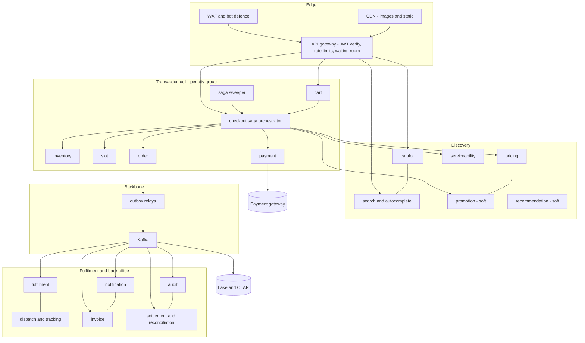
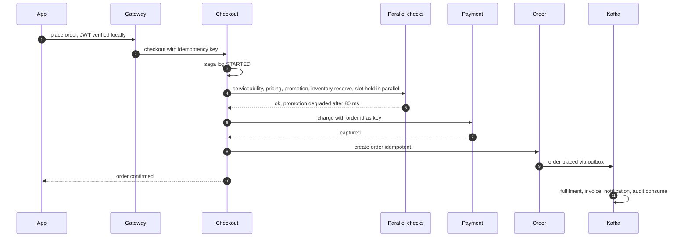
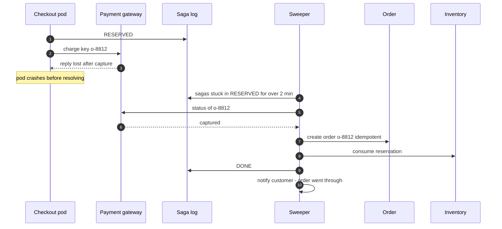
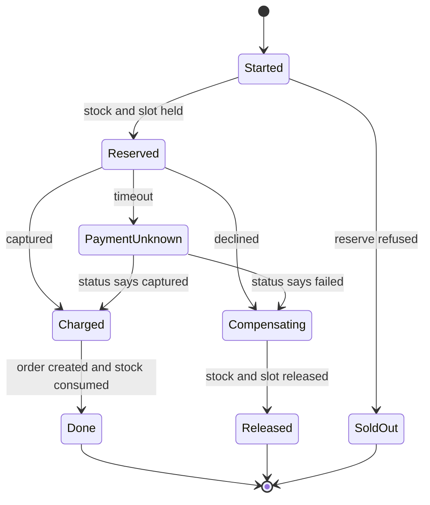

# 56. Capstone: The Grocery Marketplace, End to End

!!! abstract "Chapter at a glance"
    **Reader bands:** B3 → B4 · **Prerequisites:** the whole handbook, especially [Ch 00](../00-orientation/00-how-to-use-this-handbook.md) (the platform and its 26 services), [Ch 18](../02-distributed-core/18-resilience-patterns.md), [Ch 27](../03-production/27-reliability-and-disaster-recovery.md), [Ch 31–32](../04-architect/31-architecture-decision-making.md) and case studies 38–55.

    **What you will build:** the whole platform as one design. It covers requirements and capacity; the service and data architecture; the event backbone; the critical paths with their latency budgets; failure isolation; SLOs that are arithmetically achievable; deployment topology; security, compliance and cost; and an evolution roadmap. Every earlier chapter solved one part. This chapter checks that the parts compose.

    **The four labs:**

    - **L1: latency budget of place-order (simulation).** 1M checkouts.
        - The external payment gateway is most of the median (~180 of 222 ms).
        - Our own part's p99 is **~1.2 s**, even though each hop's own p99 is under 60 ms: 0.5% outliers across 7 hops compound.
        - Timeouts plus honest degradation for *optional* calls, and hedged pricing, cut our p99 from 1,231 to **1,050 ms**, degrading 1.06% of checkouts.
        - A page that needs 30 calls waits on a p99-slow one **26%** of the time.
    - **L2: the whole checkout under failure (real HTTP + PostgreSQL).** 2,000 checkouts, with lost payment replies and orchestrator crashes.
        - The naive design produced **60 customers charged with no order**, **139 double charges** and 44 leaked reservations.
        - Idempotency, a payment-status check and a saga log removed the double charges.
        - Adding a **recovery sweeper** brought **every invariant to zero**.
    - **L3: blast radius of each service (real graph analysis of the 26-service map).**
        - As-built: 22 services could break user traffic, and **16 could break checkout**. Identity alone took down 100% of requests.
        - Designed: local token checks, async side effects and soft optional features left **15 and 10**, and cut total traffic lost across all single failures from 649% to **385%**.
    - **L4: SLO composition (simulation).**
        - Ten hard dependencies at 99.95% each give a checkout of **99.46%**. Every month broke a 99.95% budget.
        - Shared databases make it worse.
        - Cells cap one outage at **a quarter to a half** of customers.
        - Even 99.995% per service reached only 99.94%. Journey SLOs must be set with this arithmetic in hand.

    · **Reading time:** 120 min + code

---

## 1. Introduction & Why It Matters

### 1.1 A story: every service was green

Sale night. Every service dashboard was green: each service met its 99.95% SLO, and each team's p99 was under 60 ms. But:

- The checkout success rate was 91%.
- Support queues were full of "money deducted, no order".
- Some customers were charged twice.
- For 12 minutes, nobody could log in, because the identity service hit its connection limit and **every** request validated tokens there, not just logins.
- The home page stalled when the recommendation service slowed, because the page waited for it.

In the post-mortem, the service owners were right that their services were fine. The platform was not. Its guarantees are properties of **how the parts compose**:

- latency adds along paths;
- availability multiplies across hard dependencies;
- failures travel along synchronous edges;
- money is only safe if every step of a saga is idempotent and every abandoned saga is finished by someone.

That is what an architect owns: not the boxes, but the arrows between them.

!!! quote "The thesis of this chapter"
    A platform is correct only if its **journeys** are correct, fast and available end to end, not just its services.

    - **Budget latency along the critical path**, and remove optional work from it (L1).
    - **Make every money-moving flow a saga** with idempotent steps, explicit handling of "unknown" outcomes, and a sweeper that finishes abandoned work (L2).
    - **Draw the dependency graph** and shrink the critical set: async side effects, local verification, degraded answers (L3).
    - **Set SLOs using composition arithmetic**, engineer the small critical set to a higher standard than the journey, and use cells to bound how many customers one failure touches (L4).

### 1.2 The platform in one page

| Dimension | Normal day | Sale day | Source chapters |
|---|---|---|---|
| Daily active users | 2M | 6M | [Ch 00](../00-orientation/00-how-to-use-this-handbook.md), [Ch 02](../01-foundations/02-back-of-the-envelope-estimation.md) |
| Orders/day | 400k | 1.5M | [Ch 46](../05-case-studies/46-grocery-checkout-and-inventory-reservation.md) |
| Peak factor | 5× (7–10 pm) | 20× (sale start minute) | [Ch 09](../01-foundations/09-scalability-fundamentals.md) |
| Dark stores / SKUs | 500 / 250k | — | [Ch 47](../05-case-studies/47-delivery-dispatch-and-live-tracking.md) |
| Riders online (peak) | 40k | 80k | [Ch 47](../05-case-studies/47-delivery-dispatch-and-live-tracking.md) |
| Services | 26 | — | [Ch 00](../00-orientation/00-how-to-use-this-handbook.md), [Ch 16](../02-distributed-core/16-microservices-architecture.md) |

### 1.3 Learning objectives

By the end you will be able to:

- **Compose an end-to-end design**, and trace every requirement to a component and an ADR.
- **Budget latency** along critical paths (L1).
- **Prove money safety** of the order flow under failure (L2).
- **Analyse blast radius** and shrink the critical set (L3).
- **Set achievable SLOs** by composition, and choose cells and redundancy accordingly (L4).
- **Plan evolution**: what to build first, and what to defer.

---

## 2. Core Concepts — Beginner to Deep

### 2.1 Intuition: a relay race, not a set of sprinters <span class="band b3">B3</span>

Every runner can be fast, and the relay still lose. It loses at the handovers (latency adds up), if any runner falls (availability multiplies), if a dropped baton isn't picked up (sagas without recovery), or if one runner's stumble trips the others (synchronous coupling). The architect coaches the handovers.

### 2.2 Requirements, end to end <span class="band b3">B3</span>

**Customer journeys (the unit of design)**

| Journey | Share of requests | Freshness / correctness | Target |
|---|---|---|---|
| Home / browse | ~40% | Prices ≤ 60 s stale, stock indicative | p99 < 400 ms, 99.9% |
| Search | ~22% | Index ≤ 60 s behind | p99 < 300 ms, 99.9% |
| Add to cart | ~15% | Read-your-writes | p99 < 200 ms, 99.95% |
| **Checkout** | ~5% | Exact stock, exact money | p99 < 2.5 s (with gateway), **99.95%** |
| Track order | ~10% | Position ≤ 10 s old | p99 < 500 ms, 99.9% |
| Login / OTP | ~3% | — | p99 < 3 s (SMS), 99.9% |
| Seller: catalogue updates | ~5% | Visible in ≤ 5 min | 99.5% |

**Cross-cutting**

- No customer is charged without an order, and none is charged twice.
- No stock is sold that doesn't exist.
- GST-correct invoices; data residency for payments data.
- Sale-day surge handled with a waiting room rather than failure.

### 2.3 The architecture in layers <span class="band b3">B3</span>

| Layer | Components | Chapters |
|---|---|---|
| Edge | CDN (images, static), WAF, API gateway (JWT verification, rate limits), waiting room | [Ch 03](../01-foundations/03-networking-essentials.md), [Ch 08](../01-foundations/08-load-balancing-proxies-and-gateways.md), [Ch 39](../05-case-studies/39-distributed-rate-limiter.md), [Ch 52](../05-case-studies/52-object-storage-and-media-pipeline.md) |
| Discovery | Catalog, search, autocomplete, recommendations, pricing, promotions | [Ch 22](../03-production/22-search-systems.md), [Ch 42](../05-case-studies/42-search-autocomplete.md), [Ch 43](../05-case-studies/43-home-feed-and-recommendations.md), [Ch 49](../05-case-studies/49-pricing-promotions-and-coupons.md) |
| Transaction | Cart, checkout (saga orchestrator), inventory, slots, payments, orders, wallet | [Ch 13](../02-distributed-core/13-distributed-transactions.md), [Ch 45](../05-case-studies/45-payment-system.md), [Ch 46](../05-case-studies/46-grocery-checkout-and-inventory-reservation.md), [Ch 48](../05-case-studies/48-delivery-slot-booking-and-capacity.md) |
| Fulfilment | Picking, dispatch, tracking, chat, notifications | [Ch 40](../05-case-studies/40-notification-system.md), [Ch 41](../05-case-studies/41-chat-customer-rider-messaging.md), [Ch 47](../05-case-studies/47-delivery-dispatch-and-live-tracking.md) |
| Back office | Settlement, invoices, reconciliation, audit, support, sourcing exchange | [Ch 45](../05-case-studies/45-payment-system.md), [Ch 55](../05-case-studies/55-order-matching-engine.md), [Ch 36](../04-architect/36-compliance-governance-and-data-residency.md) |
| Backbone | Kafka event bus + outbox, schema registry, job scheduler | [Ch 14](../02-distributed-core/14-messaging-and-event-streaming.md), [Ch 15](../02-distributed-core/15-event-driven-architecture-cqrs-and-event-sourcing.md), [Ch 28](../03-production/28-schema-and-data-evolution.md), [Ch 50](../05-case-studies/50-distributed-job-scheduler.md) |
| Data | PostgreSQL per service, Redis, OpenSearch, object storage, lake + OLAP | [Ch 05](../01-foundations/05-relational-databases-deep-dive.md), [Ch 06](../01-foundations/06-nosql-and-polyglot-persistence.md), [Ch 21](../03-production/21-data-at-scale.md), [Ch 51](../05-case-studies/51-real-time-analytics-and-top-k.md) |
| Platform | Kubernetes, CI/CD, observability, secrets, cost | [Ch 24](../03-production/24-observability.md), [Ch 26](../03-production/26-deployment-and-infrastructure.md), [Ch 35](../04-architect/35-cost-engineering-and-finops.md) |

### 2.4 Critical paths and latency budgets ⭐ <span class="band b4">B4</span>

L1 ran 1M simulated place-order requests:

| Design | End-to-end p50 | End-to-end p99 | Our part p99 | Our part p99.9 | Degraded |
|---|---|---|---|---|---|
| Everything sequential | 252 ms | 1,561 ms | 1,269 ms | 1,549 ms | 0% |
| Pre-payment checks in parallel | 224 ms | 1,524 ms | 1,231 ms | 1,508 ms | 0% |
| **+ timeouts/degradation + hedged pricing** | 222 ms | 1,418 ms | **1,050 ms** | 1,492 ms | 1.06% |

- **The external payment gateway is most of the median.** Show progress, and resolve lost outcomes asynchronously (L2).
- **Our tail is made of rare outliers compounded across hops.** No single team sees it. Allocate a budget per hop, and track journey-level p99.
- **Parallelise independent calls.** Put tight timeouts with honest degraded answers on optional calls: a cached serviceability answer, "coupon couldn't be applied, you can retry". Hedge idempotent reads.
- **Tail amplification**: a page needing 30 calls hits a slow one 26% of the time (1 − 0.99³⁰). Aggregate in backend-for-frontend layers, and cache aggressively on browse paths ([Ch 07](../01-foundations/07-caching.md)).

### 2.5 Money safety: the order saga ⭐ <span class="band b4">B4</span>

L2 ran real services on real PostgreSQL, with 5% declines, 8% lost payment replies and 3% orchestrator crashes:

| Design | Orders | Charged, no order | Charged twice | Oversold | Leaked reservations |
|---|---|---|---|---|---|
| Naive | 1,627 | **60** | **139** | 0 | 44 |
| Idempotent + status check + saga log | 1,660 | 39 | 0 | 0 | 44 |
| **+ recovery sweeper** | **1,709** | **0** | **0** | 0 | **0** |

- **A timeout means "unknown", not "failed".** Resolve it by asking the gateway for the payment's status with the same idempotency key ([Ch 20](../02-distributed-core/20-idempotency-ids-and-distributed-locks.md), [Ch 45](../05-case-studies/45-payment-system.md)).
- **Every step is idempotent on the order id**: reserve, charge, create order, consume stock and release.
- **A saga log is only half the solution.** A sweeper must resume or compensate abandoned sagas, and then notify customers whose "failed" checkout actually completed.
- **Database invariants** (conditional stock updates) kept overselling at zero in every design ([Ch 46](../05-case-studies/46-grocery-checkout-and-inventory-reservation.md)).
- **Reconciliation** with the payment gateway's settlement files is the final net: anything the sweeper missed shows up there ([Ch 45](../05-case-studies/45-payment-system.md)).

### 2.6 Failure isolation: the dependency graph ⭐ <span class="band b4">B4</span>

L3 analysed the 26-service map's journeys as call trees:

| Version | Services whose failure breaks traffic | …that break checkout | Traffic lost, summed over all single failures |
|---|---|---|---|
| As-built (everything hard and synchronous) | 22 | 16 | 649% |
| **Designed** | 15 | **10** | **385%** |

- **Local token verification** (signed JWTs at the gateway) takes identity off every request. As-built, identity was a 100% outage.
- **Events for side effects**: confirmation SMS, audit, invoice and fulfilment all leave checkout, via the outbox ([Ch 15](../02-distributed-core/15-event-driven-architecture-cqrs-and-event-sourcing.md)).
- **Degraded answers**:
    - recommendations → bestsellers;
    - promotions → no auto-coupon;
    - search → category browse;
    - tracking map → status only;
    - cart stock → "check at checkout".
- **The remaining critical set** gets redundancy, cells, the strictest SLOs and the most careful change management: gateway, catalog, pricing, serviceability, cart, checkout, customer, inventory, slot, payment and order.
- **Draw the graph from traces**, not diagrams ([Ch 24](../03-production/24-observability.md)). Hidden synchronous calls are how platforms drift into the as-built graph.

### 2.7 SLO composition and cells ⭐ <span class="band b4">B4</span>

L4 simulated a year of the checkout journey:

| Checkout journey | Availability | Outage min/month | Months over 99.95% budget | Most customers down at once |
|---|---|---|---|---|
| As-built, 16 hard deps at 99.95% | 99.091% | 398.1 | 12 | 100% |
| Designed, 10 hard deps at 99.95% | 99.458% | 237.3 | 12 | 100% |
| Designed, shared PostgreSQL | 99.400% | 262.9 | 12 | 100% |
| Designed, 4 cells | 99.453% | 239.7 | 12 | **50%** |
| Designed, each at 99.99% | 99.904% | 42.3 | 6 | 100% |
| Designed, each at 99.995% | 99.938% | 27.1 | 6 | 100% |

- **Journey availability ≤ the product of its hard dependencies' availability.** A 99.95% journey needs critical services at ~99.99–99.995%, and fewer of them.
- **Shared infrastructure is a dependency.** Count databases, Kafka, DNS and the gateway.
- **Cells** (independent stacks per city group, [Ch 30](../03-production/30-multi-tenancy-and-saas-architecture.md), [Ch 27](../03-production/27-reliability-and-disaster-recovery.md)) don't raise average availability. They cap blast radius, which is what customers and regulators feel.
- **Set SLOs per journey**, derive per-service SLOs from them, and spend error budgets deliberately ([Ch 24](../03-production/24-observability.md)).

### 2.8 Data architecture <span class="band b3">B3</span>

- **Database per service** (PostgreSQL), with an outbox for events. No shared tables across services ([Ch 16](../02-distributed-core/16-microservices-architecture.md)).
- **Read models**:
    - OpenSearch for search.
    - Redis for carts, slots, rate limits and hot reads.
    - Precomputed shelves.
- **Money**: a double-entry ledger in wallet and payment services. Order snapshots are the source for invoices, refunds and settlement ([Ch 45](../05-case-studies/45-payment-system.md), [Ch 49](../05-case-studies/49-pricing-promotions-and-coupons.md)).
- **Analytics**: events → lake (object storage, Iceberg) → warehouse. Streaming to OLAP for live dashboards. Reconciliation of stream vs batch ([Ch 21](../03-production/21-data-at-scale.md), [Ch 51](../05-case-studies/51-real-time-analytics-and-top-k.md)).
- **Residency and retention**: payments data stays in India (VERIFY current RBI rules); PII is minimised; retention is encoded as lifecycle rules ([Ch 36](../04-architect/36-compliance-governance-and-data-residency.md)).

### 2.9 Deployment topology <span class="band b3">B3</span>

- **Region**: one primary region in India with 3 AZs. A DR region holds async replicas of critical databases and has a tested failover runbook ([Ch 27](../03-production/27-reliability-and-disaster-recovery.md)).
- **Cells**: city groups as cells for the transaction layer (cart, checkout, inventory, slots, orders, dispatch). Global services (catalog, identity, pricing books) are replicated read-mostly into every cell.
- **Sale readiness**:
    - pre-scaling from forecasts ([Ch 02](../01-foundations/02-back-of-the-envelope-estimation.md));
    - a waiting room ([Ch 46](../05-case-studies/46-grocery-checkout-and-inventory-reservation.md));
    - load tests of whole journeys;
    - a feature freeze;
    - game days.

### 2.10 Security and compliance <span class="band b3">B3</span>

- **Identity**: OTP login, JWT access tokens verified at the gateway, mTLS between services, and least-privilege service identities ([Ch 23](../03-production/23-security-architecture.md)).
- **Payments**: card data never touches our systems (a tokenised gateway), plus PCI scope minimisation.
- **Audit**: append-only audit trail with hash chaining for money and admin actions ([Ch 36](../04-architect/36-compliance-governance-and-data-residency.md)).
- **Abuse**: rate limits, bot defences, coupon abuse detection ([Ch 39](../05-case-studies/39-distributed-rate-limiter.md), [Ch 49](../05-case-studies/49-pricing-promotions-and-coupons.md)).

### 2.11 Evolution roadmap <span class="band b4">B4</span>

| Stage | Scale | Architecture |
|---|---|---|
| 0 → 1 | 1 city, 10k orders/day | Modular monolith (clear bounded contexts), one PostgreSQL, managed queue, CDN |
| 1 → 10 | 10 cities, 100k/day | Extract checkout/payments, catalog/search and dispatch; outbox + Kafka; read models |
| 10 → 100 | National, 1M+/day | The 26-service map, cells for transactions, multi-AZ + DR, platform team, journey SLOs |

Don't start at the end ([Ch 34](../04-architect/34-modern-architecture-styles.md), [Ch 37](../04-architect/37-leading-architecture-at-scale.md)). Each extraction needs a reason in load, team or change rate.

### 2.12 Interview framing: "design the whole thing" <span class="band b4">B4</span>

Work through it in this order:

1. **Clarify the journeys and their numbers.**
2. **Sketch layers and the critical path.**
3. **Deep-dive where money and scarcity meet**: the checkout saga, inventory, slots, payments.
4. **Show failure thinking**: the dependency graph, degradation, cells.
5. **Close with SLO arithmetic, cost and evolution.**

Staff-level signals: journey-level thinking, a small critical set, "unknown ≠ failed", and SLOs derived by composition.

---

## 3. Architecture & Diagrams

### 3.1 Component view



### 3.2 Sequence: happy path, place order



### 3.3 Sequence: failure path, lost payment reply and a crashed pod



### 3.4 State: the order saga



---

## 4. Design Document Excerpt: Platform Architecture v3

!!! note "Design Document (excerpt) — Grocery Marketplace Platform Architecture v3"
    **Status:** Accepted · **Authors:** Architecture group · **Reviewers:** All domain leads, SRE, Security, Finance, Legal

    | Field | Value |
    |---|---|
    | Context | Sale-night incident: all services met their SLOs, but checkout success was 91%. There were charged-no-order and double-charge cases, a login outage caused by identity being on every request, and the home page stalled on recommendations. |
    | Decision | Journey-level SLOs with composition-derived service SLOs. A critical set of 11 services engineered to 99.99%+. Cells per city group for the transaction layer. JWT verification at the gateway. All side effects via outbox events. Degraded modes for every optional dependency. Checkout saga with idempotent steps, status resolution and a sweeper. A latency budget per hop on place-order. |
    | Related ADRs | ADR-420 Journeys and SLOs: checkout 99.95%, browse 99.9%; per-service SLOs derived (L4). ADR-421 Critical set and cells: 11 services, 4 city-group cells, shared nothing in the transaction layer (L3, L4). ADR-422 Checkout saga: idempotency by order id, "unknown" resolution, sweeper every minute, customer notification on late completion (L2). ADR-423 Latency budget: parallel pre-payment checks; timeouts for promotion (80 ms) and serviceability (50 ms, cached fallback); hedged pricing at 30 ms (L1). ADR-424 Dependency hygiene: trace-derived dependency graph reviewed monthly; any new synchronous edge into the critical set needs an ADR (L3). |

    **Requirements.**

    - **R1:** Checkout journey 99.95% monthly, measured end to end from real traffic.
    - **R2:** Zero charged-without-order older than 15 minutes. Zero double charges.
    - **R3:** Our part of place-order p99 < 800 ms. End-to-end p99 < 2.5 s including the gateway.
    - **R4:** No single service failure outside the critical set breaks checkout or browse.
    - **R5:** A single-cell failure affects ≤ 30% of customers.

    **Decisions in detail.**

    1. **SLOs (ADR-420).** Journey probes and real-user monitoring define the SLO. Error budgets gate risky launches.
    2. **Cells (ADR-421).** City-group routing at the gateway. Cell-local databases and Kafka. Global read-mostly services replicated into cells.
    3. **Saga (ADR-422).** The saga log lives in the checkout database. The sweeper is a scheduled job ([Ch 50](../05-case-studies/50-distributed-job-scheduler.md)) with fencing. Payment reconciliation runs daily.
    4. **Latency (ADR-423).** Outlier budgets are tracked per hop. Teams own their hop's p99.9, not just its p99.
    5. **Hygiene (ADR-424).** A fitness function in CI fails builds that add synchronous calls from critical-set services to non-critical ones.

    **Consequences.**

    - Costs: more infrastructure (cells, DR); stricter engineering for 11 services; governance of dependency edges; more complex operations.
    - Benefits: guarantees that hold for customers, not just dashboards.

---

## 5. Hands-On Code — Level Ladder

!!! info "What's real here"
    - **L2 is the capstone's real system**: three services over real HTTP with their own PostgreSQL tables, real concurrency, injected failures, and invariants checked by SQL.
    - **L3 is real graph analysis** of the handbook's service map. The journeys and edges are the stated model.
    - **L1 and L4 are simulations.** Per-hop latencies, outlier rates, availabilities and repair times are stated assumptions.

L2 needs PostgreSQL on port 5581. The other labs have no dependencies. Run everything with `-Dstdout.encoding=UTF-8`.

### L1 — The place-order latency budget <span class="band b3">B3</span>

**Requirement:** "Our part of place-order under 800 ms at p99, and know where the rest goes."

1M simulated checkouts through the real critical path shape.

```java title="LatencyBudgetL1.java"
// LatencyBudgetL1.java — run with: java LatencyBudgetL1.java   (JDK 21, no dependencies)
// THE CHECKOUT'S LATENCY BUDGET. Place-order goes: api-gateway → checkout → {serviceability, pricing, promotion,
// inventory reserve, slot hold} → payment (external gateway) → order create. Each hop's latency is lognormal with the
// p50/p99 below (from the earlier chapters' measurements and typical values — assumptions, fixed seed), and each
// dependency has a 0.5% chance per call of a slow outlier (GC, retry, noisy neighbour: +300–1,500 ms).
// 1,000,000 simulated checkouts per design:
//   C1 every call in sequence
//   C2 the five pre-payment checks in parallel (they are independent)
//   C3 C2 + per-call timeouts with graceful degradation for the NON-critical ones (promotion: 80 ms → price without
//      the auto-coupon and say so; serviceability: 50 ms → use the cached answer) and one hedged retry for pricing
// Also: how tails compound when one page fans out to many services.
import java.util.*;

public class LatencyBudgetL1 {
    record Dep(String name, double p50, double p99) {}
    static final Dep GW = new Dep("api-gateway", 2, 6), CO = new Dep("checkout logic", 3, 10), PAY = new Dep("payment gateway", 180, 900), ORD = new Dep("order create", 8, 30);
    static final Dep[] PRE = {new Dep("serviceability", 2, 8), new Dep("pricing", 6, 25), new Dep("promotion", 10, 45), new Dep("inventory reserve", 12, 60), new Dep("slot hold", 9, 40)};

    public static void main(String[] args) {
        System.out.println("place-order critical path; per-hop lognormal latencies + 0.5% slow outliers; 1,000,000 checkouts.\n");
        System.out.printf("   %-66s %11s %11s %11s %11s %10s%n", "design", "end-to-end", "end-to-end", "our part", "our part", "degraded");
        System.out.printf("   %-66s %11s %11s %11s %11s %10s%n", "", "p50", "p99", "p99", "p99.9", "");
        String[] names = {"C1) everything sequential", "C2) five pre-payment checks in parallel", "C3) C2 + timeouts/degradation (non-critical) + hedged pricing"};
        for (int d = 0; d < 3; d++) run(d, names[d]);
        System.out.println("\n   why parallelism alone doesn't fix the tail: the slowest of five parallel calls (each with 0.5% outliers):");
        Random r = new Random(1); int n = 1_000_000; double[] x = new double[n];
        for (int i = 0; i < n; i++) { double m = 0; for (Dep p : PRE) m = Math.max(m, lat(r, p)); x[i] = m; }
        Arrays.sort(x); System.out.printf("   max of the five: p50 %.0f ms, p99 %.0f ms — vs inventory alone p99 %.0f ms%n%n", x[n / 2], x[(int) (n * 0.99)], PRE[3].p99());
        System.out.println("   tail amplification: a page that needs ALL of N calls, each 'fast 99% of the time':");
        for (int k : new int[]{1, 5, 10, 30, 100}) System.out.printf("   N = %-4d → %5.1f%% of page loads wait for at least one slow (p99) call%n", k, 100 * (1 - Math.pow(0.99, k)));
        System.out.println("\n   → the external payment gateway is most of the median — budget for it, show progress, and resolve lost answers");
        System.out.println("     asynchronously (L2). The TAIL, though, is mostly ours: with 0.5% outliers on each of our hops, a few percent of");
        System.out.println("     checkouts hit at least one, so our part's p99 is an outlier (~1.2 s) though every hop's own p99 is < 60 ms.");
        System.out.println("     Latency is a sum over sequential steps and a MAX over parallel ones: parallel calls shorten the median, but");
        System.out.println("     the max of five is only as good as the worst of them. Timeouts with an honest degraded answer for OPTIONAL");
        System.out.println("     calls and hedged idempotent reads cut the tail; outliers in critical calls (inventory, slot) remain and must be");
        System.out.println("     fixed at their source.");
    }
    static double lat(Random r, Dep d) {
        double sigma = Math.log(d.p99() / d.p50()) / 2.326; double v = d.p50() * Math.exp(sigma * r.nextGaussian());
        if (r.nextDouble() < 0.005) v += 300 + r.nextDouble() * 1200; return v;
    }
    static void run(int design, String name) {
        Random r = new Random(56); int n = 1_000_000; double[] t = new double[n], ours = new double[n]; long degraded = 0;
        for (int i = 0; i < n; i++) {
            double total = lat(r, GW) + lat(r, CO), pre;
            if (design == 0) { pre = 0; for (Dep d : PRE) pre += lat(r, d); }
            else { pre = 0; boolean deg = false;
                for (int k = 0; k < PRE.length; k++) { double v = lat(r, PRE[k]);
                    if (design == 2) {
                        if (k == 0 && v > 50) { v = 50; deg = true; }                                       // serviceability: cached answer
                        if (k == 2 && v > 80) { v = 80; deg = true; }                                       // promotion: skip auto-coupon
                        if (k == 1) { double h = lat(r, PRE[k]); if (v > 30) v = Math.min(v, 30 + h); }      // pricing: hedge after 30 ms
                    }
                    pre = Math.max(pre, v); }
                if (deg) degraded++; }
            double o = total + pre + lat(r, ORD); ours[i] = o; t[i] = o + lat(r, PAY);
        }
        Arrays.sort(t); Arrays.sort(ours);
        System.out.printf("   %-66s %8.0f ms %8.0f ms %8.0f ms %8.0f ms %9.2f%%%n", name, t[n / 2], t[(int) (n * 0.99)], ours[(int) (n * 0.99)], ours[(int) (n * 0.999)], 100.0 * degraded / n);
    }
}
```

```text title="java LatencyBudgetL1.java"
place-order critical path; per-hop lognormal latencies + 0.5% slow outliers; 1,000,000 checkouts.

   design                                                              end-to-end  end-to-end    our part    our part   degraded
                                                                              p50         p99         p99       p99.9           
   C1) everything sequential                                               252 ms     1561 ms     1269 ms     1549 ms      0.00%
   C2) five pre-payment checks in parallel                                 224 ms     1524 ms     1231 ms     1508 ms      0.00%
   C3) C2 + timeouts/degradation (non-critical) + hedged pricing           222 ms     1418 ms     1050 ms     1492 ms      1.06%

   why parallelism alone doesn't fix the tail: the slowest of five parallel calls (each with 0.5% outliers):
   max of the five: p50 19 ms, p99 1030 ms — vs inventory alone p99 60 ms

   tail amplification: a page that needs ALL of N calls, each 'fast 99% of the time':
   N = 1    →   1.0% of page loads wait for at least one slow (p99) call
   N = 5    →   4.9% of page loads wait for at least one slow (p99) call
   N = 10   →   9.6% of page loads wait for at least one slow (p99) call
   N = 30   →  26.0% of page loads wait for at least one slow (p99) call
   N = 100  →  63.4% of page loads wait for at least one slow (p99) call

   → the external payment gateway is most of the median — budget for it, show progress, and resolve lost answers
     asynchronously (L2). The TAIL, though, is mostly ours: with 0.5% outliers on each of our hops, a few percent of
     checkouts hit at least one, so our part's p99 is an outlier (~1.2 s) though every hop's own p99 is < 60 ms.
     Latency is a sum over sequential steps and a MAX over parallel ones: parallel calls shorten the median, but
     the max of five is only as good as the worst of them. Timeouts with an honest degraded answer for OPTIONAL
     calls and hedged idempotent reads cut the tail; outliers in critical calls (inventory, slot) remain and must be
     fixed at their source.
```

**Reading it:**

- **The payment gateway** sets the median.
- **Our outliers** set the tail. The slowest of five parallel checks has a p99 of about 1 s, although each check alone has a p99 of 60 ms or less.
- **Degrading optional calls and hedging pricing** takes about 180 ms off our p99.
- **The rest of the tail** is outliers in critical calls. R3 (800 ms) is not yet met, and the remaining work is at the source of those outliers.

### L2 — The checkout under failure, end to end <span class="band b4">B4</span>

**Requirement:** "No customer charged without an order, none charged twice, no stock oversold or leaked."

Three real services over HTTP on real PostgreSQL, with payment failures and orchestrator crashes injected.

```java title="CheckoutSagaL2.java"
// CheckoutSagaL2.java — run with (PostgreSQL on :5581, db shop):
//   java -Dsun.net.httpserver.nodelay=true -Duser.timezone=UTC -cp /tmp/eslab/postgresql-42.7.4.jar CheckoutSagaL2.java
// THE WHOLE CHECKOUT, END TO END, WITH THINGS GOING WRONG. Three REAL services over HTTP, each with its own tables in
// a REAL PostgreSQL: inventory (reserve / release, conditional stock update), payment (a gateway stub: 5% of charges
// are declined; 8% succeed but the response is lost — the client times out after 1 s), and order (create order).
// 2,000 checkouts from 20 concurrent customers for 40 SKUs with limited stock (sell-outs happen). The checkout
// orchestrator also CRASHES in 3% of checkouts right after the payment call (a pod dies mid-saga). Three designs:
//   S1 naive: reserve → charge → create order; on a payment timeout, retry the charge once (new request); if it still
//      fails, release stock and tell the customer "payment failed"; a crashed checkout is simply gone
//   S2 saga done right: every step idempotent on the order id; a payment timeout is resolved by ASKING the gateway
//      for the charge status (never by guessing); a saga log records each step; decline → release stock
//   S3 S2 + a recovery sweeper that finishes or compensates sagas abandoned by crashed pods
// Invariants checked in the databases afterwards: customers charged with no order, orders charged twice, orders
// with no successful charge, oversold stock, and stock left reserved for orders that don't exist.
import com.sun.net.httpserver.*;
import java.net.*;
import java.net.http.*;
import java.sql.*;
import java.time.Duration;
import java.util.*;
import java.util.concurrent.*;
import java.util.concurrent.atomic.*;

public class CheckoutSagaL2 {
    static final String URL = "jdbc:postgresql://localhost:5581/shop?user=claude";
    static final ArrayBlockingQueue<Connection> pool = new ArrayBlockingQueue<>(40);
    static final Random rnd = new Random(56);
    static int design;

    interface Sql<T> { T run(Connection c) throws SQLException; }
    static <T> T db(Sql<T> f) throws Exception { Connection c = pool.take(); try { return f.run(c); } finally { pool.put(c); } }   // never close pooled connections

    public static void main(String[] args) throws Exception {
        for (int i = 0; i < 40; i++) pool.add(DriverManager.getConnection(URL));
        int port = startServices();
        HttpClient http = HttpClient.newBuilder().connectTimeout(Duration.ofSeconds(2)).executor(Executors.newFixedThreadPool(32)).build();
        System.out.println("3 real HTTP services on real PostgreSQL; 2,000 checkouts, 20 concurrent, 40 SKUs with limited stock;");
        System.out.println("payment: 5% declined, 8% succeed but the reply is lost (1 s timeout); orchestrator crashes in 3% of checkouts.\n");
        System.out.printf("   %-46s %8s %10s %10s %10s %10s %9s %10s%n", "design", "orders", "charged,", "charged", "order w/o", "oversold", "leaked", "told");
        System.out.printf("   %-46s %8s %10s %10s %10s %10s %9s %10s%n", "", "placed", "NO order", "twice", "charge", "units", "reserv.", "'failed'");
        String[] names = {"S1) naive: retry charge, release on failure", "S2) idempotent steps + status check + saga log", "S3) S2 + recovery sweeper for crashed sagas"};
        for (design = 1; design <= 3; design++) {
            reset();
            AtomicInteger toldFailed = new AtomicInteger(); ExecutorService customers = Executors.newFixedThreadPool(20); List<Future<?>> fs = new ArrayList<>();
            Random plan = new Random(5600 + 0);
            for (int i = 0; i < 2000; i++) { final String oid = "o" + i; final int sku = plan.nextInt(40), qty = 1 + plan.nextInt(3); final boolean crash = plan.nextDouble() < 0.03;
                fs.add(customers.submit(() -> { if (!checkout(http, port, oid, sku, qty, crash)) toldFailed.incrementAndGet(); return null; })); }
            for (Future<?> f : fs) f.get(); customers.shutdown();
            Thread.sleep(2500);                                                                  // let lost-reply charges land
            if (design == 3) sweep(http, port);
            System.out.printf("   %-46s %8d %10d %10d %10d %10d %9d %10d%n", names[design - 1], q("SELECT count(*) FROM orders"),
                    q("SELECT count(DISTINCT split_part(p.order_id,'#',1)) FROM payment p WHERE p.status='CAPTURED' AND NOT EXISTS (SELECT 1 FROM orders o WHERE o.order_id = split_part(p.order_id,'#',1))"),
                    q("SELECT count(*) FROM (SELECT split_part(order_id,'#',1) FROM payment WHERE status='CAPTURED' GROUP BY 1 HAVING count(*) > 1) x"),
                    q("SELECT count(*) FROM orders o WHERE NOT EXISTS (SELECT 1 FROM payment p WHERE split_part(p.order_id,'#',1) = o.order_id AND p.status='CAPTURED')"),
                    q("SELECT coalesce(-sum(least(qty,0)),0) FROM stock"),
                    q("SELECT count(*) FROM reservation r WHERE r.status='RESERVED' AND NOT EXISTS (SELECT 1 FROM orders o WHERE o.order_id = r.order_id)"),
                    toldFailed.get());
        }
        System.out.println("\n   → a timeout is not a failure — it is 'unknown'. The naive design turns every lost reply into a second charge");
        System.out.println("     or a refund-shaped support ticket, and every crashed pod into money taken with no order and stock locked");
        System.out.println("     forever. Idempotency keys make retries safe; asking the gateway for the charge status resolves 'unknown'");
        System.out.println("     into a fact; a saga log records how far each checkout got. But a log nobody reads doesn't finish anything:");
        System.out.println("     the sweeper that resumes or compensates abandoned sagas is what brings every invariant to zero. The");
        System.out.println("     conditional stock update keeps overselling at zero in every design — the database invariant does that job.");
        System.out.println("     (Some customers the crashed pods told 'failed' get an order from the sweeper — they must be notified.)");
        System.exit(0);
    }

    static long q(String sql) throws Exception { return db(c -> { try (Statement s = c.createStatement(); ResultSet rs = s.executeQuery(sql)) { rs.next(); return rs.getLong(1); } }); }

    static void reset() throws Exception {
        db(c -> { try (Statement s = c.createStatement()) {
            s.execute("DROP TABLE IF EXISTS stock, reservation, payment, orders, saga");
            s.execute("CREATE TABLE stock (sku int PRIMARY KEY, qty int NOT NULL)");
            s.execute("CREATE TABLE reservation (order_id text PRIMARY KEY, sku int, qty int, status text)");
            s.execute("CREATE TABLE payment (order_id text PRIMARY KEY, amount bigint, status text)");
            s.execute("CREATE TABLE orders (order_id text PRIMARY KEY, sku int, qty int)");
            s.execute("CREATE TABLE saga (order_id text PRIMARY KEY, step text, sku int, qty int, updated timestamptz DEFAULT now())");
            s.execute("INSERT INTO stock SELECT g, 60 + (g % 5) * 20 FROM generate_series(0,39) g"); } return null; });
    }

    // ---------------- the orchestrator ----------------
    static boolean checkout(HttpClient http, int port, String oid, int sku, int qty, boolean crash) throws Exception {
        String base = "http://127.0.0.1:" + port;
        if (design >= 2) db(c -> exec(c, "INSERT INTO saga (order_id, step, sku, qty) VALUES ('" + oid + "','STARTED'," + sku + "," + qty + ") ON CONFLICT DO NOTHING"));
        if (call(http, base + "/inventory/reserve?order=" + oid + "&sku=" + sku + "&qty=" + qty) != 200) { step(oid, "SOLD_OUT"); return false; }
        step(oid, "RESERVED");
        int pay;
        if (design == 1) {
            pay = call(http, base + "/payment/charge?order=" + oid + "%231&amount=" + qty * 5000);
            if (pay == -1) pay = call(http, base + "/payment/charge?order=" + oid + "%232&amount=" + qty * 5000);   // retry = a NEW request
        } else {
            pay = call(http, base + "/payment/charge?order=" + oid + "&amount=" + qty * 5000);
            if (pay == -1) for (int i = 0; i < 10 && pay != 200 && pay != 402; i++) { Thread.sleep(300); pay = call(http, base + "/payment/status?order=" + oid); }   // resolve 'unknown'
        }
        if (crash) return false;                                                                  // the pod dies here; the customer sees an error
        if (pay == 200) { step(oid, "CHARGED"); call(http, base + "/order/create?order=" + oid + "&sku=" + sku + "&qty=" + qty); call(http, base + "/inventory/consume?order=" + oid); step(oid, "DONE"); return true; }
        call(http, base + "/inventory/release?order=" + oid); step(oid, "COMPENSATED"); return false;
    }
    static void step(String oid, String s) throws Exception { if (design >= 2) db(c -> exec(c, "UPDATE saga SET step='" + s + "', updated=now() WHERE order_id='" + oid + "'")); }
    static int call(HttpClient http, String url) {
        try { return http.send(HttpRequest.newBuilder(URI.create(url)).timeout(Duration.ofSeconds(1)).POST(HttpRequest.BodyPublishers.noBody()).build(), HttpResponse.BodyHandlers.discarding()).statusCode(); }
        catch (Exception e) { return -1; }                                                       // timeout / connection error = UNKNOWN
    }
    static void sweep(HttpClient http, int port) throws Exception {
        String base = "http://127.0.0.1:" + port;
        List<String[]> stuck = db(c -> { List<String[]> l = new ArrayList<>(); try (Statement s = c.createStatement(); ResultSet rs = s.executeQuery("SELECT order_id, sku, qty FROM saga WHERE step IN ('STARTED','RESERVED','CHARGED')")) {
            while (rs.next()) l.add(new String[]{rs.getString(1), rs.getString(2), rs.getString(3)}); } return l; });
        for (String[] s : stuck) {
            int st = call(http, base + "/payment/status?order=" + s[0]);
            if (st == 200) { call(http, base + "/order/create?order=" + s[0] + "&sku=" + s[1] + "&qty=" + s[2]); call(http, base + "/inventory/consume?order=" + s[0]); step(s[0], "DONE"); }
            else { call(http, base + "/inventory/release?order=" + s[0]); step(s[0], "COMPENSATED"); }
        }
    }
    static Object exec(Connection c, String sql) throws SQLException { try (Statement s = c.createStatement()) { s.execute(sql); } return null; }

    // ---------------- the services ----------------
    static int startServices() throws Exception {
        HttpServer srv = HttpServer.create(new InetSocketAddress("127.0.0.1", 0), 256); srv.setExecutor(Executors.newFixedThreadPool(32));
        srv.createContext("/inventory/reserve", ex -> respond(ex, () -> { var p = params(ex); String oid = p.get("order"); int sku = Integer.parseInt(p.get("sku")), qty = Integer.parseInt(p.get("qty"));
            return db(c -> { c.setAutoCommit(false); try (Statement s = c.createStatement()) {
                int ins = s.executeUpdate("INSERT INTO reservation VALUES ('" + oid + "'," + sku + "," + qty + ",'RESERVED') ON CONFLICT DO NOTHING");
                if (ins == 0) { c.commit(); return 200; }                                          // idempotent: already reserved
                int ok = s.executeUpdate("UPDATE stock SET qty = qty - " + qty + " WHERE sku = " + sku + " AND qty >= " + qty);
                if (ok == 0) { c.rollback(); return 409; } c.commit(); return 200; } finally { c.setAutoCommit(true); } }); }));
        srv.createContext("/inventory/release", ex -> respond(ex, () -> { String oid = params(ex).get("order");
            return db(c -> { c.setAutoCommit(false); try (Statement s = c.createStatement()) {
                try (ResultSet rs = s.executeQuery("UPDATE reservation SET status='RELEASED' WHERE order_id='" + oid + "' AND status='RESERVED' RETURNING sku, qty")) {
                    if (rs.next()) { int sku = rs.getInt(1), qty = rs.getInt(2); s.executeUpdate("UPDATE stock SET qty = qty + " + qty + " WHERE sku = " + sku); } }
                c.commit(); return 200; } finally { c.setAutoCommit(true); } }); }));
        srv.createContext("/inventory/consume", ex -> respond(ex, () -> { String oid = params(ex).get("order"); return db(c -> { exec(c, "UPDATE reservation SET status='CONSUMED' WHERE order_id='" + oid + "' AND status='RESERVED'"); return 200; }); }));
        srv.createContext("/payment/charge", ex -> respond(ex, () -> { var p = params(ex); String oid = p.get("order"); long amt = Long.parseLong(p.get("amount"));
            double x; synchronized (rnd) { x = rnd.nextDouble(); }
            String existing = db(c -> { try (Statement s = c.createStatement(); ResultSet rs = s.executeQuery("SELECT status FROM payment WHERE order_id='" + oid + "'")) { return rs.next() ? rs.getString(1) : null; } });
            if (existing != null) return existing.equals("CAPTURED") ? 200 : 402;                   // gateway is idempotent per key
            String status = x < 0.05 ? "DECLINED" : "CAPTURED";
            db(c -> exec(c, "INSERT INTO payment VALUES ('" + oid + "'," + amt + ",'" + status + "') ON CONFLICT DO NOTHING"));
            if (status.equals("CAPTURED") && x < 0.13) Thread.sleep(2000);                         // captured, but the reply is lost to the client's 1 s timeout
            return status.equals("CAPTURED") ? 200 : 402; }));
        srv.createContext("/payment/status", ex -> respond(ex, () -> { String oid = params(ex).get("order");
            return db(c -> { try (Statement s = c.createStatement(); ResultSet rs = s.executeQuery("SELECT status FROM payment WHERE order_id='" + oid + "'")) { return !rs.next() ? 404 : rs.getString(1).equals("CAPTURED") ? 200 : 402; } }); }));
        srv.createContext("/order/create", ex -> respond(ex, () -> { var p = params(ex);
            return db(c -> { exec(c, "INSERT INTO orders VALUES ('" + p.get("order") + "'," + p.get("sku") + "," + p.get("qty") + ") ON CONFLICT DO NOTHING"); return 200; }); }));
        srv.start(); return srv.getAddress().getPort();
    }
    interface Handler { int handle() throws Exception; }
    static void respond(HttpExchange ex, Handler h) { int code; try { code = h.handle(); } catch (Exception e) { code = 500; } try { ex.sendResponseHeaders(code, -1); } catch (Exception e) { } ex.close(); }
    static Map<String, String> params(HttpExchange ex) { Map<String, String> m = new HashMap<>(); String q = ex.getRequestURI().getQuery(); if (q != null) for (String kv : q.split("&")) { String[] a = kv.split("=", 2); m.put(a[0], a.length > 1 ? a[1] : ""); } return m; }
}
```

```text title="java -Duser.timezone=UTC -cp postgresql-42.7.4.jar CheckoutSagaL2.java"
3 real HTTP services on real PostgreSQL; 2,000 checkouts, 20 concurrent, 40 SKUs with limited stock;
payment: 5% declined, 8% succeed but the reply is lost (1 s timeout); orchestrator crashes in 3% of checkouts.

   design                                           orders   charged,    charged  order w/o   oversold    leaked       told
                                                    placed   NO order      twice     charge      units   reserv.   'failed'
   S1) naive: retry charge, release on failure        1627         60        139          0          0        44        373
   S2) idempotent steps + status check + saga log     1660         39          0          0          0        44        340
   S3) S2 + recovery sweeper for crashed sagas        1709          0          0          0          0         0        334

   → a timeout is not a failure — it is 'unknown'. The naive design turns every lost reply into a second charge
     or a refund-shaped support ticket, and every crashed pod into money taken with no order and stock locked
     forever. Idempotency keys make retries safe; asking the gateway for the charge status resolves 'unknown'
     into a fact; a saga log records how far each checkout got. But a log nobody reads doesn't finish anything:
     the sweeper that resumes or compensates abandoned sagas is what brings every invariant to zero. The
     conditional stock update keeps overselling at zero in every design — the database invariant does that job.
     (Some customers the crashed pods told 'failed' get an order from the sweeper — they must be notified.)
```

**Reading it:**

- **The naive design** converts lost replies into second charges (139) and failures into charged-no-order (60).
- **Idempotency and status checks** remove the double charges.
- **Only the sweeper** finishes what crashed pods abandoned. After it runs, every invariant is zero.
- **"Told 'failed'"** is mostly sold-out customers. Some customers the crashed pods told "failed" received an order from the sweeper, and must be notified.
- **Counts vary slightly between runs.** The failure draws race across threads.

### L3 — Blast radius on the service map <span class="band b4">B4</span>

**Requirement:** "No failure outside the critical set may break checkout or browse."

A real graph analysis of the handbook's journeys, as-built vs designed.

```java title="BlastRadiusL3.java"
// BlastRadiusL3.java — run with: java BlastRadiusL3.java   (JDK 21, no dependencies)
// WHAT BREAKS WHEN ONE SERVICE FAILS? The platform's 26 services (Ch 00) and its main user journeys, as a dependency
// graph: each journey is a tree of synchronous calls. Two versions of the SAME platform:
//   AS-BUILT  every call is a hard, synchronous dependency (what systems drift into): checkout also sends the
//             confirmation SMS, writes the audit record and generates the invoice inline; every request validates
//             its token by calling identity; the home page needs recommendations and promotions to render
//   DESIGNED  soft dependencies degrade (recommendations → bestsellers, promotions → no auto-coupon, search →
//             category browse, tracking map → status only, inventory on cart → "check at checkout"), tokens are
//             verified locally at the gateway (signed JWT), and notification / audit / invoice / fulfilment happen
//             asynchronously from order events (Kafka + outbox)
// Real graph traversal: for every single-service failure, which journeys fail, weighted by their share of traffic.
// Also: the longest synchronous call chain on each journey.
import java.util.*;

public class BlastRadiusL3 {
    record Call(String svc, boolean soft, List<Call> children) { Call(String s, boolean soft, Call... c) { this(s, soft, List.of(c)); } }
    static Call hard(String s, Call... c) { return new Call(s, false, c); }
    static Call soft(String s, Call... c) { return new Call(s, true, c); }

    public static void main(String[] args) {
        Map<String, Double> share = new LinkedHashMap<>();
        share.put("home / browse", 0.40); share.put("search", 0.22); share.put("add to cart", 0.15); share.put("checkout", 0.05);
        share.put("track order", 0.10); share.put("login / OTP", 0.03); share.put("seller: update catalogue", 0.05);
        for (int v = 0; v < 2; v++) {
            boolean designed = v == 1; Map<String, Call> j = journeys(designed);
            Set<String> services = new TreeSet<>(); for (Call c : j.values()) collect(c, services);
            System.out.printf("%s — %d services on synchronous paths%n", designed ? "DESIGNED" : "AS-BUILT", services.size());
            System.out.printf("   %-28s %22s   %s%n", "journey", "longest sync chain", "services it can't work without");
            for (var e : j.entrySet()) { Set<String> hardSet = new TreeSet<>(); hardDeps(e.getValue(), hardSet);
                System.out.printf("   %-28s %22d   %s%n", e.getKey(), depth(e.getValue()), String.join(", ", hardSet)); }
            List<Object[]> rows = new ArrayList<>();
            for (String s : services) { double fail = 0; List<String> broken = new ArrayList<>();
                for (var e : j.entrySet()) if (breaks(e.getValue(), s)) { fail += share.get(e.getKey()); broken.add(e.getKey()); }
                rows.add(new Object[]{s, fail, broken}); }
            rows.sort((a, b) -> Double.compare((double) b[1], (double) a[1]));
            double sum = 0; int spof = 0, breakCheckout = 0; for (Object[] r : rows) { sum += (double) r[1]; if ((double) r[1] > 0) spof++; if (((List<?>) r[2]).contains("checkout")) breakCheckout++; }
            System.out.printf("%n   services whose failure breaks user traffic: %d; that break CHECKOUT: %d; traffic lost summed over all%n", spof, breakCheckout);
            System.out.printf("   single-service failures: %.0f%% (i.e. %.1f platforms' worth of traffic if each failed once)%n", 100 * sum, sum);
            System.out.println("   worst five:");
            for (int k = 0; k < 5; k++) { Object[] r = rows.get(k); System.out.printf("   %-26s %5.0f%% of requests fail   (%s)%n", r[0], 100 * (double) r[1], r[2].toString().replaceAll("[\\[\\]]", "")); }
            System.out.println();
        }
        System.out.println("   → the difference between the two platforms is not the services — it's the edges. Every synchronous, hard");
        System.out.println("     dependency adds its failure to its callers'. Verifying tokens locally removes identity from every request;");
        System.out.println("     moving confirmations, audit, invoices and fulfilment behind events removes them from checkout; giving optional");
        System.out.println("     features a degraded answer removes them from the home page. What remains — gateway, catalogue, pricing,");
        System.out.println("     serviceability, cart, checkout, inventory, payment, order — is the platform's true critical set: those get");
        System.out.println("     redundancy, cells and the strictest SLOs. Draw this graph from real traces, not from the architecture diagram.");
    }

    static boolean breaks(Call c, String failed) {                                               // journey fails if a HARD path reaches the failed service
        if (c.svc().equals(failed)) return !c.soft();
        if (c.soft()) return false;                                                                // a soft subtree degrades instead of failing the journey
        for (Call ch : c.children()) if (breaks(ch, failed)) return true;
        return false;
    }
    static void hardDeps(Call c, Set<String> out) { if (c.soft()) return; out.add(c.svc()); for (Call ch : c.children()) hardDeps(ch, out); }
    static int depth(Call c) { int m = 0; for (Call ch : c.children()) m = Math.max(m, depth(ch)); return 1 + m; }
    static void collect(Call c, Set<String> out) { out.add(c.svc()); for (Call ch : c.children()) collect(ch, out); }

    static Map<String, Call> journeys(boolean d) {
        Map<String, Call> j = new LinkedHashMap<>();
        Call auth = d ? null : hard("identity-service");                                          // as-built: every request calls identity
        java.util.function.Function<Call[], Call> gw = kids -> { List<Call> l = new ArrayList<>(Arrays.asList(kids)); if (auth != null) l.add(0, auth); return new Call("api-gateway", false, l); };
        Call rec = d ? soft("recommendation-service") : hard("recommendation-service");
        Call promo = d ? soft("promotion-service") : hard("promotion-service");
        j.put("home / browse", gw.apply(new Call[]{hard("catalog-service"), hard("pricing-service"), hard("serviceability-service"), rec, promo}));
        j.put("search", gw.apply(new Call[]{d ? soft("search-service", hard("catalog-service")) : hard("search-service", hard("catalog-service"), hard("pricing-service")), hard("catalog-service"), hard("pricing-service")}));
        j.put("add to cart", gw.apply(new Call[]{hard("cart-service", hard("catalog-service"), hard("pricing-service"), d ? soft("inventory-service") : hard("inventory-service"))}));
        List<Call> co = new ArrayList<>(List.of(hard("customer-service"), hard("serviceability-service"), hard("pricing-service"), promo, hard("inventory-service"), hard("slot-service"), hard("payment-service"),
                d ? hard("order-service") : hard("order-service", hard("invoice-service"), hard("audit-service"), hard("fulfilment-service"))));
        if (!d) co.add(hard("notification-service"));
        j.put("checkout", gw.apply(new Call[]{hard("cart-service"), new Call("checkout-service", false, co)}));
        j.put("track order", gw.apply(new Call[]{hard("order-service"), d ? soft("tracking-service") : hard("tracking-service", hard("dispatch-service"))}));
        j.put("login / OTP", new Call("api-gateway", false, List.of(hard("identity-service", hard("notification-service")))));
        j.put("seller: update catalogue", gw.apply(new Call[]{hard("seller-service"), hard("catalog-service", d ? soft("search-service") : hard("search-service"), hard("audit-service"))}));
        return j;
    }
}
```

```text title="java BlastRadiusL3.java"
AS-BUILT — 22 services on synchronous paths
   journey                          longest sync chain   services it can't work without
   home / browse                                     2   api-gateway, catalog-service, identity-service, pricing-service, promotion-service, recommendation-service, serviceability-service
   search                                            3   api-gateway, catalog-service, identity-service, pricing-service, search-service
   add to cart                                       3   api-gateway, cart-service, catalog-service, identity-service, inventory-service, pricing-service
   checkout                                          4   api-gateway, audit-service, cart-service, checkout-service, customer-service, fulfilment-service, identity-service, inventory-service, invoice-service, notification-service, order-service, payment-service, pricing-service, promotion-service, serviceability-service, slot-service
   track order                                       3   api-gateway, dispatch-service, identity-service, order-service, tracking-service
   login / OTP                                       3   api-gateway, identity-service, notification-service
   seller: update catalogue                          3   api-gateway, audit-service, catalog-service, identity-service, search-service, seller-service

   services whose failure breaks user traffic: 22; that break CHECKOUT: 16; traffic lost summed over all
   single-service failures: 649% (i.e. 6.5 platforms' worth of traffic if each failed once)
   worst five:
   api-gateway                  100% of requests fail   (home / browse, search, add to cart, checkout, track order, login / OTP, seller: update catalogue)
   identity-service             100% of requests fail   (home / browse, search, add to cart, checkout, track order, login / OTP, seller: update catalogue)
   catalog-service               82% of requests fail   (home / browse, search, add to cart, seller: update catalogue)
   pricing-service               82% of requests fail   (home / browse, search, add to cart, checkout)
   promotion-service             45% of requests fail   (home / browse, checkout)

DESIGNED — 19 services on synchronous paths
   journey                          longest sync chain   services it can't work without
   home / browse                                     2   api-gateway, catalog-service, pricing-service, serviceability-service
   search                                            3   api-gateway, catalog-service, pricing-service
   add to cart                                       3   api-gateway, cart-service, catalog-service, pricing-service
   checkout                                          3   api-gateway, cart-service, checkout-service, customer-service, inventory-service, order-service, payment-service, pricing-service, serviceability-service, slot-service
   track order                                       2   api-gateway, order-service
   login / OTP                                       3   api-gateway, identity-service, notification-service
   seller: update catalogue                          3   api-gateway, audit-service, catalog-service, seller-service

   services whose failure breaks user traffic: 15; that break CHECKOUT: 10; traffic lost summed over all
   single-service failures: 385% (i.e. 3.8 platforms' worth of traffic if each failed once)
   worst five:
   api-gateway                  100% of requests fail   (home / browse, search, add to cart, checkout, track order, login / OTP, seller: update catalogue)
   catalog-service               82% of requests fail   (home / browse, search, add to cart, seller: update catalogue)
   pricing-service               82% of requests fail   (home / browse, search, add to cart, checkout)
   serviceability-service        45% of requests fail   (home / browse, checkout)
   cart-service                  20% of requests fail   (add to cart, checkout)

   → the difference between the two platforms is not the services — it's the edges. Every synchronous, hard
     dependency adds its failure to its callers'. Verifying tokens locally removes identity from every request;
     moving confirmations, audit, invoices and fulfilment behind events removes them from checkout; giving optional
     features a degraded answer removes them from the home page. What remains — gateway, catalogue, pricing,
     serviceability, cart, checkout, inventory, payment, order — is the platform's true critical set: those get
     redundancy, cells and the strictest SLOs. Draw this graph from real traces, not from the architecture diagram.
```

**Reading it:**

- **As-built**, identity and the gateway each take down everything, and 16 services can break checkout.
- **Designed**, the list of services checkout can't work without is 10, and identity only affects login.
- **What remains is the critical set.** The model's edges are stated assumptions; in production, derive them from traces.

### L4 — SLO composition and cells <span class="band b4">B4</span>

**Requirement:** "Set a checkout SLO we can actually meet, and bound how many customers one failure touches."

A simulated year, minute by minute.

```java title="SloCompositionL4.java"
// SloCompositionL4.java — run with: java SloCompositionL4.java   (JDK 21, no dependencies)
// CAN CHECKOUT PROMISE 99.95%? Each service on its own meets 99.95% (≈ 22 min of outage a month): outages arrive
// randomly (mean 30 min time-to-repair, fixed seed) and independently — except where services share infrastructure.
// A journey is down whenever ANY of its hard dependencies is down (the dependency sets are L3's). One simulated year,
// minute by minute:
//   A1 AS-BUILT checkout: 16 hard dependencies (L3), each an independent 99.95% service
//   A2 DESIGNED checkout: 10 hard dependencies (L3)
//   A3 A2, but all 10 share ONE PostgreSQL cluster (99.95%) — the "independent" services aren't
//   A4 A2 split into 4 cells (city groups), each with its own copy of every service and database: an outage hits one
//      cell's customers (traffic-weighted availability)
//   A5 / A6 A2 with each critical service engineered to 99.99% / 99.995%
// Measured: availability, outage minutes per month, months that broke a 99.95% SLO (21.6 min monthly budget), and the
// largest share of customers down at the same moment.
import java.util.*;

public class SloCompositionL4 {
    static final int MIN_PER_YEAR = 365 * 24 * 60;

    public static void main(String[] args) {
        System.out.println("each service 99.95% on its own; outages random, mean 30 min; one simulated year; 99.95% budget = 21.6 min/month.\n");
        System.out.printf("   %-56s %13s %12s %14s %18s%n", "checkout journey", "availability", "outage", "months over", "most customers");
        System.out.printf("   %-56s %13s %12s %14s %18s%n", "", "(traffic-", "min/month", "99.95% budget", "down at once");
        System.out.printf("   %-56s %13s %12s %14s %18s%n", "", "weighted)", "", "(of 12)", "");
        run("A1) as-built: 16 hard dependencies", 16, false, 1, 0.9995);
        run("A2) designed: 10 hard dependencies", 10, false, 1, 0.9995);
        run("A3) designed, but all 10 share one PostgreSQL cluster", 10, true, 1, 0.9995);
        run("A4) designed, 4 independent cells", 10, false, 4, 0.9995);
        run("A5) designed, each critical service at 99.99%", 10, false, 1, 0.9999);
        run("A6) designed, each critical service at 99.995%", 10, false, 1, 0.99995);
        System.out.printf("%n   rule of thumb: n independent hard dependencies at availability a → a^n: 0.9995^16 = %.4f%%, 0.9995^10 = %.4f%%%n", 100 * Math.pow(0.9995, 16), 100 * Math.pow(0.9995, 10));
        System.out.println("\n   → a journey's availability is at best the PRODUCT of its hard dependencies': neither sixteen nor ten services at");
        System.out.println("     99.95% can make a 99.95% checkout — every month blows the budget. Cutting hard edges (L3) helps; sharing one");
        System.out.println("     database quietly adds a dependency to every journey. Cells don't make outages rarer (same availability) — they");
        System.out.println("     make each one smaller: a quarter of customers per outage, half at worst when two cells failed together, never");
        System.out.println("     all. Even each critical service at 99.995% left this simulated year at 99.94% with half the months over budget:");
        System.out.println("     meeting 99.95% end to end takes both an extra nine on every critical service AND fewer of them — which is why");
        System.out.println("     the critical set must be small, and why the SLO for a journey has to be set with this arithmetic in hand.");
    }

    static void run(String name, int deps, boolean sharedDb, int cells, double avail) {
        Random r = new Random(56); double downWeighted = 0; double[] monthDown = new double[12]; int[] cellsDown = new int[MIN_PER_YEAR];
        for (int c = 0; c < cells; c++) {
            boolean[] down = new boolean[MIN_PER_YEAR];
            int comps = deps + (sharedDb ? 1 : 0);
            for (int k = 0; k < comps; k++) {                                                       // alternating up/down renewal process per component
                double mttr = 30, mtbf = mttr * (avail / (1 - avail)); double t = r.nextDouble() * mtbf;
                while (t < MIN_PER_YEAR) { double rep = -Math.log(1 - r.nextDouble()) * mttr; for (int m = (int) t; m < Math.min(MIN_PER_YEAR, t + rep); m++) down[m] = true; t += rep - Math.log(1 - r.nextDouble()) * mtbf; }
            }
            for (int m = 0; m < MIN_PER_YEAR; m++) if (down[m]) { cellsDown[m]++; downWeighted += 1.0 / cells; monthDown[Math.min(11, m / (MIN_PER_YEAR / 12))] += 1.0 / cells; }
        }
        int over = 0; for (double d : monthDown) if (d > 21.6) over++; int worst = 0; for (int x : cellsDown) worst = Math.max(worst, x);
        System.out.printf("   %-56s %12.3f%% %12.1f %14d %17.0f%%%n", name, 100 * (1 - downWeighted / MIN_PER_YEAR), downWeighted / 12, over, 100.0 * worst / cells);
    }
}
```

```text title="java SloCompositionL4.java"
each service 99.95% on its own; outages random, mean 30 min; one simulated year; 99.95% budget = 21.6 min/month.

   checkout journey                                          availability       outage    months over     most customers
                                                                (traffic-    min/month  99.95% budget       down at once
                                                                weighted)                     (of 12)                   
   A1) as-built: 16 hard dependencies                             99.091%        398.1             12               100%
   A2) designed: 10 hard dependencies                             99.458%        237.3             12               100%
   A3) designed, but all 10 share one PostgreSQL cluster          99.400%        262.9             12               100%
   A4) designed, 4 independent cells                              99.453%        239.7             12                50%
   A5) designed, each critical service at 99.99%                  99.904%         42.3              6               100%
   A6) designed, each critical service at 99.995%                 99.938%         27.1              6               100%

   rule of thumb: n independent hard dependencies at availability a → a^n: 0.9995^16 = 99.2030%, 0.9995^10 = 99.5011%

   → a journey's availability is at best the PRODUCT of its hard dependencies': neither sixteen nor ten services at
     99.95% can make a 99.95% checkout — every month blows the budget. Cutting hard edges (L3) helps; sharing one
     database quietly adds a dependency to every journey. Cells don't make outages rarer (same availability) — they
     make each one smaller: a quarter of customers per outage, half at worst when two cells failed together, never
     all. Even each critical service at 99.995% left this simulated year at 99.94% with half the months over budget:
     meeting 99.95% end to end takes both an extra nine on every critical service AND fewer of them — which is why
     the critical set must be small, and why the SLO for a journey has to be set with this arithmetic in hand.
```

**Reading it:**

- **The product rule** makes 99.95% on 10 services at 99.95% each impossible.
- **Cells** don't change the average; they cut the worst moment from 100% of customers to 50%.
- **Even 99.995% per service** landed at 99.94% in this year. Some years are unlucky, so journey SLOs need margin.


---

## 6. Production Concerns

### 6.1 Failure modes (platform level)

| Failure | Symptom | Mitigation |
|---|---|---|
| Service-level SLOs only | "Everything green", customers failing | Journey SLOs, end-to-end probes |
| Long critical paths | Compounded tails (L1) | Parallelism, budgets, degradation |
| Unknown outcomes treated as failures | Double charges, charged-no-order (L2) | Status resolution, idempotency |
| Abandoned sagas | Leaked money and stock (L2) | Sweeper, reconciliation |
| Hidden synchronous edges | Wide blast radius (L3) | Trace-derived graph, fitness functions |
| Shared infrastructure | Correlated outages (L4) | Cells, per-cell databases |
| Big critical set | Unachievable SLOs (L4) | Shrink it, engineer it better |
| Sale surges | Overload | Pre-scaling, waiting room, load shedding |

### 6.2 Observability

- **Journey dashboards**: success rate and p99 per journey, per cell.
- **Saga health**: counts by state, age of the oldest stuck saga, sweeper actions, reconciliation diffs.
- **Dependency graph** from traces: new edges highlighted.
- **Error budgets** per journey and per critical service.

### 6.3 Security

- Zero-trust between services (mTLS + authorisation). Secrets from a vault. Audit trail for money and admin.
- Threat modelling per journey (checkout fraud, coupon abuse, account takeover).

### 6.4 Performance

- Budgets per hop. Cache browse paths. Aggregate calls in BFFs. Keep payload sizes small.
- Load-test journeys, not endpoints, with production-like data and failures injected.

### 6.5 Cost

- Cost per order as the north-star unit metric ([Ch 35](../04-architect/35-cost-engineering-and-finops.md)).
- The critical set and cells are the expensive parts. Everything else can be cheaper, with degraded modes.

---

## 7. Anti-Patterns & Pitfalls

!!! danger "1. Judging the platform by service dashboards"
    Customers experience journeys.

!!! danger "2. Every call synchronous and hard"
    649% vs 385% summed blast radius (L3).

!!! danger "3. Identity on every request"
    A 100% outage from one service (L3).

!!! danger "4. Side effects inside checkout"
    SMS, audit and invoice outages become checkout outages.

!!! danger "5. Treating timeouts as failures"
    Double charges (L2).

!!! danger "6. Saga logs without sweepers"
    Charged-no-order persists (L2).

!!! danger "7. SLO targets without composition math"
    Unachievable promises (L4).

!!! danger "8. Shared databases across 'independent' services"
    Hidden coupling (L4).

!!! danger "9. Optional features on the critical path"
    Tail latency (L1).

!!! danger "10. Starting with 26 microservices"
    Complexity before need (§2.11).

!!! danger "11. Diagrams instead of traces"
    The real graph differs.

!!! danger "12. No game days"
    Degraded modes that were never exercised don't work.

---

## 8. Interview Q&A

### Beginner <span class="band b2">B2</span>

??? question "Q1 [B2] ⭐ Walk me through the architecture of a quick-commerce grocery platform."

    **30-second answer:** Edge (CDN, WAF, gateway with JWT checks and rate limits), discovery services (catalog, search, pricing, promotions, recommendations), a transaction layer in cells (cart, checkout saga, inventory, slots, payments, orders), an event backbone (outbox → Kafka) feeding fulfilment, dispatch, notifications, invoices and audit, per-service databases plus read models, and a lake for analytics.

    **Deep answer:** §2.3, §3.1.

    **Trade-offs I'd call out:** Microservices vs modular monolith by stage.

    **Follow-ups:**
    1. The hardest part? → Checkout under failure.
    2. Scale driver? → Sale-day peaks.

    **Red flags:** A list of boxes without flows.

??? question "Q2 [B2] What is a critical path, and why budget it?"

    **30-second answer:** The chain of calls a user action must complete; its latency is the sum of sequential steps and the max of parallel ones, and its tail compounds each hop's outliers — so each hop gets a budget and optional work leaves the path.

    **Deep answer:** L1: our part's p99 ~1.2 s though each hop's p99 < 60 ms.

    **Trade-offs I'd call out:** Degradation vs completeness.

    **Follow-ups:**
    1. Which to parallelise? → Independent checks.
    2. Hedging? → Idempotent reads.

    **Red flags:** Averages only.

??? question "Q3 [B2] Why can't a checkout be more available than its dependencies?"

    **30-second answer:** If any hard dependency is down, the journey is down; with independent failures the journey's availability is at most the product of the dependencies' availabilities — 10 services at 99.95% give ~99.5%.

    **Deep answer:** L4.

    **Trade-offs I'd call out:** Fewer dependencies vs features.

    **Follow-ups:**
    1. How to raise it? → Fewer hard deps, better critical services.
    2. Shared DB? → Counts too.

    **Red flags:** "Each service is 99.95%, so checkout is."

??? question "Q4 [B2] What does 'degraded mode' mean in practice?"

    **30-second answer:** A defined, honest reduced answer when an optional dependency fails or is slow: bestsellers instead of recommendations, category browse instead of search, no auto-coupon (with a message), cached serviceability — so the journey completes.

    **Deep answer:** §2.6, L3.

    **Trade-offs I'd call out:** Revenue impact vs availability.

    **Follow-ups:**
    1. Testing? → Game days.
    2. Who decides? → Product + engineering per feature.

    **Red flags:** Silent wrong answers.

### Intermediate <span class="band b2">B2</span>

??? question "Q5 [B2] ⭐ How do you make sure no customer is charged without getting an order?"

    **30-second answer:** Idempotent saga steps keyed by order id; treat payment timeouts as unknown and resolve via the gateway's status API; a saga log; a sweeper that completes or compensates abandoned sagas; customer notification on late completion; daily reconciliation with gateway settlement files.

    **Deep answer:** L2: naive 60 charged-no-order and 139 double charges; with sweeper, zero.

    **Trade-offs I'd call out:** Latency of resolution vs certainty.

    **Follow-ups:**
    1. Refund vs complete? → Complete if stock held; else refund.
    2. Reconciliation cadence? → Daily plus alerts.

    **Red flags:** "We retry the payment."

??? question "Q6 [B2] How do you keep identity from being a platform-wide single point of failure?"

    **30-second answer:** Issue signed short-lived tokens and verify them locally at the gateway (public keys cached), so only login/refresh depends on identity; add revocation lists for emergencies.

    **Deep answer:** L3: identity went from 100% of requests to only login.

    **Trade-offs I'd call out:** Revocation latency.

    **Follow-ups:**
    1. Token lifetime? → Minutes, with refresh.
    2. Key rotation? → JWKS with overlap.

    **Red flags:** Calling identity on every request.

??? question "Q7 [B2] Which work should leave the checkout path?"

    **30-second answer:** Anything the customer doesn't need to wait for: confirmation messages, invoices, audit records, fulfilment kickoff, analytics, loyalty — published as events via the outbox and consumed asynchronously.

    **Deep answer:** L3: 16 → 10 checkout dependencies.

    **Trade-offs I'd call out:** Eventual consistency for downstream views.

    **Follow-ups:**
    1. Must-have audit? → Outbox guarantees it.
    2. Invoice legal timing? → Within allowed window.

    **Red flags:** Synchronous SMS in checkout.

??? question "Q8 [B2] What is a cell, and when do you use it?"

    **30-second answer:** A complete, independent copy of a stack serving a subset of customers (city group); failures and bad deploys stay inside one cell; use when blast radius matters and the domain partitions naturally (grocery by city).

    **Deep answer:** L4: cells cap simultaneous impact at a quarter to a half of customers.

    **Trade-offs I'd call out:** Cost and operational overhead; cross-cell features.

    **Follow-ups:**
    1. Global services? → Replicated read-mostly.
    2. Rollouts? → Cell by cell.

    **Red flags:** Cells sharing one database.

??? question "Q9 [B2] How do you measure platform health?"

    **30-second answer:** Journey success rates and p99 per cell, saga health (stuck sagas, sweeper actions, reconciliation diffs), error budgets per journey, and business metrics (orders/min, conversion), not just service dashboards.

    **Deep answer:** §6.2.

    **Trade-offs I'd call out:** Probe cost vs coverage.

    **Follow-ups:**
    1. Paging? → Journey SLO burn rate.
    2. Weekly? → Budget reviews.

    **Red flags:** CPU dashboards.

### Senior <span class="band b3">B3</span>

??? question "Q10 [B3] ⭐ How would you derive per-service SLOs from journey SLOs?"

    **30-second answer:** Start from the journey target (checkout 99.95%), list its hard dependencies (including infrastructure), allocate the unavailability budget across them (e.g. 10 critical services at ~99.995%), reduce the list where the math doesn't work, and verify with measured journey availability.

    **Deep answer:** L4.

    **Trade-offs I'd call out:** Engineering cost of each nine.

    **Follow-ups:**
    1. Correlated failures? → Cells, independent infra.
    2. External gateway? → Separate SLO, degrade with alternatives.

    **Red flags:** Same SLO for every service.

??? question "Q11 [B3] How do you find hidden synchronous dependencies?"

    **30-second answer:** Build the dependency graph from distributed traces continuously, diff it against the intended architecture, flag new edges into the critical set, and enforce with CI fitness functions and ADRs.

    **Deep answer:** §2.6, ADR-424.

    **Trade-offs I'd call out:** Governance friction.

    **Follow-ups:**
    1. Libraries making calls? → Traces show them.
    2. Batch jobs? → Include.

    **Red flags:** Architecture diagrams as truth.

??? question "Q12 [B3] How do you prepare for sale day?"

    **30-second answer:** Forecast load per journey; pre-scale; load-test journeys with failures; waiting room and admission control; freeze changes; verify degraded modes in game days; war room with journey dashboards; runbooks for top failure modes.

    **Deep answer:** [Ch 02](../01-foundations/02-back-of-the-envelope-estimation.md), [Ch 46](../05-case-studies/46-grocery-checkout-and-inventory-reservation.md).

    **Trade-offs I'd call out:** Cost of over-provisioning.

    **Follow-ups:**
    1. Payment gateway limits? → Multi-gateway routing.
    2. Inventory hot SKUs? → Buckets/gates.

    **Red flags:** Autoscaling alone.

??? question "Q13 [B3] What order would you build this platform in?"

    **30-second answer:** Modular monolith with clean bounded contexts and one database first; extract checkout/payments, catalog/search and dispatch when load or team size demands; add the event backbone and read models; then cells and DR as scale and blast-radius needs grow.

    **Deep answer:** §2.11.

    **Trade-offs I'd call out:** Early simplicity vs later migration.

    **Follow-ups:**
    1. First extraction trigger? → Independent scaling or deploy cadence.
    2. Data split? → Strangler with CDC.

    **Red flags:** 26 services on day one.

??? question "Q14 [B3] How does money flow through the platform correctly?"

    **30-second answer:** Payment capture via gateway with idempotency; order snapshot with per-line allocations; double-entry ledger for wallets and refunds; settlements to sellers from the ledger; daily three-way reconciliation (orders, ledger, gateway); every step event-sourced or audited.

    **Deep answer:** [Ch 45](../05-case-studies/45-payment-system.md), [Ch 49](../05-case-studies/49-pricing-promotions-and-coupons.md), L2.

    **Trade-offs I'd call out:** Reconciliation latency.

    **Follow-ups:**
    1. Refund to wallet vs source? → Policy.
    2. Disputes? → Ledger + snapshots.

    **Red flags:** Balances updated in place without a ledger.

### Architect <span class="band b4">B4</span>

??? question "Q15 [B4] ⭐ Design the entire quick-commerce platform in 45 minutes."

    **30-second answer:** Clarify journeys and numbers; sketch layers; deep-dive checkout (saga, inventory, slots, payments) with failure handling; show dependency graph and degraded modes; cells and SLO arithmetic; data and events; security and compliance; cost and evolution.

    **Deep answer:** §2.12, L1–L4.

    **Trade-offs I'd call out:** Breadth vs depth.

    **Follow-ups:**
    1. What would you cut? → Recommendations, chat, exchange initially.
    2. Biggest risk? → Money correctness under failure.

    **Red flags:** No failure discussion.

??? question "Q16 [B4] How do you keep 26 services and 15 teams coherent?"

    **30-second answer:** Clear bounded contexts and ownership, ADRs and design reviews, platform paved roads (service template, observability, outbox, idempotency libraries), architecture fitness functions, journey SLOs owned jointly, and an architecture group that curates standards rather than approving every change.

    **Deep answer:** [Ch 31](../04-architect/31-architecture-decision-making.md), [Ch 37](../04-architect/37-leading-architecture-at-scale.md).

    **Trade-offs I'd call out:** Autonomy vs consistency.

    **Follow-ups:**
    1. Conway's law? → Align teams to contexts.
    2. Drift? → Fitness functions.

    **Red flags:** Central approval of every change.

??? question "Q17 [B4] What would you do in the first 90 days as architect of this platform?"

    **30-second answer:** Measure journeys end to end, map the real dependency graph from traces, audit money flows for unknown-outcome handling and sweepers, identify the critical set and its SLO math, fix the top blast-radius edges, and publish ADRs and a roadmap.

    **Deep answer:** L1–L4 as the audit.

    **Trade-offs I'd call out:** Quick wins vs structural fixes.

    **Follow-ups:**
    1. First fix? → Charged-no-order.
    2. Communication? → Design docs, reviews.

    **Red flags:** A rewrite proposal.

??? question "Q18 [B4] How do you handle a full region outage?"

    **30-second answer:** DR region with async replicas and tested runbooks; decide RPO/RTO per data class (payments near-zero RPO via synchronous replication or gateway reconciliation); stop the world, promote, reroute; reconcile after; practise it.

    **Deep answer:** [Ch 27](../03-production/27-reliability-and-disaster-recovery.md).

    **Trade-offs I'd call out:** Cost of active-active vs recovery time.

    **Follow-ups:**
    1. Split brain? → Fencing, single writer.
    2. Data loss? → Reconcile with gateway files.

    **Red flags:** Untested DR.

??? question "Q19 [B4] How do cost and reliability trade off here?"

    **30-second answer:** Reliability spend concentrates on the critical set (redundancy, cells, DR, higher engineering standards) while non-critical services run cheaper with degraded modes; measure cost per order and error budgets together; every extra nine should be justified by revenue at risk.

    **Deep answer:** [Ch 35](../04-architect/35-cost-engineering-and-finops.md), L4.

    **Trade-offs I'd call out:** Diminishing returns per nine.

    **Follow-ups:**
    1. Where to save? → Non-critical tiers.
    2. Where not? → Money paths.

    **Red flags:** Uniform over-provisioning.

??? question "Q20 [B4] What makes this architecture 'done' for now?"

    **30-second answer:** Journey SLOs met with measured budgets, money invariants proven under failure, blast radius bounded by cells, dependency graph governed, costs per order known, and a roadmap for the next order of magnitude — reviewed continuously, because architectures are never finished.

    **Deep answer:** §4.

    **Trade-offs I'd call out:** Done vs perfect.

    **Follow-ups:**
    1. Next scale step? → International expansion, residency.
    2. Review cadence? → Quarterly.

    **Red flags:** "It's finished."

---

## 9. Summary & Practice

### Key takeaways

1. **Design for journeys.** Services are means (all labs).
2. **Budget the critical path.** Tails compound, and optional work leaves the path (L1).
3. **Money flows are sagas**: idempotent steps, unknown ≠ failed, sweepers, reconciliation (L2).
4. **Shrink the critical set**: local verification, events, degraded modes (L3).
5. **Set SLOs by composition.** Cells bound blast radius (L4).

### Decision cheat sheet

| Concern | Decision |
|---|---|
| Latency | Per-hop budgets, parallel checks, timeouts + degradation, hedged reads |
| Money | Idempotent saga, status resolution, sweeper, reconciliation |
| Coupling | Outbox events for side effects, JWT at gateway, soft optional deps |
| Availability | Journey SLOs, small critical set at 99.99%+, cells |
| Governance | Trace-derived graph, fitness functions, ADRs |
| Evolution | Monolith → extracted cores → cells, driven by need |

### Exercises

1. **(B3)** In L1, remove the outliers from inventory only. How much does our p99 improve?
2. **(B3)** In L2, add a slot-hold step with its own failures, and extend the sweeper.
3. **(B4)** In L3, add chat and review services, and analyse where they must be soft.
4. **(B4)** In L4, model correlated AZ outages across all services, and compare with cells.
5. **(B4)** Write the platform's ADR index, linking each decision to the chapter that justifies it.

### Further reading

- Google SRE Book, *Service Level Objectives*; *The Calculus of Service Availability* (Treynor et al.).
- AWS, *Reducing the Scope of Impact with Cell-Based Architecture*.
- Dean & Barroso, *The Tail at Scale* (2013).
- Garcia-Molina & Salem, *Sagas* (1987).

### Related chapters

- [Ch 00 — How to Use This Handbook](../00-orientation/00-how-to-use-this-handbook.md): the platform and service map.
- [Ch 27 — Reliability & Disaster Recovery](../03-production/27-reliability-and-disaster-recovery.md): DR and cells.
- [Ch 46 — Grocery Checkout](../05-case-studies/46-grocery-checkout-and-inventory-reservation.md): the checkout deep dive.
- [Ch 57 onward](../07-interview/57-the-system-design-interview-framework.md): interview preparation (next part).
