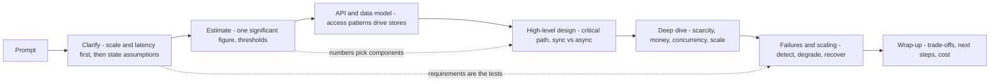
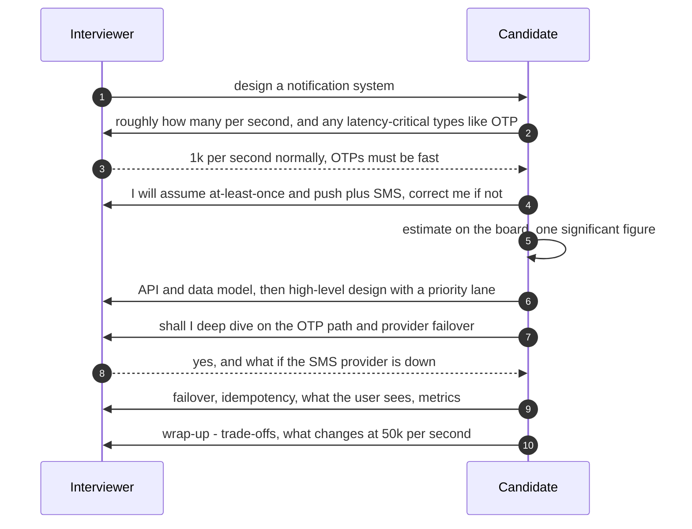
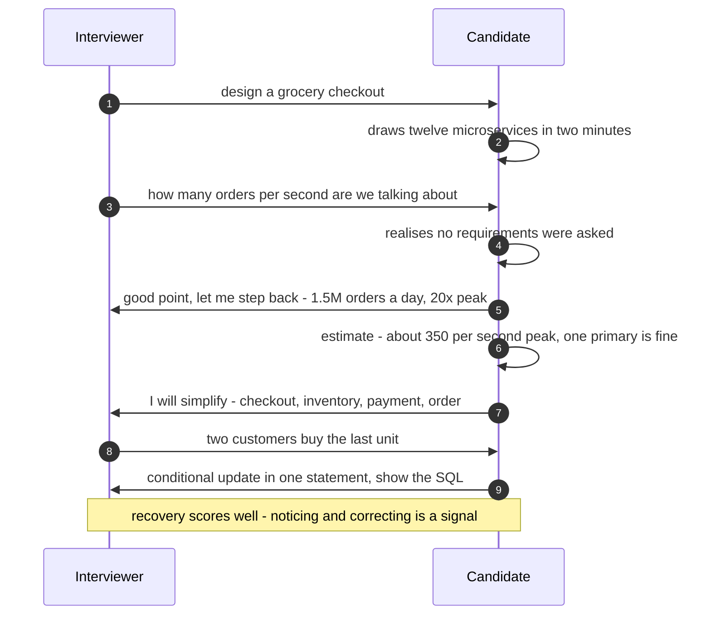
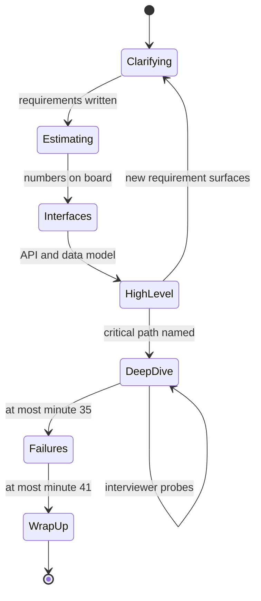

# 57. The System Design Interview Framework

!!! abstract "Chapter at a glance"
    **Reader bands:** B2 → B4 · **Prerequisites:** [Ch 01](../00-orientation/01-what-system-design-is.md) (the design process), [Ch 02](../01-foundations/02-back-of-the-envelope-estimation.md) (estimation), [Ch 31](../04-architect/31-architecture-decision-making.md) (decisions), and the case studies

    **What you will build:** a repeatable way to run a 45–60 minute system design interview. It covers what to do in which minute, which questions to ask first, how precise the numbers need to be, how to defend a choice when the interviewer pushes, and what the rubric is really scoring. The previous 56 chapters are the content. This chapter is how to deliver it under a clock, to a stranger, at a 15-year level.

    **What the labs measured:**

    - **L1, estimation.** Across 8 classic prompts:
        - Rounding every input to 1-or-5 × 10ᵏ missed by up to **7.3×** and changed the implied architecture in **3 of 8** prompts.
        - Keeping **one significant figure** stayed within **1.8×** and left **8 of 8** decisions unchanged.
    - **L2, trade-offs.** A weighted decision matrix with 100,000 perturbations:
        - Kafka for the event backbone won **87%** of the time: defend it calmly.
        - The cart store was a **tie** between PostgreSQL and a managed KV store: present it as a close call and name what flips it.
    - **L3, clarifying questions.** "Design a notification system" has **48** plausible requirement sets:
        - Designing for the "typical" reading fits **1** of them, and misses an essential component in **40**.
        - Asking just **scale and latency** leaves **0** missing.
    - **L4, the rubric.** Three illustrative transcripts:
        - The fast box-drawer scored **24%**.
        - A solid senior scored **79%**, which passes a senior bar but not a staff one.
        - The staff transcript scored **97%**, using the same framework with every phase done deliberately.

    · **Reading time:** 80 min + code

---

## 1. Introduction & Why It Matters

### 1.1 A story: the architect who failed the interview

Ravi had led the platform team for six years and designed half the systems in this handbook. In a staff-level loop, he got "design a notification system". Within ninety seconds he was drawing Kafka, three provider adapters, a preference service and a scheduler. It was his real system, beautifully.

The feedback:

- "Didn't clarify requirements."
- "Over-engineered for the stated scale."
- "When asked why Kafka over a database queue, repeated that Kafka is industry standard."
- "Ran out of time before discussing failures."

The interviewer had in mind 1,000 push notifications a second, best-effort, and wanted to see OTP latency handled.

Experience is necessary, but not sufficient. An interview measures whether you can **make your reasoning visible**:

- find out which system is being asked for;
- size it;
- choose, and say why;
- break it on purpose and fix it;
- do all of that in 45 minutes.

That is a skill of its own. This chapter trains it.

!!! quote "The thesis of this chapter"
    **Ask before you draw.** The prompt describes many systems, and two questions (scale and latency) eliminate most of them (L3). **Estimate to one significant figure** and let the numbers pick the architecture (L1). **Make trade-offs inspectable**: know which choices are robust and which are close calls, and what would flip them (L2). **Spend the clock on the deep dive and failures**, because that's where senior and staff signals live (L4).

### 1.2 The interview landscape

| Format | Duration | What's scored | Common at |
|---|---|---|---|
| Product/system design | 45–60 min | Requirements, architecture, trade-offs, depth, failures | All levels ≥ senior |
| Deep dive on your past system | 45–60 min | Ownership, decisions, what you'd change | Staff+ |
| Low-level / OO design | 45 min | Classes, patterns, concurrency | Mid/senior |
| Architecture review / take-home doc | Days | Written design, ADRs | Staff/principal |
| Behavioural | 45 min | Leadership, conflict, impact | All ([Ch 61](61-behavioral-and-leadership.md)) |

### 1.3 Learning objectives

By the end you will be able to:

- **Run the eight-step framework** on a 45-minute clock.
- **Ask the highest-value questions first** (L3).
- **Estimate fast and well enough** (L1).
- **Present and defend trade-offs** (L2).
- **Know what each level is scored on** (L4, [Ch 58](58-level-expectations.md)).

---

## 2. Core Concepts — Beginner to Deep

### 2.1 Intuition: a doctor's consultation <span class="band b2">B2</span>

A good doctor doesn't prescribe the moment you sit down. They ask the few questions that separate the likely conditions, take the measurements that matter, explain the options and their side effects, commit to a plan, and tell you what to watch for. A design interview is that consultation:

- The questions are requirements.
- The measurements are estimation.
- The options are trade-offs.
- The plan is the design.
- The warning signs are failure handling.

### 2.2 The eight-step framework ⭐ <span class="band b2">B2</span>

| # | Step | Minutes (45-min interview) | Output on the board |
|---|---|---|---|
| 1 | **Clarify** scope, users, scale, latency, consistency | 0–5 | 5–8 bullet requirements, explicit non-goals |
| 2 | **Estimate** traffic, storage, bandwidth, peaks | 5–8 | 4–6 numbers, 1 significant figure |
| 3 | **API** (key endpoints or events) | 8–11 | 3–5 signatures with idempotency and pagination |
| 4 | **Data model** (entities, keys, access patterns) | 11–14 | Tables or keys and the store chosen per pattern |
| 5 | **High-level design** | 14–20 | Boxes and arrows; the critical path named |
| 6 | **Deep dive** on 1–2 hard parts (interviewer's choice or yours) | 20–35 | Algorithms, concurrency, consistency, numbers |
| 7 | **Failures and scaling**: what breaks, how you detect and recover | 35–41 | Failure table, degradation, bottlenecks |
| 8 | **Wrap-up**: trade-offs made, what you'd do next, operability/cost | 41–45 | 3–4 sentences |

- **Timebox out loud**: "I'll take two minutes on requirements."
- **Drive, but check in**: "I'd like to deep dive on inventory reservation. Is that where you'd like to go?"
- **Write numbers and decisions on the board.** The interviewer's notes follow the board.

### 2.3 Step 1: clarify, and ask the valuable questions first ⭐ <span class="band b3">B3</span>

L3 enumerated "design a notification system":

| Strategy | Design right for | Over-built | Missing a need |
|---|---|---|---|
| No questions ("typical" set) | 1 of 48 | 7 | **40** |
| Ask scale | 3 of 48 | 21 | 24 |
| **Ask scale, then latency** | 6 of 48 | 42 | **0** |
| Ask all five | 48 of 48 | 0 | 0 |

- **Ask what splits the design space**: scale (orders of magnitude) and latency/consistency needs. Then **state assumptions** for the rest ("I'll assume at-least-once, multi-channel; stop me if not").
- **Functional questions**: who are the users, what are the 3 core use cases, and what is explicitly out of scope?
- **Non-functional questions**: DAU/QPS, read/write ratio, latency targets, consistency (money? inventory?), availability, data retention, regions ([Ch 01](../00-orientation/01-what-system-design-is.md)).
- **Write them down.** They become the acceptance tests for your design.

### 2.4 Step 2: estimate to one significant figure ⭐ <span class="band b2">B2</span>

L1 compared exact arithmetic with interview-style estimates on eight prompts:

| Rounding | Worst ratio vs exact | Design decisions unchanged |
|---|---|---|
| Each input to 1/5/10 × 10ᵏ | 7.3× | 5 of 8 |
| **Each input to 1 significant figure** | **1.8×** | **8 of 8** |

- **Shortcuts**:
    - 1 day ≈ 10⁵ s; 1 month ≈ 2.5 × 10⁶ s; 1 year ≈ 3 × 10⁷ s.
    - 1M requests/day ≈ 12/s average.
    - Peak = average × peak factor.
- **Compute what decides**: peak writes (can one primary take it?), peak reads (cache? CDN?), storage over retention (one machine? sharded?), bandwidth (egress cost, CDN).
- **Thresholds to know** (rules of thumb, VERIFY for your hardware):
    - ~5k writes/s for a comfortable single PostgreSQL primary;
    - ~100k ops/s per Redis instance;
    - ~1 GB/s per NIC;
    - ~10 TB per machine.
- **Say "near a threshold"** out loud, and design for the higher side ([Ch 02](../01-foundations/02-back-of-the-envelope-estimation.md)).

### 2.5 Steps 3–5: API, data model, high-level design <span class="band b2">B2</span>

- **API**: resource-oriented or RPC, idempotency keys on mutations, pagination, versioning. Events for async flows ([Ch 04](../01-foundations/04-api-design.md)).
- **Data model**: start from access patterns, then choose stores per pattern (relational for money and inventory, KV for carts and sessions, search engine for text, object storage for media) ([Ch 05](../01-foundations/05-relational-databases-deep-dive.md), [Ch 06](../01-foundations/06-nosql-and-polyglot-persistence.md)).
- **High-level design**: clients → edge → services → stores, with async via a queue or log. Name the **critical path**, and mark sync vs async edges ([Ch 56](../06-capstone/56-capstone-grocery-marketplace-end-to-end.md)).
- **Keep it simple first.** Add components only when a requirement or number demands them, and say which one ("reads are 100× writes at 40k/s, so a cache").

### 2.6 Step 6: the deep dive ⭐ <span class="band b3">B3</span>

This is where most of the score is. Pick the part with **scarcity, money, concurrency or scale**:

| Prompt | Typical deep dives | Chapter |
|---|---|---|
| URL shortener | ID generation, hot keys, redirects at scale | [Ch 38](../05-case-studies/38-url-shortener-and-short-links.md) |
| Rate limiter | Algorithms, distributed counters, fail-open/closed | [Ch 39](../05-case-studies/39-distributed-rate-limiter.md) |
| Notifications | Priority lanes, retries, dedup, provider failover | [Ch 40](../05-case-studies/40-notification-system.md) |
| Chat | Ordering, presence, fan-out, offline delivery | [Ch 41](../05-case-studies/41-chat-customer-rider-messaging.md) |
| Search/autocomplete | Tries vs index, ranking, freshness | [Ch 42](../05-case-studies/42-search-autocomplete.md) |
| Feed | Fan-out on write vs read, ranking | [Ch 43](../05-case-studies/43-home-feed-and-recommendations.md) |
| Payments | Idempotency, ledger, reconciliation | [Ch 45](../05-case-studies/45-payment-system.md) |
| Checkout / booking | Reservations, hot SKUs, holds | [Ch 46](../05-case-studies/46-grocery-checkout-and-inventory-reservation.md), [Ch 48](../05-case-studies/48-delivery-slot-booking-and-capacity.md) |
| Uber/dispatch | Geo index, matching, ETAs | [Ch 47](../05-case-studies/47-delivery-dispatch-and-live-tracking.md) |
| KV store / cache | Partitioning, replication, LSM, consistency | [Ch 44](../05-case-studies/44-distributed-cache.md), [Ch 54](../05-case-studies/54-distributed-key-value-store.md) |
| Exchange | Book, sequencer, determinism | [Ch 55](../05-case-studies/55-order-matching-engine.md) |

- **Go concrete**: data structures, the exact SQL/Lua for the atomic step, the state machine, the numbers.
- **Anticipate the "what if"**: two users on the last unit, a crash between steps, a hot key.

### 2.7 Step 7: failures and scaling ⭐ <span class="band b4">B4</span>

- For each component on the critical path, cover:
    - what happens when it's slow or down;
    - how you detect it;
    - what the user sees;
    - how you recover.
- Money and inventory: say "a timeout means unknown", then idempotency, sagas and reconciliation ([Ch 56](../06-capstone/56-capstone-grocery-marketplace-end-to-end.md) L2).
- Scaling: the next bottleneck at 10× load, and what you'd change.
- Staff signals: blast radius, degradation modes, SLOs by composition, cells ([Ch 56](../06-capstone/56-capstone-grocery-marketplace-end-to-end.md) L3–L4).

### 2.8 Presenting trade-offs ⭐ <span class="band b4">B4</span>

L2 perturbed each decision matrix 100,000 times:

| Decision | Base winner | Wins under perturbation | Margin | What flips it |
|---|---|---|---|---|
| Cart store | PostgreSQL = managed KV | 45% vs 43% | **TIE** | More weight on write throughput or ops burden → managed KV |
| Event backbone | Kafka | 87% | 6 points | Nothing single |
| Product search | Managed SaaS | 95% | 11 points | Nothing single |

- **The formula**: "I choose X because of requirements A and B. The cost is C. If D were true, I'd choose Y."
- **Robust choices**: defend them calmly. **Close calls**: say so, and name the flip condition. Interviewers probe to see whether you know the difference.
- **When your choice differs from a naive matrix** (the handbook chose self-run OpenSearch), name the missing criterion: control, cost at scale, data residency.

### 2.9 What the rubric scores <span class="band b3">B3</span>

L4 scored three illustrative transcripts:

| Transcript | Senior (bar 70%) | Staff (bar 85%) | Missing |
|---|---|---|---|
| Draws boxes fast | 24% | 20% | Requirements, estimation, depth, failures |
| Solid senior | **79%, hire** | 75%, no | Operability/cost weak |
| Staff signals | 96% | **97%, hire** | — |

- **Senior**: correct, complete design; a good deep dive; trade-offs named.
- **Staff**: drives ambiguity; argues trade-offs under pressure; failure handling and operability are first-class; connects to cost and organisation ([Ch 58](58-level-expectations.md) covers level expectations in detail).
- **Communication is scored implicitly**: structure, clarity, and listening to hints.

### 2.10 Adapting the framework <span class="band b4">B4</span>

- **60-minute interviews**: longer deep dive, plus a second deep dive or an evolution discussion.
- **"Design your past system"**: context → constraints → decisions with alternatives → what went wrong → what you'd change. Honesty about mistakes scores well.
- **Interviewer steers early**: follow them. The framework is a default, not a script.
- **Unfamiliar domain**: lean on the framework. Requirements and numbers transfer across domains.

---

## 3. Architecture & Diagrams

### 3.1 The interview as a flow



### 3.2 Sequence: a well-run interview



### 3.3 Sequence: an interview going wrong, and the recovery



### 3.4 State: the interview clock



---

## 4. Design Document Excerpt: One-Page Interview Plan

!!! note "Design Document (excerpt) — One-Page Plan for 'Design a Grocery Checkout' (practice template)"
    **Status:** Practice template · **Use:** fill in within the first 14 minutes on the board

    | Field | Value |
    |---|---|
    | Context | Quick-commerce checkout. 1.5M orders/day on sale days, 20× peak minute, 500 dark stores, UPI/cards via a payment gateway. |
    | Decision | Checkout orchestrates a saga: reserve stock (conditional update) → hold slot → charge (idempotent) → create order. Outbox events for fulfilment and notifications. Waiting room for the sale minute. |
    | Related decisions | Stock in PostgreSQL per store with conditional updates; Redis gate for hot SKUs ([Ch 46](../05-case-studies/46-grocery-checkout-and-inventory-reservation.md)). Payment timeouts resolved by status API ([Ch 45](../05-case-studies/45-payment-system.md)). Sweeper for abandoned sagas ([Ch 56](../06-capstone/56-capstone-grocery-marketplace-end-to-end.md)). |

    **Requirements.**

    - **R1:** Never oversell.
    - **R2:** Never charge without an order, or twice.
    - **R3:** p99 < 2.5 s including the gateway.
    - **R4:** 99.95% availability of the journey.
    - **R5:** Sale-minute surge handled without errors (a queue, not a failure).

    **Numbers.** 1.5M/day ÷ 10⁵ s ≈ 15/s average; × 20 peak ≈ 300/s writes. Reads ~ 40× → ~10k/s (cache catalog). Storage: 1.5M × 4 KB × 365 × 3 copies ≈ 7 TB/year.

    **Decisions in detail.**

    1. **Scarcity:** a conditional update for stock; buckets for hot SKUs.
    2. **Money:** idempotency key = order id; unknown ≠ failed.
    3. **Coupling:** side effects via events.
    4. **Surge:** a waiting room and pre-scaling.

    **Consequences.** More moving parts than a single transaction, in return for correctness under failure and a bounded blast radius. Mention it and move on.

---

## 5. Hands-On Code — Level Ladder

!!! info "What's real here"
    All four labs are JDK 21 programs with real computation.

    - **L1** uses stated assumptions per prompt and rule-of-thumb thresholds (VERIFY).
    - **L2** uses scores and weights that are **illustrative judgements**, not benchmarks.
    - **L3** has a requirement space and architecture rules drawn from Ch 40.
    - **L4** uses **illustrative transcripts** and bars written for this lab. They are not real candidates or a real company's rubric.

All four labs are single-file JDK 21 programs with no dependencies. Run each with `java -Dstdout.encoding=UTF-8 <File>.java`.

### L1 — How precise must estimates be? <span class="band b2">B2</span>

**Requirement:** "Estimate fast, and never let rounding change the architecture."

Eight prompts, exact vs two rounding styles, checked against design thresholds.

```java title="EstimateL1.java"
// EstimateL1.java — run with: java EstimateL1.java   (JDK 21, no dependencies)
// ESTIMATION IN THE INTERVIEW: IS MENTAL MATH GOOD ENOUGH? Eight classic prompts. For each, the exact arithmetic from
// stated assumptions vs two interview-style estimates (every input rounded COARSELY to 1, 5 or 10 × a power of ten, or
// to ONE SIGNIFICANT FIGURE; 1 day ≈ 10^5 s,
// 1 month ≈ 2.5 × 10^6 s, 1 year ≈ 3 × 10^7 s). Then the question that matters: does the rounding change a DESIGN
// DECISION? Each estimate is checked against decision thresholds (from Parts I–II; rules of thumb, VERIFY for your
// hardware): one PostgreSQL primary ≈ 5,000 writes/s comfortable; one Redis ≈ 100,000 ops/s; one server's NIC ≈
// 1 GB/s; a single machine's disk ≈ 10 TB; > 1,000 reads per write → cache / CDN.
import java.util.*;

public class EstimateL1 {
    record Prompt(String name, double dau, double actionsPerUser, double readWrite, double bytesPerWrite, double peak, double years) {}

    public static void main(String[] args) {
        List<Prompt> ps = List.of(
            new Prompt("URL shortener (writes = new links)", 1.2e8, 0.1, 100, 500, 3, 5),
            new Prompt("Grocery orders (this handbook)", 6e6, 0.25, 40, 4000, 20, 3),
            new Prompt("Chat messages", 5e7, 40, 1.5, 300, 4, 2),
            new Prompt("Rider GPS pings (writes)", 4e4, 21600, 0.2, 200, 1.5, 0.08),
            new Prompt("Product reviews", 2e6, 0.02, 800, 1500, 5, 5),
            new Prompt("Notification sends", 6e6, 6, 0.1, 800, 10, 0.25),
            new Prompt("Photo uploads (social app)", 3e8, 0.3, 50, 2.5e6, 3, 3),
            new Prompt("Ad click events", 1.5e8, 15, 0.05, 250, 5, 1));
        for (mode = 0; mode < 2; mode++) {
            System.out.println(mode == 0 ? "COARSE rounding (each input to 1, 5 or 10 × 10^k):" : "\nONE SIGNIFICANT FIGURE (each input to d × 10^k):");
            System.out.printf("   %-38s %-22s %-22s %-24s %s%n", "prompt", "peak writes/s", "peak reads/s", "storage (3 copies)", "decision from exact → from estimate");
            System.out.printf("   %-38s %-22s %-22s %-24s%n", "", "exact / estimate", "exact / estimate", "exact / estimate");
            int agree = 0; double worst = 1;
            for (Prompt p : ps) {
                double[] e = calc(p, false), r = calc(p, true);
                String de = decide(e), dr = decide(r); if (de.equals(dr)) agree++;
                for (int i = 0; i < 3; i++) worst = Math.max(worst, Math.max(e[i] / r[i], r[i] / e[i]));
                System.out.printf("   %-38s %-22s %-22s %-24s %s%n", p.name(), h(e[0]) + " / " + h(r[0]), h(e[1]) + " / " + h(r[1]), b(e[2]) + " / " + b(r[2]), de.equals(dr) ? "same: " + de : de + "  →  " + dr);
            }
            System.out.printf("   worst ratio estimate vs exact: %.1fx; design decisions unchanged in %d of %d prompts%n", worst, agree, ps.size());
        }
        System.out.println("\n   → interviewers don't grade arithmetic; they grade whether the numbers drive the design. But rounding error");
        System.out.println("     compounds: rounding five inputs to 1-or-5 multiplies small errors into a 7x miss and flips decisions for");
        System.out.println("     prompts near a threshold. Keeping ONE significant figure per input is still easy mental math and keeps the");
        System.out.println("     estimate close enough that the architecture it implies rarely changes. When a result lands near a threshold,");
        System.out.println("     say so out loud and design for the higher side.");
    }

    static int mode;
    static double r1(double x) { double p = Math.pow(10, Math.floor(Math.log10(x))); double m = x / p;
        return mode == 0 ? (m < 2.2 ? 1 : m < 7 ? 5 : 10) * p : Math.round(m) * p; }                // coarse: 1/5/10 × 10^k; fine: one significant figure
    static double[] calc(Prompt p, boolean round) {
        java.util.function.DoubleUnaryOperator R = x -> round ? r1(x) : x;
        double day = round ? 1e5 : 86400, year = round ? 3e7 : 365 * 86400.0;
        double writesPerDay = R.applyAsDouble(p.dau()) * R.applyAsDouble(p.actionsPerUser());
        double avgW = writesPerDay / day, peakW = avgW * R.applyAsDouble(p.peak());
        double peakR = peakW * R.applyAsDouble(p.readWrite());
        double storage = writesPerDay * R.applyAsDouble(p.bytesPerWrite()) * (p.years() * year / day) * 3;   // ×3 replication
        return new double[]{peakW, peakR, storage};
    }
    static String decide(double[] v) {
        List<String> d = new ArrayList<>();
        if (v[0] > 5000) d.add("shard/partition writes");
        if (v[1] > 100_000) d.add("cache tier");
        if (v[1] / Math.max(1, v[0]) > 1000) d.add("CDN/edge");
        if (v[2] > 10e12) d.add("distributed storage");
        if (v[0] > 50_000) d.add("stream ingest");
        return d.isEmpty() ? "single primary + replicas" : String.join(", ", d);
    }
    static String h(double x) { return x >= 1e6 ? String.format("%.1fM", x / 1e6) : x >= 1e3 ? String.format("%.1fk", x / 1e3) : String.format("%.0f", x); }
    static String b(double x) { return x >= 1e15 ? String.format("%.1f PB", x / 1e15) : x >= 1e12 ? String.format("%.1f TB", x / 1e12) : String.format("%.0f GB", x / 1e9); }
}
```

```text title="java EstimateL1.java"
COARSE rounding (each input to 1, 5 or 10 × 10^k):
   prompt                                 peak writes/s          peak reads/s           storage (3 copies)       decision from exact → from estimate
                                          exact / estimate       exact / estimate       exact / estimate        
   URL shortener (writes = new links)     417 / 500              41.7k / 50.0k          32.9 TB / 22.5 TB        same: distributed storage
   Grocery orders (this handbook)         347 / 250              13.9k / 12.5k          19.7 TB / 33.8 TB        same: distributed storage
   Chat messages                          92.6k / 125.0k         138.9k / 125.0k        1.3 PB / 2.3 PB          same: shard/partition writes, cache tier, distributed storage, stream ingest
   Rider GPS pings (writes)               15.0k / 5.0k           3.0k / 500             15.1 TB / 3.6 TB         shard/partition writes, distributed storage  →  single primary + replicas
   Product reviews                        2 / 1                  1.9k / 500             329 GB / 45 GB           same: single primary + replicas
   Notification sends                     4.2k / 2.5k            417 / 250              7.9 TB / 5.6 TB          same: single primary + replicas
   Photo uploads (social app)             3.1k / 12.5k           156.3k / 625.0k        739.1 PB / 3375.0 PB     cache tier, distributed storage  →  shard/partition writes, cache tier, distributed storage
   Ad click events                        130.2k / 50.0k         6.5k / 2.5k            615.9 TB / 450.0 TB      shard/partition writes, distributed storage, stream ingest  →  shard/partition writes, distributed storage
   worst ratio estimate vs exact: 7.3x; design decisions unchanged in 5 of 8 prompts

ONE SIGNIFICANT FIGURE (each input to d × 10^k):
   prompt                                 peak writes/s          peak reads/s           storage (3 copies)       decision from exact → from estimate
                                          exact / estimate       exact / estimate       exact / estimate        
   URL shortener (writes = new links)     417 / 300              41.7k / 30.0k          32.9 TB / 22.5 TB        same: distributed storage
   Grocery orders (this handbook)         347 / 360              13.9k / 14.4k          19.7 TB / 19.4 TB        same: distributed storage
   Chat messages                          92.6k / 80.0k          138.9k / 160.0k        1.3 PB / 1.1 PB          same: shard/partition writes, cache tier, distributed storage, stream ingest
   Rider GPS pings (writes)               15.0k / 16.0k          3.0k / 3.2k            15.1 TB / 11.5 TB        same: shard/partition writes, distributed storage
   Product reviews                        2 / 2                  1.9k / 1.6k            329 GB / 360 GB          same: single primary + replicas
   Notification sends                     4.2k / 3.6k            417 / 360              7.9 TB / 6.5 TB          same: single primary + replicas
   Photo uploads (social app)             3.1k / 2.7k            156.3k / 135.0k        739.1 PB / 729.0 PB      same: cache tier, distributed storage
   Ad click events                        130.2k / 200.0k        6.5k / 10.0k           615.9 TB / 1.1 PB        same: shard/partition writes, distributed storage, stream ingest
   worst ratio estimate vs exact: 1.8x; design decisions unchanged in 8 of 8 prompts

   → interviewers don't grade arithmetic; they grade whether the numbers drive the design. But rounding error
     compounds: rounding five inputs to 1-or-5 multiplies small errors into a 7x miss and flips decisions for
     prompts near a threshold. Keeping ONE significant figure per input is still easy mental math and keeps the
     estimate close enough that the architecture it implies rarely changes. When a result lands near a threshold,
     say so out loud and design for the higher side.
```

**Reading it:**

- **Coarse rounding** compounds across five inputs into a 7× miss. It flipped the decision for GPS pings: shard or not. It flipped photos: whether writes need sharding. It flipped ad clicks: whether ingest needs a stream.
- **One significant figure** is still head-arithmetic, and it never changed a decision here.

### L2 — Robust choice or close call? <span class="band b3">B3</span>

**Requirement:** "Defend each choice under 'why not X?' — and know which ones are genuinely close."

Three decision matrices, perturbed 100,000 times.

```java title="TradeoffL2.java"
// TradeoffL2.java — run with: java TradeoffL2.java   (JDK 21, no dependencies)
// DEFENDING A CHOICE UNDER QUESTIONING. Interviewers push: "why not X?" A weighted decision matrix makes the reasoning
// explicit — but is the winner robust, or an artefact of the weights you picked? Three decisions from this handbook,
// with criteria weights and 1–5 scores as a candidate might state them (ILLUSTRATIVE judgements, not benchmarks).
// For each: the base-case winner, then 100,000 perturbations (every weight ±40%, every score ±1 with 30% chance):
// how often each option wins, and which single criterion, if its weight doubled, would change the winner.
import java.util.*;

public class TradeoffL2 {
    record Decision(String name, String[] criteria, double[] weights, String[] options, int[][] scores) {}

    public static void main(String[] args) {
        List<Decision> ds = List.of(
            new Decision("Cart store (read-your-writes, 5M active carts, sale spikes)",
                new String[]{"read-your-writes", "write throughput", "ops burden", "team familiarity", "cost"}, new double[]{5, 4, 3, 2, 2},
                new String[]{"PostgreSQL (partitioned)", "Redis + PG snapshot", "Managed KV (DynamoDB-like)", "Cassandra"},
                new int[][]{{5, 3, 4, 5, 4}, {4, 5, 3, 4, 3}, {4, 5, 5, 3, 3}, {3, 5, 2, 2, 3}}),
            new Decision("Event backbone (order events, replay, 20 consumers)",
                new String[]{"replay/retention", "throughput", "ordering per key", "ops burden", "ecosystem"}, new double[]{5, 3, 4, 3, 3},
                new String[]{"Kafka", "RabbitMQ", "SQS/SNS", "Pulsar"},
                new int[][]{{5, 5, 5, 2, 5}, {2, 3, 3, 4, 4}, {1, 4, 2, 5, 3}, {5, 5, 5, 2, 3}}),
            new Decision("Product search (250k SKUs, typo tolerance, facets)",
                new String[]{"relevance features", "latency at 10k qps", "ops burden", "consistency with catalog", "cost"}, new double[]{5, 4, 3, 2, 2},
                new String[]{"OpenSearch", "PostgreSQL full-text", "Managed search SaaS"},
                new int[][]{{5, 4, 2, 3, 3}, {2, 3, 5, 5, 5}, {5, 5, 5, 3, 2}}));
        Random r = new Random(57);
        for (Decision d : ds) {
            int n = d.options().length; double[] base = score(d, d.weights(), d.scores());
            int bw = argmax(base); double second = -1; for (int o = 0; o < n; o++) if (o != bw) second = Math.max(second, base[o]);
            System.out.printf("%s%n", d.name());
            for (int o = 0; o < n; o++) System.out.printf("   %-30s base score %5.1f%s%n", d.options()[o], base[o], o == bw ? "   ← base-case winner" : "");
            int[] wins = new int[n];
            for (int k = 0; k < 100_000; k++) {
                double[] w = d.weights().clone(); for (int i = 0; i < w.length; i++) w[i] *= 0.6 + 0.8 * r.nextDouble();
                int[][] s = new int[n][]; for (int o = 0; o < n; o++) { s[o] = d.scores()[o].clone(); for (int i = 0; i < s[o].length; i++) if (r.nextDouble() < 0.3) s[o][i] = Math.max(1, Math.min(5, s[o][i] + (r.nextBoolean() ? 1 : -1))); }
                wins[argmax(score(d, w, s))]++; }
            System.out.print("   wins under perturbation: "); for (int o = 0; o < n; o++) System.out.printf("%s %.0f%%   ", d.options()[o].split(" ")[0], wins[o] / 1000.0); System.out.println();
            List<String> flips = new ArrayList<>();
            for (int i = 0; i < d.criteria().length; i++) { double[] w = d.weights().clone(); w[i] *= 2; int win = argmax(score(d, w, d.scores())); if (win != bw) flips.add("'" + d.criteria()[i] + "' → " + d.options()[win]); }
            System.out.printf("   margin over runner-up: %s; doubling one weight flips it: %s%n%n", base[bw] - second < 1e-9 ? "TIE" : String.format("%.1f points", base[bw] - second), flips.isEmpty() ? "no" : String.join("; ", flips));
        }
        System.out.println("   → a matrix doesn't make the decision; it makes your reasoning inspectable. The useful output is not the");
        System.out.println("     winner but its robustness: a choice that wins under most reasonable weightings can be defended calmly;");
        System.out.println("     a tie or narrow margin should be presented as a close call, naming what would flip it ('if write throughput");
        System.out.println("     or ops burden mattered more, I'd take the managed KV'). And when the matrix disagrees with the choice you");
        System.out.println("     made (search here), say which criterion it is missing — that is the conversation senior interviews reward.");
    }
    static double[] score(Decision d, double[] w, int[][] s) { double[] out = new double[s.length]; for (int o = 0; o < s.length; o++) for (int i = 0; i < w.length; i++) out[o] += w[i] * s[o][i]; return out; }
    static int argmax(double[] a) { int b = 0; for (int i = 1; i < a.length; i++) if (a[i] > a[b]) b = i; return b; }
}
```

```text title="java TradeoffL2.java"
Cart store (read-your-writes, 5M active carts, sale spikes)
   PostgreSQL (partitioned)       base score  67.0   ← base-case winner
   Redis + PG snapshot            base score  63.0
   Managed KV (DynamoDB-like)     base score  67.0
   Cassandra                      base score  51.0
   wins under perturbation: PostgreSQL 45%   Redis 12%   Managed 43%   Cassandra 0%   
   margin over runner-up: TIE; doubling one weight flips it: 'write throughput' → Managed KV (DynamoDB-like); 'ops burden' → Managed KV (DynamoDB-like)

Event backbone (order events, replay, 20 consumers)
   Kafka                          base score  81.0   ← base-case winner
   RabbitMQ                       base score  55.0
   SQS/SNS                        base score  49.0
   Pulsar                         base score  75.0
   wins under perturbation: Kafka 87%   RabbitMQ 0%   SQS/SNS 0%   Pulsar 13%   
   margin over runner-up: 6.0 points; doubling one weight flips it: no

Product search (250k SKUs, typo tolerance, facets)
   OpenSearch                     base score  59.0
   PostgreSQL full-text           base score  57.0
   Managed search SaaS            base score  70.0   ← base-case winner
   wins under perturbation: OpenSearch 3%   PostgreSQL 2%   Managed 95%   
   margin over runner-up: 11.0 points; doubling one weight flips it: no

   → a matrix doesn't make the decision; it makes your reasoning inspectable. The useful output is not the
     winner but its robustness: a choice that wins under most reasonable weightings can be defended calmly;
     a tie or narrow margin should be presented as a close call, naming what would flip it ('if write throughput
     or ops burden mattered more, I'd take the managed KV'). And when the matrix disagrees with the choice you
     made (search here), say which criterion it is missing — that is the conversation senior interviews reward.
```

**Reading it:**

- **Kafka and managed search** win under most reasonable weightings. Defend them calmly.
- **The cart store is a tie.** Present it as a close call and name what flips it.
- **Search: the matrix picks SaaS.** The handbook chose self-run OpenSearch, which is a prompt to name the criterion the matrix is missing (control, cost at scale, residency).

### L3 — The value of the first questions <span class="band b3">B3</span>

**Requirement:** "Design the system the interviewer means, not the one in your head."

Every plausible reading of "design a notification system", and the design each needs.

```java title="ClarifyL3.java"
// ClarifyL3.java — run with: java ClarifyL3.java   (JDK 21, no dependencies)
// WHY THE FIRST FIVE MINUTES ARE QUESTIONS. Prompt: "Design a notification system." Five things the prompt doesn't
// say, each with plausible answers (every combination is a requirement set an interviewer might have in mind):
//   scale: 1k/s | 50k/s | 1M/s burst        latency: seconds OK | < 500 ms (OTP)       guarantee: best effort | at-least-once
//   channels: push only | SMS+push+email     user prefs/quiet hours: no | yes
// A rule set (from Ch 40 and Parts I–II) maps each requirement set to the architecture it needs: queue type, priority
// lanes, provider failover, dedup store, preference service, rate limiting. We then compare:
//   Q0 skip the questions: design for the "typical" set (50k/s, seconds, at-least-once, all channels, prefs)
//   Q1..Q2 ask the most INFORMATIVE questions first (greatest reduction in uncertainty about the architecture), then
//      assume typical values for the rest
//   Q5 ask all five
// Measured: share of requirement sets for which the resulting design is right (not over-built, not missing a need).
import java.util.*;

public class ClarifyL3 {
    static final String[][] DIMS = {{"1k/s", "50k/s", "1M/s burst"}, {"seconds OK", "<500 ms"}, {"best effort", "at-least-once"}, {"push only", "SMS+push+email"}, {"no prefs", "prefs + quiet hours"}};
    static final String[] NAMES = {"scale", "latency", "guarantee", "channels", "preferences"};
    static final int[] TYPICAL = {1, 0, 1, 1, 1};

    public static void main(String[] args) {
        List<int[]> sets = new ArrayList<>(); enumerate(new int[5], 0, sets);
        System.out.printf("%d plausible requirement sets for \"design a notification system\"; each implies an architecture.%n%n", sets.size());
        // information gain of each question (entropy of the architecture over sets)
        Map<String, Integer> archCount = new HashMap<>(); for (int[] s : sets) archCount.merge(arch(s), 1, Integer::sum);
        double h0 = entropy(archCount.values(), sets.size());
        System.out.printf("   distinct architectures implied: %d (uncertainty %.2f bits)%n", archCount.size(), h0);
        Integer[] order = {0, 1, 2, 3, 4}; double[] gain = new double[5];
        for (int d = 0; d < 5; d++) { double h = 0; for (int v = 0; v < DIMS[d].length; v++) { Map<String, Integer> c = new HashMap<>(); int n = 0; for (int[] s : sets) if (s[d] == v) { c.merge(arch(s), 1, Integer::sum); n++; } h += (double) n / sets.size() * entropy(c.values(), n); } gain[d] = h0 - h; }
        Arrays.sort(order, (a, b) -> Double.compare(gain[b], gain[a]));
        System.out.print("   information gain per question: "); for (int d : order) System.out.printf("%s %.2f bits   ", NAMES[d], gain[d]); System.out.println("\n");
        System.out.printf("   %-52s %22s %14s %14s%n", "strategy", "design right for", "over-built", "missing a need");
        for (int k : new int[]{0, 1, 2, 5}) {
            int right = 0, over = 0, under = 0;
            for (int[] s : sets) { int[] assumed = TYPICAL.clone(); for (int i = 0; i < k; i++) assumed[order[i]] = s[order[i]];
                Set<String> need = parts(s), built = parts(assumed);
                if (need.equals(built)) right++; else { if (!built.containsAll(need)) under++; else over++; } }
            String name = k == 0 ? "Q0) no questions: assume the typical set" : k == 5 ? "Q5) ask all five" : "Q" + k + ") ask the " + k + " most informative question" + (k > 1 ? "s" : "") + " (" + String.join(", ", Arrays.stream(order).limit(k).map(d -> NAMES[d]).toList()) + ")";
            System.out.printf("   %-62s %13d of %d %14d %14d%n", name, right, sets.size(), over, under);
        }
        System.out.println("\n   → an unclarified prompt is 48 different systems here. Designing for a 'typical' reading fits one of them; it");
        System.out.println("     is over-built for some (Kafka and provider failover for push-only at 1k/s) and, worse, MISSING something");
        System.out.println("     essential for 40 (usually the OTP priority lane, because 'seconds are fine' was assumed). Scale splits the");
        System.out.println("     space most, so ask it first; latency is next because its wrong default does damage rather than waste. After");
        System.out.println("     two questions nothing essential is missing, and the rest can be stated as assumptions ('I'll assume at-least-");
        System.out.println("     once and multi-channel — tell me if not'), which costs seconds and fixes the over-building.");
    }
    static void enumerate(int[] cur, int d, List<int[]> out) { if (d == 5) { out.add(cur.clone()); return; } for (int v = 0; v < DIMS[d].length; v++) { cur[d] = v; enumerate(cur, d + 1, out); } }
    static Set<String> parts(int[] s) {
        Set<String> p = new TreeSet<>();
        p.add(s[0] == 0 ? "single DB-backed queue" : s[0] == 1 ? "Kafka, partitioned workers" : "Kafka + autoscaled workers + provider rate limiting");
        if (s[1] == 1) p.add("priority lane for OTP/transactional");
        if (s[2] == 1) p.add("idempotency/dedup store + retries");
        if (s[3] == 1) p.add("per-channel adapters + provider failover");
        if (s[4] == 1) p.add("preference service + scheduler for quiet hours");
        if (s[0] == 2 && s[2] == 1) p.add("outbox + DLQ");
        return p;
    }
    static String arch(int[] s) { return String.join("|", parts(s)); }
    static double entropy(Collection<Integer> counts, int n) { double h = 0; for (int c : counts) { double p = (double) c / n; h -= p * Math.log(p) / Math.log(2); } return h; }
}
```

```text title="java ClarifyL3.java"
48 plausible requirement sets for "design a notification system"; each implies an architecture.

   distinct architectures implied: 48 (uncertainty 5.58 bits)
   information gain per question: scale 1.58 bits   latency 1.00 bits   guarantee 1.00 bits   channels 1.00 bits   preferences 1.00 bits   

   strategy                                                   design right for     over-built missing a need
   Q0) no questions: assume the typical set                                   1 of 48              7             40
   Q1) ask the 1 most informative question (scale)                            3 of 48             21             24
   Q2) ask the 2 most informative questions (scale, latency)                  6 of 48             42              0
   Q5) ask all five                                                          48 of 48              0              0

   → an unclarified prompt is 48 different systems here. Designing for a 'typical' reading fits one of them; it
     is over-built for some (Kafka and provider failover for push-only at 1k/s) and, worse, MISSING something
     essential for 40 (usually the OTP priority lane, because 'seconds are fine' was assumed). Scale splits the
     space most, so ask it first; latency is next because its wrong default does damage rather than waste. After
     two questions nothing essential is missing, and the rest can be stated as assumptions ('I'll assume at-least-
     once and multi-channel — tell me if not'), which costs seconds and fixes the over-building.
```

**Reading it:**

- **Without questions**, the design misses an essential component in 40 of 48 readings.
- **Asking scale, then latency** removes every "missing" case.
- **Stating the remaining assumptions aloud** removes the over-building.

### L4 — What the rubric rewards <span class="band b4">B4</span>

**Requirement:** "Know which behaviours move the score, at your level."

Three illustrative transcripts scored against senior and staff rubrics.

```java title="RubricL4.java"
// RubricL4.java — run with: java RubricL4.java   (JDK 21, no dependencies)
// HOW A 45-MINUTE DESIGN INTERVIEW IS SCORED. A rubric of 8 signals (the ones this chapter's framework is built to
// produce), each needing specific evidence, weighted by level, plus time discipline. Three ILLUSTRATIVE transcripts of
// "design a grocery checkout" (written for this lab — timelines of what the candidate did, minute by minute) are
// scored for a senior (B3) and a staff (B4) bar. The point is to see which behaviours move the score.
import java.util.*;

public class RubricL4 {
    record Event(int minute, String signal, int quality) {}                                        // quality 1 weak – 3 strong
    static final String[] SIGNALS = {"requirements", "estimation", "api+data model", "high-level design", "deep dive", "trade-offs", "failure handling", "operability/cost"};
    static final double[] W_SENIOR = {1.0, 0.8, 1.0, 1.2, 1.5, 1.2, 1.2, 0.6}, W_STAFF = {1.2, 0.8, 0.8, 1.0, 1.4, 1.6, 1.5, 1.2};

    public static void main(String[] args) {
        Map<String, List<Event>> t = new LinkedHashMap<>();
        t.put("A — draws boxes fast", List.of(ev(1, "high-level design", 2), ev(12, "api+data model", 1), ev(18, "deep dive", 1), ev(35, "high-level design", 2), ev(43, "trade-offs", 1)));
        t.put("B — solid senior", List.of(ev(1, "requirements", 3), ev(5, "estimation", 2), ev(8, "api+data model", 2), ev(12, "high-level design", 3), ev(18, "deep dive", 3),
                ev(30, "failure handling", 2), ev(36, "trade-offs", 2), ev(42, "operability/cost", 1)));
        t.put("C — staff signals", List.of(ev(1, "requirements", 3), ev(4, "estimation", 3), ev(7, "api+data model", 2), ev(10, "high-level design", 3), ev(14, "deep dive", 3),
                ev(24, "failure handling", 3), ev(30, "trade-offs", 3), ev(36, "operability/cost", 3), ev(40, "trade-offs", 3)));
        System.out.printf("   %-24s %-10s %-10s  %-40s %s%n", "transcript (illustrative)", "senior", "staff", "missing or weak signals", "time discipline");
        System.out.printf("   %-24s %-10s %-10s%n", "", "(bar 70%)", "(bar 85%)");
        for (var e : t.entrySet()) {
            int[] best = new int[SIGNALS.length]; for (Event x : e.getValue()) { int i = Arrays.asList(SIGNALS).indexOf(x.signal()); best[i] = Math.max(best[i], x.quality()); }
            double s = score(best, W_SENIOR), st = score(best, W_STAFF);
            List<String> weak = new ArrayList<>(); for (int i = 0; i < SIGNALS.length; i++) if (best[i] < 2) weak.add(SIGNALS[i] + (best[i] == 0 ? " (absent)" : " (weak)"));
            int firstDesign = e.getValue().stream().filter(x -> x.signal().equals("high-level design")).mapToInt(Event::minute).min().orElse(99);
            int deep = e.getValue().stream().filter(x -> x.signal().equals("deep dive")).mapToInt(Event::minute).min().orElse(99);
            String time = firstDesign < 5 && best[0] == 0 ? "designed before asking" : deep > 25 ? "deep dive started late" : "on plan";
            System.out.printf("   %-24s %4.0f%% %-5s %4.0f%% %-5s  %-40s %s%n", e.getKey(), s, s >= 70 ? "hire" : "no", st, st >= 85 ? "hire" : "no", weak.isEmpty() ? "—" : String.join(", ", weak.subList(0, Math.min(3, weak.size()))) + (weak.size() > 3 ? " +" + (weak.size() - 3) : ""), time);
        }
        System.out.println("\n   bars (illustrative): senior ≥ 70%, staff ≥ 85%. The two rubrics also weigh the same evidence differently:");
        System.out.println("   staff puts more weight on trade-offs, failure handling and operability, less on API detail.");
        System.out.println("\n   → the fast box-drawer loses on everything the boxes don't show: no requirements, no numbers, no failure");
        System.out.println("     story. The solid senior clears the senior bar and not the staff one — the gap is exactly trade-offs argued");
        System.out.println("     under pressure, failure handling as a first-class part of the design, and cost/operability. Nothing in the");
        System.out.println("     staff transcript is exotic; it is the same framework, with every phase done deliberately and on time.");
    }
    static Event ev(int m, String s, int q) { return new Event(m, s, q); }
    static double score(int[] best, double[] w) { double s = 0, max = 0; for (int i = 0; i < best.length; i++) { s += w[i] * best[i]; max += w[i] * 3; } return 100 * s / max; }
}
```

```text title="java RubricL4.java"
   transcript (illustrative) senior     staff       missing or weak signals                  time discipline
                            (bar 70%)  (bar 85%) 
   A — draws boxes fast       24% no      20% no     requirements (absent), estimation (absent), api+data model (weak) +4 designed before asking
   B — solid senior           79% hire    75% no     operability/cost (weak)                  on plan
   C — staff signals          96% hire    97% hire   —                                        on plan

   bars (illustrative): senior ≥ 70%, staff ≥ 85%. The two rubrics also weigh the same evidence differently:
   staff puts more weight on trade-offs, failure handling and operability, less on API detail.

   → the fast box-drawer loses on everything the boxes don't show: no requirements, no numbers, no failure
     story. The solid senior clears the senior bar and not the staff one — the gap is exactly trade-offs argued
     under pressure, failure handling as a first-class part of the design, and cost/operability. Nothing in the
     staff transcript is exotic; it is the same framework, with every phase done deliberately and on time.
```

**Reading it:**

- **Speed without requirements, numbers or failures** scores poorly at any level.
- **The senior-to-staff gap** is trade-offs, failure handling and operability done as first-class work. The transcripts and bars are illustrative.


---

## 6. Interview-Day Concerns

### 6.1 Failure modes

| Failure | Symptom | Fix |
|---|---|---|
| Designing before asking | Wrong system (L3) | Two questions first, then assumptions |
| Coarse estimates | Wrong decisions (L1) | One significant figure, name the thresholds |
| No numbers at all | "Hand-wavy" feedback | 4–6 numbers on the board |
| Over-engineering | "Didn't fit the scale" | Add components only when a number demands it |
| Shallow everywhere | "No depth" | One real deep dive with code-level detail |
| Losing the clock | No failure discussion (L4) | Timebox out loud |
| Defending everything equally | "Rigid" | Robust vs close-call trade-offs (L2) |
| Ignoring hints | "Didn't listen" | Treat questions as steering |

### 6.2 Preparation plan

- Weeks 1–2: the foundations and core chapters on your path ([Ch 00](../00-orientation/00-how-to-use-this-handbook.md) paths).
- Weeks 3–4: one case study a day, timed at 45 minutes on paper, *before* reading the chapter.
- Weeks 5–6: mock interviews ([Ch 60](60-mock-interviews.md)) with the rubric (L4), recorded and reviewed.

### 6.3 Whiteboard and virtual hygiene

- Layout: requirements top-left, numbers top-right, diagram in the centre, decisions and failure tables below.
- Virtual: pre-agree on a tool (Excalidraw, a doc). Share early, and narrate what you draw.

### 6.4 Pacing

- Glance at the clock at minutes 5, 14, 20, 35 and 41. If you're behind, say what you'll skip.
- If the interviewer dives early, follow them, and return to the skipped steps briefly at the end.

### 6.5 Mindset

- The interviewer wants you to succeed. Treat it as a design review with a colleague.
- Say "I don't know" plus how you would find out. It beats bluffing.

---

## 7. Anti-Patterns & Pitfalls

!!! danger "1. Drawing in the first minute"
    Designing an unspecified system (L3).

!!! danger "2. Asking twenty questions"
    Ask the few that split the space, then state assumptions.

!!! danger "3. Arithmetic theatre"
    Precision without decisions.

!!! danger "4. Coarse rounding near thresholds"
    Flipped architectures (L1).

!!! danger "5. Buzzword architecture"
    Kafka, Kubernetes and microservices with no requirement behind them.

!!! danger "6. Never going deep"
    Senior interviews are won in the deep dive.

!!! danger "7. Ignoring failure handling"
    The staff signal.

!!! danger "8. 'Industry standard' as a justification"
    Name requirements and costs (L2).

!!! danger "9. Arguing with the interviewer"
    Probes are invitations, not attacks.

!!! danger "10. Monologuing"
    Check in at step boundaries.

!!! danger "11. Recreating your employer's system verbatim"
    Fit the design to the stated requirements.

!!! danger "12. Running out of time silently"
    Say what you would cover next.

---

## 8. Interview Q&A

### Beginner <span class="band b2">B2</span>

??? question "Q1 [B2] ⭐ How do you structure a 45-minute system design interview?"

    **30-second answer:** Clarify (5 min), estimate (3), API and data model (6), high-level design (6), deep dive (15), failures and scaling (6), wrap-up (4) — timeboxed out loud, with requirements and numbers on the board and check-ins at each transition.

    **Deep answer:** §2.2.

    **Trade-offs I'd call out:** Following the interviewer's lead vs the plan.

    **Follow-ups:**
    1. 60 minutes? → Longer deep dive or evolution.
    2. Interviewer jumps ahead? → Follow, backfill later.

    **Red flags:** No structure.

??? question "Q2 [B2] ⭐ Which questions do you ask first?"

    **30-second answer:** The ones that change the architecture most: scale (orders of magnitude) and latency/consistency needs, plus the core use cases; then state assumptions for the rest and invite correction.

    **Deep answer:** L3: no questions fit 1 of 48 readings; asking scale and latency left nothing essential missing.

    **Trade-offs I'd call out:** Time vs certainty.

    **Follow-ups:**
    1. Interviewer says "you decide"? → State assumptions and why.
    2. Non-functional list? → Availability, retention, regions.

    **Red flags:** Starting to draw immediately.

??? question "Q3 [B2] How precise do estimates need to be?"

    **30-second answer:** Precise enough not to change decisions: one significant figure per input, standard shortcuts (a day ≈ 10⁵ s), and explicit thresholds; flag results near a threshold.

    **Deep answer:** L1: 1-sig-fig stayed within 1.8× and preserved all 8 decisions; coarser rounding flipped 3.

    **Trade-offs I'd call out:** Speed vs accuracy.

    **Follow-ups:**
    1. Which numbers? → Peak writes, reads, storage, bandwidth.
    2. Forgot a number? → Estimate from first principles.

    **Red flags:** Skipping estimation entirely.

??? question "Q4 [B2] How do you choose what to deep dive on?"

    **30-second answer:** Where scarcity, money, concurrency or extreme scale meet — the part most likely to break or be wrong — or what the interviewer steers to; propose it and confirm.

    **Deep answer:** §2.6 table.

    **Trade-offs I'd call out:** Your strength vs their interest.

    **Follow-ups:**
    1. Two candidates? → Pick the riskier.
    2. Out of depth? → Reason from principles aloud.

    **Red flags:** Deep diving on the load balancer.

### Intermediate <span class="band b2">B2</span>

??? question "Q5 [B2] ⭐ How do you justify a technology choice?"

    **30-second answer:** Tie it to requirements and numbers, state its costs, and name the condition under which you'd choose the alternative: "Kafka because we need replay and per-key ordering at 50k/s; it costs operational complexity; for 1k/s without replay, a database queue would do."

    **Deep answer:** L2.

    **Trade-offs I'd call out:** Familiarity bias.

    **Follow-ups:**
    1. Close call? → Say so.
    2. Interviewer disagrees? → Explore their criterion.

    **Red flags:** "Industry standard."

??? question "Q6 [B2] What if you realise mid-interview that you went wrong?"

    **30-second answer:** Say so explicitly, explain what changed your mind, and adjust — noticing and correcting is a positive signal; hiding it is not.

    **Deep answer:** §3.3.

    **Trade-offs I'd call out:** Time spent reworking.

    **Follow-ups:**
    1. Late in the interview? → Describe the fix verbally.
    2. Interviewer hinted? → Thank and incorporate.

    **Red flags:** Doubling down.

??? question "Q7 [B2] How much of the design should be on the board?"

    **30-second answer:** Requirements, key numbers, a clear diagram with the critical path and sync/async edges, the data model's keys, and a short failure table — the interviewer's write-up follows the board.

    **Deep answer:** §6.3.

    **Trade-offs I'd call out:** Drawing time vs talking.

    **Follow-ups:**
    1. Virtual? → Shared doc or Excalidraw.
    2. Messy board? → Redraw the final version.

    **Red flags:** Everything in speech only.

??? question "Q8 [B2] How do you handle a domain you don't know?"

    **30-second answer:** Use the framework — requirements and numbers are domain-independent; ask domain questions as requirements; map to known patterns (booking, feed, ledger, matching); be explicit about assumptions.

    **Deep answer:** §2.10.

    **Trade-offs I'd call out:** Asking vs assuming.

    **Follow-ups:**
    1. Specialised terms? → Ask for definitions.
    2. Regulation? → Flag and move on.

    **Red flags:** Freezing.

??? question "Q9 [B2] How do you avoid over-engineering?"

    **30-second answer:** Start with the simplest design that meets the requirements and add each component only when a requirement or number demands it, saying which; mention the evolution path for 10× instead of building it now.

    **Deep answer:** §2.5; [Ch 56](../06-capstone/56-capstone-grocery-marketplace-end-to-end.md) §2.11.

    **Trade-offs I'd call out:** Showing breadth vs fit.

    **Follow-ups:**
    1. Interviewer asks for scale? → Show the 10× step.
    2. Microservices? → Justify by teams/load.

    **Red flags:** Twelve services for 300 req/s.

### Senior <span class="band b3">B3</span>

??? question "Q10 [B3] ⭐ What distinguishes a senior answer from a mid-level one?"

    **30-second answer:** Completeness and correctness under realistic constraints: explicit requirements and numbers, a coherent design, one deep dive with code-level precision (atomic operations, state machines), named trade-offs, and failure handling on the critical path.

    **Deep answer:** L4: the solid senior transcript scored 79%.

    **Trade-offs I'd call out:** Depth vs breadth.

    **Follow-ups:**
    1. What pushes to staff? → Q15.
    2. Weakest area usually? → Operability.

    **Red flags:** A generic design.

??? question "Q11 [B3] How do you discuss failures without running out of time?"

    **30-second answer:** A compact failure table for the critical path — component, failure, detection, user impact, recovery — plus money/inventory specifics (unknown outcomes, idempotency, sagas); 5–6 minutes.

    **Deep answer:** §2.7.

    **Trade-offs I'd call out:** Breadth vs depth.

    **Follow-ups:**
    1. Region outage? → DR summary.
    2. Poison messages? → DLQ.

    **Red flags:** "We'll add retries."

??? question "Q12 [B3] How do you present data model choices?"

    **30-second answer:** From access patterns: list the queries and writes, pick keys/partitioning for them, choose the store per pattern with a reason, and note consistency needs (transactions for money/stock).

    **Deep answer:** §2.5.

    **Trade-offs I'd call out:** Polyglot complexity.

    **Follow-ups:**
    1. Hot partition? → Key design.
    2. Joins? → Denormalise or read models.

    **Red flags:** Choosing NoSQL "for scale" by default.

??? question "Q13 [B3] How do you use the interviewer's hints?"

    **30-second answer:** Treat every question as steering: acknowledge, answer briefly, and adjust the plan — a question about X usually means they want depth on X or think you missed it.

    **Deep answer:** §6.1.

    **Trade-offs I'd call out:** Your plan vs their signal.

    **Follow-ups:**
    1. Silent interviewer? → Check in more often.
    2. Conflicting hints? → Ask what matters most.

    **Red flags:** Ignoring questions.

??? question "Q14 [B3] How should you prepare in the last two weeks?"

    **30-second answer:** Timed practice of 8–10 core prompts on paper before reading solutions, mock interviews scored against a rubric, a personal list of thresholds and shortcuts, and 2–3 stories of real systems you can deep dive on.

    **Deep answer:** §6.2.

    **Trade-offs I'd call out:** Breadth of prompts vs depth.

    **Follow-ups:**
    1. Recording yourself? → Yes, review pacing.
    2. Which prompts? → The §2.6 table.

    **Red flags:** Reading only.

### Architect <span class="band b4">B4</span>

??? question "Q15 [B4] ⭐ What distinguishes a staff/principal answer?"

    **30-second answer:** Driving ambiguity (scoping, phasing), trade-offs argued with flip conditions, failure handling and operability as first-class design (blast radius, SLOs, cost), organisational awareness (teams, migration), and knowing what not to build.

    **Deep answer:** L4: same framework, every phase deliberate — 97% vs the senior's 75% on the staff rubric.

    **Trade-offs I'd call out:** Depth vs leadership signals.

    **Follow-ups:**
    1. Example of phasing? → Monolith → extracted cores.
    2. Cost talk? → Unit cost per order.

    **Red flags:** Just a bigger diagram.

??? question "Q16 [B4] How do you run a 'design your past system' interview?"

    **30-second answer:** Context and constraints, the key decisions with alternatives considered, what went wrong and how you found out, metrics of impact, and what you would change now — owning mistakes and showing learning.

    **Deep answer:** §2.10.

    **Trade-offs I'd call out:** Confidentiality vs detail.

    **Follow-ups:**
    1. Your role vs team's? → Be precise.
    2. Numbers? → Approximate but real.

    **Red flags:** Taking credit for everything.

??? question "Q17 [B4] How do you handle an interviewer who challenges a correct choice?"

    **30-second answer:** Engage with their criterion — ask what they're weighing, restate your reasoning with the requirement it serves, concede where their point changes the balance, and state the flip condition; it's a test of reasoning, not of stubbornness or capitulation.

    **Deep answer:** L2.

    **Trade-offs I'd call out:** Holding vs updating.

    **Follow-ups:**
    1. They're wrong? → Explain politely with evidence.
    2. They're right? → Update visibly.

    **Red flags:** Folding immediately or arguing.

??? question "Q18 [B4] How do you bring cost and operations into a design interview?"

    **30-second answer:** A sentence per major component on cost drivers (egress, storage, compute at peak), unit cost (per order/request), the operability plan (SLOs, dashboards, on-call), and where you'd accept degraded behaviour to save money.

    **Deep answer:** [Ch 35](../04-architect/35-cost-engineering-and-finops.md).

    **Trade-offs I'd call out:** Time budget.

    **Follow-ups:**
    1. Managed vs self-hosted? → Team capacity.
    2. Biggest cost lever? → Usually data and egress.

    **Red flags:** Never mentioning cost.

??? question "Q19 [B4] How do you show organisational thinking?"

    **30-second answer:** Mention team boundaries aligned with services (Conway), migration strategies (strangler, dual writes), rollout plans (flags, canaries), and governance (ADRs, SLO ownership) where they affect the design.

    **Deep answer:** [Ch 37](../04-architect/37-leading-architecture-at-scale.md).

    **Trade-offs I'd call out:** Relevance to the prompt.

    **Follow-ups:**
    1. Team of 5 vs 50? → Different architecture.
    2. Legacy constraints? → Migration path.

    **Red flags:** Ignoring who builds it.

??? question "Q20 [B4] What are the most common reasons strong engineers fail design interviews?"

    **30-second answer:** Designing their own past system instead of the prompt, skipping requirements and numbers, no deep dive, defending choices by authority, and running out of time before failures — all fixable with the framework and timed practice.

    **Deep answer:** §1.1, L3, L4.

    **Trade-offs I'd call out:** Experience vs presentation.

    **Follow-ups:**
    1. Fastest fix? → Timed mocks.
    2. Feedback? → Ask recruiters for specifics.

    **Red flags:** "I know this stuff, I don't need to practise."

---

## 9. Summary & Practice

### Key takeaways

1. **Clarify first.** Scale and latency split the space. State the rest as assumptions (L3).
2. **Estimate to one significant figure.** Name the thresholds (L1).
3. **Trade-offs**: know robust from close calls, and the flip conditions (L2).
4. **Win in the deep dive and failures.** That's where the rubric weights are (L4).
5. **Timebox out loud** and keep the board as the record.

### Cheat sheet

| Minute | Step | Must-have output |
|---|---|---|
| 0–5 | Clarify | Requirements, non-goals, assumptions |
| 5–8 | Estimate | Peak writes/reads, storage, bandwidth |
| 8–14 | API + data | Signatures with idempotency, keys and stores |
| 14–20 | High-level | Diagram, critical path, sync/async |
| 20–35 | Deep dive | Atomic ops, state machines, numbers |
| 35–41 | Failures | Table: failure, detection, impact, recovery |
| 41–45 | Wrap-up | Trade-offs, 10× plan, cost/ops |

### Exercises

1. **(B2)** Run L1 with your own assumptions for "design Instagram". Which decisions are near thresholds?
2. **(B3)** Build a decision matrix for "SQL or NoSQL for orders" in L2. Is your choice robust?
3. **(B3)** Enumerate the requirement space for "design a rate limiter" in L3's style. Which question comes first?
4. **(B4)** Record a 45-minute mock, then score it with L4's rubric: which signals were missing?
5. **(B4)** Write the one-page plan (§4) for three case studies from memory.

### Further reading

- Alex Xu, *System Design Interview* (Vols. 1–2) — prompt catalogue.
- Martin Kleppmann, *Designing Data-Intensive Applications* — the depth behind the answers.
- Google SRE Book — failure handling and SLO vocabulary.
- This handbook's case studies (Ch 38–55) and capstone (Ch 56).

### Related chapters

- [Ch 01 — What System Design Is](../00-orientation/01-what-system-design-is.md): the design process.
- [Ch 02 — Back-of-the-Envelope Estimation](../01-foundations/02-back-of-the-envelope-estimation.md): numbers.
- [Ch 31 — Architecture Decision-Making](../04-architect/31-architecture-decision-making.md): trade-offs.
- [Ch 56 — Capstone](../06-capstone/56-capstone-grocery-marketplace-end-to-end.md): the whole system.
