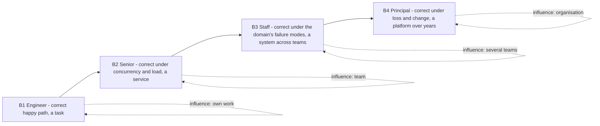
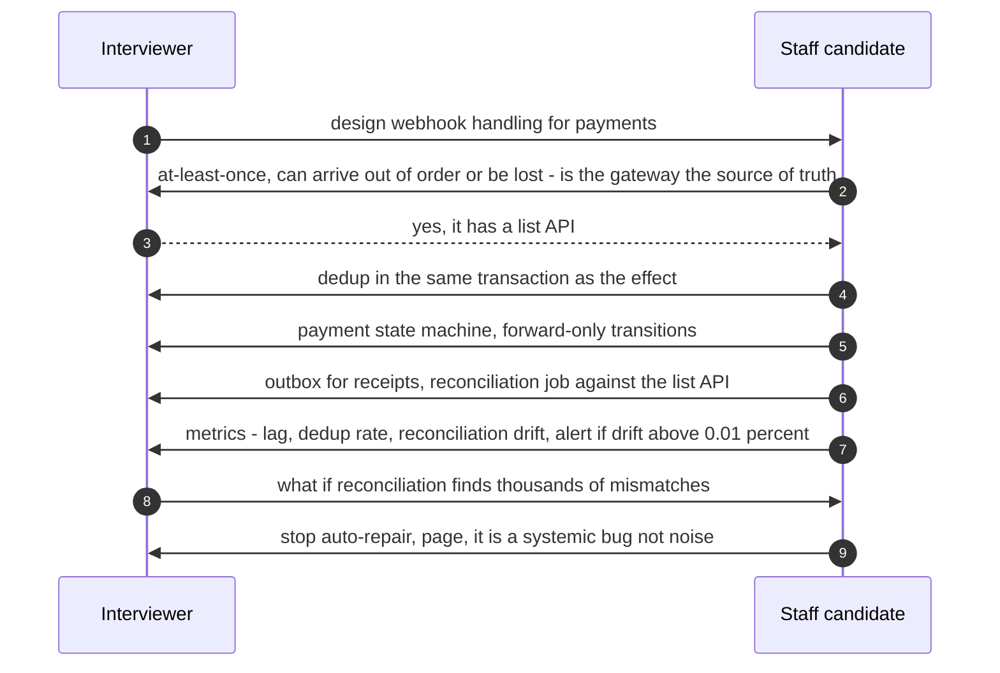
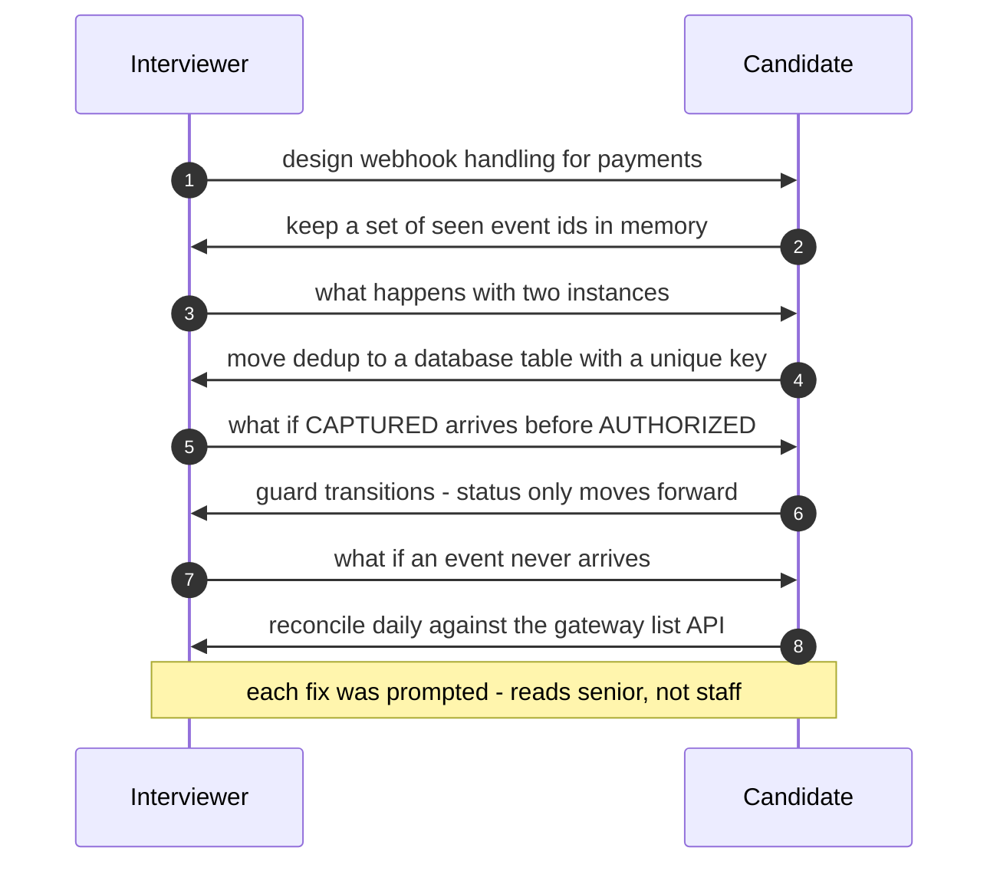
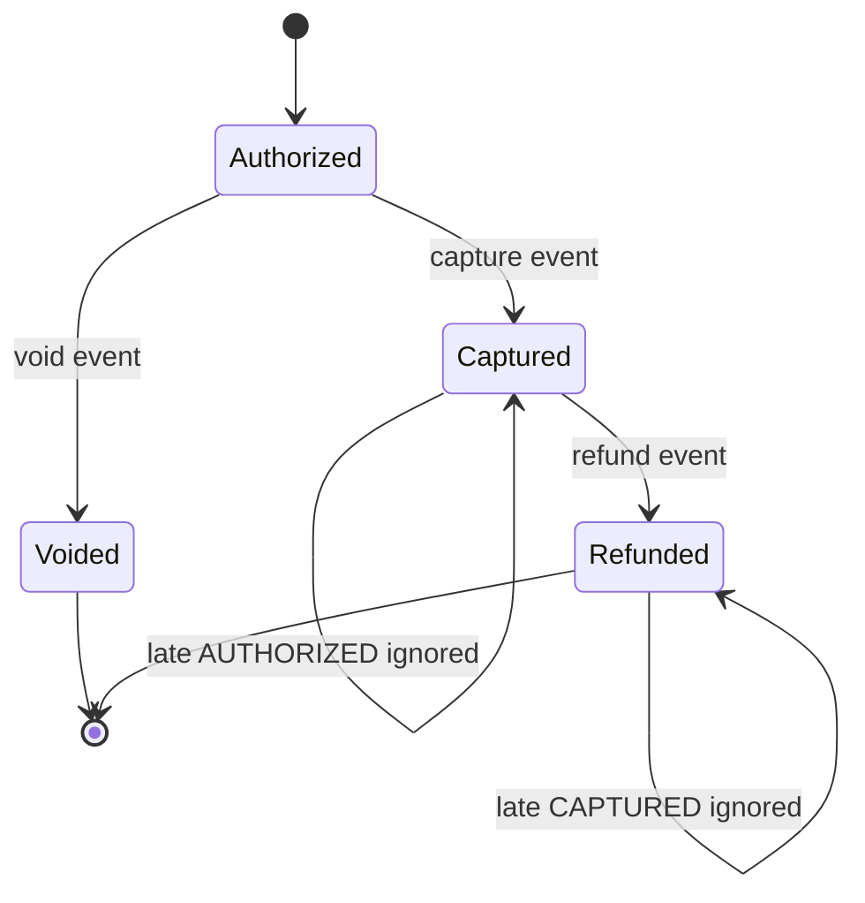

# 58. Level Expectations: From Engineer to Principal

!!! abstract "Chapter at a glance"
    **Reader bands:** B1 → B4 · **Prerequisites:** [Ch 57](57-the-system-design-interview-framework.md) (the interview framework)

    **What you will learn:** what interviewers and promotion committees expect at each level, in behaviour rather than job titles. The four levels map to this handbook's bands:

    | Band | Role | Typical experience |
    |---|---|---|
    | B1 | Engineer | 0–3 years |
    | B2 | Senior engineer | 3–7 years |
    | B3 | Staff / lead | 7–12 years |
    | B4 | Principal / architect | 12+ years |

    Titles vary by company (VERIFY each company's ladder). The behaviours are remarkably consistent.

    **The one lab** answers a single question, "handle the payment gateway's webhooks", at all four levels, against real PostgreSQL. 5,000 payments with 13,475 deliveries, including duplicates, reordering, 178 lost events, two nodes and a restart:

    | Level | What it adds | Effects applied twice | Status went backwards | Final status wrong | Money effects missing |
    |---|---|---|---|---|---|
    | B1 | In-memory dedup | 830 | 747 | 755 | 104 |
    | B2 | Database dedup in the same transaction | **0** | 747 | 755 | 104 |
    | B3 | + the domain's forward-only state machine | 0 | **0** | 82 | 82 |
    | B4 | + reconciliation with the gateway | 0 | 0 | **0** | **0** |

    Each level is *correct under one more kind of reality*.

    · **Reading time:** 70 min + code

---

## 1. Introduction & Why It Matters

### 1.1 A story: the promotion packet that said "senior" for the third year

Priya had fifteen years of experience and a strong track record. Her staff-promotion packet listed the systems she built: the payment integration, the search migration, the notification platform. The committee's feedback was the same for the third year: "Excellent senior engineer. Staff impact not demonstrated."

Her manager eventually translated it:

- Her packet described *what she built*.
- A staff packet describes *which problems she found that nobody had assigned*, *which decisions she drove across teams*, *what she chose not to build*, and *how the organisation's systems got better because of her* (standards, reviews, mentoring, incident follow-through).

The same distinction appears in interviews. A senior candidate designs the system correctly. A staff candidate reframes the problem, argues the trade-offs, anticipates the failure modes that the organisation will actually hit, and makes the design operable and evolvable.

Level is not years, and it is not how many technologies you can name. It is **the scope and ambiguity you can handle, and the kinds of failure you design for without being asked**.

!!! quote "The thesis of this chapter"
    Levels differ less in *what* you know than in **what you anticipate** and **how far your influence reaches**:

    - B1 makes it work.
    - B2 makes it work under concurrency and load.
    - B3 makes it correct under the domain's real failure modes, and owns the trade-offs.
    - B4 makes it correct under loss and change, across teams and years: reconciliation, evolution, operability, organisation.

    The lab shows the ladder on one problem.

### 1.2 The levels in one table

| Dimension | B1 Engineer | B2 Senior | B3 Staff | B4 Principal |
|---|---|---|---|---|
| **Scope** | A task or feature | A service or feature end to end | A system or domain across teams | Multiple domains, platform, company direction |
| **Ambiguity** | Clear specs | Some ambiguity, asks good questions | Defines the problem; finds unassigned problems | Sets direction where none exists |
| **Design depth** | Correct happy path | Concurrency, scale, API/data design | Domain failure modes, consistency, trade-offs argued | Loss, evolution, economics, organisational fit |
| **Failure thinking** | Handles errors | Retries, timeouts, idempotency | State machines, sagas, degradation, SLOs | Reconciliation, blast radius, DR, correlated failure |
| **Operability** | Logs | Metrics, alerts | SLOs, runbooks, on-call quality | Reliability strategy, cost per unit, platform standards |
| **Influence** | Own work | Own team, code reviews | Several teams, design reviews, mentoring seniors | Org-wide standards, strategy, hiring bar |
| **Time horizon** | Days–weeks | Weeks–quarter | Quarters–year | Years |
| **In an interview** | Solves the prompt with guidance | Solves it independently, one good deep dive | Drives it, trade-offs with flip conditions, failures first-class | Reframes it, phases it, ties it to cost, org and evolution |

### 1.3 Learning objectives

By the end you will be able to:

- **Describe each level's expectations** in observable behaviours.
- **Calibrate your own answers** to the level you're interviewing for (the lab).
- **Recognise down-levelling signals** and fix them.
- **Build evidence** of staff/principal impact for interviews and promotions.

---

## 2. Core Concepts — Beginner to Deep

### 2.1 Intuition: four drivers on the same road <span class="band b1">B1</span>

- A learner drives safely on a clear road.
- An experienced driver handles traffic and bad weather.
- A professional driver knows the route's hazards (the blind curve, the flooding underpass) and plans around them.
- A fleet manager ensures a hundred drivers are safe for years: routes, maintenance, training, incident reviews, cost.

Same road, different scope of what they anticipate and own.

### 2.2 B1: Engineer <span class="band b1">B1</span>

- **Expectation**: implements well-defined components correctly, with tests, and asks for help appropriately.
- **In a design interview** (rare at this level): produces a reasonable single-service design, knows basic storage and caching, and handles the happy path.
- **In the lab**: an in-memory dedup set works in a demo, and silently double-credits once there are two nodes or a restart.
- **Growth edge**: think about what happens when there are two of everything, and when things restart.

### 2.3 B2: Senior engineer ⭐ <span class="band b2">B2</span>

- **Expectation**: owns a service or feature end to end, independently. It is correct under concurrency and load, well designed at the API and data level, and tested and monitored.
- **In a design interview**:
    - clarifies requirements;
    - estimates;
    - gives a clean API and data model;
    - produces a coherent high-level design;
    - delivers one solid deep dive with atomic operations and idempotency;
    - names trade-offs.
- **In the lab**: dedup in the database, in the same transaction as the effect, makes duplicates harmless. It still trusts arrival order and delivery.
- **Growth edge**: model the domain's state machine and its real-world failure modes, and own decisions beyond your service.

### 2.4 B3: Staff engineer ⭐ <span class="band b3">B3</span>

- **Expectation**: owns a system or domain across teams. Defines problems as well as solving them. Makes and documents the decisions others build on (ADRs, design docs). Raises the bar for other seniors.
- **In a design interview**:
    - drives the whole session;
    - chooses the deep dive where the risk is;
    - argues trade-offs with flip conditions;
    - treats failure handling (state machines, sagas, degradation, SLOs) as part of the design;
    - discusses operability and cost unprompted.
- **In the lab**: encodes the domain rule that a payment's status only moves forward, so reordered events can't corrupt it. Side effects go to an outbox. The remaining gap is loss.
- **Growth edge**: assume every channel lies eventually, and design the correction loop. Think in years and organisations.

### 2.5 B4: Principal / architect ⭐ <span class="band b4">B4</span>

- **Expectation**: sets technical direction across domains. Designs for loss, change and scale over years. Aligns architecture with organisation and economics. Shapes standards, the hiring bar and culture.
- **In a design interview**:
    - reframes the prompt (what's the business goal? what's the smallest thing that works?);
    - phases the design (now, next year, at 10×);
    - designs the correction loops (reconciliation, audits);
    - quantifies reliability and cost;
    - addresses migration and team structure;
    - knows what not to build.
- **In the lab**: accepts that at-least-once channels can still lose messages, and closes the loop with reconciliation against the source of truth. Every invariant reaches zero.
- **Growth edge**: none that is technical. It is judgement, communication, and multiplying others.

### 2.6 The same prompt at four levels ⭐ <span class="band b3">B3</span>

| Prompt | B1 | B2 | B3 | B4 |
|---|---|---|---|---|
| **URL shortener** | Hash → DB row | ID generation, cache, 301 vs 302 | Hot keys, abuse, analytics pipeline, custom domains | Multi-region, cost per redirect, abuse economics, product phasing |
| **Rate limiter** | Counter in memory | Token bucket in Redis, atomic Lua | Distributed accuracy vs cost, fail-open/closed per route, tenant fairness | Platform policy, SLO impact, abuse strategy, org-wide adoption |
| **Checkout** | Insert order, decrement stock | Conditional update, idempotency keys | Saga with unknown outcomes, hot SKUs, degradation | Reconciliation, cells, SLO composition, sale-day strategy |
| **Chat** | WebSocket + DB | Fan-out, ordering per conversation | Presence, offline delivery, exactly-once display, moderation | Multi-region, privacy/compliance, cost of fan-out, product evolution |
| **Feed** | Query on read | Fan-out on write vs read | Ranking pipeline, freshness, celebrity problem | Experimentation platform, ML infra, cost per impression |

Every column to the right *includes* the one to its left. Senior answers aren't wrong at staff level; they're incomplete.

### 2.7 Down-levelling signals <span class="band b3">B3</span>

| Signal | Reads as | Fix |
|---|---|---|
| Waits for the interviewer to drive | B1/B2 | Propose the plan and the deep dive |
| Components without numbers | B2 | Estimate, and let the numbers choose |
| "We'll add retries" | B2 | Idempotency, unknown outcomes, sagas |
| No state machine for stateful entities | B2 | Draw the states and allowed transitions |
| Trade-offs stated as preferences | B2 | Requirement → choice → cost → flip condition |
| Failure handling only when asked | B2/B3 | A failure table before the interviewer asks |
| No operability or cost | B3 | SLOs, dashboards, unit cost |
| Over-engineering for stated scale | Any | Phase it: now vs at 10× |
| Past-system storytelling without the prompt | Any | Design what was asked |

### 2.8 Evidence for staff/principal <span class="band b4">B4</span>

Interviews and promotion committees look for **evidence of scope**, told as situation → your judgement → others' actions → measurable outcome:

- **Problems you found**: "Nobody owned reconciliation. I discovered a 0.3% silent drift and drove the fix across three teams."
- **Decisions you drove**: "I wrote the ADR choosing the outbox over dual writes, and it became the standard for 20 services."
- **What you stopped**: "I argued against a rewrite, and proposed a strangler migration that finished in two quarters."
- **Multiplication**: design reviews, a mentoring programme, guardrails in CI, paved roads.
- **Outcomes with numbers**: incidents down, latency p99 down, cost per order down, lead time down.

[Ch 61](61-behavioral-and-leadership.md) turns these into interview stories.

### 2.9 Calibrating your preparation <span class="band b2">B2</span>

| Target | Prioritise |
|---|---|
| B2 (senior) | Foundations (Ch 02–09), core distributed systems (Ch 10–20), 8–10 case studies, timed practice |
| B3 (staff) | Plus production (Ch 21–30), decisions and docs (Ch 31–32), failure-first deep dives, trade-off drills (Ch 57 L2) |
| B4 (principal) | Plus architecture leadership (Ch 33–37), the capstone (Ch 56), evolution and economics narratives, past-system deep dives |

### 2.10 Levels differ by company <span class="band b4">B4</span>

- Titles don't map one-to-one across companies (a "senior" at one can be "staff" at another). Ask the recruiter for the ladder and the expectations for the loop (VERIFY per company).
- Some loops weight coding more at senior and design more at staff. Principal loops often add a past-system deep dive and a written exercise.
- Down-levelling offers are common. Understand the rubric gap they cite, and use this chapter's table to close it.

---

## 3. Architecture & Diagrams

### 3.1 The level ladder as expanding scope



### 3.2 Sequence: a staff-level exchange



### 3.3 Sequence: down-levelled answer and the recovery



### 3.4 State: the payment's forward-only lifecycle



---

## 4. Design Document Excerpt: Level Rubric

!!! note "Design Document (excerpt) — Engineering Level Rubric for System Design (illustrative)"
    **Status:** Illustrative template · **Use:** calibrating interview feedback and promotion packets. Adapt it to your company's ladder (VERIFY).

    | Field | Value |
    |---|---|
    | Context | Interviewers disagreed on levels. Feedback said "strong" without evidence. Packets listed projects, not impact. |
    | Decision | Score eight dimensions on observable behaviour. Each level has anchor examples. Level = the lowest level that all "must-have" dimensions meet. |
    | Related | Ch 57 L4 rubric; Ch 61 story format; the level table in §1.2. |

    **Requirements.**

    - **R1:** Every score cites evidence (a quote, a board artefact, a decision).
    - **R2:** Levels are consistent across interviewers (calibration sessions quarterly).
    - **R3:** Down-level decisions name the missing dimension.
    - **R4:** Promotion packets map evidence to dimensions.
    - **R5:** The rubric is published to candidates at a high level.

    **Decisions in detail.**

    1. **Must-haves for B3:** drives ambiguity; failure handling unprompted; trade-offs with flip conditions.
    2. **Must-haves for B4:** also phasing/evolution, economics, organisational impact.
    3. **Anchors:** the §2.6 table serves as calibration examples.

    **Consequences.** Longer feedback writing, in return for fairer, more consistent levelling.

---

## 5. Hands-On Code — Level Ladder

!!! info "What's real here"
    - One program implements all four levels against a **real PostgreSQL**: real transactions, unique constraints, guarded updates and an outbox.
    - It uses two concurrent consumer threads, one of which "restarts" by losing its memory.
    - The gateway's truth, the duplicates, the reordering and the losses are generated with a fixed seed.
    - The duplicate count for B1 varies slightly between runs, because thread interleaving differs.

The program:

```java title="WebhookLevelsL.java"
// WebhookLevelsL.java — run with (PostgreSQL on :5581, db shop):
//   java -Duser.timezone=UTC -cp /tmp/eslab/postgresql-42.7.4.jar WebhookLevelsL.java   (JDK 21)
// ONE QUESTION, FOUR LEVELS OF ANSWER: "Handle the payment gateway's webhooks." 5,000 payments; the gateway sends
// status events (AUTHORIZED → CAPTURED, 20% later REFUNDED) at least once: 25% are duplicated, 15% arrive out of order
// (a later status before an earlier one), and 2% are never delivered at all. Two consumer nodes process concurrently;
// node 1 restarts halfway. Each accepted "CAPTURED" triggers a side effect (credit the order + send a receipt), each
// "REFUNDED" a reverse effect. Four implementations, each the natural answer at one level (REAL PostgreSQL):
//   B1 in-memory "seen" set per node; apply the event's status to the payment row
//   B2 dedup in the database: INSERT event_id (primary key) in the SAME transaction as the effect
//   B3 B2 + ordering: a status only moves forward along AUTHORIZED < CAPTURED < REFUNDED (guarded UPDATE); effects
//      go to an outbox in the same transaction
//   B4 B3 + reconciliation: after the stream, compare with the gateway's "list payments" API and repair drift
// Measured against the gateway's truth: receipts/credits applied twice, payments whose stored status went BACKWARDS,
// payments whose final status is wrong, and money effects missing.
import java.sql.*;
import java.util.*;
import java.util.concurrent.*;
import java.util.concurrent.atomic.*;

public class WebhookLevelsL {
    static final String URL = "jdbc:postgresql://localhost:5581/shop?user=claude";
    static final String[] ST = {"AUTHORIZED", "CAPTURED", "REFUNDED"};
    record Ev(String id, int payment, int status) {}

    public static void main(String[] args) throws Exception {
        Random r = new Random(58); int P = 5000; int[] truth = new int[P]; List<Ev> stream = new ArrayList<>(); Set<String> lost = new HashSet<>();
        for (int p = 0; p < P; p++) { int last = r.nextDouble() < 0.2 ? 2 : 1; truth[p] = last; List<Ev> evs = new ArrayList<>();
            for (int s = 0; s <= last; s++) evs.add(new Ev("evt-" + p + "-" + s, p, s));
            if (r.nextDouble() < 0.15 && evs.size() > 1) { int i = r.nextInt(evs.size() - 1); Collections.swap(evs, i, i + 1); }      // out of order
            for (Ev e : evs) { if (r.nextDouble() < 0.02) { lost.add(e.id()); continue; } stream.add(e); if (r.nextDouble() < 0.25) stream.add(e); } }   // lost / duplicated
        // interleave per payment roughly in time, preserve per-payment order of the list above
        List<Ev> ordered = new ArrayList<>(); Map<Integer, Deque<Ev>> per = new HashMap<>(); for (Ev e : stream) per.computeIfAbsent(e.payment(), k -> new ArrayDeque<>()).add(e);
        List<Integer> keys = new ArrayList<>(per.keySet()); while (!keys.isEmpty()) { int k = r.nextInt(keys.size()); Ev e = per.get(keys.get(k)).poll(); ordered.add(e); if (per.get(keys.get(k)).isEmpty()) { keys.set(k, keys.get(keys.size() - 1)); keys.remove(keys.size() - 1); } }
        System.out.printf("5,000 payments, %,d webhook deliveries (25%% duplicated, 15%% of payments out of order, %d events never delivered); 2 nodes, one restart.%n%n", ordered.size(), lost.size());
        System.out.printf("   %-58s %14s %16s %14s %14s%n", "answer", "effects applied", "status went", "final status", "money effects");
        System.out.printf("   %-58s %14s %16s %14s %14s%n", "", "twice", "backwards", "wrong", "missing");
        String[] names = {"B1) in-memory seen-set per node, apply status", "B2) dedup by event id in the same DB transaction", "B3) B2 + forward-only status + outbox", "B4) B3 + reconciliation with the gateway's list API"};
        for (int lvl = 1; lvl <= 4; lvl++) run(lvl, names[lvl - 1], ordered, truth);
        System.out.println("\n   → every answer 'handles webhooks'; they differ in which failure modes they have thought about. B1 works in a demo");
        System.out.println("     and double-credits in production (two nodes, restarts). B2 makes duplicates harmless but trusts arrival order.");
        System.out.println("     B3 encodes the domain's state machine, so late events can't move a payment backwards. B4 accepts that an");
        System.out.println("     at-least-once channel can still lose messages and closes the loop with reconciliation. That progression —");
        System.out.println("     correct once, correct under concurrency, correct under reordering, correct under loss — is what the levels mean.");
    }

    static void run(int lvl, String name, List<Ev> events, int[] truth) throws Exception {
        try (Connection c = DriverManager.getConnection(URL); Statement s = c.createStatement()) {
            s.execute("DROP TABLE IF EXISTS pay, processed_event, effect, outbox");
            s.execute("CREATE TABLE pay (id int PRIMARY KEY, status int NOT NULL DEFAULT -1, regressions int NOT NULL DEFAULT 0)");
            s.execute("CREATE TABLE processed_event (event_id text PRIMARY KEY)");
            s.execute("CREATE TABLE effect (id bigserial PRIMARY KEY, payment int, kind text)");
            s.execute("CREATE TABLE outbox (id bigserial PRIMARY KEY, payment int, kind text)");
            s.execute("INSERT INTO pay (id) SELECT g FROM generate_series(0," + (truth.length - 1) + ") g");
        }
        AtomicInteger next = new AtomicInteger(); int half = events.size() / 2;
        ExecutorService ex = Executors.newFixedThreadPool(2); List<Future<?>> fs = new ArrayList<>();
        for (int node = 0; node < 2; node++) { final int nd = node; fs.add(ex.submit(() -> {
            Set<String> seen = new HashSet<>(); boolean restarted = false;
            try (Connection c = DriverManager.getConnection(URL)) { c.setAutoCommit(false); int i;
                while ((i = next.getAndIncrement()) < events.size()) {
                    if (nd == 1 && !restarted && i > half) { seen.clear(); restarted = true; }        // node 1 restarts: memory gone
                    Ev e = events.get(i);
                    if (lvl == 1) { if (!seen.add(e.id())) continue; apply(c, lvl, e); c.commit(); continue; }
                    try (PreparedStatement p = c.prepareStatement("INSERT INTO processed_event VALUES (?) ON CONFLICT DO NOTHING")) { p.setString(1, e.id()); if (p.executeUpdate() == 0) { c.rollback(); continue; } }
                    apply(c, lvl, e); c.commit();
                }
            }
            return null; })); }
        for (Future<?> f : fs) f.get(); ex.shutdown();
        if (lvl == 4) try (Connection c = DriverManager.getConnection(URL)) {                        // reconciliation: gateway list API = truth
            c.setAutoCommit(false);
            for (int p = 0; p < truth.length; p++) { int cur; try (Statement s = c.createStatement(); ResultSet rs = s.executeQuery("SELECT status FROM pay WHERE id = " + p)) { rs.next(); cur = rs.getInt(1); }
                for (int st = cur + 1; st <= truth[p]; st++) apply(c, 3, new Ev("recon-" + p + "-" + st, p, st)); }
            c.commit();
        }
        long twice, back, wrong, missing;
        try (Connection c = DriverManager.getConnection(URL); Statement s = c.createStatement()) {
            String tbl = lvl >= 3 ? "outbox" : "effect";
            twice = one(s, "SELECT count(*) FROM (SELECT payment, kind FROM " + tbl + " GROUP BY 1,2 HAVING count(*) > 1) x");
            back = one(s, "SELECT count(*) FROM pay WHERE regressions > 0");
            StringBuilder vals = new StringBuilder(); for (int p = 0; p < truth.length; p++) vals.append(p == 0 ? "" : ",").append("(").append(p).append(",").append(truth[p]).append(")");
            wrong = one(s, "SELECT count(*) FROM pay JOIN (VALUES " + vals + ") t(id, st) USING (id) WHERE pay.status <> t.st");
            long expected = 0; for (int t : truth) expected += t >= 1 ? (t == 2 ? 2 : 1) : 0;
            missing = expected - one(s, "SELECT count(*) FROM (SELECT DISTINCT payment, kind FROM " + tbl + ") x");
        }
        System.out.printf("   %-58s %,14d %,16d %,14d %,14d%n", name, twice, back, wrong, missing);
    }
    static long one(Statement s, String q) throws SQLException { try (ResultSet rs = s.executeQuery(q)) { rs.next(); return rs.getLong(1); } }

    static void apply(Connection c, int lvl, Ev e) throws SQLException {
        String effTable = lvl >= 3 ? "outbox" : "effect";
        if (lvl >= 3) {                                                                                // forward-only transition
            try (PreparedStatement p = c.prepareStatement("UPDATE pay SET status = ? WHERE id = ? AND status < ?")) { p.setInt(1, e.status()); p.setInt(2, e.payment()); p.setInt(3, e.status()); if (p.executeUpdate() == 0) return; }
        } else {
            int cur; try (PreparedStatement p = c.prepareStatement("SELECT status FROM pay WHERE id = ? FOR UPDATE")) { p.setInt(1, e.payment()); try (ResultSet rs = p.executeQuery()) { rs.next(); cur = rs.getInt(1); } }
            try (PreparedStatement p = c.prepareStatement("UPDATE pay SET status = ?, regressions = regressions + ? WHERE id = ?")) { p.setInt(1, e.status()); p.setInt(2, e.status() < cur ? 1 : 0); p.setInt(3, e.payment()); p.executeUpdate(); }
        }
        if (e.status() >= 1) try (PreparedStatement p = c.prepareStatement("INSERT INTO " + effTable + " (payment, kind) VALUES (?, ?)")) { p.setInt(1, e.payment()); p.setString(2, e.status() == 1 ? "CREDIT+RECEIPT" : "REFUND"); p.executeUpdate(); }
        if (lvl >= 3 && e.status() == 2) {                                                             // refund after a skipped capture: capture effect also owed
            try (PreparedStatement p = c.prepareStatement("INSERT INTO outbox (payment, kind) SELECT ?, 'CREDIT+RECEIPT' WHERE NOT EXISTS (SELECT 1 FROM outbox WHERE payment = ? AND kind = 'CREDIT+RECEIPT')")) { p.setInt(1, e.payment()); p.setInt(2, e.payment()); p.executeUpdate(); }
        }
    }
}
```

```text title="java -Duser.timezone=UTC -cp postgresql-42.7.4.jar WebhookLevelsL.java"
5,000 payments, 13,475 webhook deliveries (25% duplicated, 15% of payments out of order, 178 events never delivered); 2 nodes, one restart.

   answer                                                     effects applied      status went   final status  money effects
                                                                       twice        backwards          wrong        missing
   B1) in-memory seen-set per node, apply status                         830              747            755            104
   B2) dedup by event id in the same DB transaction                        0              747            755            104
   B3) B2 + forward-only status + outbox                                   0                0             82             82
   B4) B3 + reconciliation with the gateway's list API                     0                0              0              0

   → every answer 'handles webhooks'; they differ in which failure modes they have thought about. B1 works in a demo
     and double-credits in production (two nodes, restarts). B2 makes duplicates harmless but trusts arrival order.
     B3 encodes the domain's state machine, so late events can't move a payment backwards. B4 accepts that an
     at-least-once channel can still lose messages and closes the loop with reconciliation. That progression —
     correct once, correct under concurrency, correct under reordering, correct under loss — is what the levels mean.
```

### L1 — The B1 answer: in-memory dedup <span class="band b1">B1</span>

**Requirement:** "Don't process a webhook twice."

**Reading it:**

- **It works on one node until it restarts.** With two nodes, and one restarting, 830 effects were applied twice.
- **It also overwrites status in arrival order**, so 747 payments moved backwards at some point.
- **The 2% lost events** leave 104 money effects missing.

### L2 — The B2 answer: dedup in the same transaction <span class="band b2">B2</span>

**Requirement:** "Duplicates must be harmless across nodes and restarts."

**Reading it:**

- **The event-id primary key**, inserted in the same transaction as the effect, makes every duplicate a no-op: **0 double effects**.
- **Ordering and loss are untouched.** The status still goes backwards, and final statuses are still wrong for 755 payments.

### L3 — The B3 answer: the domain's state machine <span class="band b3">B3</span>

**Requirement:** "A late event must never move a payment backwards."

**Reading it:**

- **The guarded UPDATE** (`WHERE status < new`) encodes AUTHORIZED < CAPTURED < REFUNDED: 0 regressions.
- **Effects go to an outbox** in the same transaction.
- **A refund implies the capture happened**, so its credit is owed. The domain knowledge recovers some losses.
- **82 payments remain wrong.** Their final event never arrived.

### L4 — The B4 answer: reconciliation <span class="band b4">B4</span>

**Requirement:** "Our records must match the gateway's, even when messages are lost."

**Reading it:**

- **Comparing against the gateway's list API** and repairing through the same forward-only path brings every invariant to 0.
- **In production**, add metrics on drift. A sudden jump in drift is a systemic bug, not noise, so page and stop auto-repair ([Ch 45](../05-case-studies/45-payment-system.md)).

---

## 6. Interview and Career Concerns

### 6.1 Failure modes

| Failure | Symptom | Fix |
|---|---|---|
| Answering at the wrong level | Down-levelled offer | Match §1.2 behaviours to the target |
| Depth without breadth | "Narrow" | Operability, cost, evolution |
| Breadth without depth | "Hand-wavy" | One code-level deep dive |
| Prompted fixes only | "Needed guidance" | Anticipate failure modes (§3.3) |
| Project lists | "Impact unclear" | Evidence format (§2.8) |

### 6.2 Signals interviewers write down

- "Asked about ordering before I did." (B3)
- "Proposed reconciliation unprompted." (B4)
- "Needed hints to handle duplicates." (B1/B2)
- "Great design, but no discussion of operations or cost." (B2/B3 boundary)

### 6.3 Ethics and honesty

- Describe your real role: "I led", "I contributed", "the team did". Inflation is detectable and disqualifying.
- It's fine to say "I haven't operated X, but here's how I'd reason about it."

### 6.4 Pacing by level

- **B2**: most time in the deep dive, briefly on failures.
- **B3/B4**: a shorter high-level design, with more on failures, trade-offs, evolution and operations.

### 6.5 After a down-level

- Ask for the rubric gap. Map it to §2.7. Build evidence at work, then re-interview in 6–12 months.

---

## 7. Anti-Patterns & Pitfalls

!!! danger "1. Equating years with level"
    Scope and anticipation decide it.

!!! danger "2. Naming technologies as depth"
    Depth is failure modes and invariants.

!!! danger "3. Solving only the happy path"
    That's B1 (lab row 1).

!!! danger "4. Dedup in memory"
    Two nodes and a restart break it (L1).

!!! danger "5. Trusting message order"
    Regressions (L2).

!!! danger "6. Trusting delivery"
    Loss (L3 → L4).

!!! danger "7. Waiting for the interviewer to find the holes"
    That's senior at best (§3.3).

!!! danger "8. Staff answers without operability"
    Incomplete.

!!! danger "9. Principal answers without phasing"
    Unrealistic.

!!! danger "10. Promotion packets as project lists"
    No evidence of scope.

!!! danger "11. Inflating your role"
    Integrity risk.

!!! danger "12. Assuming ladders are identical across companies"
    Calibrate per loop.

---

## 8. Interview Q&A

### Beginner <span class="band b1">B1</span>

??? question "Q1 [B1] ⭐ What's expected of a junior engineer in system design?"

    **30-second answer:** A reasonable single-service design that works on the happy path, basic knowledge of databases, caching and APIs, clear communication, and willingness to take hints; growing toward concurrency and failure thinking.

    **Deep answer:** §2.2.

    **Trade-offs I'd call out:** Breadth vs depth at the start of a career.

    **Follow-ups:**
    1. How to grow? → Ask "what if there are two of these?"
    2. Best habit? → Write down requirements.

    **Red flags:** Buzzwords without basics.

??? question "Q2 [B1] What's the single biggest jump from junior to senior?"

    **30-second answer:** Designing for concurrency and repetition — two instances, retries, restarts — with atomic operations and idempotency, instead of assuming one clean run.

    **Deep answer:** The lab's B1 → B2 row: 830 double effects → 0.

    **Trade-offs I'd call out:** Complexity vs correctness.

    **Follow-ups:**
    1. Where to learn? → Ch 13, 20.
    2. Example? → Unique constraint in the same transaction.

    **Red flags:** In-memory dedup.

??? question "Q3 [B1] How do levels differ in how they ask questions?"

    **30-second answer:** Juniors ask clarifying questions about the spec; seniors ask about scale and constraints; staff ask about failure modes and hidden requirements; principals ask about the business goal and whether to build at all.

    **Deep answer:** §1.2.

    **Trade-offs I'd call out:** None.

    **Follow-ups:**
    1. Example staff question? → "Can events be lost?"
    2. Principal? → "What's the smallest version that proves value?"

    **Red flags:** No questions.

??? question "Q4 [B1] Does a senior need to know every technology?"

    **30-second answer:** No — they need to know categories, trade-offs and failure modes deeply enough to choose and justify, and to learn specifics quickly.

    **Deep answer:** §2.3.

    **Trade-offs I'd call out:** Depth in a few vs shallow in many.

    **Follow-ups:**
    1. What must be deep? → Databases, concurrency, messaging.
    2. Unknown tech in interview? → Reason from principles.

    **Red flags:** Name-dropping.

### Intermediate <span class="band b2">B2</span>

??? question "Q5 [B2] ⭐ What makes an answer senior-level?"

    **30-second answer:** Independent, complete, correct under concurrency and load: requirements and numbers, clean API/data model, coherent design, one deep dive with atomic operations and idempotency, trade-offs named, basic failure handling.

    **Deep answer:** §2.3; Ch 57 L4 transcript B.

    **Trade-offs I'd call out:** Time allocation.

    **Follow-ups:**
    1. Most common gap? → Operability.
    2. Deep dive choice? → Where money/scarcity is.

    **Red flags:** Needing the interviewer to drive.

??? question "Q6 [B2] How do you demonstrate ownership in a design interview?"

    **30-second answer:** Drive the agenda, propose the deep dive, state assumptions, commit to decisions, and talk about how you'd operate and evolve the system — as if you'll be on call for it.

    **Deep answer:** §2.4.

    **Trade-offs I'd call out:** Driving vs listening.

    **Follow-ups:**
    1. Interviewer redirects? → Follow.
    2. On-call mention? → Alerts, runbooks.

    **Red flags:** "It depends" without deciding.

??? question "Q7 [B2] What are common down-levelling signals?"

    **30-second answer:** Waiting to be driven, no numbers, "we'll add retries", no state machines, preferences instead of trade-offs, failures only when asked, no operability/cost, over-engineering.

    **Deep answer:** §2.7.

    **Trade-offs I'd call out:** None.

    **Follow-ups:**
    1. Fastest fix? → Failure table unprompted.
    2. Practice? → Mocks with rubric.

    **Red flags:** Unaware of these.

??? question "Q8 [B2] How does failure thinking change with level?"

    **30-second answer:** B1 handles errors; B2 adds retries, timeouts, idempotency; B3 models domain failure modes (reordering, sagas, degradation, SLOs); B4 designs correction loops for loss and drift (reconciliation, audits) and bounds blast radius.

    **Deep answer:** The lab, row by row.

    **Trade-offs I'd call out:** Cost of each loop.

    **Follow-ups:**
    1. Example of B4 loop? → Daily reconciliation.
    2. Blast radius? → Cells.

    **Red flags:** Only retries.

??? question "Q9 [B2] How do you prepare differently for senior vs staff loops?"

    **30-second answer:** Senior: breadth of core patterns and case studies, timed practice. Staff: add failure-first deep dives, trade-off drills with flip conditions, operability/cost narratives, and past-system stories showing cross-team impact.

    **Deep answer:** §2.9.

    **Trade-offs I'd call out:** Study time.

    **Follow-ups:**
    1. Principal? → Evolution and economics.
    2. Behavioural? → Ch 61.

    **Red flags:** Same preparation for both.

### Senior <span class="band b3">B3</span>

??? question "Q10 [B3] ⭐ What distinguishes staff from senior in a design interview?"

    **30-second answer:** Staff candidates find the real problem and its failure modes before being asked — ordering, loss, contention, degradation — argue trade-offs with flip conditions, and treat operability and cost as part of the design; seniors produce a correct design when the problem is defined.

    **Deep answer:** §2.4, §3.2 vs §3.3.

    **Trade-offs I'd call out:** Depth vs scope.

    **Follow-ups:**
    1. Evidence? → Unprompted failure table.
    2. Communication? → Structured, concise.

    **Red flags:** Only a bigger diagram.

??? question "Q11 [B3] How do you show cross-team influence in an interview?"

    **30-second answer:** In past-system discussions: problems you found, decisions you drove (ADRs), standards you set, people you mentored, outcomes with numbers — told as situation, your judgement, others' actions, results.

    **Deep answer:** §2.8.

    **Trade-offs I'd call out:** Credit vs honesty.

    **Follow-ups:**
    1. Conflict? → Ch 61.
    2. Failure story? → What you learned.

    **Red flags:** "We" for everything or "I" for everything.

??? question "Q12 [B3] How should a staff candidate handle a simple prompt?"

    **30-second answer:** Solve it cleanly and quickly, then show judgement: realistic failure modes, operability, evolution at 10×, and what you would not build — without over-engineering the base design.

    **Deep answer:** §2.6 table.

    **Trade-offs I'd call out:** Showing depth vs over-building.

    **Follow-ups:**
    1. URL shortener at staff? → Abuse, hot keys, analytics, cost.
    2. Time? → Keep base design short.

    **Red flags:** Twelve services for a shortener.

??? question "Q13 [B3] What is 'anticipation', and how do you practise it?"

    **30-second answer:** Naming the failure modes and requirements before they're raised. Practise with a checklist per component — duplicates, reordering, loss, contention, partial failure, overload, bad input, operator error — and apply it in every mock.

    **Deep answer:** Lab rows map to checklist items.

    **Trade-offs I'd call out:** Time budget.

    **Follow-ups:**
    1. Too many to cover? → Critical path first.
    2. Show it? → A failure table.

    **Red flags:** Reactive fixes only.

??? question "Q14 [B3] How do you present a design decision at staff level?"

    **30-second answer:** Context, options considered, the decision, its costs, the conditions that would change it, and how it will be validated — the ADR format, spoken.

    **Deep answer:** [Ch 31](../04-architect/31-architecture-decision-making.md), [Ch 57](57-the-system-design-interview-framework.md) L2.

    **Trade-offs I'd call out:** Brevity vs completeness.

    **Follow-ups:**
    1. Reversibility? → Say whether it's a one-way door.
    2. Evidence? → Numbers or experiments.

    **Red flags:** "Because it's best practice."

### Architect <span class="band b4">B4</span>

??? question "Q15 [B4] ⭐ What distinguishes principal from staff?"

    **30-second answer:** Horizon and scope: designing for years of change and loss (reconciliation, migrations, evolution), across domains and organisations, with economics and people in the design; reframing problems and choosing what not to build.

    **Deep answer:** §2.5.

    **Trade-offs I'd call out:** Abstraction vs concreteness — principals still go deep when needed.

    **Follow-ups:**
    1. Example reframe? → "Do we need real-time here?"
    2. Economics? → Cost per unit.

    **Red flags:** Only abstractions.

??? question "Q16 [B4] How does a principal approach an interview prompt differently?"

    **30-second answer:** Starts with the goal and constraints, proposes a phased plan (smallest valuable version, next, at scale), designs the correction and observability loops, quantifies SLOs and cost, and addresses migration and team structure — then dives deep where risk is highest.

    **Deep answer:** §2.6 table rightmost column.

    **Trade-offs I'd call out:** Time for depth.

    **Follow-ups:**
    1. Phasing example? → Monolith first.
    2. Deep dive still needed? → Yes.

    **Red flags:** Never going below boxes.

??? question "Q17 [B4] What evidence convinces a promotion committee of staff/principal impact?"

    **30-second answer:** Problems you identified unassigned, decisions others built on, standards adopted across teams, measurable organisational outcomes (incidents, latency, cost, lead time), and people you grew — with peer testimony.

    **Deep answer:** §2.8.

    **Trade-offs I'd call out:** Visibility vs work.

    **Follow-ups:**
    1. Quiet contributors? → Write design docs, ADRs.
    2. Metrics? → Before/after.

    **Red flags:** Lists of shipped features.

??? question "Q18 [B4] How should interview loops calibrate levels fairly?"

    **30-second answer:** Published rubrics with behavioural anchors, evidence-based feedback, calibration sessions, level decided by must-have dimensions, and structured debriefs that separate signal from impression.

    **Deep answer:** §4.

    **Trade-offs I'd call out:** Process overhead.

    **Follow-ups:**
    1. Bias? → Structured questions, diverse panels.
    2. Disagreement? → Evidence wins.

    **Red flags:** "Culture fit" as a level signal.

??? question "Q19 [B4] How do principals stay technically credible?"

    **30-second answer:** They still read code and designs, go deep on the riskiest parts, prototype, participate in incidents, and measure outcomes — breadth built on regular depth.

    **Deep answer:** [Ch 37](../04-architect/37-leading-architecture-at-scale.md).

    **Trade-offs I'd call out:** Time across many teams.

    **Follow-ups:**
    1. Hands-on time? → A deliberate slice.
    2. Signals? → Accurate intuition.

    **Red flags:** Architecture astronaut.

??? question "Q20 [B4] If you're down-levelled, what should you do?"

    **30-second answer:** Ask for the rubric gap, map it to behaviours (§2.7), build evidence at work (lead a cross-team design, drive a reliability loop), practise the missing signals in mocks, and re-interview after 6–12 months.

    **Deep answer:** §6.5.

    **Trade-offs I'd call out:** Accept offer vs wait.

    **Follow-ups:**
    1. Negotiation? → Level vs compensation.
    2. Internal promotion? → Evidence packet.

    **Red flags:** Blaming the interviewer.

---

## 9. Summary & Practice

### Key takeaways

1. **Levels are scope and anticipation**, not years.
2. **B1** works; **B2** works under concurrency; **B3** works under domain failure modes; **B4** works under loss and change (the lab).
3. **Down-levelling signals** are behavioural and fixable (§2.7).
4. **Staff/principal evidence** is problems found, decisions driven, standards set and outcomes measured.
5. **Calibrate preparation** to the target level.

### Cheat sheet

| Level | Must show in a design interview |
|---|---|
| B1 | Clean happy-path design, basics |
| B2 | Requirements, numbers, API/data, a deep dive with atomicity and idempotency |
| B3 | Unprompted failure modes, state machines, trade-offs with flip conditions, SLOs, operability |
| B4 | Reframing, phasing, reconciliation and correction loops, economics, organisation |

### Exercises

1. **(B1)** Add a third consumer node to the lab. How do B1's duplicates change?
2. **(B2)** Implement a "VOIDED" status in the lab's state machine.
3. **(B3)** Add metrics to the B3 answer: dedup rate, regressions prevented, outbox lag.
4. **(B4)** Design an alert for reconciliation drift, and decide what should pause auto-repair.
5. **(B4)** Rewrite one of your project descriptions in the §2.8 evidence format.

### Further reading

- Will Larson, *Staff Engineer: Leadership beyond the management track*.
- Tanya Reilly, *The Staff Engineer's Path*.
- Camille Fournier, *The Manager's Path* (for the IC/manager boundary).
- Company engineering ladders published online (e.g. several public ladders; VERIFY current versions).

### Related chapters

- [Ch 57 — The Interview Framework](57-the-system-design-interview-framework.md)
- [Ch 45 — Payment System](../05-case-studies/45-payment-system.md): reconciliation.
- [Ch 37 — Leading Architecture at Scale](../04-architect/37-leading-architecture-at-scale.md)
- [Ch 61 — Behavioural & Leadership](61-behavioral-and-leadership.md)
