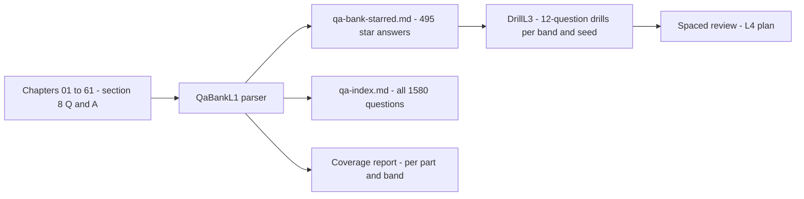
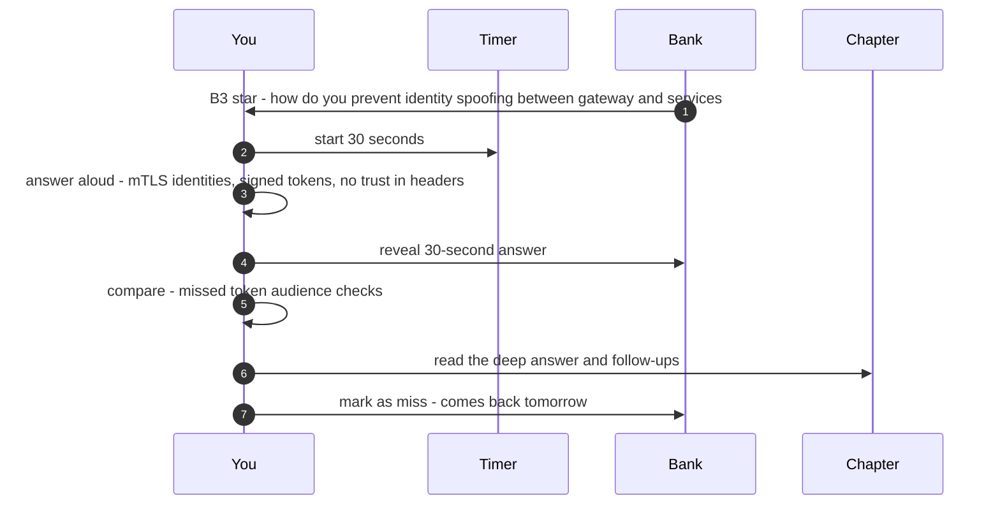
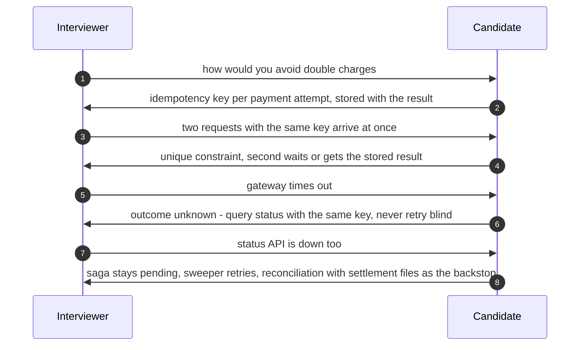
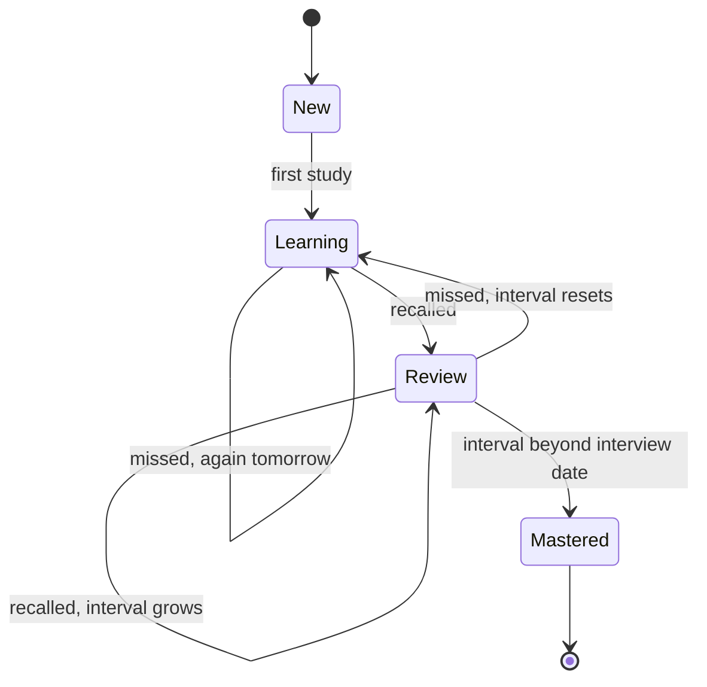

# 59. Interview Q&A Bank

!!! abstract "Chapter at a glance"
    **Reader bands:** B1 → B4 · **Prerequisites:** [Ch 57](57-the-system-design-interview-framework.md), [Ch 58](58-level-expectations.md)

    **What you get:** the whole handbook's interview material as one bank you can drill. **Every chapter's §8 and every industry design's Q&A (1,580 questions) is parsed by a program** into two companion pages, and re-running the program after any edit keeps them in step with the chapters:

    - **[⭐ Drill Bank](qa-bank-starred.md):** all **495** high-frequency (⭐) questions with their 30-second answers, grouped by part and chapter.
    - **[Full Question Index](../99-appendix/qa-index.md):** all 1,580 questions by part, chapter and level, with links back to the full answers.

    This chapter explains how to use the bank. It covers:

    - the shapes of interview questions;
    - the 30-second-answer pattern;
    - the follow-up chains interviewers use;
    - a study plan.

    It adds 20 **integration questions** that deliberately span several chapters, because real interviews don't stay inside one topic.

    **What the labs measured:**

    - **L1 (extraction):** 62 chapters plus the 18 industry designs: **1,580** questions and **495** ⭐. The first run found **17** ⭐ answers written as bullet lists, which the parser then learned to read.
    - **L2 (coverage):** every chapter has exactly 20 questions. By band there are **252** B1, **459** B2, **395** B3 and **474** B4.
    - **L3 (drills):** a deterministic 12-question drill per band and seed, spread across parts and weighted to ⭐.
    - **L4 (study plans):** modelled on the 415-card core-chapter deck. Under a simple memory model, cramming wins the next morning (61%) but keeps only 3% a month later. Weeks of spaced review plus a final pass reaches 57% on the day and keeps the most (17%).

    · **Reading time:** 50 min for this page; the bank is for drilling.

---

## 1. Introduction & Why It Matters

### 1.1 A story: 400 questions and no answers

Arjun collected four hundred system design questions from forums, books and friends into a spreadsheet. He read through it twice in the week before his loop. In the interview he recognised every question, and could answer none of them fluently. He knew *about* consistent hashing, but couldn't explain in thirty seconds why virtual nodes help, or what he'd trade for them.

Recognition is not recall, and recall is not fluency. A question bank is useful only if you:

1. answer aloud before reading;
2. answer in a fixed shape (30 seconds, then depth, then trade-offs);
3. expect the follow-ups;
4. space the practice so the answers are still there on the day.

This chapter turns the handbook into that kind of bank.

!!! quote "The thesis of this chapter"
    **Use the handbook's own Q&A as the bank, generated from the chapters so it never drifts** (L1, L2). **Drill in mixed, level-appropriate sets** (L3), **aloud, in the 30-second → deep → trade-offs → follow-ups shape**. **Space the practice over weeks and finish with a full pass** (L4).

### 1.2 What's in the bank

| Part | Questions | ⭐ | Focus |
|---|---|---|---|
| 0 · Orientation | 20 | 9 | What design is, requirements, quality attributes |
| I · Foundations | 160 | 68 | Estimation, networking, APIs, databases, caching, load balancing, scalability |
| II · Distributed core | 220 | 86 | Replication, partitioning, consensus, transactions, messaging, events, resilience, concurrency, idempotency |
| III · Production | 200 | 79 | Data at scale, search, security, observability, performance, deployment, DR, schema evolution, testing, multi-tenancy |
| IV · Architect | 140 | 49 | Decisions, docs, DDD, architecture styles, cost, compliance, leadership |
| V · Case studies | 360 | 95 | 18 end-to-end designs |
| VI · Capstone | 20 | 4 | The whole platform |
| VII · Interview | 100 | 25 | Framework, levels, and this chapter |

### 1.3 Learning objectives

By the end you will be able to:

- **Use the ⭐ bank and the index** efficiently.
- **Answer in the 30-second shape**, and handle follow-up chains.
- **Recognise question archetypes**, and the chapter that answers each.
- **Plan study time** with spaced practice (L4).
- **Answer integration questions** that span chapters (§8).

---

## 2. Core Concepts — Beginner to Deep

### 2.1 Intuition: a language, not a list <span class="band b1">B1</span>

You don't learn a language by reading a phrasebook the night before a trip. You practise speaking, in context, repeatedly, with gaps between sessions, and your answers become sentences you can adapt. Interview answers work the same way. The bank is the phrasebook; the drill is the conversation.

### 2.2 Question archetypes ⭐ <span class="band b2">B2</span>

| Archetype | Example | Answer shape | Where |
|---|---|---|---|
| **Define and contrast** | "Lamport vs vector clocks?" | Definitions → key difference → when each | Parts I–II |
| **Design X** | "Design a rate limiter" | Ch 57 framework | Part V |
| **How would you guarantee P?** | "No double charges?" | Invariant → mechanism → failure cases → verification | [Ch 20](../02-distributed-core/20-idempotency-ids-and-distributed-locks.md), [Ch 45](../05-case-studies/45-payment-system.md) |
| **What happens when F fails?** | "Primary dies mid-commit" | Timeline → state after → recovery → user impact | [Ch 10](../02-distributed-core/10-replication.md), [Ch 27](../03-production/27-reliability-and-disaster-recovery.md) |
| **Estimate** | "Storage for 5 years of orders" | Assumptions → 1-sig-fig arithmetic → decision | [Ch 02](../01-foundations/02-back-of-the-envelope-estimation.md), [Ch 57](57-the-system-design-interview-framework.md) L1 |
| **Choose between** | "Kafka or RabbitMQ?" | Requirement → choice → cost → flip condition | [Ch 31](../04-architect/31-architecture-decision-making.md), Ch 57 L2 |
| **Debug / diagnose** | "p99 doubled after deploy" | Hypotheses → evidence → narrowing → fix | [Ch 24](../03-production/24-observability.md), [Ch 25](../03-production/25-performance-engineering.md) |
| **Evolve / migrate** | "Monolith to services?" | Phases → risks → rollback → metrics | [Ch 16](../02-distributed-core/16-microservices-architecture.md), [Ch 28](../03-production/28-schema-and-data-evolution.md) |
| **Leadership** | "Disagreed with an architect?" | Situation → your judgement → actions → outcome | [Ch 37](../04-architect/37-leading-architecture-at-scale.md), [Ch 61](61-behavioral-and-leadership.md) |

### 2.3 The answer shape ⭐ <span class="band b2">B2</span>

Every question in this handbook is written in the same shape, and it's the shape to speak in:

1. **30-second answer**: the core claim, the mechanism, and the main caveat. Stop, and let the interviewer choose where to go.
2. **Deep answer**: the mechanism with numbers or an example, often from a lab.
3. **Trade-offs**: what it costs, and when you'd choose differently.
4. **Follow-ups**: prepare the two most likely next questions.
5. **Red flags**: know the wrong answers the interviewer is listening for.

Timing: 30 seconds, then pause. Most interviewers interrupt with a follow-up, and that is the conversation you want.

### 2.4 Follow-up chains ⭐ <span class="band b3">B3</span>

Interviewers probe down a chain until you reach the edge of your knowledge. Know the chains for common topics:

| Start | → | → | → | Edge (staff+) |
|---|---|---|---|---|
| Cache the product page | Invalidation? | Stampede on expiry? | Hot key? | Consistency with inventory at checkout ([Ch 07](../01-foundations/07-caching.md), [Ch 44](../05-case-studies/44-distributed-cache.md)) |
| Idempotency key | Stored where? | Concurrent duplicates? | Key expiry? | Unknown outcomes and reconciliation ([Ch 20](../02-distributed-core/20-idempotency-ids-and-distributed-locks.md), [Ch 58](58-level-expectations.md) lab) |
| Kafka for events | Ordering? | Exactly-once? | Consumer lag at peak? | Schema evolution and replay ([Ch 14](../02-distributed-core/14-messaging-and-event-streaming.md), [Ch 28](../03-production/28-schema-and-data-evolution.md)) |
| Shard the orders table | Shard key? | Cross-shard queries? | Resharding live? | Hot tenants, cells ([Ch 11](../02-distributed-core/11-partitioning-and-sharding.md), [Ch 30](../03-production/30-multi-tenancy-and-saas-architecture.md)) |
| Distributed lock | TTL? | Paused holder? | Fencing? | Is a lock the right tool at all ([Ch 20](../02-distributed-core/20-idempotency-ids-and-distributed-locks.md), [Ch 50](../05-case-studies/50-distributed-job-scheduler.md)) |
| QUORUM reads | R + W > N? | Sloppy quorum? | Tail latency? | Consensus for CAS ([Ch 10](../02-distributed-core/10-replication.md), [Ch 54](../05-case-studies/54-distributed-key-value-store.md)) |

### 2.5 The must-know thirty <span class="band b3">B3</span>

If you only have a week, drill these ⭐ questions first. Each is fully answered in its chapter, and all are in the [⭐ Drill Bank](qa-bank-starred.md).

| # | Question | Chapter |
|---|---|---|
| 1 | Functional vs non-functional requirements | [01](../00-orientation/01-what-system-design-is.md) |
| 2 | Estimate QPS and storage for a prompt | [02](../01-foundations/02-back-of-the-envelope-estimation.md) |
| 3 | REST vs gRPC vs events | [04](../01-foundations/04-api-design.md) |
| 4 | Isolation levels and anomalies | [05](../01-foundations/05-relational-databases-deep-dive.md) |
| 5 | SQL vs NoSQL, by access pattern | [06](../01-foundations/06-nosql-and-polyglot-persistence.md) |
| 6 | Cache-aside vs write-through, and invalidation | [07](../01-foundations/07-caching.md) |
| 7 | L4 vs L7 load balancing | [08](../01-foundations/08-load-balancing-proxies-and-gateways.md) |
| 8 | Leader-follower vs leaderless replication | [10](../02-distributed-core/10-replication.md) |
| 9 | Consistent hashing and virtual nodes | [11](../02-distributed-core/11-partitioning-and-sharding.md) |
| 10 | Raft in two minutes | [12](../02-distributed-core/12-consistency-time-and-consensus.md) |
| 11 | 2PC vs saga | [13](../02-distributed-core/13-distributed-transactions.md) |
| 12 | Kafka ordering and delivery semantics | [14](../02-distributed-core/14-messaging-and-event-streaming.md) |
| 13 | Outbox pattern | [15](../02-distributed-core/15-event-driven-architecture-cqrs-and-event-sourcing.md) |
| 14 | Circuit breakers, retries, backoff and jitter | [18](../02-distributed-core/18-resilience-patterns.md) |
| 15 | Idempotency keys end to end | [20](../02-distributed-core/20-idempotency-ids-and-distributed-locks.md) |
| 16 | Event time vs processing time | [21](../03-production/21-data-at-scale.md) |
| 17 | AuthN/AuthZ between services | [23](../03-production/23-security-architecture.md) |
| 18 | SLIs, SLOs and error budgets | [24](../03-production/24-observability.md) |
| 19 | Blue-green vs canary | [26](../03-production/26-deployment-and-infrastructure.md) |
| 20 | RPO/RTO and DR tiers | [27](../03-production/27-reliability-and-disaster-recovery.md) |
| 21 | Expand-contract schema changes | [28](../03-production/28-schema-and-data-evolution.md) |
| 22 | Writing an ADR | [31](../04-architect/31-architecture-decision-making.md) |
| 23 | Rate limiter algorithms | [39](../05-case-studies/39-distributed-rate-limiter.md) |
| 24 | Notification priority lanes and retries | [40](../05-case-studies/40-notification-system.md) |
| 25 | Feed fan-out on write vs read | [43](../05-case-studies/43-home-feed-and-recommendations.md) |
| 26 | Payment state machine and reconciliation | [45](../05-case-studies/45-payment-system.md) |
| 27 | Inventory reservation under contention | [46](../05-case-studies/46-grocery-checkout-and-inventory-reservation.md) |
| 28 | Geo index for nearest riders | [47](../05-case-studies/47-delivery-dispatch-and-live-tracking.md) |
| 29 | LSM trees vs B-trees | [54](../05-case-studies/54-distributed-key-value-store.md) |
| 30 | Journey SLOs by composition | [56](../06-capstone/56-capstone-grocery-marketplace-end-to-end.md) |

### 2.6 Using the bank by level <span class="band b2">B2</span>

| Target | Drill mix | Plus |
|---|---|---|
| B2 senior | B1–B2 ⭐ across Parts I–II, and B2 case studies | 8 timed designs |
| B3 staff | B2–B3 ⭐ everywhere, and B3/B4 in Part V | Failure-table drills, trade-off flips |
| B4 principal | B3–B4 ⭐, Parts IV–VI in depth | Integration questions (§8), past-system stories |

### 2.7 Keeping the bank honest <span class="band b3">B3</span>

- The bank is **generated**, not copied. `QaBankL1` re-reads every chapter, so an edited answer appears in the bank on the next run.
- The generator also **checks the format**: 20 questions per chapter, and a 30-second answer for every ⭐. The first run found 17 ⭐ answers written as bullet lists, and the parser was extended to read them rather than silently dropping them.

---

## 3. Architecture & Diagrams

### 3.1 How the bank is built



### 3.2 Sequence: one drill question, done well



### 3.3 Sequence: a follow-up chain in an interview



### 3.4 State: a card in spaced review



---

## 4. Design Document Excerpt: Study Plan

!!! note "Design Document (excerpt) — Six-Week Interview Study Plan (template)"
    **Status:** Template · **Use:** adapt to your target level and available hours

    | Field | Value |
    |---|---|
    | Context | Staff-level loop in 6 weeks; ~1.5 hours/day on weekdays, 4 hours on weekends. |
    | Decision | Spaced drilling of ⭐ questions (40/day), 3 timed designs a week, 2 mocks a week from week 4, and a full ⭐ pass in the last 2 days (L4). |
    | Related | [Ch 57](57-the-system-design-interview-framework.md) framework, [Ch 58](58-level-expectations.md) levels, [Ch 60](60-mock-interviews.md) mocks, [Ch 61](61-behavioral-and-leadership.md) behavioural. |

    **Requirements.**

    - **R1:** Every ⭐ answer spoken fluently in ≤ 30 s.
    - **R2:** 12 case studies designed on paper in 45 minutes.
    - **R3:** 6 mocks scored with the rubric (Ch 57 L4).
    - **R4:** 5 leadership stories in the evidence format ([Ch 58](58-level-expectations.md) §2.8).
    - **R5:** No new material in the last 3 days, only review.

    **Decisions in detail.**

    1. **Weeks 1–2:** Parts I–II ⭐ plus 4 case studies.
    2. **Weeks 3–4:** Parts III–IV ⭐ plus 4 case studies and 2 mocks.
    3. **Weeks 5–6:** Part V–VI ⭐, 4 case studies, 4 mocks, and integration questions.
    4. **Daily:** the L3 drill (12 questions), with misses re-queued.

    **Consequences.** It is a real time commitment. In return you get fluency, not recognition.

---

## 5. Hands-On Code — Level Ladder

!!! info "What's real here"
    - **L1–L3** run on this handbook's actual chapter files.
    - **L4** is a simulation using a stated, deliberately simple memory model.
    - The companion pages are the committed output of L1.

All four labs are JDK 21 programs. L1–L3 read the handbook's `docs/` folder.

### L1 — Generate the bank from the chapters <span class="band b2">B2</span>

**Requirement:** "One command rebuilds the bank and the index from every chapter's §8, so they can never drift."

```java title="QaBankL1.java"
// QaBankL1.java — run with: java QaBankL1.java <docs-dir> <out-dir>   (JDK 21, no dependencies)
// BUILD THE QUESTION BANK FROM THE HANDBOOK ITSELF. Parses every chapter's "??? question" blocks (§8 of each chapter),
// extracting chapter, level band, the ⭐ high-frequency marker, the question and its 30-second answer. Writes:
//   bank_starred.md — every ⭐ question with its 30-second answer, grouped by part and chapter (the drill bank)
//   index_all.md    — every question title, grouped by part and chapter, with links back to the chapter
// and prints what it found, so the bank can never drift from the chapters: re-run it after editing any chapter.
import java.io.*;
import java.nio.file.*;
import java.util.*;
import java.util.regex.*;
import java.util.stream.*;

public class QaBankL1 {
    static String fixLinks(String s, String dir) { return s.replaceAll("\\]\\(((?:\\d\\d-|i\\d\\d|index)[^)/]*\\.md)", "](../" + dir + "/$1"); }   // same-folder links, incl. industry pages (i06-x.md, index.md)
    record Q(int ch, String chapterTitle, String file, String part, int num, String band, boolean star, String text, String answer) {}
    static final Pattern QP = Pattern.compile("^\\?\\?\\? question \"Q(\\d+) \\[(B\\d)\\] (⭐ )?(.*)\"\\s*$");

    public static void main(String[] args) throws Exception {
        Path docs = Paths.get(args.length > 0 ? args[0] : "docs"), out = Paths.get(args.length > 1 ? args[1] : ".");
        List<Q> all = new ArrayList<>(); Map<String, String> partNames = Map.of("00-orientation", "Part 0 · Orientation", "01-foundations", "Part I · Foundations",
                "02-distributed-core", "Part II · Distributed Core", "03-production", "Part III · Production", "04-architect", "Part IV · Architect",
                "05-case-studies", "Part V · Case Studies", "06-capstone", "Part VI · Capstone", "07-interview", "Part VII · Interview", "08-industry", "Part VIII · Industry Designs");
        List<Path> files; try (Stream<Path> s = Files.walk(docs, 2)) { files = s.filter(p -> p.getFileName().toString().matches("(\\d\\d|i\\d\\db?)-.*\\.md")).sorted().toList(); }
        for (Path f : files) {
            List<String> lines = Files.readAllLines(f); String title = lines.stream().filter(l -> l.startsWith("# ")).findFirst().orElse("# ?").substring(2).trim();
            String fn = f.getFileName().toString(); int ch = fn.startsWith("i")  /* industry I01..I18 → 101..118 */ ? 100 + Integer.parseInt(fn.substring(1, 3)) : Integer.parseInt(fn.substring(0, 2));
            String part = partNames.getOrDefault(f.getParent().getFileName().toString(), "?");
            for (int i = 0; i < lines.size(); i++) { Matcher m = QP.matcher(lines.get(i)); if (!m.matches()) continue;
                String ans = ""; for (int j = i + 1; j < Math.min(lines.size(), i + 8); j++) { String l = lines.get(j).trim(); if (l.startsWith("**30-second answer:**")) { ans = l.substring("**30-second answer:**".length()).trim();
                        if (ans.isEmpty()) { StringBuilder b = new StringBuilder(); for (int k = j + 1; k < lines.size(); k++) { String x = lines.get(k).trim(); if (x.isEmpty() || x.startsWith("**")) break; b.append(b.length() > 0 ? "\n    " : "").append(x); } ans = b.toString(); }   // bullet-list answers
                        break; } }
                String dir = docs.relativize(f).getParent().toString();
                // same-folder links like (28-x.md) must point at ../<folder>/28-x.md once the text moves to another page
                all.add(new Q(ch, title, docs.relativize(f).toString(), part, Integer.parseInt(m.group(1)), m.group(2), m.group(3) != null, fixLinks(m.group(4), dir), fixLinks(ans, dir))); }
        }
        // bank of starred questions
        StringBuilder bank = new StringBuilder(), index = new StringBuilder(); String lastPart = "", lastCh = "";
        for (Q q : all) { if (!q.star()) continue;
            if (!q.part().equals(lastPart)) { bank.append("\n### ").append(q.part()).append("\n"); lastPart = q.part(); lastCh = ""; }
            if (!q.chapterTitle().equals(lastCh)) { bank.append("\n**[").append(q.chapterTitle()).append("](../").append(q.file()).append(")**\n\n"); lastCh = q.chapterTitle(); }
            bank.append("??? example \"").append(q.band()).append(" · ").append(q.text().replace("\"", "'")).append("\"\n    ").append(q.answer().isEmpty() ? "_See the chapter._" : q.answer()).append("\n\n"); }
        lastPart = ""; lastCh = "";
        for (Q q : all) {
            if (!q.part().equals(lastPart)) { index.append("\n## ").append(q.part()).append("\n"); lastPart = q.part(); lastCh = ""; }
            if (!q.chapterTitle().equals(lastCh)) { index.append("\n### [").append(q.chapterTitle()).append("](../").append(q.file()).append(")\n\n"); lastCh = q.chapterTitle(); }
            index.append("- **Q").append(q.num()).append("** `").append(q.band()).append("`").append(q.star() ? " ⭐" : "").append(" ").append(q.text()).append("\n"); }
        Files.writeString(out.resolve("bank_starred.md"), bank.toString()); Files.writeString(out.resolve("index_all.md"), index.toString());
        long missing = all.stream().filter(q -> q.star() && q.answer().isEmpty()).count();
        if (System.getenv("SHOWMISSING") != null) all.stream().filter(q -> q.star() && q.answer().isEmpty()).forEach(q -> System.out.println("MISSING " + q.file() + " Q" + q.num()));
        System.out.printf("parsed %d chapter files → %,d questions, %,d ⭐ (%d ⭐ without a 30-second answer)%n", files.size(), all.size(), all.stream().filter(Q::star).count(), missing);
        System.out.printf("wrote bank_starred.md (%,d words) and index_all.md (%,d words)%n", words(bank), words(index));
        // L2: coverage by part × band
        System.out.printf("%n   %-30s %6s %6s %6s %6s %8s %8s%n", "part", "B1", "B2", "B3", "B4", "total", "⭐");
        for (String p : partNames.values().stream().sorted(Comparator.comparing(QaBankL1::partOrder)).toList()) {
            List<Q> qs = all.stream().filter(q -> q.part().equals(p)).toList(); if (qs.isEmpty()) continue;
            System.out.printf("   %-30s %6d %6d %6d %6d %8d %8d%n", p, cnt(qs, "B1"), cnt(qs, "B2"), cnt(qs, "B3"), cnt(qs, "B4"), qs.size(), qs.stream().filter(Q::star).count());
        }
        System.out.printf("   %-30s %6d %6d %6d %6d %8d %8d%n", "ALL", cnt(all, "B1"), cnt(all, "B2"), cnt(all, "B3"), cnt(all, "B4"), all.size(), all.stream().filter(Q::star).count());
        // per-chapter format check: 20 questions each
        List<String> off = new ArrayList<>(); Map<Integer, Long> perCh = all.stream().collect(Collectors.groupingBy(Q::ch, TreeMap::new, Collectors.counting()));
        perCh.forEach((c, n) -> { if (n < 20) off.add((c > 100 ? "I" + (c - 100) : "Ch " + c) + ": " + n); });
        System.out.printf("%n   chapters with Q&A: %d; chapters with fewer than 20 questions: %s%n", perCh.size(), off.isEmpty() ? "none" : String.join(", ", off));
    }
    static int partOrder(String p) { return List.of("Part 0 · Orientation", "Part I · Foundations", "Part II · Distributed Core", "Part III · Production", "Part IV · Architect", "Part V · Case Studies", "Part VI · Capstone", "Part VII · Interview", "Part VIII · Industry Designs").indexOf(p); }
    static long cnt(List<Q> qs, String b) { return qs.stream().filter(q -> q.band().equals(b)).count(); }
    static int words(CharSequence s) { return s.toString().split("\\s+").length; }
}
```

```text title="java QaBankL1.java docs docs-out"
parsed 82 chapter files → 1,580 questions, 495 ⭐ (0 ⭐ without a 30-second answer)
wrote bank_starred.md (32,040 words) and index_all.md (20,664 words)

   part                               B1     B2     B3     B4    total        ⭐
   Part 0 · Orientation                4      5      5      6       20        9
   Part I · Foundations               32     40     40     48      160       68
   Part II · Distributed Core         44     55     55     66      220       86
   Part III · Production              40     50     50     60      200       79
   Part IV · Architect                28     35     35     42      140       49
   Part V · Case Studies              16    146     90    108      360       95
   Part VI · Capstone                  0      9      5      6       20        4
   Part VII · Interview               16     29     25     30      100       25
   Part VIII · Industry Designs       72     90     90    108      360       80
   ALL                               252    459    395    474     1580      495

   chapters with Q&A: 79; chapters with fewer than 20 questions: none
```

**Reading it:**

- **The program found every question** and wrote the two companion pages: [⭐ Drill Bank](qa-bank-starred.md) and [Full Question Index](../99-appendix/qa-index.md).
- **A development note.** The first run reported **17 ⭐ questions without a 30-second answer**. Those chapters wrote the answer as a bullet list on the following lines, so the parser now reads bullet-list answers. A silent drop would have made the bank quietly incomplete.
- **A second fix came from the site build.** Two questions contained same-folder links such as `(28-schema-and-data-evolution.md)`, which break once the text moves to the index page. `fixLinks` rewrites them to `../03-production/…`.
- **A third change came with the Industry Designs tab.** The parser now also reads `08-industry/iNN-*.md` pages (Part VIII), including links such as `(i06-….md)` and `(index.md)`. The two "how it works" pages (I01b, I02b) have no Q&A, so 82 files are parsed and 79 contribute questions.

### L2 — Coverage by part and level <span class="band b2">B2</span>

**Requirement:** "Know what the bank covers, and check every chapter meets the format."

The same program prints the coverage table above:

- every chapter has exactly 20 questions;
- the case studies lean to B2–B4, as designed;
- 495 of 1,580 questions (31%) are marked ⭐ high-frequency.
- the industry designs add 360 questions, weighted to B2–B4 like the case studies.

### L3 — A daily drill <span class="band b3">B3</span>

**Requirement:** "12 mixed questions a day, at my level, the same for my study group."

```java title="DrillL3.java"
// DrillL3.java — run with: java DrillL3.java <docs-dir> <band> [seed]   (JDK 21, no dependencies)
// A 45-MINUTE DRILL FROM THE BANK. Picks 12 questions for a target band from the handbook's own Q&A (parsed live from
// the chapters): at most one per chapter, spread across parts, ⭐ questions weighted 3×, questions from the band itself
// plus one band below for warm-up. Deterministic for a given seed (use the date), so a study group gets the same set.
import java.nio.file.*;
import java.util.*;
import java.util.regex.*;
import java.util.stream.*;

public class DrillL3 {
    record Q(int ch, String file, String part, String band, boolean star, String text) {}
    public static void main(String[] args) throws Exception {
        Path docs = Paths.get(args[0]); String band = args.length > 1 ? args[1] : "B3"; long seed = args.length > 2 ? Long.parseLong(args[2]) : 20260930L;
        Pattern qp = Pattern.compile("^\\?\\?\\? question \"Q(\\d+) \\[(B\\d)\\] (⭐ )?(.*)\"\\s*$"); List<Q> all = new ArrayList<>();
        try (Stream<Path> s = Files.walk(docs, 2)) { for (Path f : s.filter(p -> p.getFileName().toString().matches("\\d\\d-.*\\.md")).sorted().toList())
            for (String l : Files.readAllLines(f)) { Matcher m = qp.matcher(l); if (m.matches()) all.add(new Q(Integer.parseInt(f.getFileName().toString().substring(0, 2)), f.getFileName().toString(), f.getParent().getFileName().toString(), m.group(2), m.group(3) != null, m.group(4))); } }
        int b = band.charAt(1) - '0'; String below = "B" + Math.max(1, b - 1);
        List<Q> pool = all.stream().filter(q -> q.band().equals(band) || q.band().equals(below)).toList();
        Random r = new Random(seed); List<Q> picked = new ArrayList<>(); Set<Integer> usedCh = new HashSet<>(); Map<String, Integer> perPart = new HashMap<>();
        int warm = 0;
        while (picked.size() < 12) {
            double total = 0; List<Q> cand = new ArrayList<>(); List<Double> w = new ArrayList<>();
            for (Q q : pool) { if (usedCh.contains(q.ch())) continue; if (perPart.getOrDefault(q.part(), 0) >= 3) continue; if (q.band().equals(below) && warm >= 2) continue; if (!q.band().equals(below) && picked.size() < 2 && warm < 2 && b > 1) continue;
                double wt = q.star() ? 3 : 1; cand.add(q); w.add(wt); total += wt; }
            if (cand.isEmpty()) break;
            double x = r.nextDouble() * total; int i = 0; while (x > w.get(i)) { x -= w.get(i); i++; }
            Q q = cand.get(i); picked.add(q); usedCh.add(q.ch()); perPart.merge(q.part(), 1, Integer::sum); if (q.band().equals(below)) warm++;
        }
        System.out.printf("Drill for %s (seed %d): %d questions from %,d in the pool; answer each aloud in ≤ 3 minutes, then check the chapter.%n%n", band, seed, picked.size(), pool.size());
        int n = 1; for (Q q : picked) System.out.printf("   %2d. [%s]%s %s   → Ch %02d (%s)%n", n++, q.band(), q.star() ? " ⭐" : "", q.text(), q.ch(), q.part());
        System.out.printf("%n   parts covered: %s%n", picked.stream().map(Q::part).distinct().sorted().collect(Collectors.joining(", ")));
    }
}
```

```text title="java DrillL3.java docs B3 20260930"
Drill for B3 (seed 20260930): 12 questions from 674 in the pool; answer each aloud in ≤ 3 minutes, then check the chapter.

    1. [B2] ⭐ How would you cache redirects?   → Ch 38 (05-case-studies)
    2. [B2] ⭐ What is Row-Level Security and how does it help multi-tenancy?   → Ch 30 (03-production)
    3. [B3] ⭐ How do you keep multiple stores (DB, cache, search, Cassandra) consistent?   → Ch 06 (01-foundations)
    4. [B3] ⭐ Design the dispatch algorithm.   → Ch 47 (05-case-studies)
    5. [B3] How do you handle JavaScript-heavy sites?   → Ch 53 (05-case-studies)
    6. [B3] ⭐ Your target architecture keeps drifting. How do you diagnose and fix it?   → Ch 37 (04-architect)
    7. [B3] ⭐ How do you apply backpressure in a Kafka-consuming service?   → Ch 19 (02-distributed-core)
    8. [B3] How do you handle a design review where a senior reviewer strongly disagrees?   → Ch 32 (04-architect)
    9. [B3] ⭐ Design sharding for an orders database that must grow from 4 to 16 shards.   → Ch 11 (02-distributed-core)
   10. [B3] Compare blue-green and canary. When would you use each?   → Ch 26 (03-production)
   11. [B3] ⭐ Redis goes down during peak. What happens in your design?   → Ch 07 (01-foundations)
   12. [B3] How do Kafka's `acks`, ISR and `min.insync.replicas` map to replication concepts?   → Ch 10 (02-distributed-core)

   parts covered: 01-foundations, 02-distributed-core, 03-production, 04-architect, 05-case-studies
```

**Reading it:**

- **Two warm-up questions** come from one band below.
- **Every question is from a different chapter**, with at most three per part, and ⭐ questions are three times as likely.
- **The same seed gives the same drill**, so a study group can share one.

### L4 — Study plan: cram, cycle or space? <span class="band b4">B4</span>

**Requirement:** "Remember the answers on interview day, and still know them a month later."

```java title="SpacedL4.java"
// SpacedL4.java — run with: java SpacedL4.java   (JDK 21, no dependencies)
// HOW TO STUDY 415 ⭐ QUESTIONS IN SIX WEEKS. A simple memory model (an assumption, in the spirit of spaced-repetition
// research — VERIFY against your own experience): after a review, the chance of recalling an answer t days later is
// exp(−t / S). S starts at 1 day; each successful recall multiplies S by 2.5; a failed recall resets S to 1 day.
// Budget: about 40 reviews a day. Interview on day 43. Three plans (fixed seed):
//   P1 cram: go through all 415 on each of the last 4 days
//   P2 round-robin: 40 cards a day in a fixed cycle for 42 days (each card every ~10 days)
//   P3 spaced (Leitner-style): each day review the cards that are due (next review when recall would drop to ~80%),
//      introduce ~15 new cards a day until all are started, within the same budget
//   P4 P3 for days 1–40, then all 415 on each of the last 2 days (spaced learning + a final pass)
// Measured: expected share recalled on interview day, cards above 80% recall, expected recall 30 days later (a second
// loop, or the job), and reviews spent.
import java.util.*;

public class SpacedL4 {
    public static void main(String[] args) {
        System.out.println("415 cards, ~40 reviews/day budget, interview on day 43; recall(t) = exp(−t/S), S ×2.5 on success.\n");
        System.out.printf("   %-56s %16s %14s %16s %10s%n", "plan", "expected recall", "cards > 80%", "recall 30 days", "reviews");
        System.out.printf("   %-56s %16s %14s %16s %10s%n", "", "on interview day", "that day", "later (2nd loop)", "");
        for (int p = 1; p <= 4; p++) run(p);
        System.out.println("\n   → under this model, cramming wins the next morning and loses a month later: it fills short-term memory");
        System.out.println("     that fades in days. A fixed cycle is the worst of both — every card comes back after it has been forgotten.");
        System.out.println("     Spaced review builds durable memory but, on a tight budget, reaches the interview with fewer answers fresh.");
        System.out.println("     The combination — spaced review for weeks, then a final pass over everything — comes close to cramming on");
        System.out.println("     the day (57% vs 61%) and keeps the most a month later (17%), at the cost of more reviews. The absolute numbers");
        System.out.println("     come from a deliberately harsh, simple model; the direction is what matters (and is consistent with");
        System.out.println("     spaced-repetition research — VERIFY with your own practice).");
    }
    static void run(int plan) {
        int N = 415, days = 42; Random r = new Random(59); double[] S = new double[N], last = new double[N]; boolean[] started = new boolean[N]; int reviews = 0;
        Arrays.fill(last, Double.NaN);
        for (int day = 1; day <= days; day++) {
            List<Integer> today = new ArrayList<>();
            if (plan == 1 || (plan == 4 && day > days - 2)) { if (plan == 4 || day > days - 4) for (int i = 0; i < N; i++) today.add(i); }
            else if (plan == 2) { for (int k = 0; k < 40; k++) today.add(((day - 1) * 40 + k) % N); }
            else {
                if (plan == 4 && day > days - 2) { } else {
                List<Integer> due = new ArrayList<>(); for (int i = 0; i < N; i++) if (started[i] && Math.exp(-(day - last[i]) / S[i]) < 0.8) due.add(i);
                final int d0 = day; due.sort(Comparator.comparingDouble(i -> Math.exp(-(d0 - last[i]) / S[i])));
                for (int i : due) { if (today.size() >= 40) break; today.add(i); }
                int added = 0; for (int i = 0; i < N && today.size() < 40 && added < 15; i++) if (!started[i]) { today.add(i); started[i] = true; added++; }
                }
            }
            for (int i : today) { reviews++;
                if (Double.isNaN(last[i])) { S[i] = 1; last[i] = day; continue; }                  // first study
                double pr = Math.exp(-(day - last[i]) / S[i]); if (r.nextDouble() < pr) S[i] *= 2.5; else S[i] = 1; last[i] = day; started[i] = true; }
        }
        double sum = 0, later = 0; int strong = 0; int interview = days + 1;
        for (int i = 0; i < N; i++) { double pr = Double.isNaN(last[i]) ? 0 : Math.exp(-(interview - last[i]) / S[i]); sum += pr; if (pr > 0.8) strong++; later += Double.isNaN(last[i]) ? 0 : Math.exp(-(interview + 30 - last[i]) / S[i]); }
        String[] names = {"", "P1) cram: all 415 on each of the last 4 days", "P2) round-robin: 40 a day in a fixed cycle", "P3) spaced: due cards first, 15 new a day", "P4) spaced (days 1–40) + all 415 on the last 2 days"};
        System.out.printf("   %-56s %15.0f%% %14d %15.0f%% %10d%n", names[plan], 100 * sum / N, strong, 100 * later / N, reviews);
    }
}
```

```text title="java SpacedL4.java"
415 cards, ~40 reviews/day budget, interview on day 43; recall(t) = exp(−t/S), S ×2.5 on success.

   plan                                                      expected recall    cards > 80%   recall 30 days    reviews
                                                            on interview day       that day later (2nd loop)           
   P1) cram: all 415 on each of the last 4 days                          61%            143               3%       1660
   P2) round-robin: 40 a day in a fixed cycle                             6%              0               0%       1680
   P3) spaced: due cards first, 15 new a day                             24%             87              11%       1645
   P4) spaced (days 1–40) + all 415 on the last 2 days                   57%             86              17%       2395

   → under this model, cramming wins the next morning and loses a month later: it fills short-term memory
     that fades in days. A fixed cycle is the worst of both — every card comes back after it has been forgotten.
     Spaced review builds durable memory but, on a tight budget, reaches the interview with fewer answers fresh.
     The combination — spaced review for weeks, then a final pass over everything — comes close to cramming on
     the day (57% vs 61%) and keeps the most a month later (17%), at the cost of more reviews. The absolute numbers
     come from a deliberately harsh, simple model; the direction is what matters (and is consistent with
     spaced-repetition research — VERIFY with your own practice).
```

**Reading it:**

- **Cramming wins the next morning and fades fast.** A fixed cycle is the worst of both.
- **Spaced review plus a final pass** is close to cramming on the day and best a month later.
- **The model is deliberately simple and harsh.** Trust the direction, not the percentages.

---

## 6. Practice Concerns

### 6.1 Failure modes

| Failure | Symptom | Fix |
|---|---|---|
| Reading, not answering | Recognition without recall | Answer aloud first |
| One topic at a time | Can't switch contexts in a loop | Mixed drills (L3) |
| Cramming only | Gone a week later (L4) | Spaced review + final pass |
| Long answers | Interviewer can't steer | 30 seconds, then pause |
| Ignoring follow-ups | Stuck on the second question | Prepare the chains (§2.4) |

### 6.2 Tracking progress

- Keep a miss log per chapter. Topics with repeated misses need a chapter re-read, not more drilling.
- Record one mock a week, and score it with the rubric.

### 6.3 Study groups

- Share a seed so everyone gets the same L3 drill. Take turns as interviewer, using the follow-up chains.

### 6.4 The day before

- One full ⭐ pass. No new topics. Sleep.

### 6.5 After each loop

- Write down every question you were asked. Add missing ones to your own bank. Re-run L1 if you edit the chapters.

---

## 7. Anti-Patterns & Pitfalls

!!! danger "1. Collecting questions instead of answering them"
    A list is not practice.

!!! danger "2. Silent reading"
    Interviews are spoken.

!!! danger "3. Memorising paragraphs"
    Memorise shapes and mechanisms, not scripts.

!!! danger "4. Skipping follow-ups"
    The chain is where levels show.

!!! danger "5. Only B4 questions for a staff loop"
    The fundamentals get probed too.

!!! danger "6. Only your favourite topics"
    Weak areas stay weak.

!!! danger "7. Cramming the last week"
    Short-lived (L4).

!!! danger "8. Copying answers from the internet"
    Unverified, and often wrong. Use the chapters and their labs.

!!! danger "9. Bank drifting from sources"
    Generate it (L1).

!!! danger "10. No timing"
    Answers expand to fill the time.

!!! danger "11. Never saying 'I don't know'"
    Bluffing is worse.

!!! danger "12. No mocks"
    Drills aren't interviews ([Ch 60](60-mock-interviews.md)).

---

## 8. Interview Q&A — Integration Questions

These questions deliberately cross chapters. They are the kind senior and staff interviewers use to test whether knowledge connects.

### Beginner <span class="band b1">B1</span>

??? question "Q1 [B1] ⭐ A product page is slow. Walk through where the time could go."

    **30-second answer:** DNS/TLS and network to the edge, CDN miss to origin, API gateway, service latency (DB queries, cache misses, downstream calls), payload size and rendering; measure with tracing before guessing.

    **Deep answer:** [Ch 03](../01-foundations/03-networking-essentials.md), [Ch 07](../01-foundations/07-caching.md), [Ch 24](../03-production/24-observability.md), [Ch 25](../03-production/25-performance-engineering.md).

    **Trade-offs I'd call out:** Caching vs freshness.

    **Follow-ups:**
    1. Which first? → Traces and the slowest span.
    2. Images? → CDN variants ([Ch 52](../05-case-studies/52-object-storage-and-media-pipeline.md)).

    **Red flags:** "Add more servers."

??? question "Q2 [B1] Why do we need both a database and a cache?"

    **30-second answer:** The database is the durable source of truth with transactions; the cache serves hot reads faster and cheaper; together they trade freshness and complexity for latency and load.

    **Deep answer:** [Ch 05](../01-foundations/05-relational-databases-deep-dive.md), [Ch 07](../01-foundations/07-caching.md).

    **Trade-offs I'd call out:** Staleness, invalidation.

    **Follow-ups:**
    1. Cache as source of truth? → Only with persistence and care.
    2. What not to cache? → Money balances at checkout.

    **Red flags:** Cache everything.

??? question "Q3 [B1] What happens when you place an order, end to end?"

    **30-second answer:** The app calls the gateway; checkout validates price and serviceability, reserves stock, holds a slot, charges payment, creates the order; events trigger picking, dispatch, notifications and invoices.

    **Deep answer:** [Ch 46](../05-case-studies/46-grocery-checkout-and-inventory-reservation.md), [Ch 56](../06-capstone/56-capstone-grocery-marketplace-end-to-end.md).

    **Trade-offs I'd call out:** Sync vs async steps.

    **Follow-ups:**
    1. Payment fails? → Release stock.
    2. Which steps are async? → Side effects.

    **Red flags:** One big transaction across services.

??? question "Q4 [B1] What's the difference between scaling reads and scaling writes?"

    **30-second answer:** Reads scale with replicas and caches; writes need partitioning (sharding), batching, or async processing because a single primary bounds them.

    **Deep answer:** [Ch 09](../01-foundations/09-scalability-fundamentals.md), [Ch 10](../02-distributed-core/10-replication.md), [Ch 11](../02-distributed-core/11-partitioning-and-sharding.md).

    **Trade-offs I'd call out:** Replica lag; cross-shard queries.

    **Follow-ups:**
    1. Read-your-writes with replicas? → Session routing.
    2. When to shard? → Numbers (Ch 57 L1).

    **Red flags:** Sharding first.

### Intermediate <span class="band b2">B2</span>

??? question "Q5 [B2] ⭐ How do idempotency, retries and timeouts fit together?"

    **30-second answer:** Timeouts bound waiting; retries recover transient failures; idempotency makes retries safe because the operation may have succeeded; add backoff with jitter and treat timeouts on side-effecting calls as unknown outcomes.

    **Deep answer:** [Ch 18](../02-distributed-core/18-resilience-patterns.md), [Ch 20](../02-distributed-core/20-idempotency-ids-and-distributed-locks.md), [Ch 56](../06-capstone/56-capstone-grocery-marketplace-end-to-end.md) L2.

    **Trade-offs I'd call out:** Retry storms vs recovery.

    **Follow-ups:**
    1. Retry budget? → Limit per request.
    2. Non-idempotent API? → Status query before retry.

    **Red flags:** Retrying payments blindly.

??? question "Q6 [B2] How do the outbox pattern and Kafka work together?"

    **30-second answer:** Write the business change and an outbox row in one local transaction; a relay (polling or CDC) publishes outbox rows to Kafka; consumers are idempotent because delivery is at-least-once.

    **Deep answer:** [Ch 14](../02-distributed-core/14-messaging-and-event-streaming.md), [Ch 15](../02-distributed-core/15-event-driven-architecture-cqrs-and-event-sourcing.md).

    **Trade-offs I'd call out:** Latency of the relay.

    **Follow-ups:**
    1. Ordering? → Key by aggregate.
    2. Cleanup? → Partition and drop.

    **Red flags:** Dual writes.

??? question "Q7 [B2] How does caching interact with inventory correctness?"

    **30-second answer:** Browse can show cached, slightly stale availability; the checkout path must check and reserve against the source of truth atomically; show "few left" hints rather than exact counts from cache.

    **Deep answer:** [Ch 07](../01-foundations/07-caching.md), [Ch 46](../05-case-studies/46-grocery-checkout-and-inventory-reservation.md).

    **Trade-offs I'd call out:** Oversell vs freshness.

    **Follow-ups:**
    1. Hot SKU? → Buckets or a gate.
    2. Invalidation? → Events from inventory.

    **Red flags:** Reserving from cache.

??? question "Q8 [B2] How do SLOs, alerts and dashboards relate?"

    **30-second answer:** SLOs define reliability targets from user journeys; alerts page on error-budget burn rates; dashboards support diagnosis; each alert should link to a runbook.

    **Deep answer:** [Ch 24](../03-production/24-observability.md), [Ch 56](../06-capstone/56-capstone-grocery-marketplace-end-to-end.md).

    **Trade-offs I'd call out:** Alert fatigue vs detection.

    **Follow-ups:**
    1. Multi-window burn? → Fast and slow.
    2. Journey vs service? → Journey first.

    **Red flags:** CPU alerts only.

??? question "Q9 [B2] How do schema changes and deployments interact?"

    **30-second answer:** Old and new code run together during rollouts, so schema changes must be backward compatible: expand (add), migrate, switch reads/writes, contract (remove) — each deploy compatible with the previous version.

    **Deep answer:** [Ch 26](../03-production/26-deployment-and-infrastructure.md), [Ch 28](../03-production/28-schema-and-data-evolution.md).

    **Trade-offs I'd call out:** Migration duration.

    **Follow-ups:**
    1. Event schemas? → Registry compatibility rules.
    2. Rollback? → Only if the schema still fits.

    **Red flags:** Rename column in one deploy.

### Senior <span class="band b3">B3</span>

??? question "Q10 [B3] ⭐ Walk a payment through every consistency mechanism it touches."

    **30-second answer:** Idempotency key at the API; state machine with guarded transitions in the DB; outbox to events; webhook dedup and forward-only updates; status polling for unknowns; double-entry ledger; daily reconciliation with settlement files.

    **Deep answer:** [Ch 45](../05-case-studies/45-payment-system.md), [Ch 58](58-level-expectations.md) lab.

    **Trade-offs I'd call out:** Complexity vs money safety.

    **Follow-ups:**
    1. Where can money be lost? → Unknown outcomes.
    2. Which runs daily? → Reconciliation.

    **Red flags:** "The gateway handles it."

??? question "Q11 [B3] How do partitioning, replication and consensus fit together in one store?"

    **30-second answer:** Partitioning spreads data (consistent hashing or ranges); replication copies each partition (leader-based or leaderless); consensus (Raft/Paxos) decides leaders and ordered logs where strong consistency is needed; membership and failure detection glue it together.

    **Deep answer:** [Ch 10](../02-distributed-core/10-replication.md), [Ch 11](../02-distributed-core/11-partitioning-and-sharding.md), [Ch 12](../02-distributed-core/12-consistency-time-and-consensus.md), [Ch 54](../05-case-studies/54-distributed-key-value-store.md).

    **Trade-offs I'd call out:** Consistency vs availability per partition.

    **Follow-ups:**
    1. Raft per partition? → Multi-Raft.
    2. Rebalancing? → Move replicas, not keys.

    **Red flags:** One global leader.

??? question "Q12 [B3] How would you make the platform survive a Kafka outage?"

    **30-second answer:** Outboxes keep producers safe (events wait in the DB); critical paths don't depend synchronously on Kafka; consumers catch up after recovery; monitor outbox depth; for prolonged outages degrade features that rely on events (e.g., delayed notifications).

    **Deep answer:** [Ch 14](../02-distributed-core/14-messaging-and-event-streaming.md), [Ch 15](../02-distributed-core/15-event-driven-architecture-cqrs-and-event-sourcing.md), [Ch 56](../06-capstone/56-capstone-grocery-marketplace-end-to-end.md) L3.

    **Trade-offs I'd call out:** Eventual delays vs availability.

    **Follow-ups:**
    1. Outbox growth? → Capacity planning.
    2. Ordering after recovery? → Per-key preserved.

    **Red flags:** Checkout publishing to Kafka synchronously.

??? question "Q13 [B3] How do security and multi-tenancy intersect for sellers?"

    **30-second answer:** Tenant identity in tokens, row-level or schema isolation enforced in the data layer, per-tenant rate limits and quotas, encryption keys per tenant where needed, and audit trails — isolation for data, performance and blast radius.

    **Deep answer:** [Ch 23](../03-production/23-security-architecture.md), [Ch 30](../03-production/30-multi-tenancy-and-saas-architecture.md), [Ch 39](../05-case-studies/39-distributed-rate-limiter.md).

    **Trade-offs I'd call out:** Isolation cost.

    **Follow-ups:**
    1. Noisy neighbour? → Quotas, cells.
    2. Admin access? → Audited break-glass.

    **Red flags:** Tenant id from request params.

??? question "Q14 [B3] How do performance testing and capacity planning work together for sale day?"

    **30-second answer:** Forecast journeys' peak load, find per-service capacity by load tests with realistic data and failures, compute headroom and pre-scaling, validate with a full-journey test, and set admission control for the excess.

    **Deep answer:** [Ch 02](../01-foundations/02-back-of-the-envelope-estimation.md), [Ch 25](../03-production/25-performance-engineering.md), [Ch 46](../05-case-studies/46-grocery-checkout-and-inventory-reservation.md).

    **Trade-offs I'd call out:** Cost of headroom.

    **Follow-ups:**
    1. Coordinated omission? → Open-model load.
    2. Dependencies? → Test gateways' limits too.

    **Red flags:** Testing one endpoint.

### Architect <span class="band b4">B4</span>

??? question "Q15 [B4] ⭐ Connect DDD, team topology and microservice boundaries."

    **30-second answer:** Bounded contexts define language and consistency boundaries; teams own contexts end to end (Conway); services follow contexts where independent deployment and scaling pay off; start as modules and extract when load, team size or change rate demands.

    **Deep answer:** [Ch 16](../02-distributed-core/16-microservices-architecture.md), [Ch 33](../04-architect/33-domain-driven-design.md), [Ch 37](../04-architect/37-leading-architecture-at-scale.md).

    **Trade-offs I'd call out:** Autonomy vs integration overhead.

    **Follow-ups:**
    1. Shared kernel? → Minimise.
    2. Wrong boundary? → Merge before splitting further.

    **Red flags:** One service per table.

??? question "Q16 [B4] How do cost, reliability and compliance trade off in data residency?"

    **30-second answer:** Residency limits where data and replicas live, which constrains DR regions and CDN/processing choices, raising cost; classify data, keep regulated data in-country with in-country DR, and use global services only for non-regulated data.

    **Deep answer:** [Ch 27](../03-production/27-reliability-and-disaster-recovery.md), [Ch 35](../04-architect/35-cost-engineering-and-finops.md), [Ch 36](../04-architect/36-compliance-governance-and-data-residency.md).

    **Trade-offs I'd call out:** Resilience vs compliance.

    **Follow-ups:**
    1. Logs with PII? → Redact or keep local.
    2. Vendor SaaS? → Contracts and locations.

    **Red flags:** Ignoring regulation.

??? question "Q17 [B4] What architecture would you choose for 10k orders/day vs 1M orders/day, and why?"

    **30-second answer:** 10k/day: a modular monolith, one PostgreSQL, managed queue, CDN — fast to build and operate. 1M/day: extracted checkout/payments, search, dispatch; event backbone; read models; cells and DR for the critical set — justified by load, team size and blast radius.

    **Deep answer:** [Ch 34](../04-architect/34-modern-architecture-styles.md), [Ch 56](../06-capstone/56-capstone-grocery-marketplace-end-to-end.md) §2.11.

    **Trade-offs I'd call out:** Early complexity vs later migration.

    **Follow-ups:**
    1. Migration path? → Strangler.
    2. First extraction? → The one with the most independent load.

    **Red flags:** Same architecture for both.

??? question "Q18 [B4] How do you decide which consistency model each part of a platform needs?"

    **30-second answer:** By the cost of anomalies: money and scarce stock need linearizable or serializable operations on their critical keys; carts need read-your-writes; catalog, search and feeds tolerate staleness; analytics tolerate approximation — encoded per operation, not per system.

    **Deep answer:** [Ch 12](../02-distributed-core/12-consistency-time-and-consensus.md), [Ch 51](../05-case-studies/51-real-time-analytics-and-top-k.md), [Ch 54](../05-case-studies/54-distributed-key-value-store.md).

    **Trade-offs I'd call out:** Latency and availability costs.

    **Follow-ups:**
    1. Mixed in one service? → Per endpoint.
    2. Verification? → Invariant checks.

    **Red flags:** "Everything strongly consistent."

??? question "Q19 [B4] Where do most production incidents in such platforms actually come from, and how does design reduce them?"

    **30-second answer:** Changes (deploys, config, schema), overload and retry storms, dependency failures, and data drift; design reduces them with safe rollouts, backpressure and budgets, soft dependencies and degradation, idempotency with reconciliation, and cells to bound blast radius.

    **Deep answer:** [Ch 18](../02-distributed-core/18-resilience-patterns.md), [Ch 26](../03-production/26-deployment-and-infrastructure.md), [Ch 27](../03-production/27-reliability-and-disaster-recovery.md).

    **Trade-offs I'd call out:** Velocity vs safety.

    **Follow-ups:**
    1. Change management? → Canaries, flags.
    2. Learning? → Blameless postmortems.

    **Red flags:** "Hardware failures."

??? question "Q20 [B4] If you had to teach one principle from this whole handbook, what would it be?"

    **30-second answer:** Make guarantees explicit and verify them: every design choice exists to keep some invariant true under some failure, so name the invariant, the failure, the mechanism, and the check that proves it — the labs in this handbook are that principle applied.

    **Deep answer:** Every chapter's L1–L4.

    **Trade-offs I'd call out:** Rigour vs speed.

    **Follow-ups:**
    1. Example? → No double charges: key + state machine + reconciliation.
    2. How to check? → Tests, metrics, audits.

    **Red flags:** A buzzword.

---

## 9. Summary & Practice

### Key takeaways

1. **The bank is generated from the chapters**: 495 ⭐ answers and 1,580 questions, kept in sync (L1, L2).
2. **Answer in shape**: 30 seconds, then depth, then trade-offs, with the follow-ups prepared.
3. **Drill mixed, level-appropriate sets** (L3).
4. **Space your practice and finish with a full pass** (L4).
5. **Integration questions** test whether knowledge connects (§8).

### Cheat sheet

| Resource | Use |
|---|---|
| [⭐ Drill Bank](qa-bank-starred.md) | Daily spaced drills |
| [Full Question Index](../99-appendix/qa-index.md) | Find every question on a topic |
| §2.5 Must-know thirty | Last-week priority |
| §2.4 Follow-up chains | Prepare the second and third questions |
| L3 drill | 12 questions per day |

### Exercises

1. **(B1)** Run L3 for B2 with today's date as the seed. Answer aloud and log your misses.
2. **(B2)** Pick 3 must-know questions and write your own 30-second answers before reading the chapter's.
3. **(B3)** For 3 chains in §2.4, add a fifth link.
4. **(B4)** Write two integration questions that span 3+ chapters, and answer them.
5. **(All)** Run L4 with your real daily budget and choose a plan.

### Further reading

- Ebbinghaus's forgetting curve and spaced-repetition research (e.g. Cepeda et al., 2006).
- Anki / Leitner-system guides.
- The chapters themselves: each answer's deep version and lab.

### Related chapters

- [Ch 57 — Interview Framework](57-the-system-design-interview-framework.md)
- [Ch 58 — Level Expectations](58-level-expectations.md)
- [⭐ Drill Bank](qa-bank-starred.md) · [Full Question Index](../99-appendix/qa-index.md)
