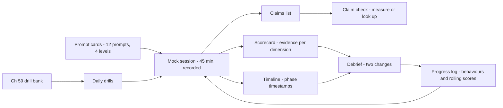
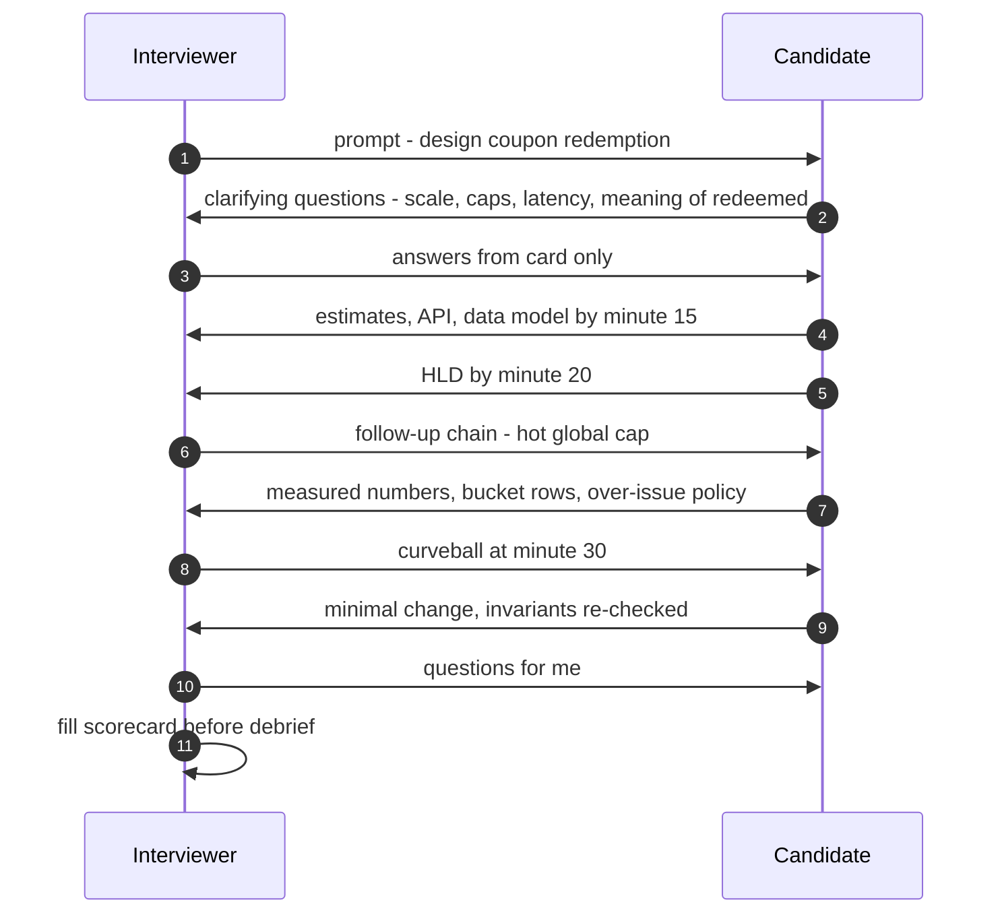
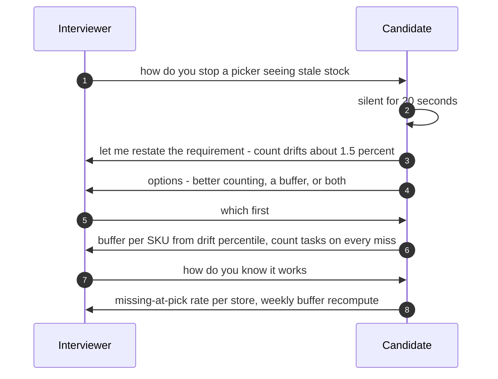
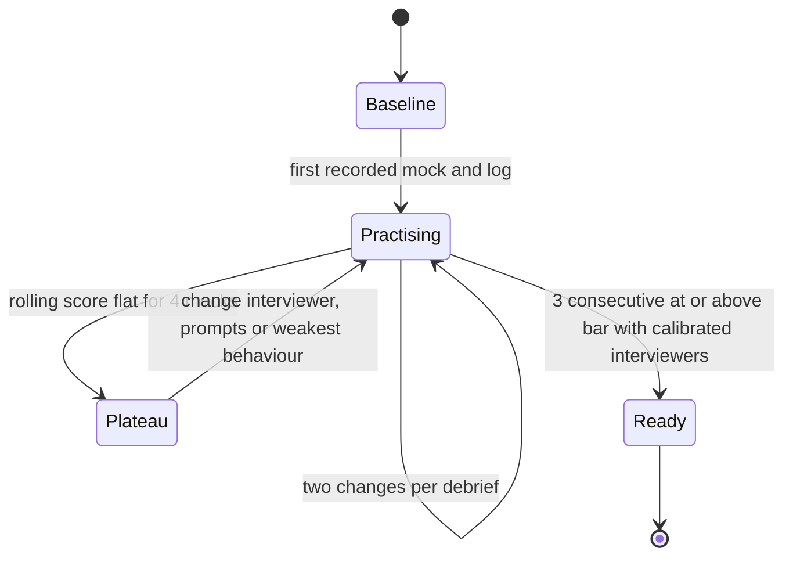

# 60. Mock Interviews

!!! abstract "Chapter at a glance"
    **Reader bands:** B1 → B4 · **Prerequisites:** [Ch 57](57-the-system-design-interview-framework.md), [Ch 58](58-level-expectations.md), [Ch 59](59-interview-qa-bank.md)

    **What you get:**

    - How to run mock interviews that actually change your performance: formats, the interviewer's script, pacing, debriefs, calibration and tracking progress.
    - **Four full worked mocks** with interviewer cards, timelines, transcript excerpts and scorecards:
        - **A** coupon redemption (B1–B2)
        - **B** order-status notifications (B2)
        - **C** dark-store inventory for 10-minute delivery (B3)
        - **D** taking the platform to a second country (B4)

    **What the labs measured:**

    - **L1 (pacing):** in six recorded practice mocks, the deep-dive and failure phases got **11.2 of a planned 16 minutes**. A single checkpoint rule ("drawing the HLD by minute 20") recovers them to **15.2**. It does not fix an 11-minute clarify phase.
    - **L2 (calibration), simulated:**
        - One **calibrated** interviewer decides as accurately as **four uncalibrated** ones (86.4% vs 86.5%).
        - Two uncalibrated interviewers reach the same verdict only **68%** of the time.
        - A candidate just above the bar gets a "hire" from one uncalibrated mock only **60%** of the time.
    - **L3 (check a claim before the mock), real PostgreSQL:** a single-row conditional `UPDATE` gives **4,398 reservations/s** with one thread, but only **~2,000/s at 32 threads with a 77 ms p99**. Sixteen bucket rows give **10,844/s at 8 threads**.
    - **L4 (progress), simulated:** even when you really improve by 0.10 per mock, **one in three** candidates scores lower on mock 4 than on mock 1. A statistical trend needs about **12 mocks**.

    **Reading time:** 70 min.

---

## 1. Introduction & Why It Matters

### 1.1 A story: the fifth mock

Meera had done four mocks with friends. All four "went fine", and she was nervous about each real loop anyway. On the fifth, her friend recorded the session and then sat down with her, the recording and a stopwatch. The recording showed:

- **Requirements:** 11 minutes of clarifying questions.
- **Deep dive:** 3 minutes, because time ran out.
- **Failure handling:** never discussed.
- **Two claims she couldn't back up:** "a Redis counter handles any load" and "Kafka guarantees exactly-once".

None of her four earlier mocks had surfaced this, because the friend had been *friendly*: no clock, no follow-ups, no scorecard.

A mock is only useful if it is **harder and more honest than the real thing**. That means a real clock, an interviewer with a script and hidden requirements, follow-up chains, a scorecard against a level, a recording, and a debrief that ends with two things to change. This chapter is how to run those, on both sides of the table.

!!! quote "The thesis of this chapter"
    **Run mocks as experiments:**

    - a timed prompt with an interviewer card;
    - follow-up chains to the edge of what you know;
    - a level-anchored scorecard;
    - a recorded debrief with two changes.

    **Pace with checkpoints** (L1). **Calibrate peer interviewers** before trusting a verdict (L2). **Check your standard claims against real numbers** (L3). **Judge progress on trends and behaviours, not one score** (L4).

### 1.2 Learning objectives

By the end you will be able to:

- **Run a mock** as candidate *and* as interviewer, with a card, a clock and a scorecard.
- **Pace 45 minutes** with checkpoints, and recover when you're behind.
- **Handle pushback, being stuck, and "what if" chains** gracefully.
- **Debrief** into specific, behavioural changes.
- **Calibrate** a peer group and **track progress** honestly.

---

## 2. Core Concepts — Beginner to Deep

### 2.1 Intuition: a dress rehearsal <span class="band b1">B1</span>

Actors rehearse in costume, on stage, with lights, before opening night. Mistakes that would be fatal on the night (a missed cue, a prop in the wrong place) are cheap in rehearsal. A mock is your dress rehearsal. It is only useful if the conditions match: the time limit, a stranger's questions, a whiteboard, and nobody rescuing you.

### 2.2 Mock formats <span class="band b1">B1</span>

| Format | Good for | Limits | Frequency |
|---|---|---|---|
| **Solo, recorded** | Pacing, clarity, speaking aloud | No follow-ups, no pushback | 2/week early on |
| **Peer (swap roles)** | Follow-ups, both perspectives | Calibration varies (L2) | 1–2/week |
| **Senior colleague or mentor** | Level-accurate probing, stories | Their time | 2–4 total |
| **Paid or professional** | Calibrated scoring, company-specific style | Cost | 1–2 before key loops |
| **Real low-stakes loops** | Real conditions | Cost of a no | Optional |

**Order:** solo first to fix pacing, then peers for follow-ups, then calibrated interviewers to find out where you actually stand.

### 2.3 The interviewer card ⭐ <span class="band b2">B2</span>

A mock interviewer needs more than a prompt. They need a **card** holding what a real interviewer knows and the candidate doesn't:

| Card section | Contents |
|---|---|
| **Prompt** | One sentence, deliberately vague |
| **Hidden requirements** | Answers to reveal only if asked (scale, latency, regions, consistency) |
| **Must-cover** | The 2–3 hard parts the design must address |
| **Follow-up chains** | 3–4 chains, each 3–4 links deep ([Ch 59](59-interview-qa-bank.md) §2.4) |
| **Curveballs** | One requirement change at minute ~30 |
| **Level anchors** | What B2/B3/B4 answers sound like for this prompt ([Ch 58](58-level-expectations.md)) |
| **Scorecard** | Dimensions and 1–4 anchors ([Ch 57](57-the-system-design-interview-framework.md) L4) |

The four mocks in §2.6–§2.9 each come with a card you can reuse.

### 2.4 The interviewer's script <span class="band b2">B2</span>

1. **0–1 min:** Deliver the prompt. Say nothing else.
2. **1–10 min:** Answer questions from the card only. Unasked hidden requirements stay hidden.
3. **Throughout:** Take timestamped notes of phases, claims and numbers.
4. **~20 min:** If the candidate is still on requirements, don't rescue them. Note it.
5. **20–35 min:** Pull one follow-up chain per hard part until the candidate reaches the edge of what they know.
6. **~30 min:** Deliver the curveball.
7. **40–45 min:** "What would you do next with more time?", and questions to you.
8. **After:** Fill the scorecard *before* discussing it, so the discussion can't soften the score. Then debrief (§2.10).

### 2.5 Behaviours under pressure ⭐ <span class="band b2">B2</span>

| Situation | Weak response | Strong response |
|---|---|---|
| **Stuck** | Silence, or random components | "Let me reason from the requirement: we need X within Y, so the options are A or B…" |
| **Pushback** ("why not X?") | Abandon the choice, or defend blindly | Restate the requirement, compare X honestly, keep or switch *with a reason* |
| **Unknown fact** | Bluff | "I don't know the exact number. I'd measure it. My estimate is ~N because…" |
| **Wrong earlier** | Hide it | "I said Y earlier. That's wrong because Z. Let me fix the design." |
| **Curveball** | Start over | Identify what changes, modify the minimum, re-check the invariants |
| **Behind on time** | Rush everything | Say so, compress the low-value phases aloud (L1), protect the deep dive |
| **Interviewer silent** | Keep adding boxes | Check in: "Would you like me to go deeper on X or move to Y?" |

### 2.6 Mock A — Coupon redemption service <span class="band b2">B1–B2</span>

!!! example "Interviewer card — Mock A"
    **Prompt:** "Design a service that lets customers apply coupon codes at checkout."

    **Hidden requirements (reveal only if asked):**

    - 20M users and 50k active coupons.
    - Peak 3,000 checkouts/s during sale events.
    - Some coupons are single-use per user; others have a global cap, e.g. the first 10,000 redemptions.
    - Coupon validation must answer in p99 ≤ 50 ms.
    - A redeemed coupon must never be redeemed twice, even with retries.

    **Must-cover:**

    - A validation vs redemption split.
    - Enforcing per-user and global caps under concurrency.
    - Idempotent redemption tied to the order.

    **Chains:**

    1. The global cap at 3,000/s → a hot counter → buckets/reservations → over-issue tolerance.
    2. Payment fails after redemption → release → timeout sweeper → idempotency.
    3. Stacking rules → rule engine → evaluation order ([Ch 49](../05-case-studies/49-pricing-promotions-and-coupons.md)).

    **Curveball (min 30):** "Marketing wants a coupon valid only for the first order in each city."

    **Level anchors:**

    - **B1:** a working CRUD design with a unique constraint.
    - **B2:** caps under concurrency, idempotency and release on failure.
    - **B3:** hot-cap handling with numbers, and an abuse/fraud angle.

**Timeline of a strong B2 answer:**

| Min | Phase | What happened |
|---|---|---|
| 0–5 | Clarify | Asked scale, cap types, latency, stacking and what "redeemed" means (at payment, not at apply). |
| 5–8 | Estimate | 3,000 checkouts/s × ~30% with a coupon ≈ 1,000 validations/s. One sale coupon can take most of them. |
| 8–11 | API | `POST /coupons/validate {code, cartId}` returns the discount and a validation token. `POST /coupons/redeem {code, orderId}` is idempotent on the order id. |
| 11–15 | Data | `coupon` (rules, caps), `redemption` (`coupon_id`, `user_id`, `order_id`, status) with UNIQUE(`coupon_id`, `user_id`) for single-use coupons and UNIQUE(`order_id`). |
| 15–24 | HLD | Checkout calls validate (reads from a cached rules table), then reserves at order creation, then confirms on payment. |
| 24–36 | Deep dive | Global cap: a conditional decrement on a counter row. The candidate checked the hot-row limit against L3 (≈2,000/s at high concurrency), proposed 16 bucket rows, and accepted a small over-issue at the end. |
| 36–41 | Failures | Payment fails → release. The reservation carries a TTL, and a sweeper releases it. Duplicate redeem → the unique order id returns the prior result. |
| 41–45 | Curveball | "First order per city" means a new rule type plus a per-city check against order history. The candidate asked whether "first" means first ever or first with this coupon. |

**Transcript excerpt: the hot counter chain**

> **Interviewer:** The sale coupon is capped at 10,000 and 2,000 people apply it in the first second. What happens?
>
> **Candidate:** A single counter row with `UPDATE … SET left = left - 1 WHERE left > 0` is correct, but it's one hot row. I measured something similar: roughly 4,000 per second from one connection, but only about 2,000 per second with 32 concurrent callers, and the p99 was around 75 ms. So it would just about hold, but it breaks our 50 ms budget. I'd split the cap across 16 bucket rows. Each request picks a random bucket and moves on if it's empty.
>
> **Interviewer:** Then some buckets empty early. Do you under-issue?
>
> **Candidate:** Near the end, yes, unless empty-bucket misses fall through to the other buckets. I'd rather do that, and accept a handful of over-issues only if marketing agrees. For money-capped coupons I'd keep it exact.

**Scorecard (B2 target):**

| Dimension | Score | Evidence |
|---|---|---|
| Requirements | 4 | Asked about caps and the definition of "redeemed" |
| Estimation | 3 | Derived the hot-coupon rate |
| Design | 3 | Clean validate/reserve/confirm split |
| Deep dive | 4 | Hot row with measured numbers and a bucket fallback |
| Failures | 3 | Release, TTL and idempotency; missed abuse (code sharing) |
| Communication | 3 | Checked in at 24 minutes |

**Verdict:** strong B2.

**What a B1 answer looked like:** a CRUD coupon table and a check-then-insert in application code, which has a race under concurrency. There was no release when payment failed, and one global counter in Redis "because Redis is fast", with no numbers behind it.

### 2.7 Mock B — Order-status notifications <span class="band b2">B2</span>

!!! example "Interviewer card — Mock B"
    **Prompt:** "Customers should be told when their order status changes. Design it."

    **Hidden requirements:**

    - 1.5M orders/day, ~8 status changes each.
    - Channels: push, SMS for critical changes, in-app.
    - "Out for delivery" must arrive within 30 s.
    - No duplicate SMS (they cost money).
    - Respect quiet hours for promotional messages, but not for transactional ones.

    **Must-cover:**

    - Event source → notification pipeline.
    - Priority lanes.
    - Dedup/idempotency.
    - Provider failover.

    **Chains:**

    1. The SMS provider is slow → retries → duplicate SMS → an idempotency key per (order, status, channel).
    2. A burst after a flash sale → lanes and rate limits.
    3. Ordering: "delivered" arrives before "out for delivery".

    **Curveball:** "Add WhatsApp as a channel in some cities."

    **Level anchors:**

    - **B2:** outbox + queue + workers, dedup, retries.
    - **B3:** lanes with capacity numbers, provider failover, ordering per order.

**Timeline highlights:**

- **Estimate.** 1.5M × 8 = 12M events/day. That averages 140/s, and a sale peak at 5× the average is ~700/s. Push costs little, SMS costs per message, so the candidate asked which statuses trigger SMS (only "delayed" and "out for delivery").
- **HLD.** The order service writes an outbox, which feeds Kafka (keyed by order id). The notification service applies preferences and templates, then puts messages on priority topics, and channel workers send them through providers. A delivery-status webhook closes the loop ([Ch 40](../05-case-studies/40-notification-system.md)).
- **Deep dive: duplicates.** The idempotency key is `(orderId, status, channel)`. It is claimed in a table *before* calling the provider, with the state moving `sending → sent/failed`. If the provider times out, the outcome is unknown: query the provider's status API with the client reference, and don't blindly resend.
- **Deep dive: ordering.** Events are keyed by order, so they stay in order per partition. On the device, show the latest status by sequence number and drop stale events.

**Transcript excerpt: recovering from a wrong statement**

> **Candidate:** …and Kafka gives us exactly-once, so there are no duplicate SMS.
>
> **Interviewer:** Does it?
>
> **Candidate:** Let me correct that. Kafka's exactly-once covers read-process-write *within* Kafka. Sending an SMS is an external side effect, so we get at-least-once delivery to our worker. The duplicate protection has to be our idempotency key before the provider call, plus reconciliation with the provider's delivery reports.

**Scorecard excerpt:** the quick self-correction counted *in the candidate's favour* on communication. It showed they know exactly where Kafka's guarantee ends, which is the real point of the question.

### 2.8 Mock C — Dark-store inventory for 10-minute delivery <span class="band b3">B3</span>

!!! example "Interviewer card — Mock C"
    **Prompt:** "We promise delivery in 10 minutes from 400 dark stores. Design inventory so we never sell what the store doesn't have."

    **Hidden requirements:**

    - 5,000 SKUs per store.
    - 20 orders/min per store at peak, with about 12 items each.
    - Stock changes from orders, receiving, damage and cycle counts.
    - Pickers find items missing about 1.5% of the time, because the counts drift.
    - Checkout p99 ≤ 300 ms.
    - The app shows availability per store.

    **Must-cover:**

    - Reservation vs physical stock.
    - Drift and reconciliation with cycle counts.
    - Availability shown in the app vs availability at checkout.
    - The hot SKU during a flash deal.

    **Chains:**

    1. Flash deal on one SKU in one store → hot row → the L3 numbers.
    2. A picker finds the item missing → substitution → correct the count → feed the ML forecast.
    3. A store goes offline → the store's own system vs the central one.

    **Curveball:** "We're adding scheduled orders for tomorrow morning."

    **Level anchors:**

    - **B3:** a two-level stock model (on-hand vs reservable), a safety buffer derived from drift, and reconciliation loops.
    - **B4:** unit economics of buffers vs the cost of missing items, and an org-level ownership model.

**The B3 moves that stood out:**

1. **A two-number model.**
    - `on_hand` is physical stock, updated by receiving, picking and counts.
    - `reservable = on_hand − reserved − safety_buffer`.
    - The buffer is set per SKU from the observed drift, e.g. the 95th percentile of count corrections.
2. **Checked the load before over-engineering.** 400 stores × 20 orders/min × 12 items is about **1,600 reservations/s** across the fleet, spread over ~2M (store, SKU) rows. A single-row `UPDATE` per (store, SKU) is plenty. Only a flash deal on one row needs attention, and L3 says ~2,000/s is the ceiling for a single row under heavy concurrency. The candidate put a **per-SKU request gate** in front of it rather than sharding every row.
3. **Separated app availability from checkout.**
    - The app reads a cached "reservable > buffer" flag, refreshed from events within seconds.
    - Checkout reserves against the source of truth, and fails closed with a substitution offer ([Ch 46](../05-case-studies/46-grocery-checkout-and-inventory-reservation.md)).
4. **Closed the loop on drift.** Every "missing" found at picking triggers a count task for that bin. Corrections are events, and the buffer is recomputed weekly. The metric to watch is the **missing-at-pick rate**, not stock accuracy in general.
5. **The curveball, done calmly.** Scheduled orders reserve against *tomorrow's* stock after receiving. That makes it a forecast-backed reservation with a confirmation step at 06:00 when stock arrives. It is a separate pool, so it never blocks 10-minute orders.

**Transcript excerpt: pushback**

> **Interviewer:** Why not keep inventory in Redis? It's faster.
>
> **Candidate:** For reservation it would be faster, but then Redis becomes the source of truth for stock, which means persistence, failover semantics and reconciliation back to the warehouse system. Our load is about 1,600 per second spread over two million rows, which PostgreSQL does comfortably. I'd put Redis in front only for the one hot-deal SKU as a gate, where losing the gate state is safe because the database still enforces the count.

### 2.9 Mock D — Taking the platform to a second country <span class="band b4">B4</span>

!!! example "Interviewer card — Mock D"
    **Prompt:** "We're launching in a second country in 9 months. What changes in the architecture and how do you run it?"

    **Hidden requirements:**

    - Data residency: customer and payment data must stay in the new country (VERIFY the actual law for any real country).
    - Different tax rules, currency, payment providers and language.
    - About 10% of India's volume in year 1.
    - The same product team, plus 2 new local teams.
    - The CFO wants the launch cost under 15% of the current infrastructure spend.

    **Must-cover:**

    - Cells or deployment per country vs a shared global setup.
    - What is global vs what is local.
    - Configurable tax, currency and payments.
    - Org and ownership.
    - Rollout and risk.

    **Chains:**

    1. Residency → which services must be in-country → shared catalog? → cross-border analytics.
    2. One codebase vs a fork → feature flags per market → testing matrix.
    3. Cost → a small cell's fixed cost → managed services.

    **Curveball:** "Legal says order history may need to be kept 8 years in-country."

    **Level anchors:**

    - **B3:** a sound regional deployment design.
    - **B4:**
        - sequencing and decision records;
        - the org model;
        - cost and risk trade-offs with numbers;
        - what *not* to build;
        - reversible first steps.

**What a B4 answer covered:**

1. **Framing first.** "This is mostly a product-and-org decision with an architecture component." The candidate named the three hard constraints (residency, payments, cost) and the two-way doors vs the one-way doors ([Ch 31](../04-architect/31-architecture-decision-making.md)).
2. **A country cell, not a fork.**
    - The same code and the same deployment pipeline, running as an in-country cell.
    - Market configuration (tax, currency, payment adapters, locale) as data and plug-ins.
    - The global layer is limited to non-personal data: catalog templates, the ML models' training jobs on anonymised aggregates, and engineering tooling ([Ch 30](../03-production/30-multi-tenancy-and-saas-architecture.md), [Ch 36](../04-architect/36-compliance-governance-and-data-residency.md)).
3. **Cost with numbers.** A minimal HA cell has a fixed floor: 3 AZs, a managed database, Kafka, search and observability. At 10% of the volume, that floor dominates. The candidate estimated the cell at ~12% of current spend and named the levers (managed services, smaller search, shared CI) and the risk of passing 15%.
4. **The org.**
    - Platform teams own the cell template.
    - The two local teams own the market adapters and local operations.
    - Architecture reviews add a "market impact" section.
    - The on-call model covers local hours ([Ch 37](../04-architect/37-leading-architecture-at-scale.md)).
5. **Sequencing.** Make the market configurable inside India first (a reversible step), then stand up a staging cell, run a shadow launch with employees, then a soft launch in one city. Each stage has a success metric and a rollback.
6. **The curveball.** Retention goes into the cell's archive tier, stored in-country. The retention policy lives as code per market, and the cost impact is estimated. The candidate asked legal which fields fall in scope.

**The B4 signal:** most of the time went on constraints, sequencing, cost and ownership. The boxes-and-arrows part took about 10 minutes. The candidate also said what they would *not* do yet (no multi-country active-active, no global customer identity).

### 2.10 The debrief ⭐ <span class="band b2">B2</span>

A debrief turns a mock into change. Keep it to 15 minutes:

1. **Candidate first (3 min):** what went well, and what you'd redo.
2. **Timeline (3 min):** the interviewer reads out the phase timestamps (L1).
3. **Scorecard (4 min):** a score per dimension, *with evidence quotes*.
4. **Claims check (2 min):** list every number or claim the candidate made, and mark it verified, plausible or wrong (L3).
5. **Two changes (3 min):** specific and behavioural, e.g. "Checkpoint at 20 minutes" or "State the invariant before the mechanism". Not "be better at caching".

Log it: date, prompt, level, scores, the two changes, and whether last mock's changes happened.

### 2.11 Pacing ⭐ <span class="band b2">B2</span>

L1's six mocks show the usual pattern. The early phases overrun one or two minutes at a time, and the deep dive, which is where levels are decided, absorbs all of it.

**Checkpoints:**

| By minute | You should be |
|---|---|
| 5 | Done clarifying (state the assumptions for the rest) |
| 12 | Done with estimates and the API |
| 20 | Drawing the HLD |
| 30 | In the deep dive on the hardest part |
| 38 | On failures, operability and trade-offs |

**When you're behind:**

1. Say so.
2. Compress the phases L1 marks as compressible, aloud. For example: "I'll state the numbers: ~1,000 validations per second, 50 ms budget." Or: "Two endpoints: validate and redeem."
3. Protect the deep dive.

Clarify is not compressible in the same way. Timebox it at 5 minutes and state your assumptions for the rest.

### 2.12 Calibrating a peer group <span class="band b3">B3</span>

L2 shows that uncalibrated peers disagree on about one verdict in three. The disagreement comes from **bias** (lenient or harsh interviewers) as much as noise. To calibrate:

- **Anchored rubrics:** for each dimension, write down what a 2, 3 and 4 *sound like* for this prompt. The level anchors on the cards above are a start.
- **Shadow scoring:** two interviewers score the same recording independently, then compare scores and evidence.
- **Score review:** monthly, look at each interviewer's average score. A consistently lenient interviewer is a known bias you can correct for.
- **Evidence over impressions:** every score cites a quote or a timestamp.

In L2's model, a single calibrated interviewer decides about as well as four uncalibrated ones. Calibration is cheaper than more mocks.

### 2.13 Measuring progress <span class="band b4">B4</span>

L4's lesson: one mock score is mostly noise (prompt difficulty and interviewer). Even with genuine improvement, scores go down about a third of the time over four mocks. Instead:

- **Track behaviours, not verdicts.** Did you hit the 20-minute checkpoint? State the invariant? Quantify the hot path? Cover failures? Each is a yes or no.
- **Use rolling averages** over 3 mocks, and vary the prompts.
- **Expect about 12 mocks** before a trend shows up statistically, which is roughly the number most prep plans use anyway.
- **Stop mocking when readiness is consistent:** 3 consecutive mocks at or above bar, with calibrated interviewers.

### 2.14 Remote and whiteboard logistics <span class="band b1">B1</span>

- **Practise on the real tool** (a shared whiteboard or diagram tool), including drawing speed. Pre-set a few shapes if the tool allows it.
- **Camera and audio:** a quiet room, a headset, and a second screen for your notes if that's allowed.
- **Handwriting:** use large boxes with few words and label every arrow with the call type (sync or async).

---

## 3. Architecture & Diagrams

### 3.1 A mock practice programme



### 3.2 Sequence: a mock that goes well



### 3.3 Sequence: recovering from being stuck



### 3.4 State: readiness across a mock series



---

## 4. Design Document Excerpt: Mock Programme

!!! note "Design Document (excerpt) — Peer Mock Interview Programme for a Study Group of 6"
    **Status:** Template · **Owner:** study group lead

    | Field | Value |
    |---|---|
    | Context | Six engineers targeting senior and staff loops within 8 weeks. Peer mocks disagree often (L2), and nobody tracks progress. |
    | Decision | Weekly role-swapping mocks using shared interviewer cards and anchored rubrics. Every session is recorded, and the first two weeks include shadow-scored calibration. A progress log tracks behaviours. |
    | Related | [Ch 57](57-the-system-design-interview-framework.md) rubric, [Ch 58](58-level-expectations.md) anchors, [Ch 59](59-interview-qa-bank.md) drills. |

    **Requirements.**

    - **R1:** Each member does ≥ 2 mocks a week as candidate and 1–2 as interviewer.
    - **R2:** Every mock uses a card, a clock and a scorecard with evidence.
    - **R3:** Inter-interviewer verdict agreement ≥ 80% on shared recordings by week 3.
    - **R4:** Each debrief produces two behavioural changes, logged.
    - **R5:** Readiness is declared only after 3 consecutive at-bar mocks with calibrated interviewers.

    **Decisions in detail.**

    1. **Card library.** 12 prompts, 3 per level, each with hidden requirements, chains and anchors (§2.6–§2.9 as a start).
    2. **Calibration.** In weeks 1–2, everyone scores the same two recordings. Discuss the differences, then update the anchors.
    3. **Rotation.** Avoid always pairing the same two people. Rotate prompts so nobody sees one twice.
    4. **Claims check.** Every debrief lists the numbers used. Anyone can run a lab (§5 L3) to verify them.
    5. **Log.** A shared sheet with prompt, level, behaviours (yes/no), scores and changes.

    **Consequences.**

    - About 4 hours per person per week.
    - Better-calibrated verdicts.
    - Progress becomes visible through behaviours even while the scores are noisy.

---

## 5. Hands-On Code — Level Ladder

!!! info "What's real here"
    - **L3** runs against a real PostgreSQL 16 database (`fsync=on`) on a 2-CPU sandbox.
    - **L1** replays illustrative phase logs.
    - **L2** and **L4** are simulations whose assumptions are stated in the code. Trust their direction, not the exact percentages.

All four labs are JDK 21 single-file programs. L3 needs the PostgreSQL JDBC driver:
`java -Duser.timezone=UTC -cp postgresql-42.7.4.jar ClaimCheckL3.java`.

### L1 — Where did the 45 minutes go? <span class="band b2">B2</span>

**Requirement:** "Protect the deep dive, which is where levels are decided."

The program takes six practice mocks as recorded, with each phase's duration and a hard stop at 45 minutes. It replays them with one checkpoint rule.

```java title="PacingL1.java"
// L1 — Pacing: where the 45 minutes actually went in six recorded mocks, and what a checkpoint rule changes.
// Phase durations are illustrative, in the pattern typical of practice recordings (not real candidate data).
import java.util.*;

public class PacingL1 {
    static final String[] PH = {"clarify", "estimate", "api", "data", "hld", "deep-dive", "failures", "wrap"};
    static final int[] PLAN = {5, 4, 4, 5, 9, 12, 4, 2};          // sums to 45
    static final boolean[] COMPRESSIBLE = {false, true, true, true, false, false, false, false};
    static final int[] FLOOR = {0, 1, 1, 2, 0, 0, 0, 0};           // minimum minutes if compressed

    record Mock(String name, int[] minutes) {}

    public static void main(String[] a) {
        List<Mock> mocks = List.of(
            new Mock("M1 coupon service (B2)", new int[]{11, 7, 6, 8, 10, 3, 0, 0}),
            new Mock("M2 order notifications (B2)", new int[]{6, 3, 9, 7, 8, 9, 3, 0}),
            new Mock("M3 dark-store inventory (B3)", new int[]{5, 5, 3, 6, 11, 11, 4, 0}),
            new Mock("M4 multi-country (B4)", new int[]{8, 2, 2, 4, 12, 10, 5, 2}),
            new Mock("M5 rate limiter (B2)", new int[]{4, 8, 5, 5, 9, 10, 2, 2}),
            new Mock("M6 search autocomplete (B3)", new int[]{7, 6, 4, 9, 9, 8, 2, 0}));

        System.out.println("Plan (min): " + fmt(PLAN) + "   total 45\n");
        System.out.printf("%-30s %-44s %6s %9s %9s%n", "mock (as recorded)", PH[0] + "/" + PH[1] + "/.../" + PH[7], "@20min", "deep+fail", "overran");
        for (Mock m : mocks) {
            int[] x = cap(m.minutes());
            System.out.printf("%-30s %-44s %6s %6d/16 %9s%n", m.name(), fmt(x), phaseAt(x, 20), x[5] + x[6], overran(x));
        }
        System.out.println("\nCheckpoint rule: at minute 20 you must be drawing the HLD. If you are behind, compress estimate/api/data");
        System.out.println("to their floors (1/1/2 min: state the numbers, name 2 endpoints, list 3 tables) and say so aloud.\n");
        System.out.printf("%-30s %-44s %6s %9s%n", "mock (replayed with rule)", "", "@20min", "deep+fail");
        int before = 0, after = 0;
        for (Mock m : mocks) {
            int[] x = cap(m.minutes()), y = applyRule(m.minutes());
            before += x[5] + x[6]; after += y[5] + y[6];
            System.out.printf("%-30s %-44s %6s %6d/16%n", m.name(), fmt(y), phaseAt(y, 20), y[5] + y[6]);
        }
        System.out.printf("%nDeep-dive + failures, average over 6 mocks: %.1f min as recorded → %.1f min with the rule (plan: 16)%n", before / 6.0, after / 6.0);
        System.out.println("(replay assumes the minutes saved go to deep-dive then failures; clarify is never compressed)");
    }

    // the interview stops at 45 minutes: whatever was not reached gets nothing
    static int[] cap(int[] m) { int[] r = new int[m.length]; int t = 0; for (int i = 0; i < m.length; i++) { r[i] = Math.max(0, Math.min(m[i], 45 - t)); t += r[i]; } return r; }

    static int[] applyRule(int[] m) {
        int[] r = m.clone(); int t = 0; int saved = 0;
        for (int i = 0; i < 4; i++) t += r[i];
        if (t > 20 - 0) {                       // HLD not started by minute 20
            for (int i = 1; i <= 3; i++) if (COMPRESSIBLE[i] && r[i] > FLOOR[i]) {
                int cut = Math.min(r[i] - FLOOR[i], t - 20 + 0); if (cut <= 0) break; r[i] -= cut; saved += cut; t -= cut; }
        }
        int total = Arrays.stream(r).sum();
        int spare = 45 - total;                 // minutes now available before the hard stop
        if (spare > 0) { int addDeep = Math.min(spare, Math.max(0, PLAN[5] - r[5])); r[5] += addDeep; spare -= addDeep;
                         int addFail = Math.min(spare, Math.max(0, PLAN[6] - r[6])); r[6] += addFail; spare -= addFail;
                         r[7] += Math.min(spare, 2); }
        return cap(r);
    }
    static String phaseAt(int[] x, int minute) { int t = 0; for (int i = 0; i < x.length; i++) { t += x[i]; if (t > minute) return PH[i]; } return "done"; }
    static String overran(int[] x) { StringBuilder s = new StringBuilder(); for (int i = 0; i < 4; i++) if (x[i] > PLAN[i] + 2) s.append(s.length() > 0 ? "," : "").append(PH[i]); return s.length() == 0 ? "-" : s.toString(); }
    static String fmt(int[] x) { StringBuilder s = new StringBuilder(); for (int v : x) s.append(String.format("%3d", v)); return s.toString(); }
}
```

```text title="java PacingL1.java"
Plan (min):   5  4  4  5  9 12  4  2   total 45

mock (as recorded)             clarify/estimate/.../wrap                    @20min deep+fail   overran
M1 coupon service (B2)          11  7  6  8 10  3  0  0                        api      3/16 clarify,estimate,data
M2 order notifications (B2)      6  3  9  7  8  9  3  0                       data     12/16       api
M3 dark-store inventory (B3)     5  5  3  6 11 11  4  0                        hld     15/16         -
M4 multi-country (B4)            8  2  2  4 12 10  5  2                        hld     15/16   clarify
M5 rate limiter (B2)             4  8  5  5  9 10  2  2                       data     12/16  estimate
M6 search autocomplete (B3)      7  6  4  9  9  8  2  0                       data     10/16      data

Checkpoint rule: at minute 20 you must be drawing the HLD. If you are behind, compress estimate/api/data
to their floors (1/1/2 min: state the numbers, name 2 endpoints, list 3 tables) and say so aloud.

mock (replayed with rule)                                                   @20min deep+fail
M1 coupon service (B2)          11  1  1  7 10 12  3  0                        hld     15/16
M2 order notifications (B2)      6  1  6  7  8 12  4  1                        hld     16/16
M3 dark-store inventory (B3)     5  5  3  6 11 11  4  0                        hld     15/16
M4 multi-country (B4)            8  2  2  4 12 10  5  2                        hld     15/16
M5 rate limiter (B2)             4  6  5  5  9 12  2  2                        hld     14/16
M6 search autocomplete (B3)      7  1  3  9  9 12  4  0                        hld     16/16

Deep-dive + failures, average over 6 mocks: 11.2 min as recorded → 15.2 min with the rule (plan: 16)
(replay assumes the minutes saved go to deep-dive then failures; clarify is never compressed)
```

**Reading it:**

- **As recorded:**
    - Four of the six mocks were still on the data model or earlier at minute 20.
    - Deep dive plus failures averaged **11.2 of 16 planned minutes**.
    - M1 got **3 minutes** and never reached failures.
- **With the rule:** "HLD by minute 20, compress estimate/API/data aloud if behind" raises the average to **15.2**.
- **What the rule can't fix:** M1 still spends 11 minutes clarifying, because clarify is not compressible. Clarify needs its own 5-minute timebox.
- **What it doesn't touch:** mocks already on time (M3, M4) are unchanged.

### L2 — Should you trust your peer's verdict? <span class="band b3">B3</span>

**Requirement:** "Know how much a mock verdict tells you, and what makes it more reliable."

The program simulates 200,000 candidates under two interviewer models. The bias and noise levels are assumptions stated in the code.

```java title="CalibrationL2.java"
// L2 — Calibration: how interviewer bias and noise turn into wrong hire decisions, and what calibration and more interviewers buy.
// Model (assumptions, VERIFY against your own loop data): candidate skill ~ N(0,1); hire bar = skill > 0.5 (~31% should pass).
// Interviewer i reports skill + bias_i + noise. Uncalibrated: bias sd 0.5, noise sd 0.6. Calibrated (anchored rubric,
// shadowing, score review): bias sd 0.15, noise sd 0.45. Decision: mean of the k interviewers' scores > 0.5.
import java.util.*;

public class CalibrationL2 {
    public static void main(String[] a) {
        long seed = 60;
        int candidates = 200_000, panel = 12;
        System.out.println("200,000 simulated candidates; hire bar: true skill > 0.5 (30.9% should be hired)\n");
        System.out.printf("%-14s %3s %11s %12s %12s %10s %14s%n", "interviewers", "k", "accuracy", "false hire", "false reject", "hire rate", "2 agree (k=1)");
        for (String mode : new String[]{"uncalibrated", "calibrated"}) {
            double biasSd = mode.equals("uncalibrated") ? 0.5 : 0.15, noiseSd = mode.equals("uncalibrated") ? 0.6 : 0.45;
            for (int k : new int[]{1, 2, 3, 4}) {
                Random r = new Random(seed);
                double[] bias = new double[panel]; for (int i = 0; i < panel; i++) bias[i] = r.nextGaussian() * biasSd;
                if (k == 1) System.out.printf("   (%s panel of %d: mean bias %+.2f, most lenient %+.2f, harshest %+.2f)%n", mode, panel,
                        Arrays.stream(bias).average().orElse(0), Arrays.stream(bias).max().orElse(0), Arrays.stream(bias).min().orElse(0));
                int correct = 0, fh = 0, fr = 0, hires = 0, agree = 0;
                for (int c = 0; c < candidates; c++) {
                    double skill = r.nextGaussian(); boolean should = skill > 0.5;
                    int[] who = pick(r, panel, Math.max(k, 2));
                    double sum = 0; for (int j = 0; j < k; j++) sum += skill + bias[who[j]] + r.nextGaussian() * noiseSd;
                    boolean hire = sum / k > 0.5;
                    if (hire == should) correct++; else if (hire) fh++; else fr++;
                    if (hire) hires++;
                    // would two single interviewers, seen independently, reach the same decision?
                    boolean d1 = skill + bias[who[0]] + r.nextGaussian() * noiseSd > 0.5, d2 = skill + bias[who[1]] + r.nextGaussian() * noiseSd > 0.5;
                    if (d1 == d2) agree++;
                }
                System.out.printf("%-14s %3d %10.1f%% %11.1f%% %11.1f%% %9.1f%% %13.1f%%%n", mode, k, 100.0 * correct / candidates,
                        100.0 * fh / candidates, 100.0 * fr / candidates, 100.0 * hires / candidates, 100.0 * agree / candidates);
            }
        }
        // mock-interview angle: a candidate right at the bar (skill 0.7) vs just below (0.3) — how often a single mock says "hire"?
        System.out.println("\nOne mock, one interviewer — how often the verdict is \"hire\" for a candidate with true skill s:");
        System.out.printf("%-14s %8s %8s %8s %8s %8s%n", "interviewers", "s=0.0", "s=0.3", "s=0.7", "s=1.0", "s=1.5");
        for (String mode : new String[]{"uncalibrated", "calibrated"}) {
            double biasSd = mode.equals("uncalibrated") ? 0.5 : 0.15, noiseSd = mode.equals("uncalibrated") ? 0.6 : 0.45;
            Random r = new Random(seed + 1);
            StringBuilder row = new StringBuilder(String.format("%-14s", mode));
            for (double s : new double[]{0.0, 0.3, 0.7, 1.0, 1.5}) {
                int yes = 0, n = 100_000;
                for (int i = 0; i < n; i++) if (s + r.nextGaussian() * biasSd + r.nextGaussian() * noiseSd > 0.5) yes++;
                row.append(String.format(" %7.0f%%", 100.0 * yes / n));
            }
            System.out.println(row);
        }
    }
    static int[] pick(Random r, int n, int k) { List<Integer> l = new ArrayList<>(); for (int i = 0; i < n; i++) l.add(i); Collections.shuffle(l, r); int[] x = new int[k]; for (int i = 0; i < k; i++) x[i] = l.get(i); return x; }
}
```

```text title="java CalibrationL2.java"
200,000 simulated candidates; hire bar: true skill > 0.5 (30.9% should be hired)

interviewers     k    accuracy   false hire false reject  hire rate  2 agree (k=1)
   (uncalibrated panel of 12: mean bias +0.20, most lenient +1.48, harshest -0.85)
uncalibrated     1       76.2%        17.0%         6.8%      41.3%          67.7%
uncalibrated     2       81.6%        13.7%         4.7%      39.7%          67.6%
uncalibrated     3       84.5%        12.0%         3.5%      39.2%          67.7%
uncalibrated     4       86.5%        10.8%         2.7%      39.0%          67.7%
   (calibrated panel of 12: mean bias +0.06, most lenient +0.44, harshest -0.26)
calibrated       1       86.4%         8.7%         4.8%      34.9%          81.2%
calibrated       2       90.0%         6.4%         3.5%      33.7%          81.0%
calibrated       3       91.7%         5.5%         2.7%      33.5%          81.1%
calibrated       4       93.0%         4.8%         2.2%      33.4%          81.1%

One mock, one interviewer — how often the verdict is "hire" for a candidate with true skill s:
interviewers      s=0.0    s=0.3    s=0.7    s=1.0    s=1.5
uncalibrated        26%      40%      60%      74%      90%
calibrated          14%      34%      66%      85%      98%
```

**Reading it:**

- **Two uncalibrated interviewers reach the same verdict on only ~68% of candidates.** Calibrated interviewers agree on ~81%.
- **One calibrated interviewer (86.4%) is as accurate as four uncalibrated ones (86.5%).** Averaging more interviewers reduces the noise, but not the panel's shared lenience. This simulated panel happened to average **+0.20** lenient, which is why false hires outnumber false rejects. So does the base rate: most candidates sit below the bar, so noise pushes more of them over it than under.
- **A candidate just above the bar (s = 0.7) gets "hire" from one mock only 60–66% of the time.** One mock's verdict is weak evidence either way.
- The numbers depend on the assumed bias and noise. **The direction is the finding: calibrate first, then add interviewers.** VERIFY against your own group's shadow-scoring data.

### L3 — Check a claim before you make it <span class="band b3">B3</span>

**Requirement:** "In Mocks A and C I'll say one hot stock or coupon row handles about 2,000 reservations/s. Is that true?"

This lab runs against real PostgreSQL 16 with `fsync=on`, from 1, 8 and 32 concurrent connections, for 4 seconds per run.

```java title="ClaimCheckL3.java"
// L3 — Check a claim before you make it in a mock: "one conditional UPDATE on a single stock row handles a
// flash sale of 2,000 reservations/s for one SKU". Real PostgreSQL 16 (fsync=on), 2-CPU sandbox, localhost.
// Modes: A single row; B 16 bucket rows (random bucket, move on if empty); C single row, 20 reservations per commit (batched).
import java.sql.*;
import java.util.*;
import java.util.concurrent.*;
import java.util.concurrent.atomic.*;

public class ClaimCheckL3 {
    static final String URL = "jdbc:postgresql://localhost:5581/shop?user=claude";
    static final int SECONDS = 4;

    public static void main(String[] a) throws Exception {
        try (Connection c = DriverManager.getConnection(URL); Statement s = c.createStatement()) {
            s.execute("DROP TABLE IF EXISTS mock_stock");
            s.execute("CREATE TABLE mock_stock (sku int, bucket int, qty int NOT NULL, PRIMARY KEY (sku, bucket))");
        }
        System.out.printf("Each run: %d s of closed-loop load, stock large enough never to run out. Target from the mock: 2,000 reservations/s.%n%n", SECONDS);
        System.out.printf("%-34s %8s %14s %10s %10s%n", "mode", "threads", "reservations/s", "p50 ms", "p99 ms");
        for (String mode : new String[]{"A single row", "B 16 bucket rows", "C single row, 20 per commit"})
            for (int threads : new int[]{1, 8, 32}) run(mode, threads);
        try (Connection c = DriverManager.getConnection(URL); Statement s = c.createStatement()) {
            ResultSet rs = s.executeQuery("SELECT count(*), min(qty) FROM mock_stock"); rs.next();
            System.out.printf("%nrows %d, lowest remaining qty %d (never ran out, so every UPDATE did real work)%n", rs.getInt(1), rs.getInt(2));
        }
    }

    static void run(String mode, int threads) throws Exception {
        int buckets = mode.startsWith("B") ? 16 : 1, batch = mode.startsWith("C") ? 20 : 1;
        try (Connection c = DriverManager.getConnection(URL); Statement s = c.createStatement()) {
            s.execute("DELETE FROM mock_stock");
            for (int b = 0; b < buckets; b++) s.execute("INSERT INTO mock_stock VALUES (1, " + b + ", " + (10_000_000 / buckets) + ")");
            s.execute("VACUUM ANALYZE mock_stock");
        }
        AtomicLong done = new AtomicLong(); ConcurrentLinkedQueue<long[]> lat = new ConcurrentLinkedQueue<>();
        long end = System.nanoTime() + SECONDS * 1_000_000_000L;
        ExecutorService ex = Executors.newFixedThreadPool(threads); List<Future<?>> fs = new ArrayList<>();
        for (int t = 0; t < threads; t++) fs.add(ex.submit(() -> {
            Connection c = DriverManager.getConnection(URL);      // one dedicated connection per worker, closed below
            try {
                PreparedStatement ps = c.prepareStatement("UPDATE mock_stock SET qty = qty - ? WHERE sku = 1 AND bucket = ? AND qty >= ?");
                ThreadLocalRandom r = ThreadLocalRandom.current(); long[] mine = new long[400_000]; int n = 0;
                while (System.nanoTime() < end) {
                    long t0 = System.nanoTime();
                    int b = r.nextInt(buckets);
                    ps.setInt(1, batch); ps.setInt(2, b); ps.setInt(3, batch);
                    if (ps.executeUpdate() == 1) done.addAndGet(batch);
                    long d = System.nanoTime() - t0;
                    for (int i = 0; i < batch && n < mine.length; i++) mine[n++] = d;   // each reservation in a batch waits for the commit
                }
                lat.add(Arrays.copyOf(mine, n));
            } finally { c.close(); }
            return null;
        }));
        for (Future<?> f : fs) f.get(); ex.shutdown();
        long[] all = lat.stream().flatMapToLong(Arrays::stream).sorted().toArray();
        System.out.printf("%-34s %8d %,14.0f %10.2f %10.2f%n", mode, threads, done.get() / (double) SECONDS,
                all[all.length / 2] / 1e6, all[(int) (all.length * 0.99)] / 1e6);
    }
}
```

```text title="java -Duser.timezone=UTC -cp postgresql-42.7.4.jar ClaimCheckL3.java"
Each run: 4 s of closed-loop load, stock large enough never to run out. Target from the mock: 2,000 reservations/s.

mode                                threads reservations/s     p50 ms     p99 ms
A single row                              1          4,398       0.19       0.81
A single row                              8          3,722       1.54       9.67
A single row                             32          1,976      10.66      76.56
B 16 bucket rows                          1          5,297       0.17       0.46
B 16 bucket rows                          8         10,844       0.60       2.72
B 16 bucket rows                         32          9,643       2.44      14.61
C single row, 20 per commit               1         97,040       0.18       0.53
C single row, 20 per commit               8         72,340       1.52      10.11
C single row, 20 per commit              32         41,020      10.39      74.44

rows 1, lowest remaining qty 9835920 (never ran out, so every UPDATE did real work)
```

**Reading it:**

- **Single row:** throughput *falls* as concurrency rises: 4,398/s with one connection, 3,722/s with 8, and **1,976/s with 32**, with p99 **77 ms**. Every transaction queues on the same row lock. So the claim holds only at the edge, and it breaks a 50 ms p99 budget. A second run gave 2,313/s and a 69 ms p99 at 32 connections, so expect ±15% between runs.
- **16 bucket rows:** lock contention spreads out, giving **10,844/s at 8 connections** with a 2.7 ms p99. Going from 8 to 32 connections adds nothing (9,643/s), which is consistent with the 2-CPU sandbox being the limit.
- **Batching 20 per commit:** throughput is enormous (97k/s with one connection), but each reservation waits for its batch's commit. The latency pattern follows the lock queue, as in the single-row case.
- **In the mock, say:** "About 2,000 per second on one hot row under real concurrency, with a p99 of tens of milliseconds. Above that, I'd use bucket rows or a gate in front." Hardware differs, so quote the order of magnitude and say you'd measure.

### L4 — Am I actually improving? <span class="band b4">B4</span>

**Requirement:** "Decide from my mock scores whether I'm improving, without fooling myself."

The simulation adds noise from prompt difficulty and the interviewer (total sd ≈ 0.5 on the 1–4 scale; an assumption) on top of a true per-mock gain.

```java title="ProgressL4.java"
// L4 — Are my mocks improving, or is it noise? Scores on the 1–4 rubric scale.
// Model (assumption, VERIFY with your own spread): true level starts at 2.4 and improves by `gain` per mock;
// each mock score = true level + prompt difficulty (sd 0.35) + interviewer (sd 0.35) → total noise sd ≈ 0.5.
import java.util.*;

public class ProgressL4 {
    public static void main(String[] a) {
        int trials = 50_000; Random r = new Random(6004);
        System.out.println("How often does a series of N mocks show what is really happening?  (50,000 simulated candidates per cell)\n");
        System.out.printf("%-12s %3s %16s %18s %20s %20s%n", "gain/mock", "N", "last < first", "slope > 0 (90%)", "rolling-3 rose", "true gain over N");
        for (double gain : new double[]{0.0, 0.05, 0.10})
            for (int n : new int[]{4, 6, 8, 12}) {
                int lastLower = 0, sig = 0, roll = 0;
                for (int t = 0; t < trials; t++) {
                    double[] y = new double[n];
                    for (int i = 0; i < n; i++) y[i] = 2.4 + gain * i + r.nextGaussian() * 0.35 + r.nextGaussian() * 0.35;
                    if (y[n - 1] < y[0]) lastLower++;
                    if (tStat(y) > tCrit(n - 2)) sig++;
                    if (avg(y, n - 3, n) > avg(y, 0, 3)) roll++;
                }
                System.out.printf("%-12s %3d %15.0f%% %17.0f%% %19.0f%% %20s%n", String.format("%+.2f", gain), n,
                        100.0 * lastLower / trials, 100.0 * sig / trials, 100.0 * roll / trials, String.format("%+.2f", gain * (n - 1)));
            }
        System.out.println("\nlast < first: the discouraging comparison people make; slope > 0 (90%): one-sided test on the least-squares slope;");
        System.out.println("rolling-3 rose: average of the last 3 mocks above the average of the first 3 (for N=4 the windows overlap by 2 mocks).");
    }
    static double avg(double[] y, int from, int to) { double s = 0; for (int i = from; i < to; i++) s += y[i]; return s / (to - from); }
    static double tStat(double[] y) {
        int n = y.length; double mx = (n - 1) / 2.0, my = avg(y, 0, n), sxx = 0, sxy = 0;
        for (int i = 0; i < n; i++) { sxx += (i - mx) * (i - mx); sxy += (i - mx) * (y[i] - my); }
        double b = sxy / sxx, sse = 0; for (int i = 0; i < n; i++) { double e = y[i] - (my + b * (i - mx)); sse += e * e; }
        return b / Math.sqrt(sse / (n - 2) / sxx);
    }
    // one-sided 90% critical values of Student's t
    static double tCrit(int df) { return switch (df) { case 2 -> 1.886; case 4 -> 1.533; case 6 -> 1.440; case 10 -> 1.372; default -> 1.3; }; }
}
```

```text title="java ProgressL4.java"
How often does a series of N mocks show what is really happening?  (50,000 simulated candidates per cell)

gain/mock      N     last < first    slope > 0 (90%)       rolling-3 rose     true gain over N
+0.00          4              50%                10%                  50%                +0.00
+0.00          6              50%                10%                  50%                +0.00
+0.00          8              50%                10%                  50%                +0.00
+0.00         12              50%                10%                  50%                +0.00
+0.05          4              41%                14%                  59%                +0.15
+0.05          6              36%                19%                  64%                +0.25
+0.05          8              31%                25%                  73%                +0.35
+0.05         12              22%                45%                  87%                +0.55
+0.10          4              33%                18%                  67%                +0.30
+0.10          6              24%                31%                  77%                +0.50
+0.10          8              16%                47%                  89%                +0.70
+0.10         12               6%                85%                  99%                +1.10

last < first: the discouraging comparison people make; slope > 0 (90%): one-sided test on the least-squares slope;
rolling-3 rose: average of the last 3 mocks above the average of the first 3 (for N=4 the windows overlap by 2 mocks).
```

**Reading it:**

- **Genuine improvement still looks like decline surprisingly often.** At +0.10 per mock, **33%** of candidates score lower on mock 4 than on mock 1, and 16% still do on mock 8.
- **A statistically clear trend needs about 12 mocks** (85% detection at +0.10 per mock). With no real improvement, the test fires 10% of the time, as designed.
- **Rolling 3-mock averages** point the right way more often (89% at N = 8, gain +0.10). With no gain they rise half the time, so they indicate direction, not proof. For N = 4 the windows overlap, and the comparison reduces to last vs first.
- **Practical rule:** track yes/no behaviours (checkpoint hit, invariant stated, failures covered), which you control. Treat any single score as one noisy sample.

---

## 6. Practice Concerns

### 6.1 Choosing prompts

- Mix familiar and unfamiliar prompts: about 60% from Part V, 40% new.
- Include one prompt per week from outside your domain.
- For staff and principal loops, include at least one evolution or strategy prompt, like Mock D.

### 6.2 Being a good mock interviewer

- Stick to the card and don't rescue the candidate.
- Pull chains to the edge.
- Score before you talk.
- Being an interviewer also makes you a better candidate: you see the rubric from the other side.

### 6.3 Recording and privacy

- Record with consent. Keep recordings private to the group, and delete them after the prep period.
- Never use real proprietary designs from employers in mocks.

### 6.4 Company-specific styles

Formats differ between companies: whiteboard vs doc-based design, product vs infrastructure focus, strict 45 minutes vs a 60-minute deep dive.

- Adjust your pacing checkpoints to the format.
- Ask your recruiter about the format. This is expected and fine.

### 6.5 Burnout

- Cap mocks at 3–4 a week. Rest days help consolidation (Ch 59 L4).
- Do a light drill the day before, not a mock.

---

## 7. Anti-Patterns & Pitfalls

!!! danger "1. Friendly mocks"
    No clock, no follow-ups, no score. It feels good and teaches little.

!!! danger "2. Rescuing the candidate"
    The interviewer reveals hidden requirements early, so the requirements skill never gets tested.

!!! danger "3. Scoring after the chat"
    The discussion softens the score. Fill the scorecard first.

!!! danger "4. Judging by one verdict"
    One mock is noise (L2, L4).

!!! danger "5. Vague debriefs"
    "Be more structured" changes nothing. Name specific behaviours.

!!! danger "6. Always the same partner"
    Their bias becomes your baseline.

!!! danger "7. Only familiar prompts"
    You end up rehearsing answers, not thinking.

!!! danger "8. Unchecked standard claims"
    "Redis handles anything" and "Kafka is exactly-once" get probed. Measure or look them up (L3).

!!! danger "9. No recording"
    You can't see your own pacing or filler words.

!!! danger "10. Ignoring the curveball skill"
    Real interviewers change requirements. Practise minimal, calm changes.

!!! danger "11. Mocking the day before the loop"
    It adds fatigue and anxiety. Do a light drill instead.

!!! danger "12. Staff-level candidates only drawing boxes"
    At B4, sequencing, cost and ownership are the signal (Mock D).

---

## 8. Interview Q&A

### Beginner <span class="band b1">B1</span>

??? question "Q1 [B1] ⭐ What makes a mock interview useful rather than just practice?"

    **30-second answer:** Realistic conditions (clock, stranger-like interviewer, hidden requirements, follow-ups), a level-anchored scorecard with evidence, a recording, and a debrief that ends in two specific behavioural changes — tracked across mocks.

    **Deep answer:** §2.3–§2.4 and §2.10. A friendly mock without these produces confidence without feedback.

    **Trade-offs I'd call out:** More realism costs more time; it's the part that transfers.

    **Follow-ups:**
    1. How many mocks? → About 8–12, until consistently at bar (L4).
    2. Solo mocks? → Useful early for pacing.

    **Red flags:** "I just talk through designs with friends."

??? question "Q2 [B1] How should you use the first five minutes of a design interview?"

    **30-second answer:** Clarify users, core features, scale, latency and consistency needs, and non-goals; write them down; then state the assumptions you'll use for anything unanswered — and move on by minute five.

    **Deep answer:** L1: overrunning clarify was the single biggest time loss in the recorded mocks, and the checkpoint rule can't recover it.

    **Trade-offs I'd call out:** Too few questions risk the wrong system ([Ch 57](57-the-system-design-interview-framework.md) L3); too many starve the deep dive.

    **Follow-ups:**
    1. Interviewer says "you decide"? → State an assumption and why.
    2. Which question first? → Scale, then latency.

    **Red flags:** Drawing before asking anything.

??? question "Q3 [B1] What do you do when you don't know something in an interview?"

    **30-second answer:** Say so, reason from principles to an estimate, and say how you'd verify it — "I don't know the exact figure; roughly N because…; I'd measure it with…". Never bluff.

    **Deep answer:** §2.5. Interviewers probe until you reach an edge; how you behave there is part of the signal.

    **Trade-offs I'd call out:** None — bluffing is always worse.

    **Follow-ups:**
    1. Guess wrong? → Correct it when you realise.
    2. Many unknowns? → Focus on the ones that change the design.

    **Red flags:** Confident wrong numbers.

??? question "Q4 [B1] How do you practise system design on your own?"

    **30-second answer:** Timed, recorded solo mocks on a whiteboard tool, answering aloud from a prompt card, then reviewing the recording for pacing and clarity; plus daily Q&A drills and one design written up per week.

    **Deep answer:** §2.2 and [Ch 59](59-interview-qa-bank.md) L3.

    **Trade-offs I'd call out:** No follow-ups — pair with peers later.

    **Follow-ups:**
    1. What to watch in recordings? → Phase times, filler words, unexplained boxes.
    2. How often? → Two per week early on.

    **Red flags:** Only reading solutions.

### Intermediate <span class="band b2">B2</span>

??? question "Q5 [B2] ⭐ You're 20 minutes in and still haven't drawn the architecture. What do you do?"

    **30-second answer:** Say it aloud, compress estimates/API/data to one line each ("~1,000 validations/s; validate and redeem endpoints; coupon and redemption tables"), draw the HLD now, and protect the deep-dive time.

    **Deep answer:** L1: the checkpoint rule raised deep-dive + failure time from 11.2 to 15.2 minutes on average across six mocks.

    **Trade-offs I'd call out:** Less detail in early phases — rarely where the signal is.

    **Follow-ups:**
    1. Interviewer wants the data model? → Go there; they steer.
    2. Clarify overran? → Timebox to 5 next time.

    **Red flags:** Rushing everything equally.

??? question "Q6 [B2] ⭐ The interviewer asks 'why not use X instead?' How do you respond?"

    **30-second answer:** Restate the requirement that drove your choice, compare X honestly on it, then either keep your choice with the reason or switch with the reason — both are fine; flip-flopping without reasons isn't.

    **Deep answer:** Mock C's Redis pushback (§2.8) and [Ch 57](57-the-system-design-interview-framework.md) L2 — know which of your choices are close calls.

    **Trade-offs I'd call out:** Defending a weak choice vs appearing unsure.

    **Follow-ups:**
    1. X is actually better? → Say so and switch.
    2. Interviewer insists? → Explore it, note the risk.

    **Red flags:** Immediately abandoning a sound choice.

??? question "Q7 [B2] How do you handle a requirement change at minute 30?"

    **30-second answer:** Identify what the change affects (data, APIs, invariants, load), make the minimal modification, re-check the invariants and failure cases touched, and state what you'd revisit with more time.

    **Deep answer:** Mock A (first order per city) and Mock C (scheduled orders — separate pool, never blocks instant orders).

    **Trade-offs I'd call out:** Minimal change vs a cleaner redesign.

    **Follow-ups:**
    1. Change conflicts with an earlier choice? → Say so and adapt.
    2. Ambiguous change? → Ask one question.

    **Red flags:** Starting over.

??? question "Q8 [B2] ⭐ How do you make a claim like 'a single database row can handle this' credible?"

    **30-second answer:** Give the number and its basis — measured or well-known — and the condition: e.g., a conditional UPDATE on one row did ~4,400/s from one connection but ~2,000/s with a 77 ms p99 at 32 concurrent callers on a small box; then say what you'd do if the load is higher (buckets, batching, a gate).

    **Deep answer:** L3.

    **Trade-offs I'd call out:** Precision vs time; one sig fig is fine.

    **Follow-ups:**
    1. Different hardware? → Order of magnitude holds; measure.
    2. Why does concurrency lower throughput? → Row-lock contention and queueing.

    **Red flags:** "Databases are slow" or "Redis handles anything".

??? question "Q9 [B2] How should a mock debrief work?"

    **30-second answer:** Candidate self-assessment, the timeline, a scorecard with evidence quotes, a check of every claim made, and two specific behavioural changes — logged and checked next mock.

    **Deep answer:** §2.10.

    **Trade-offs I'd call out:** 15 minutes per mock — worth it.

    **Follow-ups:**
    1. Too many issues? → Pick the two with the most impact.
    2. Positive feedback? → Name what to keep doing.

    **Red flags:** "Went well, good job."

### Senior <span class="band b3">B3</span>

??? question "Q10 [B3] ⭐ In the dark-store inventory mock, how do you prevent selling items that aren't physically there?"

    **30-second answer:** Separate on-hand from reservable stock with a per-SKU safety buffer derived from count drift; reserve at checkout against the source of truth; show cached availability in the app; and every missing-at-pick triggers a count and feeds buffer recalculation — measured by missing-at-pick rate.

    **Deep answer:** §2.8.

    **Trade-offs I'd call out:** Buffers hide sellable stock.

    **Follow-ups:**
    1. Buffer size? → From the drift percentile, per SKU.
    2. Store offline? → Local fallback.

    **Red flags:** Trusting system counts exactly.

??? question "Q11 [B3] Why do peer mock verdicts disagree, and what do you do about it?"

    **30-second answer:** Interviewer bias (lenient/harsh) and noise; in a simple model two uncalibrated peers agreed on only ~68% of verdicts. Anchored rubrics, shadow scoring on shared recordings, evidence-based scores and reviewing each interviewer's average fix most of it.

    **Deep answer:** L2 and §2.12.

    **Trade-offs I'd call out:** Calibration time vs more mocks — calibration wins.

    **Follow-ups:**
    1. Measure it? → Agreement on shared recordings.
    2. One lenient friend? → Discount or rotate.

    **Red flags:** Trusting the kindest verdict.

??? question "Q12 [B3] How do you design an interviewer card for a new prompt?"

    **30-second answer:** A one-line prompt, hidden requirements that change the design, 2–3 must-cover hard parts, 3–4 follow-up chains each 3–4 links deep, one curveball, level anchors for B2/B3/B4, and the scorecard.

    **Deep answer:** §2.3 and the four cards.

    **Trade-offs I'd call out:** Card detail vs flexibility.

    **Follow-ups:**
    1. Where do chains come from? → The chapter's Q&A follow-ups.
    2. Test the card? → Run it once yourself.

    **Red flags:** Prompt only.

??? question "Q13 [B3] How do you avoid the 'Kafka is exactly-once' trap in a notification design?"

    **30-second answer:** Kafka's exactly-once covers read-process-write within Kafka; an SMS send is an external side effect, so the consumer sees at-least-once; protect with an idempotency key claimed before the provider call, status queries for unknown outcomes, and reconciliation with delivery reports.

    **Deep answer:** Mock B; [Ch 14](../02-distributed-core/14-messaging-and-event-streaming.md), [Ch 40](../05-case-studies/40-notification-system.md).

    **Trade-offs I'd call out:** Rare duplicates vs rare drops.

    **Follow-ups:**
    1. Provider timeout? → Query, don't resend.
    2. Key lifetime? → Beyond the retry window.

    **Red flags:** Relying on Kafka for external effects.

??? question "Q14 [B3] How do you know your mock scores are actually improving?"

    **30-second answer:** Single scores are noisy — in a simple model a third of genuinely improving candidates score lower on mock 4 than mock 1; track yes/no behaviours per mock, rolling averages over varied prompts, and expect around 12 mocks before a trend is statistically clear.

    **Deep answer:** L4 and §2.13.

    **Trade-offs I'd call out:** More mocks vs fatigue.

    **Follow-ups:**
    1. Plateau? → Change interviewer or weakest behaviour.
    2. Ready when? → 3 consecutive at bar, calibrated.

    **Red flags:** Quitting after one bad mock.

### Architect <span class="band b4">B4</span>

??? question "Q15 [B4] ⭐ How do you approach 'launch in a second country' in a principal-level interview?"

    **30-second answer:** Frame it as product, org and architecture; name hard constraints (residency, payments, cost) and one-way doors; propose country cells from the same code with market configuration as data; estimate the cell's fixed cost; define ownership; sequence reversible steps with metrics and rollback; and say what you won't build yet.

    **Deep answer:** Mock D (§2.9).

    **Trade-offs I'd call out:** Cell fixed cost vs shared-infrastructure compliance risk.

    **Follow-ups:**
    1. Fork the code? → No, configure.
    2. Global identity? → Not yet.

    **Red flags:** Just drawing another region.

??? question "Q16 [B4] What distinguishes a B4 answer to a strategy prompt from a B3 answer?"

    **30-second answer:** B3 designs a sound regional deployment; B4 also sequences the work, quantifies cost and risk, sets ownership and decision records, identifies what not to do, and makes the first steps reversible — the boxes take a quarter of the time.

    **Deep answer:** [Ch 58](58-level-expectations.md), Mock D.

    **Trade-offs I'd call out:** Breadth vs depth — B4 still needs one deep dive.

    **Follow-ups:**
    1. Interviewer wants depth? → Go deep on residency.
    2. Evidence of past work? → A story.

    **Red flags:** Hand-waving without numbers.

??? question "Q17 [B4] You're running interview calibration for an org. What do you put in place?"

    **30-second answer:** Anchored rubrics per level and prompt, interviewer training with shadowing, evidence-based written feedback before debriefs, periodic score audits per interviewer, and outcome tracking (performance of hires) — the same levers as the peer mock programme, at org scale.

    **Deep answer:** L2, §2.12; [Ch 37](../04-architect/37-leading-architecture-at-scale.md).

    **Trade-offs I'd call out:** Interviewer time vs decision quality.

    **Follow-ups:**
    1. Bar raiser role? → Consistency across teams.
    2. Bias? → Structured questions reduce it.

    **Red flags:** "Trust your gut."

??? question "Q18 [B4] How do you use mocks to prepare for leadership and behavioural rounds, not just design?"

    **30-second answer:** Mock those too: 5–8 stories in an evidence format, delivered to a peer who probes for your specific actions, trade-offs and outcomes; score for scope, judgement and influence; and tie stories to design topics (a migration, an incident).

    **Deep answer:** [Ch 58](58-level-expectations.md) §2.8; [Ch 61](61-behavioral-and-leadership.md).

    **Trade-offs I'd call out:** Rehearsed vs natural.

    **Follow-ups:**
    1. "We" vs "I"? → Say what you did.
    2. Failure stories? → What you changed after.

    **Red flags:** Only success stories.

??? question "Q19 [B4] In a mock, the interviewer challenges a trade-off you're confident about. How do you handle it at staff level?"

    **30-second answer:** Engage the strongest version of their alternative, restate the requirement and the costs on both sides with numbers, identify the condition under which you'd flip, and keep your choice if it still holds — a calm disagreement is a staff signal.

    **Deep answer:** [Ch 31](../04-architect/31-architecture-decision-making.md); Mock C.

    **Trade-offs I'd call out:** Humility vs conviction.

    **Follow-ups:**
    1. They're right? → Switch and thank them.
    2. No data? → Propose a test.

    **Red flags:** Arguing without evidence.

??? question "Q20 [B4] What would you change about how most engineers prepare for system design interviews?"

    **30-second answer:** Less reading, more timed spoken practice; measured claims rather than folklore; calibrated scoring instead of friendly verdicts; tracking behaviours instead of single scores; and preparing strategy prompts and stories for senior levels.

    **Deep answer:** This chapter's L1–L4 and [Ch 59](59-interview-qa-bank.md) L4.

    **Trade-offs I'd call out:** Time investment.

    **Follow-ups:**
    1. First change? → Record your next mock.
    2. Group or solo? → Both.

    **Red flags:** "Memorise solutions."

---

## 9. Summary & Practice

### Key takeaways

1. **Mocks need a card, a clock, a scorecard and a debrief.**
2. **Pace with checkpoints.** "HLD by minute 20" protects the deep dive (L1).
3. **Calibrate interviewers before trusting verdicts** (L2).
4. **Check your standard claims against real numbers** (L3).
5. **Track behaviours and trends, not one score** (L4).
6. **At B4, strategy, sequencing and ownership are the signal** (Mock D).

### Cheat sheet

| Moment | Move |
|---|---|
| Minute 5 | Stop clarifying, state your assumptions |
| Minute 20 | HLD on the board, or compress aloud |
| Stuck | Restate the requirement, list the options |
| Pushback | Requirement → compare → keep or switch with a reason |
| Unknown | Estimate, then say how you'd verify it |
| Curveball | Minimal change, re-check the invariants |
| After | Scorecard first, then two changes |

### Exercises

1. **(B1)** Record a solo mock of Mock A and log your phase times with L1's format.
2. **(B2)** Run Mock B with a peer as interviewer, using the card. Debrief with §2.10.
3. **(B3)** Change L3 to use `SELECT … FOR UPDATE` then `UPDATE`. How much slower is it, and why?
4. **(B3)** Write an interviewer card for a prompt from Part V that isn't used here.
5. **(B4)** Run Mock D and write the one-page decision record the answer implies.

### Further reading

- Books and guides on structured interviewing and interviewer calibration (VERIFY which your target company uses).
- Company engineering blogs describing their interview formats.
- This handbook's case studies (Part V) as prompt sources.

### Related chapters

- [Ch 57 — Interview Framework](57-the-system-design-interview-framework.md)
- [Ch 58 — Level Expectations](58-level-expectations.md)
- [Ch 59 — Interview Q&A Bank](59-interview-qa-bank.md)
- [Ch 61 — Behavioural & Leadership](61-behavioral-and-leadership.md)
