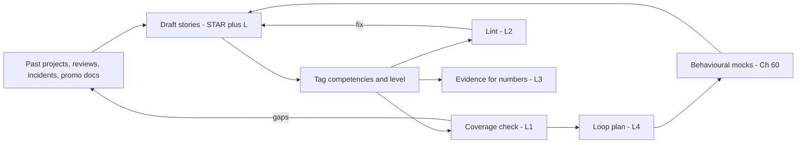
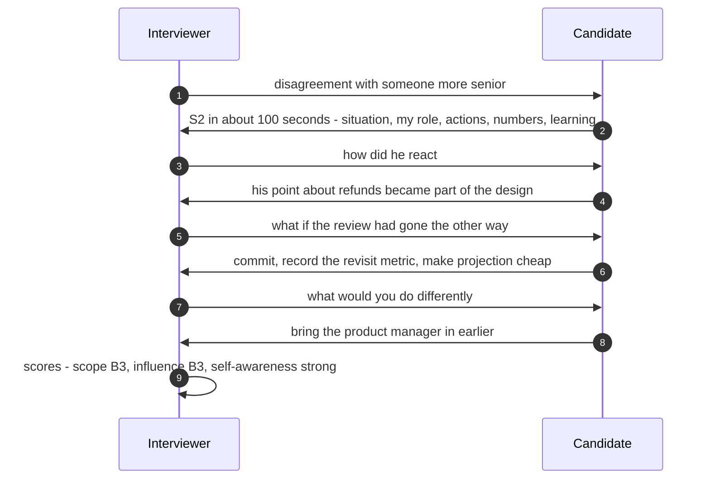
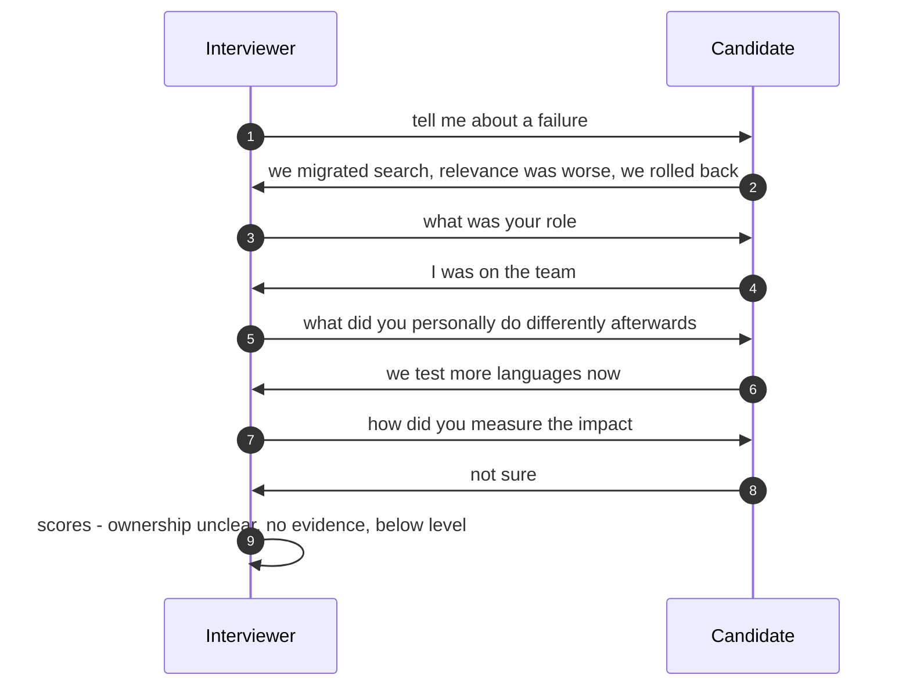
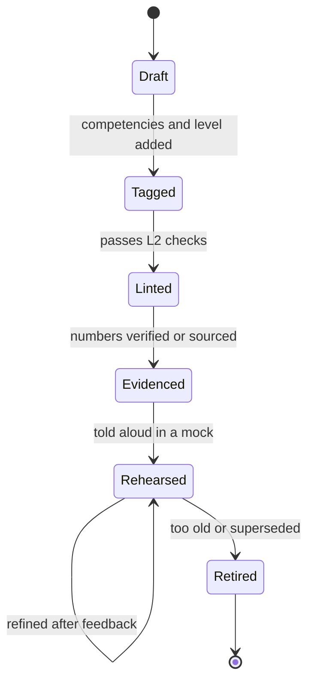

# 61. Behavioural & Leadership

!!! abstract "Chapter at a glance"
    **Reader bands:** B1 → B4 · **Prerequisites:** [Ch 37](../04-architect/37-leading-architecture-at-scale.md), [Ch 58](58-level-expectations.md), [Ch 60](60-mock-interviews.md)

    **What you get:** the rounds that decide levels as often as design does. It covers:

    - what behavioural and leadership interviews assess at each level, and the story format;
    - how to build a **story bank** mapped to competencies;
    - "I" vs "we", and how to back impact claims with honest evidence;
    - the question families and what each one probes;
    - technical leadership as a senior IC, and principal-level strategy and org influence;
    - planning which story goes to which interviewer across a loop.

    **What the labs measured** (on an illustrative 8-story bank):

    - **L1 (coverage):** for a staff loop, **1 gap** (prioritisation) and **10 thin or below-level** competencies. Three stories carry four competencies each.
    - **L2 (lint):** the two weak stories fail on everything: under 30 seconds, set-up above 35%, "we" in place of "I", no numbers, one-line learnings. The rewrites pass.
    - **L3 (evidence, real PostgreSQL):** a covering index cut p50 by **38%, 37% and 11%** in three rounds. Each round's confidence interval was tight, but the rounds disagreed with each other, and **p99 showed no measurable change**. Cherry-picking the same data gives "99% faster".
    - **L4 (loop plan):** after the gap is filled, all 12 questions have a fitting story (fit 19 → 22 of 24). Even the optimal plan tells **3 stories twice**, which means more stories are needed.

    **Reading time:** 75 min.

---

## 1. Introduction & Why It Matters

### 1.1 A story: "we did great work"

Rahul was a strong engineer with 15 years of experience. His design round was rated staff level, but his behavioural round came back "senior, not staff". The feedback:

- *"Every answer was 'we'. I couldn't tell what he personally did."*
- *"No numbers on impact."*
- *"His conflict example was with a junior engineer. We needed influence across teams."*
- *"When asked what he'd do differently, he said 'nothing, it went well'."*

He had done staff-level work. He hadn't *shown* it. Behavioural rounds are evidence interviews: the interviewer can only score what you say. Stories need to be concrete, in the first person, quantified and reflective, and matched to the level.

!!! quote "The thesis of this chapter"
    **Behavioural rounds score evidence of scope, judgement and influence at your target level.**

    - Build a **story bank** that covers the competencies at that level (L1).
    - Tell each story in **first person with numbers and a real learning** (L2).
    - **Back impact claims** with measurements you can defend (L3).
    - **Plan the loop** so each interviewer hears different evidence (L4).

### 1.2 What these rounds are called

| Company style | Name | Emphasis |
|---|---|---|
| Large product companies | Behavioural, "values", leadership principles | Specific past behaviour against published values (VERIFY each company's list) |
| Startups | Culture / founder chat | Ownership, speed, ambiguity |
| Staff+ loops | Leadership, "technical leadership", "past project deep-dive" | Scope, influence, strategy, org impact |
| Managers | People management | Hiring, performance, org design (outside this chapter's IC focus) |

### 1.3 Learning objectives

By the end you will be able to:

- **Explain what each level signals** in behavioural rounds.
- **Build and maintain** a story bank mapped to competencies.
- **Tell stories** in a tight format, in the first person, with honest numbers.
- **Handle probing follow-ups** and difficult questions.
- **Demonstrate technical leadership** as a senior, staff or principal IC.

---

## 2. Core Concepts — Beginner to Deep

### 2.1 Intuition: past behaviour as evidence <span class="band b1">B1</span>

An interviewer can't watch you work for six months, so they ask what you *did* in specific situations. The assumption is that past behaviour in similar situations is the best available predictor. That's why hypothetical answers ("I would…") score poorly, and specific ones ("Last March I…") score well.

### 2.2 What each level signals ⭐ <span class="band b2">B1–B4</span>

| Dimension | B1 engineer | B2 senior | B3 staff | B4 principal |
|---|---|---|---|---|
| **Scope** | A task or feature | A service or project | Multiple teams or a domain | An org, a platform, multi-year direction |
| **Ambiguity** | Clear problems | Unclear solutions | Unclear problems | Unclear strategy |
| **Influence** | Own team members | Team, adjacent teams | Peer teams and managers without authority | Directors and executives, and the industry |
| **Conflict** | With peers | Technical disagreements | Cross-team, with senior people | Org-level trade-offs |
| **Impact** | Shipped work | Measurable outcomes for a system | Outcomes across teams, with raised standards | Changed how the org builds and decides |
| **Growing others** | Helping peers | Mentoring | Growing seniors, raising hiring bars | Building leadership benches, culture |
| **Time horizon** | Weeks | Quarters | Quarters to a year | Years |

**The same question at different levels:** "Tell me about a disagreement."

- A B2 answer is about a design debate within the team.
- A B3 answer is about changing another team's or an architect's decision with evidence (S2).
- A B4 answer is about resolving an org-level trade-off, such as the roadmap cut (S9), or setting a standard that many teams adopted.

### 2.3 The story format: STAR + L ⭐ <span class="band b1">B1</span>

| Part | Share | Content |
|---|---|---|
| **Situation** | ~15% | Context, with one number for scale |
| **Task** | ~10% | *Your* responsibility and the stakes |
| **Action** | ~50% | What *you* did, in order, with your reasoning and trade-offs |
| **Result** | ~15% | Numbers, what changed, what outlasted you |
| **Learning** | ~10% | What you do differently since then |

**Spoken length:** 90–150 seconds for the first telling, then let the follow-ups come. L2 flags set-up over 35%, "we" outnumbering "I" in the action, results without numbers, and learnings under 10 words.

### 2.4 The story bank ⭐ <span class="band b2">B2</span>

- **Aim for 8–12 stories.** Each covers 2–4 competencies at the target level, from the last 3–5 years where possible.
- **Tag each story** with its competencies and level, and keep the notes in the STAR+L format. The bank in §5 is an illustrative example.
- **Check coverage** against the competencies expected at your target level (L1).
- **Include required types:**
    - a real failure with real consequences;
    - a disagreement with someone more senior;
    - an incident;
    - mentoring;
    - a cross-team delivery;
    - a decision *not* to do something;
    - for B4, a strategy or org change.
- **Avoid single points of failure.** A story tagged for 4+ competencies gets reused across interviewers (L4).

### 2.5 "I", "we" and specificity <span class="band b2">B2</span>

- **Use "we" for context and "I" for actions.** "The team decided" hides your role. "I proposed X, wrote the comparison, and ran the review that adopted it" shows it.
- **Name decisions and their reasoning.** "I chose to roll back rather than fix forward because…"
- **Be specific:** dates, numbers, names of systems. Use colleagues' roles rather than names.
- **Own mistakes directly.** "I only sampled English queries, and I signed off" (S3 rewrite). Not "The testing missed Hindi".

### 2.6 Evidence for impact ⭐ <span class="band b3">B3</span>

Senior interviewers probe numbers: "How did you measure that?" L3 shows three honest-evidence problems in a single experiment:

1. **Rounds disagree.** Each round's 95% confidence interval was tight, yet the p50 reduction ranged from 11% to 38% across rounds as caching conditions changed. A single benchmark understates uncertainty. Production metrics over weeks are better evidence.
2. **Percentiles differ.** p50 improved in every round, but p99 had no measurable change. "Faster" needs a percentile.
3. **Cherry-picking inflates.** The worst "before" run against the best "after" run said "99% faster". A single pair of queries said 70%.

**Say:** "Median page-load for order history dropped by roughly a third in our load tests, and in production the p50 fell from X to Y over the following month. The tail didn't move; that came from a separate change." If you don't know the number, say how you would have measured it.

### 2.7 Question families and what they probe ⭐ <span class="band b2">B2–B4</span>

| Family | Typical wording | What they're scoring | Strong elements | Bank |
|---|---|---|---|---|
| **Conflict** | "Tell me about a disagreement with a senior colleague" | Judgement, respect, influence | Evidence, a pre-meeting, a condition for changing your mind, the outcome, the relationship afterwards | S2 |
| **Failure** | "Tell me about a time you failed" | Ownership, learning | *Your* mistake, the consequences, the fix, the systemic change, what you do differently | S3 (v2) |
| **Influence without authority** | "Got other teams to do something" | Scope, persuasion | Making cost visible, making the path easy, milestones, early escalation with a fix | S6 |
| **Ambiguity** | "Unclear problem" | Structuring | Investigate before solving, data, options, reversible first steps | S5, S8 |
| **Incident / pressure** | "A production crisis" | Calm, prioritisation, communication | Roles, a mitigation-first order, comms cadence, postmortem actions *you* owned | S1 |
| **Mentoring / growing others** | "Helped someone grow" | Leverage | Specific plan, their outcome, it spreading | S4, S7 |
| **Prioritisation / saying no** | "Too much to do" | Trade-offs, stakeholder management | Criteria, transparency, a date for "later" | S9 |
| **Customer focus** | "Went beyond the ticket" | Empathy with data | Journey-level investigation, measured outcome | S8 (v2) |
| **Strategy / technical direction** | "Set direction for a platform" | Long horizon, cost, reversibility | Options, measurement, ADR, a revisit trigger | S5 |
| **Org change** | "Changed how your org works" | Principal-level scope | Mechanism, adoption, outcomes | S9, S7 |
| **Delivery** | "Delivered against a deadline" | Planning, risk | Early risk surfacing, scope cuts | S6 |
| **Hiring / bar** | "Improved hiring" | Standards | Rubrics, calibration, outcomes | S7 |

### 2.8 A full answer, with follow-ups <span class="band b3">B3</span>

> **Interviewer:** Tell me about a time you disagreed with someone more senior on a technical decision.
>
> **Candidate (S2, ~100 s):** Two years ago our principal architect proposed event sourcing for the whole order domain, about 30 services' worth of state. I thought it would slow the team for a year with little benefit, because only payments needed a full audit trail. I owned the order-history and payments APIs, so I'd be carrying a lot of the cost. I wrote a two-page comparison of three options: full event sourcing, a hybrid with a ledger for payments and an outbox elsewhere, and the status quo. I included a prototype of the order-history query both ways. I met him one-to-one before the review so he wouldn't be surprised, and I told him what would change my mind: if we needed temporal queries across orders within a year. The review adopted the hybrid. The ledger shipped in six weeks, against five months estimated for the full approach, and two years later we still hadn't needed full event sourcing. What I learned is that a prototype, a pre-meeting and a stated condition for changing my mind make disagreement land as help, not opposition.
>
> **Interviewer:** How did he react in the one-to-one?
>
> **Candidate:** He pushed back on the audit argument at first. Then he pointed out that we'd need replay for refunds, which I hadn't considered. That became part of the ledger design. So the hybrid was partly his idea by the time of the review.
>
> **Interviewer:** What if the review had gone with full event sourcing?
>
> **Candidate:** I'd have committed to it. I'd have asked for the revisit metric to be recorded in the ADR, and focused my team on making the order-history projection cheap.
>
> **Interviewer:** What would you do differently?
>
> **Candidate:** I'd involve the product manager earlier. The delivery date was the strongest argument, and it would have come better from them.

**Why it scores at B3:**

- The disagreement is with a senior person.
- The candidate has evidence (a prototype), a stated condition for changing their mind, and a quantified outcome.
- They incorporated the other person's point.
- They show disagree-and-commit readiness and a real "differently".

### 2.9 Technical leadership as a senior IC <span class="band b3">B3</span>

Leadership questions for staff engineers probe *mechanisms*, not charisma:

| Mechanism | What good looks like | Chapter |
|---|---|---|
| **Design reviews** | Clear criteria, written feedback, decisions recorded | [Ch 32](../04-architect/32-design-documents-and-architecture-communication.md) |
| **ADRs and RFCs** | Options, trade-offs, revisit triggers | [Ch 31](../04-architect/31-architecture-decision-making.md) |
| **Standards and paved roads** | Adopted because they're easier, not mandated | [Ch 37](../04-architect/37-leading-architecture-at-scale.md) |
| **Migrations** | Visible cost, libraries, milestones, escalation with fixes | S6 |
| **Incident culture** | Blameless postmortems, owned actions, followed through | S1, [Ch 27](../03-production/27-reliability-and-disaster-recovery.md) |
| **Mentoring and sponsorship** | Growing seniors, giving visible work to others | S4 |
| **Managing up** | Risks early, options not problems, decisions with dates | S9 |
| **Disagree and commit** | Argue with evidence, then execute fully | S2 |

### 2.10 Principal-level signals <span class="band b4">B4</span>

At B4, interviewers look for:

- **Choosing problems.** "I noticed that 40% of our roadmap slipped each quarter, and made that the problem" (S9). This is more than solving the problems you're given.
- **Multi-year bets with reversibility.** "Not yet, with a trigger" (S5). Knowing when to stop.
- **Changing systems of work.** Planning processes, hiring bars (S7), architecture review, paved roads, and not just shipping systems.
- **Influence upward and outward.** Directors, executives, other orgs, and sometimes the industry: talks, open source, standards.
- **Stories told at the org level.** Cost, risk and people outcomes.
- **Failure at scale.** A bet that didn't work, how you noticed, and what you changed in how the org decides.

### 2.11 Follow-up probes and how to prepare <span class="band b3">B3</span>

| Probe | Why they ask | Prepare |
|---|---|---|
| "What exactly did *you* do?" | Separate your role from the team's | Actions in the first person |
| "How did you measure that?" | Test the result | L3-style evidence |
| "What would you do differently?" | Self-awareness | A real, specific change |
| "What did your manager or the other person think?" | Perspective-taking | Their view, fairly |
| "What happened next?" | Durability | What outlasted you |
| "What was the hardest part?" | Depth | The judgement call |
| "Did anyone disagree?" | Politics and influence | How you handled it |

### 2.12 Difficult questions <span class="band b1">B1</span>

- **"Why are you leaving?"** Talk about what you're moving *towards*. Don't criticise your current employer.
- **"What's your biggest weakness?"** A real one, with what you do about it. Not a disguised strength.
- **"Tell me about a gap or a short tenure."** Brief, honest and factual, then move to what you did or learned.
- **"Tell me about a time you were wrong."** Treat it like a failure story. Change your mind visibly and with evidence.
- **"Why this company?"** Specific to their product and their technical challenges, connected to your experience.
- **"Where do you see yourself in 5 years?"** A direction (for example deeper technical leadership), not a job title.

### 2.13 Planning the loop <span class="band b3">B3</span>

- Interviewers in a loop often cover different competencies, and they **compare notes**. Telling the same story three times makes the evidence look thin.
- Before the loop, ask the recruiter which competencies each interview focuses on. This is often shared (VERIFY per company).
- **Plan a primary and a backup story per likely question** (L4). Keep each story to at most two interviewers, and never repeat one with the same interviewer.
- **Stay flexible.** If an interviewer asks something unplanned, pick the best-fitting unused story.

### 2.14 Values and leadership principles <span class="band b2">B2</span>

Some companies publish values or leadership principles, and their interviewers score against them.

- Read the published list and map your stories to it, using the company's wording in your tags.
- Don't recite the principles. Show the behaviour.
- Lists change, and their interpretation varies between teams (VERIFY the current version).

---

## 3. Architecture & Diagrams

### 3.1 Story bank workflow



### 3.2 Sequence: a well-handled behavioural question



### 3.3 Sequence: a vague story under probing



### 3.4 State: a story's lifecycle



---

## 4. Design Document Excerpt: Story Bank & Loop Plan

!!! note "Design Document (excerpt) — Personal Story Bank and Loop Plan for a Staff Loop"
    **Status:** Template

    | Field | Value |
    |---|---|
    | Context | Staff-level loop in 4 weeks: hiring manager, bar raiser, a peer staff engineer and a director. The recruiter shared the focus competencies per interview. |
    | Decision | 10 stories in STAR+L notes, each tagged; a coverage check (L1), lint (L2) and evidence (L3); a loop plan with primary and backup stories (L4); 3 behavioural mocks. |
    | Related | [Ch 58](58-level-expectations.md) level anchors, [Ch 60](60-mock-interviews.md) mocks. |

    **Requirements.**

    - **R1:** Every competency expected at B3 has ≥ 2 stories, at least one at level.
    - **R2:** Every story passes the lint, with numbers you can explain.
    - **R3:** No story used with more than 2 interviewers.
    - **R4:** A real failure story and a senior-disagreement story.
    - **R5:** 3 recorded behavioural mocks with probing follow-ups.

    **Decisions in detail.**

    1. Mine performance reviews, incident reports and design docs for candidate stories.
    2. Fill the L1 gaps first: prioritisation (S9), plus a second incident and a second delivery story.
    3. Rewrite the weak stories (S3, S8) with first-person actions and measured results.
    4. Plan the loop (L4), then rehearse aloud.

    **Consequences.** About 10–15 hours of preparation. The stories are reusable for promotion packets and performance reviews.

---

## 5. Hands-On Code — Level Ladder

!!! info "What's real here"
    - **The stories are illustrative.** Replace them with your own.
    - **L1, L2 and L4** run on the story files shown below.
    - **L3** measures a real index change on PostgreSQL 16.

**The story bank the labs read:**

??? example "stories.md — version 1 (illustrative)"
    ```markdown
    # Story bank (illustrative — replace with your own)

    ## S1 Checkout outage in the festival sale
    - competencies: incident, pressure, ownership, communication
    - level: B3
    - situation: During the festival sale our checkout error rate went from 0.2% to 18% within four minutes of the 8 pm deal drop. I was the on-call lead for the checkout domain that night.
    - task: I had to restore checkout quickly, keep leadership and customer support informed, and make sure it could not happen the same way again.
    - action: I declared a SEV1, split the bridge into a mitigation lead and a communications lead, and asked for the last three changes. I found that a pricing cache TTL change had moved load onto the promotions database. I rolled back the config, turned on the static-price fallback for the deal SKUs, and posted updates every ten minutes. Afterwards I ran the blameless postmortem and owned three of the actions: a load test for sale-day config, a canary rule for TTL changes, and a runbook for the fallback.
    - result: Checkout recovered in 23 minutes. We estimated about 41,000 affected sessions. The next two sales ran without a checkout SEV, and TTL changes now go through a canary.
    - learning: I now ask for "what changed" in the first five minutes of every incident, and I push for config changes to be treated like code.

    ## S2 Disagreeing with the principal architect on event sourcing
    - competencies: conflict, technical-decision, influence
    - level: B3
    - situation: The principal architect proposed event sourcing for the whole order domain. I believed it would slow the team for a year with little benefit.
    - task: I needed to change the decision without damaging the relationship, and stay open to being wrong.
    - action: I wrote a two-page comparison with three options and costs, including a prototype of the order history query both ways. I met him one-to-one before the review so he wasn't surprised, and I proposed event sourcing only for the payment ledger, where the audit trail mattered, with an outbox for the rest. I agreed a metric that would make us revisit it.
    - result: The review adopted the hybrid. The ledger shipped in six weeks instead of the estimated five months for the full approach, and two years later we still had not needed full event sourcing for orders.
    - learning: Disagreement lands better with a prototype, a pre-meeting and a condition for changing my mind.

    ## S3 My failed search migration
    - competencies: failure, ownership, learning
    - level: B2
    - situation: We were moving product search from a self-hosted cluster to a new version and I planned the cutover.
    - task: Cut over with no visible impact.
    - action: We did the cutover on a Tuesday and we saw that relevance was worse for Hindi queries. We rolled back after two hours. We had tested only English queries in the shadow comparison.
    - result: It was rolled back.
    - learning: Test more languages.

    ## S4 Mentoring a new engineer into on-call
    - competencies: mentoring, growing-others, communication
    - level: B2
    - situation: A new engineer, Priya, joined the dispatch team and was anxious about joining on-call after four weeks.
    - task: Get her confident and effective on-call without throwing her in.
    - action: I paired with her on three shadow shifts, then reverse-shadowed, where she led and I watched. I gave her ownership of rewriting two runbooks she had found confusing, and we did a weekly 30-minute review of real alerts.
    - result: She joined the rotation in week seven. Her runbook rewrites cut the median time to mitigate for those two alerts from 22 to 9 minutes, and she later mentored the next new joiner the same way.
    - learning: Ownership of something small builds confidence faster than more shadowing.

    ## S5 Choosing not to build a feature store
    - competencies: technical-decision, strategy, cost, ambiguity
    - level: B4
    - situation: Three teams asked for a feature store for recommendations, fraud and ETA models. The vendor quotes were large and the requirements were vague.
    - task: I was asked to recommend a platform direction for the next 18 months.
    - action: I interviewed the three teams and measured how features were actually used: 80% were batch features read once a day, and only ETA needed sub-second online features. I proposed a shared offline feature table with conventions, plus a small online store only for ETA, and wrote an ADR with a trigger to revisit if two more teams needed online features.
    - result: We saved roughly the vendor cost for the year, the ETA team shipped in one quarter, and the revisit trigger fired 14 months later, at which point we bought a managed store with clear requirements.
    - learning: A clear "not yet" with a trigger is often better than a big platform bet on vague requirements.

    ## S6 Aligning four teams on an API deprecation
    - competencies: influence, cross-team, delivery, communication
    - level: B3
    - situation: We had to retire the v1 cart API, which four teams still called, before a payment-provider change deadline.
    - task: I had no authority over the other teams but owned the deadline risk.
    - action: I published the call volumes per team, offered a migration library and office hours, set dated milestones with each team lead, and escalated one team's blocker early to their director with a proposed fix rather than a complaint.
    - result: All four teams migrated nine days before the deadline and v1 traffic went to zero without an incident.
    - learning: Making the cost visible and the path easy did more than asking.

    ## S7 Hiring bar for the platform team
    - competencies: hiring, growing-others, strategy
    - level: B4
    - situation: Our platform team's hiring had high variance: two recent hires struggled and interviewers disagreed often.
    - task: As the senior engineer on the hiring panel, improve our hiring decisions without slowing hiring.
    - action: I introduced anchored rubrics per interview, had interviewers write feedback before the debrief, ran four calibration sessions on recorded interviews, and tracked each interviewer's pass rate monthly.
    - result: Verdict agreement in shadow scoring rose from about two-thirds to over eighty percent, time to hire stayed the same, and the next six hires all passed their six-month review.
    - learning: Structure beats instinct in hiring, and interviewers welcome it when it saves them debate time.

    ## S8 Customer-facing delay in slot booking
    - competencies: customer-focus, ambiguity, technical-decision
    - level: B2
    - situation: Customers complained that the slot they booked showed as full when they returned to change the order.
    - task: I was asked to fix the complaints in the slot booking service.
    - action: We found the capacity check counted the customer's own booking. We changed the query to exclude the customer's own reservation and added a test.
    - result: Complaints went down.
    - learning: Look at the customer journey, not just the API.
    ```

??? example "stories_v2.md — rewrites and one new story"
    ```markdown
    # Version 2: rewrites of the two weakest stories, plus a new story for the gap L1 found

    ## S3 My failed search migration
    - competencies: failure, ownership, learning
    - level: B3
    - situation: I led the cutover of product search to a new engine version. About 30% of our queries are in Hindi or Hinglish.
    - task: I owned the plan and the go/no-go decision, with a goal of no visible relevance drop.
    - action: I built the shadow comparison, but I only sampled English queries, and I signed off on it. Two hours after the cutover, support flagged bad Hindi results. I made the call to roll back, then led the analysis: the new analyzer tokenised Devanagari differently. I added a language-stratified query sample and a click-through guardrail to the shadow test, fixed the analyzer config, and re-ran the cutover three weeks later.
    - result: The second cutover held Hindi click-through within 1% of the old engine and improved English by 4%. The stratified shadow test is now the template for every search change.
    - learning: I now ask "which users does this sample not represent?" before signing off any comparison, and I say out loud which go/no-go criteria are mine.

    ## S8 Customer-facing delay in slot booking
    - competencies: customer-focus, ambiguity, technical-decision
    - level: B2
    - situation: Customers who returned to change a delivery slot saw their own slot as full. Support tickets about it had grown to about 900 a week.
    - task: I owned the slot booking service and took the ticket theme on even though the root cause was unclear.
    - action: I reproduced the journey end to end rather than testing the API alone, and found that the capacity check counted the customer's own reservation. I changed the query to exclude it, added a test for the modify flow, and asked support to tag slot tickets so we could see the trend.
    - result: Slot-related tickets fell from about 900 to under 60 a week within two weeks, and modify-order completion rose by 7%.
    - learning: I test changes as a customer journey now, not only as API calls, and I ask support for tagged tickets before and after a fix.

    ## S9 Cutting the quarter's roadmap in half
    - competencies: prioritisation, strategy, conflict, org-change
    - level: B4
    - situation: Our platform group of five teams had 23 committed roadmap items for the quarter and delivered about 40% of commitments in the previous two quarters.
    - task: As the group's senior architect, I was asked by the director to make the plan credible without losing the business's trust.
    - action: I scored every item on customer impact, risk reduction and cost of delay with each product manager, published the scores openly, and proposed committing to 11 items with the rest as stretch. I met the two stakeholders whose items dropped before the review, offering them dates and interim workarounds. I also changed our planning so that each team reserves 20% for operational work, which had been silently eating the roadmap.
    - result: We delivered 10 of the 11 commitments that quarter and 85% the quarter after. Escalations about missed dates dropped from about six a month to one.
    - learning: Saying no with published criteria and a date for "later" keeps trust; hidden overcommitment loses it.
    ```

### L1 — Does the story bank cover the level? <span class="band b2">B2</span>

**Requirement:** "Every competency expected at my target level has a story, ideally two, at least one at that level."

```java title="StoryBankL1.java"
// L1 — Story bank coverage: which competencies interviewers ask about are covered by your stories, at which level,
// and which stories you lean on too much. Reads a markdown story bank (## title, "- key: value" lines).
import java.nio.file.*;
import java.util.*;
import java.util.regex.*;

public class StoryBankL1 {
    record Story(String id, String title, Set<String> comps, String level) {}
    // competencies commonly probed in behavioural / leadership rounds, with the minimum level where it's expected
    static final LinkedHashMap<String, String> EXPECTED = new LinkedHashMap<>();
    static {
        EXPECTED.put("ownership", "B1"); EXPECTED.put("failure", "B1"); EXPECTED.put("conflict", "B2"); EXPECTED.put("communication", "B1");
        EXPECTED.put("customer-focus", "B1"); EXPECTED.put("pressure", "B2"); EXPECTED.put("technical-decision", "B2"); EXPECTED.put("ambiguity", "B2");
        EXPECTED.put("mentoring", "B2"); EXPECTED.put("influence", "B3"); EXPECTED.put("cross-team", "B3"); EXPECTED.put("incident", "B2");
        EXPECTED.put("delivery", "B2"); EXPECTED.put("hiring", "B3"); EXPECTED.put("strategy", "B4"); EXPECTED.put("cost", "B4");
        EXPECTED.put("growing-others", "B3"); EXPECTED.put("learning", "B1"); EXPECTED.put("prioritisation", "B3"); EXPECTED.put("org-change", "B4");
    }

    public static void main(String[] a) throws Exception {
        String target = a.length > 1 ? a[1] : "B3";
        List<Story> stories = parse(Files.readString(Path.of(a.length > 0 ? a[0] : "stories.md")));
        System.out.printf("%d stories; target level %s%n%n", stories.size(), target);
        System.out.printf("%-20s %-6s %-22s %s%n", "competency", "from", "stories (level)", "status");
        int gaps = 0, thin = 0;
        for (var e : EXPECTED.entrySet()) {
            if (lvl(e.getValue()) > lvl(target)) continue;                  // not expected at this level
            List<Story> hits = stories.stream().filter(s -> s.comps().contains(e.getKey())).toList();
            boolean atLevel = hits.stream().anyMatch(s -> lvl(s.level()) >= Math.min(lvl(target), 3));
            String st = hits.isEmpty() ? "GAP — no story" : hits.size() == 1 ? "thin — one story" + (atLevel ? "" : ", below level") : atLevel ? "ok" : "below level";
            if (hits.isEmpty()) gaps++; else if (hits.size() == 1 || !atLevel) thin++;
            System.out.printf("%-20s %-6s %-22s %s%n", e.getKey(), e.getValue(),
                    hits.stream().map(s -> s.id() + "(" + s.level() + ")").reduce((x, y) -> x + " " + y).orElse("-"), st);
        }
        System.out.printf("%ngaps: %d, thin or below level: %d%n%n", gaps, thin);
        System.out.println("load per story (competencies it is tagged for — a story used for 4+ is a single point of failure):");
        for (Story s : stories) System.out.printf("  %-4s %-48s %d  %s%n", s.id(), s.title(), s.comps().size(), s.comps());
    }

    static int lvl(String b) { return b.charAt(1) - '0'; }
    static List<Story> parse(String md) {
        List<Story> out = new ArrayList<>();
        for (String block : md.split("\n## ")) {
            Matcher h = Pattern.compile("^(S\\d+) (.+)").matcher(block.strip()); if (!h.find()) continue;
            Matcher c = Pattern.compile("- competencies: (.+)").matcher(block); Matcher l = Pattern.compile("- level: (B\\d)").matcher(block);
            if (!c.find() || !l.find()) continue;
            out.add(new Story(h.group(1), h.group(2), new LinkedHashSet<>(Arrays.stream(c.group(1).split(",")).map(String::strip).toList()), l.group(1)));
        }
        return out;
    }
}
```

```text title="java StoryBankL1.java stories.md B3"
8 stories; target level B3

competency           from   stories (level)        status
ownership            B1     S1(B3) S3(B2)          ok
failure              B1     S3(B2)                 thin — one story, below level
conflict             B2     S2(B3)                 thin — one story
communication        B1     S1(B3) S4(B2) S6(B3)   ok
customer-focus       B1     S8(B2)                 thin — one story, below level
pressure             B2     S1(B3)                 thin — one story
technical-decision   B2     S2(B3) S5(B4) S8(B2)   ok
ambiguity            B2     S5(B4) S8(B2)          ok
mentoring            B2     S4(B2)                 thin — one story, below level
influence            B3     S2(B3) S6(B3)          ok
cross-team           B3     S6(B3)                 thin — one story
incident             B2     S1(B3)                 thin — one story
delivery             B2     S6(B3)                 thin — one story
hiring               B3     S7(B4)                 thin — one story
growing-others       B3     S4(B2) S7(B4)          ok
learning             B1     S3(B2)                 thin — one story, below level
prioritisation       B3     -                      GAP — no story

gaps: 1, thin or below level: 10

load per story (competencies it is tagged for — a story used for 4+ is a single point of failure):
  S1   Checkout outage in the festival sale             4  [incident, pressure, ownership, communication]
  S2   Disagreeing with the principal architect on event sourcing 3  [conflict, technical-decision, influence]
  S3   My failed search migration                       3  [failure, ownership, learning]
  S4   Mentoring a new engineer into on-call            3  [mentoring, growing-others, communication]
  S5   Choosing not to build a feature store            4  [technical-decision, strategy, cost, ambiguity]
  S6   Aligning four teams on an API deprecation        4  [influence, cross-team, delivery, communication]
  S7   Hiring bar for the platform team                 3  [hiring, growing-others, strategy]
  S8   Customer-facing delay in slot booking            3  [customer-focus, ambiguity, technical-decision]
```

**Reading it:**

- **One gap: prioritisation.** Staff interviewers ask "what did you say no to?" often, and version 1 of the bank has no answer. S9 in version 2 fills it.
- **Ten competencies are thin or below level.**
    - **Only story, and below level:** failure, customer focus, mentoring and learning each rest on a single B2 story. Two of those stories (S3, S8) are also the weakest in L2.
    - **Only story, at level:** conflict, pressure, incident, delivery, cross-team and hiring each have exactly one story.
- **Three stories carry four competencies each** (S1, S5, S6). If one of them tells badly, several competencies go with it.
- Run for B4, the tool adds **org-change** as a second gap and **cost** as thin.

### L2 — Lint the stories <span class="band b2">B2</span>

**Requirement:** "Catch the mechanical problems before an interviewer does."

```java title="StoryLintL2.java"
// L2 — Story lint: the mechanical problems interviewers notice in behavioural answers.
// Checks: spoken length, how much is set-up vs action, "we" vs "I" in the action, numbers in the result, a specific learning.
import java.nio.file.*;
import java.util.*;
import java.util.regex.*;

public class StoryLintL2 {
    static final int WPM = 140;   // typical interview speaking pace (assumption)

    public static void main(String[] a) throws Exception {
        System.out.printf("%-4s %-40s %5s %6s %8s %8s %6s %7s  %s%n", "id", "title", "words", "spoken", "set-up", "I:we", "nums", "learn", "flags");
        for (String f : a) {
            System.out.println("— " + f);
            for (String block : Files.readString(Path.of(f)).split("\n## ")) {
                Matcher h = Pattern.compile("^(S\\d+) (.+)").matcher(block.strip()); if (!h.find()) continue;
                Map<String, String> p = new HashMap<>();
                for (String k : List.of("situation", "task", "action", "result", "learning")) {
                    Matcher m = Pattern.compile("- " + k + ": (.+)").matcher(block); p.put(k, m.find() ? m.group(1) : ""); }
                int sit = words(p.get("situation")) + words(p.get("task")), act = words(p.get("action")), res = words(p.get("result")), lrn = words(p.get("learning"));
                int total = sit + act + res + lrn;
                int i = count(p.get("action"), "\\b(I|I'm|I've|my|me)\\b"), we = count(p.get("action"), "\\b(we|We|our|Our|us)\\b");
                int nums = count(p.get("result"), "\\b\\d[\\d,.]*%?|\\b(two|three|four|five|six|seven|eight|nine|ten|half|doubled|halved)\\b");
                List<String> flags = new ArrayList<>();
                double spoken = total * 60.0 / WPM;
                if (spoken < 60) flags.add("too short (<1 min)");
                if (spoken > 180) flags.add("too long (>3 min)");
                if ((double) sit / total > 0.35) flags.add("set-up >35%");
                if (we > i) flags.add("action says 'we' more than 'I'");
                if (nums == 0) flags.add("result has no numbers");
                if (lrn < 10) flags.add("learning too thin");
                System.out.printf("%-4s %-40.40s %5d %5.0fs %7.0f%% %4d:%-3d %6d %6dw  %s%n", h.group(1), h.group(2), total, spoken,
                        100.0 * sit / total, i, we, nums, lrn, flags.isEmpty() ? "ok" : String.join("; ", flags));
            }
        }
        System.out.println("\nspoken = words at " + WPM + " wpm; set-up = situation + task share; I:we counted in the action only; nums = figures in the result.");
    }
    static int words(String s) { return s.isBlank() ? 0 : s.trim().split("\\s+").length; }
    static int count(String s, String re) { Matcher m = Pattern.compile(re).matcher(s); int n = 0; while (m.find()) n++; return n; }
}
```

```text title="java StoryLintL2.java stories.md stories_v2.md"
id   title                                    words spoken   set-up     I:we   nums   learn  flags
— stories.md
S1   Checkout outage in the festival sale       196    84s      29%    4:0        3     25w  ok
S2   Disagreeing with the principal architect   152    65s      26%    4:1        3     15w  ok
S3   My failed search migration                  64    27s      38%    0:4        0      3w  too short (<1 min); set-up >35%; action says 'we' more than 'I'; result has no numbers; learning too thin
S4   Mentoring a new engineer into on-call      111    48s      24%    3:1        4     10w  too short (<1 min)
S5   Choosing not to build a feature store      149    64s      24%    2:0        1     18w  ok
S6   Aligning four teams on an API deprecatio    99    42s      31%    1:0        2     12w  too short (<1 min)
S7   Hiring bar for the platform team           101    43s      30%    1:0        3     15w  too short (<1 min)
S8   Customer-facing delay in slot booking       65    28s      45%    0:2        0      9w  too short (<1 min); set-up >35%; action says 'we' more than 'I'; result has no numbers; learning too thin
— stories_v2.md
S3   My failed search migration                 161    69s      24%    5:0        2     25w  ok
S8   Customer-facing delay in slot booking      140    60s      31%    2:1        4     25w  ok
S9   Cutting the quarter's roadmap in half      158    68s      29%    3:1        4     16w  ok

spoken = words at 140 wpm; set-up = situation + task share; I:we counted in the action only; nums = figures in the result.
```

**Reading it:**

- **S3 and S8 fail every check.** Each is under 30 seconds spoken, with a set-up above 35%. The action says "we" (0:4 and 0:2), the result has no numbers, and the learning is a one-liner ("Test more languages"). These are what interviewers write down as "unclear ownership, no impact".
- **The rewrites pass.** Each is 60–70 seconds as notes, with first-person actions, numbers in the result, and a specific learning. The rewrite of S3 also raises it to B3: it now shows owning the go/no-go decision and changing the process for every search change.
- **S4, S6 and S7 are flagged only as short.** They are compressed notes. Rehearse the spoken version to 90–150 seconds. The check is there to prompt that rehearsal, not to rewrite a good story.
- The lint is mechanical: it can't tell whether a story is *good*. That's what mocks are for ([Ch 60](60-mock-interviews.md)).

### L3 — Evidence behind an impact number <span class="band b3">B3</span>

**Requirement:** "My story says I made order history faster. Say by how much, in a way that survives 'how did you measure that?'"

This lab runs against real PostgreSQL 16:

- 1.5M orders.
- The **before** state: an index on `customer_id`. The **after** state: a covering index on `(customer_id, created_at DESC)`.
- Three rounds of warm-up followed by 300 timed queries per state, with bootstrap confidence intervals.

```java title="ImpactL3.java"
// L3 — Evidence for an impact claim. Your story says "I cut the order-history p99 by X%". Measure it honestly on
// real PostgreSQL: before/after latency samples, p50/p99 with bootstrap 95% confidence intervals, and the claims
// that would be misleading (best run, mean instead of p99, a single measurement).
import java.sql.*;
import java.util.*;

public class ImpactL3 {
    static final String URL = "jdbc:postgresql://localhost:5581/shop?user=claude";

    public static void main(String[] a) throws Exception {
        Connection c = DriverManager.getConnection(URL);
        try {
            Statement s = c.createStatement();
            s.execute("DROP TABLE IF EXISTS beh_orders");
            s.execute("CREATE TABLE beh_orders (id bigserial PRIMARY KEY, customer_id int NOT NULL, created_at timestamptz NOT NULL, total_paise bigint NOT NULL, status text NOT NULL)");
            s.execute("INSERT INTO beh_orders (customer_id, created_at, total_paise, status) " +
                      "SELECT (random()*200000)::int, now() - random() * interval '365 days', (random()*500000)::bigint, " +
                      "(ARRAY['DELIVERED','CANCELLED','DELIVERED','DELIVERED'])[1 + (random()*3)::int] FROM generate_series(1, 1500000)");
            s.execute("VACUUM ANALYZE beh_orders");
            String q = "SELECT id, created_at, total_paise, status FROM beh_orders WHERE customer_id = ? AND created_at > now() - interval '90 days' ORDER BY created_at DESC LIMIT 20";
            System.out.println("1.5M orders, 200k customers; query: a customer's orders in the last 90 days, newest first (the order-history page)");
            System.out.println("before: index on (customer_id) — after: covering index on (customer_id, created_at DESC) INCLUDE (total_paise, status)\n");

            // three rounds: switch the index back and forth, warm up, then 300 timed queries per state
            System.out.printf("%-6s %-7s %8s %10s %10s %10s %10s%n", "round", "state", "samples", "best ms", "mean ms", "p50 ms", "p99 ms");
            Random r = new Random(61); double[] b1 = null, a1 = null; List<String> red = new ArrayList<>();
            for (int round = 1; round <= 3; round++) {
                setIndex(s, false); double[] before = measure(c, q, 300, round * 10L);
                setIndex(s, true);  double[] after = measure(c, q, 300, round * 10L + 1);
                row(round, "before", before); row(round, "after", after);
                double[] p50 = ciRatio(before, after, 0.50, r), p99 = ciRatio(before, after, 0.99, r);
                red.add(String.format("round %d   p50 %5.1f%% (95%% CI %5.1f … %5.1f%%)   p99 %6.1f%% (95%% CI %6.1f … %5.1f%%)", round, p50[0], p50[1], p50[2], p99[0], p99[1], p99[2]));
                if (round == 1) { b1 = before; a1 = after; }
            }
            System.out.println("\nreduction after the change (positive = faster):"); red.forEach(x -> System.out.println("  " + x));
            System.out.printf("%nmisleading versions of round 1:%n");
            System.out.printf("  worst-before vs best-after:   \"%.0f%% faster\"  (cherry-picked pair)%n", 100 * (1 - min(a1) / max(b1)));
            System.out.printf("  one sample each:              \"%.1f%% faster\"  (a single pair of queries is mostly noise)%n", 100 * (1 - a1[0] / b1[0]));
            System.out.printf("  mean before vs mean after:    \"%.1f%% faster\"  (says nothing about the tail)%n", 100 * (1 - avg(a1) / avg(b1)));
            ResultSet plan = s.executeQuery("EXPLAIN SELECT id, created_at, total_paise, status FROM beh_orders WHERE customer_id = 42 AND created_at > now() - interval '90 days' ORDER BY created_at DESC LIMIT 20");
            System.out.println("\nplan after:"); while (plan.next()) System.out.println("  " + plan.getString(1));
            s.execute("DROP TABLE beh_orders");
        } finally { c.close(); }
    }

    // before = index on (customer_id), what production had; after = the change the story is about: a composite,
    // covering index that returns the page's rows already in order
    static void setIndex(Statement s, boolean after) throws SQLException {
        s.execute("DROP INDEX IF EXISTS beh_orders_cust"); s.execute("DROP INDEX IF EXISTS beh_orders_cust_created");
        s.execute(after ? "CREATE INDEX beh_orders_cust_created ON beh_orders (customer_id, created_at DESC) INCLUDE (total_paise, status)"
                        : "CREATE INDEX beh_orders_cust ON beh_orders (customer_id)");
        s.execute("VACUUM ANALYZE beh_orders");
    }
    static double avg(double[] x) { return Arrays.stream(x).average().orElse(0); }
    static double[] measure(Connection c, String q, int n, long seed) throws SQLException {
        PreparedStatement ps = c.prepareStatement(q); Random r = new Random(seed); double[] out = new double[n];
        for (int i = 0; i < 50; i++) { ps.setInt(1, r.nextInt(200_000)); try (ResultSet rs = ps.executeQuery()) { while (rs.next()) { } } }   // warm-up
        for (int i = 0; i < n; i++) {
            ps.setInt(1, r.nextInt(200_000)); long t0 = System.nanoTime();
            try (ResultSet rs = ps.executeQuery()) { while (rs.next()) { } }
            out[i] = (System.nanoTime() - t0) / 1e6;
        }
        return out;
    }
    static void row(int round, String name, double[] x) { System.out.printf("%-6d %-7s %8d %10.2f %10.2f %10.2f %10.2f%n", round, name, x.length, min(x), avg(x), pct(x, .5), pct(x, .99)); }
    static double pct(double[] x, double p) { double[] s = x.clone(); Arrays.sort(s); return s[Math.min(s.length - 1, (int) Math.floor(p * s.length))]; }
    static double min(double[] x) { return Arrays.stream(x).min().orElse(0); }
    static double max(double[] x) { return Arrays.stream(x).max().orElse(0); }
    // bootstrap: resample both sets, compute % reduction of the percentile
    static double[] ciRatio(double[] b, double[] a, double p, Random r) {
        double point = 100 * (1 - pct(a, p) / pct(b, p)); double[] boots = new double[2000];
        for (int k = 0; k < boots.length; k++) boots[k] = 100 * (1 - pct(resample(a, r), p) / pct(resample(b, r), p));
        Arrays.sort(boots); return new double[]{point, boots[50], boots[1949]};
    }
    static double[] resample(double[] x, Random r) { double[] y = new double[x.length]; for (int i = 0; i < y.length; i++) y[i] = x[r.nextInt(x.length)]; return y; }
}
```

```text title="java -Duser.timezone=UTC -cp postgresql-42.7.4.jar ImpactL3.java"
1.5M orders, 200k customers; query: a customer's orders in the last 90 days, newest first (the order-history page)
before: index on (customer_id) — after: covering index on (customer_id, created_at DESC) INCLUDE (total_paise, status)

round  state    samples    best ms    mean ms     p50 ms     p99 ms
1      before       300       0.05       0.22       0.13       1.58
1      after        300       0.02       0.18       0.08       2.49
2      before       300       0.06       0.14       0.09       1.22
2      after        300       0.02       0.09       0.06       1.44
3      before       300       0.02       0.07       0.03       1.96
3      after        300       0.02       0.03       0.03       0.11

reduction after the change (positive = faster):
  round 1   p50  38.3% (95% CI  31.3 …  43.9%)   p99  -57.7% (95% CI -186.5 …  27.3%)
  round 2   p50  36.7% (95% CI  33.6 …  38.7%)   p99  -18.3% (95% CI -262.7 …  86.8%)
  round 3   p50  10.5% (95% CI   6.1 …  13.3%)   p99   94.4% (95% CI  -49.0 …  97.0%)

misleading versions of round 1:
  worst-before vs best-after:   "99% faster"  (cherry-picked pair)
  one sample each:              "70.0% faster"  (a single pair of queries is mostly noise)
  mean before vs mean after:    "19.4% faster"  (says nothing about the tail)

plan after:
  Limit  (cost=0.43..12.47 rows=2 width=34)
    ->  Index Scan using beh_orders_cust_created on beh_orders  (cost=0.43..12.47 rows=2 width=34)
          Index Cond: ((customer_id = 42) AND (created_at > (now() - '90 days'::interval)))
```

**Reading it:**

- **The rounds disagree even though each round looks precise.**
    - The p50 reduction is **38%, 37% and 11%**, and each round's 95% CI is only a few points wide.
    - By round 3, the "before" state was also faster (p50 0.03 ms), because the table's pages were cached by then.
    - A single benchmark's confidence interval does not capture this between-run variation. The honest claim is a range, from repeated runs and ideally from production.
- **p99 has no measurable change.** The intervals span from much worse to much better. "Faster" here means the median, not the tail.
- **The same round-1 data gives three misleading claims:**
    - pairing the worst "before" with the best "after" gives **"99% faster"**;
    - a single pair of queries gives **70%**;
    - comparing means gives 19%.
- **An honest story line:** "It cut the median order-history query by roughly 10–40% in repeated load tests at sub-millisecond latencies. The tail didn't measurably change. In production we tracked it with the p50 dashboard for a month." Absolute times will differ on your hardware. The method is the point.
- **Your run will differ.** Rerunning the lab gives different percentages. The pattern (per-round intervals tighter than the spread between rounds) is what to look for.

### L4 — Plan the loop <span class="band b3">B3</span>

**Requirement:** "Twelve likely questions across four interviewers. Pick a story for each, with no story told to more than two interviewers and none repeated with the same one."

```java title="LoopPlanL4.java"
// L4 — Plan which story answers which question across a whole loop. Interviewers compare notes, so a story may be
// used at most twice in the loop and never twice with the same interviewer. Fit: 2 = story tagged for the competency
// at or above the target level, 1 = tagged but below level, 0 = not tagged. Optimal plan by min-cost flow; compared
// with the natural greedy approach (best available story, question by question, in interview order).
import java.nio.file.*;
import java.util.*;
import java.util.regex.*;

public class LoopPlanL4 {
    record Story(String id, String title, Set<String> comps, int level) {}
    record Q(String interview, String comp) {}
    static final List<Q> LOOP = List.of(
        new Q("hiring manager", "ownership"), new Q("hiring manager", "conflict"), new Q("hiring manager", "delivery"),
        new Q("bar raiser", "failure"), new Q("bar raiser", "influence"), new Q("bar raiser", "customer-focus"),
        new Q("peer staff eng", "technical-decision"), new Q("peer staff eng", "mentoring"), new Q("peer staff eng", "cross-team"),
        new Q("director", "strategy"), new Q("director", "prioritisation"), new Q("director", "incident"));
    static final int TARGET = 3;   // a staff (B3) loop

    public static void main(String[] a) throws Exception {
        Map<String, Story> v1 = parse(Files.readString(Path.of("stories.md")));
        Map<String, Story> v2 = new LinkedHashMap<>(v1); v2.putAll(parse(Files.readString(Path.of("stories_v2.md"))));
        for (var e : List.of(Map.entry("story bank v1 (8 stories)", v1), Map.entry("story bank v2 (S3, S8 rewritten, S9 added)", v2))) {
            List<Story> st = new ArrayList<>(e.getValue().values());
            System.out.println("=== " + e.getKey() + ", staff (B3) loop, 4 interviews x 3 questions");
            String[] greedy = greedy(st), best = optimal(st);
            System.out.printf("%-16s %-20s %-10s %-10s%n", "interview", "competency", "greedy", "optimal");
            for (int i = 0; i < LOOP.size(); i++)
                System.out.printf("%-16s %-20s %-10s %-10s%n", LOOP.get(i).interview(), LOOP.get(i).comp(), label(greedy[i], st, i), label(best[i], st, i));
            System.out.printf("%-37s %-10s %-10s%n", "total fit (max 24)", score(greedy, st), score(best, st));
            System.out.printf("%-37s %-10s %-10s%n", "questions with no fitting story", empty(greedy, st), empty(best, st));
            System.out.printf("%-37s %-10s %-10s%n%n", "stories used twice", reused(greedy), reused(best));
        }
        System.out.println("label: story id, then * if it fits at level (2), ~ if tagged but below level (1), ! if not tagged for the question (0), - if nothing left");
    }

    static int fit(Story s, Q q) { return !s.comps().contains(q.comp()) ? 0 : s.level() >= TARGET ? 2 : 1; }
    static String label(String id, List<Story> st, int i) { if (id == null) return "-"; Story s = st.stream().filter(x -> x.id().equals(id)).findFirst().get(); int f = fit(s, LOOP.get(i)); return id + (f == 2 ? "*" : f == 1 ? "~" : "!"); }
    static int score(String[] plan, List<Story> st) { int t = 0; for (int i = 0; i < plan.length; i++) if (plan[i] != null) { String id = plan[i]; t += fit(st.stream().filter(x -> x.id().equals(id)).findFirst().get(), LOOP.get(i)); } return t; }
    static long empty(String[] plan, List<Story> st) { int n = 0; for (int i = 0; i < plan.length; i++) { String id = plan[i]; if (id == null || fit(st.stream().filter(x -> x.id().equals(id)).findFirst().get(), LOOP.get(i)) == 0) n++; } return n; }
    static long reused(String[] plan) { Map<String, Integer> c = new HashMap<>(); for (String p : plan) if (p != null) c.merge(p, 1, Integer::sum); return c.values().stream().filter(v -> v > 1).count(); }

    static String[] greedy(List<Story> st) {
        String[] plan = new String[LOOP.size()]; Map<String, Integer> uses = new HashMap<>();
        for (int i = 0; i < LOOP.size(); i++) {
            Story bestS = null; int bf = 0;
            for (Story s : st) {
                if (uses.getOrDefault(s.id(), 0) >= 2 || usedIn(plan, s.id(), LOOP.get(i).interview())) continue;
                int f = fit(s, LOOP.get(i)); if (f > bf) { bf = f; bestS = s; } }
            if (bestS != null) { plan[i] = bestS.id(); uses.merge(bestS.id(), 1, Integer::sum); }
        }
        return plan;
    }
    static boolean usedIn(String[] plan, String id, String interview) { for (int j = 0; j < plan.length; j++) if (id.equals(plan[j]) && LOOP.get(j).interview().equals(interview)) return true; return false; }

    // min-cost flow: source → story (two edges: 1st use cost 0, 2nd use cost 0.3) → story×interview (cap 1) → question (cost −fit) → sink
    static String[] optimal(List<Story> st) {
        List<String> ivs = LOOP.stream().map(Q::interview).distinct().toList();
        int S = 0, n0 = 1, nSI = n0 + st.size(), nQ = nSI + st.size() * ivs.size(), T = nQ + LOOP.size(), N = T + 1;
        Graph g = new Graph(N);
        for (int k = 0; k < st.size(); k++) { g.add(S, n0 + k, 1, 0); g.add(S, n0 + k, 1, 0.3);
            for (int v = 0; v < ivs.size(); v++) g.add(n0 + k, nSI + k * ivs.size() + v, 1, 0); }
        for (int i = 0; i < LOOP.size(); i++) { int v = ivs.indexOf(LOOP.get(i).interview());
            for (int k = 0; k < st.size(); k++) { int f = fit(st.get(k), LOOP.get(i)); if (f > 0) g.add(nSI + k * ivs.size() + v, nQ + i, 1, -f); }
            g.add(nQ + i, T, 1, 0); }
        g.minCost(S, T);
        String[] plan = new String[LOOP.size()];
        for (int k = 0; k < st.size(); k++) for (int v = 0; v < ivs.size(); v++) for (Graph.E e : g.adj.get(nSI + k * ivs.size() + v))
            if (e.to >= nQ && e.to < T && e.cap == 0 && e.cost < 0) plan[e.to - nQ] = st.get(k).id();
        return plan;
    }
    static class Graph {
        static class E { int to, rev, cap; double cost; E(int t, int r, int c, double co) { to = t; rev = r; cap = c; cost = co; } }
        List<List<E>> adj = new ArrayList<>();
        Graph(int n) { for (int i = 0; i < n; i++) adj.add(new ArrayList<>()); }
        void add(int u, int v, int cap, double cost) { adj.get(u).add(new E(v, adj.get(v).size(), cap, cost)); adj.get(v).add(new E(u, adj.get(u).size() - 1, 0, -cost)); }
        void minCost(int s, int t) {
            while (true) {                                    // Bellman-Ford shortest augmenting path; stop when it no longer lowers cost
                int n = adj.size(); double[] d = new double[n]; Arrays.fill(d, 1e18); d[s] = 0; int[] pv = new int[n], pe = new int[n];
                for (int it = 0; it < n; it++) { boolean ch = false;
                    for (int u = 0; u < n; u++) if (d[u] < 1e17) for (int j = 0; j < adj.get(u).size(); j++) { E e = adj.get(u).get(j);
                        if (e.cap > 0 && d[u] + e.cost < d[e.to] - 1e-9) { d[e.to] = d[u] + e.cost; pv[e.to] = u; pe[e.to] = j; ch = true; } }
                    if (!ch) break; }
                if (d[t] >= -1e-9) return;
                for (int v = t; v != s; v = pv[v]) { E e = adj.get(pv[v]).get(pe[v]); e.cap--; adj.get(v).get(e.rev).cap++; }
            }
        }
    }
    static Map<String, Story> parse(String md) {
        Map<String, Story> out = new LinkedHashMap<>();
        for (String block : md.split("\n## ")) {
            Matcher h = Pattern.compile("^(S\\d+) (.+)").matcher(block.strip()); if (!h.find()) continue;
            Matcher c = Pattern.compile("- competencies: (.+)").matcher(block), l = Pattern.compile("- level: B(\\d)").matcher(block);
            if (!c.find() || !l.find()) continue;
            out.put(h.group(1), new Story(h.group(1), h.group(2), new HashSet<>(Arrays.stream(c.group(1).split(",")).map(String::strip).toList()), Integer.parseInt(l.group(1))));
        }
        return out;
    }
}
```

```text title="java LoopPlanL4.java"
=== story bank v1 (8 stories), staff (B3) loop, 4 interviews x 3 questions
interview        competency           greedy     optimal   
hiring manager   ownership            S1*        S1*       
hiring manager   conflict             S2*        S2*       
hiring manager   delivery             S6*        S6*       
bar raiser       failure              S3~        S3~       
bar raiser       influence            S2*        S2*       
bar raiser       customer-focus       S8~        S8~       
peer staff eng   technical-decision   S5*        S5*       
peer staff eng   mentoring            S4~        S4~       
peer staff eng   cross-team           S6*        S6*       
director         strategy             S5*        S7*       
director         prioritisation       -          -         
director         incident             S1*        S1*       
total fit (max 24)                    19         19        
questions with no fitting story       1          1         
stories used twice                    4          3         

=== story bank v2 (S3, S8 rewritten, S9 added), staff (B3) loop, 4 interviews x 3 questions
interview        competency           greedy     optimal   
hiring manager   ownership            S1*        S1*       
hiring manager   conflict             S2*        S2*       
hiring manager   delivery             S6*        S6*       
bar raiser       failure              S3*        S3*       
bar raiser       influence            S2*        S2*       
bar raiser       customer-focus       S8~        S8~       
peer staff eng   technical-decision   S5*        S5*       
peer staff eng   mentoring            S4~        S4~       
peer staff eng   cross-team           S6*        S6*       
director         strategy             S5*        S7*       
director         prioritisation       S9*        S9*       
director         incident             S1*        S1*       
total fit (max 24)                    22         22        
questions with no fitting story       0          0         
stories used twice                    4          3         

label: story id, then * if it fits at level (2), ~ if tagged but below level (1), ! if not tagged for the question (0), - if nothing left
```

**Reading it:**

- **Version 1 leaves the director's prioritisation question with no story.** Version 2 fills it with S9, and the rewritten S3 now fits at level, so fit goes from **19 to 22 of 24**.
- **Greedy and optimal planning score the same** on this bank. The optimal plan differs only by moving strategy to S7, which leaves **3 stories told twice** instead of 4. With a bank this size, the gaps matter more than the algorithm.
- **Even the optimal plan tells S1, S2 and S6 to two interviewers each,** and mentoring and customer focus are still answered with B2 stories.
- **The next step is not better planning but more stories:** a second incident, a second influence story, and a B3 mentoring story (growing a senior engineer).

---

## 6. Practice Concerns

### 6.1 Mining your history

- Look through performance reviews, promotion documents, incident postmortems, design docs, and emails where someone thanked you.
- Keep a **brag document** going forward: date, what you did, the numbers, and who saw it.

### 6.2 Confidentiality

- Anonymise company-specific details, and never disclose confidential numbers. Use relative changes ("cut by about a third") if absolute numbers are sensitive.
- Don't criticise named former colleagues.

### 6.3 Authenticity

- **Use real stories only.** Probing follow-ups expose invented or inflated ones quickly.
- **Rehearse the structure, not a script.** Memorised paragraphs sound memorised.

### 6.4 Cultural and communication style

- Some engineers are trained to credit the team and play down their own role. In these interviews, being clear about *your* contribution is expected, and it isn't arrogance.
- Speak at a steady pace, and pause for follow-ups.

### 6.5 Remote rounds

- Keep a one-line cue per story visible, never full text.
- Look at the camera when making key points.

---

## 7. Anti-Patterns & Pitfalls

!!! danger "1. \"We\" all the way through"
    The interviewer can't score you.

!!! danger "2. Hypotheticals"
    "I would…" instead of "I did…".

!!! danger "3. Situation monologues"
    Three minutes of context and thirty seconds of action.

!!! danger "4. No numbers"
    The result stays unverifiable.

!!! danger "5. Inflated or cherry-picked numbers"
    These fall apart under probing (L3).

!!! danger "6. Fake failures"
    "I work too hard."

!!! danger "7. Blaming others"
    It is a red flag in every failure and conflict story.

!!! danger "8. Below-level stories"
    A conflict with a junior engineer, told for a staff role.

!!! danger "9. Same story for every interviewer"
    It makes the evidence look thin (L4).

!!! danger "10. Nothing you'd do differently"
    It signals low self-awareness.

!!! danger "11. Stories older than a decade"
    These are fine for early-career examples only. The evidence should be recent.

!!! danger "12. Criticising a current employer"
    It raises doubts about how you'd talk about this one.

---

## 8. Interview Q&A

These questions are ones you'll be asked. The answers describe **how to answer**, with an outline from the illustrative bank.

### Beginner <span class="band b1">B1</span>

??? question "Q1 [B1] ⭐ Tell me about yourself."

    **30-second answer:** Ninety seconds: current role and scope, two or three highlights with numbers that match the job, what you're looking for next and why this role — a trailer, not your CV.

    **Deep answer:** For a staff role, lead with scope ("I lead technical direction for checkout and payments across four teams") and one outcome per highlight.

    **Trade-offs I'd call out:** Breadth vs a clear theme — choose a theme.

    **Follow-ups:**
    1. Which highlight to expand? → The one closest to their challenges.
    2. Career gaps? → Brief and factual.

    **Red flags:** Reading out your CV chronologically.

??? question "Q2 [B1] ⭐ Tell me about a time you failed."

    **30-second answer:** A real failure where you made the call, with consequences; what you did immediately; the systemic fix; and what you do differently now — owned in the first person.

    **Deep answer:** S3 (v2): I signed off a shadow test that only sampled English queries; rolled back after two hours; added stratified samples and a click-through guardrail; re-cut over with Hindi within 1%; now I ask which users a sample doesn't represent.

    **Trade-offs I'd call out:** Real stakes vs a catastrophic story — choose recoverable but real.

    **Follow-ups:**
    1. Who else was involved? → Credit fairly, keep ownership.
    2. Would you catch it now? → Yes, with the specific practice.

    **Red flags:** A disguised strength or blaming others.

??? question "Q3 [B1] Why are you leaving your current role?"

    **30-second answer:** Talk about what you want next — scope, problems, growth — connected to this role; stay positive about your current employer.

    **Deep answer:** §2.12.

    **Trade-offs I'd call out:** Honesty vs negativity — be honest about the pull, not the push.

    **Follow-ups:**
    1. Counter-offer? → What would change.
    2. Short tenure? → Factual.

    **Red flags:** Complaints about a manager.

??? question "Q4 [B1] What's your biggest weakness?"

    **30-second answer:** A real, relevant weakness, a concrete example, and what you do about it with evidence it's improving.

    **Deep answer:** e.g., "I used to hold on to hard technical work instead of delegating; now I pair on it first and hand it over — two engineers I did this with now own those areas."

    **Trade-offs I'd call out:** A real weakness vs a disqualifying one.

    **Follow-ups:**
    1. How do you know it's improving? → Feedback, outcomes.
    2. Another one? → Have a second.

    **Red flags:** "Perfectionism."

### Intermediate <span class="band b2">B2</span>

??? question "Q5 [B2] ⭐ Tell me about a disagreement with a colleague."

    **30-second answer:** A real technical disagreement; how you understood their view; the evidence you brought; how it was decided; the outcome; and the relationship afterwards — at your level, ideally with someone senior or another team.

    **Deep answer:** S2 and §2.8.

    **Trade-offs I'd call out:** Winning vs the right outcome.

    **Follow-ups:**
    1. If you'd lost? → Disagree and commit.
    2. Relationship after? → Specific.

    **Red flags:** "I was right and they came around."

??? question "Q6 [B2] Tell me about a time you handled a production incident."

    **30-second answer:** Your role, the first minutes (declare, roles, what changed), mitigation before root cause, communication cadence, recovery time and impact, and the postmortem actions you owned and followed through.

    **Deep answer:** S1: 18% errors, config rollback plus a static-price fallback, 23-minute recovery, canary rule for TTL changes.

    **Trade-offs I'd call out:** Mitigate fast vs understand.

    **Follow-ups:**
    1. Customer impact? → Quantified.
    2. Did it recur? → No, because of the actions.

    **Red flags:** A hero story with no follow-up actions.

??? question "Q7 [B2] How have you helped someone grow?"

    **30-second answer:** A specific person and goal, your plan (pairing, stretch ownership, feedback cadence), their measurable outcome, and how it spread.

    **Deep answer:** S4: shadow → reverse-shadow, runbook ownership, alert-to-mitigation time for those alerts from 22 to 9 minutes, she mentored the next joiner.

    **Trade-offs I'd call out:** Time invested vs your own delivery.

    **Follow-ups:**
    1. Someone who didn't improve? → What you did.
    2. Seniors? → Sponsorship.

    **Red flags:** "I answer questions on Slack."

??? question "Q8 [B2] Tell me about a time you went beyond the ticket for a customer."

    **30-second answer:** A customer problem you investigated at journey level, the root cause, the fix, a measured customer outcome, and a change in how you work.

    **Deep answer:** S8 (v2): slot tickets from ~900 to under 60 per week; modify-order completion up 7%.

    **Trade-offs I'd call out:** Scope creep vs impact.

    **Follow-ups:**
    1. How did you measure? → Tagged tickets.
    2. Who asked for it? → Took it on.

    **Red flags:** No customer outcome.

??? question "Q9 [B2] How do you handle an unclear problem?"

    **30-second answer:** Investigate before solving — talk to users, measure current behaviour, write the problem statement, generate options with costs, take a reversible first step, and set a checkpoint.

    **Deep answer:** S5: measured that 80% of features were daily batch; recommended an offline table plus a small online store.

    **Trade-offs I'd call out:** Speed vs understanding.

    **Follow-ups:**
    1. Stakeholders wanted a vendor? → Data and a trigger.
    2. Checkpoint? → The revisit trigger.

    **Red flags:** Jumping to a solution.

### Senior <span class="band b3">B3</span>

??? question "Q10 [B3] ⭐ Tell me about a time you influenced teams you had no authority over."

    **30-second answer:** Make the cost and the deadline visible, make the path easy (libraries, office hours), agree dated milestones with each lead, escalate early with a proposed fix, and report the outcome.

    **Deep answer:** S6: four teams off the v1 cart API nine days before the deadline, zero incidents.

    **Trade-offs I'd call out:** Pushing vs relationships.

    **Follow-ups:**
    1. A team refused? → Escalation with options.
    2. Why did they prioritise it? → Their cost was visible.

    **Red flags:** "I told them to."

??? question "Q11 [B3] ⭐ How do you know the impact you claim is real?"

    **30-second answer:** Define the metric and percentile up front, compare like with like over enough time, repeat measurements, report ranges, separate your change from others, and prefer production metrics over one benchmark.

    **Deep answer:** L3: tight per-round confidence intervals but rounds disagreed (11–38% p50 reduction), and p99 had no measurable change; cherry-picking said 99%.

    **Trade-offs I'd call out:** Precision vs time.

    **Follow-ups:**
    1. No data? → Say so and how you'd measure.
    2. Confounders? → Dated before/after windows, controls.

    **Red flags:** "Ten times faster" with no percentile.

??? question "Q12 [B3] Tell me about a technical decision you're proud of, and one you regret."

    **30-second answer:** Proud: a decision with clear options, reasoning, and a measured outcome (S5). Regret: a decision where you missed a consideration, how you noticed, and what changed in your process.

    **Deep answer:** Regret example: the search sampling (S3) — changed sign-off criteria.

    **Trade-offs I'd call out:** Honesty about regret shows judgement.

    **Follow-ups:**
    1. What would you decide now? → With today's information.
    2. Who pushed back? → How it was resolved.

    **Red flags:** No regrets.

??? question "Q13 [B3] How do you run design reviews that improve decisions rather than slow them?"

    **30-second answer:** Written design docs with options and trade-offs, clear review criteria, the right reviewers, async comments first and a short meeting for open questions, decisions recorded as ADRs with revisit triggers, and tracking review lead time.

    **Deep answer:** [Ch 31](../04-architect/31-architecture-decision-making.md), [Ch 32](../04-architect/32-design-documents-and-architecture-communication.md).

    **Trade-offs I'd call out:** Rigor vs speed — tier by reversibility.

    **Follow-ups:**
    1. Reviews becoming gates? → Time-box.
    2. Disagreements? → Decision owner.

    **Red flags:** Architecture by committee.

??? question "Q14 [B3] How do you disagree and commit?"

    **30-second answer:** Argue with evidence before the decision, state what would change your mind, and once decided, execute fully and help it succeed — while recording the revisit condition so the question can be reopened with data.

    **Deep answer:** S2 follow-up in §2.8.

    **Trade-offs I'd call out:** Commitment vs silence on new evidence.

    **Follow-ups:**
    1. When not to commit? → Safety, ethics, legal.
    2. How to reopen? → Data meeting the trigger.

    **Red flags:** Quiet non-compliance.

### Architect <span class="band b4">B4</span>

??? question "Q15 [B4] ⭐ Tell me about a time you changed how your organisation works."

    **30-second answer:** A system-of-work problem you chose (with data), the mechanism you introduced, how you got adoption across teams and leadership, measured outcomes, and what you'd change.

    **Deep answer:** S9: 23 commitments to 11 with published scoring, 20% operational reserve; delivery from ~40% to 91% then 85%; escalations down from ~6 to 1 a month. S7 is an alternative (hiring calibration).

    **Trade-offs I'd call out:** Process overhead vs predictability.

    **Follow-ups:**
    1. Who resisted? → Pre-meetings and dates for "later".
    2. Did it last? → Next quarter's numbers.

    **Red flags:** A process nobody adopted.

??? question "Q16 [B4] Tell me about a big bet that didn't work."

    **30-second answer:** The bet and the reasoning at the time, the signals that it wasn't working, how and when you stopped or changed course, the cost, and what you changed in how the org makes bets (e.g., revisit triggers, smaller first steps).

    **Deep answer:** Principal-level failure story; §2.10.

    **Trade-offs I'd call out:** Persistence vs sunk cost.

    **Follow-ups:**
    1. Earlier signals missed? → Name them.
    2. Team impact? → How you supported them.

    **Red flags:** No principal-level failure.

??? question "Q17 [B4] How do you set technical direction for multiple teams?"

    **30-second answer:** Understand business goals and current pain with data, write a direction document with principles and a few big bets, involve teams early, define paved roads that make the direction easy, sequence reversible steps, and review progress with measurable signals.

    **Deep answer:** S5; [Ch 37](../04-architect/37-leading-architecture-at-scale.md).

    **Trade-offs I'd call out:** Alignment vs autonomy.

    **Follow-ups:**
    1. A team disagrees? → Exceptions with criteria.
    2. Measure direction? → Adoption and outcomes.

    **Red flags:** A slide deck without mechanisms.

??? question "Q18 [B4] How do you raise the engineering bar through hiring?"

    **30-second answer:** Anchored rubrics per interview and level, written feedback before debriefs, calibration on recorded interviews, interviewer pass-rate reviews, and tracking hire outcomes — without slowing time-to-hire.

    **Deep answer:** S7 and [Ch 60](60-mock-interviews.md) L2.

    **Trade-offs I'd call out:** Rigor vs speed.

    **Follow-ups:**
    1. Resistance from interviewers? → Saves debate time.
    2. Diversity? → Structure reduces bias.

    **Red flags:** "I trust my gut."

??? question "Q19 [B4] How do you manage up when leadership wants something you think is wrong?"

    **30-second answer:** Understand the goal behind the ask, present options with costs and risks in their terms, recommend one, agree what would change the decision, then commit and deliver or escalate transparently if it's a safety or legal issue.

    **Deep answer:** S5 (vendor push), S9 (roadmap).

    **Trade-offs I'd call out:** Relationship vs outcome.

    **Follow-ups:**
    1. They insist? → Commit, record risks.
    2. Timing? → Early.

    **Red flags:** Complaining to the team.

??? question "Q20 [B4] What kind of technical leader are you, and what would your peers say?"

    **30-second answer:** Describe your approach through mechanisms and examples ("I lead with written options and data, I grow people through ownership, I make hard calls with revisit triggers"), then give specific peer feedback you've received, including a developmental point.

    **Deep answer:** Draw on S2, S4, S5, S9.

    **Trade-offs I'd call out:** Self-description vs evidence — prefer evidence.

    **Follow-ups:**
    1. Critical feedback? → A real one.
    2. Style change? → Situational.

    **Red flags:** Adjectives without examples.

---

## 9. Summary & Practice

### Key takeaways

1. **Behavioural rounds score evidence** of scope, judgement and influence at your level.
2. **Build a story bank** that covers every competency expected at your level, with at least two stories each (L1).
3. **STAR+L, first person, numbers, a real learning.** Lint your stories (L2).
4. **Back impact claims honestly:** percentiles, repeated measurements, ranges (L3).
5. **Plan the loop** so the evidence doesn't repeat (L4).
6. **At staff and principal levels, show mechanisms and systems of work**, not heroics.

### Cheat sheet

| Question family | Story must show |
|---|---|
| Conflict | Evidence, respect, a condition for changing your mind, the outcome |
| Failure | Your mistake, consequences, systemic fix, what you do differently |
| Influence | Visible cost, an easy path, milestones, early escalation |
| Incident | Roles, mitigation first, communication, owned actions |
| Mentoring | A plan, their outcome, it spreading |
| Prioritisation | Criteria, transparency, a date for later |
| Strategy | Data, options, reversibility, a trigger |

### Exercises

1. **(B1)** Write three stories in STAR+L and run L2 on them.
2. **(B2)** Tag 8 stories and run L1 for your target level. Fill one gap.
3. **(B3)** For your best impact claim, write down the metric, the percentile, the time window and the source, as in L3.
4. **(B3)** Run L4 with the focus areas your recruiter shared.
5. **(B4)** Write your "changed how the org works" story, and have a peer probe it with §2.11.

### Further reading

- Structured and behavioural interviewing literature (VERIFY which approach your target company uses).
- Published leadership principles and values of your target companies.
- Books on staff-plus engineering and technical leadership.

### Related chapters

- [Ch 37 — Leading Architecture at Scale](../04-architect/37-leading-architecture-at-scale.md)
- [Ch 58 — Level Expectations](58-level-expectations.md)
- [Ch 60 — Mock Interviews](60-mock-interviews.md)
- [Ch 59 — Interview Q&A Bank](59-interview-qa-bank.md)
