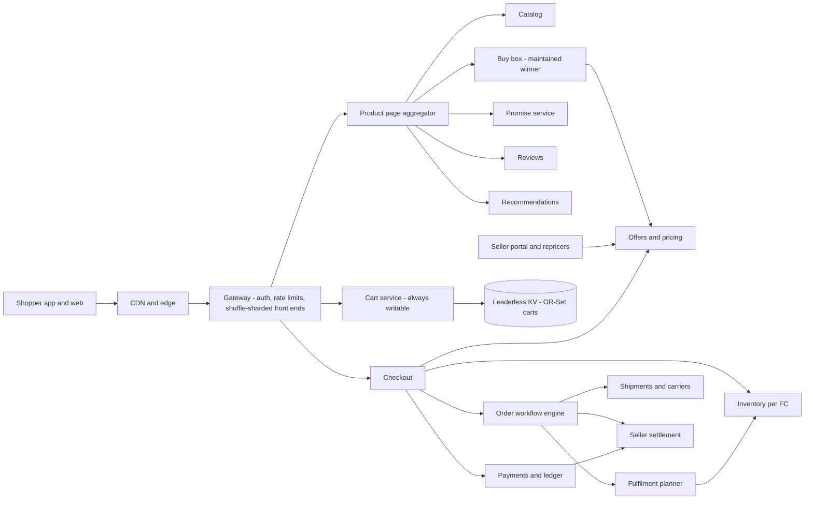
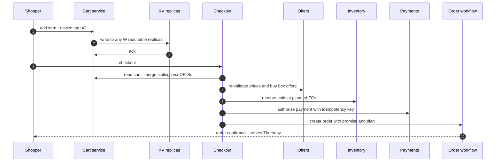
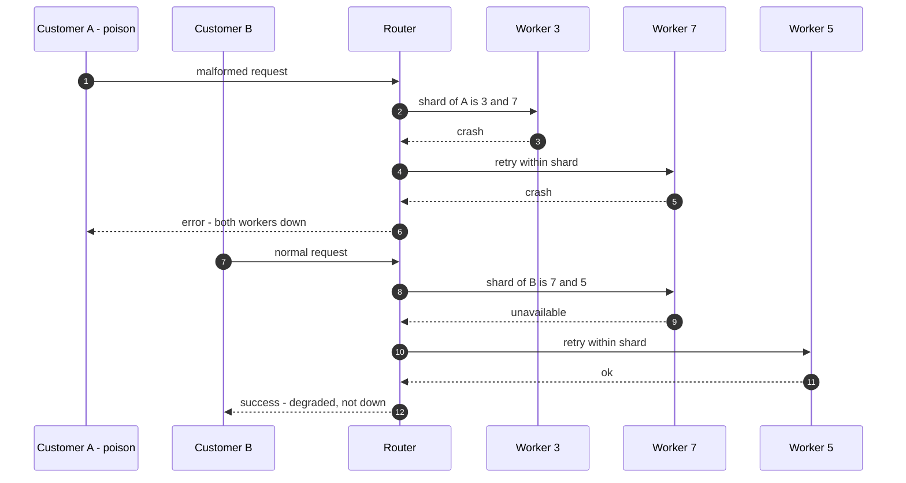
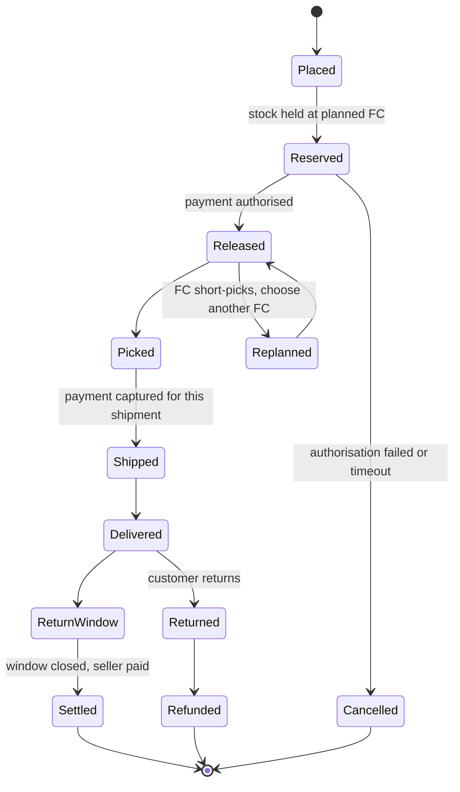

# I01. Amazon-Style Global Marketplace

!!! abstract "Chapter at a glance"
    **Sector:** E-commerce (global marketplace) · **Reader bands:** B1 → B4 · **Builds on:** [Ch 10](../02-distributed-core/10-replication.md), [Ch 34](../04-architect/34-modern-architecture-styles.md), [Ch 45](../05-case-studies/45-payment-system.md), [Ch 46](../05-case-studies/46-grocery-checkout-and-inventory-reservation.md)

    **What you get:** the architecture of a global, multi-seller marketplace in the style Amazon has described publicly. It covers:

    - an always-writable cart;
    - one catalog entry per product, with many sellers' offers and a "buy box" winner;
    - a delivery promise computed from fulfilment-centre stock;
    - a page composed from many services;
    - order pipelines as workflows;
    - cells and shuffle sharding to contain failures.

    **What the labs measured:**

    - **L1 (cart merge):** in 20,000 fully partitioned cart sessions, last-writer-wins lost **36,206 adds**. Dynamo-style union kept adds (6 lost to clock skew) but **resurrected 12,184 removed items**. An OR-Set cart got **100%** of carts right.
    - **L2 (buy box, real PostgreSQL):**
        - Reading a maintained buy-box row is faster than computing the winner per page: **57k vs 29k reads/s**, p99 **0.29 vs 0.49 ms**. Maintaining it cuts repricing throughput by ~30%.
        - A forced interleaving shows the race: two concurrent reprices leave the **wrong winner**. A per-product lock fixes it.
    - **L3 (delivery promise):** an exhaustive planner cuts cost per order by **17%** (₹110.9 → ₹91.9) and split orders from **54% to 36%**. The share delivered within the promise is identical, **63.5%**, for all strategies. Only stocking the top 300 SKUs everywhere moves it, to **68.7%**.
    - **L4 (shuffle sharding):** with one poison customer, fixed shards take out **25%** of other customers completely. Shuffle shards of 2 of 8 workers take out **3.6%**, and 5 of 80 take out **0%**, matching 1/C(n,k).

    **Reading time:** 80 min.

!!! warning "What this chapter is, and isn't"
    - This is a **design in the style of** a large global marketplace, based on **public** sources: the Dynamo paper (SOSP 2007), the AWS Builders' Library, and conference talks and interviews.
    - It is **not** a description of Amazon's internal systems.
    - The buy-box scoring, fulfilment rules and numbers are **illustrative**.
    - Statements attributed to public sources are marked **VERIFY**. Check the original before quoting them.

---

## 1. Introduction & Why It Matters

### 1.1 A story: the cart that forgot

It is the first hour of a big sale. A replica group behind the cart service loses contact with its peers for four minutes. The cart team had chosen strong consistency, so writes to that group fail. Across the affected carts, "Add to cart" shows an error, and conversion for those shoppers drops to nearly zero while the network heals.

The post-incident question is blunt: **is a shopper ever better off seeing "can't add to cart" than seeing a cart that might need merging later?** For a cart, almost never. That is the reasoning behind the Dynamo paper's requirement that the shopping cart be *always writable* (VERIFY: DeCandia et al., "Dynamo: Amazon's Highly Available Key-value Store", SOSP 2007). It also explains the famous side-effect the paper describes: deleted items can reappear after a merge.

Global marketplaces are full of these choices. Where do you give up consistency for availability (the cart), and where must you not (payment, the last unit of stock)? How do millions of sellers share one product page? How do you promise a delivery date before the order exists? And how do you stop one bad customer or one bad deploy from taking down everyone?

!!! quote "The thesis of this chapter"
    A global marketplace is **many small, owned services composed per page**. Each service chooses its own consistency model:

    - carts are always writable and merge correctly (L1);
    - offers are aggregated into a single winning offer that is maintained, not recomputed (L2);
    - promises are computed from where stock is, and stock placement matters more than routing (L3);
    - failures are contained by cells and shuffle sharding (L4).

### 1.2 Where this sits in the handbook

| Concern | Handbook chapter | This chapter adds |
|---|---|---|
| Replication, conflicts | [Ch 10](../02-distributed-core/10-replication.md), [Ch 54](../05-case-studies/54-distributed-key-value-store.md) | Cart-specific merge semantics |
| Checkout, reservation | [Ch 46](../05-case-studies/46-grocery-checkout-and-inventory-reservation.md) | Multi-seller, multi-FC orders |
| Payments | [Ch 45](../05-case-studies/45-payment-system.md) | Marketplace settlement to sellers |
| Cells, blast radius | [Ch 34](../04-architect/34-modern-architecture-styles.md) | Shuffle sharding |
| Search, recommendations | [Ch 22](../03-production/22-search-systems.md), [Ch 43](../05-case-studies/43-home-feed-and-recommendations.md) | — |

### 1.3 Learning objectives

By the end you will be able to:

- **Design** the domains of a multi-seller marketplace and their consistency needs.
- **Implement** a cart that survives partitions without losing adds or resurrecting removes.
- **Maintain** a derived "winning offer" correctly under concurrent repricing.
- **Compute** delivery promises and fulfilment plans, and explain why placement dominates.
- **Contain** failures with cells and shuffle sharding, and quantify the benefit.

---

## 2. Core Concepts — Beginner to Deep

### 2.1 Intuition: a mall, not a shop <span class="band b1">B1</span>

A single retailer owns its shelves. A marketplace is a **mall**: thousands of shops (sellers) sell the same product, and the mall decides which shop's offer to show first. It runs the checkout counters, the warehouses (for sellers who use them), and the delivery vans. The platform's job is to make the mall feel like one shop to the customer, while treating every seller fairly and keeping the mall open whatever happens in one aisle.

### 2.2 Requirements <span class="band b1">B1</span>

| Type | Requirement |
|---|---|
| **Functional** | Browse and search a catalog; product pages with offers; cart; checkout; payment; delivery promise and tracking; returns; seller listing, pricing and inventory; reviews; recommendations; membership (e.g. free shipping). |
| **Scale (assumptions, B1 estimation)** | 300M products and 2B offers; 50M daily active shoppers; 10× traffic on sale days; 5M orders/day normal and 30M on peak days. |
| **Latency** | Product page p99 ≤ 300 ms at the edge. Add-to-cart p99 ≤ 100 ms. Search p99 ≤ 200 ms. |
| **Availability** | Browse, cart and checkout ≥ 99.99%. Cart writes must succeed during partial failures. |
| **Correctness** | Never charge twice; never sell the same last unit twice (or compensate within minutes); the right offer is shown for the price that is charged. |
| **Global** | Separate marketplaces per country (currency, tax, language, regulations); data residency where required (VERIFY per country). |

**Estimation.**

- **Product page reads:** 50M shoppers × 20 pages/day ≈ 1B page views/day. That averages ~12k/s, reaching ~120k/s at a 10× peak.
- **Page fan-out:** each page calls tens of services, so internal RPS is 10–100× the page RPS ([Ch 02](../01-foundations/02-back-of-the-envelope-estimation.md)).

### 2.3 Domains and their consistency ⭐ <span class="band b2">B2</span>

| Domain | Owns | Consistency choice | Why |
|---|---|---|---|
| **Catalog** | Products, attributes, variations | Eventual; versioned documents | Read-heavy; a stale description is harmless |
| **Offers & pricing** | Seller offers, prices, promotions | Per-offer strong, per-product derived | The price shown must equal the price charged at checkout (re-validated) |
| **Buy box** | Winning offer per product | Derived, maintained transactionally (L2) | Read on every page |
| **Search** | Index, ranking | Eventual (seconds) | [Ch 22](../03-production/22-search-systems.md) |
| **Cart** | Items per customer | **Always writable**, merge on conflict (L1) | Unavailable carts lose sales |
| **Inventory** | Units per FC and seller | Strong per SKU/FC for reservation | Last unit ([Ch 46](../05-case-studies/46-grocery-checkout-and-inventory-reservation.md)) |
| **Orders** | Order state, workflow | Strong per order; workflow engine | Money and promises |
| **Payments** | Charges, refunds, seller payouts | Strong; double-entry ledger | [Ch 45](../05-case-studies/45-payment-system.md) |
| **Fulfilment** | FC selection, shipments | Strong per shipment | L3 |
| **Reviews, Q&A** | UGC | Eventual; moderated | Abuse handling |
| **Recommendations** | Models, candidates | Eventual; precomputed | [Ch 43](../05-case-studies/43-home-feed-and-recommendations.md) |

The pattern is **consistency chosen per operation, not per company**. It is the same principle as [Ch 59](../07-interview/59-interview-qa-bank.md) Q18.

### 2.4 The always-writable cart ⭐ <span class="band b2">B2</span>

- **Requirement:** add-to-cart must succeed even when some replicas are unreachable. That means a leaderless or multi-leader store with sloppy quorums and hinted handoff ([Ch 54](../05-case-studies/54-distributed-key-value-store.md)).
- **Consequence:** replicas can hold concurrent versions (siblings), detected with version vectors, and the application must merge them.
- **The merge is a product decision.**
    - **Last-writer-wins** throws away a whole replica's cart. L1 lost 36,206 of 95,886 adds.
    - **Union of siblings** keeps adds but brings back removed items. L1 resurrected 12,184 removes, the behaviour the Dynamo paper describes.
    - **An OR-Set** tags each add. A remove deletes only the tags the client had seen, so adds and removes both survive. In L1 every cart ended up right.
- **Cost of an OR-Set:** tag metadata grows. Garbage-collect it when all replicas have seen a remove ([Ch 10](../02-distributed-core/10-replication.md) CRDTs).
- **Where strong consistency returns:** at checkout. Prices, stock and promotions are re-validated against their sources of truth, and the cart is only a *wish list with quantities*.

### 2.5 Catalog, offers and the buy box ⭐ <span class="band b2">B2</span>

- **One product, many offers.** Sellers attach offers (price, shipping, condition, fulfilment method) to one catalog entry. Duplicate listings are merged by product identifiers and matching ([Ch 21](../03-production/21-data-at-scale.md)).
- **The winning offer ("buy box")** is chosen by a score: landed price, delivery promise, seller performance, and stock. The real criteria are not public, so L2 uses an illustrative formula.
- **It is read on every product page** and changes whenever any seller reprices. Automated repricers can change prices many times an hour. Choices:
    - **Compute on read:** simple and always current, but it costs a query per page (L2: 29k reads/s).
    - **Maintain on write:** upsert the winner in the same transaction as the offer change. Reads are about 2× faster; writes cost ~30% more (L2).
    - **Precompute plus cache:** fastest, but stale. Acceptable if checkout re-validates the price.
- **The race.**
    - Two sellers reprice the same product at once. Each transaction computes the winner from a snapshot that cannot see the other's uncommitted change.
    - The later commit can install the **wrong winner**, and it stays wrong until the next change to that product (L2's forced interleaving).
    - **Fixes:** serialize per product (advisory lock or `SELECT … FOR UPDATE` on a product row), recompute asynchronously from a per-product queue, or use SERIALIZABLE isolation and retry.

### 2.6 Composing the product page <span class="band b2">B2</span>

- **A product page is assembled from many services:** catalog, offers, buy box, price, promotions, delivery promise, reviews, Q&A, recommendations, ads and personalisation. A 2006 interview described 100–150 service calls to build a page (VERIFY: "A Conversation with Werner Vogels", ACM Queue, 2006).
- **Latency budget:** the page deadline is split across tiers. Calls run in parallel with per-call timeouts, and **non-critical widgets degrade**: the page renders without recommendations rather than waiting ([Ch 18](../02-distributed-core/18-resilience-patterns.md), [Ch 56](../06-capstone/56-capstone-grocery-marketplace-end-to-end.md) L1).
- **Critical vs optional:** title, price, buy box, availability and promise are critical. Everything else is optional and has a fallback or is hidden.
- **Caching:** catalog content is cached at the edge. Price and availability are fetched fresh, or cached for seconds and re-validated in the cart.

### 2.7 The delivery promise ⭐ <span class="band b3">B3</span>

- **"Get it by Thursday" is computed before an order exists:** which FCs hold the item, carrier cut-offs, transit times to the customer's postcode, and FC capacity.
- **The fulfilment plan chooses FCs per order** to meet the promise at minimum cost. Every extra box costs money and customer goodwill.
- **L3 finding:** planning strategies differ a lot in *cost*. Exhaustive planning saves 17% and cuts splits from 54% to 36%. They are identical on the *promise* (63.5%), because per-item nearest is already the fastest plan.
- **What moves the promise is inventory placement:** stocking the 300 best-sellers in every FC raised it to 68.7% and cut cost further.
- **This is why marketplaces invest in forecasting and placement,** and in seller-fulfilment programmes that put sellers' stock into the platform's FCs (VERIFY for any specific programme).
- **Promise integrity:** the promise shown on the product page is re-checked at checkout. The order stores the promise it was sold with, and missed promises are an SLI.

### 2.8 Orders as workflows <span class="band b3">B3</span>

- **An order is a long-running workflow** that can take days: authorise payment → reserve stock at FCs → release to FC → pick → pack → ship → deliver → capture payment → settle to sellers → returns window.
- **Each step is idempotent** and has a compensation ([Ch 13](../02-distributed-core/13-distributed-transactions.md)). The workflow's state is persisted, and timers drive timeouts (e.g. "not shipped in 48 h → notify, offer cancellation").
- **Multi-seller orders split** into per-seller or per-FC shipments, each with its own sub-workflow. Payment is captured per shipment when it ships (a common marketplace practice; VERIFY per payment network and country).
- **Seller settlement:** the marketplace collects payment, holds it through the returns window, deducts fees, and pays sellers on a schedule. That needs a double-entry ledger with per-seller accounts ([Ch 45](../05-case-studies/45-payment-system.md)).

### 2.9 Teams and services <span class="band b3">B3</span>

- **Small, autonomous teams** own services end to end, including on-call, often described as "two-pizza teams" (VERIFY the original sources).
- **Services communicate only through interfaces:** APIs and events, no shared databases. This is widely attributed to an early-2000s internal mandate (VERIFY; the best-known account is second-hand).
- **The consequence is many services per page** (§2.6). That makes latency budgets, timeouts and degradation first-class concerns, and requires a platform: deployment, observability, service discovery ([Ch 16](../02-distributed-core/16-microservices-architecture.md), [Ch 37](../04-architect/37-leading-architecture-at-scale.md)).

### 2.10 Cells and shuffle sharding ⭐ <span class="band b4">B4</span>

- **Cells** are complete, independent copies of a service stack, each serving a subset of customers. A bad deploy or a poison request affects one cell. Deploys roll out cell by cell ([Ch 34](../04-architect/34-modern-architecture-styles.md); VERIFY: re:Invent talks on minimising blast radius).
- **Shuffle sharding** assigns each customer a small random *combination* of workers. Two customers rarely share their whole combination.
    - The chance that another customer shares all k workers with a poison customer is 1/C(n,k).
    - For 5 of 80 workers that is 1 in 24 million (L4). Fixed shards of 5 still take out 6.3% of customers completely.
    - VERIFY: AWS Builders' Library, "Workload isolation using shuffle-sharding".
- **The trade-off:** with shuffle shards, *more* customers are **degraded**, meaning they lose part of their shard (28% for 5 of 80). They survive only if clients retry on another worker in their shard. Shuffle sharding therefore requires **client-side retries across the shard** and per-worker health checks.
- **Where it fits:** multi-tenant front ends, API gateways, queues, and anything where one tenant's traffic can be poison or overwhelming.

### 2.11 Peak events <span class="band b4">B4</span>

- **Pre-scaling** from forecasts, with no reliance on reactive autoscaling alone ([Ch 02](../01-foundations/02-back-of-the-envelope-estimation.md) §3.3).
- **Deal inventory:** hot deals use reservation gates and queues ([Ch 46](../05-case-studies/46-grocery-checkout-and-inventory-reservation.md)).
- **Game days** before the event, a freeze on risky changes, and degradation switches ready: hide recommendations, simplify search.
- **Load shedding by priority:** checkout traffic is protected over browse traffic ([Ch 18](../02-distributed-core/18-resilience-patterns.md)).
- **Constant-work designs** avoid modes that only appear at peak (VERIFY: AWS Builders' Library, "Reliability, constant work, and a good cup of coffee").

### 2.12 Going global <span class="band b4">B4</span>

| Concern | Approach |
|---|---|
| Marketplaces per country | Separate catalogs, prices, tax and payment methods, sharing platform services |
| Data residency | Regional cells holding personal and payment data in-country where required (VERIFY per law) ([Ch 36](../04-architect/36-compliance-governance-and-data-residency.md)) |
| Cross-border sellers | Listing translation, currency conversion, customs and duties, export compliance |
| Latency | Edge caching, regional stacks; global services only for non-personal data |

---

## 3. Architecture & Diagrams

### 3.1 Component view



### 3.2 Sequence: add to cart, then checkout (happy path)



### 3.3 Sequence: a poison request with shuffle sharding



### 3.4 State: an order line



---

## 4. Design Document Excerpt

!!! note "Design Document (excerpt) — Buy Box Service"
    | Field | Value |
    |---|---|
    | Context | Product pages compute the winning offer per request from the offers table (L2 path A). Page p99 budget pressure, and repricers generate ~5k offer changes/s at peak. |
    | Decision | Maintain a `buy_box` row per product, updated in the same transaction as each offer change, under a per-product advisory lock. Pages read the row. Checkout re-validates the offer. |
    | Related ADRs | ADR-I01-1 cart OR-Set; ADR-I01-2 promise re-validation at checkout; ADR-I01-3 shuffle-sharded front ends |

    **Requirements.**

    - **R1:** Product page buy-box read p99 ≤ 1 ms at the service.
    - **R2:** After any committed offer change, the buy box is correct for that product. No lasting wrong winner.
    - **R3:** Sustain 5k offer changes/s at peak.
    - **R4:** Checkout never charges a price different from the one validated at checkout.
    - **R5:** A full rebuild is possible in < 10 min, as a repair tool.

    **Decisions in detail.**

    1. **Maintained winner.** L2 shows read p99 0.29 ms vs 0.49 ms, and about 2× the read throughput.
    2. **Per-product serialization.** L2's forced interleaving shows the race without it. The lock cost ~14% of throughput in the price war.
    3. **A nightly consistency check** compares against a from-scratch computation and alerts on any mismatch.
    4. **Checkout re-validation** against the offer row covers any page-to-checkout staleness.

    **Consequences.** Offer writes are ~30% more expensive (L2). One hot product's repricing serializes (acceptable: it's one product). A rebuild job exists for repair.

---

## 5. Hands-On Code — Level Ladder

!!! info "What's real here"
    - **L2** runs against a real PostgreSQL 16 database with ~300k offers.
    - **L1, L3 and L4** are JDK-only simulations. Their assumptions are stated in the code.

### L1 — The always-writable cart <span class="band b2">B2</span>

**Requirement:** "Add-to-cart never fails, and after the partition heals the cart holds exactly what the shopper intended."

This lab simulates 20,000 shopper sessions. Every request goes to a random one of 3 partitioned replicas, and clocks are skewed by up to ±150 ms.

```java title="CartMergeL1.java"
// L1 — The always-writable cart (Dynamo-style). Three replicas accept cart writes during a partition; afterwards the
// versions are merged. Compare: last-writer-wins (LWW), Dynamo's "union of siblings" (adds survive, deletes can
// resurrect), and an OR-Set cart (adds and removes both survive). Counts lost adds and resurrected removes.
import java.util.*;

public class CartMergeL1 {
    record Op(int replica, long ts, boolean add, String item, String tag) {}

    public static void main(String[] a) {
        int sessions = 20_000; Random r = new Random(101);
        long[] lostAdd = new long[3], resurrect = new long[3], adds = new long[1], removes = new long[1], correctCarts = new long[3];
        // one shopper, two devices, requests routed to any of 3 replicas while they are partitioned from each other
        String[] names = {"LWW (whole cart, newest timestamp)", "Dynamo union of siblings", "OR-Set (add-tags, remove-tags)"};
        for (int s = 0; s < sessions; s++) {
            // a shopper (phone + laptop) edits the cart while replicas are partitioned; clocks skew by up to ±150 ms
            List<Op> ops = new ArrayList<>(); long t = 0; Set<String> truth = new LinkedHashSet<>();   // truth = what the shopper intended
            int n = 4 + r.nextInt(8);
            for (int i = 0; i < n; i++) {
                t += 50 + r.nextInt(2000);
                int rep = r.nextInt(3); long skewed = t + (r.nextInt(301) - 150);
                String item = "sku" + r.nextInt(6);
                if (truth.contains(item) && r.nextDouble() < 0.5) {                  // remove something already in the cart
                    truth.remove(item); removes[0]++; ops.add(new Op(rep, skewed, false, item, null));
                } else if (!truth.contains(item)) {                                  // add something new
                    truth.add(item); adds[0]++; ops.add(new Op(rep, skewed, true, item, "t" + i));
                }
            }
            // each replica only sees the ops sent to it (partition), then anti-entropy merges the three replica states
            Set<String> lww = lww(ops), union = union(ops), orset = orset(ops);
            List<Set<String>> results = List.of(lww, union, orset);
            for (int k = 0; k < 3; k++) {
                Set<String> got = results.get(k);
                for (String x : truth) if (!got.contains(x)) lostAdd[k]++;
                for (String x : got) if (!truth.contains(x)) resurrect[k]++;
                if (got.equals(truth)) correctCarts[k]++;
            }
        }
        System.out.printf("%,d partitioned cart sessions, %,d adds and %,d removes spread over 3 replicas (clock skew ±150 ms)%n%n", sessions, adds[0], removes[0]);
        System.out.printf("%-38s %14s %20s %16s%n", "merge strategy", "lost adds", "resurrected removes", "cart exactly right");
        for (int k = 0; k < 3; k++)
            System.out.printf("%-38s %,14d %,20d %15.1f%%%n", names[k], lostAdd[k], resurrect[k], 100.0 * correctCarts[k] / sessions);
    }

    // per-replica state is the ops it received, applied in its own (skewed) timestamp order
    static Set<String> apply(List<Op> ops) { Set<String> c = new LinkedHashSet<>(); ops.stream().sorted(Comparator.comparingLong(Op::ts)).forEach(o -> { if (o.add()) c.add(o.item()); else c.remove(o.item()); }); return c; }
    static List<Op> at(List<Op> ops, int rep) { return ops.stream().filter(o -> o.replica() == rep).toList(); }
    // LWW: keep the whole cart of the replica whose last write has the newest timestamp
    static Set<String> lww(List<Op> ops) {
        int best = -1; long bt = Long.MIN_VALUE;
        for (int rep = 0; rep < 3; rep++) for (Op o : at(ops, rep)) if (o.ts() > bt) { bt = o.ts(); best = rep; }
        return best < 0 ? Set.of() : apply(at(ops, best));
    }
    // Dynamo: concurrent versions come back as siblings; the cart merges them by union (so an item removed on one
    // replica but still present on another comes back — the paper's "deleted items can resurface")
    static Set<String> union(List<Op> ops) { Set<String> u = new LinkedHashSet<>(); for (int rep = 0; rep < 3; rep++) u.addAll(apply(at(ops, rep))); return u; }
    // OR-Set: each add carries a unique tag; a remove deletes the tags it has SEEN. Here a remove on a replica sees the
    // add tags that the shopper's client had observed (the client sends them with the remove request).
    static Set<String> orset(List<Op> ops) {
        Map<String, Set<String>> addTags = new HashMap<>(), removed = new HashMap<>(); Map<String, Set<String>> seenByClient = new HashMap<>();
        for (Op o : ops) {   // in the order the client issued them
            if (o.add()) { addTags.computeIfAbsent(o.item(), k -> new HashSet<>()).add(o.tag()); seenByClient.computeIfAbsent(o.item(), k -> new HashSet<>()).add(o.tag()); }
            else { removed.computeIfAbsent(o.item(), k -> new HashSet<>()).addAll(seenByClient.getOrDefault(o.item(), Set.of())); seenByClient.remove(o.item()); }
        }
        Set<String> c = new LinkedHashSet<>();
        addTags.forEach((item, tags) -> { Set<String> live = new HashSet<>(tags); live.removeAll(removed.getOrDefault(item, Set.of())); if (!live.isEmpty()) c.add(item); });
        return c;
    }
}
```

```text title="java CartMergeL1.java"
20,000 partitioned cart sessions, 95,886 adds and 27,318 removes spread over 3 replicas (clock skew ±150 ms)

merge strategy                              lost adds  resurrected removes cart exactly right
LWW (whole cart, newest timestamp)             36,206                2,604             8.3%
Dynamo union of siblings                            6               12,184            52.3%
OR-Set (add-tags, remove-tags)                      0                    0           100.0%
```

**Reading it:**

- **Last-writer-wins keeps one replica's cart and throws away the rest.** It lost **36,206 adds**, and only 8% of carts ended up right.
- **Union of siblings keeps nearly every add, but brings back 12,184 removed items.** This is the "deleted items can resurface" behaviour the Dynamo paper accepts. The 6 lost adds come from clock skew reordering a remove and a re-add on the same replica.
- **The OR-Set gets every cart right.** Each add carries a tag, and a remove deletes only the tags the client had seen.
- **The scenario is the worst case:** the whole session happens during a partition. In real life most sessions never produce siblings.

### L2 — The buy box, on real PostgreSQL <span class="band b3">B3</span>

**Requirement:** "Show the winning offer on every product page quickly, and never show a wrong winner for long."

```java title="BuyBoxL2.java"
// L2 — The buy box: many sellers offer the same product; the product page shows one winning offer.
// Real PostgreSQL 16: 50,000 products, ~250,000 offers (seeded). Compare computing the winner on every page read (A) with
// maintaining a buy_box row in the same transaction as each offer change (B). Measures read latency, repricing
// throughput, and checks that B's table agrees with a from-scratch computation after heavy churn.
import java.sql.*;
import java.util.*;
import java.util.concurrent.*;
import java.util.concurrent.atomic.*;

public class BuyBoxL2 {
    static final String URL = "jdbc:postgresql://localhost:5581/shop?user=claude";
    // lower is better: landed price, penalised for slow promise and low seller rating (illustrative weights)
    static final String SCORE = "(price_paise + ship_paise) * (1 + 0.02 * greatest(promise_days - 2, 0)) * (1 + 0.1 * (4.5 - least(rating, 4.5)))";
    static final String WINNER = "SELECT product_id, seller_id, price_paise + ship_paise AS landed FROM offers WHERE product_id = ? AND in_stock ORDER BY " + SCORE + ", seller_id LIMIT 1";
    static final String UPSERT = "INSERT INTO buy_box (product_id, seller_id, landed) " + WINNER.replace("?", "?") +
            " ON CONFLICT (product_id) DO UPDATE SET seller_id = EXCLUDED.seller_id, landed = EXCLUDED.landed";

    public static void main(String[] a) throws Exception {
        Connection c = DriverManager.getConnection(URL);
        try {
            Statement s = c.createStatement();
            s.execute("DROP TABLE IF EXISTS offers, buy_box");
            s.execute("CREATE TABLE offers (product_id int, seller_id int, price_paise bigint, ship_paise bigint, rating numeric(2,1), promise_days int, in_stock boolean, PRIMARY KEY (product_id, seller_id))");
            s.execute("SELECT setseed(0.42)");
            s.execute("INSERT INTO offers SELECT p, sl, 10000 + (random()*90000)::int, (ARRAY[0,0,4000,9900])[1 + (random()*3)::int], 3.0 + round((random()*2)::numeric, 1), 1 + (random()*6)::int, random() > 0.08 " +
                      "FROM generate_series(1, 50000) p, LATERAL (SELECT DISTINCT (random()*2000)::int + p*0 AS sl FROM generate_series(1, 1 + (random()*7)::int)) x");
            s.execute("CREATE TABLE buy_box (product_id int PRIMARY KEY, seller_id int, landed bigint)");
            s.execute("INSERT INTO buy_box SELECT DISTINCT ON (product_id) product_id, seller_id, price_paise + ship_paise FROM offers WHERE in_stock ORDER BY product_id, " + SCORE + ", seller_id");
            s.execute("VACUUM ANALYZE offers"); s.execute("VACUUM ANALYZE buy_box");
            ResultSet rs = s.executeQuery("SELECT count(*), count(DISTINCT product_id) FROM offers"); rs.next();
            System.out.printf("%,d offers across %,d products (1–8 sellers each, 8%% out of stock)%n%n", rs.getLong(1), rs.getLong(2));
        } finally { c.close(); }

        System.out.printf("%-44s %8s %12s %9s %9s%n", "workload (4 threads, 5 s)", "", "ops/s", "p50 ms", "p99 ms");
        run("A product page: compute winner on read", false, true);
        run("B product page: read buy_box row", true, true);
        run("A repricing: update offer only", false, false);
        rebuild(); run("B repricing: update offer + upsert buy_box", true, false); String b1 = check();
        HOT = true;
        rebuild(); run("B repricing, price war on 20 hot products", true, false); String b2 = check();
        rebuild(); LOCK = true; run("B' same price war, per-product lock first", true, false); String b3 = check();
        System.out.println("\nbuy_box vs a from-scratch computation (buy_box rebuilt before each run):");
        System.out.println("  B,  random products : " + b1);
        System.out.println("  B,  price war       : " + b2);
        System.out.println("  B', price war + lock: " + b3);
        System.out.println("\nThe race a benchmark hides — two reprices of one product, forced interleaving:");
        System.out.println("  " + race(false));
        System.out.println("  " + race(true));
        Connection v = DriverManager.getConnection(URL); try { v.createStatement().execute("DROP TABLE offers, buy_box"); } finally { v.close(); }
    }

    static volatile boolean LOCK = false, HOT = false;
    static void rebuild() throws SQLException { Connection c = DriverManager.getConnection(URL); try { Statement s = c.createStatement();
        s.execute("TRUNCATE buy_box"); s.execute("INSERT INTO buy_box SELECT DISTINCT ON (product_id) product_id, seller_id, price_paise + ship_paise FROM offers WHERE in_stock ORDER BY product_id, " + SCORE + ", seller_id"); } finally { c.close(); } }
    static String check() throws SQLException { Connection c = DriverManager.getConnection(URL); try {
        ResultSet rs = c.createStatement().executeQuery("WITH truth AS (SELECT DISTINCT ON (product_id) product_id, seller_id FROM offers WHERE in_stock ORDER BY product_id, " + SCORE + ", seller_id) " +
            "SELECT count(*) FILTER (WHERE b.seller_id IS DISTINCT FROM t.seller_id), count(*) FROM truth t FULL JOIN buy_box b USING (product_id)");
        rs.next(); return String.format("%d of %,d products show the wrong winner", rs.getLong(1), rs.getLong(2)); } finally { c.close(); } }
    // product 0: seller 1 at ₹500, seller 2 at ₹600 (same shipping, rating, promise) → seller 1 wins.
    // T1 cuts seller 2 to ₹400 and upserts (holds the buy_box row). T2 cuts seller 1 to ₹450, upserts from a snapshot
    // that cannot see T1's uncommitted change, and waits on the row. T1 commits, T2 commits. True winner: seller 2.
    static String race(boolean lock) throws Exception {
        try (Connection c = DriverManager.getConnection(URL); Statement s = c.createStatement()) {
            s.execute("DELETE FROM offers WHERE product_id = 0"); s.execute("DELETE FROM buy_box WHERE product_id = 0");
            s.execute("INSERT INTO offers VALUES (0, 1, 50000, 0, 4.5, 2, true), (0, 2, 60000, 0, 4.5, 2, true)");
            s.execute("INSERT INTO buy_box VALUES (0, 1, 50000)");
        }
        Connection t1 = DriverManager.getConnection(URL), t2 = DriverManager.getConnection(URL);
        try {
            t1.setAutoCommit(false); t2.setAutoCommit(false);
            if (lock) t1.createStatement().executeQuery("SELECT pg_advisory_xact_lock(0)");
            t1.createStatement().executeUpdate("UPDATE offers SET price_paise = 40000 WHERE product_id = 0 AND seller_id = 2");
            PreparedStatement u1 = t1.prepareStatement(UPSERT); u1.setInt(1, 0); u1.executeUpdate();
            CompletableFuture<Void> second = CompletableFuture.runAsync(() -> { try {
                if (lock) t2.createStatement().executeQuery("SELECT pg_advisory_xact_lock(0)");      // waits for T1 here
                t2.createStatement().executeUpdate("UPDATE offers SET price_paise = 45000 WHERE product_id = 0 AND seller_id = 1");
                PreparedStatement u2 = t2.prepareStatement(UPSERT); u2.setInt(1, 0); u2.executeUpdate();    // without the lock, waits on the row
                t2.commit(); } catch (SQLException e) { throw new RuntimeException(e); } });
            Thread.sleep(500);                       // T2 is now blocked (on the advisory lock, or on the buy_box row)
            t1.commit(); second.get();
            try (Connection c = DriverManager.getConnection(URL); Statement s = c.createStatement()) {
                ResultSet rs = s.executeQuery("SELECT seller_id, landed FROM buy_box WHERE product_id = 0"); rs.next();
                int shown = rs.getInt(1); long landed = rs.getLong(2);
                return String.format("%-26s buy box shows seller %d at ₹%d — %s", lock ? "with per-product lock:" : "without a lock:", shown, landed / 100,
                        shown == 2 ? "correct (seller 2 at ₹400 is cheaper)" : "WRONG: seller 2 at ₹400 is cheaper, and nothing will fix it until the next reprice");
            }
        } finally { t1.close(); t2.close(); }
    }
    static void run(String name, boolean maintained, boolean read) throws Exception {
        AtomicLong n = new AtomicLong(); ConcurrentLinkedQueue<long[]> lat = new ConcurrentLinkedQueue<>();
        long end = System.nanoTime() + 5_000_000_000L; ExecutorService ex = Executors.newFixedThreadPool(4); List<Future<?>> fs = new ArrayList<>();
        for (int t = 0; t < 4; t++) { int tid = t; fs.add(ex.submit(() -> {
            Connection c = DriverManager.getConnection(URL);
            try {
                PreparedStatement win = c.prepareStatement(WINNER), box = c.prepareStatement("SELECT seller_id, landed FROM buy_box WHERE product_id = ?"),
                        upd = c.prepareStatement("UPDATE offers SET price_paise = greatest(5000, price_paise + ?), in_stock = ? WHERE product_id = ? AND seller_id = (SELECT seller_id FROM offers WHERE product_id = ? ORDER BY seller_id OFFSET ? LIMIT 1)"),
                        ups = c.prepareStatement(UPSERT), del = c.prepareStatement("DELETE FROM buy_box WHERE product_id = ? AND NOT EXISTS (SELECT 1 FROM offers WHERE product_id = ? AND in_stock)");
                Random r = new Random(tid * 31L + (maintained ? 7 : 0) + (read ? 1 : 0)); long[] mine = new long[2_000_000]; int k = 0;
                if (!read) c.setAutoCommit(false);
                while (System.nanoTime() < end) {
                    int p = HOT && !read ? 1 + r.nextInt(20) : 1 + r.nextInt(50000); long t0 = System.nanoTime();
                    if (read) { PreparedStatement q = maintained ? box : win; q.setInt(1, p); try (ResultSet rs = q.executeQuery()) { rs.next(); } }
                    else {
                        if (LOCK) { try (PreparedStatement l = c.prepareStatement("SELECT pg_advisory_xact_lock(?)")) { l.setInt(1, p); l.executeQuery(); } }
                        upd.setInt(1, r.nextInt(4001) - 2000); upd.setBoolean(2, r.nextDouble() > 0.05); upd.setInt(3, p); upd.setInt(4, p); upd.setInt(5, r.nextInt(2)); upd.executeUpdate();
                        if (maintained) { ups.setInt(1, p); ups.executeUpdate(); del.setInt(1, p); del.setInt(2, p); del.executeUpdate(); }
                        c.commit();
                    }
                    if (k < mine.length) mine[k++] = System.nanoTime() - t0; n.incrementAndGet();
                }
                lat.add(Arrays.copyOf(mine, k));
            } finally { c.close(); }
            return null; })); }
        for (Future<?> f : fs) f.get(); ex.shutdown();
        long[] all = lat.stream().flatMapToLong(Arrays::stream).sorted().toArray();
        System.out.printf("%-44s %8s %,12.0f %9.2f %9.2f%n", name, "", n.get() / 5.0, all[all.length / 2] / 1e6, all[(int) (all.length * 0.99)] / 1e6);
    }
}
```

```text title="java -Duser.timezone=UTC -cp postgresql-42.7.4.jar BuyBoxL2.java"
299,635 offers across 50,000 products (1–8 sellers each, 8% out of stock)

workload (4 threads, 5 s)                                    ops/s    p50 ms    p99 ms
A product page: compute winner on read                      29,304      0.10      0.49
B product page: read buy_box row                            57,143      0.05      0.29
A repricing: update offer only                               5,058      0.68      3.54
B repricing: update offer + upsert buy_box                   3,570      1.03      3.12
B repricing, price war on 20 hot products                    3,719      1.00      2.55
B' same price war, per-product lock first                    3,209      1.10      4.17

buy_box vs a from-scratch computation (buy_box rebuilt before each run):
  B,  random products : 0 of 50,000 products show the wrong winner
  B,  price war       : 1 of 50,000 products show the wrong winner
  B', price war + lock: 0 of 50,000 products show the wrong winner

The race a benchmark hides — two reprices of one product, forced interleaving:
  without a lock:            buy box shows seller 1 at ₹450 — WRONG: seller 2 at ₹400 is cheaper, and nothing will fix it until the next reprice
  with per-product lock:     buy box shows seller 2 at ₹400 — correct (seller 2 at ₹400 is cheaper)
```

**Reading it:**

- **Reads:** a maintained row serves **57k reads/s** at p99 **0.29 ms**, against 29k/s at p99 0.49 ms when computing the winner per page. That is about 2× the throughput.
- **Writes:** maintaining it costs about **30% of repricing throughput** (5,058 → 3,570/s).
- **The race is real but hard to see under load.**
    - In 5 seconds of a price war on 20 products, the final table was wrong for **1 product** in this run (0 in others).
    - Every later reprice recomputes the winner from committed data, which heals earlier mistakes. Only a race on the *last* change leaves a lasting error.
- **The forced interleaving shows the race directly.** T2 computes its winner from a snapshot that can't see T1's uncommitted price cut, waits on the row, then overwrites it. The result: seller 1 at ₹450 is shown although seller 2 is at ₹400.
- **A per-product advisory lock fixes it**, at ~14% of price-war throughput.
- **Timings vary run to run** (about ±15% here). The race result doesn't.

### L3 — Promise and fulfilment planning <span class="band b3">B3</span>

**Requirement:** "Ship each order at the lowest cost that still meets the 2-day promise."

The model has 12 illustrative fulfilment centres (FCs) and 20,000 orders. Popular SKUs are stocked more widely.

```java title="PromiseL3.java"
// L3 — Which fulfilment centre (FC) ships what? A multi-item order can ship from one FC or be split. Compare three
// strategies on 20,000 simulated orders across 12 FCs: per-item nearest FC, "one box if any FC can do it", and an
// exhaustive cost optimiser under the delivery promise. Geography, stock and costs are illustrative (VERIFY for real use).
import java.util.*;

public class PromiseL3 {
    record FC(String name, double x, double y, double size) {}
    static final FC[] FCS = {
        new FC("DEL-1", 770, 285, 1.0), new FC("DEL-2", 785, 300, 0.6), new FC("BOM-1", 720, 1905, 1.0), new FC("BOM-2", 740, 1880, 0.5),
        new FC("BLR-1", 1290, 2600, 1.0), new FC("HYD-1", 1300, 2150, 0.7), new FC("MAA-1", 1500, 2600, 0.7), new FC("CCU-1", 2050, 1380, 0.7),
        new FC("AMD-1", 460, 1450, 0.5), new FC("LKO-1", 1100, 560, 0.4), new FC("GAU-1", 2450, 870, 0.3), new FC("PNQ-1", 830, 1990, 0.4)};
    static final int SKUS = 5000, ORDERS = 20_000, PROMISE_DAYS = 2;
    static final double FIXED = 35, PER_KM = 0.04;           // ₹ per shipment, ₹ per km (illustrative)

    public static void main(String[] a) {
        Random r = new Random(1101);
        boolean[][] stock = new boolean[FCS.length][SKUS];
        for (int f = 0; f < FCS.length; f++) for (int s = 0; s < SKUS; s++) {
            double popularity = 1.0 / Math.pow(s + 1, 0.35);            // popular SKUs stocked widely
            stock[f][s] = r.nextDouble() < Math.min(0.97, FCS[f].size() * (0.35 + 0.9 * popularity));
        }
        simulate("stock as is", stock, new Random(7));
        // placement change: the 300 best-selling SKUs are stocked in every FC (costs working capital, not routing code)
        for (int f = 0; f < FCS.length; f++) for (int sku = 0; sku < 300; sku++) stock[f][sku] = true;
        simulate("top 300 SKUs stocked in every FC", stock, new Random(7));
    }

    static void simulate(String label, boolean[][] stock, Random r) {
        double[] cust = new double[2]; String[] names = {"S1 nearest FC per item", "S2 one box if possible, else S1", "S3 cheapest plan within promise"};
        double[] cost = new double[3], ships = new double[3], met = new double[3], split = new double[3]; long[] nanos = new long[3]; int[] noPlan = new int[3];
        for (int o = 0; o < ORDERS; o++) {
            FC home = FCS[r.nextInt(FCS.length)];                        // customers cluster around metros
            cust[0] = home.x() + r.nextGaussian() * 220; cust[1] = home.y() + r.nextGaussian() * 220;
            int items = 1 + Math.min(5, (int) Math.abs(r.nextGaussian() * 2));
            int[] skus = new int[items]; for (int i = 0; i < items; i++) skus[i] = zipf(r);
            for (int k = 0; k < 3; k++) {
                long t0 = System.nanoTime();
                int[] plan = k == 0 ? nearest(skus, stock, cust) : k == 1 ? oneBox(skus, stock, cust) : optimal(skus, stock, cust);
                nanos[k] += System.nanoTime() - t0;
                if (plan == null) { noPlan[k]++; continue; }
                Set<Integer> used = new HashSet<>(); for (int f : plan) used.add(f);
                double c = 0; int worst = 0; for (int f : used) { double d = dist(FCS[f], cust); c += FIXED + PER_KM * d; worst = Math.max(worst, days(d)); }
                cost[k] += c; ships[k] += used.size(); if (worst <= PROMISE_DAYS) met[k]++; if (used.size() > 1) split[k]++;
            }
        }
        System.out.printf("%n=== %s: %,d orders (1–6 items, popular SKUs more likely), 12 FCs, promise = %d days%n", label, ORDERS, PROMISE_DAYS);
        System.out.printf("%-34s %10s %11s %12s %13s %11s%n", "strategy", "₹/order", "boxes/order", "split orders", "within promise", "µs/order");
        for (int k = 0; k < 3; k++) {
            int n = ORDERS - noPlan[k];
            System.out.printf("%-34s %10.1f %11.2f %11.1f%% %12.1f%% %11.1f%n", names[k], cost[k] / n, ships[k] / n, 100 * split[k] / n, 100 * met[k] / n, nanos[k] / 1e3 / ORDERS);
        }
        System.out.printf("orders with an item in no FC at all: %d (excluded)%n", noPlan[0]);
    }
    static int zipf(Random r) { return Math.min(SKUS - 1, (int) Math.floor(Math.pow(r.nextDouble(), 2.2) * SKUS)); }
    static double dist(FC f, double[] c) { return Math.hypot(f.x() - c[0], f.y() - c[1]); }
    static int days(double km) { return km < 300 ? 1 : km < 1000 ? 2 : km < 1800 ? 3 : 4; }
    static int[] nearest(int[] skus, boolean[][] st, double[] c) {
        int[] p = new int[skus.length];
        for (int i = 0; i < skus.length; i++) { int best = -1; for (int f = 0; f < FCS.length; f++) if (st[f][skus[i]] && (best < 0 || dist(FCS[f], c) < dist(FCS[best], c))) best = f; if (best < 0) return null; p[i] = best; }
        return p;
    }
    static int[] oneBox(int[] skus, boolean[][] st, double[] c) {
        int best = -1;
        for (int f = 0; f < FCS.length; f++) { boolean all = true; for (int s : skus) all &= st[f][s];
            if (all && days(dist(FCS[f], c)) <= PROMISE_DAYS && (best < 0 || dist(FCS[f], c) < dist(FCS[best], c))) best = f; }
        if (best < 0) return nearest(skus, st, c);
        int[] p = new int[skus.length]; Arrays.fill(p, best); return p;
    }
    // exhaustive: every assignment of items to FCs that stock them; minimise cost among plans meeting the promise,
    // falling back to the fastest plan if none meets it
    static int[] optimal(int[] skus, boolean[][] st, double[] c) {
        List<List<Integer>> opts = new ArrayList<>();
        for (int s : skus) { List<Integer> l = new ArrayList<>(); for (int f = 0; f < FCS.length; f++) if (st[f][s]) l.add(f); if (l.isEmpty()) return null; opts.add(l); }
        int[] cur = new int[skus.length], best = null, fastest = null; double bestCost = Double.MAX_VALUE; int bestDays = 99; double fastCost = Double.MAX_VALUE;
        int[] idx = new int[skus.length];
        while (true) {
            for (int i = 0; i < skus.length; i++) cur[i] = opts.get(i).get(idx[i]);
            Set<Integer> used = new HashSet<>(); for (int f : cur) used.add(f);
            double cost = 0; int worst = 0; for (int f : used) { double d = dist(FCS[f], c); cost += FIXED + PER_KM * d; worst = Math.max(worst, days(d)); }
            if (worst <= PROMISE_DAYS && cost < bestCost) { bestCost = cost; best = cur.clone(); }
            if (worst < bestDays || worst == bestDays && cost < fastCost) { bestDays = worst; fastCost = cost; fastest = cur.clone(); }
            int i = 0; while (i < skus.length && ++idx[i] == opts.get(i).size()) { idx[i] = 0; i++; }
            if (i == skus.length) break;
        }
        return best != null ? best : fastest;
    }
}
```

```text title="java PromiseL3.java"

=== stock as is: 20,000 orders (1–6 items, popular SKUs more likely), 12 FCs, promise = 2 days
strategy                              ₹/order boxes/order split orders within promise    µs/order
S1 nearest FC per item                  110.9        1.78        53.7%         63.5%         0.5
S2 one box if possible, else S1         106.5        1.68        44.6%         63.5%         0.8
S3 cheapest plan within promise          91.9        1.41        36.0%         63.5%        39.2
orders with an item in no FC at all: 578 (excluded)

=== top 300 SKUs stocked in every FC: 20,000 orders (1–6 items, popular SKUs more likely), 12 FCs, promise = 2 days
strategy                              ₹/order boxes/order split orders within promise    µs/order
S1 nearest FC per item                  101.2        1.69        49.8%         68.7%         0.7
S2 one box if possible, else S1          94.6        1.55        36.3%         68.7%         0.5
S3 cheapest plan within promise          81.4        1.29        25.6%         68.7%       209.8
orders with an item in no FC at all: 549 (excluded)
```

**Reading it:**

- **Planning changes cost a lot.** The exhaustive planner is **17% cheaper** than per-item nearest (₹91.9 vs ₹110.9), and cuts split orders from 54% to 36%.
- **Planning doesn't change the promise at all.** All three strategies meet it on the same 63.5% of orders. Per-item nearest is already the fastest possible plan, and the others only fall back to it.
- **Placement moves the promise.** Stocking the 300 best-sellers in every FC raised it to **68.7%** and cut the cheapest plan to ₹81.4.
- **The rest is long-tail SKUs held only in distant FCs.** No algorithm can fix that.
- The exhaustive search costs **35–210 µs per order** at 1–6 items. Larger baskets need heuristics or integer programming.

### L4 — Shuffle sharding <span class="band b4">B4</span>

**Requirement:** "One bad customer must not take down the others."

```java title="ShuffleShardL4.java"
// L4 — Shuffle sharding (as described in the AWS Builders' Library): each customer gets a small random subset of
// workers. A "poison" customer whose requests crash every worker they touch takes out only its own subset. How many
// OTHER customers lose all of their workers (full outage) or some (degraded)? Exact combinatorics + simulation.
import java.util.*;

public class ShuffleShardL4 {
    public static void main(String[] a) {
        int customers = 10_000; Random r = new Random(404);
        System.out.printf("%,d customers; one poison customer crashes every worker it is routed to%n%n", customers);
        System.out.printf("%-44s %9s %16s %14s %14s%n", "layout", "workers", "possible shards", "full outage", "degraded");
        row("no sharding (everyone on every worker)", 8, 8, false, customers, r);
        row("4 fixed shards of 2 workers", 8, 2, false, customers, r);
        row("shuffle shards of 2 of 8 workers", 8, 2, true, customers, r);
        row("shuffle shards of 4 of 8 workers", 8, 4, true, customers, r);
        row("16 fixed shards of 5 workers", 80, 5, false, customers, r);
        row("shuffle shards of 5 of 80 workers", 80, 5, true, customers, r);
        System.out.printf("%nexact chance another customer shares ALL workers with the poison one, shuffle k of n = 1 / C(n,k):%n");
        for (int[] nk : new int[][]{{8, 2}, {8, 4}, {80, 5}}) System.out.printf("  C(%d,%d) = %,d  → %.6f%%%n", nk[0], nk[1], choose(nk[0], nk[1]), 100.0 / choose(nk[0], nk[1]));
    }

    static void row(String name, int n, int k, boolean shuffle, int customers, Random r) {
        int trials = 200; double full = 0, degraded = 0;
        for (int t = 0; t < trials; t++) {
            List<Set<Integer>> assign = new ArrayList<>();
            for (int c = 0; c < customers; c++) assign.add(shuffle ? randomSubset(n, k, r) : fixedShard(n, k, r.nextInt(n / k)));
            Set<Integer> dead = assign.get(0);                                   // customer 0 is the poison pill
            for (int c = 1; c < customers; c++) {
                long lost = assign.get(c).stream().filter(dead::contains).count();
                if (lost == assign.get(c).size()) full++; else if (lost > 0) degraded++;
            }
        }
        double others = (double) trials * (customers - 1);
        String shards = shuffle ? String.format("%,d", choose(n, k)) : String.valueOf(n / k);
        System.out.printf("%-44s %9d %16s %13.3f%% %13.2f%%%n", name, n, shards, 100 * full / others, 100 * degraded / others);
    }
    static Set<Integer> fixedShard(int n, int k, int shard) { Set<Integer> s = new HashSet<>(); for (int i = 0; i < k; i++) s.add(shard * k + i); return s; }
    static Set<Integer> randomSubset(int n, int k, Random r) { List<Integer> l = new ArrayList<>(); for (int i = 0; i < n; i++) l.add(i); Collections.shuffle(l, r); return new HashSet<>(l.subList(0, k)); }
    static long choose(int n, int k) { long c = 1; for (int i = 0; i < k; i++) c = c * (n - i) / (i + 1); return c; }
}
```

```text title="java ShuffleShardL4.java"
10,000 customers; one poison customer crashes every worker it is routed to

layout                                         workers  possible shards    full outage       degraded
no sharding (everyone on every worker)               8                1       100.000%          0.00%
4 fixed shards of 2 workers                          8                4        24.974%          0.00%
shuffle shards of 2 of 8 workers                     8               28         3.558%         42.90%
shuffle shards of 4 of 8 workers                     8               70         1.436%         97.12%
16 fixed shards of 5 workers                        80               16         6.274%          0.00%
shuffle shards of 5 of 80 workers                   80       24,040,016         0.000%         28.19%

exact chance another customer shares ALL workers with the poison one, shuffle k of n = 1 / C(n,k):
  C(8,2) = 28  → 3.571429%
  C(8,4) = 70  → 1.428571%
  C(80,5) = 24,040,016  → 0.000004%
```

**Reading it:**

- **The simulation matches the exact probability 1/C(n,k):** 3.56% vs 3.57%, and 1.44% vs 1.43%.
- **Fixed shards of 2 workers:** a poison customer takes out a quarter of everyone.
- **Shuffle shards of 2 of 8:** 3.6%.
- **5 of 80:** effectively nobody (1 in 24 million), against 6.3% for fixed shards of the same size.
- **The cost is in the degraded column.** Many more customers lose *part* of their shard: 28% for 5 of 80, and 97% for 4 of 8. They stay up only if clients retry on another worker in their shard. Shuffle sharding without in-shard retries turns "degraded" into "failed".

---

## 6. Production Concerns

### 6.1 Failure modes

| Failure | Effect | Mitigation |
|---|---|---|
| Cart replica partition | Siblings | OR-Set merge (L1), read repair |
| Buy-box race | Wrong winner shown | Per-product lock (L2), checkout re-validation, nightly check |
| Repricer storm | Offer write overload | Per-seller rate limits ([Ch 39](../05-case-studies/39-distributed-rate-limiter.md)), coalescing |
| FC outage | Promises wrong | Replan, mark FC unavailable in the promise service |
| Poison tenant or request | Workers crash | Shuffle sharding (L4), request validation |
| Bad deploy | Errors | Cell-by-cell rollout with bake time |

### 6.2 Observability

Useful signals:

- page p99 per widget;
- cart sibling rate, and the share of merges that resurrect items;
- buy-box mismatch count from the nightly check;
- promise accuracy (delivered by the promised date);
- split-shipment rate;
- per-cell error rates.

### 6.3 Security and abuse

- Seller account takeover.
- Fake reviews: detection, and verified-purchase flags.
- Price-gouging controls during emergencies (VERIFY local law).
- Bot checkout on deals: queues, CAPTCHAs, per-account limits.

### 6.4 Performance and cost

- **Cache catalog at the edge.** Keep price and availability fresh.
- **Precompute recommendations.**
- **Cost per order** is a first-class metric ([Ch 35](../04-architect/35-cost-engineering-and-finops.md)). Split shipments are a direct cost driver (L3).

### 6.5 Compliance

- Marketplace liability rules, consumer-protection disclosures, tax collection at source for sellers, and data residency. All of these vary by country (VERIFY per market) ([Ch 36](../04-architect/36-compliance-governance-and-data-residency.md)).

---

## 7. Anti-Patterns & Pitfalls

!!! danger "1. Strongly consistent carts"
    An unavailable cart loses sales during partitions.

!!! danger "2. Last-writer-wins carts"
    They silently drop items (L1).

!!! danger "3. Union-merge without remove tracking"
    Deleted items come back (L1).

!!! danger "4. Computing the buy box on every page at scale"
    It wastes database capacity (L2).

!!! danger "5. Maintaining derived winners without serialization"
    A lasting wrong winner (L2).

!!! danger "6. Trusting cart prices at checkout"
    Always re-validate.

!!! danger "7. Promises from routing alone"
    Placement decides the promise (L3).

!!! danger "8. Ignoring split-shipment cost"
    It is a direct cost per order (L3).

!!! danger "9. Waiting for every widget"
    Optional widgets must degrade.

!!! danger "10. Fixed shards for multi-tenant front ends"
    Large blast radius (L4).

!!! danger "11. Shuffle sharding without client retries"
    Degraded customers become failed customers (L4).

!!! danger "12. Global stacks for regulated data"
    Residency violations.

---

## 8. Interview Q&A

### Beginner <span class="band b1">B1</span>

??? question "Q1 [B1] ⭐ What are the main services of an e-commerce marketplace?"

    **30-second answer:** Catalog, offers/pricing, search, product page aggregation, cart, checkout, inventory, payments, order workflow, fulfilment and shipping, seller portal, reviews, recommendations — each owned by a team with its own data.

    **Deep answer:** §2.3 table with consistency choices.

    **Trade-offs I'd call out:** Many services → latency budgets and ops overhead.

    **Follow-ups:**
    1. Which are critical path? → Price, buy box, availability, checkout.
    2. Which can degrade? → Recommendations, reviews.

    **Red flags:** One database for everything.

??? question "Q2 [B1] Why is a marketplace different from a single-retailer shop?"

    **30-second answer:** Many sellers offer the same product, so the platform must merge listings, choose a winning offer fairly, handle seller inventory and fulfilment methods, and settle money to sellers after fees and returns.

    **Deep answer:** §2.1, §2.5, §2.8.

    **Trade-offs I'd call out:** Seller fairness vs customer value.

    **Follow-ups:**
    1. Duplicate listings? → Matching on identifiers.
    2. Seller payouts? → Ledger per seller.

    **Red flags:** Treating sellers as products.

??? question "Q3 [B1] What happens when you click 'Add to cart'?"

    **30-second answer:** The cart service writes the item to replicated storage that accepts writes even if some replicas are down; nothing is reserved yet — price and stock are checked again at checkout.

    **Deep answer:** §2.4, §3.2.

    **Trade-offs I'd call out:** Availability vs later merge.

    **Follow-ups:**
    1. Why not reserve stock? → Carts are abandoned often.
    2. Guest carts? → Merge on login.

    **Red flags:** Reserving stock on add-to-cart.

??? question "Q4 [B1] How would you estimate product-page traffic?"

    **30-second answer:** Daily active users × pages per user ÷ 86,400 for average, × a peak factor (10× on sale days); multiply by service calls per page for internal load.

    **Deep answer:** §2.2: ~12k pages/s average, ~120k peak; 10–100× internal fan-out.

    **Trade-offs I'd call out:** Assumptions dominate — state them.

    **Follow-ups:**
    1. Cache hit rate? → Reduces origin load.
    2. Bot traffic? → Filter.

    **Red flags:** No peak factor.

### Intermediate <span class="band b2">B2</span>

??? question "Q5 [B2] ⭐ Design the shopping cart for availability."

    **30-second answer:** A leaderless or multi-leader KV store with sloppy quorums and hinted handoff so writes always succeed; version vectors detect concurrent versions; merge with an OR-Set so adds and removes both survive; re-validate everything at checkout.

    **Deep answer:** L1: LWW lost 36,206 adds; union resurrected 12,184 removes; OR-Set exact.

    **Trade-offs I'd call out:** Tag metadata growth.

    **Follow-ups:**
    1. GC of tags? → When all replicas have seen removes.
    2. Why not LWW? → Loses whole carts.

    **Red flags:** Strong consistency for carts.

??? question "Q6 [B2] ⭐ How do you choose and serve the winning offer for a product?"

    **30-second answer:** Score offers (landed price, promise, seller performance, stock), maintain the winner per product on every offer change in the same transaction under a per-product lock, serve it from that row, and re-validate at checkout.

    **Deep answer:** L2 numbers; §2.5.

    **Trade-offs I'd call out:** Write cost vs read speed.

    **Follow-ups:**
    1. Scoring secret? → Real criteria aren't public; ours is illustrative.
    2. Stale cache? → Checkout re-validation.

    **Red flags:** Computing per page at 100k pages/s.

??? question "Q7 [B2] How do you keep a product page fast when it needs dozens of services?"

    **30-second answer:** Parallel calls with a page deadline split into per-call timeouts, critical vs optional widgets, fallbacks or hiding for optional ones, edge caching for catalog content, and fresh fetch for price and availability.

    **Deep answer:** §2.6; [Ch 18](../02-distributed-core/18-resilience-patterns.md).

    **Trade-offs I'd call out:** Completeness vs latency.

    **Follow-ups:**
    1. Which calls are critical? → Price, buy box, availability, promise.
    2. Tail latency? → Hedging for critical reads.

    **Red flags:** Sequential calls.

??? question "Q8 [B2] How is a delivery date promised before ordering?"

    **30-second answer:** From which FCs hold the item, carrier cut-offs, transit times to the postcode, and FC capacity; cached per product and region, recomputed at checkout, stored on the order.

    **Deep answer:** §2.7, L3.

    **Trade-offs I'd call out:** Optimistic promises vs missed dates.

    **Follow-ups:**
    1. Accuracy SLI? → Delivered by promised date.
    2. Stock moves? → Invalidate by event.

    **Red flags:** A fixed "3–5 days" everywhere.

??? question "Q9 [B2] How are sellers paid?"

    **30-second answer:** The marketplace collects payment, records it in a double-entry ledger with per-seller liability accounts, holds funds through the returns window, deducts fees and refunds, and pays out on a schedule with reconciliation against bank transfers.

    **Deep answer:** §2.8; [Ch 45](../05-case-studies/45-payment-system.md).

    **Trade-offs I'd call out:** Payout speed vs return risk.

    **Follow-ups:**
    1. Chargebacks? → Debit seller account.
    2. Tax? → Per-country rules.

    **Red flags:** Paying sellers at order time.

### Senior <span class="band b3">B3</span>

??? question "Q10 [B3] ⭐ Two sellers reprice the same product at the same moment. What can go wrong and how do you prevent it?"

    **30-second answer:** Each transaction recomputes the winner from a snapshot that can't see the other's uncommitted change; the later commit can install a wrong winner that persists until the next change. Serialize per product (advisory lock or locking a product row), or recompute asynchronously per product, or use SERIALIZABLE with retry.

    **Deep answer:** L2 forced interleaving; the benchmark alone showed 0–1 wrong products, which is why races need targeted tests.

    **Trade-offs I'd call out:** Lock contention on hot products.

    **Follow-ups:**
    1. Detection? → Nightly check.
    2. Why didn't the benchmark catch it? → Later changes heal it.

    **Red flags:** "Transactions handle it."

??? question "Q11 [B3] How do you decide which FCs ship a multi-item order?"

    **30-second answer:** Enumerate plans over FCs holding each item (small in practice), filter by the promise, minimise cost including a per-box fixed cost; fall back to the fastest plan when none meets the promise; re-plan on short picks.

    **Deep answer:** L3: 17% cheaper and splits 54% → 36% vs per-item nearest; promise unchanged.

    **Trade-offs I'd call out:** Compute (35–210 µs/order) vs savings.

    **Follow-ups:**
    1. Larger orders? → Heuristics, ILP.
    2. Capacity? → Add FC load to cost.

    **Red flags:** Nearest FC per item.

??? question "Q12 [B3] Why does inventory placement matter more than routing for delivery promises?"

    **30-second answer:** Routing can only choose among FCs that already hold the item; if a long-tail item is only far away, no algorithm meets the promise. Placing best-sellers everywhere raised the promise rate from 63.5% to 68.7% in L3 while routing changes left it unchanged.

    **Deep answer:** L3 second run.

    **Trade-offs I'd call out:** Working capital and FC space.

    **Follow-ups:**
    1. Which SKUs? → Forecast demand by region.
    2. Seller stock? → Fulfilment programmes.

    **Red flags:** Optimising routing only.

??? question "Q13 [B3] How do you run a multi-day order process reliably?"

    **30-second answer:** A persisted workflow with idempotent steps, compensations, durable timers, per-shipment sub-workflows, and visibility into stuck orders — not a chain of synchronous calls or cron jobs.

    **Deep answer:** §2.8; [Ch 13](../02-distributed-core/13-distributed-transactions.md), [Ch 50](../05-case-studies/50-distributed-job-scheduler.md).

    **Trade-offs I'd call out:** Workflow engine complexity.

    **Follow-ups:**
    1. Versioning workflows? → New orders on new versions.
    2. Stuck detection? → Age of oldest step.

    **Red flags:** One giant transaction.

??? question "Q14 [B3] How do you prepare the platform for a peak sale day?"

    **30-second answer:** Forecast and pre-scale, load test full journeys, gate hot deals with reservation queues, freeze risky changes, prepare degradation switches, protect checkout with priority shedding, and run game days.

    **Deep answer:** §2.11.

    **Trade-offs I'd call out:** Cost of headroom.

    **Follow-ups:**
    1. First thing to degrade? → Recommendations.
    2. Bots on deals? → Per-account limits, queues.

    **Red flags:** Relying on autoscaling alone.

### Architect <span class="band b4">B4</span>

??? question "Q15 [B4] ⭐ Explain shuffle sharding and when it's worth it."

    **30-second answer:** Give each customer a random small combination of k of n workers; a poison customer only kills its own combination, and the chance another customer shares all k is 1/C(n,k) — for 5 of 80, one in 24 million versus 6.3% with fixed shards. It needs client retries within the shard because more customers are partially affected.

    **Deep answer:** L4; §2.10.

    **Trade-offs I'd call out:** More degraded customers; routing complexity.

    **Follow-ups:**
    1. Choosing k? → Enough capacity per customer.
    2. With cells? → Complementary.

    **Red flags:** "Just add more servers."

??? question "Q16 [B4] How would you use cells in a global marketplace?"

    **30-second answer:** Partition customers (and sometimes sellers) into independent full-stack cells with a thin routing layer; deploy cell by cell with bake time; keep global services minimal; place regulated data in regional cells.

    **Deep answer:** §2.10, §2.12; [Ch 34](../04-architect/34-modern-architecture-styles.md).

    **Trade-offs I'd call out:** Cross-cell features (search, catalog) and fixed cost per cell.

    **Follow-ups:**
    1. Cell size? → Blast radius vs cost.
    2. Moving customers? → Online migration.

    **Red flags:** One global stack.

??? question "Q17 [B4] Where would you accept eventual consistency in this platform, and where not?"

    **30-second answer:** Eventual: catalog, search, reviews, recommendations, cart contents (with correct merges). Strong: last-unit reservation, payment, ledger, order state, and the price actually charged (re-validated at checkout).

    **Deep answer:** §2.3.

    **Trade-offs I'd call out:** Latency and availability costs of strong paths.

    **Follow-ups:**
    1. Buy box? → Derived, maintained, re-validated.
    2. Inventory display? → Eventual; reservation strong.

    **Red flags:** One model everywhere.

??? question "Q18 [B4] How do you organise hundreds of teams around this architecture?"

    **30-second answer:** Teams own services end to end around business capabilities, communicate through APIs and events only, share a paved-road platform (deploy, observability, discovery), and are held to SLOs and page-level latency budgets.

    **Deep answer:** §2.9; [Ch 37](../04-architect/37-leading-architecture-at-scale.md).

    **Trade-offs I'd call out:** Duplication vs speed.

    **Follow-ups:**
    1. Shared data? → Through APIs.
    2. Standards? → Paved roads.

    **Red flags:** Shared databases between teams.

??? question "Q19 [B4] How would you expand the marketplace to a new country?"

    **30-second answer:** A new marketplace on shared platform services, with regional cells for personal and payment data where required, localised catalog, tax and payments, local FCs and carriers, and phased launch with seller onboarding first.

    **Deep answer:** §2.12; [Ch 60](../07-interview/60-mock-interviews.md) Mock D.

    **Trade-offs I'd call out:** Fixed regional cost.

    **Follow-ups:**
    1. Cross-border sellers? → Customs, currency.
    2. Residency? → Classify data.

    **Red flags:** Copying the whole stack blindly.

??? question "Q20 [B4] What would you measure to know the marketplace architecture is healthy?"

    **30-second answer:** Journey SLOs (browse, add to cart, checkout), page p99 by widget, promise accuracy, split-shipment rate and cost per order, buy-box correctness, cart merge anomalies, per-cell error rates and blast radius of incidents, and deploy frequency with change failure rate.

    **Deep answer:** §6.2; [Ch 24](../03-production/24-observability.md).

    **Trade-offs I'd call out:** Metric sprawl — pick journey-level first.

    **Follow-ups:**
    1. North star? → Orders delivered on promise.
    2. Cost? → Per order.

    **Red flags:** CPU dashboards only.

---

## 9. Summary & Practice

### Key takeaways

1. **Choose consistency per operation.** Carts are always writable; money and the last unit of stock are strong.
2. **Carts need correct merges:** OR-Set, not last-writer-wins or plain union (L1).
3. **Maintain derived winners transactionally and serialize per product** (L2).
4. **Routing sets the cost; placement sets the promise** (L3).
5. **Cells and shuffle sharding bound the blast radius.** Shuffle sharding needs retries within the shard (L4).

### Cheat sheet

| Problem | Pattern |
|---|---|
| Cart during a partition | Leaderless KV, version vectors, OR-Set |
| Many offers, one page | Maintained buy box, per-product lock, checkout re-validation |
| Delivery date | Promise service over stock location, re-checked at checkout |
| Multi-FC order | Plan to minimise boxes and cost under the promise |
| Poison tenant | Shuffle sharding with retries within the shard |
| Bad deploy | Cell-by-cell rollout |

### Exercises

1. **(B1)** Estimate internal RPS for 120k product pages/s at 40 calls per page.
2. **(B2)** Add a "quantity" to L1's OR-Set cart. How do you merge concurrent quantity changes?
3. **(B3)** Change L2 to recompute the winner asynchronously from a per-product queue, and measure staleness.
4. **(B3)** Add FC capacity limits to L3. How do cost and promise change at 80% utilisation?
5. **(B4)** Extend L4 so clients retry within the shard. What share of customers see *any* error?

### Further reading

- DeCandia et al., "Dynamo: Amazon's Highly Available Key-value Store", SOSP 2007.
- The AWS Builders' Library articles on shuffle sharding, timeouts and retries, and constant work.
- "A Conversation with Werner Vogels", ACM Queue, 2006.
- Talks on cell-based architecture and minimising blast radius (VERIFY titles and years).

### Related chapters

- [Ch 10 — Replication](../02-distributed-core/10-replication.md) · [Ch 46 — Checkout & Inventory](../05-case-studies/46-grocery-checkout-and-inventory-reservation.md) · [Ch 45 — Payments](../05-case-studies/45-payment-system.md) · [Ch 34 — Architecture Styles](../04-architect/34-modern-architecture-styles.md)
- Full system walkthrough (journeys, algorithms, data platform, tech stack): [I01b — How It Works](i01b-amazon-how-it-works.md)
- Next in this tab: [I02 — Flipkart-Style Sale-Day E-Commerce](i02-flipkart-style-sale-day-ecommerce.md)
