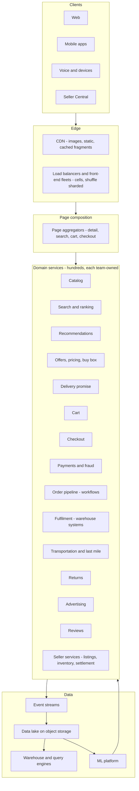

# I01b. Amazon-Style Marketplace — How the Whole System Works

!!! abstract "What this page adds"
    [I01](i01-amazon-style-global-marketplace.md) focuses on four hard problems with runnable labs. This page is the **system walkthrough, with no code**. It follows one order from search to doorstep and the seller's payout, and explains each subsystem:

    - catalog, search, recommendations, pricing and the buy box, cart, checkout and payments;
    - the order pipeline, fulfilment centres, transportation and delivery, returns;
    - the seller side and advertising;
    - the **algorithms** behind them;
    - the **data platform and warehouse**;
    - the **tech stack**, with what has been publicly described kept separate from a reference choice.

!!! warning "Sources and honesty"
    Everything attributed to Amazon comes from **public sources**:

    - papers such as Dynamo (2007) and item-to-item collaborative filtering (2003);
    - AWS blog posts, the AWS Builders' Library, re:Invent talks and news coverage.

    These are marked **VERIFY**. Internal details are not public, so where this page says "a system like this would…" it is describing a **reference design**, not Amazon's implementation.

---

## 1. The Business in Numbers (orders of magnitude)

| Quantity | Order of magnitude (VERIFY current figures) |
|---|---|
| Products (catalog entries) | Hundreds of millions |
| Sellers | Millions, with the majority of units sold by third-party sellers (VERIFY share) |
| Customers | Hundreds of millions |
| Fulfilment and delivery sites | Hundreds of fulfilment centres, plus sortation centres and delivery stations worldwide |
| Peak events | Prime Day and holiday peaks, with AWS publishing per-service peak metrics for the retail business in yearly blog posts (VERIFY) |

**What this scale implies:**

- **Everything is sharded by customer, product or seller.**
- **Everything is owned by a small team behind an API.**
- **Everything is measured.**

---

## 2. The Architecture in Layers

**Organising principles (publicly described; VERIFY):**

- **Service-oriented from early on.** Teams own services end to end, including on-call. They communicate only through APIs, with no shared databases.
- **Small teams**, often described as "two-pizza teams".
- **Cells, shuffle sharding and constant-work designs** for blast-radius control. Deployments roll out in waves, region by region and cell by cell (AWS Builders' Library).
- **Correction of Errors (COE)** documents after incidents, a blameless postmortem culture with root-cause analysis (VERIFY).

---

## 3. One Order, End to End

### 3.1 Search

1. **Request:** a customer types "running shoes men". The request reaches a front-end fleet in their region, routed to a cell.
2. **Query understanding:**
    - spelling correction;
    - tokenisation and normalisation;
    - **category and attribute prediction** (department = shoes, gender = men, activity = running);
    - brand detection;
    - synonyms;
    - intent classification: navigational ("nike air zoom") vs exploratory ("gift for runner").
3. **Candidate retrieval:**
    - **lexical retrieval** over an inverted index of product text (titles, bullets, attributes, backend keywords sellers provide);
    - **semantic retrieval** with neural embeddings (query and product encoded into the same vector space; approximate nearest-neighbour search) to catch products that don't share words with the query. Amazon published semantic product search work (VERIFY: "Semantic Product Search", KDD 2019);
    - **filters:** availability in the customer's region, and deliverability to the customer's address.
4. **Ranking:** a **learning-to-rank** model scores candidates. Features:
    - text relevance, and behavioural signals (clicks, add-to-carts, purchases for this query);
    - price, delivery speed, reviews and ratings, availability, seller quality;
    - personalisation.

    It is trained on historical searches with purchase and engagement labels. Ranking is **multi-objective**: relevance, conversion, customer experience signals.
5. **Blending:** sponsored products (from the ads auction, §3.12) and widgets are blended into the results with limits.
6. **Rendering:** the page aggregator combines results with prices and delivery promises (from the offer and promise services), then renders. The whole flow has a latency budget of a few hundred ms.

### 3.2 Product detail page

When the customer clicks a product, the **detail page aggregator** calls tens of services in parallel with deadlines:

- catalog (title, images, attributes, variations);
- **offer listing and buy box** (the winning offer);
- price and deals;
- delivery promise for the customer's address;
- stock status;
- reviews summary;
- Q&A;
- recommendations ("frequently bought together", "customers also viewed");
- ads;
- the customer's own state (bought before, in cart).

**Critical widgets** (price, buy box, availability, Add to Cart) must render. **Optional widgets** degrade (see [I01](i01-amazon-style-global-marketplace.md) §2.6).

### 3.3 Catalog — one product, many sellers

- **Identity:** each product has an identifier (ASIN). Sellers either **match** their offer to an existing ASIN (using UPC/EAN/ISBN or matching) or **create** one.
- **Contributions:** many sellers and vendors contribute data about the same product, which conflicts (different titles, wrong weights).
    - An **arbitration** process picks the displayed value per attribute, using contributor trust, consistency checks and ML-based quality models.
    - Duplicate detection merges accidental duplicates.
- **Product types and schemas:** attributes are defined per product type (shoes have size and width; TVs have screen size). Listings are validated against the schema.
- **Variations:** parent–child relationships (size and colour) group variants on one page.
- **Storage:** a versioned, attribute-level store, with change events feeding search indexing, the detail page and the data lake.

### 3.4 Offers, pricing and the buy box

- **An offer** = seller + ASIN + condition + price + shipping + fulfilment channel (seller-fulfilled or platform-fulfilled) + quantity.
- **Pricing:**
    - sellers set prices, often through **automated repricers**;
    - the platform's own retail pricing uses automated competitive pricing (monitoring prices elsewhere, cost, demand elasticity; VERIFY specifics);
    - fair-pricing policies block unusually high prices (VERIFY policy details).
- **The buy box:** one offer wins the default Add to Cart position. The factors publicly described to sellers include landed price, fulfilment method and delivery speed, seller performance metrics and stock (VERIFY; the exact formula is not public). [I01](i01-amazon-style-global-marketplace.md) L2 shows how to maintain it consistently under repricing.

### 3.5 Cart

- **Always writable:** the cart is the original use case of the **Dynamo** paper's highly available key-value design (VERIFY; today's implementation isn't public).
- **Contents:** item references and quantities, not prices, which are re-read at checkout.
- **Merge semantics:** see [I01](i01-amazon-style-global-marketplace.md) L1.
- **"Saved for later"** is a separate list.
- **Guest carts** are merged into the account at sign-in.

### 3.6 Checkout

1. **Address and delivery options.** The **promise service** computes delivery dates per shipping speed from inventory positions, carrier cut-offs and capacity (§3.9).
2. **Payment selection:** cards (tokenised), wallets, gift balances, instalments and local methods per country.
3. **Order total:**
    - item prices re-validated;
    - promotions and coupons applied (a rules engine; [Ch 49](../05-case-studies/49-pricing-promotions-and-coupons.md));
    - tax computed per jurisdiction by a tax engine using product tax codes and the ship-to address.
4. **Place order:**
    - a **risk check** (fraud score);
    - payment **authorisation**;
    - order creation with the promise and fulfilment plan attached;
    - confirmation to the customer.

    Payment is usually **captured** later, when items ship (common e-commerce practice; VERIFY per market).

### 3.7 Payments and fraud

- **Payments:**
    - an **authorisation** at order time, and **capture** at shipment (partial captures for split shipments);
    - **refunds** on returns;
    - card data kept out of most systems through tokenisation (PCI DSS scope reduction; [Ch 45](../05-case-studies/45-payment-system.md)).
- **Fraud detection:** real-time models score each order, using:
    - account age and history, device and network signals;
    - address risk, payment instrument risk, velocity;
    - graph links between accounts.

    The actions are: accept, hold for review, step-up verification, or cancel. Amazon offers related capability as an AWS service, Amazon Fraud Detector (VERIFY that it is still offered), which reflects the kind of models used.
- **Seller-side risk:** new-seller verification, suspicious listing detection, counterfeit reports and brand registry protections (VERIFY programme names).

### 3.8 The order pipeline

- **A long-running workflow:** placed → payment authorised → released to fulfilment → picked → packed → shipped (capture) → delivered → return window → closed.
- **Each shipment is its own sub-workflow.** Cancellation is possible until release to the fulfilment centre.
- **Orchestrated by workflow engines** with durable state and timers. The public analogue is AWS Step Functions and the Simple Workflow Service (SWF), whose paradigm came from internal use (VERIFY) ([Ch 13](../02-distributed-core/13-distributed-transactions.md), [Ch 50](../05-case-studies/50-distributed-job-scheduler.md)).
- **Events** from every step go to tracking pages, notifications, analytics and finance.

### 3.9 Inventory placement and the promise

- **Demand forecasting** per product, per region, per day, as **probabilistic (quantile) forecasts**. Amazon researchers published deep-learning forecasting methods such as DeepAR and multi-horizon quantile recurrent forecasters (MQ-RNN) (VERIFY papers and use).
- **Buying and placement:**
    - how much to buy, from forecasts, lead times and cost of stock-outs vs holding;
    - where to place it (which fulfilment centres), so most customers are near stock.

    [I01](i01-amazon-style-global-marketplace.md) L3 shows placement dominates the promise.
- **Inbound:**
    - vendors ship to the platform, and sellers using the platform's fulfilment (FBA) send inbound shipments;
    - the system chooses the destination FCs, and inventory is distributed later between FCs as needed.
- **The promise:** for a customer and item, find FCs with available stock, pick and ship cut-off times, carrier transit time and capacity. The fastest feasible option is shown as "Arrives Tuesday".

### 3.10 Inside a fulfilment centre

1. **Receive:** inbound units are scanned and checked.
2. **Stow:** units are placed into **any available bin**, not a fixed location per product. This is **random ("chaotic") stow**, widely described (VERIFY).
    - It maximises space use and spreads popular items so many pickers can reach them.
    - The system records exactly which bin holds what.
3. **Pick:**
    - **Traditional FCs:** pickers follow **optimised pick paths** through aisles.
    - **Robotic FCs:** **drive units carry shelving pods to picker stations** (from the Kiva Systems acquisition in 2012, now Amazon Robotics; VERIFY current systems). Pick lists are batched by wave and by the chosen shipping cut-off.
4. **Pack:** the system **recommends a box size** from item dimensions (cartonisation, a 3D bin-packing heuristic), or uses automated packaging.
5. **Label and sort:** a label is applied, and the parcel is sorted to the right outbound lane: carrier and destination sortation centre.
6. **Throughput control:** the warehouse management system balances work across stations. Labour planning uses forecasts of units per hour.

### 3.11 Transportation and last mile

- **Middle mile:** trucks and planes move parcels from FCs to **sortation centres** and **delivery stations**. Linehaul schedules are optimised against volume forecasts.
- **Last mile:**
    - parcels are sorted by route at delivery stations;
    - **route planning** solves a **vehicle routing problem with time windows** (VRP-TW), with stop sequences, road network travel times and driver hours;
    - drivers include in-house partners and crowd-sourced drivers (VERIFY programmes).
- **Tracking:** scan events and driver app GPS update tracking. Delivery photo proof and OTPs are used for high-value items.
- **Alternatives:** lockers and pickup points.

### 3.12 Advertising

- **Sponsored products:** advertisers bid on keywords or targets. For each search, eligible ads go through an **auction**:
    - the ranking combines bid × predicted click-through rate × relevance;
    - pricing is a second-price-like auction (VERIFY the current auction design).

    Budget pacing spreads spend across the day ([Ch 49](../05-case-studies/49-pricing-promotions-and-coupons.md) L3 for pacing concepts).
- **Measurement:** attribution of purchases to ad clicks, and advertiser reporting from the data platform.

### 3.13 Reviews

- **Collection:** reviews and ratings, with "Verified Purchase" badges.
- **Abuse detection:** ML models, graph analysis of reviewer–seller relationships, and bulk suppression (VERIFY).
- **Aggregated rating:** a weighted model rather than a simple average. Amazon has said its star ratings use ML weighting by factors such as recency and verification (VERIFY).

### 3.14 Returns

- **The return request** is checked against policy.
- **Options:** drop-off, pickup, or refund at drop-off for some items.
- **Grading:** returned items are graded and routed to restock, sell as used or open-box, return to the seller, liquidate, or dispose.
- **Money and fraud:** refunds via payments, and return-abuse detection.

### 3.15 The seller's side

- **Onboarding:** identity and business verification, tax information and bank account.
- **Listing:** matching or creating ASINs, and bulk upload through APIs.
- **Inventory:** seller-fulfilled or platform-fulfilled.
- **Orders:** notifications and SLAs for seller-fulfilled orders, and performance metrics (late shipment, cancellation, defect rates).
- **Settlement:**
    - a **per-seller ledger**: sales, less fees (referral, fulfilment, storage, ads), refunds and chargebacks;
    - held until the return window, then disbursed on a schedule, with statements;
    - double-entry accounting as in [Ch 45](../05-case-studies/45-payment-system.md) and [I03](i03-core-banking-and-upi.md).

---

## 4. Algorithms Catalog

| Problem | Algorithm (typical) | Where |
|---|---|---|
| Similar products ("customers who bought") | **Item-to-item collaborative filtering** (publicly described, 2003): compute similarity between items from co-purchases, offline; online, look up similar items for what the customer bought or viewed | Recommendations |
| Personalised ranking | Learning-to-rank (gradient-boosted trees, neural rankers) on engagement and purchase labels | Search, feeds |
| Semantic matching | Two-tower neural embeddings + approximate nearest neighbour (HNSW/IVF) | Search retrieval |
| Query understanding | Classifiers for category, attributes and intent; spell correction; synonyms | Search |
| Demand forecasting | Probabilistic deep-learning forecasters (quantiles) | Buying, placement, labour |
| Inventory placement | Optimisation: minimise expected shipping cost and missed promises under capacity | Supply chain |
| Buy box | Scoring on landed price, delivery, seller performance (formula not public) | Offers |
| Pricing | Competitive price monitoring, elasticity models, rules | Retail pricing |
| Fulfilment plan | Search over FC combinations, minimising cost under the promise | Order release ([I01](i01-amazon-style-global-marketplace.md) L3) |
| Pick paths | Heuristic TSP within zones, batching and wave planning | Fulfilment centres |
| Box selection | 3D bin packing heuristics | Packing |
| Route planning | Vehicle routing with time windows (heuristics + local search) | Last mile |
| Fraud | Gradient-boosted models, graph features, rules | Checkout, sellers, reviews |
| Ads auction | Bid × predicted CTR × relevance ranking; pacing controllers | Advertising |
| Review ranking | Helpfulness models, abuse detection | Reviews |
| Availability of the site | Cells, shuffle sharding, constant work | Infrastructure ([I01](i01-amazon-style-global-marketplace.md) L4) |

### 4.1 Item-to-item collaborative filtering

A closer look at the algorithm from the published 2003 paper (VERIFY: Linden, Smith and York, IEEE Internet Computing):

1. **Offline, build an item–item table.** For each item A, look at customers who bought A. For each other item B those customers bought, compute a similarity between A and B, e.g. the cosine similarity of their customer-purchase vectors. Keep the top N similar items per item.
2. **Online, for a customer:** take the items they bought, rated or viewed, and collect each one's similar items. Sum the similarity scores, remove items already bought, and rank.
3. **Why it scales:**
    - the expensive part is offline, and grows with items and co-purchase pairs, not with customers × items;
    - online, it is a few table lookups.
4. **What it teaches:** precompute the heavy relationship offline, serve it cheaply online, and personalise by combining precomputed pieces. Modern systems add deep learning, sequence models and real-time signals on the same principle.

---

## 4A. Deep Dives

### 4A.1 From a seller's new listing to a searchable product

1. **Submission:** the seller submits a listing (via portal, feed file or API), which is validated against the product type schema.
2. **Matching:**
    - an identifier match (UPC/EAN/ISBN) links it to an existing product;
    - otherwise ML matching compares titles, attributes and images to detect duplicates;
    - if no match is found, a new product is created.
3. **Content arbitration** chooses the displayed attribute values. Image and content quality checks run, and prohibited or restricted products are screened by rules and classifiers.
4. **Change events:** the resulting catalog change events trigger:
    - search document rebuild and partial index update;
    - embedding refresh (batch);
    - detail-page cache invalidation;
    - lake ingestion.
5. **Offer events:** when the seller's offer (price, quantity) is created, events update the buy box ([I01](i01-amazon-style-global-marketplace.md) L2) and the availability used for search filtering.

### 4A.2 The recommendation pipeline in a modern form

1. **Offline:**
    - item-to-item similarity tables (the 2003 approach) and embedding models trained on sequences of views and purchases;
    - candidate tables per item and per customer segment.
2. **Nearline:** recent customer activity (last views, cart adds) is kept in a fast profile store and updated from streams within seconds.
3. **Online:**
    - gather candidates from several sources;
    - rank with a model using customer, item and context features;
    - apply business rules (availability, deliverability, diversity, no already-purchased consumables unless re-buy is likely).
4. **Placement:** widget selection per page, with experiments on each widget's contribution.

### 4A.3 How the promise stays true

- **Promise inputs:** inventory positions (by FC), open capacity (by FC and shift), carrier cut-offs, and transit time distributions by lane.
- **Using history:** the service uses **historical delivery performance** by lane and day to pick a date it can meet with high probability. It is a quantile decision, not an average: a promise must be kept most of the time.
- **When capacity tightens** (peak season), promises lengthen automatically instead of being broken.
- **After ordering:** the order stores the promise it was sold with. Downstream systems prioritise orders at risk of missing it.

### 4A.4 A peak-day request path

1. **Front end:** a request hits a cell's front-end fleet, and page aggregators fan out with deadlines.
2. **Degradation:** under load, optional widgets are dropped first, and shedding protects checkout ([Ch 18](../02-distributed-core/18-resilience-patterns.md)).
3. **Orders:** they flow into the pipeline, where queues absorb bursts. Fulfilment release is paced by FC capacity.
4. **Monitoring:** operations dashboards watch per-cell error rates, order rates and payment success. Deployments pause during peak windows.

---

## 5. Data Platform and Warehouse

### 5.1 What flows in

- **Event streams** from every service: page views, searches, clicks, add-to-carts, orders, shipments, FC scans, delivery scans, ad impressions and clicks, payments, reviews.
- **Change data** from operational databases.
- **External data:** carrier data and competitor prices.

### 5.2 How it is organised (reference design, informed by public AWS material)

| Layer | Role | AWS services commonly described (VERIFY for Amazon retail's own use) |
|---|---|---|
| Ingestion | Streams and CDC | Kinesis Data Streams, Kinesis Firehose, MSK (Kafka), DMS |
| Lake storage | All raw and curated data as files | S3, with open table formats |
| Catalog and governance | Schemas, ownership, permissions | Glue Data Catalog, Lake Formation |
| Processing | Batch and streaming transforms | EMR (Spark), Glue, Kinesis Data Analytics / Managed Flink |
| Warehouse | SQL analytics, dashboards | Redshift |
| Ad hoc query | SQL over the lake | Athena |
| BI | Dashboards | QuickSight |
| ML | Training, features, serving | SageMaker |

**Public milestones:**

- AWS publicly described Amazon's consumer business **migrating off Oracle databases** to AWS services, including DynamoDB, Aurora and Redshift, completed in 2019 (VERIFY: AWS News Blog, "Migration Complete — Amazon's Consumer Business Just Turned off its Final Oracle Database").
- AWS has also described an internal consumer-business data lake on S3 with a catalog and self-service access (VERIFY name and details).

### 5.3 Modelling

- **Data ownership follows service ownership** (data-mesh style). Each team publishes curated datasets with schemas and SLAs, and a central catalog makes them discoverable.
- **Star schemas** for business reporting:
    - **facts:** orders, order items, shipments, page views, ad events, returns;
    - **dimensions:** product (ASIN), customer (pseudonymised for analytics), seller, marketplace, date, fulfilment centre.
- **Metrics:** conversion by page and search, delivery promise accuracy, cost per unit shipped, ad return on spend, seller performance, forecast accuracy.
- **Experimentation:**
    - an A/B testing platform assigns customers to treatments;
    - metrics are computed from the lake;
    - a change is launched only on measured customer impact. Amazon is publicly known for heavy experimentation (VERIFY its internal platform names).

---

## 6. Tech Stack

| Layer | Publicly described for Amazon retail (VERIFY) | Reference choice for building something similar |
|---|---|---|
| Languages | Java widely used in services (VERIFY) | Java/Kotlin for services; Python for ML; TypeScript for front ends |
| Service framework and RPC | Internal frameworks (not public in detail) | Spring Boot or Micronaut; gRPC/HTTP APIs |
| Key-value and document | DynamoDB (Dynamo lineage) | DynamoDB, Cassandra or ScyllaDB |
| Relational | Aurora and RDS after the Oracle migration | PostgreSQL/Aurora |
| Object storage | S3 | S3 or compatible |
| Queues and streams | SQS, SNS, Kinesis | Kafka, SQS/SNS |
| Workflows | SWF / Step Functions lineage | Temporal, Step Functions |
| Search | Internal search (A9 heritage); AWS offers OpenSearch | OpenSearch/Elasticsearch + vector search |
| Caching | Internal and ElastiCache | Redis |
| Warehouse and lake | Redshift, S3, EMR, Glue | Iceberg on object storage, Spark, Trino, a cloud warehouse |
| ML | SageMaker | MLflow, Kubeflow or SageMaker; feature store |
| Deployment | Internal build and deploy systems; waves by region and cell (Builders' Library) | Kubernetes, Argo CD, progressive delivery |
| Observability | CloudWatch and internal tools | OpenTelemetry, Prometheus, Grafana |

---

## 7. Reliability and Operations

- **Cells and shuffle sharding** limit how many customers one failure touches ([I01](i01-amazon-style-global-marketplace.md) L4).
- **Timeouts, retries with jitter, and load shedding** everywhere (AWS Builders' Library articles; [Ch 18](../02-distributed-core/18-resilience-patterns.md)).
- **Peak readiness:** load tests beyond forecast peaks, **game days**, pre-scaling, and change freezes near peak events (VERIFY practices).
- **Operational reviews:** weekly metric reviews per team, and COE postmortems with action items.
- **Degradation:** optional widgets turn off, heavy features pause, and core buying stays up.

---

## 8. Interview Angles

Use this page to answer "design Amazon" at any depth:

- **B2:** the order journey and main services.
- **B3:** deep dives into cart, buy box, promise and fulfilment ([I01](i01-amazon-style-global-marketplace.md) labs).
- **B4:** data platform, algorithms, cells, and the organisational model.

The 20 interview questions for this design are in [I01 §8](i01-amazon-style-global-marketplace.md).
