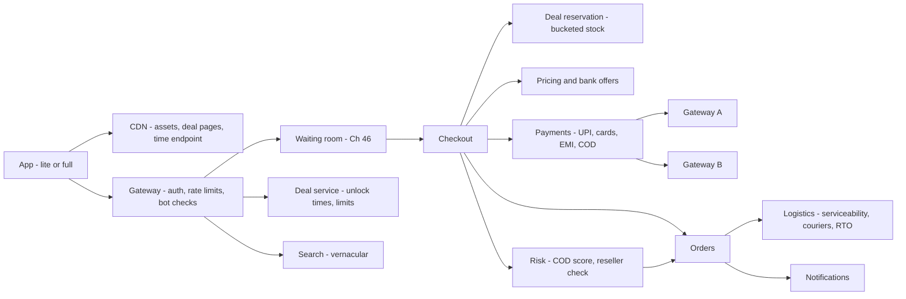
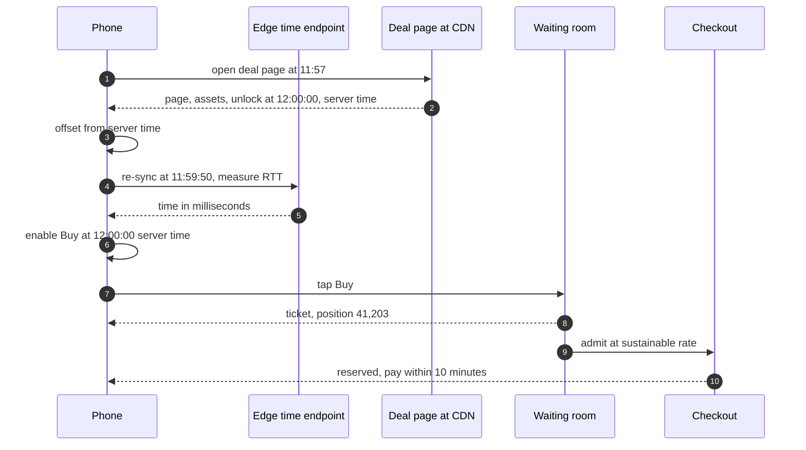
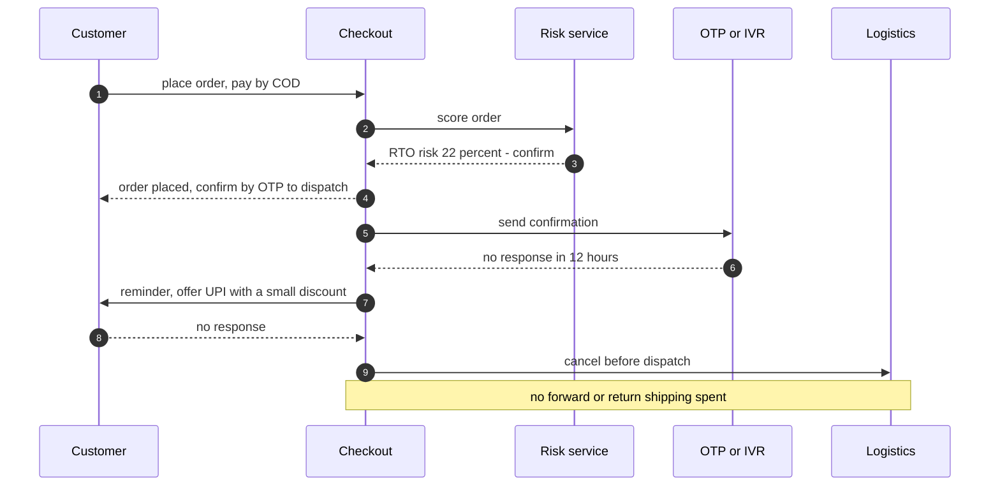
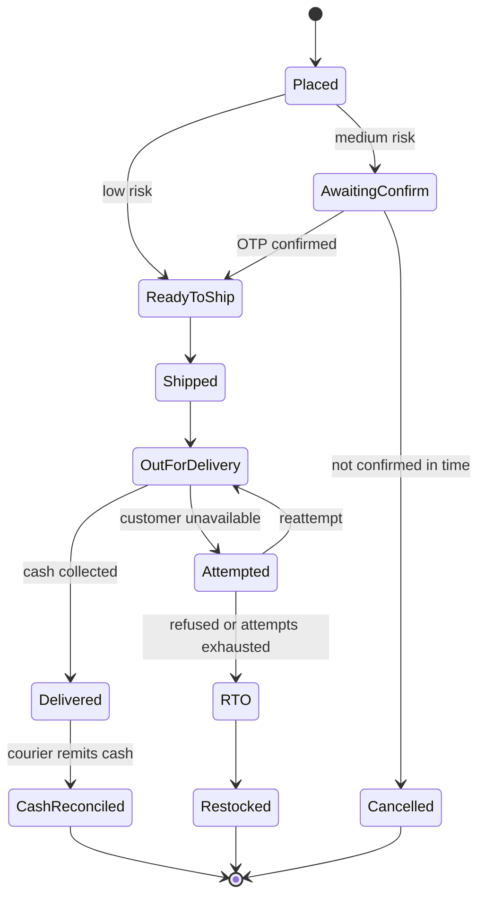

# I02. Flipkart-Style Sale-Day E-Commerce

!!! abstract "Chapter at a glance"
    **Sector:** E-commerce (India, festive sales) · **Reader bands:** B1 → B4 · **Builds on:** [Ch 02](../01-foundations/02-back-of-the-envelope-estimation.md), [Ch 45](../05-case-studies/45-payment-system.md), [Ch 46](../05-case-studies/46-grocery-checkout-and-inventory-reservation.md), [Ch 49](../05-case-studies/49-pricing-promotions-and-coupons.md), [I01](i01-amazon-style-global-marketplace.md)

    **What you get:** the design of an Indian e-commerce platform for its biggest days: a multi-day festive sale with midnight deal unlocks. It covers what is specific to India:

    - cash on delivery and parcels returned undelivered;
    - pincode serviceability;
    - bank offers and no-cost EMI;
    - slow networks and low-end phones;
    - vernacular shoppers;
    - reseller rings on limited deals;
    - the operating model of a sale: readiness, war rooms and change freezes.

    The waiting room and hot-SKU reservation are in [Ch 46](../05-case-studies/46-grocery-checkout-and-inventory-reservation.md), and payment routing is in [Ch 45](../05-case-studies/45-payment-system.md). This chapter builds on them rather than repeating them.

    **What the labs measured:**

    - **L1 (deal unlock):** with a million phones whose clocks are wrong, polling the origin every 2 s costs **102M requests** and gets only **37%** of shoppers within 1 s of the unlock. Trusting the phone clock is worse: **17.5%** tap early and **12%** are late by more than 5 s. Syncing from the server's clock gets **96.6%**, and a millisecond re-sync at T−10 s gets **100%**.
    - **L2 (COD policy, illustrative economics):** turning off COD loses **a third of orders**, and is the worst policy once new-customer value counts. OTP confirmation for medium-risk orders cuts parcels returned undelivered (RTO) by **half** and gives the best result on both measures.
    - **L3 (page weight, real compression):** a 40-product listing is **65 KB** of full JSON and **1.5 KB** trimmed and gzipped. On 2G that is **8.0 s vs 2.9 s** on a new connection, and **5.9 s vs 0.8 s** on a reused one. Connection setup dominates once payloads are small.
    - **L4 (reseller rings):** per-account and exact-address limits let a 400-account ring take **800 and 778** deal units. A normalised tower/flat/pincode key cuts that to **24**, the theoretical minimum of 2 per drop point, while blocking **82** genuine buyers against an unavoidable floor of 82 (same household or the drop point itself). Fuzzy text similarity is **worse** on both counts.

    **Reading time:** 80 min.

!!! warning "What this chapter is, and isn't"
    - This is a design **in the style of** a large Indian e-commerce platform during festive sales, based on public talks, engineering blogs and news coverage.
    - It is **not** a description of Flipkart's internal systems.
    - Business numbers (COD share, RTO rates, costs, network profiles) are **illustrative**.
    - Regulatory statements are marked **VERIFY**.

---

## 1. Introduction & Why It Matters

### 1.1 A story: midnight, and the phone that thought it was 11:58

The sale's headline deal, a phone at ₹9,999 with 5,000 units, unlocks at 12:00:00.

- **The early taps.** At 11:59:58 the origin receives 40,000 "Buy" requests from phones whose clocks run fast. They are rejected, the apps retry, and the retries land at 12:00:00, exactly when the real demand arrives.
- **The late shoppers.** Some shoppers' phones run slow. Their Buy button appears at 12:00:40, after the units have gone.
- **The complaints.** Social media fills with "the sale was rigged".
- **The ring.** A reseller ring with 400 accounts ships 800 units to a dozen flats, with each address typed a different way.
- **The returns.** Three days later, 18% of the cash-on-delivery orders in some regions come back undelivered, and the reverse shipping eats the margin.

None of this is a database problem. It is **time, trust, networks and money**, and in India each of these has its own shape.

!!! quote "The thesis of this chapter"
    **An Indian sale day is won before it starts and at the edges.**

    - Synchronise clients to server time instead of polling (L1).
    - Price the risk of cash on delivery instead of banning it (L2).
    - Design for 2G and cold connections (L3).
    - Enforce deal limits on the *real* delivery address (L4).
    - Behind all of that: the capacity, waiting room and reservation machinery of [Ch 46](../05-case-studies/46-grocery-checkout-and-inventory-reservation.md).

### 1.2 What's specific to India

| Factor | Effect on design | Where |
|---|---|---|
| **Cash on delivery** is still widely used, especially outside metros (VERIFY current share) | Parcels returned undelivered (RTO), cash reconciliation, risk scoring | §2.5, L2 |
| **~19,000+ pincodes** with very different courier coverage (VERIFY count) | Serviceability, promise by pincode | [Ch 01](../00-orientation/01-what-system-design-is.md) |
| **Slow and variable mobile networks; entry-level Android phones** | Payload budgets, fewer connections, lite apps | §2.6, L3 |
| **Many languages** | Vernacular UI and search, transliteration | §2.7 |
| **UPI, cards, EMI, bank offers** | Payment mix, offer eligibility at checkout | §2.8, [Ch 45](../05-case-studies/45-payment-system.md) |
| **Festive season concentration** | A large share of annual sales in a few days | §2.9 |
| **Consumer-protection and e-commerce rules** | Display of seller details, country of origin, flash-sale rules (VERIFY current rules) | §6.5 |

### 1.3 Learning objectives

By the end you will be able to:

- **Design** a sale-day architecture and readiness plan.
- **Synchronise** millions of clients to a deal unlock fairly.
- **Decide** COD eligibility with risk and economics, not blanket rules.
- **Budget** payloads and connections for slow networks.
- **Enforce** purchase limits against reseller rings without blocking households.

---

## 2. Core Concepts — Beginner to Deep

### 2.1 Intuition: a festival market that opens at midnight <span class="band b1">B1</span>

Imagine a market where every shop opens at the stroke of midnight and the best items go in seconds. Some shoppers' watches are wrong. Some came on slow buses. Some pay in cash at their door and change their minds. And a few professional buyers send twenty cousins to queue for the same item. A good market organiser fixes all of these *before* midnight: one clock everyone trusts, a door that admits people in order, clear rules on cash, and limits per household, not per person.

### 2.2 Requirements and estimates <span class="band b1">B1</span>

| Type | Requirement |
|---|---|
| **Functional** | Deal pages with countdowns; sale-only prices and bank offers; limited-quantity deals with per-customer limits; cart; checkout with UPI, cards, EMI, wallets and COD; order tracking; returns. |
| **Scale (assumptions)** | 100M app opens on day 1; at peak minutes, ~1M concurrent shoppers on the deal page; ~10–20× normal checkout rate (VERIFY with your own history). |
| **Latency** | Deal page usable within 3 s on a slow 3G connection; Buy button enabled within ±1 s of unlock for ≥ 99% of shoppers. |
| **Fairness** | First to tap is first served (within network variance); per-customer limits enforced on the delivery household. |
| **Correctness** | No overselling deal units ([Ch 46](../05-case-studies/46-grocery-checkout-and-inventory-reservation.md)); the bank offer shown is the one applied. |

**Estimation** ([Ch 02](../01-foundations/02-back-of-the-envelope-estimation.md)): 1M shoppers tapping Buy within ~2 seconds of unlock gives **~500k requests/s** for a few seconds at the origin (L1: ~580–680k in the peak second). That is why the tap must be admitted through a waiting room and reserved against sharded stock (Ch 46), and why nothing *else* may hit the origin at that second (L1).

### 2.3 Architecture overview ⭐ <span class="band b2">B2</span>

| Component | Role on sale day |
|---|---|
| **Edge / CDN** | Static assets, deal pages, and the edge-cached time endpoint (L1) |
| **Deal service** | Deal definitions, unlock times, quantity pools, per-customer limits |
| **Time service** | Millisecond server time served from the edge |
| **Waiting room and admission** | Fair entry to checkout at a sustainable rate ([Ch 46](../05-case-studies/46-grocery-checkout-and-inventory-reservation.md)) |
| **Inventory reservation** | Bucketed deal stock, holds with a TTL ([Ch 46](../05-case-studies/46-grocery-checkout-and-inventory-reservation.md)) |
| **Pricing and offers engine** | Sale prices, bank instant discounts, EMI plans, coupons ([Ch 49](../05-case-studies/49-pricing-promotions-and-coupons.md)) |
| **Checkout and payments** | UPI, cards, EMI, wallets, COD; gateway routing ([Ch 45](../05-case-studies/45-payment-system.md)) |
| **Risk and abuse** | Reseller detection (L4), COD risk (L2), payment fraud |
| **Serviceability and promise** | Pincode coverage, delivery dates ([Ch 01](../00-orientation/01-what-system-design-is.md), [I01](i01-amazon-style-global-marketplace.md) L3) |
| **Order and logistics** | Manifests, courier allocation, returns, cash reconciliation |
| **Notifications** | Sale reminders, order updates, with priority lanes ([Ch 40](../05-case-studies/40-notification-system.md)) |

### 2.4 Unlocking a deal on a million phones ⭐ <span class="band b2">B2</span>

- **Polling the origin to ask "is it live?" is the worst option** (L1): 102M requests in five minutes, and still only 37% of shoppers ready within a second, because of the poll interval.
- **The phone's own clock is wrong for a meaningful minority** (L1's assumption: 30% are off by more than a second). So 17.5% tap early (rejected, then retried at the worst moment), and 12% are more than 5 s late. That is the "rigged sale" complaint.
- **Sync from the server once.**
    - On page load, compute `offset = serverTime − localTime`, using the response's `Date` header or a time field, and correct for half the round trip.
    - The `Date` header has one-second resolution, which gives 96.6% within ±1 s.
- **Re-sync at T−10 s from an edge-cached, millisecond-precision time endpoint** (measure the round trip, use its midpoint). That gives 100% within ±1 s.
- **Also:**
    - Pre-fetch the deal page and assets before unlock.
    - Enable the button locally.
    - The server still checks the time *authoritatively* on the Buy request, and rejects early taps without penalising them.
- **The unavoidable part** is the Buy spike itself (~0.6M requests/s in the peak second). It goes to the waiting room, not straight to checkout.

### 2.5 Cash on delivery and RTO ⭐ <span class="band b3">B3</span>

- **COD** lets the customer pay at the door. It widens reach (new customers, customers without cards, low trust), but adds:
    - **RTO:** the parcel is refused or undeliverable and travels back, so you pay both shipping legs and make no sale.
    - Cash handling and reconciliation ([Ch 45](../05-case-studies/45-payment-system.md) §2.7).
- **The risk model** scores each order's chance of RTO. Illustrative features: pincode tier, whether the customer is new, their past RTO history, order value, and time to delivery. Actions by score:
    - **Low risk:** COD offered normally.
    - **Medium risk:** COD with confirmation, by OTP/IVR before dispatch, or a small partial prepayment.
    - **High risk:** prepaid only.
- **L2 findings** (illustrative economics):
    - Blocking COD entirely keeps only 68% of orders and is worst once the future value of new customers counts.
    - Aggressive blocking (P3, P4) raises this order's profit but gives up future value.
    - The best policy blocks only very high risk and confirms the middle band (P5): best on both measures.
- **Operations matter too:** a promise that slips raises refusals, and delivery attempt scheduling and customer calls reduce RTO. Measure RTO by pincode, courier and seller.

### 2.6 Slow networks and entry-level phones <span class="band b2">B2</span>

- **Budget the payload per screen.** L3's list view: 65 KB of full JSON shrinks to 1.5 KB when trimmed to the rendered fields and gzipped.
- **On 2G the connection costs more than the bytes.**
    - A new HTTPS connection costs 3 round trips of DNS, TCP and TLS, which is 2.1 s at 700 ms RTT.
    - Reusing connections, limiting the number of origins, and HTTP/2 or HTTP/3 multiplexing matter as much as compression.
    - Trimmed + gzip took 2.9 s on a new connection and 0.8 s on a reused one.
- **Images dominate real pages:** list thumbnails in modern formats at the rendered size, lazy loading, and low-quality placeholders.
- **Lite apps and PWAs** for low-end phones and slow networks. Flipkart publicly launched a PWA, Flipkart Lite, in 2015 (VERIFY details).
- **Offline-tolerant cart and retries with idempotency keys**, because connections drop mid-checkout.

### 2.7 Vernacular shoppers <span class="band b2">B2</span>

- **UI localisation** for many Indian languages, with content from the catalog in multiple languages.
- **Search:**
    - handle transliteration ("mobail" / "मोबाइल" → mobile), mixed-script queries and voice input;
    - query understanding maps them to the same catalog ([Ch 22](../03-production/22-search-systems.md), [Ch 42](../05-case-studies/42-search-autocomplete.md));
    - measure search success per language.
- **Keep font and layout budgets** in mind for complex scripts on low-end phones.

### 2.8 Bank offers, EMI and the price at checkout <span class="band b3">B3</span>

- **Sale prices often come with bank instant discounts** (e.g. 10% off with specific cards, up to a cap) and no-cost EMI. In no-cost EMI, the interest is funded as a discount (VERIFY accounting and disclosure rules).
- **Eligibility is only known at payment time,** from the card BIN or UPI app, bank, EMI tenure and cap usage. So the checkout must:
    - show the estimated offer early;
    - recompute exactly when the instrument is chosen;
    - reserve the bank's offer budget atomically (per-bank daily caps are the budget-pacing problem of [Ch 49](../05-case-studies/49-pricing-promotions-and-coupons.md));
    - release it on payment failure.
- **Price integrity:** the order stores the price, each discount line and who funds it (seller, platform, bank) for settlement and invoicing (GST).

### 2.9 Reseller rings and purchase limits ⭐ <span class="band b3">B3</span>

- **Limited deals** ("2 per customer") attract rings: many accounts, cards and phones, but few real delivery points.
- **L4:**
    - Per-account limits give the ring everything, 800 units.
    - Exact-address matching gives it 778, because the ring types each address differently.
    - Normalising to **tower + flat + pincode** gives it exactly 24, which is 2 per drop point, the minimum possible.
    - It blocks 82 genuine buyers, exactly the unavoidable cases: 79 second buyers in the same household, and 3 who live in the drop-point flats.
- **Fuzzy text similarity is worse:** "Flat 1102" and "Flat 1103" look 80% similar, so it merged neighbours (2,034 blocked) and still let 202 units through. Parse structure first; use fuzzy matching only on leftovers.
- **Combine signals:** device, payment instrument, phone number, address, and graph links between accounts. Enforce at checkout (reservation) and again before dispatch.
- **Communicate household limits clearly** so genuine families understand.

### 2.10 Readiness: running a sale like a launch <span class="band b4">B4</span>

| When | Activity |
|---|---|
| T−8 weeks | Capacity plan from forecasts; dependency limits (banks, gateways, couriers, SMS) |
| T−6 weeks | Full-journey load tests at 1.5× forecast; chaos drills on critical paths |
| T−4 weeks | Degradation switches built and tested (recommendations, reviews, search suggestions) |
| T−2 weeks | Change freeze on critical services; on-call rosters; war room plan |
| T−1 day | Pre-scale; warm caches; verify time sync, waiting room and deal configs |
| Sale | War room with journey dashboards; decision owners; comms templates |
| T+1 week | Retrospective: forecast vs actuals, incidents, RTO, abuse |

The pattern is **constant preparation over heroics**: known limits, rehearsed switches, one decision owner per journey ([Ch 27](../03-production/27-reliability-and-disaster-recovery.md), [Ch 37](../04-architect/37-leading-architecture-at-scale.md)).

### 2.11 Dependencies you don't own <span class="band b4">B4</span>

- **Payment gateways and banks, UPI apps, SMS/OTP providers, couriers** are each rate-limited and can fail on sale day.
- **Agree peak volumes in advance.** Route across providers ([Ch 45](../05-case-studies/45-payment-system.md) L4). Degrade gracefully, e.g. allow the order with a delayed OTP, or queue confirmations.
- **Watch a per-dependency success rate** on the war-room dashboard, with pre-agreed switch-over thresholds.

---

## 3. Architecture & Diagrams

### 3.1 Component view



### 3.2 Sequence: a fair deal unlock (happy path)



### 3.3 Sequence: a risky COD order (failure path handled)



### 3.4 State: a COD order



---

## 4. Design Document Excerpt

!!! note "Design Document (excerpt) — COD Eligibility Service"
    | Field | Value |
    |---|---|
    | Context | RTO on COD orders varies by region, customer and value. The current rule turns off COD above ₹5,000 everywhere, which loses genuine orders and misses risky low-value ones. |
    | Decision | Score every COD-eligible order for RTO risk. Offer plain COD below 12%, COD with OTP/IVR confirmation from 12% to 40%, and prepaid only above 40%. Review thresholds monthly per region. |
    | Related ADRs | ADR-I02-1 time sync for deal unlocks; ADR-I02-2 household-level deal limits; ADR-I02-3 payload budgets per screen |

    **Requirements.**

    - **R1:** The decision is made in ≤ 30 ms at checkout, and falls back to "COD with confirmation" if the model is unavailable.
    - **R2:** The RTO rate on COD orders is reduced without losing more than 5% of COD orders.
    - **R3:** The decision and its reasons are logged for customer support and fairness audits.
    - **R4:** Thresholds are configurable per region and category, with a shadow mode for changes.
    - **R5:** No protected attributes are used as features (VERIFY applicable rules).

    **Decisions in detail.**

    1. **Three bands, not a binary.** L2 shows confirmation beats blocking for the middle band.
    2. **Future value included in evaluation:** blocking new customers costs more than this order's margin (L2).
    3. **Shadow mode for two weeks** before any threshold change.
    4. **Fail open to confirmation**, not to plain COD or blocking.

    **Consequences.** Confirmation adds a step for some customers. The model needs monitoring for drift, especially at sale time, when the customer mix changes.

---

## 5. Hands-On Code — Level Ladder

!!! info "What's real here"
    - **L3** measures real serialised and gzip-compressed payloads.
    - **L4** runs real address parsing and matching on synthetic Indian addresses.
    - **L1 and L2** are simulations whose assumptions are stated in the code.
    - The economics and network profiles are **illustrative**.

### L1 — A fair deal unlock on a million phones <span class="band b2">B2</span>

**Requirement:** "Every shopper sees the Buy button within a second of 12:00:00, without flooding the origin."

```java title="DealUnlockL1.java"
// L1 — "Deal unlocks at 12:00:00". A million phones must start the deal at the same moment, but phone clocks are
// wrong (some by minutes). Compare four client strategies: how much load hits the origin before and at unlock, and how
// many shoppers are ready within 1 s of the true unlock. Clock-skew distribution is an assumption (VERIFY with your
// own client telemetry).
import java.util.*;

public class DealUnlockL1 {
    static final int USERS = 1_000_000, WINDOW = 300;            // users waiting on the deal page in the last 5 minutes

    public static void main(String[] a) {
        Random r = new Random(1202);
        double[] skew = new double[USERS], rtt = new double[USERS], arrive = new double[USERS];
        for (int i = 0; i < USERS; i++) {
            double u = r.nextDouble();                                   // phone clock minus true time, seconds
            skew[i] = u < 0.70 ? r.nextGaussian() * 0.4 : u < 0.92 ? r.nextGaussian() * 15 : r.nextGaussian() * 120;
            rtt[i] = 0.05 + Math.abs(r.nextGaussian()) * (r.nextDouble() < 0.2 ? 0.8 : 0.15);   // 20% on slow networks
            arrive[i] = -WINDOW * Math.sqrt(r.nextDouble());            // more arrivals close to unlock
        }
        System.out.printf("%,d shoppers on the deal page during the last %d s; phone clocks: 70%% within ~1 s, 22%% off by ~15 s, 8%% by ~2 min%n%n", USERS, WINDOW);
        System.out.printf("%-48s %14s %14s %12s %14s %12s%n", "strategy", "origin reqs", "peak origin/s", "early taps", "within ±1 s", "late > 5 s");
        for (int s = 1; s <= 4; s++) run(s, skew, rtt, arrive, r);
        System.out.println("\norigin reqs / peak: requests reaching the origin from arrival until 10 s after unlock (edge-cached polls excluded)");
        System.out.println("early taps: 'Buy' requests sent before the true unlock (rejected, and often retried)");
        System.out.println("within ±1 s: shoppers whose app shows the Buy button within 1 s of the true unlock (early or late)");
    }

    static void run(int s, double[] skew, double[] rtt, double[] arrive, Random r) {
        long origin = 0, early = 0, ready = 0, late = 0; long[] perSec = new long[WINDOW + 20];
        for (int i = 0; i < USERS; i++) {
            double t0 = arrive[i], start;                                // true time the app enables Buy
            switch (s) {
                case 1 -> {                                              // poll the origin every 2 s until it says "live"
                    double first = t0 + r.nextDouble() * 2; int polls = 0; double t = first;
                    while (t < 0) { add(perSec, t); polls++; t += 2; }
                    add(perSec, t); polls++; origin += polls; start = t + rtt[i];
                }
                case 2 -> start = -skew[i];                              // local timer on the phone's own clock
                case 3 -> {                                              // one origin call on page load: offset = server Date − local clock
                    add(perSec, t0); origin++;
                    // the Date header is truncated to whole seconds (up to 1 s behind) and the one-way delay is unknown (±RTT/2)
                    start = r.nextDouble() + (r.nextDouble() - 0.5) * rtt[i];
                }
                default -> {                                             // S3, then at T−10 s re-sync from an edge-cached, ms-precision time endpoint
                    add(perSec, t0); origin++;
                    start = (r.nextDouble() - 0.5) * rtt[i] * 0.5;       // RTT measured, so only asymmetry error remains
                }
            }
            // the shopper taps Buy ~0.3–1.5 s after the button appears; that tap always goes to the origin
            double tap = start + 0.3 + r.nextDouble() * 1.2;
            add(perSec, tap); origin++;
            if (tap < 0) early++;
            if (Math.abs(start) <= 1) ready++;
            if (start > 5) late++;
        }
        long peak = Arrays.stream(perSec).max().getAsLong();
        String[] names = {"", "S1 poll the origin every 2 s", "S2 timer on the phone's clock", "S3 offset from server Date on page load", "S4 S3 + ms-precision re-sync at T−10 s"};
        System.out.printf("%-48s %,14d %,14d %11.1f%% %13.1f%% %11.1f%%%n", names[s], origin, peak, 100.0 * early / USERS, 100.0 * ready / USERS, 100.0 * late / USERS);
    }
    static void add(long[] perSec, double t) { int idx = (int) Math.floor(t) + WINDOW; if (idx >= 0 && idx < perSec.length) perSec[idx]++; }
}
```

```text title="java DealUnlockL1.java"
1,000,000 shoppers on the deal page during the last 300 s; phone clocks: 70% within ~1 s, 22% off by ~15 s, 8% by ~2 min

strategy                                            origin reqs  peak origin/s   early taps    within ±1 s   late > 5 s
S1 poll the origin every 2 s                        101,959,847        870,823         0.0%          37.3%         0.0%
S2 timer on the phone's clock                         1,000,000        375,953        17.5%          70.4%        12.0%
S3 offset from server Date on page load               2,000,000        680,923         0.0%          96.6%         0.0%
S4 S3 + ms-precision re-sync at T−10 s                2,000,000        582,100         0.0%         100.0%         0.0%

origin reqs / peak: requests reaching the origin from arrival until 10 s after unlock (edge-cached polls excluded)
early taps: 'Buy' requests sent before the true unlock (rejected, and often retried)
within ±1 s: shoppers whose app shows the Buy button within 1 s of the true unlock (early or late)
```

**Reading it:**

- **S1, polling the origin,** costs **102M requests** in five minutes, and still only 37% of shoppers are ready within a second. The 2-second poll interval spreads them out.
- **S2, the phone's clock:** only one request each, but **17.5% tap early**, get rejected and retry into the peak, and **12% are more than 5 s late**. With this skew distribution (an assumption), that is the "rigged sale" complaint.
- **S3, an offset from the server `Date` on page load,** reaches 96.6% within ±1 s. The rest is the header's one-second resolution plus network asymmetry.
- **S4 adds a millisecond re-sync at T−10 s** and reaches **100%**.
- **The Buy taps themselves always peak at ~0.6M/s in one second.** That is the demand, and it goes to the waiting room ([Ch 46](../05-case-studies/46-grocery-checkout-and-inventory-reservation.md)). The peak differs between S3 and S4 only because of how the taps fall into one-second buckets.

### L2 — Who gets cash on delivery? <span class="band b3">B3</span>

**Requirement:** "Cut returned undelivered parcels (RTO) without losing the customers COD brings in."

```java title="CodPolicyL2.java"
// L2 — Cash on delivery (COD) and "return to origin" (RTO): the customer refuses the parcel at the door and it
// travels back. Which orders should be offered COD? Compare policies on 300,000 simulated orders with a risk model.
// All rates, costs and behaviours are ILLUSTRATIVE assumptions (VERIFY against your own data before using the numbers).
import java.util.*;

public class CodPolicyL2 {
    record Order(double value, double margin, double pRto, boolean wouldPrepay, double pAbandonIfNoCod, double pAcceptOtp, boolean newCust) {}

    public static void main(String[] a) {
        Random r = new Random(1203); List<Order> orders = new ArrayList<>();
        for (int i = 0; i < 300_000; i++) {
            double tier = r.nextDouble();                                            // city tier: metro / tier-2 / tier-3+
            boolean newCust = r.nextDouble() < 0.35, pastRto = !newCust && r.nextDouble() < 0.08;
            double value = Math.exp(6.3 + r.nextGaussian() * 0.8);                   // ₹ (median ~₹545)
            double base = tier < 0.4 ? 0.06 : tier < 0.75 ? 0.12 : 0.20;              // RTO rate for COD by tier (assumption)
            double p = base * (newCust ? 1.5 : 1.0) * (pastRto ? 3.0 : 1.0) * (value > 2000 ? 1.3 : 1.0);
            p = Math.min(0.85, p * Math.exp(r.nextGaussian() * 0.35));               // unobserved noise
            boolean prepay = r.nextDouble() < (tier < 0.4 ? 0.55 : tier < 0.75 ? 0.35 : 0.20);   // would pay online anyway
            orders.add(new Order(value, 0.18 * value, p, prepay, tier < 0.4 ? 0.35 : 0.60, 0.85, newCust));
        }
        double shipFwd = 45, shipRev = 40, codFee = 15;                               // ₹ per parcel (assumption)
        System.out.println("300,000 orders; contribution margin 18%; forward shipping ₹45, return ₹40, COD handling ₹15;");
        System.out.println("a successfully delivered NEW customer is worth ₹" + (int) LTV + " of future margin (all illustrative)\n");
        System.out.printf("%-46s %11s %11s %13s %13s %15s%n", "policy", "orders kept", "RTO parcels", "this order ₹L", "₹ per order", "incl. future ₹L");
        // the model's score is the true risk plus estimation error (a real model is not perfect)
        double[] score = orders.stream().mapToDouble(o -> Math.min(0.95, o.pRto() * Math.exp(r.nextGaussian() * 0.30))).toArray();
        policy("P1 COD for everyone", orders, score, 1.01, 1.01, shipFwd, shipRev, codFee, r);
        policy("P2 no COD at all", orders, score, -1, -1, shipFwd, shipRev, codFee, r);
        policy("P3 block COD if risk > 25%", orders, score, 0.25, 0.25, shipFwd, shipRev, codFee, r);
        policy("P4 block > 25%, OTP-confirm COD at 12–25%", orders, score, 0.12, 0.25, shipFwd, shipRev, codFee, r);
        policy("P5 block > 40%, OTP-confirm COD at 12–40%", orders, score, 0.12, 0.40, shipFwd, shipRev, codFee, r);
        System.out.println("\nOTP-confirm: the customer confirms by OTP/IVR before dispatch; assumed to cut RTO risk by 40% and lose 15% of those orders.");
    }

    // risk < confirmAt: plain COD offered; confirmAt ≤ risk < blockAt: COD with OTP confirmation; risk ≥ blockAt: prepaid only
    static final double LTV = 250;
    static void policy(String name, List<Order> os, double[] score, double confirmAt, double blockAt, double fwd, double rev, double fee, Random r) {
        Random rr = new Random(99); long kept = 0, rto = 0; double profit = 0, future = 0;
        for (int i = 0; i < os.size(); i++) {
            Order o = os.get(i); double s = score[i];
            if (o.wouldPrepay()) { kept++; profit += o.margin() - fwd; if (o.newCust()) future += LTV; continue; }       // prepaid orders: no RTO modelled
            if (s >= blockAt) {                                                            // COD refused: some pay online, others leave
                if (rr.nextDouble() < o.pAbandonIfNoCod()) continue;
                kept++; profit += o.margin() - fwd; if (o.newCust()) future += LTV; continue;
            }
            double p = o.pRto();
            if (s >= confirmAt) { if (rr.nextDouble() > o.pAcceptOtp()) continue; p *= 0.6; }
            kept++;
            if (rr.nextDouble() < p) { rto++; profit -= fwd + rev; }                       // lost both legs, no sale
            else { profit += o.margin() - fwd - fee; if (o.newCust()) future += LTV; }
        }
        System.out.printf("%-46s %,11d %,11d %13.1f %13.1f %15.1f%n", name, kept, rto, profit / 1e5, profit / os.size(), (profit + future) / 1e5);
    }
}
```

```text title="java CodPolicyL2.java"
300,000 orders; contribution margin 18%; forward shipping ₹45, return ₹40, COD handling ₹15;
a successfully delivered NEW customer is worth ₹250 of future margin (all illustrative)

policy                                         orders kept RTO parcels this order ₹L   ₹ per order incl. future ₹L
P1 COD for everyone                                300,000      32,290         189.0          63.0           417.7
P2 no COD at all                                   203,982           0         183.5          61.2           361.5
P3 block COD if risk > 25%                         275,533      18,364         194.8          64.9           410.3
P4 block > 25%, OTP-confirm COD at 12–25%          265,392      12,453         196.5          65.5           408.6
P5 block > 40%, OTP-confirm COD at 12–40%          277,199      16,337         198.1          66.0           419.8

OTP-confirm: the customer confirms by OTP/IVR before dispatch; assumed to cut RTO risk by 40% and lose 15% of those orders.
```

**Reading it** (all economics are illustrative):

- **No COD at all (P2)** keeps only **68% of orders**. It ends slightly *below* COD-for-everyone on this order's profit, and is clearly the worst once new-customer value counts (₹361.5L vs ₹417.7L).
- **Blocking above 25% (P3, P4)** raises this order's profit but gives up future value.
- **Blocking only above 40% and confirming the 12–40% band (P5)** is best on both measures: ₹198.1L now and ₹419.8L with future value. It also halves RTO parcels (32,290 → 16,337).
- **The lesson is the method, not the thresholds:** evaluate COD policy on both horizons, and prefer confirmation to blocking for the middle band. The first version of this lab assumed a 12% margin and ₹55 shipping. There, *no* COD policy was profitable at all, because the margin on a median order barely covered shipping. That is a reminder that the conclusion depends on unit economics you must take from your own data.

### L3 — The sale page on 2G <span class="band b2">B2</span>

**Requirement:** "The deal list loads in under 3 s on a congested 3G connection."

```java title="PayloadL3.java"
// L3 — The sale page on a slow phone network. Build a real product-listing response (40 products), measure its REAL
// size as full JSON, trimmed JSON (only fields the list view renders) and gzip-compressed, then estimate load time on
// 2G/3G/4G profiles with TCP slow start (initial window 10 segments). Network profiles are assumptions (VERIFY).
import java.io.*;
import java.nio.charset.StandardCharsets;
import java.util.*;
import java.util.zip.*;

public class PayloadL3 {
    public static void main(String[] a) throws Exception {
        Random r = new Random(1204);
        String full = listing(r, true), trim = listing(new Random(1204), false);
        byte[] fullB = full.getBytes(StandardCharsets.UTF_8), trimB = trim.getBytes(StandardCharsets.UTF_8);
        byte[] fullGz = gzip(fullB, 6), trimGz = gzip(trimB, 6), trimGz9 = gzip(trimB, 9);
        String[] names = {"full JSON", "full JSON + gzip", "trimmed JSON", "trimmed + gzip", "trimmed + gzip -9"};
        int[] sizes = {fullB.length, fullGz.length, trimB.length, trimGz.length, trimGz9.length};
        // name, downlink kbit/s, RTT ms (illustrative profiles)
        Object[][] nets = {{"2G/EDGE", 100, 700}, {"3G congested", 400, 350}, {"4G busy (sale evening)", 3000, 120}, {"4G good", 15000, 50}};
        System.out.printf("40-product listing response, sizes measured; times = new HTTPS connection + transfer with slow start%n%n");
        System.out.printf("%-20s %10s", "payload", "bytes");
        for (Object[] n : nets) System.out.printf(" %22s", n[0]);
        System.out.println();
        for (int i = 0; i < names.length; i++) {
            System.out.printf("%-20s %,10d", names[i], sizes[i]);
            for (Object[] n : nets) System.out.printf(" %20.2f s", seconds(sizes[i], (int) n[1], (int) n[2], true));
            System.out.println();
        }
        System.out.printf("%nsame, on an already-open connection (no DNS/TCP/TLS setup, window already grown):%n");
        for (int i = 0; i < names.length; i++) {
            System.out.printf("%-20s %,10d", names[i], sizes[i]);
            for (Object[] n : nets) System.out.printf(" %20.2f s", seconds(sizes[i], (int) n[1], (int) n[2], false));
            System.out.println();
        }
        System.out.println("\nfull: 17 fields per product incl. description, specs, 6 image URLs, offers, seller; trimmed: id, title, price, mrp, rating, 1 image");
    }

    // setup: DNS 1 RTT + TCP 1 RTT + TLS 1.3 1 RTT, then request 1 RTT; transfer in slow-start rounds (10 × 1460 B, doubling)
    // until the bandwidth-delay product is reached, then at link rate
    static double seconds(int bytes, int kbps, int rttMs, boolean cold) {
        double rtt = rttMs / 1000.0, bw = kbps * 1000 / 8.0, t = cold ? 3 * rtt : 0; double sent = 0, window = cold ? 14600 : Math.max(14600, bw * rtt);
        t += rtt / 2;                                                    // request reaches the server
        while (sent < bytes) {
            double burst = Math.min(window, bytes - sent);
            t += Math.max(burst / bw, 0) + (sent + burst < bytes ? Math.max(0, rtt - burst / bw) : rtt / 2);
            sent += burst; window = Math.min(window * 2, Math.max(bw * rtt, 14600));
        }
        return t;
    }
    static byte[] gzip(byte[] in, int level) throws IOException {
        ByteArrayOutputStream bo = new ByteArrayOutputStream();
        try (GZIPOutputStream g = new GZIPOutputStream(bo) {{ def.setLevel(level); }}) { g.write(in); }
        return bo.toByteArray();
    }
    // product copy varies per product (a repeated sentence would compress unrealistically well)
    static final String[] WORDS = ("powerful fast octa core processor smooth display amoled bright sunlight battery lasts all day charging watt turbo camera portrait night mode " +
        "sensor lens ultra wide selfie video stabilisation gaming cooling chamber storage expandable memory slot dual sim network band support sleek design slim body " +
        "glass back matte finish fingerprint unlock face secure stereo speakers dolby audio headphone jack software updates security patches years durable splash resistant " +
        "premium value best in segment students professionals everyday use travel streaming social media multitasking apps").split(" ");
    static String prose(Random r, int n) { StringBuilder b = new StringBuilder(); for (int i = 0; i < n; i++) { if (i > 0) b.append(i % 12 == 0 ? ". " : " "); b.append(WORDS[r.nextInt(WORDS.length)]); } return b.append('.').toString(); }
    static String listing(Random r, boolean full) {
        String[] brands = {"Redmi", "Samsung", "realme", "POCO", "Moto", "iQOO", "OnePlus", "vivo"}, colors = {"Black", "Blue", "Green", "Silver", "Purple"};
        StringBuilder sb = new StringBuilder("{\"page\":1,\"items\":[");
        for (int i = 0; i < 40; i++) {
            String brand = brands[r.nextInt(brands.length)]; int mrp = 9999 + r.nextInt(30) * 1000, price = (int) (mrp * (0.6 + r.nextDouble() * 0.3));
            if (i > 0) sb.append(',');
            sb.append("{\"id\":\"MOB").append(100000 + r.nextInt(900000)).append("\",\"title\":\"").append(brand).append(" ").append(r.nextInt(90) + 10)
              .append(" 5G (").append(colors[r.nextInt(5)]).append(", ").append(4 << r.nextInt(3)).append("GB RAM, ").append(64 << r.nextInt(3)).append("GB)\",")
              .append("\"price\":").append(price).append(",\"mrp\":").append(mrp).append(",\"rating\":").append(3.5 + r.nextInt(15) / 10.0)
              .append(",\"img\":\"https://img.example.in/p/").append(Long.toHexString(r.nextLong())).append("_312x312.webp\"");
            if (full) {
                sb.append(",\"ratingCount\":").append(r.nextInt(90000)).append(",\"reviewCount\":").append(r.nextInt(9000))
                  .append(",\"description\":\"").append(prose(r, 60 + r.nextInt(60))).append("\"")
                  .append(",\"specs\":{\"display\":\"6.7 inch FHD+\",\"battery\":\"").append(5000 + r.nextInt(3) * 500).append(" mAh\",\"camera\":\"50MP + 2MP\",\"processor\":\"Octa-core\",\"warranty\":\"1 year\"}")
                  .append(",\"images\":[");
                for (int k = 0; k < 6; k++) sb.append(k > 0 ? "," : "").append("\"https://img.example.in/p/").append(Long.toHexString(r.nextLong())).append("_832x832.jpeg\"");
                sb.append("],\"offers\":[\"10% instant discount on select bank cards\",\"No-cost EMI from ₹").append(price / 12).append("/month\",\"Exchange offer up to ₹").append(r.nextInt(15) * 1000).append(" off\"]")
                  .append(",\"seller\":{\"id\":\"S").append(r.nextInt(99999)).append("\",\"name\":\"RetailNet ").append(r.nextInt(99)).append("\",\"rating\":4.").append(r.nextInt(9)).append("}")
                  .append(",\"deliveryPromise\":\"Delivery by tomorrow\",\"returnPolicy\":\"7 days replacement\",\"trackingTags\":[\"sale\",\"bbd\",\"slot").append(r.nextInt(9)).append("\"]");
            } else {
                for (int k = 0; k < 18; k++) r.nextInt(99999);   // keep the random stream aligned with the full listing where it matters little
            }
            sb.append('}');
        }
        return sb.append("]}").toString();
    }
}
```

```text title="java PayloadL3.java"
40-product listing response, sizes measured; times = new HTTPS connection + transfer with slow start

payload                   bytes                2G/EDGE           3G congested 4G busy (sale evening)                4G good
full JSON                64,963                 8.00 s                 2.76 s                 0.78 s                 0.31 s
full JSON + gzip         13,904                 3.91 s                 1.68 s                 0.52 s                 0.21 s
trimmed JSON              6,699                 3.34 s                 1.53 s                 0.50 s                 0.20 s
trimmed + gzip            1,502                 2.92 s                 1.43 s                 0.48 s                 0.20 s
trimmed + gzip -9         1,481                 2.92 s                 1.43 s                 0.48 s                 0.20 s

same, on an already-open connection (no DNS/TCP/TLS setup, window already grown):
full JSON                64,963                 5.90 s                 1.65 s                 0.29 s                 0.08 s
full JSON + gzip         13,904                 1.81 s                 0.63 s                 0.16 s                 0.06 s
trimmed JSON              6,699                 1.24 s                 0.48 s                 0.14 s                 0.05 s
trimmed + gzip            1,502                 0.82 s                 0.38 s                 0.12 s                 0.05 s
trimmed + gzip -9         1,481                 0.82 s                 0.38 s                 0.12 s                 0.05 s

full: 17 fields per product incl. description, specs, 6 image URLs, offers, seller; trimmed: id, title, price, mrp, rating, 1 image
```

**Reading it:**

- **Real sizes:**
    - full JSON is **65 KB**;
    - gzip alone reduces it to 13.9 KB;
    - trimming to the six fields the list renders reduces it to 6.7 KB;
    - trimming plus gzip gives **1.5 KB**. Maximum gzip level adds almost nothing.
- **On 2G with a new connection,** full JSON takes 8.0 s and trimmed + gzip 2.9 s. Of that 2.9 s, about **2.1 s is DNS + TCP + TLS setup**, three 700 ms round trips.
- **On an already-open connection** the same payload takes 0.8 s. **Once payloads are small, connections matter more than bytes:** reuse connections, keep few origins, and pre-connect.
- **The requirement:**
    - congested 3G, new connection: 1.43 s for trimmed + gzip, which meets it;
    - full JSON on 3G: 2.76 s, which barely meets it;
    - full JSON on 2G misses badly.
- **Images are not included.** Budget them separately: thumbnails at the rendered size, in modern formats, lazy-loaded.
- The network profiles and the slow-start model are simplifications (VERIFY with real-user measurements).

### L4 — Reseller rings vs purchase limits <span class="band b3">B3</span>

**Requirement:** "2 units per customer means per *household*. Don't block neighbours or families."

```java title="ResellerL4.java"
// L4 — Reseller rings on deal day. The deal allows 2 units per customer; a ring uses 400 accounts that ship to 12 real
// drop points, each address written many different ways. Genuine buyers include neighbours in the same apartment
// complexes. Compare per-account, exact-address, normalised-address and fuzzy (token-similarity) limits: how many deal
// units reach the ring, and how many genuine buyers are wrongly blocked. Addresses are synthetic, in Indian formats.
import java.util.*;
import java.util.stream.*;

public class ResellerL4 {
    record Order(String account, String address, String pincode, boolean ring, int dropOrHome) {}

    public static void main(String[] a) {
        Random r = new Random(1205);
        String[] soc = {"Prestige Lakeside Habitat", "Sobha Dream Acres", "Brigade Metropolis", "Purva Riviera", "Salarpuria Greenage", "Mantri Espana"};
        String[] roads = {"Varthur Road", "Whitefield Main Road", "Sarjapur Road", "Outer Ring Road", "Hosur Road", "Bannerghatta Road"};
        String[] pins = {"560087", "560066", "560035", "560103", "560068", "560076"};
        List<Order> orders = new ArrayList<>();
        // 12 ring drop points: real flats/shops in the same complexes genuine customers live in
        int[][] drops = new int[12][3]; for (int d = 0; d < 12; d++) drops[d] = new int[]{r.nextInt(6), 1 + r.nextInt(12), (1 + r.nextInt(25)) * 100 + 1 + r.nextInt(8)};
        for (int acc = 0; acc < 400; acc++) {
            int[] d = drops[acc % 12];
            orders.add(new Order("R" + acc, variant(r, soc[d[0]], roads[d[0]], d[1], d[2], true), pins[d[0]], true, acc % 12));
        }
        // 20,000 genuine buyers at their own homes; 1,500 live in the same six complexes (12 towers × 25 floors × 8 flats each)
        for (int g = 0; g < 20_000; g++) {
            int c = r.nextInt(6); int tower = 1 + r.nextInt(12), flat = (1 + r.nextInt(25)) * 100 + 1 + r.nextInt(8);
            boolean inComplex = g < 1_500;
            String addr = inComplex ? variant(r, soc[c], roads[c], tower, flat, false)
                                    : (100 + r.nextInt(900)) + ", " + (1 + r.nextInt(20)) + "th Cross, " + (1 + r.nextInt(12)) + "th Main, Sector " + (1 + r.nextInt(7)) + ", HSR Layout";
            orders.add(new Order("G" + g, addr, inComplex ? pins[c] : "5601" + (10 + r.nextInt(80)), false, inComplex ? c * 1_000_000 + tower * 10_000 + flat : 100_000_000 + g));
        }
        Collections.shuffle(orders, r);
        Map<Integer, Long> homes = orders.stream().filter(o -> !o.ring()).collect(Collectors.groupingBy(Order::dropOrHome, Collectors.counting()));
        long sameHome = homes.values().stream().filter(v -> v > 1).mapToLong(v -> v - 1).sum();
        long nearDrop = orders.stream().filter(o -> !o.ring() && Arrays.stream(drops).anyMatch(d -> d[0] * 1_000_000 + d[1] * 10_000 + d[2] == o.dropOrHome())).count();
        System.out.println("deal limit: 2 units per customer; ring = 400 accounts × 2 units → 12 drop points; 20,000 genuine buyers (1,500 in the same 6 complexes)\n");
        System.out.printf("%-44s %16s %24s %12s%n", "limit keyed on", "units to ring", "genuine buyers blocked", "keys");
        run("account", orders, o -> o.account());
        run("exact address string", orders, o -> o.address() + "|" + o.pincode());
        run("normalised address (tower, flat, pincode)", orders, ResellerL4::normKey);
        run("fuzzy: normalised + token similarity ≥ 0.8", orders, null);
        System.out.printf("%nfloor on 'genuine blocked' for any address-based limit: %d buyers share a flat with an earlier genuine buyer (same household),%n", sameHome);
        System.out.printf("and %d genuine buyers live in a flat the ring uses as a drop point%n", nearDrop);
        System.out.println("\nexamples of one drop point as the ring typed it:");
        orders.stream().filter(o -> o.ring() && o.dropOrHome() == 0).limit(5).forEach(o -> System.out.println("  " + o.address() + " — " + o.pincode()));
    }

    interface Key { String of(Order o); }
    static void run(String name, List<Order> orders, Key key) {
        Map<String, Integer> used = new HashMap<>(); List<String[]> fuzzyKeys = new ArrayList<>(); List<Integer> fuzzyUsed = new ArrayList<>();
        int ringUnits = 0, blocked = 0;
        for (Order o : orders) {
            int allowed;
            if (key != null) { String k = key.of(o); int u = used.getOrDefault(k, 0); allowed = Math.max(0, 2 - u); used.put(k, u + allowed); }
            else {                                                         // fuzzy: compare with earlier keys in the same pincode
                String[] me = {o.pincode(), normText(o.address())}; int hit = -1;
                for (int i = 0; i < fuzzyKeys.size(); i++) if (fuzzyKeys.get(i)[0].equals(me[0]) && sim(fuzzyKeys.get(i)[1], me[1]) >= 0.8) { hit = i; break; }
                if (hit < 0) { fuzzyKeys.add(me); fuzzyUsed.add(0); hit = fuzzyKeys.size() - 1; }
                allowed = Math.max(0, 2 - fuzzyUsed.get(hit)); fuzzyUsed.set(hit, fuzzyUsed.get(hit) + allowed);
            }
            if (o.ring()) ringUnits += allowed; else if (allowed < 2) blocked++;
        }
        long keys = key != null ? used.size() : fuzzyKeys.size();
        System.out.printf("%-44s %16d %24d %,12d%n", name, ringUnits, blocked, keys);
    }

    // normalise: lowercase, expand common abbreviations, pull out tower/block and flat numbers
    static String normText(String s) {
        s = s.toLowerCase().replaceAll("[.,#/\\-]", " ")
             .replaceAll("\\b(flt|flat no|flat|apt|apartment|no)\\b", " flat ").replaceAll("\\b(twr|tower|block|blk|wing)\\b", " tower ")
             .replaceAll("\\b(rd)\\b", " road ").replaceAll("\\b(opp|opposite|near|nr|behind)\\b.*", " ").replaceAll("\\s+", " ").trim();
        return s;
    }
    static String normKey(Order o) {
        String s = normText(o.address());
        String tw = find(s, "\\btower (\\d+)", "\\bt(\\d+)\\b");
        String fl = find(s, "\\bflat (\\d{3,4})\\b", "\\b(?:tower |t)\\d+ (\\d{3,4})\\b", "(?:^| )(\\d{3,4})(?= |$)");
        return tw == null || fl == null ? s + "|" + o.pincode() : tw + "|" + fl + "|" + o.pincode();   // unparsed: fall back to the full text
    }
    static String find(String s, String... patterns) {
        for (String p : patterns) { java.util.regex.Matcher m = java.util.regex.Pattern.compile(p).matcher(s); if (m.find()) return m.group(1); }
        return null;
    }
    static double sim(String a, String b) {                              // Jaccard similarity of word sets
        Set<String> x = new HashSet<>(Arrays.asList(a.split(" "))), y = new HashSet<>(Arrays.asList(b.split(" ")));
        Set<String> i = new HashSet<>(x); i.retainAll(y); Set<String> u = new HashSet<>(x); u.addAll(y);
        return u.isEmpty() ? 0 : (double) i.size() / u.size();
    }

    // one real address, written the way different people (or a ring deliberately) would write it
    static String variant(Random r, String soc, String road, int tower, int flat, boolean evasive) {
        int unit = flat;                                                  // floor × 100 + flat on the floor, e.g. 1203
        String[] towerForms = {"Tower " + tower, "T" + tower, "Block " + tower, "Twr-" + tower, "Wing " + tower};
        String[] flatForms = {"Flat " + unit, "Flat No. " + unit, "#" + unit, unit + "", "Apt " + unit, "Flt " + unit};
        String tf = towerForms[r.nextInt(evasive ? 5 : 2)], ff = flatForms[r.nextInt(evasive ? 6 : 2)];
        String socName = evasive && r.nextBoolean() ? soc.replace(" ", "").toUpperCase() : soc;
        String rd = r.nextBoolean() ? road : road.replace("Road", "Rd");
        String landmark = evasive && r.nextDouble() < 0.5 ? ", near " + (r.nextBoolean() ? "Decathlon" : "Forum Mall") : "";
        String name = evasive && r.nextDouble() < 0.4 ? "C/o " + (char) ('A' + r.nextInt(26)) + ". Kumar, " : "";
        return r.nextBoolean() ? name + ff + ", " + tf + ", " + socName + ", " + rd + landmark
                               : name + tf + "-" + unit + ", " + socName + ", " + rd + landmark;
    }
}
```

```text title="java ResellerL4.java"
deal limit: 2 units per customer; ring = 400 accounts × 2 units → 12 drop points; 20,000 genuine buyers (1,500 in the same 6 complexes)

limit keyed on                                  units to ring   genuine buyers blocked         keys
account                                                   800                        0       20,400
exact address string                                      778                        7       20,382
normalised address (tower, flat, pincode)                  24                       82       19,930
fuzzy: normalised + token similarity ≥ 0.8                202                     2034       18,067

floor on 'genuine blocked' for any address-based limit: 79 buyers share a flat with an earlier genuine buyer (same household),
and 3 genuine buyers live in a flat the ring uses as a drop point

examples of one drop point as the ring typed it:
  C/o P. Kumar, Twr-6-1102, Purva Riviera, Outer Ring Rd — 560103
  Tower 6-1102, Purva Riviera, Outer Ring Road, near Decathlon — 560103
  Flat No. 1102, T6, Purva Riviera, Outer Ring Rd, near Forum Mall — 560103
  Flt 1102, Twr-6, Purva Riviera, Outer Ring Rd, near Forum Mall — 560103
  Wing 6-1102, Purva Riviera, Outer Ring Rd, near Forum Mall — 560103
```

**Reading it:**

- **Per-account limits** give the ring all 800 units. **Exact address strings** give it 778, because the ring typed each drop point differently: "Twr-6-1102", "Flat No. 1102, T6", "Wing 6-1102", plus C/o names and landmarks.
- **A normalised tower + flat + pincode key** gives the ring **24 units**, exactly 2 per drop point, which is the minimum possible. It blocks **82 genuine buyers**, and all of them are unavoidable: 79 second buyers in the same household, and 3 who live in the drop-point flats. The first version of the parser missed the "T6" form, which left the tower unknown and merged flats across towers (388 wrongly blocked). The fix was to parse more forms and fall back to the full text when parsing fails.
- **Fuzzy word similarity is worse on both counts:** 202 units to the ring and **2,034 genuine buyers blocked**. "Flat 1102, Tower 6" and "Flat 1103, Tower 6" share most words, so neighbours merge, while landmark and C/o noise splits the ring's own variants. Parse structure first, and use fuzzy matching only on what can't be parsed.

---

## 6. Production Concerns

### 6.1 Failure modes

| Failure | Effect | Mitigation |
|---|---|---|
| Client clock skew | Early and late taps, "rigged" complaints | Server-time sync + re-sync (L1) |
| Buy spike | Checkout overload | Waiting room, bucketed reservation ([Ch 46](../05-case-studies/46-grocery-checkout-and-inventory-reservation.md)) |
| Gateway or bank degraded | Payment failures | Routing and health-based switching ([Ch 45](../05-case-studies/45-payment-system.md)) |
| OTP/SMS provider throttled | Logins and COD confirmations fail | Multiple providers, WhatsApp/IVR fallback, queueing |
| Reseller ring | Genuine customers miss deals | Household keys (L4), device and payment graph |
| RTO surge | Margin loss | Risk bands (L2), promise accuracy |

### 6.2 Observability

The war-room dashboards show:

- journey success rates: browse, add to cart, checkout, payment by method and bank;
- waiting-room depth and admission rate;
- deal units remaining;
- time-sync error from clients (reported by the app);
- payload sizes by screen;
- RTO and COD confirmation rates by region;
- limit hits and abuse blocks.

### 6.3 Security and abuse

- Bot traffic on deal pages is handled by device attestation, behavioural checks and rate limits ([Ch 39](../05-case-studies/39-distributed-rate-limiter.md)).
- Account takeover spikes around sales need step-up authentication.
- Promo and bank-offer abuse is handled by per-instrument caps.

### 6.4 Performance and cost

- Pre-scaling and reserved capacity for the sale window ([Ch 35](../04-architect/35-cost-engineering-and-finops.md)).
- Payload budgets (L3) reduce CDN egress as well as latency.
- RTO is a logistics cost line to track per region (L2).

### 6.5 Compliance

- E-commerce rules on seller information display, country of origin, grievance officers, and restrictions on certain flash-sale practices (VERIFY the current Consumer Protection (E-Commerce) Rules and amendments).
- Invoicing with GST per seller.
- Payment data rules (RBI tokenisation for cards; VERIFY) ([Ch 36](../04-architect/36-compliance-governance-and-data-residency.md)).

---

## 7. Anti-Patterns & Pitfalls

!!! danger "1. Polling the origin for deal status"
    It costs 100M requests for nothing (L1).

!!! danger "2. Trusting the phone's clock"
    Early and late taps (L1).

!!! danger "3. Rejecting early taps with a penalty"
    It punishes clock skew, not cheating.

!!! danger "4. Turning off COD to cut RTO"
    It loses a third of orders (L2).

!!! danger "5. Judging COD policy on this order's profit only"
    It ignores new-customer value (L2).

!!! danger "6. Shipping full product JSON to list views"
    Payload bloat (L3).

!!! danger "7. Many origins per screen on 2G"
    Connection setup dominates (L3).

!!! danger "8. Per-account deal limits"
    Rings win (L4).

!!! danger "9. Fuzzy address matching as the main key"
    It blocks neighbours (L4).

!!! danger "10. Estimating bank offers without reserving the budget"
    Caps are overspent.

!!! danger "11. Changes during the sale"
    Freeze critical services.

!!! danger "12. Unagreed peak volumes with banks, SMS providers and couriers"
    Dependencies fail first.

---

## 8. Interview Q&A

### Beginner <span class="band b1">B1</span>

??? question "Q1 [B1] ⭐ What makes a big Indian sale day different from a normal day?"

    **30-second answer:** Traffic spikes of an order of magnitude or more concentrated at deal unlocks, limited-quantity deals, heavy COD and slow networks outside metros, bank offers and EMI at checkout, and dependencies (banks, SMS, couriers) that also peak.

    **Deep answer:** §1.2, §2.2.

    **Trade-offs I'd call out:** Headroom cost vs lost sales.

    **Follow-ups:**
    1. Which component breaks first? → Often a dependency.
    2. How to prepare? → §2.10.

    **Red flags:** "Autoscaling handles it."

??? question "Q2 [B1] How would you show a countdown that ends at the same moment for everyone?"

    **30-second answer:** Send the unlock time and server time with the page, compute the phone's clock offset, re-sync precisely shortly before unlock, and let the server check the time again on the Buy request.

    **Deep answer:** §2.4, L1: 96.6% → 100% within ±1 s.

    **Trade-offs I'd call out:** One extra request vs fairness.

    **Follow-ups:**
    1. Why not the phone clock? → 17.5% early taps.
    2. Why not poll? → 102M requests.

    **Red flags:** Polling every second.

??? question "Q3 [B1] What is RTO and why does it matter?"

    **30-second answer:** Return to origin — the parcel isn't delivered (refused or unreachable) and comes back; you pay shipping both ways and make no sale, so it's a major cost for COD orders.

    **Deep answer:** §2.5.

    **Trade-offs I'd call out:** Reach vs cost.

    **Follow-ups:**
    1. Main drivers? → Customer intent, delays, address quality.
    2. Measure? → By pincode, courier, seller.

    **Red flags:** Ignoring reverse logistics.

??? question "Q4 [B1] How would you keep the app usable on 2G?"

    **30-second answer:** Send only what the screen renders, compress, reuse connections and limit origins, right-size images, cache aggressively, and consider a lite app or PWA.

    **Deep answer:** L3: 65 KB → 1.5 KB; 8.0 s → 0.8 s with reuse.

    **Trade-offs I'd call out:** Two API shapes to maintain.

    **Follow-ups:**
    1. Images? → Modern formats, lazy load.
    2. Offline? → Cached cart, idempotent retries.

    **Red flags:** Same payload for list and detail.

### Intermediate <span class="band b2">B2</span>

??? question "Q5 [B2] ⭐ Design the deal-unlock flow for a million concurrent shoppers."

    **30-second answer:** Deal pages and assets from the CDN before unlock; server-time sync on load and a millisecond re-sync from an edge time endpoint at T−10 s; local enable at unlock; Buy goes to a waiting room that admits to checkout at a sustainable rate; the server rechecks time and per-customer limits; bucketed stock reservation.

    **Deep answer:** §2.4, L1; [Ch 46](../05-case-studies/46-grocery-checkout-and-inventory-reservation.md).

    **Trade-offs I'd call out:** Waiting-room latency vs overload.

    **Follow-ups:**
    1. Peak origin RPS? → ~0.6M/s in L1's peak second.
    2. Early taps? → Reject softly, no penalty.

    **Red flags:** Everything to origin at once.

??? question "Q6 [B2] How do you decide whether to offer COD on an order?"

    **30-second answer:** Score RTO risk from features like region, customer history and value; offer plain COD at low risk, COD with OTP/IVR confirmation in the middle, prepaid-only at high risk; evaluate policies on this order's margin and on new-customer value.

    **Deep answer:** L2: P5 best on both measures; no-COD worst with future value.

    **Trade-offs I'd call out:** Friction vs RTO.

    **Follow-ups:**
    1. Model down? → Fall back to confirmation.
    2. Fairness? → No protected attributes; audits.

    **Red flags:** Blanket COD ban.

??? question "Q7 [B2] How are bank offers applied correctly at checkout?"

    **30-second answer:** Show an estimate early, recompute when the payment instrument is known (card BIN, bank, EMI tenure), reserve the offer budget atomically against daily caps, release on failure, and store each discount line with its funder for settlement and invoicing.

    **Deep answer:** §2.8; [Ch 49](../05-case-studies/49-pricing-promotions-and-coupons.md).

    **Trade-offs I'd call out:** Checkout step vs accuracy.

    **Follow-ups:**
    1. Cap exhausted mid-checkout? → Show before paying.
    2. Refunds? → Reverse the discount lines.

    **Red flags:** Discount computed after payment.

??? question "Q8 [B2] How do you support shoppers in many languages?"

    **30-second answer:** Localised UI and catalog content, search that handles transliteration, mixed scripts and voice mapping to the same catalog, and success metrics per language.

    **Deep answer:** §2.7.

    **Trade-offs I'd call out:** Content translation cost.

    **Follow-ups:**
    1. Seller content? → Machine translation with review.
    2. Fonts? → Size budgets.

    **Red flags:** English-only search.

??? question "Q9 [B2] How would you prepare external dependencies for a sale?"

    **30-second answer:** Agree peak volumes with banks, gateways, SMS providers and couriers; route across providers; build fallbacks (IVR/WhatsApp OTP, delayed confirmations); watch per-dependency success on the war-room dashboard with switch thresholds.

    **Deep answer:** §2.11.

    **Trade-offs I'd call out:** Multi-provider cost.

    **Follow-ups:**
    1. OTP provider throttles? → Switch, queue.
    2. Courier capacity? → Allocation limits.

    **Red flags:** Discovering limits on the day.

### Senior <span class="band b3">B3</span>

??? question "Q10 [B3] ⭐ A deal says '2 per customer'. How do you stop reseller rings without blocking families?"

    **30-second answer:** Enforce limits on the delivery household, not the account: normalise addresses into structured keys (tower, flat, pincode) and combine with device, payment and phone signals; use fuzzy matching only for unparsed leftovers; explain household limits to customers.

    **Deep answer:** L4: ring units 800 → 24 (minimum); genuine blocks 82 = unavoidable floor; fuzzy blocked 2,034.

    **Trade-offs I'd call out:** Households with multiple buyers.

    **Follow-ups:**
    1. Rings with many addresses? → Payment/device graph.
    2. Enforcement point? → Checkout and before dispatch.

    **Red flags:** Per-account limits.

??? question "Q11 [B3] Why does trusting the phone clock produce complaints even when servers are fine?"

    **30-second answer:** A minority of phones are seconds to minutes off: fast ones tap early and get rejected, slow ones see the button after stock is gone; to users the sale looks rigged. Server-time sync removes almost all of it.

    **Deep answer:** L1: 17.5% early, 12% late > 5 s on phone clocks.

    **Trade-offs I'd call out:** None meaningful.

    **Follow-ups:**
    1. Detect skew? → Report offset in telemetry.
    2. Airplane-mode users? → Sync on reconnect.

    **Red flags:** "Our servers were fast."

??? question "Q12 [B3] On a slow network, what matters more: payload size or connections?"

    **30-second answer:** Both, but once payloads are trimmed and compressed, connection setup dominates — a new HTTPS connection costs several round trips (2+ s on 2G); reuse connections, reduce origins, use HTTP/2 or HTTP/3, and pre-connect before the user needs it.

    **Deep answer:** L3: trimmed + gzip 2.9 s cold vs 0.8 s warm on 2G.

    **Trade-offs I'd call out:** Consolidating origins vs isolation.

    **Follow-ups:**
    1. TLS 1.3 / 0-RTT? → Fewer round trips (VERIFY replay risks).
    2. Images? → Separate budget.

    **Red flags:** Only minifying JSON.

??? question "Q13 [B3] How do you reduce RTO beyond blocking COD?"

    **30-second answer:** Confirmation for medium-risk orders, accurate promises (late deliveries get refused), better addresses (validation, geocoding), delivery attempt scheduling and customer calls, incentives to prepay, and courier/pincode performance management.

    **Deep answer:** §2.5, L2.

    **Trade-offs I'd call out:** Friction vs conversion.

    **Follow-ups:**
    1. Attribution? → RTO reason codes.
    2. Seller-driven RTO? → Seller scorecards.

    **Red flags:** COD ban as the only lever.

??? question "Q14 [B3] What does your sale-day war room look at?"

    **30-second answer:** Journey success rates, waiting-room depth and admission, deal inventory, payment success by method, bank and gateway, dependency health, error budgets, and abuse/limit hits — with a named decision owner per journey and pre-agreed switches.

    **Deep answer:** §2.10, §6.2.

    **Trade-offs I'd call out:** Too many dashboards.

    **Follow-ups:**
    1. First switch to flip? → Non-critical widgets.
    2. Comms? → Templates.

    **Red flags:** Host metrics only.

### Architect <span class="band b4">B4</span>

??? question "Q15 [B4] ⭐ Plan the engineering readiness for a festive sale."

    **30-second answer:** Forecast journeys and dependency peaks, capacity plan with headroom, full-journey load and chaos tests, degradation switches, change freeze, pre-scaling and cache warming, war room with owners and comms, then a retrospective feeding next year's forecast.

    **Deep answer:** §2.10 timeline.

    **Trade-offs I'd call out:** Freeze vs feature pressure.

    **Follow-ups:**
    1. Load test realism? → Real journeys, real data.
    2. Budget? → Reserved capacity.

    **Red flags:** Plan starts a week before.

??? question "Q16 [B4] How would you evaluate a proposal to stop offering COD nationally?"

    **30-second answer:** Model the whole economics: orders lost (not every COD customer prepays), RTO saved, and the lifetime value of new customers who only start with COD; compare with targeted risk bands; pilot by region with shadow scoring before any national change.

    **Deep answer:** L2: no-COD keeps 68% of orders and is worst with future value.

    **Trade-offs I'd call out:** Short-term margin vs growth.

    **Follow-ups:**
    1. Regional rollout? → Yes, by tier.
    2. Prepay incentives? → Test them.

    **Red flags:** Decision on RTO alone.

??? question "Q17 [B4] How do you make limited deals perceived as fair?"

    **30-second answer:** Synchronised unlocks, first-come order via a waiting room, household limits against rings, clear communication (position in queue, sold-out quickly), post-sale transparency on units, and no penalties for honest early taps.

    **Deep answer:** L1, L4; [Ch 46](../05-case-studies/46-grocery-checkout-and-inventory-reservation.md).

    **Trade-offs I'd call out:** Lottery vs first-come.

    **Follow-ups:**
    1. Lottery instead? → Fairer on slow networks.
    2. Bots? → Attestation, behaviour.

    **Red flags:** Silent failures.

??? question "Q18 [B4] How would you architect for entry-level phones and slow networks across the whole platform?"

    **30-second answer:** Per-screen payload and request budgets enforced in CI, BFFs shaping responses per client, image pipeline with device-aware variants, connection reuse and few origins, offline-tolerant flows with idempotency, and a lite client; measure real-user performance by network type.

    **Deep answer:** §2.6, L3; [Ch 34](../04-architect/34-modern-architecture-styles.md) BFF.

    **Trade-offs I'd call out:** More client variants to maintain.

    **Follow-ups:**
    1. Budget enforcement? → Fail builds over budget.
    2. RUM? → By network class.

    **Red flags:** Testing only on office Wi-Fi.

??? question "Q19 [B4] What regulatory and trust constraints shape Indian e-commerce design?"

    **30-second answer:** Consumer-protection e-commerce rules on disclosures and certain flash-sale practices, grievance redressal, GST invoicing per seller, RBI rules for card data and payment aggregators, and personal-data protection — all to be checked against current text (VERIFY).

    **Deep answer:** §6.5; [Ch 36](../04-architect/36-compliance-governance-and-data-residency.md).

    **Trade-offs I'd call out:** Speed vs compliance review.

    **Follow-ups:**
    1. Card tokenisation? → Network tokens.
    2. Seller data? → Display requirements.

    **Red flags:** Ignoring rules until audit.

??? question "Q20 [B4] Compare the design priorities of an Indian sale-day platform with a global marketplace."

    **30-second answer:** Both need cells, reservation and resilience; the Indian sale adds extreme synchronised spikes, COD/RTO economics, slow-network design, household-level limits, bank-offer complexity and vernacular reach — so edge, client and risk design matter as much as back-end scale.

    **Deep answer:** [I01](i01-amazon-style-global-marketplace.md) vs this chapter.

    **Trade-offs I'd call out:** Where to invest first.

    **Follow-ups:**
    1. Shared platform? → Yes, market-specific edges.
    2. Biggest risk? → Dependencies on the day.

    **Red flags:** Copying a global design unchanged.

---

## 9. Summary & Practice

### Key takeaways

1. **Sync clients to server time and re-sync before unlock.** Never poll the origin (L1).
2. **Price COD risk with bands and confirmation, and count new-customer value** (L2).
3. **Budget payloads and connections for 2G.** Setup round trips dominate small payloads (L3).
4. **Enforce limits on structured household keys, not accounts or fuzzy text** (L4).
5. **Sale days are won by readiness:** capacity, dependencies, switches, freeze, war room.

### Cheat sheet

| Problem | Pattern |
|---|---|
| Deal unlock | Server-time offset + millisecond re-sync; authoritative server check |
| Buy spike | Waiting room + bucketed reservation ([Ch 46](../05-case-studies/46-grocery-checkout-and-inventory-reservation.md)) |
| COD risk | Risk bands: COD, COD + OTP, prepaid only |
| Slow networks | Trim + compress, reuse connections, few origins, lite client |
| Resellers | Normalised tower/flat/pincode key + device/payment graph |
| Bank offers | Recompute at instrument choice, reserve cap budget |

### Exercises

1. **(B1)** Estimate origin requests if 1M shoppers poll every 5 s for 10 minutes.
2. **(B2)** Add a "partial prepayment of ₹99" option to L2. Where does it beat OTP confirmation?
3. **(B3)** Add a 5 KB thumbnail per product to L3 and recompute the 2G times.
4. **(B3)** Extend L4 so the ring also rotates phone numbers and cards. Which signal catches it?
5. **(B4)** Write the war-room runbook for "UPI success rate drops by 20% at 12:01".

### Further reading

- Flipkart engineering blog posts on sale readiness and Flipkart Lite (VERIFY titles).
- Research and industry reports on COD and RTO in Indian e-commerce (VERIFY sources and dates).
- Web performance guidance on HTTP/2, HTTP/3 and TLS 1.3 round trips.
- The Consumer Protection (E-Commerce) Rules, 2020 and later amendments (VERIFY current text).

### Related chapters

- [Ch 46 — Checkout & Inventory Reservation](../05-case-studies/46-grocery-checkout-and-inventory-reservation.md) · [Ch 45 — Payments](../05-case-studies/45-payment-system.md) · [Ch 49 — Pricing & Promotions](../05-case-studies/49-pricing-promotions-and-coupons.md) · [I01 — Amazon-Style Marketplace](i01-amazon-style-global-marketplace.md)
- Full system walkthrough (journeys, algorithms, data platform, tech stack): [I02b — How It Works](i02b-flipkart-how-it-works.md)
- Next in this tab: [I03 — Core Banking & UPI Payments](i03-core-banking-and-upi.md)
