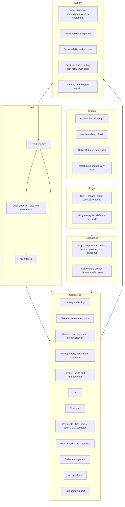

# I02b. Flipkart-Style E-Commerce — How the Whole System Works

!!! abstract "What this page adds"
    [I02](i02-flipkart-style-sale-day-ecommerce.md) focuses on four sale-day problems with labs. This page is the **system walkthrough, with no code**. It follows a customer and a seller through an Indian e-commerce platform:

    - the app and edge, catalog and seller onboarding, vernacular search and discovery, recommendations and ads;
    - pricing, offers and loyalty, cart and checkout, payments including UPI, EMI and COD;
    - fraud and abuse, and the order pipeline;
    - the logistics network: warehouses, hubs, pincode serviceability, last mile, COD cash, and returns;
    - customer support;
    - the **algorithms**, the **data platform and warehouse**, and the **tech stack**.

!!! warning "Sources and honesty"
    Statements about Flipkart come from **public sources**: its engineering blog, conference talks, case studies published by technology vendors, and news. They are marked **VERIFY**. Internal details are not public, so "a system like this would…" describes a **reference design**.

---

## 1. What Makes Indian E-Commerce Different

| Factor | System consequence |
|---|---|
| **Mobile-first, many entry-level Android phones** | Lightweight apps and PWAs, small payloads, offline tolerance ([I02](i02-flipkart-style-sale-day-ecommerce.md) L3) |
| **~19,000+ pincodes with uneven courier reach** | Serviceability and promise computed per pincode (VERIFY count) |
| **Cash on delivery still common** | COD risk scoring, cash reconciliation, RTO management ([I02](i02-flipkart-style-sale-day-ecommerce.md) L2) |
| **Many languages** | Vernacular UI, transliteration, voice search |
| **Festive sale concentration** | Big Billion Days-style events with extreme peaks ([I02](i02-flipkart-style-sale-day-ecommerce.md)) |
| **UPI, bank offers, no-cost EMI, pay later** | Complex checkout pricing and payment routing |
| **Regulation** | E-commerce rules for marketplaces, FDI rules on the marketplace model, GST, payment data storage (VERIFY) |

---

## 2. Architecture in Layers

---

## 3. The Customer Journey, Step by Step

### 3.1 Opening the app

1. **App launch:** a single **home page API** call returns a personalised layout.
    - Widgets such as banners, deals and "recently viewed" are chosen by a **content/widget platform** that marketing configures for sales without code deployments.
    - Personalisation ranks the widgets.
2. **Caching:**
    - **Static assets and images** come from the CDN in sizes appropriate to the device.
    - **Personalised parts** are fetched separately from cacheable parts, so most bytes are cacheable at the edge.
3. **Device constraints:** for low-end devices and slow networks, the app or PWA downloads less (fewer widgets, lower-resolution images). Flipkart publicly launched a PWA, Flipkart Lite, in 2015 (VERIFY).

### 3.2 Searching in Hindi, Hinglish or by voice

1. **The query** can be typed in English, Hindi script, Latin-script Hindi ("mobail cover") or spoken.
2. **Speech:** voice input goes through speech recognition to text. Flipkart has publicly discussed vernacular voice search (VERIFY details).
3. **Query understanding:**
    - transliteration and normalisation to a common representation;
    - spell correction trained on Indian spelling patterns;
    - vernacular-to-English mapping for catalog terms;
    - category and attribute prediction (e.g. "under 15000" becomes a price filter).
4. **Retrieval:**
    - lexical matches from an inverted index;
    - **semantic retrieval** with multilingual embeddings;
    - filtered by serviceability to the user's pincode.
5. **Ranking:** learning-to-rank on relevance, conversion history, price competitiveness, delivery speed, ratings and seller quality. Sponsored listings are blended through the ads auction.

### 3.3 The product page

- **Components:**
    - catalog content (possibly translated);
    - the chosen seller's offer (a buy-box-like selection among sellers, similar to [I01](i01-amazon-style-global-marketplace.md));
    - price with sale discount;
    - **bank offers and EMI options** (estimated);
    - exchange offers;
    - **delivery date for the user's pincode**;
    - COD availability;
    - ratings and reviews;
    - questions and answers;
    - recommendations.
- **Pincode check:** the serviceability service answers from precomputed tables:
    - pincode × seller or warehouse × product size/weight class × payment type;
    - result: can we deliver, by when, and is COD allowed.

### 3.4 Cart and checkout

1. **Cart:** the cart stores items and quantities. It can be merged across devices at login.
2. **Checkout:**
    - address selection, with **address quality checks**: pincode validation, geocoding, and prompts for missing landmarks;
    - serviceability re-check.
3. **Price computation:**
    - sale price;
    - coupon;
    - **bank offer** once the payment instrument is known;
    - coins or loyalty redemption;
    - delivery fee rules;
    - taxes (GST per item and seller).
4. **Payment options:** UPI (intent or collect), cards (tokenised), net banking, EMI (card EMI, cardless EMI or pay later), wallets and gift cards, and **COD** if the risk score allows ([I02](i02-flipkart-style-sale-day-ecommerce.md) L2).
5. **Order placement:**
    - reservation of stock from the chosen warehouse or seller;
    - payment authorisation (or COD confirmation flow);
    - order created with the promise, the fulfilment plan and price breakdown lines (who funds each discount: seller, platform or bank).

### 3.5 Payments

- **Routing:** a payments orchestrator routes each transaction to a gateway or processor by method, bank and **live success rates** ([Ch 45](../05-case-studies/45-payment-system.md) L4).
- **UPI flows:** intent (opens a UPI app) or collect (request in the UPI app), with status polling and callbacks; see [I03](i03-core-banking-and-upi.md) for the bank side.
- **EMI and pay later:** eligibility checks with lenders. The platform may partner with lenders for credit products (VERIFY).
- **Refunds** go to the source instrument or wallet. Reconciliation against gateway and bank settlement files, as in [Ch 45](../05-case-studies/45-payment-system.md).

### 3.6 Order management and fulfilment choice

- **The order management system (OMS)** splits the order into shipments by seller, warehouse and size class. Each shipment is a state machine: created → packed → dispatched → in transit → out for delivery → delivered or RTO.
- **Fulfilment models:**
    - **platform warehouses** hold seller inventory (a fulfilment-by-platform model; Flipkart's "Flipkart Assured" signals quality and fast delivery, VERIFY);
    - **seller-fulfilled** items are picked up from the seller.
- **Cancellation** is allowed until dispatch. Payment is authorised or captured according to the method.

### 3.7 Warehouses and the logistics network

1. **Warehouses (fulfilment centres):** inbound from sellers, stow, pick, pack.
    - Large-appliance warehouses are separate from small-item ones.
    - Sortation is automated at big sites (VERIFY specific automation).
2. **Network:** fulfilment centre → **mother hubs** (large sortation) → **delivery hubs** near pincode clusters → delivery agents. This is a hub-and-spoke network run by the in-house logistics arm (Ekart; VERIFY current structure) plus third-party couriers.
3. **Line-haul:** truck schedules between hubs, planned from volume forecasts. Sale periods add temporary hubs and vehicles.
4. **Last mile:**
    - shipments assigned to delivery agents by area;
    - **route optimisation** (VRP with time windows and capacity);
    - agent app with navigation, proof of delivery (OTP, photo);
    - COD cash collection and UPI-at-door.
5. **COD cash:** agents deposit cash at hubs. Cash is reconciled per shipment and remitted. Mismatches are investigated ([Ch 45](../05-case-studies/45-payment-system.md) §2.7).
6. **Failed deliveries:** re-attempt scheduling, customer calls. If it still fails, **RTO** back to the warehouse or seller.

### 3.8 Returns

- **Return request:** reason captured; policy checked (return, replacement, or not returnable).
- **Reverse pickup:** scheduled, with doorstep quality checks for some categories (e.g. matching IMEI for phones).
- **Refund:** issued on pickup or on receipt, depending on the customer's trust tier.
- **Returned item:** graded at the warehouse, then restocked, returned to the seller, or refurbished.

### 3.9 Customer support

- **Self-service first:** order tracking, cancellation, returns and refund status.
- **Chat:** a chatbot with intent classification, handing off to agents with full order context.
- **Voice support in multiple languages.**
- **Operations:** support tickets link to orders and shipments. Common issues are auto-resolved by rules, e.g. refunding automatically when a shipment is marked lost.

---

## 4. The Seller Journey

1. **Onboarding:** GST and PAN verification, bank account verification, and address and pickup location (VERIFY required documents).
2. **Listing:**
    - match to an existing catalog product, or create a new listing with attributes per category;
    - **quality checks** on images and content, with ML models detecting prohibited items, counterfeit indicators and poor images.
3. **Inventory and pricing:** sellers manage stock and prices through the portal or APIs. **Pricing recommendations** suggest competitive prices.
4. **Orders:** notifications with dispatch SLAs, labels and manifests, and pickup scheduling.
5. **Settlement:**
    - the platform collects payments;
    - it deducts commission, fees (fixed, shipping, collection) and taxes (TCS under GST, VERIFY);
    - it settles to the seller on a schedule, with detailed statements.

    This needs a per-seller ledger.
6. **Performance:** metrics (cancellation, late dispatch, returns) affect visibility and eligibility for programmes.
7. **Ads:** sellers buy sponsored placements with bids and budgets.

---

## 5. Algorithms Catalog

| Problem | Algorithm (typical) | Where |
|---|---|---|
| Query understanding (vernacular) | Transliteration models, spell correction, multilingual classifiers for category and attributes | Search |
| Retrieval | Inverted index + multilingual embeddings with ANN (HNSW) | Search |
| Ranking | Learning-to-rank (gradient-boosted trees → neural rankers) | Search, browse |
| Recommendations | Item-to-item co-view/co-purchase; embedding-based candidate generation (two-tower) + ranking; session-based sequence models | Home, product pages |
| Home page layout | Widget ranking (contextual bandits or learned ranking) | Home |
| Pricing | Elasticity and competitive price models; sale pricing rules | Pricing |
| Bank offer budgets | Budget pacing controllers ([Ch 49](../05-case-studies/49-pricing-promotions-and-coupons.md)) | Offers |
| Demand forecasting | Hierarchical time-series forecasting (category → product, national → region), with sale uplift features | Inventory, capacity |
| Serviceability | Precomputed lookup tables from courier coverage and SLAs | Promise |
| COD risk | Gradient-boosted classifiers on customer, pincode and order features | Checkout ([I02](i02-flipkart-style-sale-day-ecommerce.md) L2) |
| Address intelligence | Address parsing, normalisation and geocoding; clustering to delivery hubs | Logistics, abuse ([I02](i02-flipkart-style-sale-day-ecommerce.md) L4) |
| Fraud and abuse | Graph features across devices, payments and addresses; anomaly detection | Risk |
| Hub routing | Network flow / shortest path with capacities | Middle mile |
| Last-mile routing | VRP with time windows (heuristics, local search) | Delivery agents |
| Warehouse slotting and picking | Velocity-based slotting, batch picking, route heuristics | Warehouses |
| Deal unlocks | Client time sync ([I02](i02-flipkart-style-sale-day-ecommerce.md) L1) | Sale events |
| Support | Intent classification, automated resolution rules | Customer support |

---

## 5A. Deep Dives

### 5A.1 How the search index is built and kept fresh

1. **Source events:** catalog changes (new listing, attribute edit), offer changes (price, stock, seller) and serviceability changes all emit events.
2. **Document assembly:** an indexing pipeline joins these into a **search document** per product. It holds:
    - title and attributes;
    - vernacular and transliterated variants;
    - category path;
    - best price and discount;
    - rating;
    - seller-quality score;
    - **availability by region** (bitmaps or lists of serviceable warehouse clusters).
3. **Two update paths:**
    - **real-time partial updates** for price and stock, within seconds, so sold-out items don't rank;
    - **periodic full rebuilds** (e.g. nightly) for text and embedding changes.

    Blue-green index aliases switch rebuilt indexes in without downtime ([Ch 22](../03-production/22-search-systems.md)).
4. **Embeddings:** product embeddings are recomputed in batch by the ML platform and pushed to the vector index. Query embeddings are computed online.
5. **Serving:** search nodes shard the index by product and replicate each shard. A query fans out to shards, merges top-K, then re-ranks with the heavier model on the top few hundred ([Ch 42](../05-case-studies/42-search-autocomplete.md) for autocomplete).

### 5A.2 How recommendations are produced

1. **Candidate generation.** Several cheap sources each propose hundreds of items:
    - co-view and co-buy item-to-item tables (precomputed daily);
    - embedding nearest neighbours of recently viewed items;
    - trending in the user's city;
    - category affinity;
    - "continue where you left off".
2. **Ranking:** one model scores all candidates with user features, item features, context (time, device, language, sale day) and cross features, trained on clicks and purchases.
3. **Re-ranking:** business rules and diversity, such as:
    - not five similar phones in a row;
    - boosting in-stock items that are fast to deliver to this pincode;
    - removing out-of-stock or non-serviceable items;
    - frequency caps for sponsored items.
4. **Serving:**
    - precomputed recommendations for the home page are stored per user in a key-value store, so reading them is a single lookup;
    - real-time signals (the last few views in this session) re-rank at request time;
    - everything degrades to popular-in-category if the model service is slow.
5. **Measurement:** A/B tests on conversion and revenue per session, and guardrails on page latency.

### 5A.3 How serviceability and the promise are computed

- **Inputs:**
    - courier and own-logistics coverage per pincode;
    - hub mappings;
    - transit time matrices (origin hub → destination hub, hub → pincode);
    - cut-off times;
    - capacity per hub per day;
    - product constraints (weight, size, hazardous items, high value);
    - payment constraints (COD limits per pincode).
- **Precompute:** a batch job builds a table:

    > origin warehouse cluster × destination pincode × product class → {serviceable, promise days, COD allowed, courier options}

    It is loaded into a low-latency key-value store and refreshed several times a day, plus immediately on disruptions (hub closure, floods).
- **At request time:** find warehouses holding stock for the product, look up each (warehouse, pincode, class), and choose the fastest serviceable option with capacity. The result is the "Delivery by Tuesday" and COD flag.
- **Feedback:** actual delivery times feed back into transit-time estimates, so promises reflect reality. Promise accuracy is tracked per pincode and hub.

### 5A.4 Inside a warehouse (WMS)

1. **Inbound:** receive against the seller's advance shipping notice, with quality checks per category.
2. **Put-away and slotting:** fast-moving items go to locations close to packing. Slotting is recomputed by sales velocity before sales.
3. **Order release in waves:** orders are grouped by dispatch cut-off and destination hub.
4. **Picking:**
    - **batch picking**: one picker collects items for many orders, then they are sorted to orders (put-wall);
    - pick paths are optimised per zone.
5. **Packing:** box recommendation by item dimensions; invoice and label printing.
6. **Sortation:** sorted by destination hub into bags or cages, then manifested per truck.
7. **Sale preparation:** pre-packing of hot deal items before the sale (packed and labelled once the order arrives), and extra shifts.

### 5A.5 A sale-day request, end to end

1. **Before the unlock:** the user opens the deal page from the CDN, and the app syncs to server time ([I02](i02-flipkart-style-sale-day-ecommerce.md) L1).
2. **Buy:** the tap goes through the gateway (bot checks, rate limits) into the **waiting room**, which admits the user at checkout's sustainable rate ([Ch 46](../05-case-studies/46-grocery-checkout-and-inventory-reservation.md)).
3. **Checkout:**
    - the deal quantity is reserved from bucketed stock;
    - the household limit is checked ([I02](i02-flipkart-style-sale-day-ecommerce.md) L4);
    - the price is computed with bank offers, the offer budget reserved, the payment authorised, and the order created.
4. **Events:** order events flow to OMS, the warehouse release queue, notifications, and the **real-time sale dashboard** via stream processing.
5. **Fulfilment:** pre-packed items ship within hours. Logistics hubs run extended shifts, and customers see live tracking from scan events.

### 5A.6 Loyalty coins and membership

- **Coins** are earned on orders and credited after the return window. They are redeemable on later orders and partner offers, and expire.
- **Accounting:** a **ledger per customer**, where earning, redemption, expiry and reversal on return are all entries ([Ch 45](../05-case-studies/45-payment-system.md) patterns). Coin liability is tracked by finance.
- **Membership tiers** unlock benefits (early sale access, free delivery). Tier eligibility is computed from spend or coins over a window.

---

## 6. Data Platform and Warehouse

### 6.1 Public milestones (VERIFY)

- Flipkart has publicly described an in-house **data platform** built on the Hadoop ecosystem for batch processing and reporting, plus streaming pipelines, in engineering blog posts.
- Flipkart announced a strategic partnership with **Google Cloud** (2021), which included cloud infrastructure (VERIFY scope).

### 6.2 Reference design for a platform of this kind

| Layer | Role | Reference technology |
|---|---|---|
| Event collection | App clickstream, service events | SDK → collectors → Kafka |
| Change data | From operational databases | Debezium CDC → Kafka |
| Stream processing | Real-time metrics, fraud features, sale dashboards | Apache Flink |
| Lake storage | Raw and curated tables | Object storage + Apache Iceberg/Hudi |
| Batch processing | Heavy transforms | Apache Spark |
| Warehouse and query | Analytics SQL | Trino/Presto, a cloud warehouse (e.g. BigQuery), or ClickHouse for real-time dashboards |
| Orchestration | Pipelines | Airflow; dbt for SQL models |
| Catalog and governance | Ownership, lineage, PII tags | DataHub or OpenMetadata |
| BI | Dashboards | Superset, Looker or similar |
| ML | Features, training, serving | Feature store, Spark/PyTorch training, model serving on Kubernetes |
| Experimentation | A/B tests | An in-house platform on the lake |

### 6.3 Data model highlights

- **Facts:**
    - sessions and events (views, searches, clicks);
    - cart events, orders and order items;
    - shipments with every logistics scan;
    - deliveries, RTOs and returns;
    - payments and refunds;
    - ad impressions and clicks;
    - seller settlements.
- **Dimensions:** customer (pseudonymised), product and category tree, seller, pincode (with city tier, state, hub), warehouse, courier, payment method and bank, date and time (with sale-event flags).
- **Key derived metrics:**
    - conversion funnel by channel and language;
    - search success rate by language;
    - promise accuracy by pincode;
    - RTO rate by pincode, courier and payment type;
    - COD share;
    - bank offer spend vs budget;
    - seller performance;
    - cost per shipment.
- **Real-time sale dashboards** (seconds-level) come from stream processing, not the batch warehouse.

---

## 7. Tech Stack

| Layer | Publicly reported for Flipkart (VERIFY each) | Reference choice |
|---|---|---|
| Services | Java-based microservices widely reported | Java 21 / Spring Boot, gRPC |
| Front end | Native Android/iOS; React-based web and PWA (Flipkart Lite) | Kotlin/Swift or Flutter; React/Next.js PWA |
| Key-value and caching | Aerospike reported in vendor case studies | Aerospike or Redis for sessions and carts |
| Relational | MySQL widely reported | MySQL/PostgreSQL, sharded (Vitess/Citus) |
| Wide-column / big tables | HBase reported in the Hadoop-based platform | HBase/Cassandra, or cloud equivalents |
| Search | Solr/Elasticsearch-family engines reported | OpenSearch/Elasticsearch + vector search |
| Messaging | Kafka widely used | Kafka |
| Data platform | Hadoop ecosystem; Google Cloud partnership (2021) | Iceberg/Hudi + Spark + Trino/BigQuery |
| Infrastructure | Private cloud plus public cloud | Kubernetes, Terraform, Argo CD |
| Observability | — | OpenTelemetry, Prometheus, Grafana, ELK/OpenSearch |

---

## 8. Reliability and Sale Operations

- **Readiness:** capacity planning, load tests at a multiple of forecast, dependency agreements, and freeze windows ([I02](i02-flipkart-style-sale-day-ecommerce.md) §2.10).
- **Isolation:** sale-specific services (deal pages, waiting rooms) scaled and isolated from the everyday catalog, with **feature switches** to degrade non-critical widgets.
- **Logistics surge:** temporary hubs, additional delivery agents, extended hours, and serviceability tightened when capacity is exceeded.
- **War room:** journey dashboards, per-bank payment success, logistics backlog by hub, RTO early indicators.

---

## 9. Interview Angles

- **B2:** customer journey and services.
- **B3:** serviceability, COD risk, vernacular search, logistics hubs.
- **B4:** data platform, sale readiness, algorithms across the funnel.

The 20 interview questions for this design are in [I02 §8](i02-flipkart-style-sale-day-ecommerce.md).
