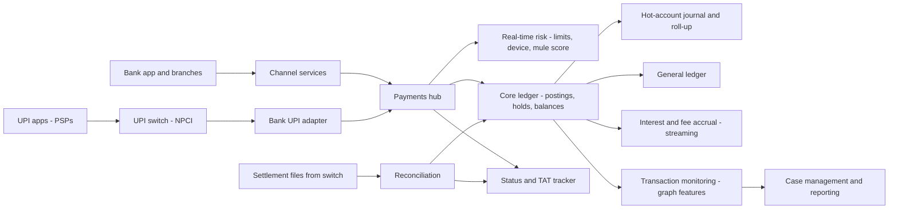
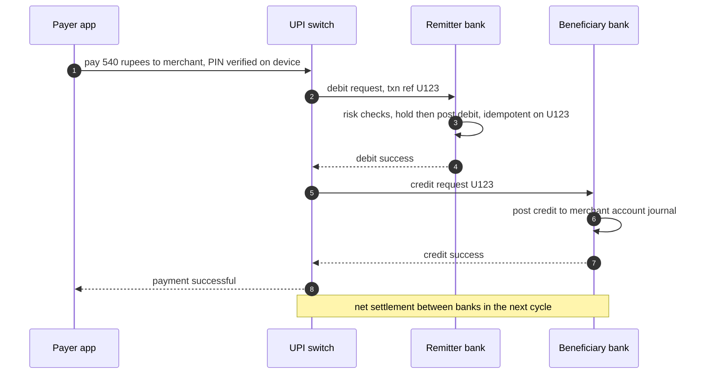
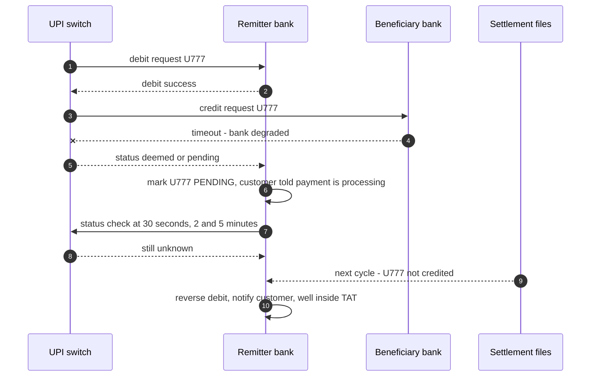
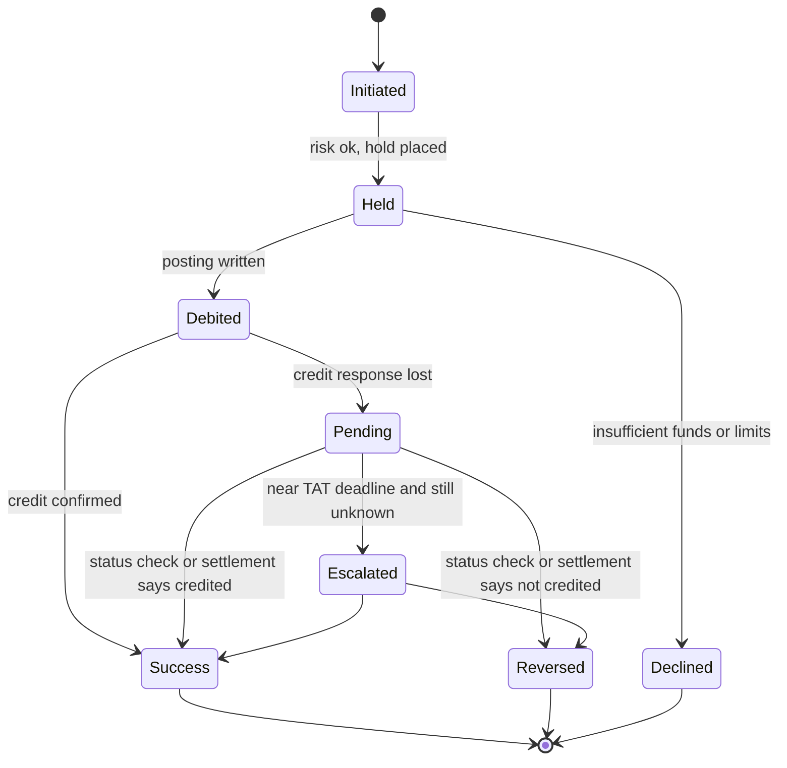

# I03. Core Banking & UPI Payments

!!! abstract "Chapter at a glance"
    **Sector:** Banking (India) · **Reader bands:** B1 → B4 · **Builds on:** [Ch 05](../01-foundations/05-relational-databases-deep-dive.md), [Ch 13](../02-distributed-core/13-distributed-transactions.md), [Ch 20](../02-distributed-core/20-idempotency-ids-and-distributed-locks.md), [Ch 36](../04-architect/36-compliance-governance-and-data-residency.md), [Ch 45](../05-case-studies/45-payment-system.md)

    **What you get:** the design of a bank's core ledger and its UPI switch integration. It covers:

    - accounts, balances and holds;
    - the general ledger and end-of-day processing in a 24×7 world;
    - hot merchant accounts;
    - UPI's multi-party flow and what to do when a response never arrives;
    - interest accrual to the paisa;
    - finding mule accounts in the payment graph.

    [Ch 45](../05-case-studies/45-payment-system.md) covers a merchant's payment system (gateways, webhooks, ledger, reconciliation). This chapter is the **bank's** side of the same money.

    **What the labs measured:**

    - **L1 (hot account, real PostgreSQL):** a single balance row handles **1,585 txn/s** with p50 6.7 ms. An append-only journal with a 200 ms roll-up handles **5,687/s**, and 16 sub-accounts **3,932/s**. In a refund storm (30% debits) the gap narrows to **1,741 vs ~2,450/s**, because debits must serialise. The balance invariant held in every run.
    - **L2 (UPI timeouts):**
        - Reversing immediately on a timeout paid **60,381** people twice.
        - Treating the payment as successful left **49,494** payers short for over 24 h.
        - Status checks with backoff, plus reversal at the next settlement cycle for anything still unknown, left **0** short for over 24 h and **0** paid twice.
    - **L3 (interest, BigDecimal):**
        - Rounding daily interest to the paisa looks harmless in total (**+₹306** on ₹95 crore). It still changes **977,265 of 1,000,000** accounts by up to ₹0.45.
        - Truncating underpays by **₹4.38 lakh**, and dividing by 365 in a leap year overpays by **₹26 lakh**.
    - **L4 (mule accounts):**
        - Fan-in or pass-through rules alone have **2% and 0.5% precision**. Combining them in the same 2-hour window reaches **98.5%** precision.
        - Following the money to accounts fed by ≥ 2 flagged mules finds **23 of 24 collectors**: **90 of 104** bad accounts at 96.8% precision.

    **Reading time:** 85 min.

!!! warning "Regulatory content"
    Banking is heavily regulated. Statements about RBI or NPCI rules are summaries and are marked **VERIFY**: turnaround times and compensation, UPI limits, KYC, data localisation, reporting. Check the current circulars and your bank's compliance function before building on them. Numbers in the labs are illustrative.

---

## 1. Introduction & Why It Matters

### 1.1 A story: the timeout that paid twice

At 2:10 pm a beneficiary bank's UPI systems slow down. The remitter bank has already debited its customers' accounts, sent the credit requests through the UPI switch, and is now receiving timeouts.

- **The first fix.** An engineer adds a rule: *on timeout, reverse the debit*. Customers get their money back immediately, and complaints stop.
- **The morning after.** The settlement file shows that more than half of those "failed" payments were in fact credited to the beneficiary. The bank has paid tens of thousands of payments twice, and must now recover money from customers who believe they did nothing wrong.
- **Rolling it back.** The rule is reversed to *treat timeouts as successful*. At the next incident, customers whose payments really failed wait a day or more for their money. Some go past the regulator's turnaround time, and the bank owes compensation (VERIFY: RBI's TAT framework for failed transactions).

Both rules were simple, and both were wrong. The correct answer is a **state machine** with status checks, settlement-driven resolution and a deadline. Banking is full of these: money that must never be created or lost, even when the systems holding it disagree.

!!! quote "The thesis of this chapter"
    A bank is a **ledger with deadlines**.

    - Every rupee is in exactly one account at every moment (double entry).
    - Every state change is recorded and never overwritten.
    - Hot accounts are fed by an append-only journal (L1).
    - Unknown outcomes are resolved by status and settlement, not guesses (L2).
    - Arithmetic follows the product terms to the paisa (L3).
    - The payment graph is watched for money that moves like fraud (L4).

### 1.2 Core banking in one picture

| Concept | Meaning |
|---|---|
| **Customer (CIF)** | The customer information file, linked to KYC |
| **Account** | Savings, current, loan, fixed deposit; a product defines its rules (interest, limits, fees) |
| **Ledger balance** | The sum of posted entries |
| **Available balance** | Ledger balance − holds (liens) + any overdraft limit |
| **Hold / lien** | Money reserved for a pending debit (a card authorisation, a UPI debit awaiting the outcome, a court order) |
| **Posting** | A balanced set of entries (debits = credits) with a value date |
| **General ledger (GL)** | Bank-level accounts (e.g. "UPI settlement receivable", "interest expense") that customer postings roll into |
| **EOD / BOD** | End- and beginning-of-day processing: interest accrual, charges, standing instructions, statements, GL balancing |

### 1.3 Learning objectives

By the end you will be able to:

- **Model** accounts, holds and double-entry postings with value dates.
- **Scale** hot accounts without breaking the no-overdraft rule.
- **Handle** UPI timeouts with a state machine that meets turnaround times.
- **Compute** interest and fees exactly as the product terms say.
- **Detect** mule accounts using time-windowed, graph-aware features.

---

## 2. Core Concepts — Beginner to Deep

### 2.1 Intuition: a very careful notebook <span class="band b1">B1</span>

A bank's core system is a notebook where every line moves money from one page to another, the two sides always add up, and nobody ever erases a line: mistakes are fixed with new lines. The balance on each page is just the sum of its lines. Everything else (apps, UPI, cards, branches) is a way of asking the notebook to add lines, and every one of them must be answered "yes, written" or "no, not written". "Maybe" must never be the final answer.

### 2.2 Requirements <span class="band b1">B1</span>

| Type | Requirement |
|---|---|
| **Functional** | Open accounts (with KYC); deposits, withdrawals and transfers (IMPS, NEFT, RTGS, UPI); holds; interest and fees; statements; loans and EMIs; standing instructions; disputes. |
| **Scale (assumptions)** | 50M accounts; UPI peak of a few thousand transactions/s for a large bank, much more for the switch as a whole (VERIFY current NPCI volumes); a few merchant accounts receiving hundreds of credits per second. |
| **Correctness** | Double entry always balanced; no overdraft beyond the limit; exactly-once posting per request; interest exactly per product terms. |
| **Availability** | UPI and cards 24×7, with no EOD downtime for payments. |
| **Deadlines** | Failed-transaction reversals within regulator TATs, with compensation otherwise (VERIFY). |
| **Compliance** | KYC/AML, transaction monitoring, payment data stored in India (VERIFY RBI storage directive), audit trails. |

### 2.3 Postings, holds and balances ⭐ <span class="band b2">B2</span>

- **A posting is a set of entries** that sum to zero:
    - a debit to the customer's account;
    - a credit to the UPI settlement GL;
    - and for fees, lines to the fee income GL and a GST GL.
- **Entries are immutable.** A correction is a reversing posting that references the original.
- **Holds** separate *intent* from *movement.* A UPI debit or card authorisation first places a hold, which reduces available balance. The hold is then either converted to a posting or released. Holds have expiry times and reasons.
- **Idempotency.** Every posting carries the upstream reference (for UPI, the transaction's reference id) with a unique constraint, so a retried request returns the original result ([Ch 20](../02-distributed-core/20-idempotency-ids-and-distributed-locks.md)).
- **Value date vs posting date:** interest is computed on value-dated balances. A back-dated correction changes interest, which needs recomputation.

### 2.4 Hot accounts ⭐ <span class="band b3">B3</span>

- **A large merchant's or aggregator's settlement account** can receive hundreds or thousands of credits per second. Updating one balance row serialises all of them on one row lock (L1: 1,585 txn/s, p50 6.7 ms with 16 clients).
- **Credits are safe to decouple:** adding money can never break the no-overdraft rule.
    - **Append-only journal:** each credit is an insert, and a roll-up folds committed rows into the balance every few hundred ms. L1: **5,687/s**.
    - **Sub-accounts:** credits are spread across N balance rows. L1: 3,932/s.
- **Debits must see the whole balance.** They take a per-account lock and check the effective balance: rolled-up balance plus unrolled journal rows, or the sum of the sub-accounts. In a refund storm, debits dominate and all designs converge (L1: ~2,450/s at 30% debits).
- **The sequence-gap trap:**
    - Rolling up "everything below sequence N" skips rows whose transactions haven't committed yet, because sequences are assigned before commit.
    - L1 marks rows as rolled instead, which only sees committed rows.
    - Alternatives: roll up rows older than the longest possible transaction, or use the database's commit-order facilities (VERIFY for your database).
- **The display balance** for a hot account may lag by the roll-up interval. The debit check never does.

### 2.5 UPI: four parties and one truth ⭐ <span class="band b2">B2</span>

**The parties (P2M example):**

- the payer's app (**payer PSP**);
- the **UPI switch** (NPCI);
- the payer's bank (**remitter**), which debits;
- the beneficiary's bank, which credits;
- plus the merchant's PSP or aggregator.

**The simplified flow** (VERIFY against the current NPCI specifications):

1. Collect or intent, then PIN on the payer's device.
2. Debit request to the remitter bank, which debits and responds.
3. Credit request to the beneficiary bank, which credits and responds.
4. Final status to both PSPs.
5. Net settlement between banks happens in cycles, with settlement files.

**Where it breaks:** any hop can time out after doing its work. The most dangerous case is the one this chapter's story is about: the **remitter has debited but doesn't know whether the beneficiary credited.**

**The design rule:** no participant guesses. Each has:

- a state machine;
- a **status-check** operation keyed by the transaction reference;
- a **reconciliation** against settlement files;
- a **deadline**: reversal within the regulator's TAT, or compensation (VERIFY).

### 2.6 Resolving unknown outcomes ⭐ <span class="band b3">B3</span>

| Policy | What L2 showed |
|---|---|
| R1 reverse immediately | **60,381 paid twice**: the beneficiary had credited, and the payer was refunded too. Recovery is painful and customer-hostile. |
| R2 treat as success, fix later | **49,494 payers short for more than 24 h**, all failed payments waiting for the T+1 batch. |
| R3 status checks with backoff, then decide | Most resolved within minutes. Those still unknown after the checks (the beneficiary's status API was down during its 3.5 h incident) fall to T+1: **19,530 short for more than 24 h**. |
| **R4 R3, plus reverse at the next settlement cycle** | **0 paid twice, 0 short for more than 24 h**, no manual cases. 22,593 were short for more than 1 h: those waiting for the settlement cycle after a long incident. |

**Engineering details:**

- Hold the debit as **PENDING** (not reversed, not final).
- Schedule status checks at growing intervals ([Ch 18](../02-distributed-core/18-resilience-patterns.md)) and budget their load: R3/R4 made 705k calls, concentrated at incident recovery. Add jitter.
- Consume settlement and reconciliation files as the source of truth.
- Track every PENDING against the TAT deadline, with alerts well before it.

### 2.7 Interest, fees and the paisa <span class="band b3">B3</span>

- **Product terms define the arithmetic:** rate, day-count convention (actual/365, actual/actual, 30/360), accrual frequency, rounding and credit frequency (VERIFY RBI rules for savings interest).
- **L3 on a million accounts:**
    - **Daily rounding** looks harmless in aggregate: +₹306 on ₹95 crore. But it changes 977k accounts by up to ₹0.45, so no account matches the product terms.
    - **Truncation** systematically underpays: −₹4.38 lakh a quarter, a conduct risk.
    - **The wrong day count** in a leap year overpays ₹26 lakh.
- **The rules:**
    - accrue at high precision (a decimal type, never floating point);
    - round once at posting, as the terms specify;
    - store the accrual basis for audit;
    - test against published examples.
- **EOD at 24×7:** accrual runs against a *consistent* snapshot of value-dated balances. It must not freeze payments, so use snapshot reads or an accrual journal fed by postings ([Ch 21](../03-production/21-data-at-scale.md)).

### 2.8 Mule accounts and transaction monitoring <span class="band b3">B3</span>

- **Mule accounts** receive fraud proceeds from many victims and forward them within minutes to collector accounts before cash-out.
- **Legitimate accounts look similar on any single feature:**

    | Feature | Also seen in |
    |---|---|
    | Many payers | Shops |
    | Fast pass-through | Salary followed by rent |
    | Many payers, then one payment | Group collections paid to a vendor |

- **L4 on synthetic data:**
    - Single-feature rules flag thousands of accounts, at 0.5–2% precision.
    - Requiring fan-in, pass-through, few receivers and a meaningful amount **in the same 2-hour window**, excluding payments to registered merchants, reaches 98.5% precision and finds 67 of 80 mules.
    - Following the money (accounts fed by ≥ 2 flagged mules) finds 23 of 24 collectors.
- **In production:**
    - features are computed in streaming windows ([Ch 21](../03-production/21-data-at-scale.md), [Ch 51](../05-case-studies/51-real-time-analytics-and-top-k.md));
    - graph features are refreshed frequently;
    - a model is trained on labelled cases;
    - actions are graded: monitor, then a credit hold, then a debit freeze, subject to legal process (VERIFY);
    - suspicious transaction reporting follows regulatory requirements (VERIFY).
- **Real-time controls at payment time:** device binding, new-device cooling limits, per-transaction and daily limits, and beneficiary risk (VERIFY current UPI limits).

### 2.9 24×7 banking and the end of "end of day" <span class="band b4">B4</span>

- **Traditional core banking systems** ran EOD batches that paused transactions. Instant payments made that unacceptable.
- **Approaches:**
    - **Separate the payment ledger** (always on) from batch processes that read snapshots.
    - **Business date vs calendar date:** transactions after the cut-over belong to the next business date.
    - **Accrual and charges as streaming jobs** over postings.
    - **Stand-in processing** during core maintenance: a shadow ledger authorises within limits, and postings are replayed later (VERIFY applicability per product and regulator).
- **Modernising a legacy core** is a strangler migration ([Ch 16](../02-distributed-core/16-microservices-architecture.md)):
    - a payments hub in front of the old core;
    - new products on a new ledger;
    - accounts migrated in cohorts, with dual-run reconciliation.

### 2.10 Resilience, residency and regulators <span class="band b4">B4</span>

| Concern | Design |
|---|---|
| **Data localisation** | Payment system data stored in India (VERIFY the RBI directive and FAQs) ([Ch 36](../04-architect/36-compliance-governance-and-data-residency.md)) |
| **DR** | Near-zero RPO for the ledger (synchronous replication within a region, async to the DR site); tested DR drills; regulator expectations for recovery times (VERIFY) ([Ch 27](../03-production/27-reliability-and-disaster-recovery.md)) |
| **Audit** | Immutable postings, maker-checker for manual entries, privileged access logging |
| **Change management** | Controlled releases outside peak hours; regulator reporting of outages where required (VERIFY) |
| **Third parties** | Outsourcing and cloud guidelines for regulated entities (VERIFY) |

---

## 3. Architecture & Diagrams

### 3.1 Component view



### 3.2 Sequence: a UPI payment (happy path)



### 3.3 Sequence: credit timeout resolved by status and settlement



### 3.4 State: a remitter-side UPI debit



---

## 4. Design Document Excerpt

!!! note "Design Document (excerpt) — Pending-Outcome Resolution for UPI Debits"
    | Field | Value |
    |---|---|
    | Context | Credit-leg timeouts during beneficiary-bank incidents leave debited payments unknown. The current auto-reverse rule caused double payments, and the previous "treat as success" rule caused TAT breaches. |
    | Decision | A PENDING state with scheduled status checks (30 s to 2 h, jittered). Resolution from status responses or settlement files, whichever arrives first. Unknowns are reversed at the next settlement cycle, never later than the TAT deadline minus a safety margin. |
    | Related ADRs | ADR-I03-1 append-only journal for hot accounts; ADR-I03-2 decimal accrual with single rounding; ADR-I03-3 mule scoring with graph features |

    **Requirements.**

    - **R1:** No customer is refunded for a payment that was credited (no double payment from our side).
    - **R2:** Every failed payment is reversed within the TAT (VERIFY current TAT), and at P99 within the same business day.
    - **R3:** Status checks never exceed an agreed rate towards the switch, even after an incident.
    - **R4:** Customers see the PENDING status and an expected resolution time.
    - **R5:** Every PENDING has an audit trail: checks, responses, the settlement record and the final action.

    **Decisions in detail.**

    1. **Settlement files are the source of truth.** Status checks shorten the wait.
    2. **Reversal is itself idempotent** on the transaction reference, and can race with a late credit confirmation. The state machine guards it: only PENDING can move to REVERSED.
    3. **Status-check load is spread** with jitter and capped by a token bucket ([Ch 39](../05-case-studies/39-distributed-rate-limiter.md)).
    4. **TAT dashboards** show the oldest PENDING per beneficiary bank.

    **Consequences.** Some customers wait hours after long incidents (L2: 22,593 more than 1 h). Messaging and expectation-setting are part of the design.

---

## 5. Hands-On Code — Level Ladder

!!! info "What's real here"
    - **L1** runs against a real PostgreSQL 16 database (`fsync=on`, 16 connections).
    - **L3** is exact decimal arithmetic on a million accounts.
    - **L2 and L4** are simulations with illustrative parameters.
    - Regulatory rules are summarised and marked **VERIFY**.

### L1 — The hot merchant account <span class="band b3">B3</span>

**Requirement:** "Absorb thousands of credits per second on one account, and never let a refund overdraw it."

```java title="HotAccountL1.java"
// L1 — The hot merchant account. A large merchant's settlement account receives thousands of UPI credits per second
// while refunds (debits) must never overdraw it. Real PostgreSQL 16, fsync on, 16 client threads, 5 s per run.
// A: one balance row, UPDATE per credit/debit (debit guarded by balance >= amount).
// B: append-only journal + roll-up every 200 ms (credits never touch the hot row; debits check rolled-up balance +
//    unrolled journal rows under a per-account advisory lock, which the roll-up also takes).
// C: 16 sub-account balance rows; credits go to a random sub-account; debits take a lock on the account and draw from
//    sub-accounts in turn. Checks the invariant: final balance == opening + credits − debits, never negative.
import java.sql.*;
import java.util.*;
import java.util.concurrent.*;
import java.util.concurrent.atomic.*;

public class HotAccountL1 {
    static final String URL = "jdbc:postgresql://localhost:5581/shop?user=claude";
    static final int THREADS = 16, SECONDS = 5, SUBS = 16;
    static final long OPENING = 1_000_000_00L;          // ₹10 lakh in paise

    public static void main(String[] a) throws Exception {
        System.out.printf("one merchant account, %d threads, %d s per run, credits ₹1–2,000; fsync on%n", THREADS, SECONDS);
        for (double share : new double[]{0.05, 0.30}) {
            DEBIT = share;
            System.out.printf("%n%s: %.0f%% debits (refunds, payouts)%n", share < 0.1 ? "normal day" : "refund storm", share * 100);
            System.out.printf("%-40s %10s %9s %9s %9s %9s %s%n", "design", "txn/s", "p50 ms", "p99 ms", "refused", "errors", "invariant");
            for (String d : new String[]{"A single balance row", "B journal + roll-up every 200 ms", "C 16 sub-account rows"}) run(d);
        }
        try (Connection c = DriverManager.getConnection(URL); Statement s = c.createStatement()) { s.execute("DROP TABLE IF EXISTS acct, sub_acct, journal"); }
    }

    static volatile double DEBIT = 0.05;
    static void setup(Statement s) throws SQLException {
        s.execute("DROP TABLE IF EXISTS acct, sub_acct, journal");
        s.execute("CREATE TABLE acct (id int PRIMARY KEY, balance bigint NOT NULL CHECK (balance >= 0))");
        s.execute("CREATE TABLE sub_acct (id int, sub int, balance bigint NOT NULL CHECK (balance >= 0), PRIMARY KEY (id, sub))");
        s.execute("CREATE TABLE journal (seq bigserial PRIMARY KEY, id int NOT NULL, amount bigint NOT NULL, rolled boolean NOT NULL DEFAULT false, created timestamptz DEFAULT now())");
        s.execute("CREATE INDEX journal_unrolled ON journal (id) WHERE NOT rolled");
        s.execute("INSERT INTO acct VALUES (1, " + OPENING + ")");
        for (int i = 0; i < SUBS; i++) s.execute("INSERT INTO sub_acct VALUES (1, " + i + ", " + OPENING / SUBS + ")");
    }

    static void run(String design) throws Exception {
        try (Connection c = DriverManager.getConnection(URL); Statement s = c.createStatement()) { setup(s); }
        char mode = design.charAt(0);
        AtomicLong n = new AtomicLong(), refused = new AtomicLong(), errors = new AtomicLong(), credited = new AtomicLong(), debited = new AtomicLong();
        ConcurrentLinkedQueue<long[]> lat = new ConcurrentLinkedQueue<>();
        long end = System.nanoTime() + SECONDS * 1_000_000_000L;
        ExecutorService ex = Executors.newFixedThreadPool(THREADS + 1); List<Future<?>> fs = new ArrayList<>();
        if (mode == 'B') fs.add(ex.submit(() -> { Connection c = DriverManager.getConnection(URL);    // roll-up worker
            try { c.setAutoCommit(false);
                while (System.nanoTime() < end + 300_000_000L) { rollUp(c); Thread.sleep(200); }
                rollUp(c);
            } finally { c.close(); } return null; }));
        for (int t = 0; t < THREADS; t++) { int tid = t; fs.add(ex.submit(() -> {
            Connection c = DriverManager.getConnection(URL); c.setAutoCommit(false);
            try {
                Random r = new Random(tid * 13L + mode); long[] mine = new long[500_000]; int k = 0;
                while (System.nanoTime() < end) {
                    boolean debit = r.nextDouble() < DEBIT; long amt = 100 + r.nextInt(200_000);
                    long t0 = System.nanoTime();
                    try {
                        boolean ok = switch (mode) { case 'A' -> a(c, debit, amt, r); case 'B' -> b(c, debit, amt); default -> cc(c, debit, amt, r); };
                        c.commit();
                        if (ok) { if (debit) debited.addAndGet(amt); else credited.addAndGet(amt); } else refused.incrementAndGet();
                    } catch (SQLException e) { c.rollback(); errors.incrementAndGet(); }
                    if (k < mine.length) mine[k++] = System.nanoTime() - t0; n.incrementAndGet();
                }
                lat.add(Arrays.copyOf(mine, k));
            } finally { c.close(); }
            return null; })); }
        for (Future<?> f : fs) f.get(); ex.shutdown();
        long[] all = lat.stream().flatMapToLong(Arrays::stream).sorted().toArray();
        long bal;
        try (Connection c = DriverManager.getConnection(URL); Statement s = c.createStatement()) {
            ResultSet rs = s.executeQuery(mode == 'C' ? "SELECT sum(balance) FROM sub_acct" : "SELECT balance FROM acct WHERE id = 1"); rs.next(); bal = rs.getLong(1);
            if (mode == 'B') { rs = s.executeQuery("SELECT count(*) FROM journal WHERE NOT rolled"); rs.next(); if (rs.getLong(1) > 0) bal = -1; }
        }
        long expect = OPENING + credited.get() - debited.get();
        System.out.printf("%-40s %,10.0f %9.2f %9.2f %9d %9d %s%n", design, n.get() / (double) SECONDS, all[all.length / 2] / 1e6, all[(int) (all.length * 0.99)] / 1e6,
                refused.get(), errors.get(), bal == expect ? "holds" : "BROKEN (" + bal + " vs " + expect + ")");
    }

    // A: the classic hot row
    static boolean a(Connection c, boolean debit, long amt, Random r) throws SQLException {
        try (PreparedStatement p = c.prepareStatement(debit ? "UPDATE acct SET balance = balance - ? WHERE id = 1 AND balance >= ?" : "UPDATE acct SET balance = balance + ? WHERE id = 1")) {
            p.setLong(1, amt); if (debit) p.setLong(2, amt); return p.executeUpdate() == 1; }
    }
    // B: credits are inserts only; debits serialise on an advisory lock and check the effective balance
    static boolean b(Connection c, boolean debit, long amt) throws SQLException {
        if (!debit) { try (PreparedStatement p = c.prepareStatement("INSERT INTO journal (id, amount) VALUES (1, ?)")) { p.setLong(1, amt); p.executeUpdate(); } return true; }
        try (Statement s = c.createStatement()) { s.execute("SELECT pg_advisory_xact_lock(1)"); }
        try (PreparedStatement p = c.prepareStatement("SELECT a.balance + coalesce((SELECT sum(amount) FROM journal j WHERE j.id = 1 AND NOT j.rolled), 0) FROM acct a WHERE a.id = 1")) {
            ResultSet rs = p.executeQuery(); rs.next(); if (rs.getLong(1) < amt) return false; }
        try (PreparedStatement p = c.prepareStatement("INSERT INTO journal (id, amount) VALUES (1, ?)")) { p.setLong(1, -amt); p.executeUpdate(); }
        return true;
    }
    // roll-up: fold committed, not-yet-rolled journal rows into the balance and mark them, in one statement. Marking rows
    // (instead of remembering "rolled up to seq N") avoids the sequence-gap trap: a lower seq can still be in flight
    // when a higher one has committed, and a high-water mark would skip it forever.
    static void rollUp(Connection c) throws SQLException {
        try (Statement s = c.createStatement()) {
            s.execute("SELECT pg_advisory_xact_lock(1)");
            s.executeUpdate("WITH r AS (UPDATE journal SET rolled = true WHERE id = 1 AND NOT rolled RETURNING amount) " +
                            "UPDATE acct SET balance = balance + (SELECT coalesce(sum(amount), 0) FROM r) WHERE id = 1");
        }
        c.commit();
    }
    // C: credits spread over sub-accounts; debits lock the account and draw across sub-accounts
    static boolean cc(Connection c, boolean debit, long amt, Random r) throws SQLException {
        if (!debit) { try (PreparedStatement p = c.prepareStatement("UPDATE sub_acct SET balance = balance + ? WHERE id = 1 AND sub = ?")) { p.setLong(1, amt); p.setInt(2, r.nextInt(SUBS)); p.executeUpdate(); } return true; }
        try (Statement s = c.createStatement()) { s.execute("SELECT pg_advisory_xact_lock(1)"); }
        long need = amt;
        try (PreparedStatement p = c.prepareStatement("SELECT sub, balance FROM sub_acct WHERE id = 1 ORDER BY balance DESC FOR UPDATE")) {
            ResultSet rs = p.executeQuery(); List<long[]> subs = new ArrayList<>(); long total = 0;
            while (rs.next()) { subs.add(new long[]{rs.getInt(1), rs.getLong(2)}); total += rs.getLong(2); }
            if (total < amt) return false;
            try (PreparedStatement u = c.prepareStatement("UPDATE sub_acct SET balance = balance - ? WHERE id = 1 AND sub = ?")) {
                for (long[] sb : subs) { if (need == 0) break; long take = Math.min(need, sb[1]); if (take == 0) continue; u.setLong(1, take); u.setInt(2, (int) sb[0]); u.executeUpdate(); need -= take; }
            }
        }
        return true;
    }
}
```

```text title="java -Duser.timezone=UTC -cp postgresql-42.7.4.jar HotAccountL1.java"
one merchant account, 16 threads, 5 s per run, credits ₹1–2,000; fsync on

normal day: 5% debits (refunds, payouts)
design                                        txn/s    p50 ms    p99 ms   refused    errors invariant
A single balance row                          1,585      6.65     48.27         0         0 holds
B journal + roll-up every 200 ms              5,687      1.38     31.90         0         0 holds
C 16 sub-account rows                         3,932      1.44     41.00         0         0 holds

refund storm: 30% debits (refunds, payouts)
design                                        txn/s    p50 ms    p99 ms   refused    errors invariant
A single balance row                          1,741      6.26     41.02         0         0 holds
B journal + roll-up every 200 ms              2,446      0.85     30.16         0         0 holds
C 16 sub-account rows                         2,449      1.18     25.86         0         0 holds
```

**Reading it:**

- **A single balance row caps out at ~1,600 txn/s,** with p50 6.7 ms, because every transaction queues on one row lock.
- **Journal + roll-up:** credits become plain inserts, giving **5,687/s**, with p50 1.4 ms. The balance is corrected every 200 ms.
- **Sub-accounts spread the lock** and reach 3,932/s.
- **In a refund storm** (30% debits), both designs fall to ~2,450/s. Debits must see the *whole* balance, so they serialise on the account lock whatever you do to credits.
- **The invariant held in every run:** final balance = opening + credits − debits, never negative. The check constraint, the debit lock and the effective-balance check guarantee it together.
- **A design note from building it:** the first roll-up remembered "rolled up to sequence N". A lower sequence can still be uncommitted when a higher one commits, so that version could skip credits forever. Marking rows `rolled` in one statement sees only committed rows.
- **Timings vary about ±10% between runs.**

### L2 — UPI timeouts: reverse, trust, or find out? <span class="band b3">B3</span>

**Requirement:** "Never pay twice, and never leave a customer short beyond the turnaround time."

```java title="UpiTimeoutL2.java"
// L2 — "Money debited, but the payment failed." In UPI the payer's bank debits, and the beneficiary bank's credit
// response can time out. The payer's bank must then decide without knowing whether the credit happened.
// One day, 2,000,000 payments; a beneficiary bank has three incidents where 30% of its responses time out.
// Timing, incident and settlement-cycle numbers are ILLUSTRATIVE; the T+1 auto-reversal rule and its compensation
// follow the RBI turnaround-time framework as commonly summarised (VERIFY the current circular before relying on it).
import java.util.*;

public class UpiTimeoutL2 {
    record Txn(double t, boolean credited, double statusFrom) {}  // time (h), did the credit really happen, when status becomes queryable (h)

    public static void main(String[] a) {
        Random r = new Random(1301); List<Txn> unknown = new ArrayList<>(); int total = 2_000_000;
        double[][] incidents = {{10.2, 0.6}, {14.0, 3.5}, {20.5, 0.3}};                  // start hour, duration hours
        for (int i = 0; i < total; i++) {
            double t = r.nextDouble() * 24;
            for (double[] in : incidents) if (t >= in[0] && t < in[0] + in[1] && r.nextDouble() < 0.30) {
                boolean credited = r.nextDouble() < 0.55;                                     // many timeouts happen after the credit posted
                double recover = in[0] + in[1] + r.nextDouble() * 0.5;                        // status API usable again after recovery
                unknown.add(new Txn(t, credited, Math.max(t, recover)));
            }
        }
        System.out.printf("%,d payments in a day; %,d timed out with the outcome unknown (%.2f%%)%n", total, unknown.size(), 100.0 * unknown.size() / total);
        System.out.printf("%,d of those were in fact credited to the beneficiary%n%n", unknown.stream().filter(Txn::credited).count());
        System.out.printf("%-46s %14s %16s %16s %14s %13s%n", "remitter bank's action on timeout", "paid twice", "payer short >1 h", "payer short >24 h", "status calls", "exceptions");
        run("R1 reverse the debit immediately", unknown, 1);
        run("R2 treat as success, fix at settlement", unknown, 2);
        run("R3 status checks with backoff, then decide", unknown, 3);
        run("R4 R3 + unresolved → reverse at settlement", unknown, 4);
        System.out.println("\npaid twice: payer refunded although the beneficiary was credited (bank must recover the money)");
        System.out.println("payer short: payer's money neither with the payer nor with the beneficiary for longer than the window");
        System.out.println("settlement: settlement/reconciliation files reveal every outcome at the next cycle (every 4 h here); T+1 batch = end of next day");
        System.out.println("status checks at +30 s, 2, 5, 15, 30 min, 1 h, 2 h; the beneficiary bank's status API is down during its incident");
    }

    static void run(String name, List<Txn> xs, int mode) {
        long twice = 0, short1h = 0, shortT1 = 0, calls = 0, ops = 0;
        for (Txn x : xs) {
            double settle = Math.ceil((x.t() + 0.01) / 4) * 4;                               // next settlement cycle
            double resolvedAt; boolean refunded = false;
            switch (mode) {
                case 1 -> { refunded = true; resolvedAt = x.t(); if (x.credited()) { twice++; ops++; } }
                case 2 -> { resolvedAt = x.credited() ? x.t() : 48;                             // not credited: reversed in the T+1 end-of-day batch
                            if (!x.credited()) ops++; }
                default -> {
                    // query at +30 s, +2 min, +5 min, +15 min, +30 min, +1 h, +2 h (7 calls max)
                    double[] at = {0.0083, 0.033, 0.083, 0.25, 0.5, 1, 2}; double known = -1;
                    for (double d : at) { calls++; if (x.t() + d >= x.statusFrom()) { known = x.t() + d; break; } }
                    if (known >= 0) resolvedAt = x.credited() ? x.t() : known;              // not credited → reverse now
                    else if (mode == 3) { resolvedAt = x.credited() ? x.t() : 48; ops++; }   // falls back to the T+1 batch
                    else { resolvedAt = x.credited() ? x.t() : settle; }                     // reverse at settlement, same day
                }
            }
            double shortFor = x.credited() && !refunded ? 0 : refunded ? 0 : resolvedAt - x.t();
            if (shortFor > 1) short1h++;
            if (shortFor > 24) shortT1++;
        }
        System.out.printf("%-46s %,14d %,16d %,16d %,14d %,13d%n", name, twice, short1h, shortT1, calls, ops);
    }
}
```

```text title="java UpiTimeoutL2.java"
2,000,000 payments in a day; 109,875 timed out with the outcome unknown (5.49%)
60,381 of those were in fact credited to the beneficiary

remitter bank's action on timeout                  paid twice payer short >1 h payer short >24 h   status calls    exceptions
R1 reverse the debit immediately                       60,381                0                0              0        60,381
R2 treat as success, fix at settlement                      0           49,494           49,494              0        49,494
R3 status checks with backoff, then decide                  0           30,993           19,530        705,361        43,707
R4 R3 + unresolved → reverse at settlement                  0           22,593                0        705,361             0

paid twice: payer refunded although the beneficiary was credited (bank must recover the money)
payer short: payer's money neither with the payer nor with the beneficiary for longer than the window
settlement: settlement/reconciliation files reveal every outcome at the next cycle (every 4 h here); T+1 batch = end of next day
status checks at +30 s, 2, 5, 15, 30 min, 1 h, 2 h; the beneficiary bank's status API is down during its incident
```

**Reading it** (illustrative parameters):

- **R1, reversing on timeout:** refunded **60,381** payers whose money *had* reached the beneficiary. Each of those is a recovery case.
- **R2, treating the timeout as success:** left **49,494** payers short for more than 24 h, waiting for the T+1 batch.
- **R3, status checks:** resolve most cases within minutes. The 3.5-hour incident outlasts the 2-hour checking window, and those payments fall back to T+1: 19,530 short for more than 24 h.
- **R4, the same checks plus reversal at the next settlement cycle:** **0 paid twice, 0 short for more than 24 h, 0 exceptions.** 22,593 wait more than an hour, the price of a long incident.
- **Load:** the status checks cost **705k calls**, concentrated around recoveries. Budget them with jitter and a token bucket.
- **Specific TAT values and compensation** come from the regulator (VERIFY). The lesson is structural: *PENDING + evidence + deadline*.

### L3 — Interest to the paisa <span class="band b3">B3</span>

**Requirement:** "Pay every account exactly what the product terms say."

This lab uses exact `BigDecimal` arithmetic on 1,000,000 accounts over a 91-day leap-year quarter. It takes about 90 s.

```java title="InterestL3.java"
// L3 — Savings interest to the paisa. 1,000,000 accounts, 3.0% p.a. on the end-of-day balance, credited at quarter end
// (Jan–Mar of a leap year: 91 days). Compare rounding policies against exact arithmetic (BigDecimal, 20 digits).
// Rates, balances and the day-count convention are ILLUSTRATIVE; the bank's product terms and regulator decide (VERIFY).
import java.math.*;
import java.util.*;

public class InterestL3 {
    static final BigDecimal RATE = new BigDecimal("0.03"), PAISE = new BigDecimal("0.01");
    static final MathContext MC = new MathContext(20);

    public static void main(String[] a) {
        int accounts = 1_000_000, days = 91; Random r = new Random(1302);
        String[] names = {"exact (20 digits), round once at credit", "round each day's interest HALF_UP, sum", "truncate each day's interest (DOWN), sum",
                          "round each day HALF_EVEN, sum", "round once, but divide by 365 in a leap year"};
        BigDecimal[] total = new BigDecimal[5]; Arrays.fill(total, BigDecimal.ZERO);
        long[] differs = new long[5]; BigDecimal[] maxDiff = new BigDecimal[5]; Arrays.fill(maxDiff, BigDecimal.ZERO);
        long zeroInterest = 0;
        for (int i = 0; i < accounts; i++) {
            // balances: many small (₹50–₹5,000), some large; a few deposits/withdrawals during the quarter
            double u = r.nextDouble(); long bal = (long) ((u < 0.5 ? 5_000 + r.nextInt(495_000) : u < 0.9 ? 500_000 + r.nextInt(9_500_000) : 10_000_000 + r.nextInt(190_000_000)));
            BigDecimal exact = BigDecimal.ZERO, halfUp = BigDecimal.ZERO, down = BigDecimal.ZERO, even = BigDecimal.ZERO, wrongDays = BigDecimal.ZERO;
            for (int d = 0; d < days; d++) {
                if (r.nextDouble() < 0.03) bal = Math.max(0, bal + (r.nextBoolean() ? 1 : -1) * r.nextInt(200_000));
                BigDecimal b = BigDecimal.valueOf(bal, 2);                                   // rupees with 2 decimals
                BigDecimal day = b.multiply(RATE, MC).divide(BigDecimal.valueOf(366), MC);   // leap year: actual/actual → 366
                exact = exact.add(day, MC);
                halfUp = halfUp.add(day.setScale(2, RoundingMode.HALF_UP));
                down = down.add(day.setScale(2, RoundingMode.DOWN));
                even = even.add(day.setScale(2, RoundingMode.HALF_EVEN));
                wrongDays = wrongDays.add(b.multiply(RATE, MC).divide(BigDecimal.valueOf(365), MC), MC);
            }
            BigDecimal credit = exact.setScale(2, RoundingMode.HALF_UP);
            if (credit.signum() == 0) zeroInterest++;
            BigDecimal[] got = {credit, halfUp, down, even, wrongDays.setScale(2, RoundingMode.HALF_UP)};
            for (int k = 0; k < 5; k++) {
                total[k] = total[k].add(got[k]);
                BigDecimal diff = got[k].subtract(credit).abs();
                if (diff.signum() != 0) differs[k]++;
                if (diff.compareTo(maxDiff[k]) > 0) maxDiff[k] = diff;
            }
        }
        System.out.printf("%,d savings accounts, 3.0%% p.a., %d days (leap-year quarter), interest credited once at quarter end%n%n", accounts, days);
        System.out.printf("%-48s %18s %16s %16s %14s%n", "policy", "total interest ₹", "vs exact ₹", "accounts differ", "max per acct");
        for (int k = 0; k < 5; k++)
            System.out.printf("%-48s %,18.2f %+,16.2f %,16d %13s%n", names[k], total[k], total[k].subtract(total[0]), differs[k], "₹" + maxDiff[k].toPlainString());
        System.out.printf("%naccounts earning ₹0.00 this quarter: %,d%n", zeroInterest);
    }
}
```

```text title="java InterestL3.java"
1,000,000 savings accounts, 3.0% p.a., 91 days (leap-year quarter), interest credited once at quarter end

policy                                             total interest ₹       vs exact ₹  accounts differ   max per acct
exact (20 digits), round once at credit              949,788,960.77            +0.00                0            ₹0
round each day's interest HALF_UP, sum               949,789,266.74          +305.97          977,265         ₹0.45
truncate each day's interest (DOWN), sum             949,350,649.28      -438,311.49          998,429         ₹0.91
round each day HALF_EVEN, sum                        949,789,228.32          +267.55          977,267         ₹0.46
round once, but divide by 365 in a leap year         952,391,117.65    +2,602,156.88          975,601        ₹40.92

accounts earning ₹0.00 this quarter: 395
```

**Reading it:**

- **Rounding each day's interest to the paisa** nets out to just **+₹306** on ₹95 crore. The errors cancel in aggregate, which is exactly why this bug survives reviews that only check totals. Yet **977,265 accounts** get a different amount from the terms, by up to ₹0.45. HALF_EVEN behaves the same.
- **Truncating each day** always rounds down: **−₹4.38 lakh** in one quarter, taken from customers. That is a conduct problem, not a rounding detail.
- **Dividing by 365 in a leap year** overpays **₹26 lakh** (about 0.27% more). Up to ₹40.92 per account.
- **395 accounts earn ₹0.00:** tiny balances, where the terms' minimums and rounding matter.
- **The fix:** accrue at high precision, round once at posting, and use the day-count convention the terms state. Keep a test suite of worked examples from the product documentation.

### L4 — Finding mule accounts <span class="band b4">B4</span>

**Requirement:** "Find accounts laundering fraud proceeds without flagging shops, salaried people or friends splitting a bill."

```java title="MuleL4.java"
// L4 — Mule accounts. Fraud proceeds are sent by many victims to "mule" accounts, which forward them within minutes
// to a few collector accounts. Legitimate look-alikes exist: small shops (many payers), people who pay rent right after
// salary (pass-through), friends collecting group money and paying a vendor. One simulated day of transfers; compare
// detection rules by precision and recall. Behaviours and thresholds are ILLUSTRATIVE (VERIFY with labelled data).
import java.util.*;

public class MuleL4 {
    record Tx(int from, int to, long paise, double minute) {}

    public static void main(String[] a) {
        Random r = new Random(1303); List<Tx> txs = new ArrayList<>(); int N = 200_000;
        Set<Integer> mules = new HashSet<>(), collectors = new HashSet<>();
        // ordinary P2P and P2M traffic
        int shops = 3_000;
        for (int i = 0; i < 600_000; i++) {
            int from = shops + r.nextInt(N - shops);
            int to = r.nextDouble() < 0.6 ? r.nextInt(shops) : shops + r.nextInt(N - shops);
            txs.add(new Tx(from, to, 2_000 + r.nextInt(300_000), r.nextDouble() * 1440));
        }
        // 2,000 salary-then-rent accounts: one big credit, 80–95% paid out within an hour to one landlord
        for (int i = 0; i < 2_000; i++) { int p = shops + r.nextInt(N - shops), land = shops + r.nextInt(N - shops); double t = r.nextDouble() * 1300;
            long sal = 3_000_000 + r.nextInt(7_000_000); txs.add(new Tx(-1, p, sal, t)); txs.add(new Tx(p, land, (long) (sal * (0.8 + r.nextDouble() * 0.15)), t + 5 + r.nextDouble() * 50)); }
        // 800 group collectors: 8–30 friends send small amounts, collector pays one vendor within the hour
        for (int i = 0; i < 800; i++) { int c = shops + r.nextInt(N - shops), vendor = r.nextInt(shops); double t = r.nextDouble() * 1300; long sum = 0; int k = 8 + r.nextInt(23);
            for (int j = 0; j < k; j++) { long amt = 20_000 + r.nextInt(80_000); sum += amt; txs.add(new Tx(shops + r.nextInt(N - shops), c, amt, t + r.nextDouble() * 40)); }
            txs.add(new Tx(c, vendor, sum, t + 45 + r.nextDouble() * 15)); }
        // 8 fraud rings: 3 collectors each, 10 mules each; each mule receives from 15–60 victims, forwards 90–99% within
        // 2–25 minutes to 1–2 of its ring's collectors
        for (int g = 0; g < 8; g++) {
            int[] col = {shops + r.nextInt(N - shops), shops + r.nextInt(N - shops), shops + r.nextInt(N - shops)}; for (int c : col) collectors.add(c);
            for (int m = 0; m < 10; m++) {
                int mule = shops + r.nextInt(N - shops); mules.add(mule); int k = 15 + r.nextInt(46); double t0 = r.nextDouble() * 1300; long got = 0;
                for (int j = 0; j < k; j++) { long amt = 50_000 + r.nextInt(450_000); got += amt; txs.add(new Tx(shops + r.nextInt(N - shops), mule, amt, t0 + r.nextDouble() * 90)); }
                long fwd = (long) (got * (0.90 + r.nextDouble() * 0.09));
                int n = 1 + r.nextInt(2); for (int j = 0; j < n; j++) txs.add(new Tx(mule, col[r.nextInt(3)], fwd / n, t0 + 90 + 2 + r.nextDouble() * 23));
            }
        }
        txs.sort(Comparator.comparingDouble(Tx::minute));
        Map<Integer, List<Tx>> in = new HashMap<>(), out = new HashMap<>();
        for (Tx t : txs) { if (t.from() >= 0) out.computeIfAbsent(t.from(), k -> new ArrayList<>()).add(t); in.computeIfAbsent(t.to(), k -> new ArrayList<>()).add(t); }
        Set<Integer> bad = new HashSet<>(mules); bad.addAll(collectors);
        System.out.printf("%,d transfers among %,d accounts; hidden: %d mules and %d collectors in 8 rings%n", txs.size(), N, mules.size(), collectors.size());
        System.out.printf("look-alikes: %,d shops, 2,000 salary-then-rent payers, 800 group collectors%n%n", shops);
        System.out.printf("%-58s %9s %11s %9s %8s%n", "rule", "flagged", "true bad", "precision", "recall");
        Set<Integer> all = new HashSet<>(in.keySet()); all.addAll(out.keySet());
        Set<Integer> d1 = new HashSet<>(), d2 = new HashSet<>(), d3 = new HashSet<>();
        for (int acc : all) {
            List<Tx> ins = in.getOrDefault(acc, List.of());
            List<Tx> p2p = out.getOrDefault(acc, List.of()).stream().filter(t -> t.to() >= shops).toList();   // payments to registered merchants excluded
            // fan-in: most distinct senders within any 2-hour window
            int fanIn = 0; for (int i = 0, j = 0; i < ins.size(); i++) { while (ins.get(i).minute() - ins.get(j).minute() > 120) j++;
                Set<Integer> snd = new HashSet<>(); for (int k = j; k <= i; k++) snd.add(ins.get(k).from()); fanIn = Math.max(fanIn, snd.size()); }
            // pass-through: for each outgoing P2P transfer, share of the last 2 hours' inflow that has left by then
            double pass = 0; long winIn = 0; long receivers = 0;
            for (Tx o : p2p) { long inW = ins.stream().filter(t -> t.minute() <= o.minute() && o.minute() - t.minute() <= 120).mapToLong(Tx::paise).sum();
                long outW = p2p.stream().filter(t -> t.minute() <= o.minute() && o.minute() - t.minute() <= 120).mapToLong(Tx::paise).sum();
                if (inW > 0 && (double) outW / inW > pass) { pass = (double) outW / inW; winIn = inW;
                    receivers = p2p.stream().filter(t -> t.minute() <= o.minute() && o.minute() - t.minute() <= 120).mapToInt(Tx::to).distinct().count(); } }
            if (fanIn >= 15) d1.add(acc);
            if (pass >= 0.8) d2.add(acc);
            if (fanIn >= 15 && pass >= 0.85 && receivers <= 2 && winIn >= 1_500_000) d3.add(acc);
        }
        // D4: 2-hop — accounts receiving from ≥ 2 D3-flagged accounts are likely collectors; add them
        Map<Integer, Set<Integer>> fedBy = new HashMap<>();
        for (int m : d3) for (Tx t : out.getOrDefault(m, List.of())) fedBy.computeIfAbsent(t.to(), k -> new HashSet<>()).add(m);
        Set<Integer> d4 = new HashSet<>(d3); fedBy.forEach((acc, src) -> { if (src.size() >= 2) d4.add(acc); });
        report("D1 fan-in: ≥ 15 distinct senders within 2 h", d1, bad);
        report("D2 pass-through: ≥ 80% of 2-h inflow sent on (P2P)", d2, bad);
        report("D3 fan-in + pass ≥ 85% to ≤ 2 receivers + ≥ ₹15k (same 2 h)", d3, bad);
        report("D4 D3 + accounts fed by ≥ 2 D3 accounts (collectors)", d4, bad);
        long d3mule = d3.stream().filter(mules::contains).count(), d4col = d4.stream().filter(collectors::contains).count();
        System.out.printf("%nD3 finds %d of %d mules and %d collectors; D4 adds %d of %d collectors%n", d3mule, mules.size(), d3.stream().filter(collectors::contains).count(), d4col, collectors.size());
        System.out.printf("false positives: D3 %d, D4 %d%n", d3.stream().filter(x -> !bad.contains(x)).count(), d4.stream().filter(x -> !bad.contains(x)).count());
    }
    static void report(String name, Set<Integer> flagged, Set<Integer> bad) {
        long tp = flagged.stream().filter(bad::contains).count();
        System.out.printf("%-58s %,9d %11d %8.1f%% %7.1f%%%n", name, flagged.size(), tp, flagged.isEmpty() ? 0 : 100.0 * tp / flagged.size(), 100.0 * tp / bad.size());
    }
}
```

```text title="java MuleL4.java"
623,328 transfers among 200,000 accounts; hidden: 80 mules and 24 collectors in 8 rings
look-alikes: 3,000 shops, 2,000 salary-then-rent payers, 800 group collectors

rule                                                         flagged    true bad precision   recall
D1 fan-in: ≥ 15 distinct senders within 2 h                    3,482          80      2.3%    76.9%
D2 pass-through: ≥ 80% of 2-h inflow sent on (P2P)            15,040          81      0.5%    77.9%
D3 fan-in + pass ≥ 85% to ≤ 2 receivers + ≥ ₹15k (same 2 h)        68          67     98.5%    64.4%
D4 D3 + accounts fed by ≥ 2 D3 accounts (collectors)              93          90     96.8%    86.5%

D3 finds 67 of 80 mules and 0 collectors; D4 adds 23 of 24 collectors
false positives: D3 1, D4 3
```

**Reading it:**

- **Fan-in alone** (D1) flags **3,482** accounts, mostly shops, at 2.3% precision. **Pass-through alone** (D2) flags **15,040**, catching salaried people paying rent and group collectors, at 0.5% precision. Either would drown investigators.
- **Combining them in the same 2-hour window (D3)** reaches **98.5% precision** and finds 67 of 80 mules. The window requires:
    - many senders;
    - ≥ 85% forwarded;
    - to ≤ 2 personal accounts;
    - ≥ ₹15,000.

    Excluding payments to registered merchants removes group collections, which pay a vendor.
- **Following the money (D4):** accounts fed by ≥ 2 flagged mules add **23 of 24 collectors**. Overall that is 90 of 104 bad accounts, with 3 false positives.
- **The misses and the design choices were deliberate:**
    - The first version measured pass-through "after the last credit of the day". Ordinary transfers arriving later hid the pattern, and recall was 5%. Windowed features fixed it.
    - Counting receivers over the whole day also hid mules, so the receiver count is now taken within the window.
- **Synthetic data flatters rules.** Real deployments need labelled cases, models, and review before account restrictions (VERIFY legal process).

---

## 6. Production Concerns

### 6.1 Failure modes

| Failure | Effect | Mitigation |
|---|---|---|
| Credit leg timeout | Money in limbo | PENDING + status + settlement (L2) |
| Hot merchant account | Latency, lock waits | Journal + roll-up (L1) |
| Roll-up past an uncommitted row | Lost credit | Mark rows, not high-water marks (L1) |
| Rounding and day-count bugs | Mis-paid interest at scale | Decimal types, single rounding, tests against the terms (L3) |
| Mule rings | Fraud losses, regulatory action | Windowed and graph features (L4) |
| EOD batch blocking payments | Outages at midnight | Snapshot-based batches, business dates (§2.9) |

### 6.2 Observability

- PENDING count and age per counterparty bank, with the time to TAT deadline.
- Status-check rate.
- Roll-up lag for hot accounts.
- GL balancing checks (debits = credits) every few minutes.
- Accrual totals vs expected.
- Mule alert volumes and their outcomes.

### 6.3 Security

- Device binding and SIM checks for UPI apps (at the PSP; VERIFY).
- HSM-backed keys.
- Maker-checker for manual postings.
- Least privilege and full audit for operations staff ([Ch 23](../03-production/23-security-architecture.md)).

### 6.4 Performance and cost

- The journal pattern moves hot-row contention to insert throughput.
- Status-check budgets protect the switch.
- Batches run on replicas or snapshots, off the primary.

### 6.5 Compliance

- KYC/AML.
- RBI directions on payment data storage, outsourcing and IT governance.
- TAT and compensation.
- Customer protection for unauthorised transactions.
- Reporting to the financial intelligence unit.

All of these are VERIFY items against current texts ([Ch 36](../04-architect/36-compliance-governance-and-data-residency.md)).

---

## 7. Anti-Patterns & Pitfalls

!!! danger "1. Updating balances in place without postings"
    There is no audit trail and no way to reconcile.

!!! danger "2. One hot balance row for a large merchant"
    It serialises every credit (L1).

!!! danger "3. Rolling up by sequence high-water mark"
    Credits in flight are skipped.

!!! danger "4. Auto-reversing on timeout"
    Double payments (L2).

!!! danger "5. Treating timeouts as success"
    TAT breaches (L2).

!!! danger "6. Unbounded status-check retries"
    They storm the switch after an incident.

!!! danger "7. Floating point for money"
    Always use decimals.

!!! danger "8. Rounding interest daily when the terms say otherwise"
    Per-account errors (L3).

!!! danger "9. Hard-coding 365 days"
    Leap years overpay (L3).

!!! danger "10. Single-feature fraud rules"
    Thousands of false alerts (L4).

!!! danger "11. EOD batches that stop payments"
    Unacceptable for 24×7 rails.

!!! danger "12. Unaudited manual corrections"
    Insider risk.

---

## 8. Interview Q&A

### Beginner <span class="band b1">B1</span>

??? question "Q1 [B1] ⭐ What is double-entry bookkeeping and why do banks use it?"

    **30-second answer:** Every transaction is recorded as equal debits and credits across accounts, so money is only ever moved, never created or lost; the books always balance, which makes errors detectable and audits possible.

    **Deep answer:** §2.3; [Ch 45](../05-case-studies/45-payment-system.md).

    **Trade-offs I'd call out:** More rows than a balance update.

    **Follow-ups:**
    1. Corrections? → Reversing entries.
    2. GL? → Bank-level accounts.

    **Red flags:** Updating a balance column only.

??? question "Q2 [B1] What is the difference between ledger balance and available balance?"

    **30-second answer:** Ledger is the sum of posted entries; available is ledger minus holds (pending debits like card authorisations or pending UPI) plus any overdraft limit — what you can actually spend now.

    **Deep answer:** §1.2, §2.3.

    **Trade-offs I'd call out:** Hold expiry vs stuck money.

    **Follow-ups:**
    1. Hold never released? → Expiry and reconciliation.
    2. Cheque deposits? → Uncleared funds.

    **Red flags:** One balance number.

??? question "Q3 [B1] Walk through a UPI payment at a high level."

    **30-second answer:** The payer approves with a PIN in their UPI app; the switch asks the payer's bank to debit, then the beneficiary's bank to credit; both respond and the apps show success; banks settle net amounts in cycles later.

    **Deep answer:** §2.5, §3.2.

    **Trade-offs I'd call out:** Speed vs multiple parties.

    **Follow-ups:**
    1. Who holds the money in between? → Remitter's debit, settlement GLs.
    2. Refunds? → New credit transaction.

    **Red flags:** Thinking the app moves money.

??? question "Q4 [B1] Why must banks never use floating point for money?"

    **30-second answer:** Binary floating point can't represent most decimal fractions exactly, so sums drift by fractions of a paisa and comparisons fail; banks use fixed-point integers (paise) or decimal types with explicit rounding rules.

    **Deep answer:** §2.7, L3.

    **Trade-offs I'd call out:** Slightly slower arithmetic.

    **Follow-ups:**
    1. Interest rates? → Decimal with enough precision.
    2. Currency conversion? → Rates with defined rounding.

    **Red flags:** double balances.

### Intermediate <span class="band b2">B2</span>

??? question "Q5 [B2] ⭐ How do you make postings idempotent?"

    **30-second answer:** Every posting carries the upstream reference (UPI transaction id, request id) with a unique constraint; a retry finds the existing posting and returns its result; reversals reference the original posting and are unique too.

    **Deep answer:** §2.3; [Ch 20](../02-distributed-core/20-idempotency-ids-and-distributed-locks.md).

    **Trade-offs I'd call out:** Reference retention period.

    **Follow-ups:**
    1. Different amount same ref? → Reject and alert.
    2. Across services? → Payments hub owns refs.

    **Red flags:** Retry creates a second posting.

??? question "Q6 [B2] What is a hold (lien) and when is it used?"

    **30-second answer:** A reservation that reduces available balance without posting — for card authorisations, pending UPI debits, legal orders or collateral; it is converted into a posting or released, with an expiry and a reason.

    **Deep answer:** §2.3.

    **Trade-offs I'd call out:** Expiry too short (double spend) vs too long (stuck money).

    **Follow-ups:**
    1. Partial capture? → Release remainder.
    2. Visibility? → Show holds in the app.

    **Red flags:** Posting immediately and reversing.

??? question "Q7 [B2] What happens in end-of-day processing, and why is it a problem for UPI?"

    **30-second answer:** Accrual, charges, standing instructions, statements and GL balancing on a closed business date — traditionally blocking transactions; UPI is 24×7, so batches must run on snapshots or streams with business dates, never pausing payments.

    **Deep answer:** §2.9.

    **Trade-offs I'd call out:** Complexity of snapshot processing.

    **Follow-ups:**
    1. Business date cut-over? → Late transactions go to next date.
    2. Stand-in? → Shadow ledger with limits.

    **Red flags:** "We stop UPI at midnight."

??? question "Q8 [B2] How do settlement and reconciliation work between banks for UPI?"

    **30-second answer:** Transactions are cleared in cycles; the switch computes net positions per bank and settles through accounts at the central bank; each bank reconciles its own records against the settlement files and resolves mismatches — the files are the final truth for outcomes.

    **Deep answer:** §2.5, §2.6 (VERIFY cycle details).

    **Trade-offs I'd call out:** Cycle frequency vs operational load.

    **Follow-ups:**
    1. Mismatch? → Exception queue.
    2. GL? → Settlement receivable/payable.

    **Red flags:** Real-time gross settlement assumed.

??? question "Q9 [B2] How do you compute savings interest correctly?"

    **30-second answer:** Follow the product terms: daily balances on value dates, the specified day-count convention, high-precision accrual, a single rounding at posting with the specified mode, credited at the specified frequency — and test against worked examples.

    **Deep answer:** L3: daily rounding changes 977k of 1M accounts; wrong day count overpays ₹26 lakh.

    **Trade-offs I'd call out:** Storage of accrual basis.

    **Follow-ups:**
    1. Back-dated transaction? → Recompute accrual.
    2. Leap year? → Convention in terms.

    **Red flags:** Float and daily rounding by default.

### Senior <span class="band b3">B3</span>

??? question "Q10 [B3] ⭐ A merchant account receives 3,000 credits per second. How do you design its balance?"

    **30-second answer:** Credits become inserts into an append-only journal (or spread over sub-accounts); a roll-up folds committed rows into the balance frequently; debits take a per-account lock and check balance plus unrolled rows; roll-up marks rows rather than using a sequence high-water mark.

    **Deep answer:** L1: 1,585/s single row vs 5,687/s journal; refund storm narrows the gap.

    **Trade-offs I'd call out:** Display lag; debit serialisation.

    **Follow-ups:**
    1. Why not high-water mark? → Uncommitted lower sequences.
    2. Refund storm? → Debits serialise regardless.

    **Red flags:** Sharding debits without a global check.

??? question "Q11 [B3] ⭐ The credit leg of a UPI payment times out. What does the remitter bank do?"

    **30-second answer:** Keep the debit in PENDING — neither reverse nor finalise; run jittered status checks with backoff; resolve from status or settlement files, whichever comes first; reverse at the next settlement cycle if still unknown, well before the TAT deadline; tell the customer it's processing.

    **Deep answer:** L2: immediate reversal paid 60,381 twice; R4 had zero double payments and zero >24 h.

    **Trade-offs I'd call out:** Customer wait vs correctness.

    **Follow-ups:**
    1. Status-check storm? → Token bucket.
    2. Late credit confirmation after reversal? → State machine guards.

    **Red flags:** "Reverse on timeout."

??? question "Q12 [B3] How would you detect mule accounts?"

    **30-second answer:** Combine features in the same short window — fan-in from many distinct senders, rapid pass-through, few receivers, meaningful amounts, excluding payments to registered merchants — then follow the money to accounts fed by several suspects; score, review, and act proportionately.

    **Deep answer:** L4: single features 0.5–2% precision; combined 98.5%; graph finds 23/24 collectors.

    **Trade-offs I'd call out:** False positives block genuine customers.

    **Follow-ups:**
    1. Real time? → Streaming windows.
    2. Labels? → Confirmed fraud cases.

    **Red flags:** "More than N credits a day."

??? question "Q13 [B3] How do you run interest accrual for 50 million accounts without stopping payments?"

    **30-second answer:** Read a consistent snapshot of value-dated balances (replica or snapshot export), or maintain accrual incrementally from the posting stream; post accruals as balanced entries under the business date; reconcile totals against the GL.

    **Deep answer:** §2.7, §2.9; [Ch 21](../03-production/21-data-at-scale.md).

    **Trade-offs I'd call out:** Snapshot freshness vs load.

    **Follow-ups:**
    1. Back-dated corrections? → Recompute window.
    2. Monitoring? → Expected vs actual totals.

    **Red flags:** Locking tables at midnight.

??? question "Q14 [B3] What makes a bank's DR design different from a typical web service?"

    **30-second answer:** Near-zero RPO for the ledger (you cannot lose postings), regulator expectations on recovery and drills, data localisation limiting where DR can be, and reconciliation after failover to prove no posting was lost or duplicated.

    **Deep answer:** §2.10; [Ch 27](../03-production/27-reliability-and-disaster-recovery.md).

    **Trade-offs I'd call out:** Sync replication latency.

    **Follow-ups:**
    1. Split brain? → Fencing.
    2. After failover? → Reconcile with switch.

    **Red flags:** Async-only replication for the ledger.

### Architect <span class="band b4">B4</span>

??? question "Q15 [B4] ⭐ How would you modernise a legacy core banking system?"

    **30-second answer:** Strangler approach: a payments hub and API layer in front of the old core, new products on a new ledger, migrate account cohorts with dual-run reconciliation, move batch work to streams, and retire old modules only after sustained parity — with regulator engagement throughout.

    **Deep answer:** §2.9; [Ch 16](../02-distributed-core/16-microservices-architecture.md).

    **Trade-offs I'd call out:** Two systems for years.

    **Follow-ups:**
    1. Cohort choice? → Simple products first.
    2. Parity? → Daily reconciliation.

    **Red flags:** Big-bang replacement.

??? question "Q16 [B4] How do regulatory deadlines shape system design?"

    **30-second answer:** They become explicit timers in state machines (TAT for reversals, reporting windows, dispute timelines), with dashboards of the oldest item per deadline, alerts ahead of breach, and automatic safe actions at the deadline — plus audit evidence that the timers ran.

    **Deep answer:** §2.6, design doc.

    **Trade-offs I'd call out:** Automatic actions vs manual judgment.

    **Follow-ups:**
    1. Compensation owed? → Automatic credit and report.
    2. Rule change? → Configurable timers.

    **Red flags:** Deadlines handled by email.

??? question "Q17 [B4] Design the risk controls for a bank's UPI payments."

    **30-second answer:** Device and SIM binding at the PSP, limits per transaction/day and for new devices or beneficiaries, real-time scoring using velocity and graph features, beneficiary mule scores, step-up or decline actions, and post-transaction monitoring with case management and reporting.

    **Deep answer:** §2.8, L4 (VERIFY current NPCI/RBI limits).

    **Trade-offs I'd call out:** Friction vs fraud losses.

    **Follow-ups:**
    1. Latency budget? → Tens of ms.
    2. Model drift? → Monitoring, retraining.

    **Red flags:** Only static limits.

??? question "Q18 [B4] How would you ensure a bank's ledger is always balanced and proven so?"

    **30-second answer:** Enforce balanced postings at write time (constraint or transactional check), immutable entries, continuous GL balancing jobs, reconciliation with external statements and settlement files, and independent audits of the tooling — alerting on any non-zero imbalance immediately.

    **Deep answer:** §2.3, §6.2.

    **Trade-offs I'd call out:** Check cost vs certainty.

    **Follow-ups:**
    1. Where do imbalances come from? → Bugs, manual entries.
    2. Proof? → Hash chains, audit logs.

    **Red flags:** Monthly balancing only.

??? question "Q19 [B4] What are the design implications of payment data localisation?"

    **30-second answer:** Payment system data must be stored in the country (per the regulator's directive), which constrains cloud regions, DR sites, analytics and vendors; processing abroad may have conditions; design data classification and regional storage from the start (VERIFY current RBI rules and FAQs).

    **Deep answer:** §2.10; [Ch 36](../04-architect/36-compliance-governance-and-data-residency.md).

    **Trade-offs I'd call out:** Vendor choice and cost.

    **Follow-ups:**
    1. Logs? → Same classification.
    2. SaaS tools? → Contracts and locations.

    **Red flags:** Global analytics copies.

??? question "Q20 [B4] Compare a merchant's payment system (Ch 45) with a bank's core ledger."

    **30-second answer:** The merchant integrates gateways and reconciles against them, owning order state and a ledger of receivables; the bank owns the actual accounts, holds, interest and regulatory deadlines, participates in the switch and settlement, and must never create money — both need idempotency, state machines and reconciliation.

    **Deep answer:** [Ch 45](../05-case-studies/45-payment-system.md) vs this chapter.

    **Trade-offs I'd call out:** Where truth lives.

    **Follow-ups:**
    1. Shared patterns? → Outbox, idempotency.
    2. Bank-only? → Holds, accrual, TAT.

    **Red flags:** Treating both the same.

---

## 9. Summary & Practice

### Key takeaways

1. **Double entry, immutable postings and holds** are the bank's data model.
2. **Hot accounts:** credits go to an append-only journal, debits check under a lock, and the roll-up marks rows (L1).
3. **Unknown outcomes stay PENDING** until resolved by status checks or settlement, before the TAT (L2).
4. **Interest follows the terms:** decimal arithmetic, single rounding, the correct day count (L3).
5. **Detect mules with windowed combinations and graph features** (L4).

### Cheat sheet

| Problem | Pattern |
|---|---|
| Money movement | Balanced postings, idempotent on upstream reference |
| Pending debit | Hold, then posting or release |
| Hot merchant account | Journal + roll-up; locked debits |
| UPI timeout | PENDING, status checks, settlement, TAT timer |
| Interest | Decimal accrual, round once, day-count per terms |
| Mules | Fan-in + pass-through + few receivers in a window; follow the money |

### Exercises

1. **(B1)** Write the postings (all lines) for a ₹500 UPI payment with a ₹2 fee and 18% GST on the fee.
2. **(B2)** Add hold expiry to L1: debits first place a hold, then post.
3. **(B3)** Change L2's incident to 8 hours. When does R4 risk the TAT?
4. **(B3)** Add a 30/360 day-count to L3 and compare.
5. **(B4)** Add a "money mule marketplace" pattern to L4, with mules rotating collectors every hour. Which feature catches it?

### Further reading

- NPCI's UPI documentation and procedural guidelines (VERIFY current versions).
- RBI circulars on TAT harmonisation for failed transactions, storage of payment system data, and outsourcing of IT services (VERIFY current texts).
- Core banking and accounting references on double entry, accruals and day-count conventions.

### Related chapters

- [Ch 45 — Payment System](../05-case-studies/45-payment-system.md) · [Ch 20 — Idempotency](../02-distributed-core/20-idempotency-ids-and-distributed-locks.md) · [Ch 13 — Distributed Transactions](../02-distributed-core/13-distributed-transactions.md) · [Ch 36 — Compliance](../04-architect/36-compliance-governance-and-data-residency.md)
- Next in this tab: [I04 — Hospital EHR & Telemedicine](i04-hospital-ehr-and-telemedicine.md)
