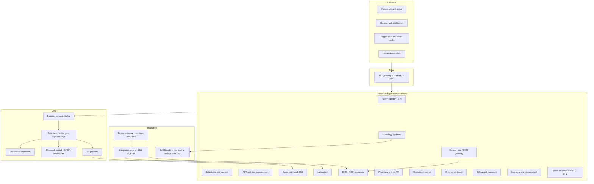
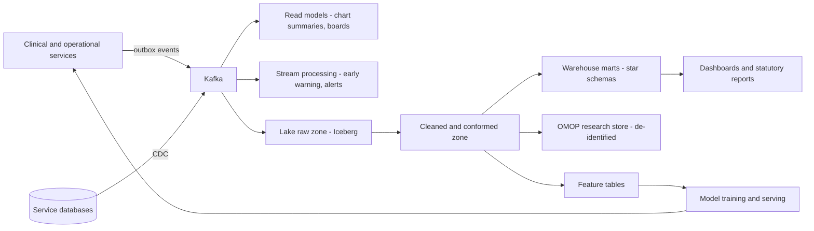

# I04. Hospital Information System, EHR & Telemedicine

!!! abstract "Chapter at a glance"
    **Sector:** Healthcare · **Format:** system design walkthrough (no code) · **Reader bands:** B1 → B4

    **What you get:** a complete design for a multi-hospital chain in India (10 hospitals, 3,000 beds, 30 clinics, telemedicine), explained the way it actually runs:

    - how a patient moves through registration, OPD, emergency, admission, surgery, discharge and billing, and what each system does at every step;
    - the clinical record (EHR) and how orders, results, medications and notes flow;
    - lab, radiology (PACS), pharmacy, nursing, operating theatres and beds;
    - insurance and cashless claims;
    - telemedicine video consultations and e-prescriptions;
    - interoperability: HL7 v2, FHIR, DICOM, and India's Ayushman Bharat Digital Mission (ABDM);
    - the algorithms behind patient matching, scheduling, bed assignment, early-warning scores, drug checks, inventory and claims;
    - the data platform: operational stores, event streaming, data lake, warehouse, research data model and ML;
    - the tech stack, layer by layer;
    - security, privacy, consent, compliance, reliability and disaster recovery.

    **Reading time:** 90 min.

!!! warning "Clinical and regulatory content"
    - This is an **engineering design**, not clinical guidance.
    - Clinical scores (NEWS2, triage levels), drug-interaction logic and treatment pathways must be validated and owned by clinicians.
    - Statements about Indian law and programmes (DPDP Act 2023, ABDM, Telemedicine Practice Guidelines 2020, NHCX, record retention) are summaries marked **VERIFY**. Check the current official texts.
    - The tech stack is a **reference choice**, not a description of any specific hospital's systems.

---

## 1. The System in One Page

### 1.1 What a hospital's software must do

A hospital is a 24×7 operation where information errors can harm people:

- A lab result that reaches the wrong patient's chart.
- A drug allergy that isn't visible when the prescription is written.
- A bed shown as free that isn't.
- A discharge delayed for hours because billing is waiting for an insurer's approval.

The software's job is to make **the right information available to the right person at the right moment**, to **record everything that was done** (legally and clinically), and to **coordinate** hundreds of staff, rooms, machines and payers.

### 1.2 The main systems

| System | Common name | What it does |
|---|---|---|
| **Patient administration** | PAS / ADT | Registration, identity, admission–discharge–transfer, bed census |
| **Scheduling** | — | OPD appointments, doctor rosters, OT schedules, telemedicine slots |
| **Electronic health record** | EHR / EMR | Problems, allergies, medications, vitals, notes, orders, results, discharge summaries |
| **Computerised provider order entry** | CPOE | Doctors order labs, imaging, drugs, diets, procedures, with safety checks |
| **Laboratory information system** | LIS | Sample collection, barcode tracking, analyser interfaces, results, validation |
| **Radiology information system + image archive** | RIS / PACS / VNA | Imaging orders, modality worklists, DICOM images, reports |
| **Pharmacy** | — | Dispensing, formulary, stock, controlled drugs |
| **Nursing and medication administration** | eMAR | Care plans, vitals, bedside barcode-verified drug administration |
| **Operating theatre management** | OT | Scheduling, checklists, anaesthesia records, instrument tracking |
| **Emergency department** | ED | Triage, tracking board, fast registration |
| **Revenue cycle** | Billing / RCM | Charges, packages, deposits, insurance pre-authorisation, claims, payments |
| **Supply chain** | Inventory | Drugs, consumables, implants; purchase, stock, expiry |
| **Telemedicine** | — | Video consultations, e-prescriptions, remote follow-up |
| **Patient app and portal** | — | Booking, reports, bills, teleconsults, consent |
| **Integration engine** | — | HL7 v2 and FHIR messages, device feeds, ABDM, insurers |
| **Clinical decision support** | CDS | Drug checks, early-warning scores, sepsis alerts, reminders |
| **Data platform** | Lake / warehouse | Reporting, quality indicators, research, ML |

### 1.3 Scale for this design (assumptions)

| Quantity | Value |
|---|---|
| Hospitals / beds / clinics | 10 / 3,000 / 30 |
| OPD visits per day | ~15,000 (in person) + ~2,000 teleconsults |
| Admissions per day | ~600; average stay 4 days |
| ED visits per day | ~1,200 |
| Lab tests per day | ~60,000 (many tests per sample) |
| Imaging studies per day | ~3,000; CT/MRI studies are 100 MB–2 GB each |
| Vitals observations | ~2M per day (monitors + nursing) |
| Staff users | ~20,000; ~6,000 concurrent at peak |
| Records retention | Many years; imaging petabyte-scale over time (VERIFY retention rules) |

**Estimation highlights:**

- **Imaging dominates storage.** 3,000 studies/day at an average of ~150 MB is ~450 GB/day, or **~160 TB/year** before compression.
- **Clinical data is small but critical.** Notes, orders and results total **tens of GB/day**.
- **Latency needs:**
    - **Clinical screens:** open a patient chart in < 1 s at p95.
    - **Order entry with checks:** < 2 s.
    - **Lab analyser interfaces:** near real time.
    - **ED tracking board:** updates within seconds.

---

## 2. Requirements

### 2.1 Functional

1. Register patients once and recognise them everywhere (one patient, one record), linking the national health ID (ABHA) with consent (VERIFY).
2. Book, reschedule and cancel appointments across doctors, clinics and teleconsults, with queue tokens on the day.
3. Triage and treat emergency patients with minimal registration first ("register later").
4. Admit, transfer and discharge patients; manage beds and housekeeping turnaround.
5. Document care (history, examination, diagnoses, notes, vitals, nursing charts) and order tests, imaging, drugs and procedures, with safety checks.
6. Run the lab from sample collection to validated results; the radiology workflow from order to report with images.
7. Dispense and administer medicines with bedside verification.
8. Schedule and document surgeries.
9. Bill correctly (itemised and packages), take deposits, obtain insurance pre-authorisation, and submit and track claims.
10. Offer teleconsultations with video, documents and e-prescriptions.
11. Exchange records with other providers and national systems (FHIR, ABDM), with patient consent.
12. Report quality indicators, statutory reports and management dashboards; support approved research.

### 2.2 Non-functional

| Attribute | Target |
|---|---|
| **Availability** | Clinical core ≥ 99.95%, with **downtime procedures** (read-only copies, printed MARs) for anything below that |
| **Latency** | Chart open p95 < 1 s; result delivery to the chart < 1 min after validation |
| **Integrity** | No result ever filed to the wrong patient; every clinical entry signed, timestamped and immutable (amendments are new versions) |
| **Security** | Role-based and relationship-based access, break-glass with audit, encryption, device control |
| **Privacy** | Consent-based sharing; minimum necessary; DPDP Act obligations (VERIFY) |
| **Auditability** | Who viewed or changed what, and when, for every record |
| **Interoperability** | HL7 v2, FHIR R4, DICOM, ABDM APIs (VERIFY versions) |
| **Recovery** | RPO ≈ 0 for clinical data in-region; RTO < 1 h for the clinical core; imaging archive recoverable within a day for older studies |

---

## 3. High-Level Architecture

### 3.1 Component view

### 3.2 Architectural decisions

| Decision | Choice | Why |
|---|---|---|
| **Monolith vs services** | A **modular core** (patient, EHR, orders, results in one strongly consistent domain) plus separate services for scheduling, billing, pharmacy stock, imaging, telemedicine and integration | Clinical data needs transactions across orders, results and notes. Operational domains scale and change independently ([Ch 34](../04-architect/34-modern-architecture-styles.md)). |
| **Clinical data model** | **FHIR R4 resources** as the canonical model (Patient, Encounter, Observation, MedicationRequest, ServiceRequest, DiagnosticReport, Condition, AllergyIntolerance, DocumentReference, Consent) | International standard, used by ABDM for record exchange (VERIFY). It avoids a custom model that needs translation everywhere. |
| **Storage of clinical data** | PostgreSQL behind a FHIR server (resources as versioned JSONB plus search indexes), with append-only history | Transactions, versioning, and SQL for operations ([Ch 05](../01-foundations/05-relational-databases-deep-dive.md)) |
| **Integration** | An **integration engine** for HL7 v2 (lab analysers, legacy systems) and FHIR, plus an **event bus** for internal events | Hospitals are full of devices and vendor systems that speak HL7 v2 |
| **Images** | **PACS/VNA** with DICOM, on tiered object storage | Images are huge and have their own standard and viewers |
| **Deployment** | Private cloud or on-premises Kubernetes in each region, with a DR site; edge nodes in each hospital for downtime resilience | Clinical systems must keep working when the WAN link fails; data residency (VERIFY) |

---

## 4. How It Works — Patient Journeys End to End

### 4.1 Journey 1: an OPD visit booked in the app

1. **Search and booking.**
    - The patient searches by specialty, doctor or symptoms in the app. Search finds doctors (OpenSearch index of doctors, specialties, languages and locations).
    - The scheduling service shows free slots.
    - Slots come from each doctor's **roster templates** (e.g. Mon/Wed/Fri 10:00–13:00, 12-minute slots), minus leaves and blocks, **plus overbooking allowance** computed from predicted no-shows (§6.3).
2. **Holding the slot.** The app holds the slot for 5 minutes (a hold record with a TTL), collects the fee if prepaid, and confirms.
    - Double booking is prevented by a **unique constraint on (doctor, slot, sequence)** and a conditional insert, exactly like inventory reservation ([Ch 46](../05-case-studies/46-grocery-checkout-and-inventory-reservation.md)).
3. **Identity.** At first booking, the patient is created or matched in the **Master Patient Index** (MPI) using name, date of birth, gender, mobile and ABHA number if given.
    - The MPI returns a **medical record number (MRN)**.
    - If a probable duplicate exists, the record is flagged for review rather than merged automatically (§6.1).
4. **Reminders.** SMS/WhatsApp/push reminders go out 24 h and 2 h before ([Ch 40](../05-case-studies/40-notification-system.md)), with a one-tap cancel that frees the slot for waitlisted patients.
5. **Arrival.** The patient scans a QR at a kiosk or the front desk.
    - The **queue service** issues a token and puts the patient in the doctor's queue.
    - The queue order considers appointment time, arrival time and priority (elderly, pregnant, follow-up-with-reports), shown on waiting-room screens.
    - Expected wait is computed from the doctor's recent consultation times.
6. **Pre-consultation.** A nurse records vitals on a tablet. The vitals become FHIR **Observations** linked to today's **Encounter**.
7. **Consultation.** The doctor opens the chart:
    - **Summary:** problems, allergies, current medications, recent results, past visits.
    - **Documentation:** the doctor writes a note (templates per specialty, voice dictation optional) and records diagnoses (coded, e.g. ICD-10, with SNOMED CT where used; VERIFY coding standards adopted).
    - **Orders:** labs, imaging and prescriptions, through **CPOE**.
8. **Safety checks at order time (CDS):**
    - drug–allergy, drug–drug interaction, duplicate therapy;
    - dose range for age and weight, and renal adjustment if recent creatinine is available;
    - duplicate test within a time window.

    Alerts are **tiered** (hard stop vs warning with override reason), to avoid alert fatigue.
9. **Checkout.**
    - The billing service turns orders into **charges** using the tariff master (item prices by payer, package rules).
    - The patient pays at the counter or in the app (UPI/card; [Ch 45](../05-case-studies/45-payment-system.md)).
    - The e-prescription is sent to the pharmacy and to the patient's app.
    - A visit summary is shared, and pushed to the patient's ABDM-linked record if consented (§8).
10. **Sample collection.** Lab orders appear in the **phlebotomy worklist**. Barcoded labels are printed per sample container, and the collection time is scanned.
11. **Results.**
    - Analysers send results over HL7 v2/ASTM to the LIS, which applies **auto-verification rules**: delta checks, reference ranges, instrument flags.
    - A pathologist validates the exceptions. Validated results post to the EHR as Observations and DiagnosticReports.
    - The doctor and patient are notified. **Critical values** trigger a phone call workflow with acknowledgement tracking.

### 4.2 Journey 2: an emergency patient who becomes an in-patient

1. **Arrival.** The patient arrives by ambulance, and pre-arrival details may come from the ambulance app.
    - **Quick registration** creates an "unknown" or minimal patient (temporary MRN) in seconds.
    - Identity is reconciled later by the MPI's **merge** workflow.
2. **Triage.** A nurse assigns a **triage level**, e.g. a 5-level scale such as ESI, per hospital protocol (VERIFY which scale is used).
    - The **ED tracking board** shows every patient's location, level, waiting time, pending orders and results.
    - Updates are pushed over WebSockets from ED events.
3. **Early warning.** Vitals from monitors reach the **device gateway**, which converts them to FHIR Observations.
    - An **early-warning score** (e.g. NEWS2; §6.4) is computed on every new vital set.
    - A rising score pages the responsible doctor through escalation rules.
4. **Stat orders** go to the lab and radiology with a priority flag.
    - Radiology's **modality worklist** (DICOM MWL) sends the patient's details to the CT scanner, so the images carry the correct identifiers.
    - Images go to PACS, and the radiologist reports in the RIS. The report posts to the EHR, and a link opens the images in a web viewer.
5. **Decision to admit.** A **bed request** is created with the needs:
    - specialty and level (ward/HDU/ICU);
    - isolation, gender and equipment;
    - near nursing station or not.
6. **Bed assignment.** The bed management service proposes beds using a **constraint-based assignment** (§6.2), considering beds that will be free after pending discharges and housekeeping.
    - The bed manager confirms. **ADT** records the admission and transfer events.
    - Housekeeping and transport tasks are generated.
7. **In-patient care:**
    - **Admission orders**, often from an order set, e.g. "community-acquired pneumonia adult".
    - **Medication orders:** the pharmacist verifies them (clinical check), then dispenses (unit dose).
    - **Bedside administration:** nurses scan the patient wristband and the drug barcode. The **eMAR** checks the five rights (patient, drug, dose, route, time) before recording administration.
    - **Nursing:** documentation, care plans and fluid balance.
    - **Doctors:** progress notes.
8. **Billing during the stay.** Charges accumulate on the in-patient account (room rent per day by room category, drugs, consumables, tests, procedures, doctor visits).
    - If insured, a **pre-authorisation** request with diagnosis and estimated cost goes to the insurer or TPA (§4.4).
    - Deposits are tracked against the running bill.
9. **Discharge.**
    - The doctor writes the **discharge summary**: diagnoses, procedures, course, medications, follow-up. Pharmacy reconciles medications, and nursing completes the checklist.
    - Billing produces the final bill, and the insurer approves the final claim amount.
    - The patient leaves.
    - The bed goes to housekeeping, then back to available. The discharge event updates bed forecasts.
    - **Discharge delay** (from "medically fit" to "left the bed") is a key metric, often dominated by billing and insurance steps.

### 4.3 Journey 3: a planned surgery

1. **Booking the case.** The surgeon books the case with procedure, duration estimate, surgeon, anaesthesia type, implants and special equipment.
2. **Pre-operative assessment:** tests, anaesthesia assessment, consent forms (e-signed), and pre-authorisation if insured.
3. **OT scheduling** assigns theatre, date and sequence (§6.5), checking the constraints:
    - surgeon availability;
    - equipment conflicts (one C-arm shared by two theatres);
    - implant availability, reserved in inventory;
    - ICU bed after surgery, if needed.
4. **On the day:**
    - The **surgical safety checklist** (sign-in, time-out, sign-out) is recorded in the OT app.
    - Anaesthesia records capture device data. Implants are scanned (lot and serial for traceability), and instruments are tracked through sterilisation cycles.
5. **After surgery:** the recovery room, then the ward or ICU, with the transfer recorded in ADT. The billing package is applied (e.g. a fixed-price package with inclusions and exclusions).

### 4.4 Journey 4: cashless insurance

1. At admission, the **insurance desk** verifies the policy (payer API or portal) and captures eligibility.
2. **Pre-authorisation request:** diagnosis codes, planned procedure, estimated cost, clinical notes and investigation reports. It goes by the payer's API or portal, or through the **National Health Claims Exchange** (NHCX, FHIR-based) where adopted (VERIFY status and scope).
3. The payer approves an amount, queries for more information, or rejects.
    - Queries become **tasks** for doctors and the insurance desk.
    - Response time is tracked, because it delays discharge.
4. **Enhancements** are requested if the stay extends.
5. **Final bill:** the claim is submitted with the itemised bill and discharge summary. The payer deducts non-payable items (per policy), and the patient pays the difference.
6. **Payment reconciliation:** payer remittances are matched to claims. Deductions are analysed by reason (§6.7) to reduce future denials.

### 4.5 Journey 5: a teleconsultation

1. **Booking and payment:** the patient books a teleconsult slot (same scheduling engine, channel = video) and pays.
2. **Joining:** 10 minutes before, the patient joins a **virtual waiting room**. The app checks camera, microphone and bandwidth.
3. **The call:** the doctor starts the call from the clinician workspace, with the chart on one side. Video uses **WebRTC**:
    - clients connect to a **selective forwarding unit (SFU)**, through **TURN** relays when networks block peer connections;
    - bandwidth adapts through simulcast/SVC and congestion control.
    - On poor networks the call falls back to **audio-only**, then to chat.
4. **Documentation:** the doctor documents, prescribes and orders tests.
    - The **e-prescription** follows the Telemedicine Practice Guidelines (VERIFY): doctor registration number, restrictions on which drug categories can be prescribed remotely, and the patient's identity and consent recorded.
5. **After the call:** the prescription goes to the patient's app and optionally to a partner pharmacy. Test orders create home-collection requests. A follow-up is scheduled.
6. **Recording:** calls are normally **not** stored as video. The clinical note is the record, and any recording requires explicit consent and a retention policy (VERIFY).

### 4.6 Journey 6: sharing records via ABDM (consent-based)

1. **Linking:** the patient links their ABHA number to the hospital's MRN, which makes the hospital a **Health Information Provider** (HIP) for that patient.
2. **Request:** another provider, a **Health Information User** (HIU), requests records. The patient's **consent manager** app asks the patient to approve a consent artefact: purpose, date range, record types and expiry.
3. **Delivery:** on approval, the hospital's ABDM gateway receives the request.
    - It fetches the matching records (FHIR bundles), **encrypts them for the requester**, and sends them over the ABDM data flow.
    - It logs everything against the consent artefact.

    The hospital never sends data without a valid consent artefact, and revocations stop further sharing (VERIFY exact protocol and specifications).

---

## 5. Core Subsystems in Depth

### 5.1 Master Patient Index (MPI)

- **Purpose:** one person, one MRN across all hospitals and clinics. Duplicates cause missed allergies and split histories. Wrong merges are worse, because they mix two people's records.
- **Data:**
    - demographics and identifiers (MRN per facility, enterprise ID, ABHA number, mobile, government IDs only where lawful);
    - addresses and aliases;
    - a **match history**.
- **Matching (§6.1)** is probabilistic:
    - **auto-link above an upper threshold**;
    - **queue for human review** in the grey zone;
    - **new record** below the lower threshold.
- **Merge and unmerge** are first-class operations with full audit. Downstream systems receive merge events and repoint their references (a FHIR `Patient.link`).

### 5.2 EHR and the clinical data store

**Model:** FHIR resources. The main ones:

- `Patient`, `Encounter` (visit/admission), `EpisodeOfCare`;
- `Condition`, `AllergyIntolerance`;
- `Observation` (vitals, labs), `DiagnosticReport`;
- `MedicationRequest`, `MedicationAdministration`;
- `ServiceRequest` (orders), `Procedure`;
- `DocumentReference` (notes, scanned documents), `Consent`.

**Storage:**

- Each resource type is stored as **versioned JSONB** plus **search parameter tables** (patient, date, code, status) in PostgreSQL. A FHIR server provides this (e.g. HAPI FHIR JPA).
- Every update creates a new version, and the history is immutable.
- **Amendments** to signed notes are new versions with a reason, and the original remains visible.

**The chart view** is assembled by a **read model**, a per-patient summary projection (latest vitals, active problems, active meds, recent results):

- it is updated from events, so opening a chart is one indexed read, not dozens of queries ([Ch 15](../02-distributed-core/15-event-driven-architecture-cqrs-and-event-sourcing.md));
- the source of truth remains the resource store.

**Clinical documents:**

- Structured templates plus free text. Scanned paper and external PDFs are stored in object storage, referenced by `DocumentReference`, and made searchable after OCR where useful.

**Terminologies:**

- A **terminology service** (e.g. Snowstorm for SNOMED CT, plus LOINC for lab tests, ICD-10 for diagnoses and billing, and a local drug master mapped to a national list where available; VERIFY licensing and national standards).
- Codes make CDS rules, analytics and exchange possible.

### 5.3 Orders (CPOE) and clinical decision support

- **Order lifecycle:** draft → signed → (pharmacist or radiologist verification) → scheduled → in progress → completed or cancelled.
- **Order sets** bundle evidence-based orders for common conditions.
- **CDS hooks:**
    - **At order-select and order-sign**, CDS services evaluate:
        - rules on the patient context (allergies, current meds, labs, weight, age, pregnancy);
        - knowledge bases for interactions and dose ranges (commercial or national drug knowledge base; VERIFY licensing).
    - **The response** is cards: info, warning (override with reason), or hard stop.
- **Alert fatigue control:** measure the override rate per rule, tune or retire noisy rules, and show only the highest-severity interaction per pair.
- **Asynchronous CDS:**
    - early-warning scores and sepsis screening run on the observation stream (§6.4);
    - care-gap reminders (e.g. diabetic foot exam overdue) run on schedules.

### 5.4 Laboratory (LIS)

**Workflow:**

1. **Order → sample planning.** Tests are grouped by container and sample type.
2. **Labelling and collection:** barcode labels are printed and the collection is scanned.
3. **Transport and receipt** at the lab.
4. **Analysis:** samples are loaded onto analysers. Instruments query the LIS for the tests per barcode (host query), then return results.
5. **Auto-verification** (§6.6) releases normal, consistent results automatically. The rest wait for technologist or pathologist review.
6. **Reporting:** the report posts to the EHR, and critical values trigger phone-call workflows.

**Instrument interfaces:** HL7 v2 or ASTM/LIS2 over TCP/serial through the integration engine.

**Quality control:** QC runs are recorded. Levey–Jennings charts and **Westgard rules** detect analyser drift, and results are blocked if QC fails.

**Sample tracking:** every scan (collected, received, loaded, stored) is an event, so turnaround time can be measured per step.

### 5.5 Radiology (RIS/PACS)

- **Order to scan:**
    - the RIS schedules the modality slot;
    - the **DICOM Modality Worklist** gives the scanner patient and accession details;
    - images go to **PACS** via DICOM C-STORE (or DICOMweb STOW-RS);
    - the RIS tracks status.
- **Storage:**
    - **tiered**: recent studies on fast storage for reading, older ones compressed (lossless) in object storage (a vendor-neutral archive), with lifecycle rules;
    - **pre-fetching** of prior studies when a patient is scheduled.
- **Viewing:**
    - radiologists use diagnostic workstations;
    - clinicians use a **zero-footprint web viewer** over DICOMweb (WADO-RS), streaming the frames needed rather than the whole study.
- **Reporting:**
    - structured templates and voice dictation;
    - reports are signed and posted as DiagnosticReports;
    - critical findings follow a communication workflow.
- **AI assist (optional):** triage models, such as intracranial haemorrhage detection on CT, prioritise the worklist. They are regulated as medical devices where applicable (VERIFY), and always sit under radiologist review.

### 5.6 Pharmacy and medication administration

- **Formulary and drug master:** brands mapped to generics, strengths, forms, prices and stock units.
- **In-patient flow:**
    1. Order.
    2. Pharmacist verification: clinical checks, substitutions per formulary.
    3. **Dispensing:** unit doses per ward per round, often by cart cycles.
    4. **eMAR schedule** is generated from the order frequency.
    5. **Barcode administration** at the bedside.
- **Controlled drugs:** double sign-off, a register, and stock reconciliation per shift.
- **Stock:** batch and expiry tracking. **FEFO** (first-expiry-first-out) picking. Reorder points (§6.8). Returns from wards.

### 5.7 Beds, ADT and patient flow

- **ADT events** are the heartbeat of the hospital: admit, transfer, discharge, leave of absence, and cancel versions of each. They are published on the event bus so lab, pharmacy, diet, billing and housekeeping follow the patient automatically.
- **Bed states:** available → reserved → occupied → dirty (after discharge) → cleaning → available. Blocked (maintenance/isolation) is a separate state.
- **Patient-flow command centre:** live census, expected discharges today, ED boarders, OT schedule, ICU capacity, and the **bed demand forecast** (§6.2).

### 5.8 Revenue cycle (billing and insurance)

- **Charge capture:** every billable event (room day, order completed, drug dispensed, implant used) emits a charge event. The billing service prices it with the **tariff master**, which holds:
    - price by payer contract (cash, corporate, insurer, government scheme);
    - package definitions (inclusions, exclusions, caps).
- **Package logic:** a surgery package may include room stay up to N days, standard drugs and consumables. Items beyond it are billed separately, and the engine decides per charge line whether it is included.
- **Deposits, refunds and payment modes**, using [Ch 45](../05-case-studies/45-payment-system.md) patterns (idempotent payments, ledger, reconciliation).
- **Claims:** pre-auth, enhancement and final claim, with document bundles. The claim status is tracked per payer SLA.
- **Denial analytics** find root causes (§6.7).
- **Accounting:** posting to the finance system (GL) with GST where applicable (VERIFY GST treatment of healthcare services and items).

### 5.9 Telemedicine platform

| Component | Role |
|---|---|
| **Signalling service** | WebSocket-based room management, join tokens, presence |
| **SFU cluster** | Forwards media streams. Per call, 2–4 participants (patient, doctor, interpreter/family) |
| **TURN servers** | Relay for NAT/firewall traversal, in-region |
| **Media quality service** | Collects WebRTC stats (packet loss, jitter, bitrate) for troubleshooting and quality dashboards |
| **Waiting room** | Patient queue per doctor, with device checks |
| **Clinical workspace** | Chart, notes, e-prescription, orders beside the video |

**Capacity:** 2,000 teleconsults/day at 12 minutes each, with a peak of ~250 concurrent calls. A single SFU node handles hundreds of streams, so a small, regional cluster suffices.

**Privacy:**

- Media is encrypted (DTLS-SRTP), and no recording by default.
- Identity is verified at booking.
- Consent is recorded in the encounter (VERIFY guideline requirements).

### 5.10 Integration engine

- **Purpose:** translate and route messages between systems that were never designed together.
- **Inbound:**
    - lab analysers (HL7 v2 ORU, ASTM);
    - bedside monitors, via a device gateway to Observations;
    - external labs;
    - insurer responses;
    - ABDM requests.
- **Outbound:**
    - orders to external labs (HL7 v2 ORM/OML);
    - ADT feeds to departmental systems (A01 admit, A02 transfer, A03 discharge, A08 update);
    - FHIR APIs for partners.
- **Features:** message transformation, code mapping, retries with dead-letter queues, replay, message tracking UI, and alerts on interface backlog. It is the most common source of silent failures, so every interface has a heartbeat and a backlog alarm.

---

## 6. Algorithms Used

### 6.1 Patient matching (MPI) — probabilistic record linkage

- **Blocking:** don't compare every record with every other. Compare only records sharing a **blocking key**, such as the first letters of the phonetically encoded surname plus birth year, the mobile number, or the ABHA number. This cuts comparisons from billions to thousands.
- **Field comparisons:**
    - names with **Jaro–Winkler** similarity and phonetic codes (Double Metaphone), with Indian-name normalisation: initials, spelling variants, surname and given-name order, honorifics;
    - date of birth: exact, transposed day/month, or year ±1;
    - gender, mobile (exact), and address tokens.
- **Scoring:** the **Fellegi–Sunter model**. Each field agreement adds log(m/u) and each disagreement adds log((1−m)/(1−u)), where:
    - *m* = the probability that the fields agree if the records are the same person;
    - *u* = the probability that they agree by chance.

    The weights are estimated from reviewed pairs (or with EM).
- **Thresholds:** auto-link above the upper threshold, human review in between, new record below. The thresholds are chosen by the **cost of errors**: a false merge is far worse than a false split.
- **Monitoring:** the duplicate rate, the review queue size, and unmerges (each one is a near-miss safety event).

### 6.2 Bed assignment and demand forecasting

- **Assignment** is a **constraint-satisfaction and scoring** problem.
    - **Hard constraints:** gender (for shared rooms), isolation, level of care, equipment.
    - **Soft preferences:** ward specialty match, proximity to the nursing station for high-risk patients, keeping teams' patients together, and minimising transfers.
    - **Method:** score every feasible bed and propose the top 3. For batch assignment (morning admissions), solve as a **weighted bipartite matching** (Hungarian algorithm or min-cost flow).
- **Forecasting:**
    - admissions by hour and day of week (seasonal time series such as SARIMA/Prophet or gradient-boosted models with calendar and epidemic features);
    - discharges from **predicted length of stay** per patient (a regression on diagnosis, age and procedures);
    - this yields expected free beds per ward over the next 24–72 h.
- **Queueing view:** ED boarding occurs when bed arrival rate × length of stay approaches capacity (Little's Law, [Ch 31](../04-architect/31-architecture-decision-making.md)). Occupancy beyond ~85–90% makes waits explode (a common planning heuristic; VERIFY for your context).

### 6.3 Appointment scheduling and overbooking

- **Slot generation** from roster templates, minus leaves and blocks.
- **No-show prediction:** a logistic regression or gradient-boosted model on lead time, past no-shows, distance, weather, day and time, and payment status.
- **Overbooking:** add extra bookings per session so that *expected* attendance ≈ capacity. Two limits:
    - the expected overtime and waiting time must stay within policy;
    - no overbooking for procedures that need fixed resources.
- **Queue ordering** on the day: a priority queue by (priority class, appointment time, arrival time).
- **Expected wait** = queue position × a rolling average consultation time (by doctor and visit type).

### 6.4 Early warning scores and sepsis screening

- **NEWS2-style scoring:**
    - points for respiratory rate, oxygen saturation, supplemental oxygen, systolic blood pressure, pulse, consciousness and temperature;
    - the total maps to the response level (routine, increased frequency, urgent review, emergency response).

    The scoring table and responses must follow the clinically approved protocol (VERIFY).
- **Implementation:** a **stream processor** consumes vital-sign Observations and recomputes the score per patient.
    - **Escalations** go out when the score crosses thresholds, with **suppression windows** to avoid repeated pages.
    - Missing vitals are handled explicitly: a stale value is not normal.
- **Sepsis screens:** rule-based (e.g. infection suspicion plus abnormal vitals or labs) or ML-based. Always validated locally before activation, with alert burden measured.

### 6.5 Operating theatre scheduling

- **Estimate case duration** per surgeon and procedure from history (median plus spread), not from surgeon guesses alone.
- **Build daily schedules** as a **bin-packing and sequencing** problem:
    - fit cases into theatre blocks, minimising overtime and idle time;
    - respect surgeon, anaesthetist, equipment and post-op bed constraints.

    Heuristics (longest-first, or first-fit decreasing) or **integer programming** for the weekly plan.
- **Day-of-surgery re-planning** when a case runs long: move later cases, and notify the ward and patients.

### 6.6 Lab auto-verification and quality control

- **Rules per test:**
    - within reference and critical limits;
    - no instrument flags;
    - **delta check** against the patient's previous result (a large change in a short time suggests a wrong sample or a real event);
    - consistency across tests (e.g. calculated vs measured values).

    Results passing all rules are released automatically, and the rest are held.
- **Westgard QC rules** on control samples detect systematic and random error. For example, one control beyond 3 SD, or two consecutive beyond 2 SD on the same side. Patient runs are blocked when QC fails.

### 6.7 Claims and denial analytics

- **Pre-submission checks:** a rules engine checks completeness (documents per procedure), coding consistency (diagnosis vs procedure), and policy limits (room-rent caps, sub-limits). This catches avoidable denials.
- **Denial analytics:** classify deductions by reason (text classification of payer remarks, plus codes where provided). Pareto analysis finds the top fixable causes.
- **Prediction** (optional): the likely approved amount for a pre-auth, to set patient expectations early.

### 6.8 Inventory

- **Reorder point** = average daily usage × lead time + safety stock, where safety stock = z × σ(usage) × √(lead time).
- **Order quantity:** EOQ as a starting point, adjusted for supplier minimums, expiry and storage.
- **ABC analysis** (by value) and **VED analysis** (vital/essential/desirable) set control intensity. Vital items never stock out.
- **Expiry management:** FEFO picking, and alerts N days before expiry for redistribution between hospitals.

### 6.9 Access-anomaly detection (privacy)

- **Rules** flag risky access:
    - access to records of patients with **no care relationship** (not on the user's ward, clinic list or consult);
    - VIP or employee records;
    - unusual volumes;
    - after-hours access from unusual locations.
- **Scoring:** a baseline per role, with z-scores on access counts. Flags go to a privacy officer's review queue.

---

## 7. Data Architecture

### 7.1 Operational stores

| Data | Store | Notes |
|---|---|---|
| Clinical resources (FHIR) | PostgreSQL (FHIR server) | Versioned, immutable history, search params |
| Scheduling, ADT, billing, inventory | PostgreSQL per service | Transactions, row-level security per facility |
| Patient summaries (read model) | PostgreSQL or Redis | Rebuilt from events |
| Search (doctors, patients for staff, documents) | OpenSearch | Patient search limited by access rules; no PHI in logs |
| Images | PACS + object storage (VNA) | DICOM; lifecycle tiers |
| Documents and scans | Object storage | Encrypted, referenced from the EHR |
| Sessions, rate limits, queues on screens | Redis | Ephemeral |
| Audit log | Append-only store (partitioned PostgreSQL or a log store) + WORM archive | Tamper-evident (hash-chained), long retention |

### 7.2 Event streaming

- **Kafka** carries domain events: `patient.registered`, `encounter.started`, `adt.admitted`, `order.signed`, `result.validated`, `medication.administered`, `bed.status.changed`, `charge.created`, `claim.status.changed`.
- **Outbox pattern** in each service, so events are published if and only if the transaction commits ([Ch 15](../02-distributed-core/15-event-driven-architecture-cqrs-and-event-sourcing.md)).
- **CDC** (Debezium) from databases feeds the lake without touching application code.
- **Consumers:** read models, billing, notifications, the early-warning processor, the command centre, the lake.
- **Topics with PHI** are encrypted, with restricted ACLs. Retention is short on the bus, and long-term history lives in the lake.

### 7.3 Data lake and warehouse

- **Raw zone:** CDC and event data land in **Apache Iceberg** tables on object storage, partitioned by date and facility.
- **Cleaned zone:** deduplicated and conformed:
    - codes mapped through the terminology service;
    - patients linked by enterprise ID;
    - time zones normalised.
- **Warehouse and marts** follow the Kimball approach (star schemas, [Ch 21](../03-production/21-data-at-scale.md)).
    - **Facts:** encounters, admissions, orders, results, medication administrations, charges, claims, bed-days, OT cases, appointments.
    - **Dimensions:** patient (with de-identified variants), doctor, department, facility, date, payer, diagnosis, procedure, drug.
    - **Slowly changing dimensions** (type 2) for doctor department and tariff versions.
- **Query engines:**
    - **Trino** (or Spark SQL) over Iceberg for heavy analysis;
    - a serving warehouse (ClickHouse, or a cloud warehouse if allowed by residency and policy) for dashboards;
    - **Superset** or similar BI with row-level security by facility.
- **Typical outputs:**
    - **operations:** bed occupancy, average length of stay, discharge delay, OT utilisation, ED length of stay, lab TAT;
    - **quality:** infection rates, readmissions within 30 days, mortality indices, medication errors;
    - **finance:** revenue per bed-day, denial rate by payer;
    - **statutory:** notifiable diseases, government scheme reports.
- **Research data:**
    - de-identified extracts in the **OMOP Common Data Model**, for approved studies, with ethics committee approval and data use agreements;
    - **de-identification:** remove direct identifiers, shift dates per patient, generalise rare attributes, and check k-anonymity risk before release.

### 7.4 ML platform

- **Features** are computed in the lake and served online for real-time uses (a feature store such as Feast, or simple precomputed tables).
- **Models:** no-show prediction, length-of-stay prediction, bed demand forecasting, readmission risk, sepsis screening (with clinical validation), denial prediction, and radiology triage (vendor, regulated).
- **Governance:**
    - model cards, validation on local data, bias checks across groups;
    - **silent mode** (predictions logged but not shown) before go-live;
    - monitoring for drift;
    - clinical owner sign-off, and the ability to switch off instantly.

### 7.5 Data flow diagram

---

## 8. Interoperability & India's Digital Health Stack

| Standard or programme | Used for |
|---|---|
| **HL7 v2** | Lab analysers, legacy departmental systems, ADT feeds |
| **FHIR R4** | Canonical clinical model; APIs for apps and partners; ABDM record exchange (VERIFY profiles) |
| **DICOM / DICOMweb** | Imaging storage, worklists, viewers |
| **SNOMED CT, LOINC, ICD-10** | Clinical terms, lab tests, diagnoses and billing (VERIFY national licensing and adoption) |
| **ABDM building blocks** | ABHA (patient ID), Health Facility Registry, Healthcare Professionals Registry, consent manager, health information exchange (VERIFY current specifications) |
| **NHCX** | Standardised claims exchange with insurers (VERIFY adoption and scope) |

**Design implications:**

- keep **FHIR as the internal canonical model**, so external exchange is mapping, not translation;
- store **consent artefacts** and check them on every outbound share;
- register the facility and professionals in the national registries;
- be ready for **patient-initiated** record requests.

---

## 9. Tech Stack (reference choice)

| Layer | Choice | Alternatives | Why |
|---|---|---|---|
| **Clinician front end** | Web app (React/Angular) + tablet app; keyboard-heavy workflows | Native desktop | Deployment ease; works on shared workstations |
| **Patient app** | Android-first native or Flutter; PWA for low-end devices | React Native | India's device mix |
| **API gateway and identity** | Kong or Spring Cloud Gateway; **Keycloak** (OIDC, SMART on FHIR for app launch) | Cloud IAM | Standards-based SSO, role mapping |
| **Core services** | **Java 21 / Spring Boot** microservices and modular core | Kotlin, .NET | Team skills, ecosystem ([Ch 16](../02-distributed-core/16-microservices-architecture.md)) |
| **FHIR server** | **HAPI FHIR** JPA server on PostgreSQL | Commercial FHIR servers | Mature, open source, Java |
| **Databases** | **PostgreSQL 16** with streaming replication (Patroni) | Oracle, SQL Server | Reliability, cost, JSONB |
| **Cache** | Redis | — | Sessions, queue screens |
| **Search** | OpenSearch | Elasticsearch | Doctor and patient search, documents |
| **Messaging** | **Apache Kafka** + Debezium CDC; Schema Registry | RabbitMQ for simple queues | Durable event log, replay ([Ch 14](../02-distributed-core/14-messaging-and-event-streaming.md)) |
| **Stream processing** | Kafka Streams or Apache Flink | — | Early-warning scores, alerting windows |
| **Integration engine** | **Mirth Connect / NextGen Connect** or Apache Camel | Commercial engines | HL7 v2 tooling, mapping UI |
| **Imaging** | **Orthanc** or **dcm4chee** PACS + OHIF web viewer; object storage VNA | Commercial PACS | DICOM standards, web viewing |
| **Terminology** | Snowstorm (SNOMED CT) + local code services | Commercial | Codes for CDS and analytics |
| **Video** | WebRTC with an SFU (**LiveKit**, mediasoup or Jitsi) + coturn TURN | Commercial video APIs | Control over residency and cost |
| **Object storage** | MinIO on-prem or cloud object storage (in-country) | — | Documents, images, lake |
| **Lakehouse** | **Apache Iceberg** + **Spark** + **Trino** | Delta Lake, Hudi | Open table formats, SQL at scale |
| **Serving warehouse** | ClickHouse (on-prem) or an in-country cloud warehouse | Snowflake/BigQuery if permitted | Fast dashboards |
| **Orchestration** | Apache Airflow; dbt for transformations | Dagster | Scheduled pipelines, tested SQL models |
| **BI** | Apache Superset | Power BI, Metabase | Row-level security, open source |
| **ML** | MLflow, Python (scikit-learn, XGBoost), feature tables | SageMaker/Vertex (if permitted) | Tracking, reproducibility |
| **Platform** | Kubernetes (on-prem OpenShift/Rancher, or in-country cloud), Terraform, Argo CD | VMs for PACS | Standard deployment ([Ch 26](../03-production/26-deployment-and-infrastructure.md)) |
| **Observability** | Prometheus, Grafana, Loki/OpenSearch logs, OpenTelemetry tracing; PHI scrubbing in logs | Commercial APM | [Ch 24](../03-production/24-observability.md) |
| **Security** | Vault/HSM for keys, WAF, MDM for devices, SIEM | — | [Ch 23](../03-production/23-security-architecture.md) |

---

## 10. Security, Privacy & Compliance

- **Access control:**
    - **RBAC** (doctor, nurse, pharmacist, billing, admin), plus **relationship-based rules**: care team membership, ward, consult, or the referring doctor;
    - **ABAC** for sensitive categories (mental health, HIV, reproductive health), which get extra restrictions;
    - **Break-glass:** emergency access outside the rules, with a reason, alerts and after-the-fact review.
- **Audit:** every view, create, update, print and export of patient data is logged with user, patient, action, reason and time. The log is tamper-evident (hash-chained, WORM archive) and regularly reviewed (§6.9).
- **Encryption:**
    - TLS everywhere;
    - encryption at rest with keys in an HSM or KMS;
    - field-level encryption for especially sensitive identifiers.
- **Consent:** consent records for treatment, data sharing (ABDM), research and teleconsultation. They are checked by the consent service on every outbound share.
- **Data protection law:** DPDP Act 2023 obligations, including notice, consent, purpose limitation, data principal rights, breach notification and security safeguards (VERIFY the rules issued under the Act). Also the clinical establishment rules and medical record retention requirements (VERIFY) ([Ch 36](../04-architect/36-compliance-governance-and-data-residency.md)).
- **Devices:** managed tablets and workstations, auto-logout, no local PHI storage, and badge tap for quick login on shared terminals.
- **Medical device software:** CDS and AI features may fall under medical device regulation (VERIFY). Validation and change control apply.

---

## 11. Reliability, Downtime & Disaster Recovery

- **Clinical core availability:**
    - active-standby databases with **synchronous replication** within the region (RPO ≈ 0);
    - automated failover with fencing ([Ch 27](../03-production/27-reliability-and-disaster-recovery.md));
    - a DR site in another zone or region within the country.
- **Hospital edge nodes:** each hospital runs a local node with:
    - a **read-only replica** of its active patients' records;
    - local printing of MARs and results;
    - a **downtime order-entry** mode whose orders queue locally and sync when the WAN returns.

    Paper downtime forms remain the last resort, and **downtime drills** are scheduled.
- **Graceful degradation:**
    - If CDS is unavailable, orders proceed with a visible "checks unavailable" banner and pharmacist review.
    - If billing is down, charges queue.
    - If telemedicine video fails, it falls back to audio, then phone.
- **Interface monitoring:** a heartbeat and backlog alarm on every interface. A silent analyser interface means results aren't reaching charts, which is a patient safety risk.
- **Imaging:** PACS keeps recent studies on local storage at each hospital, with the central archive replicated. Older studies are recalled from the archive on demand, with pre-fetching for scheduled patients.
- **Backups and restore drills** for every store, with restore time measured.

---

## 12. Key Trade-offs (ADR summary)

| Decision | Chosen | Trade-off accepted |
|---|---|---|
| Canonical clinical model | FHIR R4 | Some performance cost and modelling learning curve; big gain in exchange and tooling |
| Core structure | Modular clinical core + separate operational services | Core is larger, but clinical transactions stay simple and consistent |
| Patient matching | Probabilistic with human review in the grey zone | Staff effort on review queues, to avoid dangerous auto-merges |
| Alerts | Tiered CDS with override tracking | Some risk of missed warnings, to preserve clinician trust |
| Deployment | In-country, hospital edge nodes | Higher ops cost; resilience to WAN loss and residency compliance |
| Imaging storage | Tiered VNA | Retrieval delay for old studies |
| Analytics | Lakehouse + OMOP | Pipeline complexity; one source for operations, quality and research |

---

## 13. Interview Q&A

### Beginner B1

??? question "Q1 [B1] ⭐ What are the main systems in a hospital, and how do they connect?"

    **30-second answer:** Patient administration (registration, ADT), scheduling, EHR with order entry, lab (LIS), radiology (RIS/PACS), pharmacy and eMAR, OT, billing and insurance, inventory, telemedicine and a patient app — connected by an integration engine (HL7 v2, FHIR) and an event bus, with ADT events telling every department where the patient is.

    **Deep answer:** §1.2, §3.1.

    **Trade-offs I'd call out:** One vendor suite vs best-of-breed with integration.

    **Follow-ups:**
    1. Heartbeat event? → ADT.
    2. Images? → PACS with DICOM.

    **Red flags:** One database for everything including images.

??? question "Q2 [B1] What happens when a doctor orders a blood test?"

    **30-second answer:** CPOE records a signed order with safety checks; the lab system plans samples and prints barcode labels; collection is scanned; analysers get tests by barcode and return results; auto-verification releases normal results; validated results post to the chart and notify the doctor, with critical values phoned.

    **Deep answer:** §4.1 steps 7–11, §5.4.

    **Trade-offs I'd call out:** Auto-verification speed vs manual review.

    **Follow-ups:**
    1. Wrong patient sample? → Delta checks, barcode at bedside.
    2. Critical value? → Call workflow with acknowledgement.

    **Red flags:** Results typed in manually.

??? question "Q3 [B1] How does a teleconsultation work technically?"

    **30-second answer:** Booking in the scheduling system, a virtual waiting room, WebRTC video through an SFU with TURN relays, adaptive bitrate and audio fallback; the doctor documents and e-prescribes in the same workspace; notes, not video, are the record.

    **Deep answer:** §4.5, §5.9.

    **Trade-offs I'd call out:** SFU cost vs peer-to-peer reliability.

    **Follow-ups:**
    1. Poor network? → Audio, then chat.
    2. Recording? → Only with consent.

    **Red flags:** Recording everything by default.

??? question "Q4 [B1] Why is patient identity so important in hospital systems?"

    **30-second answer:** Duplicate records hide allergies and history; wrong merges mix two people's data — both can harm patients. A master patient index with probabilistic matching, human review and audited merge/unmerge keeps one person to one record.

    **Deep answer:** §5.1, §6.1.

    **Trade-offs I'd call out:** Review effort vs safety.

    **Follow-ups:**
    1. Emergency unknown patient? → Temporary identity, merge later.
    2. National ID? → ABHA with consent.

    **Red flags:** Matching on name only.

### Intermediate B2

??? question "Q5 [B2] ⭐ Why use FHIR as the internal clinical data model?"

    **30-second answer:** It's an international standard with well-defined resources (Patient, Encounter, Observation, MedicationRequest…), versioning and search, used for national exchange (ABDM) and apps (SMART on FHIR) — so exchange becomes mapping and the ecosystem of tools applies.

    **Deep answer:** §3.2, §5.2, §8.

    **Trade-offs I'd call out:** Generic model vs performance; profile governance.

    **Follow-ups:**
    1. Storage? → Versioned JSONB + search tables.
    2. Chart speed? → Read models.

    **Red flags:** A custom schema per department.

??? question "Q6 [B2] How does bedside medication administration prevent errors?"

    **30-second answer:** Pharmacist-verified orders generate an eMAR schedule; the nurse scans the wristband and the drug barcode; the system checks right patient, drug, dose, route and time before recording; exceptions need reasons.

    **Deep answer:** §4.2 step 7, §5.6.

    **Trade-offs I'd call out:** Workflow time vs safety.

    **Follow-ups:**
    1. Barcode missing? → Override with reason, tracked.
    2. Downtime? → Printed MAR.

    **Red flags:** Administration recorded from memory.

??? question "Q7 [B2] How do you prevent double-booking of doctor slots?"

    **30-second answer:** Slots generated from roster templates; a short hold with TTL during checkout; a unique constraint on doctor-slot-sequence with a conditional insert; waitlist fill on cancellations; overbooking only by explicit policy.

    **Deep answer:** §4.1 step 2, §6.3; [Ch 46](../05-case-studies/46-grocery-checkout-and-inventory-reservation.md).

    **Trade-offs I'd call out:** Hold length vs availability.

    **Follow-ups:**
    1. Overbooking? → From no-show prediction.
    2. Doctor leave? → Bulk reschedule workflow.

    **Red flags:** Check-then-insert without constraint.

??? question "Q8 [B2] What is an integration engine and why does a hospital need one?"

    **30-second answer:** It translates and routes messages (HL7 v2, ASTM, FHIR, DICOM metadata) between analysers, monitors, departmental systems, insurers and national platforms, with mapping, retries, replay and backlog monitoring — because hospitals run many systems that were never designed together.

    **Deep answer:** §5.10.

    **Trade-offs I'd call out:** Central engine vs point-to-point.

    **Follow-ups:**
    1. Silent failure? → Heartbeats and backlog alarms.
    2. Code mapping? → Terminology service.

    **Red flags:** Point-to-point custom scripts.

??? question "Q9 [B2] How does cashless insurance work in the system?"

    **30-second answer:** Eligibility check at admission, a pre-authorisation request with diagnosis and estimate via payer API or claims exchange, queries turned into tasks, enhancements for longer stays, final claim with documents, remittance reconciliation and denial analysis.

    **Deep answer:** §4.4, §5.8, §6.7.

    **Trade-offs I'd call out:** Discharge delays vs claim completeness.

    **Follow-ups:**
    1. Discharge delay? → Track query response times.
    2. Denials? → Pre-submission rules.

    **Red flags:** Claims prepared after discharge only.

### Senior B3

??? question "Q10 [B3] ⭐ Design the master patient index."

    **30-second answer:** Blocking keys to limit comparisons; field comparators (Jaro–Winkler and phonetic codes for names, DOB variants, mobile, ABHA); Fellegi–Sunter weights from reviewed pairs; auto-link above an upper threshold, human review in the grey zone, new record below; audited merge/unmerge events that downstream systems follow.

    **Deep answer:** §5.1, §6.1.

    **Trade-offs I'd call out:** False merges vs duplicates — thresholds set by harm.

    **Follow-ups:**
    1. Indian names? → Normalise order, initials, spelling variants.
    2. Metrics? → Duplicate rate, unmerges.

    **Red flags:** Auto-merge on name + DOB.

??? question "Q11 [B3] ⭐ How would you implement early-warning alerts from bedside monitors?"

    **30-second answer:** Device gateway converts monitor data to Observations; a stream processor keeps per-patient state and computes the approved score (e.g. NEWS2) on each vital set; threshold crossings trigger escalation with suppression windows; stale data is surfaced, not treated as normal; alert burden is measured.

    **Deep answer:** §4.2 step 3, §6.4.

    **Trade-offs I'd call out:** Sensitivity vs alert fatigue.

    **Follow-ups:**
    1. Monitor offline? → Stale data alert.
    2. Clinical ownership? → Protocol-defined responses.

    **Red flags:** Alerting on every abnormal value.

??? question "Q12 [B3] How do you store and serve medical images at petabyte scale?"

    **30-second answer:** PACS for DICOM ingest and worklists, a vendor-neutral archive on tiered object storage with lossless compression and lifecycle rules, pre-fetching priors for scheduled patients, DICOMweb for zero-footprint viewing that streams only needed frames, and local caches per hospital.

    **Deep answer:** §5.5, §11.

    **Trade-offs I'd call out:** Retrieval latency vs storage cost.

    **Follow-ups:**
    1. Estimation? → ~160 TB/year here.
    2. AI? → Worklist triage, regulated.

    **Red flags:** Images in the relational database.

??? question "Q13 [B3] How do you keep clinicians working when the network or data centre fails?"

    **30-second answer:** Hospital edge nodes with read-only replicas of active patients, local printing of MARs and results, a downtime order-entry mode that queues and syncs later, paper procedures as last resort, and scheduled downtime drills.

    **Deep answer:** §11.

    **Trade-offs I'd call out:** Edge infrastructure cost vs safety.

    **Follow-ups:**
    1. Conflicts on sync? → Orders are new records; review duplicates.
    2. How often to drill? → Quarterly.

    **Red flags:** "The cloud won't go down."

??? question "Q14 [B3] How do you design access control for patient records?"

    **30-second answer:** Roles plus care relationships (team, ward, consult) and sensitivity labels for special categories; break-glass with reason and review; every access audited in a tamper-evident log; anomaly detection on access patterns; minimum necessary in reports and exports.

    **Deep answer:** §10, §6.9.

    **Trade-offs I'd call out:** Access friction in emergencies vs privacy.

    **Follow-ups:**
    1. VIP patients? → Extra monitoring.
    2. Researchers? → De-identified data only.

    **Red flags:** Everyone sees everything.

### Architect B4

??? question "Q15 [B4] ⭐ Design the data platform for a hospital chain."

    **30-second answer:** Outbox events and CDC into Kafka; an Iceberg lakehouse with raw and conformed zones (codes mapped, patients linked); Kimball star-schema marts for operations, quality and finance; OMOP de-identified store for research; feature tables and an ML platform with governance; BI with facility-level row security; all in-country.

    **Deep answer:** §7.

    **Trade-offs I'd call out:** Pipeline complexity vs one trusted source.

    **Follow-ups:**
    1. De-identification? → Remove identifiers, date shifting, risk checks.
    2. Real time? → Stream processing for boards and alerts.

    **Red flags:** Reports queried directly from production.

??? question "Q16 [B4] How would you introduce a sepsis prediction model safely?"

    **30-second answer:** Local validation on retrospective data, bias checks, silent mode with outcome comparison, a clinical owner and response protocol, measured alert burden and outcomes after go-live, drift monitoring and an off switch — treated as regulated clinical software where applicable.

    **Deep answer:** §6.4, §7.4, §10.

    **Trade-offs I'd call out:** Speed of adoption vs harm.

    **Follow-ups:**
    1. Vendor model? → Validate locally anyway.
    2. Metrics? → Sensitivity, PPV, time-to-antibiotics.

    **Red flags:** Deploying a model because its paper looked good.

??? question "Q17 [B4] How do you integrate a hospital with ABDM?"

    **30-second answer:** Register facility and professionals, link ABHA to MRNs with patient consent, act as HIP/HIU through an ABDM gateway, serve FHIR bundles only against valid consent artefacts (encrypted to the requester), honour revocations, and log every exchange — mapping from the internal FHIR model.

    **Deep answer:** §4.6, §8 (VERIFY specs).

    **Trade-offs I'd call out:** Integration effort vs continuity of care.

    **Follow-ups:**
    1. Consent expiry? → Stop sharing.
    2. Record types? → Per specification.

    **Red flags:** Sharing without consent artefacts.

??? question "Q18 [B4] How would you reduce discharge delays across the chain?"

    **30-second answer:** Measure the time from medically-fit to bed-free by step, start discharge planning at admission (predicted LOS), run insurance and billing tasks in parallel with clinical steps, automate discharge summaries from structured data, trigger housekeeping on discharge events, and show a live discharge board.

    **Deep answer:** §4.2 step 9, §6.2.

    **Trade-offs I'd call out:** Early planning effort vs throughput.

    **Follow-ups:**
    1. Biggest cause? → Often insurance approvals.
    2. Metric? → Median and P90 delay.

    **Red flags:** Blaming nurses without data.

??? question "Q19 [B4] Buy a commercial HIS or build? How would you decide?"

    **30-second answer:** Compare total cost, clinical workflow fit, standards support (FHIR, HL7, DICOM, ABDM), vendor lock-in and data access, regulatory burden, and team capacity; many chains buy the clinical core and build patient apps, integration, data platform and analytics around it.

    **Deep answer:** [Ch 31](../04-architect/31-architecture-decision-making.md).

    **Trade-offs I'd call out:** Control vs speed and liability.

    **Follow-ups:**
    1. Exit strategy? → Data export in standards.
    2. Customisation? → Configure, don't fork.

    **Red flags:** Building a full EHR from scratch casually.

??? question "Q20 [B4] What are the top risks in hospital software, and how does the architecture address them?"

    **30-second answer:** Wrong-patient data (MPI, barcodes, delta checks), missed critical information (CDS, critical value workflows, early warnings), downtime (edge nodes, drills), privacy breaches (access rules, audit, anomaly detection), silent interface failures (heartbeats, backlogs) and unsafe AI (validation, silent mode, governance).

    **Deep answer:** §5, §6, §10, §11.

    **Trade-offs I'd call out:** Safety controls vs clinician time.

    **Follow-ups:**
    1. Measuring safety? → Near-miss reporting.
    2. Culture? → Blameless reviews.

    **Red flags:** Treating it like an e-commerce app.

---

## 14. Summary

1. **A hospital runs on identity, events and records:** one patient, one record (MPI); ADT events move every department; immutable, signed clinical data.
2. **FHIR as the canonical model** makes the EHR, apps and national exchange (ABDM) one language.
3. **Safety is designed in at every step:** CDS at order time, barcode administration, delta checks and Westgard QC, early-warning streams, critical-value workflows.
4. **Operations run on algorithms:** probabilistic matching, bed assignment and forecasting, overbooking from no-show prediction, OT bin-packing, reorder points.
5. **The data platform** (events → lakehouse → marts, OMOP, ML) serves operations, quality, finance and research, with de-identification and governance.
6. **Resilience is local:** hospital edge nodes, downtime procedures and drills, because clinical care cannot pause.

### Related chapters

- [Ch 15 — Event-Driven Architecture](../02-distributed-core/15-event-driven-architecture-cqrs-and-event-sourcing.md) · [Ch 21 — Data at Scale](../03-production/21-data-at-scale.md) · [Ch 23 — Security](../03-production/23-security-architecture.md) · [Ch 27 — Reliability & DR](../03-production/27-reliability-and-disaster-recovery.md) · [Ch 36 — Compliance](../04-architect/36-compliance-governance-and-data-residency.md) · [Ch 40 — Notifications](../05-case-studies/40-notification-system.md)
- Next in this tab: [I05 — Ride-Hailing](i05-ride-hailing.md)
