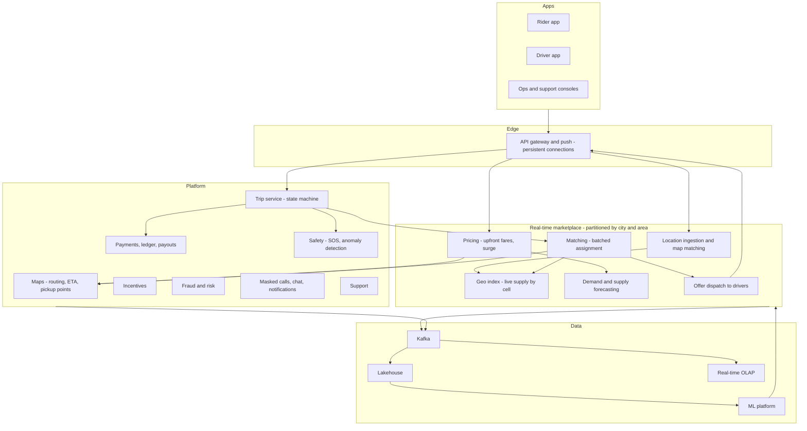
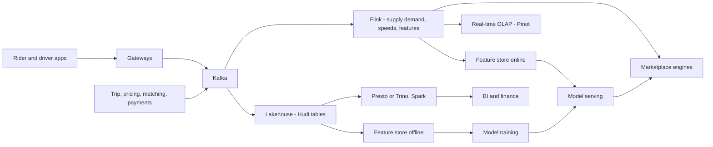

# I05. Ride-Hailing Platform

!!! abstract "Chapter at a glance"
    **Sector:** Mobility · **Format:** system design walkthrough (no code) · **Reader bands:** B1 → B4 · **Builds on:** [Ch 47](../05-case-studies/47-delivery-dispatch-and-live-tracking.md) (dispatch, geo indexes, GPS ingestion), [Ch 45](../05-case-studies/45-payment-system.md), [Ch 41](../05-case-studies/41-chat-customer-rider-messaging.md)

    **What you get:** the design of an Uber/Ola-style ride-hailing platform for Indian cities (cars, autos, bike taxis) and global markets. It covers:

    - **the rider's trip**, from opening the app to paying and rating, and the systems each step touches;
    - **the driver's day:** going online, positioning, accepting, navigating, earnings, incentives and payouts;
    - **the core engines:** geospatial indexing, supply–demand forecasting, **matching**, **ETA**, **upfront and dynamic pricing**, routing and map matching, ride sharing, airport queues;
    - **safety and trust:** identity, masked calls, trip sharing, SOS, route-deviation and crash detection, fraud (GPS spoofing, collusion);
    - **the algorithms** behind each engine;
    - **the data platform:** real-time streams, lakehouse, real-time OLAP, ML platform, experimentation;
    - **the tech stack**, with what Uber has published as open source or on its engineering blog kept separate from reference choices;
    - Indian specifics: cash, UPI, autos and bike taxis, aggregator guidelines.

    **Reading time:** 85 min.

!!! warning "Sources and honesty"
    - Uber has published a great deal about its systems: H3, Michelangelo, Cadence, Apache Hudi, Pinot usage, Schemaless/Docstore, Jaeger, M3, Ringpop, and many engineering blog posts. Those are marked as **publicly described (VERIFY)**.
    - Ola and others have published less.
    - Everything else is a **reference design**.
    - Regulatory statements (e.g. India's Motor Vehicle Aggregator Guidelines and their fare and surge provisions) are marked **VERIFY**. Check the current texts and state rules.

---

## 1. The System in One Page

### 1.1 What the platform must do

A ride-hailing platform is a **real-time two-sided market**. Every few seconds, in every neighbourhood, it must:

- **see** where riders want to go and where drivers are;
- **price** each trip so riders accept and drivers are willing;
- **match** riders to drivers so pickups are fast and the whole city stays efficient;
- **guide** both to the pickup and the destination;
- **settle** money correctly;
- **keep everyone safe.**

Mistakes are visible immediately: a 12-minute pickup, a surge that feels unfair, a driver sent across a flyover with no U-turn, an unpaid cash trip.

### 1.2 Main systems

| System | What it does |
|---|---|
| **Rider app / Driver app** | Booking, tracking, payment; driver shift, navigation, earnings |
| **Location ingestion** | Driver GPS every 1–4 s, map-matched to roads ([Ch 47](../05-case-studies/47-delivery-dispatch-and-live-tracking.md)) |
| **Geospatial index** | Which drivers are near a point, now |
| **Maps platform** | Road graph, routing, ETA, map matching, pickup points, geofences |
| **Marketplace: forecasting** | Demand and supply per area per few minutes ahead |
| **Marketplace: pricing** | Upfront fares, dynamic (surge) multipliers, promotions |
| **Marketplace: matching** | Assign drivers to requests (batched optimisation) |
| **Trip service** | The trip state machine, from request to completion |
| **Payments and ledger** | Rider charges, driver earnings, commissions, payouts, cash handling |
| **Incentives** | Driver quests, guarantees, heat maps |
| **Safety** | Identity checks, SOS, trip sharing, anomaly detection, incident response |
| **Risk and fraud** | GPS spoofing, collusion, payment fraud, promo abuse |
| **Communication** | Masked calls, in-app chat ([Ch 41](../05-case-studies/41-chat-customer-rider-messaging.md)), notifications |
| **Support** | Fare disputes, lost items, incidents |
| **Data platform** | Streams, lakehouse, real-time OLAP, ML platform, experiments |

### 1.3 Scale for this design (assumptions)

| Quantity | Value |
|---|---|
| Cities | 100 (India + international) |
| Trips per day | 5M; peak ~250 trips/s city-wide totals, ~2,000 requests/s including re-requests and fare checks |
| Drivers online at peak | 600k |
| Driver location updates | 600k drivers ÷ 4 s ≈ **150k updates/s** |
| Fare estimates ("where to?" typing) | ~20k/s at peak (many estimates per trip) |
| Trip events | ~20 state events per trip → 100M/day |

**Estimation highlights:**

- **Location updates dominate write volume.** They are ephemeral: keep the latest position in memory and the history in the lake.
- **Fare estimates dominate read computation.** Each needs a route, an ETA and a price.
- **Matching is CPU-bound per area,** not throughput-bound globally, so it is partitioned by geography.

---

## 2. Requirements

### 2.1 Functional

1. Riders set pickup and destination, see fare and ETA per product (auto, bike, mini, sedan, premium, shared), request, track, pay (cash, UPI, cards, wallet), rate and tip.
2. Drivers go online and offline, receive and accept or decline offers, navigate, start and end trips, collect cash or see digital payment, and see earnings, incentives and payouts.
3. Dynamic pricing within regulatory limits (VERIFY per jurisdiction); promotions and passes.
4. Scheduled rides, airport and railway-station queues, rentals (hourly), intercity.
5. Shared rides (pooling) where offered.
6. Safety features: verified identity, masked numbers, trip sharing, SOS, ride check-ins on anomalies.
7. Support for disputes, refunds, lost items, incidents.

### 2.2 Non-functional

| Attribute | Target |
|---|---|
| **Latency** | Fare estimate p95 < 300 ms; a match decision within a few seconds of the request; location to rider screen < 2 s |
| **Availability** | Request, match and trip ≥ 99.99% per city; a trip in progress must survive any single service failure |
| **Correctness** | A driver is never assigned two trips at once (unless pooled); every trip is billed exactly once; driver earnings are exact |
| **Fairness** | Transparent fares; no discrimination in matching; consistent surge rules |
| **Privacy** | Location data minimised and access-controlled; phone numbers masked |
| **Safety** | SOS reaches responders within seconds; incident data preserved |

---

## 3. High-Level Architecture

**Key architectural decisions:**

| Decision | Choice | Why |
|---|---|---|
| **Partitioning** | Marketplace services partitioned by **city, then geo cells**; cities are the unit of deployment and blast radius | Supply and demand are local, and failures stay local |
| **Location state** | In-memory, sharded by cell; latest position only; history to the stream | 150k writes/s of ephemeral data ([Ch 47](../05-case-studies/47-delivery-dispatch-and-live-tracking.md) L1–L2) |
| **Trip state** | Durable, strongly consistent per trip; a workflow engine for long-running steps | Money and safety depend on it |
| **Communication with apps** | Persistent connections (WebSocket/MQTT/gRPC streams) for offers and live updates; push notifications as fallback | Offers must arrive in < 1 s |
| **Geography model** | Hexagonal hierarchical cells (H3) | Uniform neighbours, multi-resolution aggregation (§5.1) |
| **Pricing and matching** | Separate engines sharing forecasts; ML-driven with guard rails | Different time scales and owners |

---

## 4. How It Works — Journeys End to End

### 4.1 Journey 1: a rider books a sedan in Bengaluru

1. **Open the app.** The app sends its location and receives nearby cars (for display, with coarse and jittered positions to protect driver privacy) and each product's ETA.
    - These come from the **geo index**: a count and nearest-driver query in the rider's cell and its neighbours.
2. **Choose the destination.** As the rider types, the **place search** service autocompletes: a places index with popularity and personalisation ([Ch 42](../05-case-studies/42-search-autocomplete.md)).
    - The **pickup point** is snapped to a safe, accessible spot: a gate or the correct side of the road, learned from past pickups.
3. **Fare estimate** per product:
    - **Route and ETA:** the maps service computes the route and **trip ETA**, a routing engine plus an ML correction for traffic (§6.3).
    - **Upfront fare:** pricing computes it from the base fare, per-km and per-minute components, estimated tolls and airport fees, and the **dynamic multiplier** for the pickup area and time (§6.4). It applies promotions and taxes.
    - **Fare quote:** the fare is shown with a **quote ID** valid for a few minutes. The quote is stored so the trip is billed at the quoted price, unless the route changes materially.
4. **Request.** The trip service creates a trip in state **REQUESTED**, holding the quote, rider, pickup, destination, product and payment method.
    - An idempotency key prevents duplicate trips from double taps ([Ch 20](../02-distributed-core/20-idempotency-ids-and-distributed-locks.md)).
    - For digital payment, a small **pre-authorisation** or payment method check may run (VERIFY per method).
5. **Matching.** The request joins the **matching batch** for its area. Every few seconds the matcher solves an assignment across all open requests and available drivers (§6.2), and chooses this rider's driver.
    - **Driver lock:** the chosen driver is **locked** with a conditional update (available → offered), so no other request can take them.
6. **Offer.** The offer goes to the driver's app over the persistent connection, showing pickup distance, rider rating and estimated earnings (VERIFY what regulations require drivers see).
    - The driver has ~10–15 s to accept.
    - **Decline or timeout:** the driver is released, and the request re-enters the next batch with a priority boost.
7. **Accepted.** The trip becomes **DRIVER_ASSIGNED**. The rider sees the driver's name, photo, vehicle and plate, and the live position.
    - The driver's app switches to **navigation to the pickup**.
    - Masked calling and chat are enabled between the two.
8. **Arriving.** Geofence detection marks **ARRIVED** when the driver is within ~50 m of the pickup.
    - A **waiting timer** starts: free waiting, then a per-minute charge, VERIFY local rules.
9. **Start.** The rider shares a **4-digit PIN/OTP**. The driver enters it, and the trip becomes **ON_TRIP**. This prevents wrong-rider pickups.
10. **During the trip:**
    - **Locations:** the driver's positions are map-matched and stream to the rider's app and trusted contacts (if shared).
    - **Safety monitoring:** watches for long unexpected stops, route deviation and possible crashes (§5.9).
    - **Destination change:** the rider can change the destination, which gets a new fare quote.
11. **End.** The driver ends the trip at the destination and the trip becomes **COMPLETED**. The **final fare** is computed:
    - the upfront fare if the route matched;
    - adjusted if there were stops, a destination change, significant detours, waiting or tolls (§5.6).
12. **Payment:**
    - **Digital:** charged via the payment method (UPI collect/autopay, card, wallet).
    - **Cash:** the driver's app shows the amount, and the driver confirms receipt. The **commission** owed by the driver is debited from their earnings balance.
    - **Ledger:** the rider's charge, the driver's earnings, commission, taxes and promotions are all posted (§5.7).
13. **Afterwards:**
    - **Rating:** both sides rate each other. Ratings feed quality systems (with bias controls), and tips go 100% to the driver.
    - **Receipt:** emailed and shown in the app. The trip data is final, and disputes open a support case referencing it.

### 4.2 Journey 2: a driver's day

1. **Going online:**
    - the driver passes periodic **selfie identity checks** (face match against the onboarded photo; VERIFY consent and regulations);
    - document validity is checked (licence, permit, insurance, fitness certificate);
    - the driver goes **ONLINE**.
2. **Positioning:**
    - the app shows a **demand heat map** (forecast demand vs supply) and active **incentives**, e.g. "complete 12 trips between 7–11 am for ₹300 extra";
    - drivers may move to busier areas.
3. **Offers:** offers arrive while online. The **acceptance rate** and **cancellation rate** are tracked. Excessive declines may reduce priority, a policy decision with fairness considerations.
4. **Destination mode:** the driver can set a home direction, and matching then prefers trips heading that way (limited uses per day).
5. **Earnings:**
    - each trip's earnings (fare minus commission, plus tips and incentives) appear in real time;
    - cash collected is netted against amounts owed to the platform;
    - the driver balance may go negative with heavy cash trips, in which case the driver must top up or earnings are deducted.
6. **Payouts** go to the driver's bank daily or weekly, with instant cash-out options (a payment rail such as IMPS/UPI; VERIFY) ([I03](i03-core-banking-and-upi.md)).
7. **Going offline:** fatigue rules may force breaks after N hours online (VERIFY local rules).

### 4.3 Journey 3: a surge at 6 pm in the rain

1. **The spike:** at 5:45 pm rain starts. Requests in the business district's cells jump 3× within minutes, while supply there stays flat, as drivers avoid rain or are stuck in traffic.
2. **Forecasting:**
    - the **real-time demand signal** (app opens, fare checks, requests, unfulfilled requests per cell per minute) and the supply signal (open drivers, drivers finishing trips nearby) feed the **forecaster**;
    - it predicts the next 15–30 minutes.
3. **Pricing** computes a multiplier per area that balances expected demand with available and attracted supply (§6.4). Within guard rails:
    - smoothing over time;
    - caps (including regulatory caps; VERIFY);
    - consistency between neighbouring areas;
    - no surges during declared emergencies (a policy decision; many platforms cap pricing in emergencies, VERIFY).
4. **Effects:**
    - some riders wait or choose cheaper products;
    - drivers see the surge on the heat map and move in;
    - **wait times recover**;
    - the multiplier decays as balance returns.
5. **Measurement:** request completion rate, pickup ETAs and rider cancellations are measured per area. **Experiments** test pricing policies by region-time units, not by user (§7.5).

### 4.4 Journey 4: airport pickup

1. **Arrival:** the airport is a **geofenced zone** with a **driver queue**. Drivers entering the holding area join a FIFO queue per product.
2. **Request:** a rider requests from the terminal. The pickup point is fixed (a designated bay), and the **first eligible driver in the queue** is offered the trip, not the nearest one.
3. **Fairness:** drivers who leave the zone lose their place. Short trips may give the driver a "return to queue" priority to avoid penalising them (a policy choice; VERIFY local airport rules and fees).
4. **Fees:** airport fees are added to the fare as regulated.

### 4.5 Journey 5: a shared ride

1. **Request:** a rider requests "shared" and gets a lower fare with a wider arrival window.
2. **Insertion:** the pooling engine tries to **insert** the pickup and drop-off into existing trips' routes, where the added detour for existing riders is within limits (e.g. + 8 min) and seats are available (§6.6).
3. **Update:** if inserted, the existing riders' ETAs update and the driver's route re-plans. If not, a new pooled trip starts with this rider as the first passenger.
4. **Fares** are fixed upfront per rider. A pool that doesn't materialise still charges the shared fare, which is the incentive for accepting uncertainty.

### 4.6 Journey 6: a safety incident

1. **Detection:** during a night trip, the car stops for 12 minutes at an unscheduled location away from the route.
    - The **safety monitor** detects a long stop plus a route deviation, and triggers a **ride check** push to rider and driver: "Is everything OK?"
2. **Escalation:** the rider presses **SOS**. The app:
    - calls the emergency number (112 in India; VERIFY integration requirements);
    - shares the live location and trip details with the platform's safety team and the rider's trusted contacts.
3. **Response:** the safety operations console shows a timeline of the trip (locations, events, driver history). Agents follow a playbook, and the event data is preserved (legal hold).
4. **After the trip:** an investigation, and account actions per policy. Data is shared with law enforcement only under lawful process (VERIFY).

---

## 5. Core Subsystems in Depth

### 5.1 Geospatial model — hexagonal cells

- **H3**, Uber's open-source hierarchical hexagonal grid (publicly described; VERIFY), divides the earth into hexagons at 16 resolutions:
    - at **resolution 9**, a hexagon is ~0.1 km² (edge ~170 m), good for local supply counts;
    - at **resolution 7** (~5 km²), good for pricing areas.
- **Why hexagons:** every neighbour is the same distance away (squares have diagonal neighbours at a different distance), so "k-ring" neighbourhoods approximate circles well. Aggregation up the hierarchy is cheap.
- **Uses:**
    - live supply per cell;
    - demand per cell;
    - pricing zones (groups of cells);
    - heat maps;
    - geofences (airports, restricted areas, as sets of cells plus exact polygons);
    - analytics.

### 5.2 Location ingestion and the live supply index

- **Ingestion:** driver apps send GPS every 1–4 s (adaptive by speed and trip state) over the persistent connection to **location gateways**. Gateways validate the points, filtering impossible jumps and spoofing indicators (§5.10).
- **Map matching** (§6.5) snaps points to road segments, which gives heading and road position for ETA.
- **The live index** is sharded by city and cell, in memory:
    - *cell → drivers (id, status, product, position, heading, last seen)*, updated on each ping;
    - drivers moving between cells are moved between buckets;
    - drivers not seen for N seconds are marked stale and excluded from matching.
- **Replication:** replicas per shard give failover. A process restart rebuilds from the next pings in seconds, because the state is ephemeral by design.
- **History:** every ping goes to Kafka, then the lake (for ETA training, safety investigations and disputes), with retention and access limits.

Details and measured trade-offs of geo indexes and ingestion are in [Ch 47](../05-case-studies/47-delivery-dispatch-and-live-tracking.md) L1–L2.

### 5.3 Maps platform

- **Road graph:** road segments with attributes (one-way, turn restrictions, speed classes, U-turn permissions), from licensed or open map data (OpenStreetMap plus a commercial provider) and **corrected by driver trace mining** (new roads, closures, wrong turn restrictions).
- **Routing:** shortest-time paths. At city scale, **contraction hierarchies** or similar precomputation make queries milliseconds, instead of Dijkstra over millions of nodes (§6.3).
- **Traffic:** live segment speeds are computed from driver traces, a stream aggregation of speeds per segment per minute, and blended with historical profiles by time of day.
- **ETA service:** route time from the graph, then an **ML correction model**. Uber has published work on deep-learning ETA post-processing (VERIFY "DeepETA").
- **Pickup points:** clustering historical pickup locations per place to suggest the best pickup spots.

### 5.4 Forecasting

- **What is predicted:** demand (requests) and supply (drivers available) per cell group for the next 5–60 minutes.
- **Features:** recent history, time of day and week, weather, events (concerts, cricket matches), holidays, airport flight arrivals and train arrivals.
- **Models:** gradient-boosted trees or neural sequence models, with separate short-horizon and longer-horizon models.
- **Consumers:** pricing (§6.4), incentives design, heat maps, and **matching look-ahead**, which avoids sending the last driver out of an area about to be busy.

### 5.5 Matching and dispatch

- **Why batch?** Assigning each request immediately to its nearest driver is greedy and makes the city worse.
    - Example: a driver 2 minutes from rider A and 3 minutes from rider B gets A. B then waits 9 minutes for the next driver, when giving the driver to B and another driver to A would have made both waits 4 minutes.
- **The batch:** every 2–5 seconds per area, the matcher collects open requests and available drivers (including those about to finish trips nearby) and solves a **minimum-cost bipartite matching** (§6.2).
- **The cost:** pickup ETA (from maps), plus penalties such as heading, driver's destination mode, product compatibility, driver fairness and rider priority after previous declines.
- **Constraints:** product (auto vs sedan), accessibility, EV range, airport queue rules, driver preferences.
- **After solving**, dispatch sends offers. Acceptance and timeouts feed back into the next batch.
- **Consistency:**
    - driver state transitions (available → offered → assigned) are **compare-and-set** operations on the driver's state, so two matchers can never assign one driver twice;
    - matchers are partitioned by area, with cross-boundary drivers handled by the area owning the request (with neighbour reads).

### 5.6 Pricing: upfront fares and final fares

- **The upfront fare** is quoted before the request:

    > base + per-km × route distance + per-min × route time + fees + tolls, × dynamic multiplier, − promotions, + taxes

    It is rounded per the rules. The quote is stored with its inputs.
- **The final fare** equals the quote, unless:
    - the destination changed (re-quote);
    - stops were added;
    - waiting exceeded the free period;
    - tolls differed;
    - the actual route diverged significantly *because of the rider*.

    A **reconciliation job** compares the actual trip with the quote, and support rules auto-resolve common disputes.
- **Regulatory limits:** in India, the aggregator guidelines set rules on fare structure and on surge relative to base fares, and states may notify their own fares (VERIFY the current guidelines and state rules). The pricing engine enforces **per-jurisdiction caps** as hard constraints.
- **Promotions:** rider discounts, passes and subscriptions. Driver-side incentives are separate (§5.8).

### 5.7 Payments, ledger and payouts

- **Rider payments:**
    - UPI (collect, intent or autopay mandates), cards (tokenised), wallets, corporate accounts, **cash**;
    - payment happens after the trip, with retries and fallback to a secondary method;
    - **unpaid balances** block the next request until settled ([Ch 45](../05-case-studies/45-payment-system.md)).
- **The ledger:** double-entry accounts for rider payable, driver earnings, platform commission, taxes, promotions and tips.
    - **Cash trips:** the platform's commission becomes a receivable from the driver.
    - **Digital trips:** the driver's share becomes a payable to the driver.
- **Payouts:** scheduled or instant transfers to drivers' bank accounts, with daily reconciliation against bank statements ([I03](i03-core-banking-and-upi.md)).
- **Tax:** GST on the platform's services and TDS/TCS obligations for drivers' earnings as applicable (VERIFY).

### 5.8 Incentives

- **Types:**
    - quests (N trips in a window → bonus);
    - area boosts (extra per trip in a zone and time);
    - guarantees (minimum hourly earnings when online in a zone).
- **Design:** incentives are budgeted by the forecast supply gap, with targeting by driver segment. Uplift is measured by experiments against a control group.
- **Accounting:** incentive payouts are ledger entries with the same rigour as fares.

### 5.9 Safety platform

- **Onboarding checks:** identity and document verification, background verification where required (VERIFY rules), vehicle checks.
- **In-trip features:** a PIN to start, masked calls, share trip, SOS, and **ride check** on anomalies.
- **Anomaly detection:**
    - **long unexpected stops**;
    - **route deviation** (distance from the planned route beyond a threshold for a sustained time);
    - **possible crash** (sudden deceleration from phone sensors followed by a stop);
    - unexpected trip end far from the destination.

    Each has thresholds tuned to limit false alarms.
- **Safety operations:** a 24×7 team with prioritised queues and trip replay tools. Evidence is preserved.
- **Women-safety and night features** in some markets (VERIFY features by market).

### 5.10 Fraud and risk

| Fraud | Signal | Response |
|---|---|---|
| **GPS spoofing** (fake location apps, emulators) | Mock-location flags, impossible speeds, inconsistent sensors, cell tower vs GPS mismatch | Block trips, suspend accounts |
| **Collusion** (driver and "rider" fake trips for incentives) | Repeated pairs, short trips with no real movement, shared devices/payment | Withhold incentives, ban |
| **Payment fraud** | Stolen cards, chargebacks, unpaid cash balances | Risk scoring at request, payment method checks |
| **Promo abuse** | Many new accounts on one device or payment | Device fingerprinting, graph analysis |
| **Fare inflation by drivers** | Detours, waiting manipulation | Route vs plan checks, auto refunds |

---

## 6. Algorithms

### 6.1 Nearest-driver search

- **k-ring search on H3:** look up the rider's cell, then rings 1, 2, 3… until enough candidates are found. Compute exact straight-line distance, then **route ETA** for the top candidates only, because ETA is expensive.
- **Alternatives:** geohash prefix search, quadtrees, R-trees; compared in [Ch 47](../05-case-studies/47-delivery-dispatch-and-live-tracking.md) L1.

### 6.2 Batched matching

- **Model:** a bipartite graph of requests × drivers, with edges where the pickup ETA is under a maximum and constraints are satisfied. The edge cost is ETA plus penalties.
- **Solving:**
    - **the Hungarian algorithm** (O(n³)) for small batches;
    - for larger batches, **min-cost flow** or auction algorithms, or greedy with local improvements when time-bounded.

    Batches are per area, so n stays small (tens to hundreds).
- **Batch window trade-off:** longer windows give better global matches but add waiting. 2–5 s is typical, tuned per city by experiment.
- **Look-ahead:** include drivers finishing trips within ~2 min near the request. Their "availability time" is added to the ETA.
- **Fairness terms:** spread offers among waiting drivers (idle time bonus) to avoid starving some.

### 6.3 Routing and ETA

- **Shortest paths:** Dijkstra and A* are the basis.
    - **Contraction hierarchies** add shortcut edges in preprocessing so queries explore only "upward" nodes. That is millisecond queries on city graphs.
    - Customisable variants (CCH/CRP) allow traffic weight updates without full re-preprocessing.
- **Traffic weights:** per-segment speed estimates from recent traces (streaming aggregation), blended with the historical time-of-day profile.
- **ETA correction:** a model predicts the residual between routing-engine ETA and actual time. Features: route, time, weather, pickup/drop-off type, city. It is trained on completed trips.

### 6.4 Dynamic pricing

- **The goal** is to keep the market in balance: requests fulfilled with reasonable pickup times.
- **A simple, explainable version:**
    - per pricing zone, compute *imbalance = forecast demand / available supply* over the next minutes;
    - map imbalance to a multiplier through a monotonic curve with caps;
    - **smooth** it over time (exponential smoothing or rate limits) and space (neighbour averaging), to avoid flicker and zone-boundary gaming.
- **More advanced versions:**
    - estimate **demand elasticity** (how many riders still request at each price) and **supply elasticity** (how many drivers move or stay online);
    - choose prices to maximise completed trips or a welfare objective, subject to caps and fairness constraints.
- **Guard rails:** regulatory caps (VERIFY), emergency overrides, consistency between quote and charge, and audit logs of every multiplier.
- **Evaluation:**
    - **switchback experiments** (alternate policies over time slots per city) avoid interference between treatment and control riders, who share the same drivers;
    - metrics: completion rate, wait time, cancellations, earnings per hour.

### 6.5 Map matching

- **The problem:** raw GPS points are noisy (±10–30 m in cities, worse near tall buildings). The trip must be placed on the actual road sequence.
- **Hidden Markov model:**
    - **hidden states:** candidate road segments near each point;
    - **emission probability:** Gaussian on the distance from point to segment;
    - **transition probability:** how plausible the move between segments is, comparing route distance with straight-line distance;
    - **solving:** the **Viterbi** algorithm finds the most likely segment sequence.
- **Outputs:** accurate distance for fares, road positions for ETA and traffic, and detection of detours.

### 6.6 Pooling insertion

- **Insertion:** for a new shared request, for each candidate trip, try inserting the pickup at position i and the drop-off at position j > i in the stop sequence. Check that:
    - capacity is respected;
    - every existing rider's detour is within limits;
    - time windows are met.

    Choose the insertion with the smallest added cost. This is **insertion heuristics** for the dial-a-ride problem, with local search to improve sequences.
- **Pruning:** only trips whose route passes near the new pickup, found by a geo index on route corridors.

### 6.7 Supply positioning and incentives

- **Heat maps** show forecast demand minus supply per cell.
- **Incentive targeting:** allocate budget to zones and times with the largest forecast gaps and the highest expected response. Uplift is modelled from experiments.
- **Repositioning suggestions:** each idle driver gets a short list of nearby cells with the best expected earnings per hour. Suggestions are **randomised** across drivers, so everyone doesn't converge on the same cell.

### 6.8 Fraud detection

- **GPS spoofing:** rules on physics (speed, acceleration), consistency (GPS vs network location, sensor data), and device integrity attestations.
- **Collusion:** a graph of rider–driver pairs, devices and payment instruments; clusters with unusual repeated interactions and incentive-heavy patterns. Community detection (e.g. connected components, Louvain) plus supervised models.

### 6.9 ETA and fare quality monitoring

- **Accuracy tracking:** ETA error distributions per city and hour; fare quote vs final fare differences.
- **Alerting:** alerts when error drifts, which may indicate map data issues, traffic feed failures or model drift.

---

## 7. Data Architecture

### 7.1 Operational stores

| Data | Store (reference) | Notes |
|---|---|---|
| Live driver locations and status | In-memory sharded service (Redis Cluster or custom) | Ephemeral; rebuilt from pings |
| Trips | Sharded relational (MySQL/PostgreSQL, Vitess/Citus) or a distributed SQL database | Per-trip strong consistency; sharded by city or trip id |
| Riders, drivers, vehicles, documents | Relational + object storage for documents | PII encrypted |
| Ledger | Relational with double-entry constraints | [Ch 45](../05-case-studies/45-payment-system.md), [I03](i03-core-banking-and-upi.md) |
| Fare quotes | Key-value with TTL | Quote IDs referenced by trips |
| Maps and routing data | In-memory routing engine instances; object storage for map versions | Versioned map releases |
| Places search | OpenSearch | Autocomplete, POIs |

Publicly described (VERIFY): Uber built **Schemaless**, a MySQL-backed append-only store, and later **Docstore**, and used **Cassandra** for some workloads. Its **Ringpop** library provided consistent hashing for sharded services.

### 7.2 Streaming

- **Kafka** carries driver locations, app events, trip state changes, pricing decisions, match decisions, payments and safety events.
    - Uber has described running one of the largest Kafka deployments (VERIFY).
- **Stream processing:**
    - **Apache Flink** computes per-cell supply and demand, segment speeds, surge inputs, fraud features and real-time dashboards;
    - Uber has described Flink-based platforms for real-time features (VERIFY).

### 7.3 Lakehouse

- **Storage:**
    - all streams and CDC land in a lakehouse on distributed storage (HDFS or object storage);
    - **Apache Hudi**, created at Uber for incremental upserts on the lake (publicly described; VERIFY), handles **late updates** such as trip corrections and fare adjustments;
    - Iceberg or Delta are alternatives.
- **Processing and query:** Spark for batch; **Presto/Trino** for interactive SQL (Uber has described large Presto deployments; VERIFY).
- **Models:**
    - **facts:** trips, requests (including unfulfilled), offers (accepted/declined/timeout), price quotes, payments, incentives, safety incidents, location aggregates;
    - **dimensions:** city, zone and cell (H3), driver, rider (pseudonymised), vehicle, product, time.
- **Governance:** location data is highly sensitive. Access is restricted by purpose, precise traces are retained only as long as needed, and aggregates are used for most analysis.

### 7.4 Real-time OLAP

- **Apache Pinot**, which Uber has described using heavily for real-time analytics (VERIFY), or ClickHouse or Druid, powers:
    - city operations dashboards (requests, completion, ETAs per zone per minute);
    - surge monitoring;
    - driver earnings views;
    - restaurant or merchant dashboards in adjacent businesses.
- **Why:** a sub-second query over fresh data (seconds old) that the batch warehouse cannot provide.

### 7.5 ML platform and experimentation

- **ML platform:** Uber's publicly described **Michelangelo** covers feature management, training, deployment and monitoring (VERIFY).
    - **Reference:** a feature store (offline in the lake, online in a low-latency store), training on Spark or GPUs, model registry, online serving with shadow and canary deployment, drift monitoring.
- **Models:** ETA correction, demand and supply forecasts, pricing elasticity, fraud, safety anomaly scoring, destination prediction, pickup point suggestion, support ticket routing.
- **Experimentation:**
    - A/B tests randomised by user for UI changes;
    - **switchback** and **geo-randomised** designs for marketplace changes (pricing, matching, incentives), because riders and drivers interact;
    - a central platform computes metrics with variance reduction.

### 7.6 Data flow

---

## 8. Tech Stack

| Layer | Publicly described by Uber (VERIFY each) | Reference choice |
|---|---|---|
| Services | Go and Java microservices (thousands of services) | Go or Java/Kotlin (Spring Boot), gRPC |
| Service discovery and sharding | Ringpop (consistent hashing, historical) | Kubernetes services, consistent hashing libraries |
| Workflows | **Cadence** (open source; Temporal is a fork) | Temporal |
| Storage | Schemaless / Docstore on MySQL; Cassandra; Redis | MySQL/PostgreSQL sharded (Vitess), Redis, Cassandra |
| Streaming | Kafka; Flink | Kafka; Flink |
| Lakehouse | **Apache Hudi** on HDFS/object storage; Spark; Presto | Hudi/Iceberg on object storage; Spark; Trino |
| Real-time OLAP | **Apache Pinot** | Pinot or ClickHouse |
| ML | **Michelangelo** | Feature store (Feast), MLflow, Ray/Spark, KServe |
| Geospatial | **H3** | H3 (open source) |
| Tracing and metrics | **Jaeger** (created at Uber), **M3** (metrics) | OpenTelemetry + Jaeger/Tempo, Prometheus/M3/Mimir |
| Maps | Internal maps stack plus providers | OSRM/Valhalla/GraphHopper (open source routing) + commercial map data |
| Mobile | Native iOS/Android; RIBs architecture (open source) | Native Kotlin/Swift |
| Communication | Persistent connections; push | WebSockets/gRPC streams, FCM/APNs, a CPaaS for masked calls |

---

## 9. Security, Privacy, Safety & Compliance

- **Location privacy:**
    - precise traces are restricted to purposes (trip, safety, disputes);
    - access is logged;
    - retention is limited, with aggregates for analytics;
    - riders see drivers' approximate positions before the trip and exact positions only during their trip.
- **Personal data:** masked phone numbers (a CPaaS proxy), minimal data shared between rider and driver, DPDP Act obligations in India (VERIFY) and GDPR where applicable.
- **Aggregator regulation (India):** licensing, driver verification, vehicle fitness, fare and surge rules, grievance redressal, safety features and data localisation provisions in the Motor Vehicle Aggregator Guidelines and state rules (VERIFY current texts; state rules vary).
- **Payments:** PCI scope reduction by tokenisation; RBI rules for card storage and payment aggregators (VERIFY).
- **Safety data:** incident data preserved and access-controlled; lawful process for law enforcement requests.

---

## 10. Reliability & Operations

- **City isolation:** each city's marketplace runs in its own partitions, so a bad deploy or a runaway surge bug affects one city. Deploys roll out city by city (cells; [Ch 34](../04-architect/34-modern-architecture-styles.md)).
- **Trips in progress must survive:**
    - the trip service is strongly consistent and replicated;
    - apps cache the trip state and continue navigation offline;
    - fare computation can happen after reconnection from buffered GPS.
- **Degradation order:**
    1. Heat maps and non-critical features go first.
    2. Then pooling, falling back to single rides.
    3. Then **dynamic pricing falls back to a fixed multiplier**.
    4. Matching falls back to greedy nearest-driver if the optimiser is slow.
- **Multi-region:** active-active across regions for stateless services; the trip store is replicated with failover; driver and rider connections reconnect to the healthy region.
- **Observability:** per-city dashboards of request → match → pickup → complete funnel, ETA error, match latency, offer acceptance, payment success, and SOS response times.
- **Peak events** (New Year's Eve, cricket finals, festivals): forecasts feed pre-scaling and incentive plans, and operations teams are on standby.

---

## 11. Key Trade-offs

| Decision | Chosen | Accepted cost |
|---|---|---|
| Matching | Batched optimisation (2–5 s windows) | A few seconds of extra waiting per request |
| Geography | H3 hexagons | Learning curve; exact polygons still needed for legal boundaries |
| Location state | In-memory, ephemeral | Brief rebuild after failover |
| Pricing | Upfront fares with reconciliation | Risk of quote vs actual mismatch; needs dispute rules |
| Surge | Smoothed, capped, experiment-tested | Slower reaction to sudden spikes |
| Trip store | Strong consistency per trip | Higher write latency than eventual stores |
| Experiments | Switchbacks for the marketplace | Longer experiments, more complex analysis |

---

## 12. Interview Q&A

### Beginner B1

??? question "Q1 [B1] ⭐ Walk me through what happens when a rider requests a ride."

    **30-second answer:** Fare estimate (route, ETA, price with multiplier) → request creates a trip with the quote → matching assigns a driver in the next batch, locking the driver → offer to driver → accept → navigation to pickup, arrival, PIN to start → live tracking → end and final fare → payment, ledger, ratings.

    **Deep answer:** §4.1.

    **Trade-offs I'd call out:** Batching delay vs better matches.

    **Follow-ups:**
    1. Driver declines? → Back into next batch with priority.
    2. Double tap? → Idempotency key.

    **Red flags:** "Send the request to the nearest driver."

??? question "Q2 [B1] How do you find drivers near a rider?"

    **30-second answer:** Keep live driver positions in an in-memory geo index sharded by cell (e.g. H3 hexagons); search the rider's cell and neighbouring rings, then compute route ETAs for the closest candidates only.

    **Deep answer:** §5.1, §5.2, §6.1; [Ch 47](../05-case-studies/47-delivery-dispatch-and-live-tracking.md).

    **Trade-offs I'd call out:** Cell size vs search cost.

    **Follow-ups:**
    1. Stale drivers? → Last-seen cutoff.
    2. Why hexagons? → Uniform neighbours.

    **Red flags:** SQL distance query over all drivers.

??? question "Q3 [B1] How does the app show the car moving on the map?"

    **30-second answer:** The driver app sends GPS every few seconds; the server map-matches it to roads and pushes it to the rider over a persistent connection; the rider app animates between points.

    **Deep answer:** §5.2, §6.5.

    **Trade-offs I'd call out:** Update frequency vs battery and data.

    **Follow-ups:**
    1. Tunnel? → Dead reckoning.
    2. Privacy before trip? → Approximate positions.

    **Red flags:** Polling every second from the rider app.

??? question "Q4 [B1] Why does the driver ask for a PIN at the start?"

    **30-second answer:** To confirm the right rider got into the right car — preventing wrong pickups and some fraud — and to mark the trip start reliably.

    **Deep answer:** §4.1 step 9, §5.9.

    **Trade-offs I'd call out:** Small friction vs safety.

    **Follow-ups:**
    1. Rider can't show? → Support flow.
    2. Other checks? → Photo, plate.

    **Red flags:** No start verification.

### Intermediate B2

??? question "Q5 [B2] ⭐ How would you design surge pricing?"

    **30-second answer:** Forecast demand and supply per zone for the next minutes, map the imbalance to a multiplier with a monotonic curve, smooth over time and space, apply caps (including regulatory ones) and emergency overrides, show it in the upfront fare, and evaluate with switchback experiments.

    **Deep answer:** §4.3, §6.4.

    **Trade-offs I'd call out:** Responsiveness vs flicker and fairness.

    **Follow-ups:**
    1. Zone boundary gaming? → Spatial smoothing.
    2. Why switchbacks? → Shared supply interference.

    **Red flags:** Unbounded multipliers.

??? question "Q6 [B2] How are upfront fares calculated and kept honest?"

    **30-second answer:** From route distance and time, fees, tolls, multiplier, promotions and taxes; stored as a quote with inputs; the final fare equals the quote unless the rider changed the trip (destination, stops, waiting) — reconciliation compares actual vs quote and auto-resolves disputes.

    **Deep answer:** §5.6.

    **Trade-offs I'd call out:** Platform bears route risk.

    **Follow-ups:**
    1. Driver detour? → Rider charged the quote.
    2. Quote expiry? → Minutes.

    **Red flags:** Metered fare with no quote.

??? question "Q7 [B2] How do you prevent a driver from being assigned two trips?"

    **30-second answer:** Driver state is changed only with compare-and-set (available → offered → assigned) in a strongly consistent store; matchers are partitioned by area; offers time out and release the driver explicitly.

    **Deep answer:** §5.5.

    **Trade-offs I'd call out:** Extra round trip vs correctness.

    **Follow-ups:**
    1. Matcher crash? → Offer timeout releases.
    2. Pooling? → Seat capacity instead of boolean.

    **Red flags:** Reading status then writing.

??? question "Q8 [B2] How do cash trips work in the ledger?"

    **30-second answer:** The rider pays the driver; the driver confirms; the platform's commission becomes a receivable from the driver, netted against digital earnings or collected via top-up; everything posts as double-entry.

    **Deep answer:** §5.7.

    **Trade-offs I'd call out:** Collection risk.

    **Follow-ups:**
    1. Negative balance? → Limits, blocking.
    2. Tips? → Separate lines.

    **Red flags:** Commission tracked in a spreadsheet.

??? question "Q9 [B2] How do airport queues differ from normal matching?"

    **30-second answer:** The airport is a geofenced zone with a FIFO driver queue per product; requests from the terminal go to the first eligible driver in the queue, not the nearest; leaving the zone forfeits the place; short trips may get queue priority on return.

    **Deep answer:** §4.4.

    **Trade-offs I'd call out:** Fairness vs efficiency.

    **Follow-ups:**
    1. Queue gaming? → GPS checks.
    2. Fees? → Added per rules.

    **Red flags:** Nearest-driver at airports.

### Senior B3

??? question "Q10 [B3] ⭐ Why batch matching instead of nearest driver, and how does it work?"

    **30-second answer:** Greedy nearest-driver is locally optimal but globally poor; batching requests and drivers every few seconds and solving a min-cost bipartite matching (Hungarian or min-cost flow) on ETA plus penalties lowers average pickup times; include drivers finishing trips nearby; tune the window per city.

    **Deep answer:** §5.5, §6.2.

    **Trade-offs I'd call out:** Batch wait vs match quality.

    **Follow-ups:**
    1. Batch size? → Per area, small n.
    2. Fairness? → Idle time terms.

    **Red flags:** Global single matcher.

??? question "Q11 [B3] ⭐ How do you compute accurate ETAs?"

    **30-second answer:** A road graph with turn restrictions, live segment speeds from driver traces blended with historical profiles, fast shortest paths (contraction hierarchies), and an ML model that corrects the routing ETA using features like time, weather and pickup type — monitored for error drift.

    **Deep answer:** §5.3, §6.3.

    **Trade-offs I'd call out:** Model complexity vs latency.

    **Follow-ups:**
    1. Map errors? → Trace mining.
    2. Latency budget? → Milliseconds per route.

    **Red flags:** Straight-line distance / average speed.

??? question "Q12 [B3] How does map matching work?"

    **30-second answer:** A hidden Markov model: candidate road segments near each GPS point are states, emission probabilities come from distance to segment, transition probabilities from route vs straight-line distance, and Viterbi finds the most likely road sequence.

    **Deep answer:** §6.5.

    **Trade-offs I'd call out:** Accuracy vs compute per point.

    **Follow-ups:**
    1. Uses? → Fares, ETA, traffic, detours.
    2. Sparse points? → Larger transitions.

    **Red flags:** Snapping each point independently.

??? question "Q13 [B3] How would you implement shared rides?"

    **30-second answer:** For a new request, find candidate trips whose routes pass near the pickup, try insertion positions for pickup and drop-off, check capacity, detour limits and time windows, and choose the cheapest insertion; fix each rider's fare upfront; re-plan the driver's route.

    **Deep answer:** §4.5, §6.6.

    **Trade-offs I'd call out:** Efficiency vs rider experience.

    **Follow-ups:**
    1. Detour limit? → Per rider.
    2. Pool fails? → Still shared fare.

    **Red flags:** Re-optimising all trips from scratch each time.

??? question "Q14 [B3] How do you detect GPS spoofing and collusion?"

    **30-second answer:** Spoofing via physics checks (speed, jumps), mock-location and device integrity signals, GPS vs network location consistency; collusion via graphs of rider–driver pairs, devices and payments with community detection plus supervised models; act on incentives and accounts.

    **Deep answer:** §5.10, §6.8.

    **Trade-offs I'd call out:** False positives hit honest drivers.

    **Follow-ups:**
    1. Appeals? → Human review.
    2. Real-time? → Streaming features.

    **Red flags:** Trusting client GPS blindly.

### Architect B4

??? question "Q15 [B4] ⭐ Design the data platform for a ride-hailing company."

    **30-second answer:** Kafka for all events; Flink for real-time features and aggregates feeding marketplace engines and a real-time OLAP store (Pinot) for ops dashboards; a Hudi/Iceberg lakehouse for trips, offers, quotes and payments with late updates; Presto/Trino and Spark for analysis; a feature store and ML platform; strict governance for location data.

    **Deep answer:** §7.

    **Trade-offs I'd call out:** Real-time complexity vs freshness.

    **Follow-ups:**
    1. Why Hudi? → Upserts for late corrections.
    2. Location retention? → Purpose-limited.

    **Red flags:** Dashboards from the trips database.

??? question "Q16 [B4] How do you experiment on pricing or matching fairly?"

    **30-second answer:** Riders and drivers share one market, so user-level A/B tests interfere; use switchback designs (alternate policies across time slots per city) or geo-randomisation, with enough slots, pre-registered metrics (completion, wait, cancellations, driver earnings) and variance reduction.

    **Deep answer:** §6.4, §7.5.

    **Trade-offs I'd call out:** Longer experiments.

    **Follow-ups:**
    1. Carryover effects? → Buffer periods.
    2. Guard rails? → Caps.

    **Red flags:** 50/50 user split for surge.

??? question "Q17 [B4] How would you make a city's marketplace resilient to failures?"

    **30-second answer:** Partition by city with independent deployments, strongly consistent replicated trip store, apps that continue trips offline, graceful fallbacks (fixed multiplier, greedy matching, no pooling), multi-region failover for connections, and per-city funnel monitoring.

    **Deep answer:** §10.

    **Trade-offs I'd call out:** Duplication per city.

    **Follow-ups:**
    1. Matching optimiser down? → Greedy fallback.
    2. Payments down? → Complete trips, charge later.

    **Red flags:** One global marketplace service.

??? question "Q18 [B4] How do regulations shape a ride-hailing platform in India?"

    **30-second answer:** Aggregator licensing and guidelines set rules on driver verification, vehicle fitness, fare structure and surge limits, safety features, grievance handling and data localisation, with state-level variations — so pricing caps, onboarding checks and data residency must be configurable per jurisdiction (VERIFY current texts).

    **Deep answer:** §5.6, §9.

    **Trade-offs I'd call out:** Configuration complexity.

    **Follow-ups:**
    1. Surge cap enforcement? → Hard constraint in pricing.
    2. Audits? → Logs of multipliers.

    **Red flags:** One global pricing policy.

??? question "Q19 [B4] How would you design driver incentives without wasting budget?"

    **30-second answer:** Target incentives to forecast supply gaps by zone and time, segment drivers by expected response, measure uplift against control groups, cap budgets, randomise repositioning suggestions to avoid herding, and account for incentives in the ledger.

    **Deep answer:** §5.8, §6.7.

    **Trade-offs I'd call out:** Short-term supply vs cost.

    **Follow-ups:**
    1. Collusion? → Fraud checks.
    2. Measuring? → Uplift experiments.

    **Red flags:** Blanket bonuses.

??? question "Q20 [B4] Compare ride-hailing dispatch with food or grocery delivery dispatch."

    **30-second answer:** Both match moving couriers to jobs with ETAs; rides have a single pickup-drop-off with the customer present and price elasticity at request time, while delivery adds preparation time uncertainty, batching multiple orders per courier and store-side waits — so delivery dispatch optimises over longer horizons with batching (Ch 47).

    **Deep answer:** [Ch 47](../05-case-studies/47-delivery-dispatch-and-live-tracking.md) vs this chapter.

    **Trade-offs I'd call out:** Batching benefits vs promise times.

    **Follow-ups:**
    1. Shared components? → Geo, maps, location.
    2. Different? → Pricing and pooling.

    **Red flags:** Treating them as identical.

---

## 13. Summary

1. **Ride-hailing is a real-time, local market:** partitioned by city and hexagonal cell, with ephemeral in-memory location state and durable trip state.
2. **Matching is batched optimisation, not nearest-driver.** Pricing balances the market with smoothed, capped multipliers tested by switchbacks.
3. **Maps are the hidden core:** road graphs, fast routing, live traffic from driver traces, ML-corrected ETAs, HMM map matching.
4. **Money and safety need strong guarantees:** idempotent trips, a double-entry ledger with cash receivables, SOS and anomaly detection, fraud graphs.
5. **The data platform:** Kafka → Flink → real-time OLAP for operations; lakehouse (Hudi) → SQL and ML for everything else; strict location privacy.

### Related chapters

- [Ch 47 — Delivery Dispatch & Live Tracking](../05-case-studies/47-delivery-dispatch-and-live-tracking.md) · [Ch 45 — Payments](../05-case-studies/45-payment-system.md) · [Ch 41 — Chat](../05-case-studies/41-chat-customer-rider-messaging.md) · [Ch 21 — Data at Scale](../03-production/21-data-at-scale.md) · [I03 — Core Banking & UPI](i03-core-banking-and-upi.md)
- Next in this tab: [I06 — Video Streaming & Live Cricket](i06-video-streaming-and-live-cricket.md)
