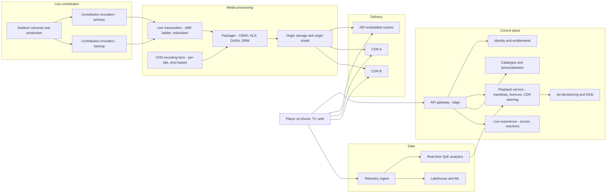
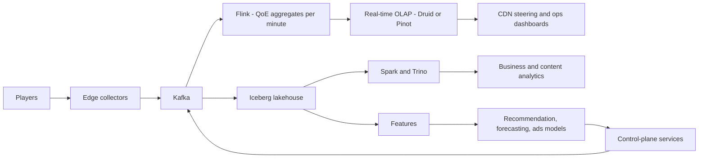

# I06. Video Streaming & Live Cricket

!!! abstract "Chapter at a glance"
    **Sector:** Media and entertainment · **Format:** system design walkthrough (no code) · **Reader bands:** B1 → B4 · **Builds on:** [Ch 52](../05-case-studies/52-object-storage-and-media-pipeline.md) (object storage, CDN), [Ch 25](../03-production/25-performance-engineering.md), [Ch 43](../05-case-studies/43-home-feed-and-recommendations.md), [Ch 51](../05-case-studies/51-real-time-analytics-and-top-k.md)

    **What you get:** the design of a streaming platform that does two very different things:

    - **video on demand (VOD)**: films and series, Netflix-style;
    - **live sport at extreme concurrency**: a cricket final watched by tens of millions of people at the same moment, Hotstar/JioCinema-style.

    It covers:

    - **the VOD pipeline:** ingest, per-title encoding, quality measurement, packaging, DRM, CDN placement, playback, adaptive bitrate;
    - **the live pipeline:** camera to phone in seconds, redundant encoders, low-latency packaging, multi-CDN, ads inserted into the stream, and the "everyone joins at the toss" problem;
    - **the product around the video:** catalogue, personalisation (including artwork), search, subscriptions and entitlements, ads, downloads, reactions and live scores;
    - **the algorithms:** bitrate ladders, VMAF, ABR, CDN steering and cache fill, recommendations, concurrency forecasting, ad decisioning;
    - **the data platform:** playback telemetry at millions of events per second, real-time quality-of-experience dashboards, the lakehouse, experimentation;
    - **the tech stack:** what Netflix and Hotstar have published, and a reference choice.

    **Reading time:** 85 min.

!!! warning "Sources and honesty"
    - Netflix has published extensively about Open Connect, per-title and shot-based encoding, VMAF, Zuul, Eureka, Hystrix, EVCache, Chaos Monkey, Spinnaker, Keystone, Maestro and Apache Iceberg. These are marked **publicly described (VERIFY)**.
    - Disney+ Hotstar engineers have given public talks about scaling for IPL concurrency. Concurrency records quoted in the press vary by source and year (**VERIFY**).
    - Everything else is a **reference design**.
    - Broadcasting and content regulations are marked **VERIFY**.

---

## 1. The System in One Page

### 1.1 Two products on one platform

| | VOD (films, series) | Live (cricket match) |
|---|---|---|
| **Content** | Known in advance, watched over months | Created now, watched now |
| **Encoding** | Hours of compute per title is fine; optimise quality per bit | Must keep up with real time; seconds of delay budget |
| **Traffic shape** | Smooth daily curve, evening peak | A cliff: millions join within minutes at the toss, spikes at wickets and the last over |
| **CDN strategy** | Pre-position popular titles in caches overnight | Every viewer wants the same few seconds of video at once; the origin must be shielded |
| **Failure impact** | One title or region degraded | Everyone, during the most valuable minutes of the year |

### 1.2 Main systems

| System | What it does |
|---|---|
| **Content ingest** | Receives masters (mezzanine files) and live feeds |
| **Encoding and transcoding** | Produces renditions at many resolutions and bitrates |
| **Packaging and DRM** | HLS/DASH manifests, CMAF segments, encryption, licences |
| **Origin and CDN** | Stores and delivers segments close to viewers |
| **Playback service** | Decides what a device may play and where to fetch it; issues manifests, licence tokens, CDN choice |
| **Player (client)** | Downloads segments, adapts bitrate (ABR), reports telemetry |
| **Catalogue and metadata** | Titles, episodes, rights windows, languages, artwork |
| **Personalisation and search** | Home rows, recommendations, artwork, search |
| **Identity, subscriptions, entitlements** | Accounts, profiles, plans, payments, device limits |
| **Ads** | Ad decisioning and server-side ad insertion |
| **Live experience** | Scores, key moments, reactions, multi-language commentary feeds |
| **Telemetry and QoE** | Start time, rebuffering, bitrate, errors, per viewer, in real time |
| **Data platform** | Lakehouse, warehouse, ML, experimentation |

### 1.3 Scale for this design (assumptions)

| Quantity | Value |
|---|---|
| Subscribers / monthly active users | 60M / 150M (with a free tier) |
| VOD catalogue | 100k titles, ~1M hours after episodes |
| VOD peak concurrent streams | 8M |
| **Live final peak concurrency** | **40M+ concurrent viewers** (records reported for Indian cricket streams have been in the tens of millions; VERIFY current records) |
| Average live bitrate delivered | ~1.5 Mbps (mostly mobile) |

**Estimation — why live cricket is extreme:**

- **Egress:** 40M × 1.5 Mbps ≈ **60 Tbps** of delivery at the peak. That only works with multiple CDNs and ISP-embedded caches.
- **Segment requests:** with 4-second segments, each viewer requests a new video segment every 4 s, plus audio and manifest refreshes. That is roughly **20–30M HTTP requests per second** at the CDN edges.
- **Origin load:** the origin must see only a tiny fraction of that. Shielding and request coalescing are mandatory (§5.6).
- **Telemetry:** 40M players sending a heartbeat every 30 s is **~1.3M events/s**, more with per-segment events.
- **Joins:** if 20M people join within 10 minutes of the toss, that is ~33k joins/s. Each join means login/token checks, entitlement, playback session creation and a manifest. **The API tier, not the video, is usually what breaks first.**

---

## 2. Requirements

### 2.1 Functional

1. Browse, search and get recommendations; watch VOD with resume across devices; download for offline viewing (within licence rules).
2. Watch live matches with multiple feeds: languages, camera angles, commentary; with DVR (pause, rewind within a window) and "go live".
3. Subscriptions and free tiers with ads; plans by device count and quality; payments including UPI autopay mandates (VERIFY mandate rules).
4. Profiles, parental controls, content ratings.
5. Ads: pre-roll for VOD on ad tiers; ad breaks in live matches (between overs), targeted per viewer.
6. Live companion features: scorecard, key moments, reactions, polls.
7. Rights enforcement: territories, windows, device types, concurrent streams.

### 2.2 Non-functional

| Attribute | Target |
|---|---|
| **Start time** | Video starts in < 2 s (p50) and < 5 s (p95) on mobile networks |
| **Rebuffering** | Rebuffer ratio < 0.5% of watch time |
| **Live latency** | Glass-to-glass 10–30 s standard, 3–8 s low-latency mode (TV broadcast is also delayed) |
| **Availability** | Live playback ≥ 99.99% during matches; no single point of failure from camera to CDN |
| **Scale** | Absorb 40M concurrent viewers and joins of tens of thousands per second |
| **Security** | DRM for premium content; token-authenticated URLs; forensic watermarking for high-value live |
| **Efficiency** | Minimise bits per quality (encoding) and origin egress (caching) |

---

## 3. High-Level Architecture

**Two planes:**

- **The data plane** (video bytes: encoders → packager → origin → CDN → player) must be simple, redundant and cacheable.
- **The control plane** (who can watch what, from where, at what quality, with which ads) is where most application logic lives. At join time it must scale like an e-commerce flash sale ([Ch 46](../05-case-studies/46-grocery-checkout-and-inventory-reservation.md)).

---

## 4. How It Works — Journeys End to End

### 4.1 Journey 1: a new series goes from master file to playable

1. **Ingest:** the studio delivers a **mezzanine master**: very high bitrate video, multichannel audio, subtitle files and artwork.
    - Automated checks: format, corrupt frames, audio sync, loudness, subtitle timing. Failures return to the studio.
2. **Analysis:** the video is split into **shots**, using scene-change detection. Complexity is measured per shot, because a dark, static dialogue scene needs far fewer bits than a stadium crowd.
3. **Encoding:**
    - each shot is encoded at many **resolution × bitrate (or quality) points**, in parallel on a large compute farm;
    - the **per-title or shot-based optimisation** picks the most efficient combinations (§6.1);
    - multiple codecs are produced for different devices: H.264 for compatibility, HEVC/VP9/AV1 for efficiency on supporting devices.

    Netflix has described per-title encoding (2015) and shot-based dynamic optimisation (2018) publicly (VERIFY).
4. **Quality measurement:** every encode is scored with **VMAF**, a perceptual quality metric Netflix open-sourced (VERIFY), so the ladder is chosen by perceived quality, not bitrate alone.
5. **Packaging:**
    - encodes are cut into segments of a few seconds each, in **CMAF** (fragmented MP4);
    - **HLS** and **DASH** manifests list the renditions;
    - audio tracks per language, and subtitles as separate tracks.
6. **DRM:** segments are encrypted (common encryption) with content keys stored in a key management service. Licences are issued at playback by the right DRM system per device: Widevine (Android, Chrome), FairPlay (Apple), PlayReady (Windows, TVs).
7. **Publishing:**
    - packaged files go to the **origin** (object storage);
    - the catalogue record goes live when the rights window opens, per territory;
    - artwork variants are generated for personalisation (§6.6).
8. **Pre-positioning:**
    - popularity is predicted per region;
    - popular titles are **filled into ISP-embedded caches overnight**, during off-peak hours, so peak-time viewing rarely touches the backbone;
    - Netflix's **Open Connect** appliances in ISP networks are the public example (VERIFY).

### 4.2 Journey 2: pressing Play on VOD

1. **Request:** the app calls the **playback service** with the title, device capabilities (codecs, DRM, resolution, HDR) and network hints.
2. **Checks:**
    - **entitlement:** is the subscription active, and does the plan allow this quality and the number of concurrent streams?
    - **rights:** is the title available in this territory now?
    - **device limits.**
3. **The playback service returns:**
    - a **manifest**, tailored to the device: only playable codecs and resolutions, possibly personalised to start at a sensible bitrate;
    - **CDN URLs:** the best cache for this client, chosen by **steering** (§6.4). The URLs are token-authenticated and expire;
    - a **licence request token** for DRM.
4. **Licence:** the player requests a DRM licence from the licence service, which checks the token and policy (offline allowed? HDCP required for 4K?).
5. **Buffering:** the player fetches the first segments at a conservative bitrate, starts playback once a small buffer is built, then **adapts** bitrate (§6.3).
6. **Resume:** the playback position is saved every few seconds, so another device resumes from the same point.
7. **Telemetry:** start time, bitrate switches, rebuffer events, errors and CDN used are sent to the telemetry pipeline (§7).

### 4.3 Journey 3: a cricket final, from the stadium to 40 million phones

1. **Production:** the broadcaster's production (tens of cameras, graphics, commentary) outputs **program feeds**: a world feed plus language commentary feeds, and sometimes extra camera angles.
2. **Contribution:**
    - feeds are encoded at high quality and sent over **two independent paths** (fibre and satellite, or two ISPs) to two cloud regions;
    - reliable streaming protocols (SRT, RIST, or dedicated links) survive packet loss.

    The **1+1 redundancy** starts here.
3. **Live transcoding:** in each region, live transcoders produce the **ABR ladder**, e.g. 240p at 200 kbps up to 1080p at 6 Mbps, plus audio per language.
    - Encoding runs with a latency budget of a second or two.
    - Transcoders run in **pairs**, time-aligned, so the packager can switch between them without a visible glitch.
4. **Packaging:** the live packager produces **CMAF segments** (e.g. 4 s, or 2 s with partial segments for low latency), updates manifests every segment, encrypts with DRM if required, and writes to the **origin**.
    - A **DVR window** (e.g. the whole match) stays available for rewind.
5. **Origin shield and CDNs:**
    - CDNs fetch from an **origin shield layer**, a tier of caches in front of the origin, not from the origin directly;
    - every segment is requested from the origin **once per shield node**. Millions of viewer requests collapse into a handful of origin fetches through **request coalescing** (§5.6);
    - **multiple CDNs** and ISP-embedded caches share the load.
6. **Joining:** millions of viewers open the app before the toss. The join path is:
    - home page (cached, mostly static);
    - match page;
    - **playback session**: entitlement, device check, ad profile, CDN assignment;
    - manifest;
    - segments.

    The control plane is **pre-scaled** for the expected join rate. Non-essential calls are deferred (§5.7).
7. **Watching:** the player fetches segments and adapts bitrate. On congested mobile networks it may settle at 360p–480p. Telemetry flows every few seconds.
8. **Ad breaks between overs:**
    - the production signals an ad break with **SCTE-35 markers** in the stream;
    - the **server-side ad insertion (SSAI)** service asks ad decisioning which ads to show each viewer or viewer segment, then splices ad segments into the manifest;
    - viewers see personalised ads seamlessly, and ad blockers can't easily strip them (§5.8).
9. **Spikes:** at a wicket, social media sends a wave of new joins. At the last over, concurrency peaks.
    - **Real-time QoE dashboards** watch rebuffer ratio per CDN, ISP and region.
    - **Steering** shifts new sessions away from a struggling CDN within a minute.
10. **After the match:** viewers leave within minutes. Highlights (auto-clipped key moments, §5.9) are published as VOD within minutes. Capacity is scaled down.

### 4.4 Journey 4: subscribing with UPI autopay

1. **Plan choice:** the user picks a plan (mobile-only, super, premium).
2. **Mandate:** the payment service creates a **recurring mandate** (UPI AutoPay or card e-mandate), subject to RBI rules on recurring payments and pre-debit notifications (VERIFY).
3. **Entitlement:** on success, the **entitlements service** grants the plan's rights: device count, max resolution, ad-free or not, live sports access. The rights are cached at the edge for playback checks.
4. **Renewals** run on a schedule, with pre-debit notifications as required. **Failed renewals** get retries and a grace period before downgrade, so dunning never cuts a viewer off mid-match (a policy choice).
5. **Password sharing:** concurrent stream limits are enforced per account by a **session counter**. Sharing detection uses devices and locations (VERIFY policies per market).

### 4.5 Journey 5: downloading an episode for a train journey

1. **Request:** the user downloads an episode at a chosen quality. The licence service issues an **offline licence** with an expiry, and download count limits per the content licence.
2. **Download:** the device downloads encrypted segments for one rendition. Playback works offline until the licence expires. The licence renews when the device is online.

---

## 5. Core Subsystems in Depth

### 5.1 The VOD encoding pipeline

- **A workflow of many small tasks:**
    - split into chunks or shots;
    - encode each chunk × each ladder point × each codec, in parallel on thousands of machines (spot capacity is fine, because a lost task just retries);
    - measure quality;
    - assemble;
    - package.

    It is orchestrated by a workflow engine with retries and idempotent tasks ([Ch 50](../05-case-studies/50-distributed-job-scheduler.md)). Netflix has described its media pipeline platform publicly (VERIFY).
- **Economics:** AV1 or HEVC encoding costs far more compute than H.264, but saves bandwidth on every view. So it pays for **popular titles** first, and the codec set per title depends on predicted views.
- **Re-encoding:** when better encoders arrive, the back catalogue is re-encoded in priority order of expected bandwidth savings.

### 5.2 Packaging, manifests and DRM

- **CMAF** lets HLS and DASH share the same media segments, which halves storage and cache footprint.
- **Manifests are generated per request** (or per device class) from templates, so they can:
    - filter renditions by device;
    - add CDN tokens;
    - insert ads (SSAI).

    Manifest generation must be very fast and cacheable per class.
- **DRM:**
    - one set of encrypted segments (CENC; CBCS mode covers all modern DRMs);
    - licence servers per DRM system;
    - keys in an HSM-backed key service;
    - **key rotation** for live;
    - licence policies (HDCP, offline, security level) enforce studio and sports-rights requirements.

### 5.3 Playback service

- **One decision point** for "may this viewer watch this now, how, and from where". It combines:
    - entitlements and rights (territory, window);
    - device capabilities;
    - concurrent-stream counts;
    - experiment assignments (e.g. a new ABR);
    - **CDN steering** (§6.4).
- **It is the most critical control-plane service during live events.** Precompute and cache what can be cached, e.g. rights per title per territory, and keep the per-request work to token signing and steering.

### 5.4 CDN strategy

| Option | Role |
|---|---|
| **ISP-embedded caches** (own appliances inside ISPs) | Serve most VOD peak traffic locally; filled off-peak; cheapest per GB at scale |
| **Commercial CDNs** (several) | Burst capacity for live, geographic coverage, redundancy |
| **Origin shield** | Collapses cache misses from many edges into few origin fetches |
| **Steering service** | Chooses a CDN per session (and can switch mid-session) based on real-time QoE and cost |

- **VOD:** the cache holds a popular subset. Fill is planned: which titles and renditions go to which cache, overnight, from popularity forecasts.
- **Live:**
    - every edge needs the *same* newest segment at the *same* time;
    - edges must coalesce concurrent misses into one upstream request;
    - manifests have short TTLs (≈ the segment duration);
    - segments have long TTLs once published.

### 5.5 The player and ABR

- **The player's control loop:**
    - estimate bandwidth;
    - track buffer level;
    - choose the next segment's rendition;
    - handle errors: retry on another CDN URL, skip a bad segment.
- **The ABR algorithm** (§6.3) balances three goals: high quality, no rebuffering, and few switches.
- **Live players** also manage **latency**: they target a buffer that keeps them close to the live edge, speeding playback slightly (e.g. 1.05×) to catch up after stalls.
- **Telemetry:** the player reports every session's key events, which feeds QoE analytics and steering.

### 5.6 Handling live concurrency — the data plane

- **Segment request coalescing:** when 100k viewers on one edge ask for segment #1832 at the same second, the edge sends **one** request upstream and serves all waiters from the result. The shield does the same towards the origin ([Ch 07](../01-foundations/07-caching.md) stampede protection).
- **Manifest caching:** live manifests change every segment. Cache them for about half a segment duration at the edge, so manifest requests don't all hit the origin.
- **Capacity reservation:**
    - CDN capacity is reserved per match, per region, weeks in advance, from concurrency forecasts;
    - ISP caches are pre-warmed;
    - peering links are checked.
- **Bitrate capping under stress:** if total demand approaches delivery capacity, the steering service caps the **maximum bitrate** for new sessions or for mobile. A little less quality for everyone beats rebuffering for many.

### 5.7 Handling live concurrency — the control plane

Public talks from Hotstar engineers on IPL-scale traffic describe these patterns (VERIFY):

- **Pre-scaling,** not reactive autoscaling. Capacity is scaled ahead of the toss from concurrency forecasts, because autoscaling can't add capacity fast enough for the join spike.
- **Degradation switches ("panic mode"):** under extreme load, turn off non-essential features, such as:
    - personalised recommendations (serve a static popular row);
    - watch history writes (batch them later);
    - some API calls (serve cached responses).

    This protects the join and playback path.
- **Static, cacheable responses** for the match page and home page during the event, served from the CDN.
- **Authentication:** token validation at the edge without calling the identity service per request; long-lived tokens refreshed lazily.
- **Retry discipline in clients:** exponential backoff with jitter, and server-provided retry-after. A synchronised retry storm from 30M apps can take down anything ([Ch 18](../02-distributed-core/18-resilience-patterns.md)).
- **Load testing** at the expected peak with realistic join curves before the season, and game days.

### 5.8 Ads: server-side insertion

- **Signals:** SCTE-35 markers in the live stream mark ad break start and duration.
- **SSAI flow:**
    1. When a viewer's manifest reaches a break, the SSAI service calls **ad decisioning** with the viewer's profile (segment, location, device, frequency caps).
    2. It receives ads (standard VAST responses).
    3. It **stitches ad segments** into that viewer's manifest.
    4. Ads are pre-transcoded to match the content ladder, so switching is seamless.
- **Scale trick:**
    - personalising every manifest for 40M viewers at the same break is expensive;
    - so viewers are grouped into **cohorts** (hundreds to thousands of cohorts), each with a personalised ad pod;
    - manifests are then cached per cohort.
- **Ad decisioning:**
    - campaigns with targeting, budgets and pacing;
    - **frequency caps** (the same ad not more than N times per match);
    - competitive separation (no two competing brands back-to-back);
    - an auction for programmatic demand.
- **Measurement:** impression beacons from the player, or server-side beacons, reconciled for billing. Viewability and completion rates.

### 5.9 Live experience features

- **Scorecard and ball-by-ball data** come from a sports data provider or official scoring feed.
    - A **low-latency pub/sub** fan-out pushes updates to apps over persistent connections, or apps poll a CDN-cached JSON with a short TTL.
    - The cached approach scales trivially to tens of millions.
- **Key moments:** wickets, sixes and milestones from the scoring feed trigger **auto-clipping** (cut the live DVR around the moment, package it as a clip) for highlights and notifications.
- **Reactions and polls:**
    - millions of emoji taps per second;
    - aggregate them at the edge or ingestion tier into counts per second per emoji;
    - broadcast only aggregated counts back;
    - never store every tap individually for real-time display (§6.8).
- **Multi-language commentary** as separate audio tracks or separate streams, with language chosen at the start and switchable.

### 5.10 Catalogue, personalisation and search

- **Catalogue:** titles, seasons and episodes, cast, genres, languages, maturity ratings, and **rights windows per territory and platform**. Its change events feed search indexes and the playback service's rights cache.
- **Home page:** rows ("Continue watching", "Because you watched…", "Top 10 in India today", "Live now") chosen and ordered per profile.
    - **Row selection and ranking** are learned (§6.6).
    - **Artwork per title is personalised:** the same film shown with a different image to different viewers. Netflix has written about this (VERIFY).
- **Search:** titles, people and genres, with multilingual and transliterated queries ([Ch 22](../03-production/22-search-systems.md), [Ch 42](../05-case-studies/42-search-autocomplete.md)), and "not available" handling for titles outside the catalogue.

### 5.11 Content protection and piracy

- **DRM** for encryption and licence policies.
- **Token-authenticated URLs** with short expiry and binding to session/IP ranges where feasible.
- **Forensic watermarking** for live sport: invisible per-session marks let the platform identify the leaking account of a pirated restream.
    - It is implemented by A/B segment variants: each viewer's manifest selects a unique sequence of variant segments.
- **Monitoring** of piracy sites, and takedown workflows.

---

## 6. Algorithms

### 6.1 Encoding ladder optimisation

- **The problem:** choose the set of (resolution, bitrate) renditions that give the best quality for each bandwidth level, per title or per shot.
- **Method:**
    1. Encode sample points across resolutions and bitrates. Measure quality (VMAF) vs bitrate for each resolution.
    2. The **convex hull** of the quality–bitrate points across all resolutions gives the most efficient choices.
    3. Pick ladder rungs along the hull at target bitrate or quality steps.

    Easy content (animation) reaches high quality at low bitrate. Complex content (sport, grain) needs more.
- **Shot-based optimisation:** choose encoding parameters per shot along the hull to minimise total bits for a target quality, or to maximise quality for a bit budget (a Lagrangian-style trade-off across shots).

### 6.2 Perceptual quality (VMAF)

- **Why not PSNR/SSIM:** they correlate poorly with what viewers perceive.
- **VMAF** fuses several elementary metrics (visual information fidelity, detail loss, motion) with a machine-learned model trained on human ratings, producing a 0–100 score.
- **Uses:** ladder selection, encoder comparisons, and regression tests for encoder changes.

### 6.3 Adaptive bitrate (ABR)

| Family | Idea | Weakness |
|---|---|---|
| **Throughput-based** | Pick the highest bitrate below the estimated bandwidth × safety factor | Noisy estimates on mobile; oscillation |
| **Buffer-based (BBA)** | Map buffer level to bitrate: low buffer → low bitrate, high buffer → high | Slow start; ignores throughput info |
| **BOLA** | Lyapunov optimisation on buffer, maximising a utility of quality minus rebuffer risk | Tuning for live latency |
| **Model predictive (MPC)** | Predict throughput over the next few segments, choose the plan maximising quality − rebuffer penalty − switch penalty | More compute; depends on predictions |
| **Learned (RL-based)** | Train a policy on network traces | Generalisation, explainability |

**Practice:** a hybrid, with throughput estimates for the start and buffer-based control in steady state. It is tuned per device class and network type through A/B tests, measuring start time, rebuffer ratio, average bitrate and switches.

### 6.4 CDN steering and request routing

- **Mechanisms:**
    - **DNS-based** routing (coarse);
    - **HTTP redirect / manifest URL choice** by the playback service (per session);
    - **client-side switching** on errors.
- **Decision:** for each (ISP, region, device) group, maintain real-time QoE per CDN (rebuffer ratio, start time, error rate, throughput) from telemetry. Assign new sessions to the best CDN subject to:
    - capacity commitments;
    - cost (committed volumes per CDN);
    - exploration: send a small share to each CDN to keep measurements fresh, **a multi-armed bandit** approach.
- **Reaction time:** QoE is aggregated per minute, and bad CDNs are drained from new sessions within a minute or two.

### 6.5 Cache fill and eviction

- **VOD fill:** predict per-title, per-region popularity for the next day (time series + release calendars). Solve a knapsack-like selection of title renditions to maximise the expected bytes served from cache, subject to cache capacity.
- **Eviction:** LRU is often worse than popularity-aware policies for video. Use frequency-aware policies (e.g. LFU with aging, or admission filters such as TinyLFU) so one-off views don't evict popular content.
- **Live:** tiny working sets (the latest segments); correctness of TTLs and coalescing matters more than eviction policy.

### 6.6 Recommendations and artwork

- **Candidate generation:** collaborative filtering (matrix factorisation of viewing), content similarity (genre, cast, language embeddings), trending, continue watching.
- **Ranking:** gradient-boosted or neural models predicting the probability that a profile plays and **keeps watching** (not just clicks). Features: history, time, device, language.
- **Page construction:** choose rows and order them with diversity constraints. Row-level and page-level models.
- **Artwork personalisation:** a **contextual bandit**. For each title, choose among artwork variants using the profile context. Explore occasionally and learn from plays (VERIFY Netflix's published approach).
- **Evaluation:** offline metrics plus online A/B tests on retention and hours streamed.

### 6.7 Concurrency forecasting for live events

- **Inputs:** teams playing, stage of tournament, time slot, day of week, match closeness, star players, competing events, historical curves for similar matches.
- **Output:** peak concurrency and **join-rate curves** (joins per second around toss, innings break, last overs), with confidence intervals.
- **Uses:** CDN reservation, control-plane pre-scaling, ad inventory estimates, operations staffing.
- **In-match updating:** the forecast is re-estimated during the match as real concurrency arrives, e.g. a close finish raises the expected peak.

### 6.8 Real-time aggregation at scale (reactions, telemetry)

- **Reactions:** clients batch taps (e.g. send once per second with counts), and ingestion nodes aggregate per emoji per second locally. A second tier sums across nodes, and results are broadcast. Counts can be approximate, but the aggregation must never create hot keys ([Ch 51](../05-case-studies/51-real-time-analytics-and-top-k.md)).
- **Telemetry QoE:** streaming aggregations per (CDN, ISP, region, device) per minute, using approximate distinct counts (HyperLogLog) for viewers and percentile sketches (t-digest/DDSketch) for start times.

### 6.9 Ad decisioning and pacing

- **Selection:** eligible campaigns filtered by targeting and frequency caps, ranked by price × predicted completion or relevance, with competitive separation.
- **Pacing:** throttle each campaign so its budget is spent evenly across the match. A PID-style controller adjusts participation probability ([Ch 49](../05-case-studies/49-pricing-promotions-and-coupons.md) L3).
- **Forecasting:** inventory (impressions per break) estimated from the concurrency forecast, to sell guaranteed campaigns.

### 6.10 Anomaly detection

- **QoE anomalies:** rebuffer spikes per ISP or CDN, detected by seasonal baselines and control charts.
- **Fraud:** credential stuffing, account sharing beyond plan rules, ad fraud (invalid traffic).

---

## 7. Data Architecture

### 7.1 Operational stores

| Data | Store (reference) | Notes |
|---|---|---|
| Accounts, profiles, subscriptions | Relational (PostgreSQL/MySQL, sharded) | Transactions for billing |
| Entitlements (read path) | Key-value cache (Redis/EVCache) replicated to edges | Read-heavy, latency-critical |
| Viewing history, resume points | Wide-column (Cassandra) | High write volume, per-profile partitions |
| Catalogue and metadata | Document store + search index | Versioned; events to downstream |
| Live session counters | Sharded in-memory counters | Concurrent stream limits, concurrency metrics |
| Media assets | Object storage (origin), CDN caches | Petabytes |
| Keys | HSM-backed key service | DRM content keys |

Publicly described (VERIFY): Netflix uses **Cassandra** widely, and **EVCache** (memcached-based) for caching.

### 7.2 Telemetry and streaming

- **Players** send session start, heartbeats, bitrate switches, rebuffers, errors, CDN used and ad beacons. Events are batched on the device and compressed.
- **Ingestion:** edge collectors → **Kafka** → **Flink** for real-time aggregates. Netflix has described its **Keystone** real-time pipeline (VERIFY).
- **Real-time stores:** **Druid, Pinot or ClickHouse** hold per-minute QoE dimensions for dashboards and steering decisions.

### 7.3 Lakehouse and warehouse

- **Storage:** all events and CDC land in **Apache Iceberg** tables on object storage. Iceberg was created at Netflix (publicly described; VERIFY).
- **Processing and query:** Spark for batch, Trino/Presto for SQL, and a workflow orchestrator. Netflix open-sourced **Maestro** (VERIFY); Airflow is the reference.
- **Models:**
    - **facts:** playback sessions (start time, watch duration, bitrate, rebuffer), viewing (title, profile, completion), subscriptions and payments, ad impressions, live concurrency per minute;
    - **dimensions:** title/episode, profile (pseudonymised), device, ISP, region, CDN, plan, date.
- **Key metrics:**
    - hours streamed, and retention cohorts;
    - QoE: start time, rebuffer ratio, bitrate;
    - peak concurrency;
    - ad fill rate and completion;
    - churn prediction inputs;
    - content performance (completion rates, value per title).

### 7.4 ML platform and experimentation

- **Feature pipelines** in the lake; online features for ranking in a low-latency store.
- **Models:** recommendations, artwork, search ranking, ABR tuning, concurrency forecasts, CDN steering, churn, ad targeting, fraud.
- **Experimentation:**
    - A/B testing across UI, recommendations, ABR and encoding;
    - Netflix has written extensively about its experimentation platform (VERIFY);
    - live events need care, because treatment and control share CDNs and match dynamics.

### 7.5 Data flow

---

## 8. Tech Stack

| Layer | Publicly described (VERIFY each) | Reference choice |
|---|---|---|
| Edge gateway | Netflix **Zuul** | Envoy, Kong or Spring Cloud Gateway |
| Service discovery / resilience | Netflix **Eureka**, **Hystrix** (now in maintenance; Resilience4j recommended) | Kubernetes services, Resilience4j |
| Services | Java (Spring Boot at Netflix), Go | Java/Kotlin or Go microservices |
| Caching | **EVCache** | Redis/memcached |
| Databases | **Cassandra**, MySQL/CockroachDB for some | Cassandra/ScyllaDB, PostgreSQL |
| Streaming | Kafka (**Keystone**), Flink | Kafka, Flink |
| Lakehouse | **Apache Iceberg**, Spark, Trino/Presto | Iceberg, Spark, Trino |
| Orchestration | **Maestro**; previously Meson | Airflow, Temporal for media workflows |
| Deployment | **Spinnaker** | Argo CD / Spinnaker |
| Chaos | **Chaos Monkey** / Simian Army | Chaos Mesh, Litmus, game days |
| CDN | **Open Connect** (own appliances) | Multi-CDN + ISP cache partnerships |
| Encoding | FFmpeg-based pipelines; **VMAF** | FFmpeg, x264/x265/SVT-AV1, VMAF |
| Packaging and DRM | — | Shaka Packager / Bento4; Widevine, FairPlay, PlayReady via a multi-DRM provider |
| Live contribution | — | SRT/RIST, redundant cloud live encoders (e.g. AWS Elemental MediaLive or open-source) |
| Real-time OLAP | Druid (Netflix has described use) | Druid, Pinot, ClickHouse |
| Players | ExoPlayer/Media3 on Android, AVPlayer on iOS, Shaka/hls.js on web | Same |

**Disney+ Hotstar** has spoken publicly about Kubernetes-based scaling, custom autoscaling ahead of events, and load testing at extreme concurrency (VERIFY details).

---

## 9. Security, Rights & Compliance

- **Rights:** territorial and time windows per title and platform, enforced in the playback service. Sports rights may differ for TV and digital.
- **DRM and watermarking:** as §5.11. Studio and league security requirements are contractual.
- **Privacy:**
    - viewing history is personal data;
    - profiles for children have restrictions;
    - ad targeting needs consent and choice where required;
    - DPDP Act obligations in India (VERIFY).
- **Content regulation:** age ratings and content codes for online curated content (India's IT Rules 2021 digital media ethics code; VERIFY current status). Broadcasting rules for live sport may apply (VERIFY).
- **Payments:** recurring payment rules (RBI e-mandate framework, VERIFY), tokenised cards.

---

## 10. Reliability & Operations

- **Live data plane redundancy:**
    - two contribution paths, two cloud regions, paired encoders, redundant packagers;
    - multiple CDNs;
    - automatic failover at each hop, rehearsed before the season.
- **Control plane:** multi-region active-active for stateless services. Netflix has described running active-active across regions and evacuating regions (VERIFY). Entitlements are cached at the edge, so an identity outage doesn't stop playback for already-authenticated viewers.
- **Chaos engineering:**
    - kill instances and dependencies in production in controlled ways;
    - regional evacuation drills;
    - game days before big matches.
- **Event runbook:**
    1. Pre-scale at T−2 h.
    2. Freeze changes.
    3. A war room with QoE dashboards per CDN/ISP.
    4. Degradation switches ready.
    5. Decision owners for bitrate caps and CDN shifts.
    6. Communication templates.
- **Graceful degradation order:** recommendations → watch-history writes → reactions → high bitrates. Never the join path or segment delivery.
- **Observability:** per-minute QoE, join success rate and latency, playback errors by code, CDN health, ad decisioning latency, licence server errors.

---

## 11. Key Trade-offs

| Decision | Chosen | Accepted cost |
|---|---|---|
| Encoding | Per-title/shot-based, multiple codecs for popular titles | Much more compute per title |
| Packaging | CMAF shared by HLS and DASH | Older devices need fallbacks |
| Delivery | ISP caches for VOD + multi-CDN for live | Operating appliances; multi-vendor complexity |
| Live latency | 10–30 s default, low-latency mode optional | Not as live as broadcast for some users |
| Ads in live | SSAI with cohort personalisation | Less precise targeting than per-viewer |
| Control plane | Pre-scaled, static fallbacks, degradation switches | Idle capacity cost before matches |
| Reactions | Approximate aggregated counts | Not exact |

---

## 12. Interview Q&A

### Beginner B1

??? question "Q1 [B1] ⭐ What happens between pressing Play and seeing video?"

    **30-second answer:** The app asks the playback service, which checks entitlement, rights and device; returns a device-specific manifest, signed CDN URLs and a DRM licence token; the player gets a licence, downloads the first segments at a safe bitrate, starts playback, and adapts bitrate while sending telemetry.

    **Deep answer:** §4.2.

    **Trade-offs I'd call out:** Start time vs initial quality.

    **Follow-ups:**
    1. Why segments? → Adaptation and caching.
    2. Why DRM? → Content licences.

    **Red flags:** Streaming one big file.

??? question "Q2 [B1] What is adaptive bitrate streaming?"

    **30-second answer:** Video is encoded at several quality levels and cut into short segments; the player picks each segment's quality based on measured bandwidth and buffer, so it can switch down instead of stalling.

    **Deep answer:** §5.5, §6.3.

    **Trade-offs I'd call out:** Quality vs rebuffer risk vs switching.

    **Follow-ups:**
    1. Segment length? → 2–6 s.
    2. Manifest? → Lists renditions.

    **Red flags:** Fixed quality per user.

??? question "Q3 [B1] Why do streaming services use CDNs?"

    **30-second answer:** Video is huge; serving it from one place would overload the origin and add latency; CDNs cache segments near viewers, and ISP-embedded caches keep traffic inside the viewer's network.

    **Deep answer:** §5.4.

    **Trade-offs I'd call out:** Cost vs control.

    **Follow-ups:**
    1. Multi-CDN? → Resilience and capacity.
    2. Cache misses? → Origin shield.

    **Red flags:** Serving video from application servers.

??? question "Q4 [B1] How do live streams differ from VOD technically?"

    **30-second answer:** Live is encoded and packaged in real time with a seconds-level delay budget, manifests change every segment, everyone watches the same moment (so caching must coalesce requests), and traffic arrives in sudden spikes rather than a smooth curve.

    **Deep answer:** §1.1, §4.3.

    **Trade-offs I'd call out:** Latency vs stability.

    **Follow-ups:**
    1. Redundancy? → 1+1 pipelines.
    2. DVR? → Window on origin.

    **Red flags:** Same pipeline assumptions.

### Intermediate B2

??? question "Q5 [B2] ⭐ How do you build the encoding ladder for a title?"

    **30-second answer:** Encode sample points across resolutions and bitrates, score them with a perceptual metric like VMAF, take the convex hull of quality vs bitrate, and pick rungs along it — per title or per shot, so simple content uses fewer bits.

    **Deep answer:** §6.1, §6.2.

    **Trade-offs I'd call out:** Compute cost vs bandwidth saved.

    **Follow-ups:**
    1. Codecs? → Popular titles get more.
    2. Re-encode? → By expected savings.

    **Red flags:** One fixed ladder for all content.

??? question "Q6 [B2] How do you protect premium content from piracy?"

    **30-second answer:** DRM encryption with device-appropriate licence servers and policies, short-lived token-authenticated URLs, forensic watermarking per session for live sport, and monitoring with takedowns.

    **Deep answer:** §5.2, §5.11.

    **Trade-offs I'd call out:** Device compatibility and cost.

    **Follow-ups:**
    1. Watermark method? → A/B segment variants.
    2. Screen recording? → Watermark traces leaks.

    **Red flags:** Obscure URLs as protection.

??? question "Q7 [B2] How are ads inserted into a live match?"

    **30-second answer:** SCTE-35 markers signal breaks; at each break the SSAI service asks ad decisioning for each viewer cohort's ad pod and stitches pre-transcoded ad segments into the manifest; the player plays them seamlessly; impressions are beaconed and reconciled.

    **Deep answer:** §5.8, §6.9.

    **Trade-offs I'd call out:** Personalisation vs manifest cost.

    **Follow-ups:**
    1. Why server-side? → Seamless, blocker-resistant.
    2. Frequency caps? → Per viewer.

    **Red flags:** Client-side ads with buffering.

??? question "Q8 [B2] How are subscriptions and entitlements enforced at playback?"

    **30-second answer:** Payments create or renew subscriptions; the entitlements service maps plans to rights (quality, devices, ad-free, sports); the playback service checks cached entitlements, rights windows and concurrent-stream counters on every play.

    **Deep answer:** §4.4, §5.3.

    **Trade-offs I'd call out:** Cache freshness vs availability.

    **Follow-ups:**
    1. Payment failure mid-match? → Grace period.
    2. Sharing? → Session limits.

    **Red flags:** Checking billing DB on every segment.

??? question "Q9 [B2] How would you show live scores and reactions to 40M viewers?"

    **30-second answer:** Scores from the official feed published as small CDN-cached JSON with short TTL (or pushed over persistent connections); reactions batched on clients, aggregated per second at ingestion tiers, and only aggregated counts broadcast.

    **Deep answer:** §5.9, §6.8.

    **Trade-offs I'd call out:** Freshness vs load.

    **Follow-ups:**
    1. Exact counts? → Not needed.
    2. Key moments? → Auto-clips.

    **Red flags:** Writing every tap to a database.

### Senior B3

??? question "Q10 [B3] ⭐ How would you handle 40 million concurrent viewers for a cricket final?"

    **30-second answer:** Data plane: redundant contribution and encoding, CMAF packaging, origin shield with request coalescing, multi-CDN plus ISP caches with reserved capacity, bitrate caps under stress. Control plane: forecast joins, pre-scale, static cacheable pages, edge token validation, degradation switches, client backoff with jitter, and a war room steering CDNs by real-time QoE.

    **Deep answer:** §4.3, §5.6, §5.7.

    **Trade-offs I'd call out:** Idle capacity cost vs failure during peak.

    **Follow-ups:**
    1. What breaks first? → Join APIs.
    2. Egress? → ~60 Tbps estimate.

    **Red flags:** "Autoscaling will handle it."

??? question "Q11 [B3] Compare ABR algorithms."

    **30-second answer:** Throughput-based reacts to bandwidth but oscillates; buffer-based is stable but slow to start; BOLA optimises utility with buffer; MPC plans a few segments ahead with predicted throughput; learned policies adapt but are harder to explain — production players blend throughput at start with buffer-based control and tune by A/B tests.

    **Deep answer:** §6.3.

    **Trade-offs I'd call out:** Quality vs rebuffer vs switches.

    **Follow-ups:**
    1. Live latency? → Catch-up speed.
    2. Metrics? → Start time, rebuffer ratio.

    **Red flags:** Always max bitrate.

??? question "Q12 [B3] How does CDN steering work?"

    **30-second answer:** Aggregate per-minute QoE per CDN, ISP and region from player telemetry; assign new sessions to the best CDN subject to capacity and cost commitments, keep a small exploration share per CDN (bandit), and let players switch on errors mid-session.

    **Deep answer:** §6.4.

    **Trade-offs I'd call out:** Cost commitments vs quality.

    **Follow-ups:**
    1. Reaction time? → Minutes.
    2. Mechanism? → Manifest URLs, DNS, redirects.

    **Red flags:** Static CDN assignment.

??? question "Q13 [B3] How do you make the live pipeline fault-tolerant?"

    **30-second answer:** 1+1 at every hop — two contribution paths, two regions, time-aligned paired encoders, redundant packagers and origins, multiple CDNs — with automatic switchover and rehearsed failovers before the season.

    **Deep answer:** §4.3, §10.

    **Trade-offs I'd call out:** Doubled cost.

    **Follow-ups:**
    1. Seamless switch? → Aligned timestamps.
    2. Testing? → Game days.

    **Red flags:** Single encoder.

??? question "Q14 [B3] How do you design the recommendation home page?"

    **30-second answer:** Candidate sources (collaborative filtering, content similarity, trending, continue watching), a ranking model predicting play-and-keep-watching, page construction with row selection and diversity, personalised artwork via contextual bandits, and A/B testing on retention and hours.

    **Deep answer:** §5.10, §6.6.

    **Trade-offs I'd call out:** Exploration vs short-term engagement.

    **Follow-ups:**
    1. Cold start? → Popular by language.
    2. Live event? → Static rows under load.

    **Red flags:** Optimising clicks only.

### Architect B4

??? question "Q15 [B4] ⭐ Design the telemetry and QoE analytics platform."

    **30-second answer:** Players batch events to edge collectors → Kafka → Flink computing per-minute QoE aggregates with sketches (HLL, t-digest) into a real-time OLAP store for dashboards and CDN steering; raw events into an Iceberg lakehouse for analysis, ML and experiments; sampling and retention tiers to control cost.

    **Deep answer:** §7.2–7.5.

    **Trade-offs I'd call out:** Granularity vs cost.

    **Follow-ups:**
    1. Volume? → ~1M+ events/s.
    2. Privacy? → Pseudonymised IDs.

    **Red flags:** Logging to a relational DB.

??? question "Q16 [B4] Build your own CDN appliances or use commercial CDNs?"

    **30-second answer:** At very large VOD scale, ISP-embedded caches filled off-peak cut cost and improve quality; commercial CDNs add burst capacity and coverage, especially for live; most large services combine both with a steering layer.

    **Deep answer:** §5.4.

    **Trade-offs I'd call out:** Operating hardware vs vendor costs.

    **Follow-ups:**
    1. Breakeven? → Volume-dependent.
    2. Live? → Multi-CDN.

    **Red flags:** One CDN only.

??? question "Q17 [B4] How would you forecast and prepare capacity for a tournament?"

    **30-second answer:** Model peak concurrency and join curves per match from teams, stage, slot and history; reserve CDN capacity and pre-scale control planes per match; load test the join curve; update forecasts in-match; align ad inventory and ops staffing to the forecast.

    **Deep answer:** §6.7, §10.

    **Trade-offs I'd call out:** Over-provision cost vs outage risk.

    **Follow-ups:**
    1. Uncertainty? → Plan to upper bound.
    2. In-match surprise? → Degradation switches.

    **Red flags:** Planning from last year's average.

??? question "Q18 [B4] What is the economics of encoding choices?"

    **30-second answer:** Better codecs and per-title optimisation cost compute once but save bandwidth on every view; prioritise by expected views and device support, re-encode the back catalogue by expected savings, and measure quality with VMAF to avoid regressions.

    **Deep answer:** §5.1, §6.1.

    **Trade-offs I'd call out:** Compute vs egress; device fragmentation.

    **Follow-ups:**
    1. AV1 adoption? → Device support.
    2. Storage? → More renditions.

    **Red flags:** Encode everything in every codec.

??? question "Q19 [B4] How do you use chaos engineering for a streaming platform?"

    **30-second answer:** Randomly terminate instances and inject dependency failures in production under controls, rehearse regional evacuation, verify degradation switches and fallbacks, and run game days before major events — with abort criteria and observability.

    **Deep answer:** §10; [Ch 27](../03-production/27-reliability-and-disaster-recovery.md).

    **Trade-offs I'd call out:** Controlled risk vs unknown failures.

    **Follow-ups:**
    1. During a final? → No experiments.
    2. Evidence? → Failure drills logs.

    **Red flags:** Chaos without monitoring.

??? question "Q20 [B4] What are the main differences between designing a VOD service and a live sports service?"

    **30-second answer:** VOD optimises bits per quality and caches pre-positioned popular content with smooth demand; live optimises real-time redundancy, latency, request coalescing and survives synchronised join spikes — so live's hardest problems are the control plane and delivery capacity, not encoding efficiency.

    **Deep answer:** §1.1, §4.3.

    **Trade-offs I'd call out:** Shared platform vs specialised paths.

    **Follow-ups:**
    1. Shared components? → Player, DRM, CDN, entitlements.
    2. Different? → Contribution, SSAI, peaks.

    **Red flags:** Treating them as the same.

---

## 13. Summary

1. **Two planes:** a simple, redundant, cacheable **data plane** for video, and a **control plane** for rights, entitlements, ads and steering that must survive flash-sale-like join spikes.
2. **VOD** wins on encoding efficiency (per-title and shot-based ladders, VMAF, modern codecs) and on pre-positioning in ISP caches.
3. **Live** wins on redundancy (1+1 everywhere), request coalescing, multi-CDN steering by real-time QoE, pre-scaling and degradation switches.
4. **Algorithms** run everything: convex-hull ladders, ABR control, bandit-based CDN and artwork choice, popularity-aware caching, concurrency forecasting, ad pacing.
5. **Telemetry is the nervous system:** millions of events per second, turned into per-minute QoE for steering, and into the lakehouse for product, content and ML decisions.

### Related chapters

- [Ch 52 — Object Storage & Media Pipeline](../05-case-studies/52-object-storage-and-media-pipeline.md) · [Ch 43 — Home Feed & Recommendations](../05-case-studies/43-home-feed-and-recommendations.md) · [Ch 51 — Real-time Analytics](../05-case-studies/51-real-time-analytics-and-top-k.md) · [Ch 18 — Resilience](../02-distributed-core/18-resilience-patterns.md) · [Ch 46 — Flash-sale admission](../05-case-studies/46-grocery-checkout-and-inventory-reservation.md)
- Next in this tab: [I07 — Messaging & Social Feed](i07-messaging-and-social-feed.md)
