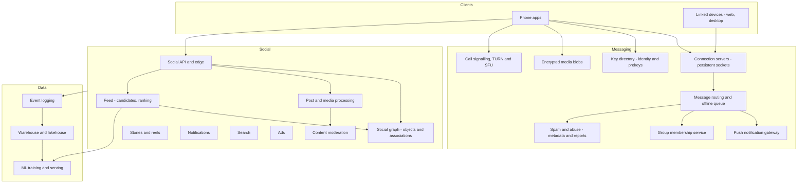
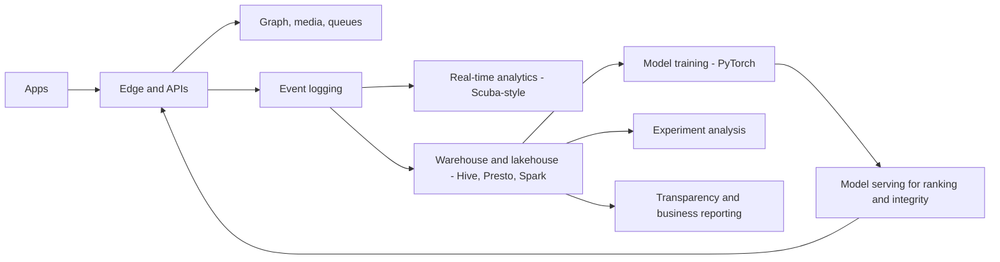

# I07. Messaging & Social Feed

!!! abstract "Chapter at a glance"
    **Sector:** Social and communication · **Format:** system design walkthrough (no code) · **Reader bands:** B1 → B4 · **Builds on:** [Ch 41](../05-case-studies/41-chat-customer-rider-messaging.md) (chat basics), [Ch 43](../05-case-studies/43-home-feed-and-recommendations.md) (feed ranking), [Ch 52](../05-case-studies/52-object-storage-and-media-pipeline.md) (media), [Ch 23](../03-production/23-security-architecture.md)

    **What you get:** two connected products at billion-user scale.

    **A WhatsApp-style messenger:**

    - end-to-end encryption (the Signal Protocol's key agreement and ratchets), multi-device and groups;
    - delivery and read receipts, the offline queue, media, voice and video calls;
    - status updates, business messaging, encrypted backups;
    - spam and abuse control when the server can't read messages.

    **An Instagram-style social app:**

    - posting photos and videos, the social graph;
    - feed, stories and short-video ranking, notifications, search, ads;
    - content moderation.

    **Plus:**

    - the algorithms: key agreement, ratchets, sender keys, fan-out strategies, graph caching, ranking funnels, perceptual hashing, spam classifiers;
    - the data platform, and a tech stack separating what Meta, WhatsApp and Instagram have published from a reference choice.

    **Reading time:** 90 min.

!!! warning "Sources and honesty"
    - The **Signal Protocol** is publicly specified (X3DH, Double Ratchet, Sesame). WhatsApp's security whitepaper describes its use of it (VERIFY the current version).
    - Meta has published papers and posts on **TAO** (social graph, 2013), **Memcache at Facebook** (2013), **RocksDB**, **ZippyDB**, **Scuba**, **Presto** and **Hive**.
    - Instagram has described **PostgreSQL sharding and ID generation**, **Cassandra** and its Django/Python stack.
    - WhatsApp's early use of **Erlang** and FreeBSD has been widely reported.

    All these are marked **VERIFY**. Everything else is a **reference design**. Indian intermediary rules (IT Rules 2021, including provisions on identifying the "first originator") are contested and marked **VERIFY**.

---

## 1. The System in One Page

### 1.1 Two products, different physics

| | Messenger | Social feed |
|---|---|---|
| **Core promise** | My message reaches exactly the people I chose, privately, instantly | I see the most interesting posts from people and topics I care about |
| **Data visibility to the server** | Ciphertext only (end-to-end encryption) | Plaintext; the server ranks, moderates and serves |
| **Hardest problem** | Reliable delivery to offline, multi-device users; encryption keys | Ranking billions of candidates; media at scale; moderation |
| **Consistency** | Per-conversation ordering; exactly-once display | Eventual; freshness in seconds is fine |
| **Traffic** | Enormous message rates, small payloads; media heavy | Read-heavy; media-dominated egress |

### 1.2 Scale (assumptions, order of magnitude)

| Quantity | Value |
|---|---|
| Messenger monthly users | 2B+ (WhatsApp has reported >2B; VERIFY) |
| Messages per day | ~100B (reported by WhatsApp in 2020; VERIFY) |
| Peak message rate | ~2–3M messages/s (estimate from daily volume with a 2× peak) |
| Concurrent connections | Hundreds of millions of persistent connections |
| Social app daily users | 500M+ |
| Posts/stories/reels created per day | Hundreds of millions |
| Feed and stories requests | Tens of billions per day |

**Estimation highlights:**

- **Connections:** 500M concurrent connections at ~1–2M per server (achievable with an Erlang/epoll-style design; VERIFY published numbers) means **hundreds of connection servers**, which are a large, simple, horizontally scaled tier.
- **Messages:** most are small (text, ~100 bytes of ciphertext plus headers). Media is uploaded once to blob storage, and only an encrypted reference is sent.
- **Feed:** each feed request ranks ~1,000 candidates with a model. At billions of requests per day, ranking compute dominates the social app's cost.

---

## 2. Requirements

### 2.1 Messenger

1. One-to-one and group chats (up to ~1,000 members; VERIFY current limits), with text, media, documents, voice notes, location, replies and reactions.
2. **End-to-end encryption** by default: only participants' devices can read content.
3. **Multi-device:** a phone plus up to several linked devices (web, desktop), each with its own keys.
4. Delivery states: sent (server received), delivered (recipient device received), read (opened), per recipient in groups.
5. Offline delivery: messages wait on the server (encrypted) until the device connects, with a retention limit.
6. Voice and video calls, one-to-one and group.
7. Status (24-hour stories), communities, channels (one-to-many broadcast), business accounts and APIs.
8. Encrypted backups; account moves to a new phone.
9. Abuse controls: block, report, forwarding limits, spam detection.

### 2.2 Social feed

1. Post photos, carousels and videos with captions, tags and location; edit and delete.
2. Follow and unfollow; private accounts with approval.
3. Home feed, stories tray, short-video (reels) feed, explore/discovery.
4. Likes, comments, shares, saves; notifications.
5. Search for users, hashtags, places, audio.
6. Ads in feed, stories and reels.
7. Moderation: prohibited content removed quickly; appeals; legal takedowns.

### 2.3 Non-functional

| Attribute | Target |
|---|---|
| **Message latency** | p50 < 200 ms sender-to-recipient when both are online in the same region |
| **Durability** | A message the server has acknowledged is never lost before delivery (within retention) |
| **Ordering** | Per-conversation order preserved per sender; the UI orders consistently |
| **Privacy** | E2EE content; minimised metadata; no content scanning on the server for E2EE chats |
| **Feed latency** | Feed first page p95 < 500 ms; media starts loading immediately |
| **Freshness** | New post visible to followers within seconds to a minute |
| **Availability** | ≥ 99.99% for messaging; graceful degradation for feed ranking |

---

## 3. High-Level Architecture

---

## 4. How the Messenger Works

### 4.1 Registration and keys

1. **Phone verification:** the user registers with a phone number, verified by an SMS or voice OTP.
2. **Key generation:** the device generates, on the device:
    - a long-term **identity key pair**;
    - a **signed prekey** (medium-term);
    - a batch of **one-time prekeys**.
3. **Publishing:** the **public** halves go to the **key directory** on the server. Private keys never leave the device.
4. **Linked devices** (web, desktop) generate their own keys and are linked by scanning a QR code. The phone vouches for them, and contacts' devices learn the new device list (VERIFY WhatsApp's multi-device design in its whitepaper).

### 4.2 Sending the first message to someone

1. **Fetch keys:** Alice's device fetches Bob's **prekey bundle**, covering each of Bob's devices: identity key, signed prekey, one one-time prekey. The server deletes one-time prekeys as they are handed out.
2. **Key agreement (X3DH):** Alice's device computes a shared secret from:
    - her identity key;
    - a fresh ephemeral key;
    - Bob's identity key, signed prekey and one-time prekey.

    Bob can compute the same secret later, even though he was offline (§6.1).
3. **Session:** a **Double Ratchet** session is initialised per (Alice device, Bob device) pair. Each message gets a fresh message key (§6.2).
4. **Encrypt:** Alice's device encrypts the message **once per recipient device**, including Alice's own other devices so her laptop shows what her phone sent. It sends the set of ciphertexts to the server over her persistent connection.
5. **Server:** the server checks the sender is allowed to message the recipient (not blocked, not rate-limited), then stores each ciphertext in the recipient device's **queue** and returns **sent** (one tick).
6. **Delivery:**
    - **if Bob's device is connected:** the connection server forwards immediately. The device decrypts it, stores it locally and acknowledges; the server deletes it from the queue and tells Alice **delivered** (two ticks);
    - **if not:** a **push notification** wakes the app (content-free, or with encrypted preview content decrypted on the device), which then connects and drains its queue.
7. **Read:** when Bob opens the chat, his device sends a **read receipt**, itself an encrypted message to Alice's devices.

### 4.3 Group messages

- **Naively**, sending to a 500-member group means encrypting 500+ times, once per device. That is too much work for a phone.
- **Sender keys (§6.3):**
    - each member creates a **sender key** for the group;
    - they distribute it to every other member's devices once, over the pairwise sessions;
    - after that, each group message is encrypted **once** with the sender key, and the server **fans out** the single ciphertext to all member devices.
- **Membership changes:** when someone leaves, senders rotate their sender keys, so the removed member can't read future messages.
- **The group membership service** holds member lists and admin roles. Membership changes are signed events distributed to members.

### 4.4 Media

1. **Encrypt on the device:** the sender encrypts the file with a random key (AES), uploads the **ciphertext** to blob storage over HTTPS, and receives a URL/ID.
2. **Send the reference:** the chat message (E2EE) carries the URL, the media key and a hash.
3. **Download:** recipients download the ciphertext, verify the hash and decrypt it. The server stores only encrypted blobs, which are deleted after all recipients download or after a retention period.
4. **Forwarding:** forwarding the same media reuses the uploaded blob where possible, with the same encrypted file and key, which saves storage and bandwidth.

### 4.5 Voice and video calls

1. **Signalling:** call offers go through the messaging channel, encrypted end to end, including the call's media keys.
2. **Media:**
    - one-to-one calls go **peer-to-peer** when NATs allow (ICE with STUN), or via **TURN relays**;
    - group calls use relay servers or SFUs;
    - media is encrypted with SRTP using keys negotiated end to end.
3. **Adaptation:** codecs adapt to network conditions, e.g. Opus for audio with bandwidth adaptation.

### 4.6 Status (stories)

- **A status** is a message to all contacts with a 24-hour expiry. It is encrypted like a group message (sender keys per audience), with the audience limited by privacy settings.
- **Expiry** is enforced by clients, and the server deletes the blobs after expiry.

### 4.7 Backups and new phones

- **Backups** go to the user's cloud storage (Google Drive/iCloud).
- **End-to-end encrypted backups:** the backup is encrypted with a key protected by a user password. The key is held in a **hardware security module-based key vault** that limits guessing attempts (WhatsApp's published design; VERIFY).
- **Moving to a new phone:** a device-to-device transfer, or restore from backup. Contacts see a "security code changed" notice if identity keys change.

### 4.8 Spam and abuse without reading messages

The server can't read E2EE content, so it uses:

- **metadata and behaviour:** account age, sending rate, how many recipients don't have the sender in contacts, message patterns across many recipients, reports, blocks;
- **client-side signals:** user reports, which include the last few messages forwarded by the reporting user;
- **product limits:** **forwarding limits**, e.g. "forwarded many times" labels and limits on forwarding to multiple chats (VERIFY current limits);
- **enforcement:** bans and rate limits.

Classifiers run on metadata. Research on privacy-preserving techniques continues (VERIFY claims about any specific deployment).

---

## 5. How the Social Feed Works

### 5.1 Posting a photo or video

1. **Upload:** the app uploads media in resumable chunks to an upload service ([Ch 52](../05-case-studies/52-object-storage-and-media-pipeline.md)), with client-side compression for mobile networks.
2. **Processing pipeline:**
    - images: resize to several sizes and formats;
    - video: transcode to an ABR ladder ([I06](i06-video-streaming-and-live-cricket.md));
    - extract thumbnails;
    - compute **perceptual hashes** (§6.8);
    - run **classifiers**: nudity, violence, spam, and copyright via audio/video fingerprints;
    - run **OCR/captions** for accessibility and search.
3. **Create the post:** a post object (author, media IDs, caption, tags, location, visibility) is written to the **social graph store**, with associations: author → post, post → tagged users, post → hashtags.
4. **Moderation outcome:** high-confidence violations are blocked before publishing. Borderline content goes to limited distribution and human review.
5. **Distribution:** the post becomes eligible for followers' feeds (§5.3) and, if public, for discovery. Notifications go to tagged users and close friends.

### 5.2 The social graph

- **The model** is **objects** (users, posts, comments, pages) and **associations**: typed, directed edges with timestamps (follows, likes, authored, tagged, commented).
- **Queries** are overwhelmingly **"get the association list"**:
    - the people X follows;
    - who liked post P;
    - the latest 50 comments on P;
    - counts.
- **Meta's TAO** (published 2013; VERIFY) serves exactly this: objects and associations on sharded MySQL, with a large, geographically distributed write-through cache tier. Reads served from cache; writes going to the leader region's database, and caches updated or invalidated.
- **Consistency:** eventual across regions, with read-your-writes for the author (§6.5).

### 5.3 Building the home feed

When a user opens the app:

1. **Candidate generation.** Several sources, a few thousand candidates in total:
    - recent posts from **accounts followed**;
    - **recommended posts** from similar-interest accounts (embedding retrieval);
    - posts from **friends' engagement**;
    - ads candidates from the ads system.
2. **Fetching followed content — pull vs push (§6.4):**
    - for most accounts, pull recent posts from each followed account's post list at read time, served from cache;
    - for users who follow thousands, or for very active authors, precomputed per-user inboxes (push) help.

    Most large systems use a **hybrid**.
3. **Filtering:** remove seen, blocked, muted, deleted or policy-violating posts, and apply privacy checks.
4. **Ranking funnel:**
    - a light model scores thousands of candidates;
    - a heavy model scores the top few hundred, predicting several engagement probabilities (like, comment, share, save, time spent, "see less");
    - they are combined into a **value score** with weights reflecting product goals ([Ch 43](../05-case-studies/43-home-feed-and-recommendations.md)).
5. **Final ordering:** diversity (not five posts from the same author in a row), freshness, ad slots inserted at spacing rules, integrity demotions (borderline content ranks lower).
6. **Serving:** the first page returns post IDs plus metadata. Media URLs point to the CDN. The client prefetches the next media. Pagination uses a cursor, and later pages re-rank with updated context.

### 5.4 Stories and reels

- **Stories:**
    - the **tray order** ranks accounts by predicted interest;
    - each story is short-lived (24 h);
    - viewers are tracked (author sees who viewed), stored as associations with TTL.
- **Reels (short video):**
    - mostly **recommendation-driven**, from non-followed creators;
    - candidates come from embedding retrieval and trending;
    - ranking predicts watch time, completion, replays, shares and follows;
    - strong **exploration** of new creators;
    - aggressive **prefetching** of the next videos, because swiping must feel instant.

### 5.5 Notifications

- **Events** (likes, comments, follows, mentions, live) generate notification candidates.
- **A notification ranker** decides what to send and when: coalescing ("12 people liked your post"), frequency caps, quiet hours.
- **Delivery** via push providers (FCM/APNs) and an in-app inbox ([Ch 40](../05-case-studies/40-notification-system.md)).

### 5.6 Content moderation pipeline

1. **Proactive detection at upload:**
    - hash matching against known-bad content databases (industry hash-sharing programmes for CSAM and terrorism content; VERIFY programmes);
    - classifiers for policy categories;
    - spam and fake-account detection.
2. **Actions:** block, remove, restrict reach, age-gate, or send to human review, prioritised by severity and virality.
3. **Human review** tools show context. Reviewer wellbeing measures matter.
4. **User reports and appeals:** appeals re-review, with an oversight process where applicable.
5. **Legal:** government and court orders processed per jurisdiction, with transparency reporting. The IT Rules 2021 in India set grievance and takedown timelines for significant intermediaries (VERIFY).

---

## 6. Algorithms

### 6.1 X3DH key agreement

- **Goal:** Alice and Bob agree on a secret while Bob is offline, with mutual authentication and forward secrecy.
- **How:** Alice combines several Diffie–Hellman computations:
    - her identity key with Bob's signed prekey;
    - her ephemeral key with Bob's identity key;
    - her ephemeral key with Bob's signed prekey;
    - optionally, her ephemeral key with Bob's one-time prekey.

    The outputs are fed into a key derivation function.
- **Why it works:** only someone holding Bob's private keys can compute the same result. The ephemeral and one-time keys give forward secrecy.
- **Verification:** users can compare **safety numbers** (a fingerprint of both identity keys) to detect a man-in-the-middle.

### 6.2 Double Ratchet

- **Symmetric ratchet:** each message uses a new key derived by a one-way chain (KDF). Compromising today's key reveals nothing about past messages (**forward secrecy**).
- **Diffie–Hellman ratchet:** with each reply, the parties exchange new DH public keys and mix the result into the chain. A compromised device state is healed once new DH values are exchanged (**post-compromise security**).
- **Out-of-order delivery:** skipped message keys are cached for a bounded number of messages.

### 6.3 Sender keys for groups

- **Setup:** each sender has a chain key and signing key per group, sent to members over pairwise sessions.
- **Sending:** messages are encrypted once with the chain's current key and signed. The chain ratchets forward per message.
- **Trade-offs:**
    - efficient fan-out (the server copies one ciphertext);
    - weaker post-compromise security than pairwise ratchets (rotate on membership change and periodically);
    - newer protocols like **MLS** (Messaging Layer Security, RFC 9420) scale group key agreement more efficiently for large groups.

### 6.4 Feed fan-out: push vs pull

| Strategy | How | Good for | Bad for |
|---|---|---|---|
| **Push (fan-out on write)** | On post, insert the post ID into every follower's inbox | Fast reads; users with few follows | Celebrities with 100M followers: 100M writes per post |
| **Pull (fan-out on read)** | On read, fetch recent posts from each followed account and merge | No write amplification | Users following thousands: many reads per request |
| **Hybrid** | Push for most authors; pull for celebrities (above a follower threshold) merged at read time | Both | Complexity |

**Ranking-based feeds** reduce the need for complete inboxes: candidates need only be "recent enough and plentiful", not exhaustive.

### 6.5 Graph caching and consistency

- **Two tiers:**
    - **write-through caches** in front of sharded databases, per region, with **leader and follower** cache tiers;
    - writes go to the leader region's database, and invalidations propagate to follower regions.
- **Read-your-writes for the author:** after writing, the author's reads route to the leader tier or carry a version token, so they see their own post immediately.
- **Hot objects** (a celebrity's post with millions of likes) get replicated cache entries and **counter sharding** (like counts split across sub-counters) ([Ch 44](../05-case-studies/44-distributed-cache.md)).
- **Lease-based cache fill** avoids thundering herds and stale sets, as described in "Scaling Memcache at Facebook" (VERIFY).

### 6.6 Ranking funnel

- **Retrieval:** two-tower embeddings (user tower, item tower) plus approximate nearest-neighbour search. Also graph-based candidates (friends' interactions).
- **Early-stage ranking:** a light model (small neural network or GBDT) over thousands of candidates.
- **Late-stage ranking:** a large multi-task neural network predicting several actions. Features include user history sequences, author affinity, content embeddings and context.
- **Value model:** a weighted sum of predicted probabilities. The weights are tuned by experiments on long-term metrics (retention), not only short-term clicks.
- **Integrity-aware ranking:** demote predicted-borderline content, and reduce virality of low-quality content.

### 6.7 ID generation and sharding

- **IDs:** 64-bit, time-sortable, with **shard ID embedded**, generated inside the database (Instagram's published approach: timestamp + logical shard ID + sequence; VERIFY). This keeps IDs unique without a central service and lets the ID route to the shard ([Ch 20](../02-distributed-core/20-idempotency-ids-and-distributed-locks.md)).
- **Logical shards:** thousands of logical shards mapped onto fewer physical databases, moved as load grows ([Ch 11](../02-distributed-core/11-partitioning-and-sharding.md)).

### 6.8 Perceptual hashing and near-duplicate detection

- **Perceptual hashes** (e.g. pHash/PDQ; Meta open-sourced PDQ and TMK+PDQF for video, VERIFY) map visually similar images to similar bit strings.
- **Matching:** Hamming distance below a threshold, looked up with multi-index hashing or LSH.
- **Uses:** blocking known-bad content, detecting reposts, copyright, and spam campaigns reusing images.

### 6.9 Spam and fake-account detection

- **Features:** registration signals (phone number type, device), behaviour (message or follow rates, reply ratio, block and report rates), network features (connections to known spam clusters).
- **Models:** GBDT/neural classifiers; graph methods (label propagation, community detection) for coordinated campaigns.
- **Actions:** rate limits, challenges, bans. Appeals exist for false positives.

### 6.10 Delivery reliability

- **Queues:** each device's queue is ordered. A message is removed only after the device acknowledges it, which is **at-least-once** delivery.
- **Deduplication:** messages carry unique IDs, and clients deduplicate, giving **exactly-once display**.
- **Multi-device ordering:** the per-conversation order is the sender's sequence. Clients merge by (server timestamp, sender sequence) for display.

---

## 7. Data Architecture

### 7.1 Messenger stores

| Data | Store (reference) | Notes |
|---|---|---|
| Connection routing (which server holds a device's socket) | In-memory distributed registry | Ephemeral |
| Offline queues | Durable per-device queues (a replicated log or KV store, e.g. RocksDB-based) | Deleted on acknowledgement; retention limit |
| Key directory | Replicated KV store | Public keys only |
| Group membership | Replicated KV/relational | Signed membership events |
| Media blobs | Object storage + CDN | Ciphertext; TTL-based deletion |
| Metadata for abuse (minimal) | Aggregated counters, limited retention | Privacy-reviewed |

- **Chat history lives on devices,** not the server, except for queued undelivered messages.
- **The server is a relay, not an archive.** This is a design choice with privacy, cost and legal implications.

### 7.2 Social stores

| Data | Store (reference) | Notes |
|---|---|---|
| Graph objects and associations | Sharded MySQL/PostgreSQL + TAO-style cache | Publicly described for Meta (VERIFY) |
| Feed inboxes (push part) | Wide-column (Cassandra) or KV | Instagram has described Cassandra use (VERIFY) |
| Counters (likes, views) | Sharded counters in KV + periodic aggregation | Hot keys |
| Media | Object storage (Meta has described Haystack/f4 for photos; VERIFY) + CDN | Petabytes |
| Search | Inverted indexes (Meta's Unicorn for the social graph; VERIFY) | Users, hashtags, places |
| Ranking features | Online feature store (low-latency KV) | Freshness in seconds |

### 7.3 Logging, lakehouse and ML

- **Events** (impressions, likes, watch time, sends, reports) → a logging pipeline (Meta's Scribe; VERIFY) → a warehouse on distributed storage.
- **Tools created at Meta** and now widely used: **Hive**, **Presto**, **RocksDB**, **PyTorch**; Meta also described **Scuba** for real-time analysis (VERIFY each).
- **Uses:**
    - training ranking and integrity models (daily or continuous);
    - experiment analysis (every product change is A/B tested);
    - dashboards;
    - transparency reports.
- **Privacy:**
    - message content from E2EE chats never enters the lake;
    - social data access is purpose-restricted, with deletion propagation (a deleted post must disappear from training sets on schedule);
    - regional storage where required.

### 7.4 Data flow

---

## 8. Tech Stack

| Layer | Publicly described (VERIFY each) | Reference choice |
|---|---|---|
| Messaging servers | **Erlang/OTP** (WhatsApp, historically on FreeBSD); ejabberd-derived early on | Erlang/Elixir or Go/Rust with epoll-based connection servers |
| Encryption | **Signal Protocol** (libsignal) | libsignal; MLS for large groups |
| Calls | WebRTC-based stacks, relays | WebRTC, coturn, SFU |
| Social web tier | Instagram: **Python/Django** (with performance work); Meta: Hack/HHVM | Python/Go/Java services |
| Graph storage | **TAO** over MySQL (Meta) | Sharded PostgreSQL/MySQL + write-through cache |
| Caching | **Memcache** at scale (Meta) | Redis/memcached with leases |
| KV | **RocksDB**, **ZippyDB** (Meta) | RocksDB-based stores, Cassandra/ScyllaDB |
| Wide-column | **Cassandra** (created at Facebook; used by Instagram) | Cassandra/ScyllaDB |
| Media storage | Haystack, f4 (Meta) | Object storage + CDN |
| Queues/streams | Scribe, LogDevice (Meta) | Kafka |
| Warehouse/query | **Hive**, **Presto** (created at Facebook), Spark | Iceberg + Spark + Trino |
| Real-time analytics | **Scuba** | Druid/Pinot/ClickHouse |
| ML | **PyTorch** | PyTorch, feature store, model serving |
| Mobile | Native iOS/Android, React Native (created at Facebook) in some apps | Native or React Native |

---

## 9. Security, Privacy & Compliance

- **E2EE threat model:** the server can't read content. It still sees **metadata**: who talks to whom, when, IP addresses, group membership. Minimise, protect and limit retention of metadata.
- **Key transparency:** detect a server that could inject keys, with key transparency logs and safety-number verification (VERIFY deployment status).
- **Account security:** two-step verification PIN, device linking approvals, notifications of new devices.
- **Social data:** privacy settings enforced at query time in the graph layer (private accounts, close friends, blocked users). Deleted content is removed from caches, indexes, backups and training data on schedule.
- **Children:** age assurance, default private accounts for teens, restricted messaging from unknown adults (VERIFY current policies).
- **India-specific:**
    - the IT Rules 2021 obligations for significant social media intermediaries: grievance officers, takedown timelines, monthly compliance reports;
    - the **traceability (first originator) requirement** for messaging, which conflicts with E2EE and is under legal challenge (VERIFY current status);
    - the DPDP Act 2023 (VERIFY).

---

## 10. Reliability & Operations

- **Connection tier:**
    - stateless beyond sockets, so clients reconnect to any server;
    - routing registry updates on reconnect;
    - rolling deploys drain connections gradually, not all at once.
- **Offline queues are replicated.** A queue shard failure fails over without losing acknowledged messages.
- **Regional failover:**
    - users connect to the nearest region;
    - messages route across regions to the recipient's connection;
    - the social graph has a leader region per shard, with follower regions serving reads.
- **Degradation:**
    - feed falls back to a simpler ranking (chronological with light scoring) if ranking services fail;
    - stories still load;
    - messaging stays independent of social features.
- **Events:** New Year's Eve, and festivals like Diwali, bring messaging peaks (greetings, media). Prepare capacity for media upload and delivery, and forwarding spikes.

---

## 11. Key Trade-offs

| Decision | Chosen | Accepted cost |
|---|---|---|
| Message storage | Device-side history; server relays | Harder multi-device history sync; backups needed |
| Group encryption | Sender keys (MLS for large groups later) | Weaker post-compromise security than pairwise |
| Abuse control in E2EE | Metadata, reports, product limits | Less visibility than content scanning |
| Feed fan-out | Hybrid push/pull | Two code paths |
| Graph consistency | Eventual across regions, read-your-writes for authors | Brief inconsistency for others |
| Ranking | Multi-stage funnel with long-term metrics | Heavy compute; complex experimentation |
| Moderation | Proactive detection + human review | Cost; false positives need appeals |

---

## 12. Interview Q&A

### Beginner B1

??? question "Q1 [B1] ⭐ How does a message get from one phone to another?"

    **30-second answer:** The sender's app encrypts it for each recipient device and sends it over a persistent connection; the server stores it in the recipient's queue and acknowledges (sent); if the recipient is online the server forwards it, otherwise a push notification wakes the app to fetch it; the recipient acknowledges (delivered) and later sends a read receipt.

    **Deep answer:** §4.2.

    **Trade-offs I'd call out:** Persistent connections cost vs latency.

    **Follow-ups:**
    1. Offline for days? → Queue with retention.
    2. Duplicates? → Message IDs.

    **Red flags:** Polling for messages.

??? question "Q2 [B1] What does end-to-end encryption mean for the server?"

    **30-second answer:** The server only relays and stores ciphertext; keys live on devices, so the server can't read messages — but it still sees metadata like who talks to whom and when.

    **Deep answer:** §4.1, §9.

    **Trade-offs I'd call out:** Privacy vs server-side features (search, moderation).

    **Follow-ups:**
    1. Backups? → Encrypted with user key.
    2. Web client? → Linked device keys.

    **Red flags:** "The server decrypts to route."

??? question "Q3 [B1] What happens when you post a photo?"

    **30-second answer:** Resumable upload, processing (resizes, formats, hashes, classifiers), a post object and associations in the social graph, moderation outcome, then the post becomes a candidate for followers' feeds and triggers notifications.

    **Deep answer:** §5.1.

    **Trade-offs I'd call out:** Upload latency vs checks.

    **Follow-ups:**
    1. Video? → Transcoding ladder.
    2. Prohibited content? → Blocked before publish.

    **Red flags:** Storing images in the database.

??? question "Q4 [B1] What are the ticks in a messaging app?"

    **30-second answer:** One tick: the server accepted the message. Two ticks: a recipient device received and decrypted it. Blue/read: the recipient opened the chat and sent a read receipt (if enabled) — in groups, per recipient.

    **Deep answer:** §4.2.

    **Trade-offs I'd call out:** Receipts are extra messages.

    **Follow-ups:**
    1. Multi-device? → Delivered when any device receives.
    2. Privacy? → Read receipts optional.

    **Red flags:** Server marks read on its own.

### Intermediate B2

??? question "Q5 [B2] ⭐ How do group messages stay efficient with end-to-end encryption?"

    **30-second answer:** Sender keys: each member distributes a group sender key once via pairwise encrypted sessions; each message is then encrypted once and the server fans out a single ciphertext; keys rotate when membership changes; MLS improves this for very large groups.

    **Deep answer:** §4.3, §6.3.

    **Trade-offs I'd call out:** Efficiency vs post-compromise security.

    **Follow-ups:**
    1. Member removed? → Rotate keys.
    2. 1,000 members? → Fan-out on server.

    **Red flags:** Encrypting per member per message on the phone.

??? question "Q6 [B2] ⭐ Push or pull for building feeds?"

    **30-second answer:** Push writes post IDs to followers' inboxes (fast reads, heavy writes for celebrities); pull merges followed accounts' recent posts at read time (no write amplification, heavy reads for users following many); production systems use a hybrid with a follower threshold, and ranking reduces the need for complete inboxes.

    **Deep answer:** §5.3, §6.4.

    **Trade-offs I'd call out:** Write vs read cost.

    **Follow-ups:**
    1. Threshold? → Tuned by cost.
    2. Unfollow? → Filter at read.

    **Red flags:** Push to 100M followers per post.

??? question "Q7 [B2] How do you store the social graph?"

    **30-second answer:** Objects and typed associations in sharded relational databases fronted by a large write-through cache tier per region (TAO-style); most queries fetch association lists and counts; writes go to the leader region and invalidate caches elsewhere.

    **Deep answer:** §5.2, §6.5.

    **Trade-offs I'd call out:** Eventual consistency across regions.

    **Follow-ups:**
    1. Hot objects? → Replicated cache, sharded counters.
    2. Graph database? → Rarely needed at this scale.

    **Red flags:** One giant graph DB with ad-hoc traversals.

??? question "Q8 [B2] How do media files work in an encrypted messenger?"

    **30-second answer:** The sender encrypts the file with a random key, uploads the ciphertext to blob storage, and sends the URL, key and hash inside the E2EE message; recipients download, verify and decrypt; the server keeps only ciphertext and deletes after delivery or retention.

    **Deep answer:** §4.4.

    **Trade-offs I'd call out:** Server can't dedupe different uploads.

    **Follow-ups:**
    1. Forwarding? → Reuse blob.
    2. CDN? → Ciphertext is cacheable.

    **Red flags:** Media sent through the message socket.

??? question "Q9 [B2] How do notifications avoid spamming users?"

    **30-second answer:** Events become candidates; a ranker decides what to send, coalesces similar events, applies frequency caps and quiet hours, and chooses push vs in-app; outcomes feed back into the model.

    **Deep answer:** §5.5.

    **Trade-offs I'd call out:** Engagement vs annoyance.

    **Follow-ups:**
    1. Coalescing? → "12 people liked".
    2. Measurement? → Opt-out rates.

    **Red flags:** Push for every like.

### Senior B3

??? question "Q10 [B3] ⭐ Explain X3DH and the Double Ratchet at a system-design level."

    **30-second answer:** X3DH lets Alice establish a shared secret with offline Bob using his published identity, signed prekey and one-time prekey plus her ephemeral key; the Double Ratchet then derives a new key per message (forward secrecy) and mixes fresh Diffie–Hellman values on replies (post-compromise security). Systems-wise: a key directory, prekey replenishment, per-device sessions, and safety numbers for verification.

    **Deep answer:** §6.1, §6.2.

    **Trade-offs I'd call out:** Session state per device pair.

    **Follow-ups:**
    1. Prekeys run out? → Signed prekey fallback.
    2. New phone? → New identity, warning.

    **Red flags:** One shared key per chat forever.

??? question "Q11 [B3] How do you guarantee delivery without duplicates?"

    **30-second answer:** Per-device durable queues; messages removed only after device acknowledgement (at-least-once); unique message IDs and client-side dedup give exactly-once display; ordering by sender sequence per conversation.

    **Deep answer:** §6.10.

    **Trade-offs I'd call out:** Storage until acknowledgement.

    **Follow-ups:**
    1. Device never returns? → Retention expiry.
    2. Queue failover? → Replicated.

    **Red flags:** Deleting on send.

??? question "Q12 [B3] How do you fight spam when you can't read messages?"

    **30-second answer:** Metadata and behaviour signals (rates, unknown-recipient ratios, blocks, reports), user reports that include recent messages, forwarding limits and labels, registration signals, and graph-based detection of coordinated accounts — with rate limits and bans.

    **Deep answer:** §4.8, §6.9.

    **Trade-offs I'd call out:** Privacy vs detection power.

    **Follow-ups:**
    1. False positives? → Appeals.
    2. Business spam? → Business policies.

    **Red flags:** "Just scan messages on the server."

??? question "Q13 [B3] ⭐ Design the ranking system for the home feed."

    **30-second answer:** Multiple candidate sources (followed, recommended via embeddings, friends' engagement, ads), filtering, a light early ranker, a heavy multi-task model predicting several actions, a value model with weights tuned for long-term retention, diversity and integrity adjustments, and continuous A/B testing.

    **Deep answer:** §5.3, §6.6; [Ch 43](../05-case-studies/43-home-feed-and-recommendations.md).

    **Trade-offs I'd call out:** Compute vs quality.

    **Follow-ups:**
    1. Feature freshness? → Online feature store.
    2. Ranking failure? → Chronological fallback.

    **Red flags:** Chronological only at scale, or clicks-only objectives.

??? question "Q14 [B3] How do you generate IDs across thousands of database shards?"

    **30-second answer:** 64-bit time-sortable IDs with an embedded logical shard ID and per-shard sequence, generated inside each shard's database; logical shards map onto physical databases so they can be moved.

    **Deep answer:** §6.7; [Ch 20](../02-distributed-core/20-idempotency-ids-and-distributed-locks.md).

    **Trade-offs I'd call out:** Clock dependence.

    **Follow-ups:**
    1. Why shard in ID? → Routing without lookup.
    2. Resharding? → Move logical shards.

    **Red flags:** Central ID service for everything.

### Architect B4

??? question "Q15 [B4] ⭐ How would you scale a messaging service to hundreds of millions of concurrent connections?"

    **30-second answer:** A large tier of connection servers optimised for many idle sockets (Erlang/epoll), a routing registry for device-to-server mapping, stateless reconnection anywhere, per-device replicated queues, push notifications for offline devices, regional presence with cross-region routing, and graceful rolling deploys that drain sockets gradually.

    **Deep answer:** §1.2, §10.

    **Trade-offs I'd call out:** Memory per connection vs cost.

    **Follow-ups:**
    1. Reconnect storms? → Jittered backoff.
    2. Presence? → Lazy, best effort.

    **Red flags:** HTTP polling at this scale.

??? question "Q16 [B4] How would you design content moderation at scale?"

    **30-second answer:** Proactive detection at upload (hash matching, classifiers), risk-based actions (block, restrict, review), prioritised human review with context tools, user reports and appeals, legal takedown workflows per jurisdiction, and measurement (prevalence, precision, time-to-action) with transparency reporting.

    **Deep answer:** §5.6, §6.8.

    **Trade-offs I'd call out:** Speed vs accuracy; free expression vs harm.

    **Follow-ups:**
    1. Viral content? → Prioritise by reach.
    2. New categories? → Human labels first.

    **Red flags:** Reactive reports only.

??? question "Q17 [B4] What are the trade-offs of keeping chat history only on devices?"

    **30-second answer:** Strong privacy and lower server cost, but harder multi-device history sync, dependence on user backups, loss if the device is lost without backup, and limited server-side features (search, moderation); encrypted backups and device-to-device transfer mitigate.

    **Deep answer:** §7.1, §4.7.

    **Trade-offs I'd call out:** Privacy vs convenience.

    **Follow-ups:**
    1. New linked device? → History transfer from phone.
    2. Legal requests? → Limited server data.

    **Red flags:** Keeping plaintext copies "just in case".

??? question "Q18 [B4] How do privacy regulations and traceability rules affect an E2EE messenger in India?"

    **30-second answer:** IT Rules 2021 require significant messaging intermediaries to enable identification of a message's first originator on lawful orders — which conflicts with E2EE design and is under legal challenge; the platform must balance compliance, user privacy and security, alongside DPDP Act duties (VERIFY current status).

    **Deep answer:** §9.

    **Trade-offs I'd call out:** Compliance vs security guarantees.

    **Follow-ups:**
    1. Metadata retention? → Minimise.
    2. Transparency? → Reports.

    **Red flags:** Weakening encryption silently.

??? question "Q19 [B4] How do you keep the social graph consistent across regions?"

    **30-second answer:** Leader region per shard handles writes; follower regions serve reads from caches invalidated asynchronously; authors get read-your-writes via routing or version tokens; lease-based cache fills avoid stampedes; eventual consistency is accepted for others' views.

    **Deep answer:** §6.5.

    **Trade-offs I'd call out:** Cross-region write latency.

    **Follow-ups:**
    1. Leader failover? → Promote a follower.
    2. Counters? → Sharded.

    **Red flags:** Multi-master without conflict rules.

??? question "Q20 [B4] Compare the architectures of a messenger and a social feed."

    **30-second answer:** The messenger is a privacy-preserving relay with device-held state, per-device queues and E2EE — optimising delivery and connections; the feed is a server-side content system with a social graph, media processing, ranking and moderation — optimising relevance and read throughput. They share identity, media infrastructure, notifications and abuse systems.

    **Deep answer:** §1.1.

    **Trade-offs I'd call out:** Where data lives and who can see it.

    **Follow-ups:**
    1. Shared services? → Media, push, identity.
    2. Different SLOs? → Delivery vs relevance.

    **Red flags:** Using the feed's database for messages.

---

## 13. Summary

1. **The messenger is a relay with cryptography at the edges:** keys and history live on devices; the server moves ciphertext through per-device queues and connection servers.
2. **Signal-protocol building blocks** (X3DH, Double Ratchet, sender keys; MLS for large groups) give forward secrecy and post-compromise security. Safety numbers let users verify.
3. **The social feed is a graph plus a ranking funnel:** objects and associations with massive caches, hybrid fan-out, multi-stage ranking tuned for long-term value.
4. **Media dominates storage and egress:** process once, hash for integrity, serve from CDNs.
5. **Integrity is built in:** metadata-based abuse control for E2EE, proactive detection and human review for public content, and legal and regulatory processes per jurisdiction.

### Related chapters

- [Ch 41 — Chat](../05-case-studies/41-chat-customer-rider-messaging.md) · [Ch 43 — Home Feed](../05-case-studies/43-home-feed-and-recommendations.md) · [Ch 44 — Distributed Cache](../05-case-studies/44-distributed-cache.md) · [Ch 23 — Security](../03-production/23-security-architecture.md) · [I06 — Video Streaming](i06-video-streaming-and-live-cricket.md)
- Next in this tab: [I08 — Stockbroking Platform](i08-stockbroking-platform.md)
