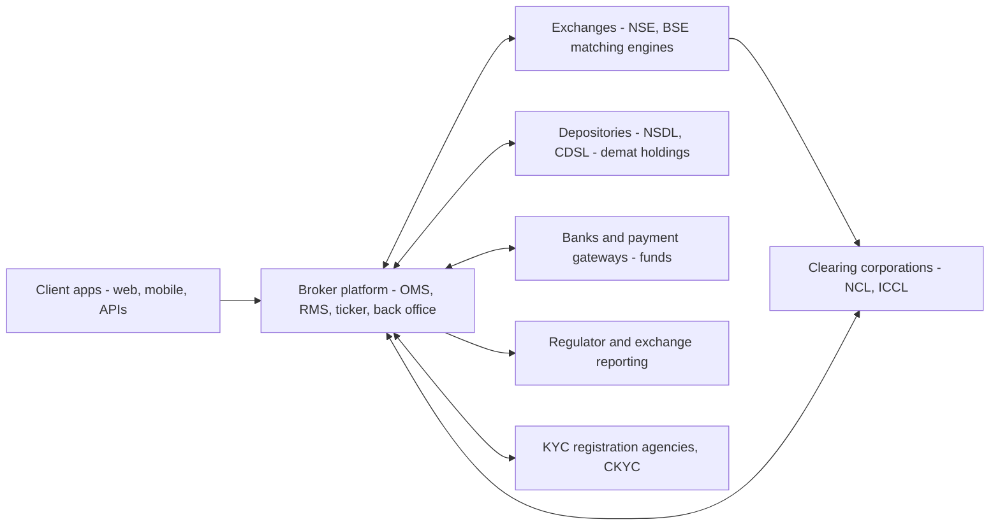
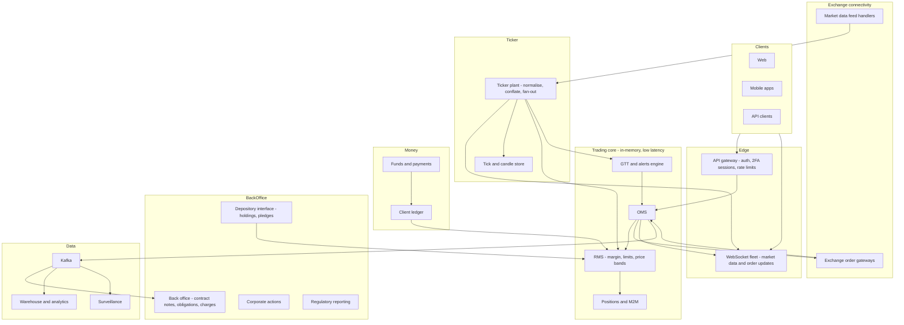
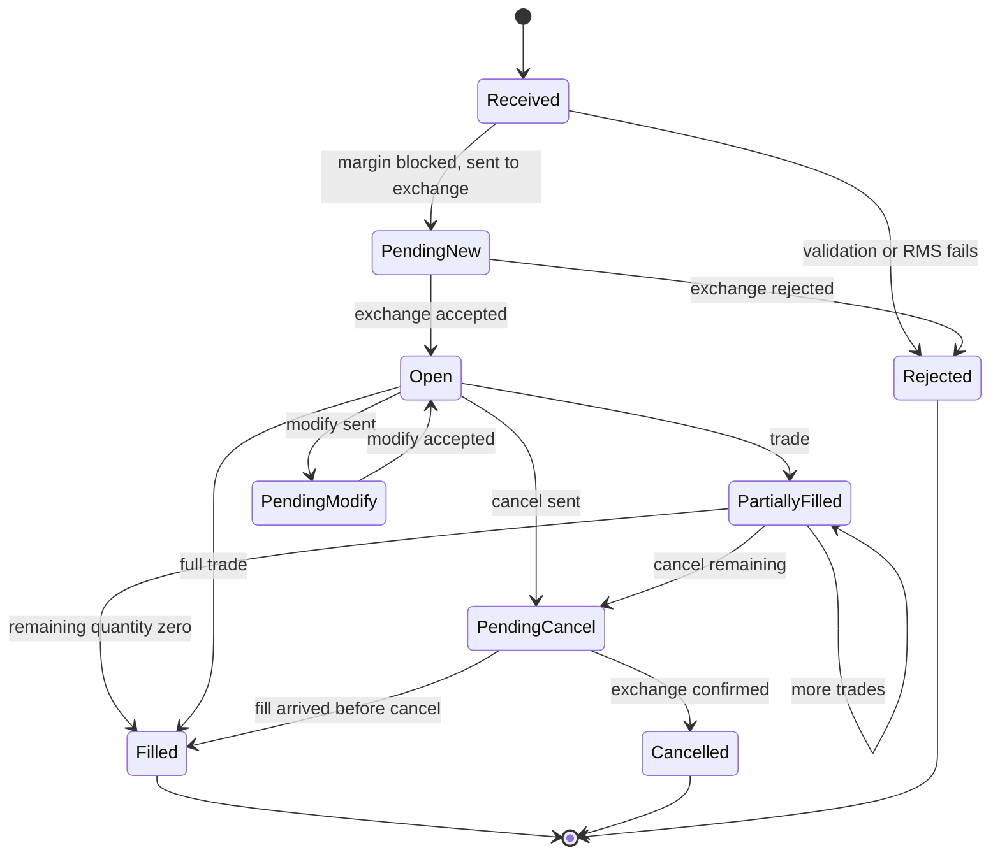
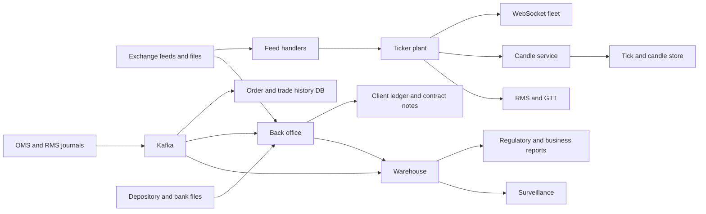

# I08. Stockbroking Platform

!!! abstract "Chapter at a glance"
    **Sector:** Capital markets (India) · **Format:** system design walkthrough (no code) · **Reader bands:** B1 → B4 · **Builds on:** [Ch 55](../05-case-studies/55-order-matching-engine.md) (the exchange's matching engine), [Ch 45](../05-case-studies/45-payment-system.md), [I03](i03-core-banking-and-upi.md), [Ch 51](../05-case-studies/51-real-time-analytics-and-top-k.md)

    **What you get:** the design of a discount broker's platform for Indian markets, like Zerodha, Groww or Upstox, serving ~10M active clients. It covers:

    - **onboarding:** KYC, e-sign, demat account;
    - **money:** funds in and out, margins and pledging;
    - **trading:** the order management system (OMS) and pre-trade risk management (RMS), exchange connectivity, the market data "ticker plant" streaming prices to millions of screens, positions and P&L, GTT and alerts;
    - **after the trade:** contract notes, T+1 settlement, obligations with the clearing corporation, corporate actions;
    - **other products:** mutual funds and IPO applications, trading APIs;
    - **the algorithms:** margin (SPAN-style scenarios plus exposure), P&L and tax lot matching, candle aggregation, conflation, trigger matching, surveillance;
    - **the data platform** (tick store, back office, warehouse, regulatory reporting) and **tech stack**;
    - **reliability** for the 9:15 am market open and extreme volatility days.

    **Reading time:** 85 min.

!!! warning "Regulatory content"
    - Securities markets in India are regulated by SEBI, with rules from exchanges (NSE, BSE), clearing corporations and depositories (NSDL, CDSL).
    - Rules on margins, client funds, settlement cycles, KYC, algorithmic trading and reporting **change frequently**. Every regulatory statement here is a summary marked **VERIFY**.
    - Statements about specific brokers' technology come from their public blogs or talks, and are marked **VERIFY**.
    - This is not investment or legal advice.

---

## 1. The System in One Page

### 1.1 Where the broker sits

The broker:

- **does not match orders.** The exchange does ([Ch 55](../05-case-studies/55-order-matching-engine.md)).
- **checks** every order against the client's funds, holdings and risk limits before sending it (pre-trade RMS).
- **streams** market data.
- **tracks** positions and money.
- **settles** obligations with the clearing corporation and depositories.

### 1.2 Main systems

| System | What it does |
|---|---|
| **Onboarding and KYC** | Identity, address, PAN, bank verification, e-sign, demat account opening, risk profiling |
| **Funds service** | Pay-in (UPI, net banking), payout requests, ledger of client money |
| **OMS** | Order lifecycle: validate, route, track acknowledgements, trades, modifications, cancellations |
| **RMS** | Pre-trade checks: margin, holdings, limits, price bands; real-time risk; auto square-off |
| **Exchange gateways** | Connections to exchanges' trading systems per segment (equity, F&O, currency, commodity) |
| **Ticker plant** | Receives exchange market data, normalises it, fans it out to clients over WebSockets |
| **Positions and P&L** | Real-time positions, M2M (mark-to-market), holdings valuation |
| **GTT / alerts** | Good-till-triggered orders and price alerts |
| **Back office** | Contract notes, settlement obligations, client ledgers, brokerage and charges, corporate actions, tax statements |
| **Depository interface** | Holdings, pledges for margin, delivery instructions (e.g. authorisation for selling holdings) |
| **Mutual funds and IPO** | Orders via exchange MF platforms / RTAs; IPO applications with UPI mandates |
| **Trading APIs** | Programmatic access for clients and third-party apps, with rate limits |
| **Surveillance and compliance** | Alerts on suspicious trading, regulatory reports |

### 1.3 Scale for this design (assumptions)

| Quantity | Value |
|---|---|
| Active clients | 10M; 1.5M trading on a busy day |
| Orders per day | 10–20M (F&O-heavy days higher) |
| Peak order rate | ~20–50k orders/s in the first minute after 9:15 am and on volatile events |
| Instruments | ~100k tradable (equities, derivatives contracts across expiries and strikes) |
| Market data ticks received | Hundreds of thousands per second at peak across segments |
| Concurrent WebSocket clients | 2–3M at market open |
| Subscribed instruments per client | 10–200 (watchlists, positions, option chains) |

**Estimation — the ticker is the biggest fan-out:**

- Sending every tick of every subscribed instrument to every client is impossible: 3M clients × 50 instruments × several ticks per second is **hundreds of millions of messages per second**.
- So the ticker **conflates**: it sends each client at most one update per instrument per interval (e.g. 1 s or 250 ms) with the latest values (§6.4).
- Even then it is tens of millions of messages per second across a fleet of WebSocket servers. That is why market data uses compact binary formats.

---

## 2. Requirements

### 2.1 Functional

1. Open an account online: KYC, PAN verification, bank account verification, e-sign, demat account, nominee, segment activation (F&O needs income proof per rules; VERIFY).
2. Add funds instantly (UPI/net banking), withdraw to the linked bank, see the ledger.
3. Watchlists with live prices; market depth (5 levels or more); option chains; charts with historical data.
4. Place orders: market, limit, stop-loss, stop-loss market; product types (delivery/CNC, intraday/MIS, normal/NRML for F&O); after-market orders (AMO); basket orders; iceberg orders; GTT (good till triggered); modify and cancel.
5. See orders, trades, positions (intraday and overnight), holdings, P&L, margin used and available.
6. Pledge holdings for margin (collateral).
7. Mutual fund purchases and SIPs; IPO applications.
8. Contract notes, ledgers, tax P&L reports, and corporate action handling (dividends, splits, bonuses).
9. APIs for programmatic trading, with rate limits and algo rules (VERIFY SEBI's framework for retail algo trading).

### 2.2 Non-functional

| Attribute | Target |
|---|---|
| **Order latency** | Client tap to exchange ack in tens of ms (network-dominated); broker's internal processing < a few ms p99 |
| **Correctness** | No order accepted without margin; no double-sending; positions and funds exact |
| **Availability** | During market hours ≥ 99.99%; any outage during market hours is highly visible and may need to be reported to exchanges (VERIFY) |
| **Market data** | Tick-to-screen within ~1 s for retail; depth updates consistent |
| **Scale** | Market open spike (orders, logins, WebSocket connects) |
| **Auditability** | Every order, modification and risk decision logged with timestamps; records retained per regulation (VERIFY) |
| **Security** | 2FA, device binding, session management; client funds protection |

---

## 3. High-Level Architecture

**Key decisions:**

| Decision | Choice | Why |
|---|---|---|
| **Trading core state** | In memory (orders, positions, margins per client), with a durable **journal** and snapshots | Microsecond-to-millisecond checks; recover by replay ([Ch 55](../05-case-studies/55-order-matching-engine.md) L2 determinism) |
| **Partitioning** | By client ID across RMS/OMS shards; each client's state owned by one shard | All of a client's orders are checked against one consistent state |
| **Exchange connectivity** | Dedicated gateways per exchange segment, with limits per connection | Exchange rules on order rates per connection (VERIFY) |
| **Market data** | Separate ticker plant from trading core | Very different load shapes; isolation |
| **Back office** | Batch and event-driven, strongly consistent ledgers | Money and regulation |
| **Deployment** | Co-location or proximity hosting for exchange-facing parts; cloud or data centre for client-facing parts | Latency to exchange vs elasticity for clients |

---

## 4. How It Works — Journeys End to End

### 4.1 Journey 1: opening an account

1. **Basics:** the client enters mobile and email (OTP verified) and their PAN.
    - **PAN verification** through the tax department's verification service.
    - **KRA check:** has this person already done KYC with any intermediary? If so, fetch those records. A **CKYC** lookup may also help (VERIFY current process).
2. **Identity and address:** Aadhaar-based e-KYC or DigiLocker document fetch with consent (VERIFY permitted modes).
    - A **live photo and in-person verification** via video or selfie with liveness checks, as required.
3. **Bank verification:** a **penny drop** (₹1 credited to verify account holder name via IMPS name lookup) or reverse penny drop (the client pays ₹1 via UPI from their account).
4. **Profile:** risk profiling questions, nominee details, segment selection. **F&O activation requires income proof** as per current rules (VERIFY).
5. **E-sign:** the account opening form is signed with Aadhaar e-sign (OTP-based).
6. **Demat account** opened with a depository (CDSL/NSDL) via the broker's DP, and a **UCC** (unique client code) registered with exchanges.
7. **Activation:** the account is ready within hours to a day, once exchange and depository registrations complete.

All documents and verification results are stored encrypted, with audit trails. KYC data is uploaded to the KRA.

### 4.2 Journey 2: adding funds

1. **Payment:** the client pays via UPI (intent or collect) or net banking through a payment gateway, which calls back on success ([Ch 45](../05-case-studies/45-payment-system.md)).
2. **Ledger credit:** the funds service credits the **client ledger** after verifying the payment, and only from the client's **own verified bank account**. Third-party funds are not allowed (VERIFY).
3. **Available margin** in the RMS increases immediately.
4. **Reconciliation:** end-of-day reconciliation matches gateway settlements with ledger credits.
5. **Client money protection:**
    - client funds are held in designated bank accounts;
    - reported and segregated per exchange and clearing corporation rules;
    - brokers must not use client funds for other purposes (VERIFY the current segregation and upstreaming rules).

### 4.3 Journey 3: placing a buy order at market open

It is 9:15:00. A client places a **limit buy for 100 shares of stock X at ₹500, product CNC (delivery)**.

1. **Submit:** the app sends the order to the API gateway. The gateway checks:
    - the session and 2FA session state;
    - rate limits;
    - that the request is well-formed.
2. **OMS validation:**
    - instrument exists and is tradable;
    - tick size (price in multiples of ₹0.05, for example);
    - quantity within freeze limits;
    - **price within the day's price band / circuit limits**;
    - order type allowed for this segment.

    It assigns an internal order ID and journals the order.
3. **RMS pre-trade check** on the client's shard, in memory:
    - **required margin:** for delivery equity buys, full value plus charges (₹50,000 + estimated charges); for intraday or F&O, margin per rules (§6.1);
    - **available margin** = ledger cash + collateral value (after haircut) − margin blocked by open orders and positions;
    - if sufficient, **block** the margin for this order;
    - if not, **reject** with a reason.
4. **Route:** the OMS sends the order to the **exchange gateway**, which:
    - sends it over the exchange's trading interface (binary protocol over leased lines);
    - respects per-connection message-rate limits;
    - distributes orders across multiple connections.
5. **Exchange acknowledgement** (order accepted into the book, with an exchange order ID) comes back. The OMS updates the order to **OPEN** and pushes an update to the client over WebSocket.
6. **Match:** when the order matches at the exchange, **trade confirmations** arrive, possibly partial fills.
    - **The OMS** updates the filled quantity and average price.
    - **The RMS** converts blocked margin into used margin for the position.
    - **Positions** update.
    - The client sees "Complete".
7. **Modify or cancel** requests follow the same path. The RMS re-computes the blocked margin. Race conditions (a cancel arriving after a fill) are resolved by the exchange's responses, and the OMS state machine handles every order of events (§5.1).
8. **End of day:**
    - the trade appears in the **contract note** (emailed within the regulatory deadline; VERIFY), with brokerage, STT, exchange transaction charges, GST, SEBI fees and stamp duty computed by the back office;
    - the settlement obligation is computed (§4.5).

### 4.4 Journey 4: an options trader on expiry day

1. **Option chain:** the client watches an **option chain**: all strikes for an index expiry, with live prices, open interest and Greeks.
    - The ticker streams the visible strikes only, conflated.
    - Greeks are computed by a pricing service from live prices, using Black-Scholes-style models with implied volatility solved numerically (§6.6).
2. **Order and margin:** the client buys and sells options in a **basket** (e.g. a spread). The RMS computes the margin for the **combined position**:
    - **SPAN-style scenario margin** (the worst loss across price and volatility scenarios);
    - plus exposure margin.

    Hedged positions need far less margin than each leg alone (§6.1).
3. **Real-time risk:** as prices move, **M2M** losses reduce available margin. If margin falls below thresholds, the RMS:
    - sends warnings;
    - blocks new positions;
    - **auto square-off** of intraday positions near the cut-off time, or on margin shortfall (per the broker's policy and rules; VERIFY).
4. **Expiry:** positions settle per exchange rules. Physical settlement applies to stock options in the money (VERIFY). Obligations are computed by the clearing corporation, and the back office reconciles.

### 4.5 Journey 5: T+1 settlement of a delivery trade

The trade is on day T.

1. **Buy side:**
    - on T, the clearing corporation computes **obligations** per broker (net funds and securities per client and settlement type);
    - on T+1, the broker pays the funds obligation (from client ledgers) and receives securities in its **pool account**;
    - the securities are then transferred to the client's demat account (VERIFY the current direct-payout mechanisms).
2. **Sell side (of holdings):**
    - the client authorises the sale, via an **e-DIS/TPIN or mandate** to the depository before selling, or through a pre-authorisation (VERIFY current mechanism);
    - on T+1, the securities are delivered from the client's demat account;
    - the funds credit the client's ledger after pay-out.
3. **Failures:**
    - **short delivery** (the seller didn't deliver) triggers an auction by the exchange, and penalties to the defaulting client;
    - the back office handles these exceptions.
4. **Settlement cycle:** India moved to **T+1** for equities in 2023, and has piloted optional T+0 settlement (VERIFY current status).

### 4.6 Journey 6: GTT (good till triggered) order

1. **Setup:** the client sets "Sell 50 shares of Y if price ≥ ₹1,200 or ≤ ₹950" (an OCO, one-cancels-other).
2. **Storage:** the GTT engine stores both triggers with no margin blocked (it's not yet an order), valid for up to a year.
3. **Watching:** on every tick of Y, the engine checks triggers efficiently with price-sorted structures (§6.5).
4. **Trigger:** when the last traded price crosses ₹1,200, the engine creates a **real order** through the OMS, with RMS checks at that moment, and cancels the other leg.
5. **Notification:** the client is notified. If the order is rejected (e.g. holdings already sold), the client is told why.

### 4.7 Journey 7: IPO application and mutual funds

- **IPO:**
    - the client applies through the broker's app;
    - the broker submits the bid to the exchange's IPO platform with the client's **UPI ID**;
    - the client approves a **UPI mandate** to block funds in their bank account (ASBA);
    - on allotment, the blocked amount is debited and shares credited to the demat account; otherwise the mandate is revoked (VERIFY flow and timelines).
- **Mutual funds:**
    - orders are placed via exchange MF platforms or directly with RTAs;
    - payment by UPI or mandate for SIPs;
    - units are credited to the demat account or held in statement form.

    A cut-off time rule decides which day's NAV applies (VERIFY).

---

## 5. Core Subsystems in Depth

### 5.1 OMS: the order state machine

- **Every transition is journaled.** Responses from the exchange can arrive in unexpected orders (a trade before the modify acknowledgement), so the state machine must accept any valid sequence and **reconcile quantities** from the exchange's messages, which are the truth.
- **Idempotency:** client order IDs prevent duplicates from retries. Exchange order IDs map to internal IDs.
- **Recovery:**
    - on OMS restart, replay the journal to rebuild state;
    - then **reconcile with the exchange's order book download** for the day, catching anything missed during a disconnect.

### 5.2 RMS: pre-trade and real-time risk

- **State per client (in memory):**
    - cash balance (ledger);
    - collateral (pledged holdings × price × (1 − haircut));
    - margins blocked by open orders;
    - margins used by positions;
    - M2M P&L;
    - limits (max order value, max quantity, allowed segments).
- **Pre-trade check** (for every order, within microseconds):
    - compute incremental margin;
    - check limits and price bands;
    - block the margin **atomically** with the order acceptance.

    The per-client shard processes that client's events in order, like a single-threaded actor, so no race can double-spend margin ([Ch 55](../05-case-studies/55-order-matching-engine.md) L3 for the risk-check model).
- **Real-time risk:**
    - on every price update of instruments in a client's positions, recompute M2M and margin utilisation (incrementally, only affected clients);
    - thresholds trigger alerts and restrictions, then square-off.
- **Scheduled square-off:** at the intraday cut-off (e.g. ~3:20 pm for equity; VERIFY), open intraday positions are closed by market orders, a large burst the OMS must pace within exchange limits.
- **Peak margin compliance:** margins must be collected upfront, and exchanges check intraday snapshots of margin sufficiency (VERIFY current rules). This is why RMS checks everything before sending.

### 5.3 Exchange connectivity

- **Protocol:** exchanges provide trading interfaces (binary protocols) over leased lines. Many brokers host servers in the **exchange co-location** facility or nearby for latency (VERIFY each broker's setup).
- **Limits:** each connection has **message-rate limits**, so the gateway spreads orders across connections and queues bursts.
- **Resilience:** redundant links and connections. On disconnect:
    - reconnect;
    - download order and trade status for reconciliation;
    - block new orders for affected segments if necessary.
- **Drop copy** (a separate feed of the broker's trades from the exchange) helps reconcile.

### 5.4 The ticker plant

1. **Feed handlers** receive exchange market data: multicast or TCP broadcast feeds of trades, quotes and depth, in binary formats. They handle sequence gaps (request retransmission, or use recovery feeds).
2. **Normalisation** to an internal format: instrument token, last traded price, volume, OHLC, depth levels, open interest.
3. **State:** an in-memory **latest snapshot per instrument** plus a short history.
4. **Fan-out:**
    - clients connect over **WebSockets** and subscribe to instrument tokens;
    - WebSocket servers keep a subscription map (token → set of connections);
    - each server receives the ticker stream (internal pub/sub, e.g. multicast in the data centre or a message bus) and sends updates to subscribed connections;
    - **conflation (§6.4):** per connection per instrument, send only the latest state at most every *n* ms;
    - modes: **LTP** (last traded price only, smallest), **quote**, **full** (with depth). Zerodha's public Kite Connect API documents LTP/quote/full modes with binary packets (VERIFY).
5. **Candles:** a candle service aggregates ticks into 1-minute OHLCV bars in real time (§6.3), and stores them in a time-series store for charts.
6. **Consumers inside the platform:** the RMS (prices for M2M), the GTT/alerts engine, the option pricing service.

### 5.5 Positions and P&L

- **Positions:** from trades, net quantity and average price per instrument per product type (intraday vs overnight).
- **Realised P&L** when positions close. **Unrealised (M2M)** from live prices.
- **Holdings:** from depository records plus today's delivery trades (T1 holdings before settlement completes). Valued at live prices, with day change and overall P&L.
- **Tax P&L:** capital gains by **FIFO lot matching** of buys and sells (§6.2), with short-term vs long-term classification and grandfathering rules for older holdings (VERIFY current tax rules).

### 5.6 Back office

- **Daily batch after market close:**
    - trade files from exchanges;
    - reconcile with the OMS;
    - compute **charges**: brokerage, STT/CTT, exchange transaction charges, SEBI turnover fee, stamp duty, GST (VERIFY current rates);
    - generate **contract notes** (digitally signed);
    - post **client ledger** entries;
    - compute **settlement obligations** per clearing corporation file;
    - generate reports.
- **Corporate actions:**
    - dividends credited by the depository/RTA;
    - **splits and bonuses** adjust holdings quantities and average prices;
    - F&O contracts are adjusted by exchange rules;
    - historical prices are adjusted for charts.
- **Pledges:** client pledge requests go to the depository for approval via OTP. Approved pledges add collateral value with haircuts.
- **Running account settlement:** periodic return of unused client funds to bank accounts, as required (VERIFY current frequency).

### 5.7 Trading APIs

- **REST APIs** for orders, positions, holdings and margins, plus **WebSocket** market data. Authentication by login flow and access tokens.
- **Rate limits** per API key (orders per second, requests per second), and per-day order caps.
- **Algorithmic trading by retail clients** is subject to SEBI's framework for API access, algo identification and exchange approval (VERIFY current rules and timelines).

---

## 6. Algorithms

### 6.1 Margin computation

- **Equity delivery buy:** full value plus charges (cash required).
- **Equity intraday:** a VaR-based margin plus extreme loss margin, applied per exchange rules. Leverage is limited by regulation (VERIFY).
- **F&O — SPAN-style:**
    - define **scenarios**: price moves (up and down by fractions of the price scan range) combined with volatility moves, plus extreme moves;
    - for each scenario, revalue each position (options by a pricing model);
    - sum across the portfolio per underlying. The **scanning risk** is the worst total loss across scenarios;
    - add calendar spread charges, subtract net option value where applicable, apply short-option minimums;
    - add **exposure margin** as a percentage of notional.

    Exchanges publish **risk parameter files** (scenario arrays) daily, so brokers compute margins consistently with the clearing corporation (VERIFY the current methodology).
- **Incremental computation:** for a new order, compute the margin of the portfolio **with** the order minus the margin **without** it. Hedging orders can reduce margin.
- **Performance:** precompute per-instrument scenario values from the risk parameter file each morning. Per order, sum arrays for the affected underlying only.

### 6.2 P&L and tax lot matching

- **FIFO matching:** keep a queue of buy lots (date, quantity, price) per instrument. Each sell consumes the oldest lots first, producing realised gain lines with holding period.
- **Weighted average cost** for display (average buy price), while tax reports use FIFO (VERIFY tax rules).
- **Corporate actions** adjust lots: a split doubles quantity and halves price, and a bonus adds zero-cost lots per rules (VERIFY).
- **Intraday vs delivery** classification (speculative vs non-speculative income; VERIFY).

### 6.3 Candle aggregation

- **Per instrument per interval:** open = first trade price, high = max, low = min, close = last, volume = sum.
- **Real-time:** maintain the current candle in memory. When a tick crosses the interval boundary, emit the completed candle and start the next.
- **Higher intervals** (5 m, 15 m, 1 h, 1 d) are aggregated from 1-minute candles.
- **Late or corrected ticks:** use the exchange's official closing data for daily candles.
- **Adjustments:** historical candles adjusted for splits and bonuses on the fly, or stored with adjustment factors.

### 6.4 Conflation and fan-out

- **Per connection, per instrument:** keep a "dirty" flag and the latest snapshot. On each flush interval, send the latest snapshot of dirty instruments in one batched binary frame.
- **Result:** bandwidth per client is bounded regardless of market activity. Clients always see the **latest** value, never a stale queue.
- **Slow clients:** if a socket's send buffer grows, increase that client's flush interval or drop depth updates. Never block the fan-out loop.
- **Sharding:** WebSocket servers are sharded by connection. Each receives the full tick stream (or a subset for its subscriptions) from the ticker plant.

### 6.5 Trigger matching (GTT, alerts, stop-loss)

- **Per instrument, two sorted structures:**
    - "trigger when price ≥ X", sorted ascending by X;
    - "trigger when price ≤ Y", sorted descending by Y.
- **On a new price p:** pop all triggers with X ≤ p from the first, and Y ≥ p from the second. That is O(k log n) for k triggered. Sorted maps or heaps work, as does a skip list.
- **Gaps:** if the price jumps past several triggers, all fire. Ordering between them follows creation time.
- **Scale:** millions of triggers across instruments, sharded by instrument. The engine consumes the ticker stream.
- **Stop-loss orders placed at the exchange** are triggered by the exchange itself. GTT and alerts are broker-side.

### 6.6 Option pricing and implied volatility

- **Pricing:** a Black-Scholes-style model for European index options (VERIFY which options are European-style in Indian markets). Greeks (delta, gamma, theta, vega) are computed analytically.
- **Implied volatility:** solve price(σ) = market price for σ by Newton–Raphson (using vega), with bisection fallback when vega is tiny.
- **Performance:** recompute the Greeks for visible strikes on price updates, throttled.

### 6.7 Surveillance

- **Patterns:**
    - wash trades (same beneficial owner on both sides);
    - spoofing/layering (large orders placed and cancelled to move prices);
    - circular trading among related accounts;
    - unusual trading before announcements;
    - pump-and-dump activity in illiquid stocks.
- **Methods:** rules on order-to-trade ratios and cancellation patterns, graph analysis of related accounts, and anomaly detection on volume and price impact. Exchange alerts come to brokers for investigation (VERIFY broker surveillance obligations).

### 6.8 Order throttling and fairness at market open

- **Pre-open session orders** and AMOs are queued and sent in a controlled stream at the session start, within exchange limits.
- **Burst smoothing:** token buckets per exchange connection ([Ch 39](../05-case-studies/39-distributed-rate-limiter.md)). FIFO across clients, so no client gets systematic priority.

---

## 7. Data Architecture

### 7.1 Operational stores

| Data | Store (reference) | Notes |
|---|---|---|
| Trading core state (orders, margins, positions) | In-memory per shard + append-only journal + snapshots | Replay on restart |
| Orders/trades (queryable) | PostgreSQL (partitioned by date) fed from the journal | Order history, APIs |
| Client master, KYC | PostgreSQL + encrypted object storage for documents | PII controls |
| Client ledger | PostgreSQL with double-entry constraints | [Ch 45](../05-case-studies/45-payment-system.md), [I03](i03-core-banking-and-upi.md) |
| Sessions, rate limits | Redis | Ephemeral |
| Latest market snapshot | In-memory in the ticker plant; Redis for services | Rebuilt from the feed |
| Ticks and candles | Time-series/columnar store (ClickHouse, QuestDB, TimescaleDB or kdb+) | Charts, analytics |
| GTT and alerts | Durable store + in-memory index per instrument | Reloaded at start of day |

**Publicly described (VERIFY):** Zerodha has written on its tech blog about using Go, PostgreSQL and Redis extensively, and open-sourced several tools. Its Kite Connect API documentation describes the market data streaming modes.

### 7.2 Streams and batch

- **Kafka** carries order events, trades, risk events and ledger postings to the back office, surveillance, notifications and the warehouse.
- **Daily batch:** exchange and clearing files (trades, obligations, margins), depository files (holdings, corporate actions), and bank statements are reconciled against internal records. Discrepancies go to an exceptions queue.

### 7.3 Warehouse and analytics

- **Facts:** orders, trades, positions end of day, ledger entries, margins, logins, API calls, market data aggregates.
- **Dimensions:** client (pseudonymised for analytics), instrument (with corporate action history), segment, exchange, date.
- **Uses:**
    - business metrics: active traders, turnover, revenue by segment;
    - risk analytics: margin utilisation distributions, square-off events;
    - client reports: tax P&L, statements;
    - **regulatory reporting**: client fund balances, margin reporting, KYC reports (VERIFY required reports);
    - surveillance models.
- **Retention:** records are kept for regulator-specified periods (VERIFY), and tick data is compressed and tiered.

### 7.4 Data flow

---

## 8. Tech Stack (reference choice)

| Layer | Choice | Why |
|---|---|---|
| Trading core (OMS/RMS) | **Java** (low-GC techniques, single-writer per shard, Aeron/Chronicle-style journaling) or **C++/Rust**; Go for less latency-critical parts | Deterministic low latency ([Ch 19](../02-distributed-core/19-concurrency-at-scale-in-java.md), [Ch 55](../05-case-studies/55-order-matching-engine.md)) |
| Exchange gateways | C++/Java with exchange-certified protocol implementations | Exchange certification requirements (VERIFY) |
| Ticker plant and WebSockets | Go or Rust (many connections per server); binary frames | Fan-out efficiency |
| APIs and back office services | Go/Java/Python | Team skills |
| Databases | PostgreSQL (partitioned), Redis | Proven |
| Time series | ClickHouse or QuestDB/TimescaleDB | Fast OHLC queries |
| Messaging | Kafka; low-latency internal messaging (Aeron or multicast) for the trading core | Separate durability and latency needs |
| Warehouse | ClickHouse/Trino + object storage | Analytics |
| Mobile/web | Native or React Native; web SPA with charting libraries | Performance |
| Infrastructure | Co-lo / on-prem for exchange-facing systems; cloud or DC for client-facing ones; Kubernetes for stateless services | Latency and regulation |
| Observability | Prometheus, Grafana, OpenTelemetry; latency histograms per hop | Market-hours SLOs |

---

## 9. Security, Compliance & Client Protection

- **Authentication:** mandatory 2FA (TOTP or app-based), device binding, session expiry daily, and alerts on new logins (VERIFY exchange/SEBI requirements).
- **Client funds:** segregation, daily reporting to exchanges and clearing corporations, and restrictions on use (VERIFY current rules).
- **Securities:** held in clients' own demat accounts. Pledges and sale authorisations go through depository mechanisms with client consent (OTP/TPIN).
- **KYC/AML:** periodic KYC updates, PEP and sanctions screening, and suspicious transaction reporting (VERIFY).
- **Cybersecurity:** SEBI's cybersecurity and cyber-resilience framework for market intermediaries (audits, SOC, incident reporting; VERIFY the current framework).
- **Data localisation and DPDP Act** for personal data (VERIFY).

---

## 10. Reliability & Operations

- **Market-hours discipline:** no deployments to trading systems during market hours, and pre-market health checks (connectivity, file loads, risk parameter files, margin calculations).
- **The 9:15 am spike:**
    - logins, WebSocket connects, pre-open and AMO order releases and first trades all at once;
    - **pre-scale** WebSocket and API fleets;
    - stagger AMO releases within exchange limits;
    - cache instrument master and static data at clients (downloaded before market);
    - use backoff with jitter on reconnect ([Ch 18](../02-distributed-core/18-resilience-patterns.md)).
- **Failover:**
    - OMS/RMS shards have hot standbys that replay the same journal;
    - failover within seconds;
    - reconcile with the exchange after failover.
- **Exchange outage or disconnection:** block new orders for that segment, show clear status, and reconcile when the connection is restored.
- **Incident reporting:** brokers may need to report technical glitches to exchanges within set timelines, with root cause analysis (VERIFY the current framework).
- **Volatile days:** circuit breakers at the exchange halt trading. Broker systems must handle halts, price band changes and surges in square-offs and margin calls.

---

## 11. Key Trade-offs

| Decision | Chosen | Accepted cost |
|---|---|---|
| Trading core | In-memory, single-writer per client shard, journaled | Complex recovery; careful sharding |
| Margin | Scenario-based, incremental per order | Morning precompute and complexity |
| Market data | Conflated snapshots per client | Clients don't see every tick |
| Settlement | Batch reconciliation with exchange files | End-of-day processing windows |
| Location | Co-location for exchange-facing, cloud for client-facing | Two infrastructure models |
| GTT | Broker-side triggers | Broker must run a reliable trigger engine |

---

## 12. Interview Q&A

### Beginner B1

??? question "Q1 [B1] ⭐ What happens when you place a stock order through a broker app?"

    **30-second answer:** The app sends it to the broker's API; the OMS validates it; the RMS checks and blocks margin; the exchange gateway sends it to the exchange; the exchange acknowledges and later matches it; trade confirmations update the order, positions and margin; the client sees updates over WebSocket; end-of-day processing generates the contract note and settlement.

    **Deep answer:** §4.3.

    **Trade-offs I'd call out:** Latency vs thorough checks.

    **Follow-ups:**
    1. Who matches? → The exchange.
    2. Rejection? → RMS or exchange reason.

    **Red flags:** "The broker matches buyers and sellers."

??? question "Q2 [B1] What is margin, and why does the broker block it before sending an order?"

    **30-second answer:** Margin is the money (or collateral) required to hold a position; the broker blocks it upfront so it never sends an order the client can't cover, as required by exchange and regulatory rules on upfront margin collection.

    **Deep answer:** §5.2, §6.1.

    **Trade-offs I'd call out:** Strictness vs user convenience.

    **Follow-ups:**
    1. Collateral? → Pledged holdings with haircut.
    2. M2M losses? → Reduce available margin.

    **Red flags:** Checking margin after the trade.

??? question "Q3 [B1] How do live prices appear on millions of phones?"

    **30-second answer:** The broker receives exchange feeds, normalises them in a ticker plant, and streams updates over WebSockets to clients subscribed to each instrument — conflated so each client gets the latest value at most every fraction of a second.

    **Deep answer:** §5.4, §6.4.

    **Trade-offs I'd call out:** Freshness vs bandwidth.

    **Follow-ups:**
    1. Why not every tick? → Fan-out explodes.
    2. Modes? → LTP, quote, full.

    **Red flags:** Polling prices over REST.

??? question "Q4 [B1] What does T+1 settlement mean for a buyer?"

    **30-second answer:** Trades done on day T settle on the next working day: the buyer's funds go to the clearing corporation and shares arrive in the buyer's demat account on T+1 via the broker's settlement process.

    **Deep answer:** §4.5 (VERIFY current mechanisms).

    **Trade-offs I'd call out:** Faster settlement vs operational pressure.

    **Follow-ups:**
    1. Selling bought shares before T+1? → BTST rules.
    2. Short delivery? → Auction.

    **Red flags:** Shares in demat instantly.

### Intermediate B2

??? question "Q5 [B2] ⭐ Design the order management system's state machine."

    **30-second answer:** Received → (rejected | pending new) → open → partially filled → filled; with pending modify/cancel states; journal every transition; accept exchange messages in any valid order and trust exchange quantities; idempotent client order IDs; recover by journal replay and reconcile with the exchange's order book.

    **Deep answer:** §5.1.

    **Trade-offs I'd call out:** Complexity vs correctness.

    **Follow-ups:**
    1. Fill after cancel request? → Filled wins.
    2. Disconnect? → Order download.

    **Red flags:** Assuming acks arrive in order.

??? question "Q6 [B2] How do you prevent a client from spending the same margin twice?"

    **30-second answer:** Partition RMS by client so one shard owns each client's state and processes their events sequentially; block margin atomically with order acceptance; release or convert on exchange responses.

    **Deep answer:** §5.2.

    **Trade-offs I'd call out:** Hot clients on one shard.

    **Follow-ups:**
    1. Two devices? → Same shard.
    2. Shard failover? → Journal replay.

    **Red flags:** Checking a shared DB balance without locks.

??? question "Q7 [B2] How are OHLC candles built for charts?"

    **30-second answer:** Aggregate ticks per instrument per interval in memory (first, max, min, last, sum of volume), emit on interval boundaries, store in a time-series database, build higher intervals from 1-minute candles, and adjust history for corporate actions.

    **Deep answer:** §6.3.

    **Trade-offs I'd call out:** Storage vs precomputation.

    **Follow-ups:**
    1. Corrections? → Official close files.
    2. Split? → Adjustment factors.

    **Red flags:** Recomputing from raw ticks per chart request.

??? question "Q8 [B2] How does a GTT order work?"

    **30-second answer:** The broker stores the trigger (no margin blocked), watches every tick with price-sorted trigger structures, and when the condition is met, places a real order through the OMS with RMS checks, cancelling the other leg for OCO.

    **Deep answer:** §4.6, §6.5.

    **Trade-offs I'd call out:** Broker-side reliability vs exchange stop-loss.

    **Follow-ups:**
    1. Price gaps? → All crossed triggers fire.
    2. Rejection at trigger? → Notify.

    **Red flags:** Scanning all triggers on every tick.

??? question "Q9 [B2] How are funds added and protected?"

    **30-second answer:** Payment via UPI/net banking from the client's verified bank account, ledger credit after verification, immediate margin update, daily reconciliation; client funds held in designated accounts with segregation and reporting as required by regulations.

    **Deep answer:** §4.2 (VERIFY rules).

    **Trade-offs I'd call out:** Instant credit vs payment risk.

    **Follow-ups:**
    1. Third-party payments? → Rejected.
    2. Payouts? → To linked bank.

    **Red flags:** Using client money for operations.

### Senior B3

??? question "Q10 [B3] ⭐ How would you compute F&O margins in real time?"

    **30-second answer:** Load the exchange's daily risk parameter files, precompute scenario loss arrays per instrument, and for each order compute portfolio margin with and without the order — worst-case scenario loss per underlying plus spread charges, net option value adjustments and exposure margin — so hedges reduce margin.

    **Deep answer:** §6.1 (VERIFY methodology).

    **Trade-offs I'd call out:** Precision vs speed.

    **Follow-ups:**
    1. Intraday changes? → Updated files.
    2. Baskets? → Evaluate together.

    **Red flags:** Summing leg margins.

??? question "Q11 [B3] ⭐ Design the ticker plant for 3 million concurrent clients."

    **30-second answer:** Feed handlers with gap recovery, normalisation to compact binary, in-memory latest snapshots, internal pub/sub to a sharded WebSocket fleet with per-connection subscription maps, per-client conflation with a flush interval, modes by detail level, slow-client handling, and pre-scaling for the market open.

    **Deep answer:** §5.4, §6.4.

    **Trade-offs I'd call out:** Latency vs bandwidth.

    **Follow-ups:**
    1. Messages per second? → Tens of millions after conflation.
    2. Reconnect storm? → Jittered backoff.

    **Red flags:** One message per tick per client.

??? question "Q12 [B3] How do you recover the OMS after a crash during market hours?"

    **30-second answer:** Hot standby replays the same journal; on failover it resumes from the last journaled state; then reconciles with the exchange's order and trade downloads to catch messages received during the gap; new orders may be paused briefly for affected segments.

    **Deep answer:** §5.1, §10.

    **Trade-offs I'd call out:** Standby cost.

    **Follow-ups:**
    1. Duplicate sends? → Client order IDs.
    2. Positions? → Rebuilt from trades.

    **Red flags:** Restarting from the database without reconciliation.

??? question "Q13 [B3] How do you compute capital gains for tax reports?"

    **30-second answer:** Per instrument, match sells against buy lots FIFO, producing gain lines with holding periods for short- vs long-term classification, adjusting lots for splits and bonuses, applying grandfathering and current tax rules, and separating intraday (speculative) income.

    **Deep answer:** §6.2 (VERIFY tax rules).

    **Trade-offs I'd call out:** Display average vs tax FIFO.

    **Follow-ups:**
    1. Transfers from another broker? → Imported lots.
    2. Corporate actions? → Lot adjustments.

    **Red flags:** Using average cost for tax.

??? question "Q14 [B3] How do you handle 9:15 am?"

    **30-second answer:** Pre-scale APIs and WebSockets, pre-download static data to clients, stagger AMO releases within exchange connection limits, shard OMS/RMS by client, use backoff with jitter for reconnects, and watch per-hop latency dashboards.

    **Deep answer:** §10.

    **Trade-offs I'd call out:** Idle capacity rest of day.

    **Follow-ups:**
    1. Order fairness? → FIFO throttling.
    2. Login storm? → Session reuse.

    **Red flags:** Autoscaling at 9:14.

### Architect B4

??? question "Q15 [B4] ⭐ Design a broker platform end to end."

    **30-second answer:** Client apps and APIs behind a gateway; sharded in-memory OMS/RMS with journals; exchange gateways with rate limits and reconciliation; a ticker plant with conflated WebSocket fan-out; GTT and alerts engines on the tick stream; funds and a double-entry client ledger; a back office for contract notes, obligations and corporate actions; depository integration for holdings and pledges; Kafka to warehouse, surveillance and regulatory reporting.

    **Deep answer:** §3, §4, §5.

    **Trade-offs I'd call out:** Latency-critical vs batch parts.

    **Follow-ups:**
    1. Where's co-location? → Exchange-facing parts.
    2. Biggest risk? → Margin correctness.

    **Red flags:** One monolith DB for everything.

??? question "Q16 [B4] How do regulations shape the broker's architecture?"

    **30-second answer:** Upfront margin and peak-margin rules force pre-trade RMS; client fund segregation shapes the ledger and banking; T+1 and depository processes shape the back office; KYC rules shape onboarding; algo trading rules shape APIs; cybersecurity and incident reporting frameworks shape operations — all changing, so rules must be configurable and audited (VERIFY current texts).

    **Deep answer:** §9.

    **Trade-offs I'd call out:** Agility vs compliance.

    **Follow-ups:**
    1. Rule changes? → Configurable parameters.
    2. Audit? → Journals.

    **Red flags:** Hard-coded margin percentages.

??? question "Q17 [B4] How would you run surveillance on client trading?"

    **30-second answer:** Stream orders and trades into a warehouse and streaming rules engine; detect wash trades, spoofing patterns (order-to-trade and cancellation ratios), circular trading via related-account graphs and pre-announcement anomalies; investigate exchange alerts; document outcomes as required.

    **Deep answer:** §6.7 (VERIFY obligations).

    **Trade-offs I'd call out:** False positives vs missed abuse.

    **Follow-ups:**
    1. Related accounts? → KYC links, devices.
    2. Algo clients? → Tagged orders.

    **Red flags:** No surveillance at broker level.

??? question "Q18 [B4] What would you keep in memory, and what in databases?"

    **30-second answer:** In memory: order and risk state per client shard, latest market snapshots, trigger indexes — all journaled and rebuildable; in databases: order/trade history, ledgers, client master, documents, candles; in the warehouse: everything for analytics and reporting.

    **Deep answer:** §7.1.

    **Trade-offs I'd call out:** Recovery complexity vs latency.

    **Follow-ups:**
    1. Snapshot frequency? → Balance replay time.
    2. Consistency? → Journal is the truth.

    **Red flags:** Synchronous DB writes in the order path for every check.

??? question "Q19 [B4] How do you keep a broker resilient to exchange connectivity problems?"

    **30-second answer:** Redundant links and connections, per-connection rate limits, automatic reconnect with order/trade download reconciliation, drop copy feeds, clear client status and order blocking for affected segments, and incident reporting per exchange rules.

    **Deep answer:** §5.3, §10.

    **Trade-offs I'd call out:** Cost of redundancy.

    **Follow-ups:**
    1. Partial outage? → Per segment.
    2. Client communication? → Status banners.

    **Red flags:** Silently queueing orders.

??? question "Q20 [B4] Compare the broker's systems with the exchange's matching engine."

    **30-second answer:** The exchange matches orders deterministically for all brokers with microsecond latency; the broker validates and risk-checks its own clients, routes orders, streams data to millions, tracks positions and money, and settles — both need journaled in-memory state and determinism, but the broker's hardest problems are risk, fan-out and back-office correctness.

    **Deep answer:** [Ch 55](../05-case-studies/55-order-matching-engine.md) vs this chapter.

    **Trade-offs I'd call out:** Different latency targets.

    **Follow-ups:**
    1. Shared patterns? → Journals, single-writer.
    2. Different? → Fan-out, settlement.

    **Red flags:** Treating the broker as the exchange.

---

## 13. Summary

1. **The broker checks, routes, streams and settles.** The exchange matches.
2. **The trading core** is in-memory, sharded by client, journaled and reconciled with the exchange. Every order passes pre-trade risk.
3. **The ticker plant** turns exchange feeds into conflated WebSocket streams for millions. Candles and triggers feed off the same stream.
4. **Money and securities follow strict processes:** double-entry ledgers, client fund segregation, T+1 obligations, depository pledges and authorisations.
5. **Algorithms matter:** scenario-based margins, FIFO tax lots, conflation, sorted trigger indexes, implied volatility, surveillance patterns.
6. **Regulation is a design input.** Keep rules configurable and everything auditable.

### Related chapters

- [Ch 55 — Order Matching Engine](../05-case-studies/55-order-matching-engine.md) · [I03 — Core Banking & UPI](i03-core-banking-and-upi.md) · [Ch 45 — Payment System](../05-case-studies/45-payment-system.md) · [Ch 51 — Real-time Analytics](../05-case-studies/51-real-time-analytics-and-top-k.md) · [Ch 19 — Concurrency in Java](../02-distributed-core/19-concurrency-at-scale-in-java.md)
- Next in this tab: [I09 — Insurance Policy & Claims](i09-insurance-policy-and-claims.md)
