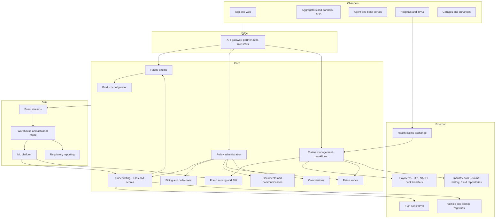
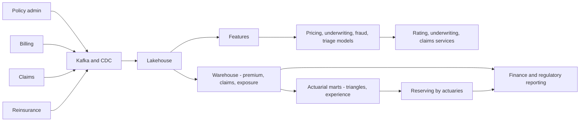

# I09. Insurance Policy & Claims Platform

!!! abstract "Chapter at a glance"
    **Sector:** Insurance (India) · **Format:** system design walkthrough (no code) · **Reader bands:** B1 → B4 · **Builds on:** [I04](i04-hospital-ehr-and-telemedicine.md) (cashless hospital claims), [Ch 45](../05-case-studies/45-payment-system.md), [Ch 13](../02-distributed-core/13-distributed-transactions.md), [Ch 21](../03-production/21-data-at-scale.md)

    **What you get:** the design of a digital insurer selling **health**, **motor** and **term life** policies through its app, agents, banks and aggregators. It covers:

    - the **product and rating engine** (how a premium is calculated), quotes, **underwriting**, policy issuance;
    - **endorsements** (mid-term changes), renewals, premium collection;
    - **claims:** first notice of loss, health cashless and reimbursement, motor surveys with photos, life claims, fraud detection, settlement;
    - **reinsurance**, **actuarial reserving**, finance and regulatory reporting;
    - **the algorithms:** GLM pricing, rules engines, underwriting scores, telematics, image-based damage assessment, fraud networks, claims triage, chain-ladder reserves, lapse prediction;
    - **the data platform** and **tech stack**, with India specifics (IRDAI, NHCX, Bima Sugam).

    **Reading time:** 80 min.

!!! warning "Regulatory content"
    Insurance in India is regulated by IRDAI. Product approval, policyholder protection (free-look periods, claim timelines, grievance redressal), distribution rules, solvency and reporting requirements change over time. Every regulatory statement here is a summary marked **VERIFY**. Commercial core systems are mentioned as common market options, not endorsements. Pricing and reserving methods must be owned by qualified actuaries.

---

## 1. The System in One Page

### 1.1 How an insurer works

An insurer **collects premiums now and pays claims later**. Its software must:

1. **Price** each risk correctly: too cheap loses money, too expensive loses customers.
2. **Issue and administer** policies exactly as the contract says, for years (life policies for decades).
3. **Pay valid claims fast**, and detect invalid ones.
4. **Hold enough reserves** for claims not yet reported, and share large risks with reinsurers.
5. **Prove all of this** to the regulator, auditors and policyholders.

### 1.2 Main systems

| System | What it does |
|---|---|
| **Product configurator** | Defines products: coverages, options, eligibility, rating factors, rules, documents |
| **Rating engine** | Computes premium from risk factors and product rules |
| **Distribution** | App/web, agents, brokers, banks (bancassurance), aggregators; commissions |
| **Quote and underwriting** | Collects risk data, applies rules and scores, decides accept/load/decline/refer |
| **Policy administration (PAS)** | Issuance, policy documents, endorsements, renewals, cancellations, lapses and revivals |
| **Billing and collections** | Premium payments, instalments, mandates (NACH/UPI AutoPay), grace periods |
| **Claims management** | Intake, validation, investigation, assessment, approval, payment, recovery |
| **Health TPA / cashless** | Hospital pre-authorisation, network hospitals, tariffs, bill auditing |
| **Motor surveys and garages** | Surveyor assignment, photo/video inspection, garage network, repair estimates |
| **Fraud and SIU** | Fraud scoring, network analysis, the special investigations unit's case management |
| **Reinsurance** | Treaties, cessions, recoveries, bordereaux |
| **Actuarial and finance** | Reserves (IBNR), experience analysis, financial and regulatory reporting |
| **Customer service** | Contact centre, grievances, self-service |
| **Documents and communications** | Policy wordings, schedules, letters, e-policies |
| **Data platform** | Warehouse, actuarial data marts, ML |

### 1.3 Scale for this design (assumptions)

| Quantity | Value |
|---|---|
| Policies in force | 8M (health 3M, motor 4.5M, life 0.5M) |
| New policies per day | 20k; quotes per day 1M (aggregators generate many) |
| Renewals per day | ~15k |
| Claims per day | ~8k (health cashless dominate), with seasonal and catastrophe spikes (floods, epidemics) |
| Documents | ~50M documents/year (proposals, bills, photos, reports) |

**Estimation highlights:**

- **Quotes dwarf policies (50:1)**, especially from aggregators. The rating engine must be fast and cacheable. Quote storage has short retention unless converted.
- **Claims are the operational heart.** Each claim involves documents, people and payments over days or weeks. That makes it a **workflow** problem more than a throughput one.
- **Catastrophes create sudden claim volumes:** motor and home claims after a flood can reach ten times normal in a week. They need surge operations and simplified processes.

---

## 2. Requirements

### 2.1 Functional

1. Launch new products and variants quickly by configuration, after regulatory approval (VERIFY the file-and-use process).
2. Quote in under a second for aggregators and the app. Buy online with e-KYC and payment. Receive the policy document instantly.
3. Underwrite automatically where possible (straight-through), refer complex cases to human underwriters, request medical tests for life and health when needed.
4. Handle mid-term changes (add a family member, change a vehicle, change a nominee) with pro-rata premium adjustments.
5. Renewals with reminders, auto-debit, and no-claim bonus/discount rules. Life policies: premium due, grace periods, lapse, revival.
6. Claims:
    - **health cashless** (hospital-initiated pre-auth) and **reimbursement** (customer uploads bills);
    - **motor** own-damage and third party, with surveys;
    - **life** death claims with nominee verification.

    All with status tracking and timelines.
7. Fraud detection and investigation workflows.
8. Reinsurance cessions and recoveries; reserves; regulatory returns.
9. Grievances and ombudsman escalations (VERIFY processes).

### 2.2 Non-functional

| Attribute | Target |
|---|---|
| **Quote latency** | p95 < 500 ms including external lookups (vehicle registry, KYC checks) |
| **Correctness** | Premiums, endorsements and claim payments exactly per contract terms; every change versioned |
| **Auditability** | Full history of every policy and claim decision with who/what/why |
| **Longevity** | Policies administered for decades; product versions preserved forever |
| **Availability** | Sales channels and cashless approvals ≥ 99.9%; hospital pre-auth within regulatory timelines (VERIFY) |
| **Privacy** | Health and personal data protected; consent-based data use (DPDP Act; VERIFY) |

---

## 3. High-Level Architecture

**Key decisions:**

| Decision | Choice | Why |
|---|---|---|
| **Products as configuration** | A product configurator with versioned product definitions (coverages, rules, rate tables) interpreted by the rating, underwriting and policy engines | New products without code changes; old versions preserved for in-force policies |
| **Policy data model** | **Bitemporal**: effective dates (when a change applies in the contract) and recorded dates (when we learned it) | Back-dated endorsements, audits, "what did we know when" |
| **Claims** | Workflow engine with human tasks, SLAs and rules | Long-running, multi-party processes ([Ch 50](../05-case-studies/50-distributed-job-scheduler.md)) |
| **Buy vs build** | Many insurers buy a core suite (policy/billing/claims) and build digital channels, rating services, fraud and data around it | Mature domain, regulatory features; differentiation is at the edges |
| **Integration** | APIs for partners, events internally, file exchanges where industry partners require them | Real-world mix |

---

## 4. How It Works — Journeys End to End

### 4.1 Journey 1: buying motor insurance on an aggregator

1. **Quote request:** the customer enters their vehicle registration number on an aggregator site, which calls the insurer's **quote API**.
2. **Enrichment:**
    - the insurer fetches vehicle details (make, model, variant, fuel, registration date) from a vehicle registry integration (VERIFY data-access arrangements);
    - checks previous insurance and claims history through industry data where available (VERIFY);
    - looks up the **insured declared value (IDV)** from depreciation schedules.
3. **Rating** (§6.1): base premium from rate tables by vehicle class, zone and age, then adjustments:
    - **No Claim Bonus** carried from the previous policy (VERIFY current NCB slabs);
    - add-ons (zero depreciation, engine protection, roadside assistance);
    - voluntary deductible;
    - the insurer's pricing model loading or discount within filed ranges;
    - taxes (GST).

    Third-party premium is set by the regulator (VERIFY).
4. **Response:** the quote returns within hundreds of milliseconds with a **quote ID** valid for a short time. Aggregators may show 20 insurers side by side.
5. **Purchase:** the customer selects and pays.
    - **KYC** is mandatory for all policies now (VERIFY), done with CKYC lookup or e-KYC.
    - **Break-in cases** (expired policy) need a **self-inspection**: the customer records a guided video or photos of the car in the app. An image model checks for damage and fraud (§6.5), and a human reviews exceptions.
6. **Issuance:**
    - underwriting rules pass;
    - the policy is created in PAS;
    - the premium is recorded in billing;
    - commission is accrued for the aggregator;
    - the **policy document** is generated (schedule plus wordings) and emailed instantly.
7. **Downstream:** the policy is reported to industry and regulatory repositories as required (VERIFY), and becomes a reinsurance cession if a treaty covers it.

### 4.2 Journey 2: buying a family health policy in the app

1. **Proposal:** the customer adds members (ages, pre-existing conditions, lifestyle questions).
2. **Underwriting rules:**
    - **accept** at standard rates (young, no conditions);
    - **accept with loading** or a waiting period for declared conditions;
    - **refer** to medical underwriting (tele-medical interview or medical tests at partner labs);
    - **decline** outside appetite.

    A **score** (§6.3) orders referrals by risk.
3. **Pricing:** premium by age band per member, sum insured, zone (city tier), deductibles, add-ons. The family floater discount is applied.
4. **Payment and mandate:** annual payment, or instalments via NACH/UPI AutoPay mandates.
5. **Issuance:** the policy with **waiting periods** recorded per member and condition. A **health card** is issued (digital) for cashless use.
6. **Free-look period:** the customer can cancel within a set number of days for a refund minus proportionate costs (VERIFY the current period and rules). The PAS supports this as a special cancellation.

### 4.3 Journey 3: a cashless hospital claim

1. **Admission and pre-auth request:** the patient is admitted to a network hospital. The hospital's insurance desk sends a **pre-authorisation request** with the diagnosis, planned treatment, estimated cost and doctor notes. It arrives via the insurer's TPA portal/API or the **National Health Claims Exchange** (NHCX, FHIR-based; VERIFY adoption) ([I04](i04-hospital-ehr-and-telemedicine.md) §4.4).
2. **Coverage checks** (automated first):
    - policy in force;
    - member covered;
    - waiting periods passed for this condition;
    - sum insured available (after previous claims);
    - sub-limits (room rent caps, disease-specific limits);
    - exclusions;
    - hospital in network with an agreed **package tariff**.
3. **Medical adjudication:**
    - rules auto-approve standard packages (e.g. cataract surgery at the agreed tariff);
    - otherwise a **medical officer** reviews: are the treatment and length of stay appropriate for the diagnosis?
    - queries go back to the hospital as tasks.
4. **Approval:** within the regulatory timeline for pre-auth decisions (VERIFY). An **approved amount** is issued, with enhancements if the stay extends.
5. **Discharge:**
    - the hospital submits the **final bill** with itemisation and discharge summary;
    - **bill audit** (§6.7) checks items against the tariff, flags non-payables (consumables excluded by policy) and applies co-pay and deductibles;
    - final approval is issued, again within timelines (VERIFY);
    - the patient pays the non-payables and leaves.
6. **Settlement:** the insurer pays the hospital via bank transfer in batches, reconciled per claim.
7. **Accounting:** the claim updates the **sum insured utilisation**, the **no-claim bonus** status for renewal, reserves (§6.8) and reinsurance recoveries.

### 4.4 Journey 4: a motor accident claim

1. **FNOL (first notice of loss):** in the app, the customer records the accident location, photos and description, and chooses a garage.
2. **Triage:**
    - small, simple claims with clear photos go to **AI-assisted assessment**: damage detection and estimate by part (§6.5), within a threshold;
    - larger or suspicious claims get a **surveyor** (licensed, per regulation; VERIFY thresholds for mandatory surveys);
    - **third-party injury claims** follow legal processes (motor accident claims tribunals) and are handled separately, with long durations.
3. **Survey:**
    - the surveyor inspects, virtually or in person, and records findings in the surveyor app;
    - the garage submits a repair estimate;
    - the system compares the estimate to part price catalogues and labour norms;
    - **depreciation** is applied per part material, unless a zero-depreciation add-on applies.
4. **Approval:** the repair is authorised. After repair, a **re-inspection** (photos) is done. The insurer pays the garage directly (cashless garage), or reimburses the customer.
5. **Fraud checks** throughout (§6.6): inconsistent photos, previously claimed damage (image similarity against past claims), staged accident patterns, linked parties.
6. **Recovery:**
    - **salvage** for total losses (the vehicle is sold via auction);
    - **subrogation** against a third party's insurer where applicable.

### 4.5 Journey 5: a life insurance death claim

1. **Intimation:** the nominee intimates the claim via the app, branch or call centre, with the death certificate, policy details, and their own KYC and bank details.
2. **Validation:** policy in force at the date of death, no lapse, and nominee identity verified.
3. **Early claims** (e.g. within the first few years) may be **investigated** for non-disclosure, within legal limits on contestability (VERIFY Section 45 of the Insurance Act as amended).
4. **Decision and payment:** payment to the nominee's verified account within regulatory timelines, with interest for delays where required (VERIFY). Reinsurance recovery for amounts above retention.

### 4.6 Journey 6: renewal and lapse

1. **Reminders:** renewal notices go out before expiry by email, SMS and app. For **motor and health**, the renewal premium is recalculated (age band change, NCB, claims experience, rate revisions).
2. **Auto-renewal:** where a mandate exists, the premium is debited after the pre-debit notification (VERIFY rules).
3. **Grace periods:** during the grace period, cover continuity rules apply per product (VERIFY).
    - **Health:** continuity preserves waiting-period credit.
    - **Life:** unpaid premiums lead to **lapse** after the grace period. **Revival** is possible within a window, with arrears plus interest and possibly fresh underwriting.
4. **Lapse prediction** (§6.9) triggers targeted outreach before due dates.

---

## 5. Core Subsystems in Depth

### 5.1 Product configurator

- **A product definition** includes:
    - coverages and benefits;
    - options and add-ons;
    - eligibility rules;
    - rating factors and rate tables;
    - underwriting rules;
    - policy wording templates;
    - claims rules (waiting periods, sub-limits, exclusions, co-pays);
    - commission rules;
    - regulatory identifiers.
- **Versioned with effective dates.** A policy is always administered under the product version it was sold on, or renewed into, per rules.
- **Output:** a machine-readable product model interpreted by the rating engine, the underwriting engine, PAS and claims. One definition, many consumers, which avoids inconsistencies between quoting and claims.
- **Testing:** every product version has test cases (premium examples filed with the regulator, claims examples) run automatically before release.

### 5.2 Rating engine

- **Stateless and fast.** Input: risk data + product version. Output: premium breakdown (per coverage, loadings, discounts, taxes).
- **Rate tables** are loaded in memory. Pricing models (§6.1) are served as tables or model artefacts.
- **Aggregator traffic:** very high quote volumes with low conversion. **Cache** quotes by risk signature (vehicle variant + zone + age + NCB + add-ons) for minutes. Rate-limit per partner.
- **Explainability:** every quote stores its factor contributions, for disputes and regulatory review.

### 5.3 Policy administration with bitemporal data

- **Policy versions:** each change (endorsement) creates a new version with an **effective date range** (when the change applies in the contract) and a **transaction time** (when it was recorded).
- **Back-dated changes** (e.g. a vehicle change effective last week) produce premium adjustments computed pro-rata for the affected period.
- **Queries:**
    - "what cover applied on the accident date?" uses effective time;
    - "what did we know when we approved that claim?" uses transaction time.
- **Documents:** endorsement schedules generated per version.
- **Cancellations:** pro-rata or short-period scales per rules. Refund computation and payment.

### 5.4 Billing and collections

- **Payment modes:** single premium, instalments (monthly or quarterly), mandates (NACH, UPI AutoPay; VERIFY limits and pre-debit rules), card, net banking.
- **Premium allocation:** premium receivable accounts per policy; unallocated receipts handled by rules.
- **Dunning:** failed debits → retry → notify → grace period → lapse or cancellation per product.
- **Integration** with finance: premium income recognition, GST, commission payable.

### 5.5 Claims management

- **A claim is a case with a workflow:**
    1. intake (FNOL);
    2. coverage verification;
    3. triage (complexity, fraud score, value);
    4. assignment (automation, adjuster, surveyor, medical officer);
    5. investigation;
    6. assessment;
    7. approval (authority limits by role and amount);
    8. payment;
    9. recovery (reinsurance, salvage, subrogation);
    10. closure, and reopen if needed.
- **Human tasks** with SLAs. **Authority matrices** (who can approve how much). Maker-checker for payments above thresholds.
- **Reserves per claim:** an initial reserve at intimation (by triage model), updated as information arrives. These **case reserves** feed actuarial reserving.
- **Straight-through processing (STP):** simple claims (low value, clear coverage, low fraud score) auto-approve and pay within minutes, e.g. small OPD health claims or windshield replacement.
- **Communication:** status updates to customers and hospitals, and document requests as tasks visible in the app.

### 5.6 Reinsurance

- **Treaties:**
    - **quota share:** a fixed percentage of every policy ceded;
    - **surplus:** amounts above the retention ceded, per policy;
    - **excess of loss:** the reinsurer pays losses above a threshold per event or per risk;
    - **catastrophe** covers.
- **Cessions:** computed per policy (at issuance and endorsement), with cession premiums.
- **Recoveries:** computed per claim or per event (catastrophes aggregate many claims).
- **Bordereaux** (listings) are sent to reinsurers periodically. Reinsurance accounting is reconciled.
- **Facultative reinsurance** for individual large risks outside treaties (a workflow with reinsurer quotes).

### 5.7 Fraud management

- **Scoring at key points:** policy issuance (application fraud), claim intimation, and before payment.
- **Rules:**
    - claims soon after inception;
    - high-value claims just below approval thresholds;
    - repeated claimants;
    - hospitals or garages with outlier patterns.
- **Models:** supervised (from past confirmed fraud) plus anomaly detection.
- **Network analysis (§6.6):** links between claimants, garages, hospitals, doctors, phones, bank accounts and addresses reveal rings.
- **SIU case management:** investigation tasks, evidence, outcomes that feed back as labels.
- **Industry sharing:** fraud repositories and claims history databases shared across insurers, where regulated (VERIFY).

---

## 6. Algorithms

### 6.1 Pricing with generalised linear models

- **Frequency × severity:**
    - model claim **frequency** (claims per policy-year) with a **Poisson GLM** (log link);
    - model claim **severity** (cost per claim) with a **Gamma GLM** (log link);
    - pure premium = frequency × severity.

    With log links, factors multiply: premium = base × factor(age) × factor(zone) × factor(vehicle)…
- **Tweedie GLMs** model pure premium directly.
- **Credibility and smoothing:** sparse cells are smoothed, e.g. a rare vehicle model gets credibility-weighted factors between its own experience and its group's.
- **Gradient-boosted models** capture interactions but must be explainable and filed. Many insurers use GBMs to find interactions, then encode them in GLM-style tables for filing and transparency (VERIFY local product filing rules).
- **Final premium:** pure premium + expense loadings + profit margin + commissions + taxes, within approved rate ranges.

### 6.2 Rules engines

- **Underwriting, eligibility and claims coverage rules** are expressed declaratively: "if age > 55 and sum insured > 50 lakh then refer".
- **Engines:** the Rete algorithm (e.g. Drools) evaluates many rules efficiently by sharing conditions and incrementally matching facts. Decision tables are for business users.
- **Governance:** versioned rule sets tied to product versions, test suites, and audit of which rules fired for each decision.

### 6.3 Underwriting scoring

- **A risk score** from applicant data (age, BMI, declared conditions, occupation, income-to-cover ratio), external data (bureau-based signals where permitted; VERIFY), and medical test results.
- **Decisions:** thresholds map the score to bands (accept, loading, referral, decline), with rules as guard rails.
- **Accelerated underwriting:** lower-risk applicants skip medical tests. The model must control **mortality/morbidity slippage**, monitored against actual claims experience.
- **Fairness:** exclude prohibited factors; monitor outcomes across groups (VERIFY applicable rules).

### 6.4 Telematics (usage-based motor insurance)

- **Data:** trips from a phone app or device: distance, time of day, speeding relative to road limits, harsh braking and acceleration, phone use while driving.
- **Driving score:** event rates per 100 km weighted by severity and exposure. Premium discounts are tied to the score (VERIFY regulatory framework for pay-as-you-drive products).
- **Pipeline:** sensor streams → trip segmentation → map matching ([I05](i05-ride-hailing.md) §6.5) → event detection → aggregation per policy period.

### 6.5 Image-based damage assessment

- **Guided capture** ensures angles and coverage. Photo metadata checks: time, location, device consistency.
- **Computer vision models:**
    - **part detection** (bumper, door, headlamp);
    - **damage detection and classification** (scratch, dent, crack);
    - **severity** → repair vs replace decisions.
- **Estimate:** parts price catalogue + labour norms + paint → estimated cost. The confidence decides auto-approve or survey.
- **Fraud:**
    - **perceptual hashing** against past claim photos (reused images; [I07](i07-messaging-and-social-feed.md) §6.8);
    - edited image detection;
    - odometer and plate consistency.

### 6.6 Fraud networks

- **Graph:** nodes = policyholders, claims, vehicles, garages, hospitals, doctors, phones, emails, bank accounts, addresses; edges = relationships.
- **Detection:**
    - **connected components and community detection** find rings;
    - **centrality** finds hubs (a garage linked to many suspicious claims);
    - **graph features** (degree, shared attributes) feed supervised models.
- **Entity resolution** first: the same person with different spellings or phones ([I04](i04-hospital-ehr-and-telemedicine.md) §6.1 patterns).

### 6.7 Claims triage and bill auditing

- **Triage model:** predicts complexity, expected cost and fraud risk at intimation. It routes to STP, a junior or senior adjuster, or the SIU, and sets the initial reserve.
- **Health bill audit:**
    - map bill items to standard codes;
    - compare with the package tariff and reasonable-cost benchmarks for the diagnosis and city;
    - flag non-payable consumables per regulatory lists (VERIFY), duplicate charges, and room-rent proportionate deductions.
- **Length-of-stay benchmarks** per diagnosis flag outliers for medical review.

### 6.8 Reserving (IBNR) with the chain-ladder method

- **The problem:** at any date, some claims have happened but aren't reported yet (IBNR), and reported claims will still develop. Reserves must cover the ultimate cost.
- **Chain ladder:**
    - arrange paid (or incurred) claims in a **triangle**: rows = accident period, columns = development period;
    - compute **age-to-age development factors** as the ratio of cumulative claims between consecutive development periods, weighted across accident periods;
    - multiply the latest diagonal by the remaining factors to project **ultimate** claims per accident period;
    - IBNR = ultimate − reported.
- **Variants:** Bornhuetter–Ferguson (blending expected loss ratio for immature periods), Mack's method for uncertainty, stochastic bootstraps.
- **Systems role:** the data platform produces **clean triangles** by product, line and period, reconciled with finance. Actuaries run and sign off models.

### 6.9 Lapse and renewal prediction

- **Model:** classifier on payment history, tenure, channel, premium change at renewal, engagement and claims experience.
- **Use:** targeted reminders, agent follow-ups, offering instalments. Measured by uplift experiments.

---

## 7. Data Architecture

### 7.1 Operational stores

| Data | Store (reference) | Notes |
|---|---|---|
| Product definitions, rules, rate tables | Versioned configuration store (Git-backed + database) | Released as artefacts |
| Policies (bitemporal) | PostgreSQL / core suite database | Versions with effective and transaction time |
| Claims and workflows | Workflow engine store + PostgreSQL | Tasks, SLAs, audit |
| Billing and ledgers | Relational with double-entry | [Ch 45](../05-case-studies/45-payment-system.md) |
| Documents | Object storage + DMS metadata | Encrypted; retention per regulation |
| Quotes | KV with TTL + warehouse copy for analytics | High volume, low conversion |
| Fraud graph | Graph database or graph tables in the warehouse | Updated daily and on events |

### 7.2 Warehouse and actuarial data

- **CDC/events** from PAS, billing, claims and reinsurance → lakehouse → **warehouse**.
- **Core subject areas:**
    - **policy/exposure:** earned exposure per policy per period;
    - **premium:** written and earned;
    - **claims:** transactions, payments, reserves by date;
    - **reinsurance:** ceded premium, recoveries;
    - **commissions**;
    - **customer**.
- **Actuarial marts:** exposure and claims per accident period and development period (triangles), per product and line. Experience studies (loss ratios by factor, mortality and morbidity experience vs expected).
- **Finance and regulatory reporting:** premium, claims, reserves, solvency calculations, and regulatory returns in prescribed formats (VERIFY IRDAI reporting and Ind AS 117 / IFRS 17 adoption status).
- **IFRS 17-style accounting** (if adopted) needs grouping of contracts, cash flow projections and a contractual service margin, a significant data and calculation engine in its own right (VERIFY).

### 7.3 ML platform

- **Models:** pricing support, underwriting scores, lapse, claims triage, fraud, image damage, bill audit anomalies, catastrophe exposure analysis.
- **Governance:**
    - model risk management (validation, documentation);
    - explainability for decisions affecting customers;
    - monitoring for drift (e.g. inflation changes severity);
    - human override paths.

### 7.4 Data flow

---

## 8. Tech Stack (reference choice)

| Layer | Choice | Notes |
|---|---|---|
| Core policy/billing/claims | Commercial suite (e.g. Guidewire, Duck Creek, or Indian vendors) or built on Java/Spring | Many insurers buy; digital layers are built |
| Rating and underwriting | Java/Kotlin services; Drools for rules; model serving | Fast, explainable |
| Workflows | Camunda/Temporal (BPMN for human tasks) | Claims and underwriting referrals |
| APIs | Spring Boot, API gateway with partner management | Aggregator scale |
| Databases | PostgreSQL; Redis for quote cache | Proven |
| Documents | Object storage + DMS; templating for policy documents | Long retention |
| Messaging | Kafka + Debezium CDC | Events to data platform |
| Lakehouse/warehouse | Iceberg + Spark + Trino, or a cloud warehouse (in-country per rules) | Actuarial marts |
| BI | Superset/Power BI | Finance and ops dashboards |
| ML | Python (scikit-learn, XGBoost, PyTorch for images), MLflow | Model governance |
| Graph | Neo4j or graph features in the warehouse | Fraud rings |
| Mobile | Native or cross-platform app with guided photo/video capture | Self-inspection, FNOL |
| Platform | Kubernetes, Terraform, Argo CD | Standard |

---

## 9. Security, Privacy & Compliance

- **Health data:** strict access by role and claim assignment, and audit ([I04](i04-hospital-ehr-and-telemedicine.md) §10 patterns). Consent for data use. DPDP Act obligations (VERIFY).
- **KYC/AML:** KYC for all policies, sanctions and PEP screening, suspicious transaction reporting for large premiums or refunds (VERIFY).
- **Policyholder protection:**
    - free-look;
    - claim decision and payment timelines;
    - grievance redressal with escalation to the Bima Bharosa system and ombudsman;
    - disclosure of rejection reasons (VERIFY current rules).
- **Distribution compliance:** commission and expense limits, disclosure by intermediaries, aggregator rules (VERIFY).
- **Industry platforms:** **Bima Sugam**, an IRDAI-backed insurance marketplace platform in development, and insurance repositories for e-policies (VERIFY current status).
- **Cybersecurity:** IRDAI information and cyber security guidelines (VERIFY).

---

## 10. Reliability & Operations

- **Channel availability:** quote and buy APIs are horizontally scaled and stateless. Aggregator traffic is rate-limited per partner. Rating is cached.
- **Cashless approvals** must work 24×7. The TPA and medical officer workflow needs on-call coverage. System outages delay patient discharges.
- **Catastrophe mode:** after floods or cyclones, activate simplified claims processes:
    - self-survey with photos;
    - relaxed documentation per regulator advisories (VERIFY);
    - surge surveyor allocation;
    - dedicated dashboards;
    - reserve estimates per event for reinsurance notification.
- **Month-end and year-end:** closing processes (earned premium, reserves, reinsurance accounting) run as scheduled pipelines with reconciliation checks.
- **Data quality:** exposure and claims data errors directly distort pricing and reserves. Build validation rules into pipelines and reconcile with finance.

---

## 11. Key Trade-offs

| Decision | Chosen | Accepted cost |
|---|---|---|
| Core systems | Buy a suite, build the edges | Vendor constraints; integration work |
| Product definition | Configuration-driven, versioned | Configurator complexity |
| Policy data | Bitemporal | Harder queries and storage |
| Claims | Workflows with STP for simple cases | Model risk in auto-approvals |
| Pricing | GLM tables (with ML insights) | Less flexible than pure ML |
| Fraud | Rules + models + graphs + SIU | Investigation cost; false positives |
| Reserving | Actuarial models on clean triangles | Data engineering effort |

---

## 12. Interview Q&A

### Beginner B1

??? question "Q1 [B1] ⭐ What are the core systems of an insurance company?"

    **30-second answer:** Product configuration and rating, distribution channels, underwriting, policy administration (issuance, endorsements, renewals), billing and collections, claims management, fraud, reinsurance, actuarial and finance, customer service, and a data platform for reporting and pricing.

    **Deep answer:** §1.2.

    **Trade-offs I'd call out:** Buy a suite vs build.

    **Follow-ups:**
    1. Most complex? → Claims.
    2. Most changed? → Products and pricing.

    **Red flags:** "It's just a CRUD app for policies."

??? question "Q2 [B1] How is a motor insurance premium calculated?"

    **30-second answer:** From vehicle details (class, age, value), zone, the insured declared value, no-claim bonus, add-ons and deductibles through rate tables and model-based loadings, plus the regulated third-party premium and taxes.

    **Deep answer:** §4.1, §6.1 (VERIFY current rules).

    **Trade-offs I'd call out:** Speed vs enrichment lookups.

    **Follow-ups:**
    1. NCB? → Discount for claim-free years.
    2. Aggregators? → Cached quotes.

    **Red flags:** Hard-coded premiums in code.

??? question "Q3 [B1] What happens in a cashless hospital claim?"

    **30-second answer:** The hospital requests pre-authorisation; the insurer checks policy coverage, waiting periods, limits and network tariffs; a medical officer reviews if needed; an approved amount is issued; at discharge the final bill is audited; the insurer pays the hospital and the patient pays non-payables.

    **Deep answer:** §4.3.

    **Trade-offs I'd call out:** Speed vs checks.

    **Follow-ups:**
    1. Timelines? → Regulatory limits.
    2. Enhancements? → For longer stays.

    **Red flags:** Only reimbursement claims.

??? question "Q4 [B1] What is an endorsement?"

    **30-second answer:** A mid-term change to a policy — adding a member, changing a vehicle or address — creating a new policy version with an effective date and, often, a pro-rata premium adjustment.

    **Deep answer:** §5.3.

    **Trade-offs I'd call out:** Versioning complexity.

    **Follow-ups:**
    1. Back-dated? → Bitemporal data.
    2. Documents? → Endorsement schedule.

    **Red flags:** Overwriting the policy row.

### Intermediate B2

??? question "Q5 [B2] ⭐ Why use a bitemporal data model for policies?"

    **30-second answer:** Changes can apply from a past or future date (effective time) and are recorded at a different time (transaction time); claims need "what cover applied on the loss date" and audits need "what did we know when we decided" — both require keeping both timelines.

    **Deep answer:** §5.3.

    **Trade-offs I'd call out:** Query and storage complexity.

    **Follow-ups:**
    1. Example? → Back-dated vehicle change.
    2. Implementation? → Valid-from/to plus recorded-at columns.

    **Red flags:** Only the latest state.

??? question "Q6 [B2] How do you launch new insurance products quickly?"

    **30-second answer:** A product configurator with versioned definitions (coverages, rules, rate tables, wordings, claims rules) consumed by rating, underwriting, policy and claims engines, with automated test cases per version — code changes only for genuinely new behaviour.

    **Deep answer:** §5.1.

    **Trade-offs I'd call out:** Configurator complexity vs speed.

    **Follow-ups:**
    1. Old policies? → Stay on their version.
    2. Regulatory approval? → Before release (VERIFY).

    **Red flags:** Product logic scattered in code.

??? question "Q7 [B2] How would you handle aggregator quote traffic?"

    **30-second answer:** Stateless, horizontally scaled rating with in-memory tables, caching by risk signature, per-partner rate limits and quotas, fast external lookups with fallbacks, short quote retention, and monitoring conversion per partner.

    **Deep answer:** §5.2.

    **Trade-offs I'd call out:** Cache freshness vs cost.

    **Follow-ups:**
    1. Registry outage? → Manual details path.
    2. Price changes? → Cache invalidation by version.

    **Red flags:** Full underwriting per quote.

??? question "Q8 [B2] How do claims workflows work?"

    **30-second answer:** A case moves through intake, coverage checks, triage, assignment, investigation, assessment, authority-based approval, payment and recovery, with human tasks, SLAs, reserves updated along the way, and straight-through processing for simple low-risk claims.

    **Deep answer:** §5.5.

    **Trade-offs I'd call out:** Automation vs control.

    **Follow-ups:**
    1. Authority limits? → Matrix by role/amount.
    2. Reopen? → Allowed with audit.

    **Red flags:** Email-driven claims.

??? question "Q9 [B2] What is reinsurance and how does the system support it?"

    **30-second answer:** Insurers transfer part of their risk to reinsurers via treaties (quota share, surplus, excess of loss, catastrophe) or facultative deals; the system computes cessions per policy, recoveries per claim or event, and produces bordereaux and reinsurance accounting.

    **Deep answer:** §5.6.

    **Trade-offs I'd call out:** Accuracy vs batch timing.

    **Follow-ups:**
    1. Catastrophe? → Event aggregation.
    2. Retention? → Per treaty.

    **Red flags:** Spreadsheet reinsurance.

### Senior B3

??? question "Q10 [B3] ⭐ How would you price motor insurance with data?"

    **30-second answer:** Frequency (Poisson GLM) × severity (Gamma GLM) with log links giving multiplicative factors, credibility smoothing for sparse cells, ML to discover interactions then encoded in explainable tables, plus expense and profit loadings, within filed ranges — and monitor actual vs expected.

    **Deep answer:** §6.1.

    **Trade-offs I'd call out:** Accuracy vs explainability and filing.

    **Follow-ups:**
    1. Telematics? → Behaviour-based factors.
    2. Inflation? → Severity trends.

    **Red flags:** One flat rate per vehicle class.

??? question "Q11 [B3] ⭐ How do you detect insurance fraud rings?"

    **30-second answer:** Entity resolution across people, vehicles, providers, phones, bank accounts and addresses; build a graph; find communities and hubs; combine graph features with rules and supervised models; route high scores to the SIU; feed outcomes back as labels.

    **Deep answer:** §5.7, §6.6.

    **Trade-offs I'd call out:** False positives delay honest claims.

    **Follow-ups:**
    1. Garages? → Outlier patterns.
    2. Photos? → Perceptual hashing.

    **Red flags:** Only per-claim rules.

??? question "Q12 [B3] How would AI-assisted motor claims work safely?"

    **30-second answer:** Guided photo capture, metadata checks, part and damage detection models producing a repair estimate from parts catalogues and labour norms, confidence thresholds for auto-approval of small claims, surveys for the rest, and image-reuse and editing detection — with human override and monitoring.

    **Deep answer:** §4.4, §6.5.

    **Trade-offs I'd call out:** Speed vs leakage.

    **Follow-ups:**
    1. Thresholds? → By value and confidence.
    2. Drift? → New car models.

    **Red flags:** Fully automated high-value claims.

??? question "Q13 [B3] How do you compute IBNR reserves, and what does the data platform provide?"

    **30-second answer:** Actuaries use development triangles (accident vs development period) and methods like chain ladder or Bornhuetter–Ferguson to project ultimate claims; IBNR is ultimate minus reported; the data platform must produce clean, reconciled triangles per product and period.

    **Deep answer:** §6.8, §7.2.

    **Trade-offs I'd call out:** Method choice vs data maturity.

    **Follow-ups:**
    1. Uncertainty? → Mack, bootstrap.
    2. Reconciliation? → With finance.

    **Red flags:** Reserves from current open claims only.

??? question "Q14 [B3] How do you audit hospital bills automatically?"

    **30-second answer:** Map items to standard codes, compare against package tariffs and cost benchmarks by diagnosis and city, apply policy rules (room-rent limits, co-pays, non-payables lists), flag duplicates and length-of-stay outliers, and route exceptions to medical officers.

    **Deep answer:** §6.7.

    **Trade-offs I'd call out:** Automation vs disputes with hospitals.

    **Follow-ups:**
    1. Standards? → Coding and exchange formats.
    2. Timelines? → Regulatory limits.

    **Red flags:** Manual review of every bill.

### Architect B4

??? question "Q15 [B4] ⭐ Design a digital insurer's platform end to end."

    **30-second answer:** Channel APIs for app, agents and aggregators; product configurator driving rating, underwriting, policy and claims engines; bitemporal policy administration; billing with mandates; claims workflows with STP, fraud scoring and SIU; reinsurance; Kafka to a lakehouse with actuarial marts, finance and regulatory reporting; ML for pricing, underwriting, triage, fraud and images.

    **Deep answer:** §3–§7.

    **Trade-offs I'd call out:** Buy core vs build.

    **Follow-ups:**
    1. Biggest risk? → Data quality for pricing and reserves.
    2. Differentiation? → Claims experience.

    **Red flags:** No actuarial data design.

??? question "Q16 [B4] Buy an insurance core suite or build?"

    **30-second answer:** Buy the heavily regulated, mature core when a suite fits; build the differentiating edges; insist on APIs, events and data access to avoid lock-in.

    **Deep answer:** Evaluate product fit, regulatory features, total cost, vendor lock-in, configurability, APIs and data access; many insurers buy policy/billing/claims cores and build channels, rating services, fraud, data and customer experience around them.

    **Trade-offs I'd call out:** Speed vs control.

    **Follow-ups:**
    1. Migration? → Product by product.
    2. Customisation? → Configure, don't fork.

    **Red flags:** Building everything from scratch.

??? question "Q17 [B4] How would you migrate millions of in-force policies from a legacy system?"

    **30-second answer:** Map product versions and rules carefully, migrate by product or cohort with parallel runs comparing premiums, renewals and claims calculations, reconcile financials, keep legacy read-only for history, and plan cut-over around renewal cycles.

    **Deep answer:** [Ch 28](../03-production/28-schema-and-data-evolution.md), [Ch 16](../02-distributed-core/16-microservices-architecture.md).

    **Trade-offs I'd call out:** Parallel run cost vs risk.

    **Follow-ups:**
    1. Life policies? → Decades of history.
    2. Validation? → Automated comparisons.

    **Red flags:** Big-bang migration.

??? question "Q18 [B4] How do you prepare systems for a catastrophe event?"

    **30-second answer:** Catastrophe mode with simplified self-survey flows, surge assignment of surveyors, event tagging of claims, per-event reserves and reinsurance notifications, capacity for claim intake and document uploads, and dashboards for regulators and management.

    **Deep answer:** §10.

    **Trade-offs I'd call out:** Speed vs fraud risk.

    **Follow-ups:**
    1. Exposure analysis? → Geocoded policies.
    2. Communication? → Proactive outreach.

    **Red flags:** Business as usual.

??? question "Q19 [B4] How do regulations shape insurance systems in India?"

    **30-second answer:** Product approvals and filed rates constrain pricing; policyholder protection sets free-look, claim and grievance timelines; KYC for all policies; distribution and commission rules; data protection; solvency and reporting (and accounting standards) requirements — so rules and timelines must be configurable and auditable (VERIFY current texts).

    **Deep answer:** §9.

    **Trade-offs I'd call out:** Agility vs compliance.

    **Follow-ups:**
    1. Timelines as SLAs? → Workflow timers.
    2. Audit? → Decision logs.

    **Red flags:** Compliance as an afterthought.

??? question "Q20 [B4] What makes insurance data platforms harder than typical analytics platforms?"

    **30-second answer:** Long-lived contracts with bitemporal history, earned vs written measures, development over years, reconciliation with finance, actuarial triangles, regulatory formats, and model governance — errors directly change prices, reserves and solvency.

    **Deep answer:** §7.

    **Trade-offs I'd call out:** Rigor vs speed of insight.

    **Follow-ups:**
    1. Earned premium? → Exposure over time.
    2. Restatements? → Versioned data.

    **Red flags:** Treating it like clickstream analytics.

---

## 13. Summary

1. **An insurer prices risk, administers contracts for years, pays claims and holds reserves.** Each is a distinct system with its own correctness needs.
2. **Configuration-driven products** and a **bitemporal policy model** make changes safe over long lifetimes.
3. **Claims are workflows:** straight-through for simple cases, human expertise for the rest, fraud scoring and network analysis throughout.
4. **Algorithms:** GLM pricing, rules engines, underwriting scores, telematics, computer vision for damage, fraud graphs, bill audits, chain-ladder reserving.
5. **The data platform** serves pricing, reserving, finance and regulators. Data quality errors cost money directly.

### Related chapters

- [I04 — Hospital EHR](i04-hospital-ehr-and-telemedicine.md) · [Ch 45 — Payments](../05-case-studies/45-payment-system.md) · [Ch 13 — Distributed Transactions](../02-distributed-core/13-distributed-transactions.md) · [Ch 21 — Data at Scale](../03-production/21-data-at-scale.md) · [Ch 36 — Compliance](../04-architect/36-compliance-governance-and-data-residency.md)
- Next in this tab: [I10 — Travel & Railway Ticketing](i10-travel-and-railway-ticketing.md)
