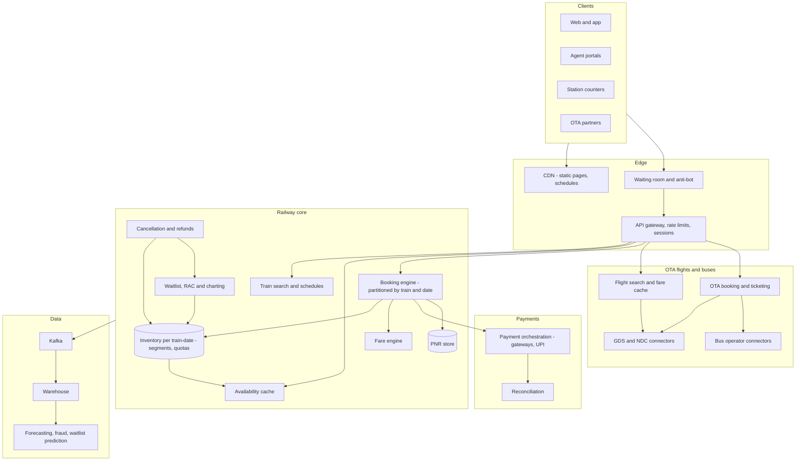
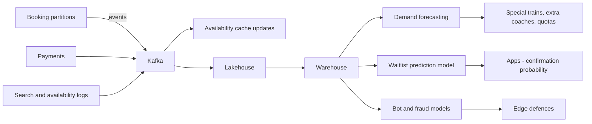

# I10. Travel & Railway Ticketing

!!! abstract "Chapter at a glance"
    **Sector:** Travel and transport · **Format:** system design walkthrough (no code) · **Reader bands:** B1 → B4 · **Builds on:** [Ch 46](../05-case-studies/46-grocery-checkout-and-inventory-reservation.md) (reservation, waiting room), [Ch 48](../05-case-studies/48-delivery-slot-booking-and-capacity.md) (capacity booking), [Ch 45](../05-case-studies/45-payment-system.md), [Ch 39](../05-case-studies/39-distributed-rate-limiter.md)

    **What you get:** two booking systems.

    **1. A national railway reservation system in the IRCTC style:**

    - the train inventory model (seats by **segment** along a route, quotas, classes);
    - berth allocation, waitlists and RAC;
    - charting, cancellations and refunds;
    - the **Tatkal rush**, when a large share of the day's demand arrives in the first minutes after the window opens;
    - bots and agents, payments at peak.

    **2. An online travel agency (OTA) for flights and buses:**

    - flight search across airlines through GDS and NDC connections;
    - fare caching and the look-to-book problem;
    - booking and ticketing, schedule changes;
    - bus aggregator inventory.

    **Also covered:**

    - the algorithms: segment inventory with bitsets, berth allocation, waitlist confirmation prediction, fare caching and invalidation, admission control, bot detection, dynamic fares, demand forecasting;
    - the data platform and tech stack.

    **Reading time:** 85 min.

!!! warning "Sources and honesty"
    - Indian Railways' reservation system (PRS) is built and run by CRIS, and ticketing on the web is through IRCTC. Their internal designs are not fully public.
    - Rules such as quota types, **Tatkal opening times**, advance reservation period, charting times, refund rules and ID requirements change over time and are summarised with **VERIFY**.
    - GDS, NDC and airline rules are industry standards and practices, also marked **VERIFY** where specific.
    - This is a **reference design**.

---

## 1. The System in One Page

### 1.1 Why train ticketing is special

A flight is one hop: 180 seats from A to B. A long-distance train is **one vehicle serving many journeys**. A berth from Delhi to Mumbai via 20 stations can be sold to one passenger for Delhi → Kota and another for Kota → Mumbai. The system must:

- track each berth's occupancy **per segment** of the route;
- apply **quotas**: general, Tatkal, ladies, senior citizen, and pooled quotas for intermediate stations (VERIFY current quota names and rules);
- sell **waitlisted tickets** that may confirm later when others cancel;
- handle **RAC** (a shared berth, with a seat guaranteed);
- produce a **final chart** before departure;
- survive **demand spikes** where far more people want seats than exist, all within minutes.

### 1.2 Main systems

| System | What it does |
|---|---|
| **Train master and schedules** | Trains, routes, stops, coach compositions, running days, fares |
| **Inventory service** | Seat/berth availability per train, date, class, quota and segment |
| **Booking engine** | Allocates berths or waitlist positions atomically; creates the PNR |
| **Waitlist and RAC manager** | Promotes waitlisted passengers on cancellations; final charting |
| **Availability service** | Fast, cached answers to "how many seats?" across trains and dates |
| **Fare engine** | Base fares by class and distance, dynamic fares where applicable, charges, taxes |
| **Payments** | Gateways, UPI, cards, wallets; reconciliation; refunds |
| **User accounts** | Registration, verification, saved passengers, agent accounts |
| **Admission and anti-bot** | Waiting room, CAPTCHA, rate limits, bot detection at Tatkal time |
| **Cancellation and refunds** | Rules by time before departure and ticket status |
| **Notifications** | PNR status updates, chart prepared, platform info |
| **OTA flights and buses** | Search, fare caching, supplier connections (GDS, NDC, bus operators), booking, ticketing |
| **Data platform** | Demand analytics, forecasting, fraud, reporting |

### 1.3 Scale for this design (assumptions; VERIFY real figures)

| Quantity | Value |
|---|---|
| Trains per day | ~13,000 passenger trains (VERIFY) |
| Reserved tickets per day | ~1.5M (web + counters + apps; VERIFY) |
| Registered users | Hundreds of millions |
| Tatkal window | Opens daily at a fixed time for AC classes and a later time for non-AC (VERIFY times) |
| Peak booking attempts | Tens of thousands per second in the first minute; far more availability checks and page loads |
| Availability queries per day | Hundreds of millions (users compare trains and dates) |

**Estimation — the Tatkal minute:**

- Suppose 200k Tatkal berths go on sale at opening, and 2M users are ready to book, each checking availability several times and submitting once or twice.
- In the first 2 minutes, the booking engine faces ~20k booking submissions/s plus 100k+ availability checks/s.
- Most berths on popular trains sell out in seconds.
- **The design goal isn't to satisfy everyone**, because demand is 10× supply. It is to stay up, be **fair** (first valid request wins), never double-sell, and tell losers quickly.

---

## 2. Requirements

### 2.1 Functional (railways)

1. Search trains between stations for a date, with availability per class and quota.
2. Book up to a maximum number of passengers per ticket (VERIFY limits), with berth preferences, senior citizen and child rules, and ID details where required.
3. Allocate confirmed berths, RAC or waitlist positions.
4. Tatkal booking with its own quota, opening time, charges and refund rules (VERIFY).
5. Cancel, fully or partially, with refunds by rules.
6. Waitlist promotion as cancellations happen. Final chart before departure, with a second chart for last-minute vacancies (VERIFY charting times).
7. PNR status enquiries; notifications.
8. Agents with separate limits and timing restrictions (VERIFY agent rules during Tatkal).

### 2.2 Functional (OTA)

1. Search flights (one-way, return, multi-city) across airlines. Show fares, fare families and baggage rules.
2. Price-check and book, then issue the ticket. Handle schedule changes and cancellations.
3. Search and book buses from many operators with seat maps.

### 2.3 Non-functional

| Attribute | Target |
|---|---|
| **Correctness** | Never allocate the same berth-segment twice; waitlist order strictly by booking time per quota rules |
| **Fairness** | First-come first-served among valid requests; bots and scripted agents excluded |
| **Availability** | Stay up through the Tatkal minute; degrade search before booking |
| **Latency** | Booking confirmation (allocation) in seconds; search in < 1 s |
| **Payments** | No ticket without payment; no payment without a ticket or a timely refund |
| **Audit** | Every booking, cancellation and chart change recorded |

---

## 3. High-Level Architecture

**Key decisions:**

| Decision | Choice | Why |
|---|---|---|
| **Partitioning** | Inventory and booking partitioned by **(train, journey date)**; each partition owned by one booking worker | All bookings for one train-date must be serialised to avoid double allocation; different trains are independent ([Ch 11](../02-distributed-core/11-partitioning-and-sharding.md)) |
| **Inventory representation** | Per berth, a **bitset over route segments**; per quota, pools of berths | Fast overlap checks and allocation (§6.1) |
| **Availability** | A cache updated from inventory changes; search never reads the booking engine directly | Protect the booking path |
| **Payment and allocation order** | Allocate (hold) first, then pay, confirm on payment success; release on failure or timeout | Avoid taking money for nothing; bounded holds ([Ch 46](../05-case-studies/46-grocery-checkout-and-inventory-reservation.md)) |
| **Tatkal defence** | Waiting room + bot defence + per-user limits + fair queueing into partitions | Demand ≫ supply |

---

## 4. How It Works — Journeys End to End

### 4.1 Journey 1: searching for a train

1. **Search:** the user enters "New Delhi → Mumbai Central, 15 Nov".
    - The **train search** service finds trains serving both stations in the right order on that day, from the timetable graph (§6.6).
    - Results are cached per (from, to, date), because schedules change rarely.
2. **Availability** per class and quota comes from the **availability cache**, not the booking engine. Each entry is the count of berths free for that segment, or the waitlist number: "AVAILABLE-0042", "RAC 12", "WL 35".
3. **Freshness:**
    - the cache is updated from inventory change events within seconds;
    - in rush periods, entries may be marked "availability may change quickly";
    - the booking engine is the truth.
4. **Fare:** the fare engine computes the fare per class: base fare by distance slab and class, reservation charge, superfast charge, GST for AC classes (VERIFY components). **Dynamic fares** apply on some premium trains (§6.7).

### 4.2 Journey 2: a regular booking

1. **Submit:** the user selects a train and class, adds passengers (name, age, gender, berth preference, ID where needed) and submits.
2. **Admission:** the gateway checks the session, the **per-user booking limits** (tickets per month per verified user; VERIFY limits) and CAPTCHA if the risk score is high. The request is routed to the **booking worker** owning (train, date).
3. **Allocation** (§6.1, §6.2), inside the worker, serially for that train-date:
    - find berths in the right quota pool free for **every segment** from boarding to destination;
    - honour preferences where possible (lower berths for seniors and women with children per rules; VERIFY);
    - keep the group together if possible;
    - if not enough confirmed berths remain: allocate **RAC** (sharing a side-lower berth) if available, else a **waitlist** number in the quota's waitlist;
    - **hold** the allocation for a short payment window.
4. **Payment:** the user pays via the gateway (UPI, cards, net banking, wallets).
    - On success, the allocation becomes **booked**. A **PNR** is created with passengers, berths/status, fare and payment reference, and the e-ticket is sent.
    - On failure or timeout, the hold is **released** and the availability cache updated.
5. **Unclear payment status:** if the gateway reports success after the hold expired (late callback), the system must either allocate if still possible or **auto-refund** within a defined time. It must never keep money without a ticket ([Ch 45](../05-case-studies/45-payment-system.md), [I03](i03-core-banking-and-upi.md)).

### 4.3 Journey 3: the Tatkal minute

It is 09:59:30 and 2 million users are logged in with passengers pre-filled ("master list").

1. **Before opening:**
    - static pages and scripts are served from the CDN;
    - users are admitted to a **waiting room** at login or near opening, so login and session creation don't all happen at 10:00;
    - a **server-synchronised countdown** (the same idea as [I02](i02-flipkart-style-sale-day-ecommerce.md) L1) prevents early submissions.
2. **At opening:**
    - submissions go through **anti-bot** checks (§6.5) and per-user and per-IP limits;
    - the **admission controller** passes requests to booking partitions at the rate each partition can process;
    - requests for the same train-date queue **in arrival order** (FIFO) at that partition.
3. **Allocation:** each partition's worker processes its queue **serially**: allocate or waitlist, hold, return.
    - Most popular trains fill in seconds. Later requests get waitlist numbers, or "not available" once the waitlist quota is exhausted (VERIFY waitlist limits).
4. **Payment peak:** thousands of payments per second hit gateways. Payment orchestration spreads the load across gateways, with health checks ([Ch 45](../05-case-studies/45-payment-system.md) L4).
    - Holds are long enough to complete payment under peak load (a few minutes).
    - Expired holds go back into the pool, and are re-offered to **queued requests in order**, not to whoever refreshes fastest.
5. **Communication:** users see their queue position and a quick answer ("waitlisted WL 42", "not available").
    - The availability cache is updated continuously.
    - The search tier may be **degraded** (cached results only) to protect booking.
6. **Aftermath:** the booking data feeds fraud analysis. Accounts with bot-like patterns are flagged and cancelled per rules (VERIFY).

### 4.4 Journey 4: a cancellation and the waitlist moves

1. **Cancellation:** a confirmed passenger cancels one day before departure. The refund is computed by rules (flat charges by class, percentage deductions by time before departure, special Tatkal rules; VERIFY).
2. **Release:** the inventory worker for that train-date releases the berth-segment.
3. **Promotion:** the **waitlist manager** promotes in order:
    - the first RAC passenger(s) move to the confirmed berth (fitting segments);
    - the first waitlisted passenger moves to RAC.

    This is per quota, with pooled-quota rules for intermediate stations (VERIFY).
4. **Notification:** promoted passengers are notified by SMS or app, and the PNR status updates.
5. **Charting:**
    - **First chart:** a set time before departure, the final allocation is frozen and waitlisted passengers who didn't confirm are cancelled with an automatic refund (for e-tickets; VERIFY).
    - **Second chart:** remaining vacancies are released for current booking until close to departure (VERIFY timings).

### 4.5 Journey 5: booking a flight on an OTA

1. **Search:** the user searches "BLR → DEL, 20 Dec, 1 adult".
    - **Cache first:** the flight search service checks its **fare cache** for recent results for this route-date (§6.8).
    - If the cache is fresh enough, results return in < 1 s. Otherwise it queries suppliers:
        - **GDS** (Amadeus, Sabre, Travelport) for full-service and some low-cost carriers;
        - **NDC APIs** directly from airlines for richer offers (fare families, ancillaries);
        - low-cost carrier direct APIs.
    - Results are merged, deduplicated and sorted, and cached.
2. **Look-to-book:** hundreds of searches per booking are normal. Supplier calls are expensive and rate-limited, which is why caching matters. Stale cache means price changes at booking, so **price-check** before payment.
3. **Offer selection and price check:** the user picks a flight and fare family. The OTA re-prices with the supplier. If the fare changed, the user is told before paying.
4. **Booking:**
    - create a **PNR** with the airline or GDS (passengers, contact, segments);
    - take payment;
    - **issue the ticket** (e-ticket number) through the GDS or airline;
    - if ticketing fails after payment, retry, then auto-refund with a clear message.
5. **Post-booking:** web check-in links, seat selection and ancillaries. **Schedule changes** pushed by airlines (queues in the GDS, or NDC notifications) are processed, and customers informed and offered options.
6. **Settlement:** with airlines through industry settlement systems (BSP for IATA agents) or direct arrangements; OTA commission or markup accounting (VERIFY).

### 4.6 Journey 6: booking a bus seat

1. **Search:** the user searches "Bengaluru → Chennai, tonight". Bus inventory comes from **operators' reservation systems** through APIs, or from operators using the aggregator's inventory software.
2. **Seat map:** a seat layout (sleeper/seater, lower/upper) shows availability, from the operator in real time or with short caching.
3. **Booking:** a **seat block** (hold) with the operator for a few minutes, then payment, then confirmation. Timeouts release the block.
4. **Journey day:** boarding point details, live bus tracking (GPS from the operator; [Ch 47](../05-case-studies/47-delivery-dispatch-and-live-tracking.md)), and cancellation per the operator's policy.

---

## 5. Core Subsystems in Depth

### 5.1 The train inventory model

- **Route segments:** a train's route is a sequence of stops S0, S1, …, Sn. A journey from Si to Sj occupies segments i … j−1.
- **Berths:** each coach has berths (lower, middle, upper, side lower, side upper per class layout).
    - Each berth's occupancy is a **bitset** of length n: bit k set means the berth is occupied on segment k.
    - A journey fits a berth if the AND of the berth's bitset and the journey mask is zero (§6.1).
- **Quotas:** berths are assigned to quota pools (general, Tatkal, ladies, senior/lower berth, defence, pooled quotas for intermediate stations; VERIFY names and rules).
    - Pools can have **remote locations** and **roadside station quotas**, so intermediate stations get fair shares.
    - Quotas may be released to other pools at defined times (e.g. unused quota released to general before charting; VERIFY).
- **Waitlists:** per quota per train-date, ordered by booking time. **RAC:** side lower berths are shared by two passengers until a berth frees up.
- **State size:** a train with 22 coaches × 72 berths ≈ 1,600 berths × a bitset of ~30 segments is tiny. **All inventory for one train-date fits in memory** in the booking worker, which is why a single-threaded worker per partition is fast.

### 5.2 Booking engine partitions

- **One owner per (train, date):**
    - the worker loads the inventory into memory;
    - it processes booking and cancellation commands **serially** from its queue;
    - it writes each result to a **durable log** (and the database) before acknowledging.

    This is the single-writer model of [Ch 55](../05-case-studies/55-order-matching-engine.md): no locks, no double allocation, and deterministic replay after a crash.
- **Partition count:** there are a lot of trains × dates (advance reservation period of ~60 days or more; VERIFY), but most are cold. Active hot partitions are few. Partitions are assigned to workers by consistent hashing, and moved on failure.
- **Throughput per partition:** thousands of commands per second in memory. During Tatkal, a popular train-date partition is **the hot spot**. The admission controller queues requests for it rather than letting them retry and pile up.

### 5.3 Availability cache

- **Per (train, date, class, quota, from, to):** there are too many combinations to precompute every pair for long routes, so the cache stores **per-segment free counts per quota** and computes the minimum over the journey's segments on request. It also caches recent answers for popular pairs.
- **Updates:** from inventory events (booking, cancellation, quota release), pushed to cache nodes within seconds.
- **During peaks:** the cache may lag the truth. The booking result is final, and the UI communicates it clearly.

### 5.4 Waitlist, RAC and charting

- **Promotion runs inside the train-date partition,** after each cancellation. It re-checks segment fit for each waitlisted passenger in order.
    - A long-distance cancellation may confirm several short-distance waitlisted passengers.
    - A short one may confirm nobody.
- **Charting:**
    - a scheduled command to each partition at the charting time;
    - it freezes allocations, generates the **reservation chart** (for coaches and the ticket examiner's handheld device), cancels unconfirmed waitlisted e-tickets with refunds, and publishes vacant berths for current booking.
- **Handheld devices** for ticket examiners can update berth occupancy on board (no-shows, on-board allocation of vacant berths to RAC passengers), synchronised when connectivity allows (VERIFY deployment).

### 5.5 Payments and refunds at peak

- **Idempotent payment callbacks** keyed by booking reference.
- **Hold timers** in the booking partition. A late payment success after hold expiry → try to re-allocate. If that's impossible, auto-refund within a defined time.
- **Refund engine:** rules by ticket status, class, time before departure and Tatkal status (VERIFY). Refunds go to the source instrument. Reconciliation and customer notification.

### 5.6 OTA: supplier connectivity

- **GDS:** a global distribution system aggregates many airlines' schedules, availability and fares. It is accessed through APIs (historically cryptic terminal commands). There is a cost per transaction and per segment booked (VERIFY commercial models).
- **NDC:** IATA's New Distribution Capability, XML/JSON APIs direct from airlines, with richer content (bundles, ancillaries, personalised offers).
- **Low-cost carrier APIs:** direct connections.
- **Normalisation:** all responses map to an internal **offer model** (segments, fares, rules, baggage, refundability). Supplier-specific quirks are isolated in connectors.
- **Resilience:** timeouts per supplier; partial results are fine ("some airlines didn't respond"). Circuit breakers ([Ch 18](../02-distributed-core/18-resilience-patterns.md)).

---

## 6. Algorithms

### 6.1 Segment inventory with bitsets

- **Journey mask:** for journey (i, j), the mask has bits i … j−1 set.
- **Fit check:** a berth b fits if `occupancy[b] AND mask == 0`. Book it by `occupancy[b] |= mask`. Cancel by clearing the mask bits (only this booking's).
- **Free count per segment** for availability: count berths with bit k clear per quota, maintained incrementally.
- **Performance:** a few thousand berths × one AND each is microseconds per request, in memory.

### 6.2 Berth allocation heuristics

**Goals, in order:**

1. Satisfy the journey.
2. Honour preferences and priority rules (seniors, women, children; VERIFY).
3. Keep a group in the same coach or bay.
4. **Minimise fragmentation**, so the remaining capacity stays useful for future journeys.

**Fragmentation example:** a berth free for segments 0–10 is valuable. Using it for a 4–6 journey leaves two short holes (0–4 and 6–10) that fewer future journeys can use.

**Best-fit heuristic:** among fitting berths, prefer the one where the booked segments **touch existing occupancy** (the berth is already occupied just before or after). That fills gaps rather than creating new ones, like best-fit in memory allocation.

**Quota and pool rules:** allocate from the journey's quota pool first, then from designated overflow pools per rules (VERIFY).

**Evaluation:** simulate booking streams to compare heuristics on seats sold and berth-km utilisation. Railways' actual algorithms are not public (VERIFY).

### 6.3 Waitlist promotion

- **The ordered list** per quota: for each waitlisted passenger in order, try to fit their journey into the released capacity. A "head-of-line" rule decides whether a later passenger can confirm when the first can't (e.g. because their segments don't fit), per rules (VERIFY).
- **RAC** passengers are promoted to confirmed berths when a full berth frees for their segment, and waitlisted passengers move into vacated RAC places.

### 6.4 Waitlist confirmation prediction

- **The question:** "WL 42 on train X, travel in 10 days, 3AC — will it confirm?"
- **Features:** train, class, quota, waitlist number, days to departure, day of week, season and festivals, historical cancellation curves for this train and class, current booking pace.
- **Model:** historical data on waitlist movement → a probability of confirmation by charting. A gradient-boosted classifier or survival-style models of cancellations.
- **Several travel apps offer such predictions** (VERIFY).
- **Use:** helps users decide whether to book the waitlisted ticket or choose another train. Suggest alternatives.

### 6.5 Anti-bot and fairness

- **Signals:**
    - request timing too fast for humans (forms filled in milliseconds);
    - scripted browser fingerprints, headless browsers;
    - many accounts per device/IP/payment instrument;
    - known automation tools;
    - CAPTCHA solving patterns.
- **Controls:**
    - CAPTCHAs (with accessibility options);
    - **device attestation** in the mobile app;
    - per-user and per-instrument limits;
    - restrictions on agents during the opening minutes (VERIFY);
    - **server-side queueing**, so speed of retries doesn't help;
    - after-the-fact cancellation of tickets from detected bot accounts.
- **Fairness principle:** FIFO at the partition among admitted requests. The admission controller never lets fast retries jump the queue ([Ch 46](../05-case-studies/46-grocery-checkout-and-inventory-reservation.md)).

### 6.6 Train search across a timetable

- **Direct trains:** index trains by station, and for each station pair check the stop order.
- **Connections (optional):** a time-dependent graph (stations and departure events). Earliest-arrival search with **CSA** (Connection Scan Algorithm) or **RAPTOR**, with a minimum transfer time. Journey planners use these to find two-train options when direct ones are full.

### 6.7 Dynamic fares

- **Flexi fares on some premium trains:** the fare increases in steps as a percentage of berths are sold, up to a cap (VERIFY the current scheme and trains covered).
- **Implementation:** the fare engine reads sold percentage per train-date-class from inventory and applies the step function. The quoted fare is held with the booking.
- **Airline pricing** in OTAs: fares come from airlines' revenue management (booking classes opened and closed by demand forecasts). The OTA shows them; it doesn't set them.

### 6.8 Fare cache for flights

- **Keys:** (origin, destination, date, passenger mix, cabin), plus result sets from suppliers.
- **TTL by volatility:** short for near-term departures, whose fares change fast, and longer for far-future dates.
- **Refresh:** popular routes are pre-fetched in the background from search logs. Refresh on booking attempts that show price changes.
- **Measure:** price-change rate at price-check (the cache's "lie rate") vs supplier cost. Tune TTLs per route and date band ([Ch 07](../01-foundations/07-caching.md)).

### 6.9 Demand forecasting

- **For railways:** demand per train, class and date from historical bookings and waitlists, holidays and festivals, and events. It is used for **special trains**, extra coaches, and quota allocation decisions.
- **For OTAs:** search volume forecasts for capacity planning, and pre-fetching fare caches for trending routes.

---

## 7. Data Architecture

### 7.1 Operational stores

| Data | Store (reference) | Notes |
|---|---|---|
| Train master, routes, schedules | Relational + cached | Versioned by timetable period |
| Inventory per train-date | In memory in the booking worker + durable log + relational snapshot | Single writer per partition |
| PNRs and passengers | Relational, partitioned by journey date | Retained per rules; PII protected |
| Availability cache | Distributed in-memory cache | Rebuilt from inventory |
| Users and sessions | Relational + Redis | Limits and verification |
| Payments | Relational ledger | Idempotent callbacks |
| OTA fare cache | Redis/KV with TTL | Large, volatile |
| OTA bookings | Relational | Supplier references (PNR, ticket numbers) |

### 7.2 Warehouse and analytics

- **Events** (search, availability views, booking attempts, allocations, payments, cancellations, chart outcomes) → Kafka → lakehouse → warehouse.
- **Analyses:**
    - demand vs supply per route and date;
    - waitlist movement curves;
    - cancellation rates;
    - Tatkal success rates and bot detection outcomes;
    - payment success by gateway;
    - OTA look-to-book, cache hit and lie rates, supplier performance.
- **Uses:** extra coaches and special trains, quota tuning, fraud models, waitlist prediction, OTA pricing and markup analysis.

### 7.3 Data flow

---

## 8. Tech Stack (reference choice)

| Layer | Choice | Notes |
|---|---|---|
| Edge | CDN, WAF, bot management, waiting room | Tatkal defence |
| APIs | Java/Spring Boot or Go services behind a gateway | Session and limits |
| Booking engine | Java (single-writer workers, in-memory inventory, journal via Kafka or Chronicle/Aeron-style logs) | Deterministic replay |
| Databases | PostgreSQL/Oracle for PNRs and masters (legacy systems often Oracle; VERIFY), partitioned by date | Durability |
| Caching | Redis/Hazelcast for availability | Fast reads |
| Messaging | Kafka | Inventory events, analytics |
| Payments | Payment orchestration over multiple gateways | Peak resilience |
| OTA connectors | Java/Go connectors for GDS (SOAP/REST), NDC (XML/JSON), bus operators | Normalised offer model |
| Search (OTA) | Fare cache in Redis; background refreshers | Look-to-book |
| Analytics | Iceberg/Spark/Trino or a warehouse | Forecasting and reports |
| ML | Python models, served as APIs | Waitlist prediction, bots |
| Platform | Kubernetes for stateless services; dedicated nodes for booking workers | Predictable latency |

---

## 9. Security, Fairness & Compliance

- **Identity:** verified accounts (mobile/email, possibly Aadhaar-based verification for higher booking limits; VERIFY current rules). ID proof is required during travel.
- **Agents:** registered agents with separate rules and timing restrictions (VERIFY).
- **Payment security:** tokenised cards and gateway compliance ([Ch 45](../05-case-studies/45-payment-system.md)).
- **Privacy:** passenger data (names, ages, IDs) protected, with limited retention (DPDP Act; VERIFY).
- **Fairness and transparency:** published rules for quotas, refunds and waitlists, consistent enforcement, and anti-bot measures explained at a high level without revealing detection details.

---

## 10. Reliability & Operations

- **Tatkal readiness:**
    - daily pre-scaling before the opening times;
    - waiting room configured;
    - search degraded mode ready;
    - payment gateways notified of peak;
    - dashboards per partition (queue depth, processing time), per gateway (success rate), and for bot blocks.
- **Partition failover:** each booking worker has a standby replaying the same log. Failover within seconds, while queued requests wait, not fail.
- **Graceful degradation:** order of shedding:
    1. recommendations and non-essential APIs;
    2. live availability refresh (serve cached);
    3. search for far-future dates.

    Protect booking and payment callbacks.
- **Charting jobs** are scheduled per train and must finish on time. Monitor late charts.
- **OTA:** supplier outages are handled by partial results. GDS connectivity failover. Airline disruption events (weather) cause mass schedule changes, processed from queues with customer communication at scale.

---

## 11. Key Trade-offs

| Decision | Chosen | Accepted cost |
|---|---|---|
| Inventory ownership | Single writer per train-date | Hot partitions during Tatkal must queue |
| Allocation | Heuristic best-fit per segment | Not globally optimal |
| Availability | Cached, eventually consistent | Users may see seats that are gone |
| Hold then pay | Bounded holds | Seats locked briefly by users who don't pay |
| Anti-bot | Layered controls + FIFO | Some friction for genuine users |
| OTA caching | TTL by volatility + price check | Price changes at booking |

---

## 12. Interview Q&A

### Beginner B1

??? question "Q1 [B1] ⭐ What makes train ticketing harder than flight ticketing?"

    **30-second answer:** A train serves many overlapping journeys along its route, so each berth's occupancy must be tracked per segment; plus quotas, RAC, waitlists that confirm on cancellations, charting, and demand spikes like Tatkal.

    **Deep answer:** §1.1, §5.1.

    **Trade-offs I'd call out:** Utilisation vs complexity.

    **Follow-ups:**
    1. Data structure? → Bitset per berth.
    2. Waitlist? → Ordered per quota.

    **Red flags:** Treating a train like a flight with 1,600 seats.

??? question "Q2 [B1] What happens when you book a train ticket?"

    **30-second answer:** Search and availability from a cache; submit passengers; the booking engine for that train-date allocates berths (or RAC/waitlist) and holds them; you pay; on success a PNR is created and the e-ticket sent; on failure the hold is released.

    **Deep answer:** §4.2.

    **Trade-offs I'd call out:** Hold time vs availability.

    **Follow-ups:**
    1. Payment late? → Re-allocate or refund.
    2. Preferences? → Heuristics.

    **Red flags:** Taking payment before checking inventory.

??? question "Q3 [B1] What is a PNR?"

    **30-second answer:** The passenger name record — a booking reference holding the train, date, class, passengers, their berth or waitlist status, fare and payment details; used to check status and on board.

    **Deep answer:** §4.2.

    **Trade-offs I'd call out:** —

    **Follow-ups:**
    1. Partial cancellation? → Per passenger.
    2. Status changes? → Notifications.

    **Red flags:** —

??? question "Q4 [B1] Why cache availability separately from bookings?"

    **30-second answer:** Availability is queried far more often than bookings are made; serving it from a cache updated by inventory events protects the booking engine, at the cost of occasionally showing seats that were just sold.

    **Deep answer:** §5.3.

    **Trade-offs I'd call out:** Freshness vs protection.

    **Follow-ups:**
    1. Update lag? → Seconds.
    2. UI? → Booking result is final.

    **Red flags:** Search queries hitting the booking engine.

### Intermediate B2

??? question "Q5 [B2] ⭐ How do you represent and allocate berths along a route?"

    **30-second answer:** Each berth has a bitset over route segments; a journey is a mask of its segments; a berth fits if AND is zero; book by OR, cancel by clearing; choose among fitting berths with best-fit heuristics that reduce fragmentation and honour preferences and quotas.

    **Deep answer:** §6.1, §6.2.

    **Trade-offs I'd call out:** Heuristic vs optimal allocation.

    **Follow-ups:**
    1. Fragmentation? → Touch existing occupancy.
    2. Groups? → Same bay preference.

    **Red flags:** One boolean per seat for the whole trip.

??? question "Q6 [B2] How do waitlist and RAC promotions work?"

    **30-second answer:** On cancellation, the released berth-segments are offered to RAC passengers first (moving them to full berths), then waitlisted passengers move into RAC or confirmed places in order, per quota and segment fit, and passengers are notified; at charting unconfirmed e-tickets are cancelled with refunds.

    **Deep answer:** §4.4, §6.3 (VERIFY rules).

    **Trade-offs I'd call out:** Strict order vs utilisation.

    **Follow-ups:**
    1. Short segments? → May confirm several.
    2. Charting? → Freeze and publish vacancies.

    **Red flags:** Random promotion.

??? question "Q7 [B2] How do you prevent double booking of a berth?"

    **30-second answer:** Partition inventory by train and date with a single writer processing commands serially in memory, journaling each allocation before acknowledging; different train-dates proceed in parallel.

    **Deep answer:** §5.2.

    **Trade-offs I'd call out:** Hot partitions.

    **Follow-ups:**
    1. Crash? → Replay journal.
    2. Throughput? → Thousands/s per partition.

    **Red flags:** Row locks across a shared seat table during Tatkal.

??? question "Q8 [B2] How does an OTA search flights across airlines quickly?"

    **30-second answer:** Check a fare cache keyed by route, date and passengers with TTLs based on volatility; on miss, query GDS, NDC and low-cost carrier APIs in parallel with timeouts, normalise into one offer model, merge, sort and cache — then price-check before booking.

    **Deep answer:** §4.5, §6.8.

    **Trade-offs I'd call out:** Staleness vs supplier cost.

    **Follow-ups:**
    1. Look-to-book? → Hundreds to one.
    2. Partial results? → Acceptable.

    **Red flags:** Querying every airline live on every search.

??? question "Q9 [B2] What happens if payment succeeds but the ticket isn't issued?"

    **30-second answer:** Retry issuance or allocation with idempotent keys; if still impossible (hold expired, seats gone, ticketing failed), auto-refund within a defined time and notify the user — never keep money without a ticket.

    **Deep answer:** §4.2, §5.5.

    **Trade-offs I'd call out:** Retry window vs refund speed.

    **Follow-ups:**
    1. Late callback? → Reconciliation.
    2. Customer view? → Clear status.

    **Red flags:** Manual refunds only.

### Senior B3

??? question "Q10 [B3] ⭐ Design the system for the Tatkal minute."

    **30-second answer:** Pre-scale; CDN for static content; a waiting room and server-synced countdown; anti-bot and per-user limits; an admission controller routing requests FIFO into single-writer train-date partitions; short holds with payment spread across gateways; cached availability and degraded search; fast "not available" answers; post-hoc bot cancellations.

    **Deep answer:** §4.3, §6.5.

    **Trade-offs I'd call out:** Fairness vs friction.

    **Follow-ups:**
    1. Retry storms? → Server-side queues.
    2. Expired holds? → Re-offered in order.

    **Red flags:** "Add more servers."

??? question "Q11 [B3] How would you predict waitlist confirmation?"

    **30-second answer:** Train a model on historical waitlist movement with features like train, class, quota, WL number, days to departure, seasonality and current booking pace; output a probability by charting; show it with alternatives.

    **Deep answer:** §6.4.

    **Trade-offs I'd call out:** Calibration vs overconfidence.

    **Follow-ups:**
    1. Festivals? → Special features.
    2. Evaluation? → Calibration curves.

    **Red flags:** Heuristic "WL < 20 confirms".

??? question "Q12 [B3] How do you detect bots in ticket booking?"

    **30-second answer:** Timing and behaviour signals, browser fingerprints and headless detection, device attestation in apps, account/device/payment clustering, CAPTCHA patterns — combined into risk scores that trigger challenges, limits, blocks and later cancellations — with server-side FIFO so speed can't win.

    **Deep answer:** §6.5.

    **Trade-offs I'd call out:** False positives on real users.

    **Follow-ups:**
    1. Agents? → Time restrictions.
    2. Accessibility? → Alternative CAPTCHAs.

    **Red flags:** CAPTCHA only.

??? question "Q13 [B3] How would you design the OTA's booking and ticketing flow?"

    **30-second answer:** Price-check, create a PNR with the supplier, take payment, issue the ticket, and handle failures with retries and refunds; process airline schedule changes from queues or notifications; reconcile with airline settlement and supplier invoices.

    **Deep answer:** §4.5, §5.6.

    **Trade-offs I'd call out:** Holding PNRs vs cost.

    **Follow-ups:**
    1. Fare changed? → Inform before payment.
    2. Supplier down? → Circuit breaker.

    **Red flags:** Payment after ticketing without hold.

??? question "Q14 [B3] How do dynamic fares on trains work in the system?"

    **30-second answer:** The fare engine reads sold percentage per train-date-class from inventory and applies the scheme's step function up to a cap; the quoted fare is fixed with the booking; rules are configurable per train (VERIFY scheme details).

    **Deep answer:** §6.7.

    **Trade-offs I'd call out:** Revenue vs public acceptance.

    **Follow-ups:**
    1. Consistency? → Price with hold.
    2. Refunds? → Rules.

    **Red flags:** Fare computed after payment.

### Architect B4

??? question "Q15 [B4] ⭐ Design a national railway reservation system."

    **30-second answer:** Timetable and train master; in-memory inventory per train-date with segment bitsets and quotas, owned by single-writer partitions with journals and standbys; booking with holds and payment orchestration; waitlist, RAC and charting jobs; cached availability; cancellation and refund rules; admission control and anti-bot for Tatkal; Kafka to a warehouse for forecasting, waitlist prediction and fraud.

    **Deep answer:** §3–§7.

    **Trade-offs I'd call out:** Heuristics vs optimal allocation.

    **Follow-ups:**
    1. Counters and web? → Same engine.
    2. Scale? → Partition by train-date.

    **Red flags:** Central seat table with locks.

??? question "Q16 [B4] How would you evaluate a new berth allocation algorithm safely?"

    **30-second answer:** Replay historical booking streams through a simulator with the current and new heuristics, compare berth-km utilisation, confirmed tickets and preference satisfaction, test edge cases (groups, quotas), then pilot on a few trains with monitoring before rollout.

    **Deep answer:** §6.2.

    **Trade-offs I'd call out:** Simulation fidelity.

    **Follow-ups:**
    1. Metrics? → Seats sold, fragmentation.
    2. Fairness? → Rules intact.

    **Red flags:** Deploying to all trains at once.

??? question "Q17 [B4] How would you modernise a legacy reservation system?"

    **30-second answer:** Put APIs and an event stream around the legacy core, move read paths (search, availability, PNR status) out first, then migrate booking partitions train by train with dual-run comparison of allocations, keeping the journal as the reconciliation point.

    **Deep answer:** [Ch 16](../02-distributed-core/16-microservices-architecture.md), [Ch 28](../03-production/28-schema-and-data-evolution.md).

    **Trade-offs I'd call out:** Parallel run cost.

    **Follow-ups:**
    1. Counters? → Same APIs.
    2. Risk? → Charting correctness.

    **Red flags:** Big-bang rewrite.

??? question "Q18 [B4] How do you balance fairness and efficiency in scarce inventory systems?"

    **30-second answer:** Define fairness (FIFO among admitted, limits per person), enforce it server-side (queues, not races), defend against bots, keep quotas and published rules, measure outcomes (success rates by segment of users), and accept that efficiency optimisations must not undermine perceived fairness.

    **Deep answer:** §6.5; [Ch 46](../05-case-studies/46-grocery-checkout-and-inventory-reservation.md).

    **Trade-offs I'd call out:** Lottery vs FIFO.

    **Follow-ups:**
    1. Lottery? → Fairer across networks.
    2. Transparency? → Published rules.

    **Red flags:** Fastest client wins.

??? question "Q19 [B4] What does the look-to-book ratio mean for OTA architecture?"

    **30-second answer:** Searches vastly outnumber bookings and suppliers charge or throttle per call, so the architecture centres on caching, pre-fetching and cost-aware supplier routing, with price checks to manage staleness — measured by cache hit rate, lie rate and supplier cost per booking.

    **Deep answer:** §4.5, §6.8.

    **Trade-offs I'd call out:** Freshness vs cost.

    **Follow-ups:**
    1. TTL tuning? → By route and date.
    2. NDC? → Richer but more calls.

    **Red flags:** Live search everywhere.

??? question "Q20 [B4] Compare railway reservation with an e-commerce flash sale."

    **30-second answer:** Both face demand far above supply, need fair admission, holds and payment orchestration; railways add segment-based inventory, quotas, waitlists that confirm later, charting deadlines and regulatory rules — so inventory logic is richer, while admission and payment patterns are shared.

    **Deep answer:** [Ch 46](../05-case-studies/46-grocery-checkout-and-inventory-reservation.md), [I02](i02-flipkart-style-sale-day-ecommerce.md).

    **Trade-offs I'd call out:** Shared platform patterns.

    **Follow-ups:**
    1. Shared components? → Waiting room, payments.
    2. Different? → Segments, waitlist.

    **Red flags:** Identical designs.

---

## 13. Summary

1. **Train inventory is per berth per route segment.** Bitsets make fit checks and allocations trivial in memory.
2. **Single-writer partitions per train-date** guarantee no double booking and simple recovery. Cached availability protects them.
3. **Waitlists, RAC and charting** are rule-driven processes inside the partition. Predictions help users decide.
4. **The Tatkal minute** is won with admission control, anti-bot measures, FIFO queues, bounded holds and payment orchestration.
5. **OTAs** live on caching and supplier normalisation because of the look-to-book ratio. Price checks and reliable ticketing protect customers.

### Related chapters

- [Ch 46 — Checkout & Inventory Reservation](../05-case-studies/46-grocery-checkout-and-inventory-reservation.md) · [Ch 48 — Slot Booking](../05-case-studies/48-delivery-slot-booking-and-capacity.md) · [Ch 55 — Order Matching Engine](../05-case-studies/55-order-matching-engine.md) · [Ch 45 — Payments](../05-case-studies/45-payment-system.md) · [I02 — Flipkart-Style Sale Day](i02-flipkart-style-sale-day-ecommerce.md)
- Next in this tab: [I11 — Telecom Billing & Charging](i11-telecom-billing-and-charging.md)
