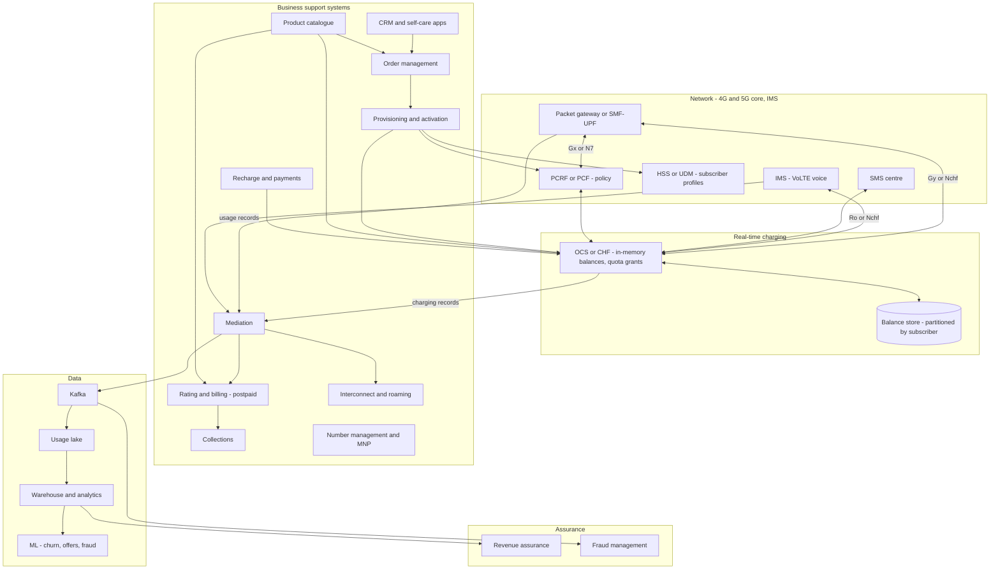
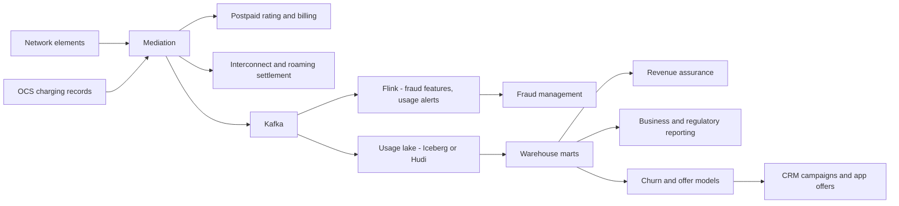

# I11. Telecom Billing & Charging

!!! abstract "Chapter at a glance"
    **Sector:** Telecom · **Format:** system design walkthrough (no code) · **Reader bands:** B1 → B4 · **Builds on:** [I03](i03-core-banking-and-upi.md) (balances and ledgers), [Ch 21](../03-production/21-data-at-scale.md), [Ch 51](../05-case-studies/51-real-time-analytics-and-top-k.md), [Ch 39](../05-case-studies/39-distributed-rate-limiter.md)

    **What you get:** the design of the **BSS** (business support systems) of a large mobile operator in India, with ~400M subscribers, mostly prepaid. It covers:

    - **real-time charging:** how every megabyte and every call minute is authorised against a balance *before* it is used, using quota reservation between the network and the online charging system;
    - **the product catalogue and tariff plans**, balance buckets and their consumption order, recharges;
    - **policy control:** fair-usage throttling after the daily data limit;
    - **postpaid billing:** usage records → mediation → rating → bill cycles → invoices → payments → collections;
    - **customer onboarding:** eKYC, SIM activation, number portability; and **provisioning** into the network;
    - **interconnect and roaming settlement**, **revenue assurance** and **telecom fraud** (SIM boxes, international revenue share fraud, Wangiri);
    - **the data platform** for the largest event volumes in the handbook: network usage records at millions per second;
    - **the algorithms:** quota sizing, bucket consumption, tariff trees, proration, record correlation and deduplication, fraud detection, churn;
    - **the tech stack** and TM Forum standards.

    **Reading time:** 85 min.

!!! warning "Sources and honesty"
    - Telecom protocols and architecture come from public standards: 3GPP (Diameter Gy/Ro and Gx for 4G; the Charging Function, CHF, and Policy Control Function, PCF, for 5G) and TM Forum (SID, Open APIs, ODA).
    - Indian regulations (TRAI tariff rules and reporting, DoT licence conditions, KYC for SIMs, MNP rules, lawful interception, record retention) are summarised with **VERIFY**.
    - Operators' internal systems aren't public; commercial BSS vendors are named only as market options.
    - This is a **reference design**.

---

## 1. The System in One Page

### 1.1 What BSS does

When you open a video on your phone, the **network** carries the bytes. The **BSS** decides:

- are you allowed to use data now?
- how much can you use before checking again?
- at what speed?
- what does it cost?
- and, at the end of the month or the recharge validity, what do you owe or have left?

It must answer the network in **milliseconds** for millions of sessions at once, and never let usage run free or charge twice.

### 1.2 Main systems

| System | What it does |
|---|---|
| **CRM and customer management** | Customer profiles, KYC, accounts, subscriptions, service requests |
| **Product catalogue** | Plans, add-ons, bundles, prices, eligibility, validity |
| **Order management** | New connections, plan changes, add-ons, porting; orchestrates provisioning |
| **Provisioning / activation** | Pushes subscriber profiles to network systems (HSS/UDM, PCRF/PCF, OCS/CHF, voicemail, SMS centre) |
| **Online charging system (OCS / 5G CHF)** | Real-time authorisation and deduction of balances for data, voice and SMS |
| **Policy control (PCRF / 5G PCF)** | Speed, QoS and fair-usage policies per subscriber |
| **Balance management** | Buckets: main balance, data packs, voice minutes, SMS counts, validity dates |
| **Recharge and payments** | Top-ups via apps, UPI, retailers' vouchers/e-recharge; postpaid bill payments |
| **Mediation** | Collects usage records from network elements, validates, correlates, deduplicates |
| **Rating and billing (postpaid)** | Prices usage, applies discounts, generates bills per cycle, invoices |
| **Collections and dunning** | Reminders, soft barring, disconnection per rules |
| **Interconnect and roaming billing** | Settlement with other operators (call termination, roaming TAP files) |
| **Revenue assurance** | Reconciliations to find leakage between network, mediation, charging and billing |
| **Fraud management** | Detects SIM boxes, IRSF, subscription fraud, SIM swap fraud |
| **Number management and MNP** | Number inventory, porting in and out via the MNP clearing house |
| **Data platform** | Usage and network data at massive scale, analytics, ML |

### 1.3 Scale for this design (assumptions)

| Quantity | Value |
|---|---|
| Subscribers | 400M (90% prepaid) (VERIFY market figures) |
| Active data sessions at peak | ~150M |
| Charging requests (session start/update/end) | ~1–2M per second at peak (§1.4) |
| Voice calls at peak | ~10M concurrent |
| Recharges per day | ~20–30M; peaks on festival offers and month starts |
| Usage records (CDRs/UDRs) per day | Tens of billions |
| Postpaid bills per month | ~40M, spread across bill cycles |

### 1.4 Estimation — charging load

- **Sessions:** 150M active data sessions. Each session gets a **quota** (e.g. 50 MB or a time-validity window) and reports back when it is used or a timer expires.
- **Update rate:** if the average session reports every ~2 minutes, that is 150M / 120 s ≈ **1.25M update requests/s**, plus starts and stops, plus voice and SMS.
- **Consequence:** the OCS is a **distributed, in-memory, strongly consistent balance store** with sub-10 ms responses at over a million transactions per second. That is one of the most demanding transactional workloads anywhere.
- **Tuning lever:** quota size is a system tuning lever (§6.1). Bigger quotas mean fewer requests, but more risk of overuse or stranded balances between sessions.

---

## 2. Requirements

### 2.1 Functional

1. Sell and change plans: prepaid packs (e.g. 28-day validity with daily data), add-ons, postpaid plans, family plans with shared data, international roaming packs.
2. Real-time charging for data, voice and SMS, with balance checks, and denial or redirection when balance is exhausted (to a recharge page).
3. Fair usage policy: throttle speed after the daily high-speed data is used (VERIFY specific plan rules). Reset daily.
4. Notifications at usage thresholds (50%, 90%, 100%) and validity expiry.
5. Recharges through many channels: app, UPI, retailers, banks, wallets. Instant credit.
6. Postpaid billing with bill cycles, itemised bills, taxes (GST), payments, credit limits, late fees.
7. Onboarding with eKYC (Aadhaar-based or other permitted methods; VERIFY), SIM activation, eSIM.
8. Mobile number portability in and out per MNP rules (VERIFY timelines).
9. Interconnect and roaming settlement with partners.
10. Revenue assurance, fraud management, regulatory reporting.

### 2.2 Non-functional

| Attribute | Target |
|---|---|
| **Charging latency** | p99 < 10–20 ms per request (network timers are strict) |
| **Charging availability** | ≥ 99.999% (a charging outage stops traffic, or lets it run free) |
| **Correctness** | No double deduction; no usage without authorisation beyond agreed tolerance |
| **Throughput** | Millions of charging transactions per second |
| **Recharge latency** | Balance credited within seconds of payment |
| **Billing accuracy** | Postpaid bills correct to the paisa, with complete usage |
| **Retention** | Usage records retained per licence conditions (VERIFY) |

---

## 3. High-Level Architecture

**Key decisions:**

| Decision | Choice | Why |
|---|---|---|
| **Prepaid and postpaid charging** | **Converged charging**: one online charging system for both (postpaid uses it for credit limits, spend caps and real-time notifications) | One source of truth for balances and policies |
| **Balance store** | In-memory, partitioned by subscriber, replicated synchronously within a site and asynchronously across sites | Millisecond latency at millions TPS; survive node loss without double-spend |
| **Protocols** | Diameter (Gy/Ro, Gx) for 4G/IMS; HTTP/2 service-based interfaces (Nchf, Npcf) for 5G | 3GPP standards (VERIFY release specifics) |
| **Catalogue** | Central product catalogue, versioned, consumed by OCS, billing, CRM and apps | Plans launch without code changes; one definition everywhere |
| **Usage data** | Mediation to a streaming pipeline and lake | Billing, settlement, analytics, fraud from the same records |

---

## 4. How It Works — Journeys End to End

### 4.1 Journey 1: opening a video on prepaid data

The subscriber has a pack with 2 GB of high-speed data per day, validity 28 days.

1. **Session start:**
    - the phone attaches and requests a data session;
    - the **packet gateway** (4G PGW, or 5G SMF controlling the UPF) creates the session;
    - it asks **policy control** (PCRF/PCF) for rules: speed, QoS class, and whether the subscriber is currently throttled;
    - policy control checks the subscriber's plan and usage state (from the OCS or its own counters).
2. **Initial quota request:**
    - the gateway sends a **credit-control request (initial)** to the **OCS** (Diameter Gy CCR-I in 4G, Nchf in 5G), identifying the subscriber and the service (rating group);
    - the OCS finds the subscriber's **balance buckets** (§5.3): today's high-speed data (2 GB, 1.2 GB left), plus any add-on packs;
    - it **reserves** a quota, e.g. 50 MB (§6.1), deducting it from available balance as *reserved*, not consumed;
    - it replies within milliseconds with the granted units and a **validity time** (e.g. 10 minutes).
3. **Usage:** the gateway lets traffic flow until the 50 MB is used or the validity time expires.
4. **Update:** then it sends a **CCR-Update** reporting the actual used units (say 48 MB).
    - the OCS **commits** 48 MB from the reservation (consumed);
    - it releases the unused 2 MB;
    - it grants a new reservation of 50 MB.

    This repeats as the video plays.
5. **Threshold crossing:** when the daily high-speed bucket reaches **100%**:
    - the OCS notifies policy control, which **changes the session's policy** to a lower speed (fair usage throttle, e.g. 64 kbps; VERIFY plan terms) via the gateway (Gx/N7 update);
    - charging continues against the "post-FUP" allowance.

    If the plan has no post-FUP allowance and no other bucket, the OCS **denies** further quota and the gateway **redirects** the user to a recharge page.
6. **Session end:**
    - a **CCR-Terminate** reports final usage;
    - the OCS commits it and releases the remaining reservation;
    - a **charging data record** is written for mediation, customer usage history and analytics.
7. **Notifications:** usage threshold events (50%, 90%, 100%) generate SMS or app notifications via a notification service ([Ch 40](../05-case-studies/40-notification-system.md)).
8. **Midnight:** a **daily reset** restores the high-speed allowance and lifts the throttle (§5.4).

### 4.2 Journey 2: a VoLTE call

1. **Call setup:** the caller dials. The **IMS** sets up the call and asks the OCS for authorisation (Diameter Ro CCR-I / Nchf) with the called number, to determine the rate: on-net, off-net, national, international, premium.
2. **Rating and reservation:**
    - the OCS **rates** the call via the tariff (§6.3);
    - for an "unlimited voice" plan, it checks eligibility and fair-use rules, and grants time units (e.g. 5 minutes);
    - for pay-per-use, it reserves money for the granted time.
3. **Updates:** during the call, updates commit used time and grant more.
4. **Call end:** final usage is committed, and a call record is generated for mediation (also needed for **interconnect settlement** if the call terminates on another operator).

### 4.3 Journey 3: recharging with UPI in the app

1. **Plan choice:** the subscriber chooses a pack in the self-care app. The app shows eligible plans from the **catalogue** (by circle, current plan and offers).
2. **Payment:** via UPI intent through the payment orchestration ([Ch 45](../05-case-studies/45-payment-system.md)). On success (callback), the **recharge service**:
    - creates the order;
    - applies the plan to the subscriber in the **OCS** (new buckets with validity, or extension of validity rules);
    - updates **policy control** if speeds change;
    - sends confirmation.
3. **Idempotency:**
    - recharges are idempotent on the payment reference, so a duplicate callback never adds a second pack;
    - a payment success with a failed pack application goes to automatic retry, then refund ([I10](i10-travel-and-railway-ticketing.md) §5.5 pattern).
4. **Retailer recharges:** a retailer's app debits the retailer's wallet with the operator and credits the subscriber, with commission to the retailer. Retailer wallets need the same ledger discipline ([I03](i03-core-banking-and-upi.md)).
5. **Volume:** recharge peaks come around offers and validity renewals. The OCS provisioning path must handle tens of thousands of plan applications per second.

### 4.4 Journey 4: a postpaid bill cycle

1. **Usage collection:** usage records from the network (data, voice, SMS, roaming) and charging records from the OCS flow through **mediation** (§5.5): collection, validation, deduplication, correlation, normalisation.
2. **Rating:** each usage record is priced against the plan: included allowances first, then overage rates. Many postpaid plans are "unlimited" with fair use, so rating mostly tracks allowances and add-ons.
3. **Bill cycles:** subscribers are spread across cycles, e.g. bills generated on the 3rd, 9th, 15th, 21st and 27th of each month, so the billing workload is spread (§6.4).
4. **Bill run** for a cycle, after the cut-off:
    - apply **recurring charges** (monthly rental, prorated for mid-cycle changes; §6.5);
    - add **one-time charges** (add-ons) and **usage charges**;
    - apply **discounts** (family plan sharing, loyalty) and **taxes** (GST);
    - carry forward previous balance and payments;
    - compute due date and minimum amount if applicable.
5. **Invoice:** invoices are rendered (PDF, itemised details on request) and sent by email and app. Payments come by UPI autopay, cards or net banking, and are reconciled.
6. **Collections:** unpaid bills trigger **dunning**: reminders, then outgoing call barring, then full barring, then disconnection per rules. Credit limits prevent runaway usage mid-cycle via real-time spending checks in the OCS.

### 4.5 Journey 5: new connection with eKYC and number portability

1. **KYC:** the customer chooses a number (from number inventory) or requests to **port in** an existing number, and completes **KYC**. Digital eKYC with Aadhaar-based authentication, or other permitted methods, per DoT rules (VERIFY current KYC norms, including restrictions on the number of SIMs per person).
2. **Order management:**
    - validates the order;
    - reserves the number;
    - allocates a SIM (ICCID/IMSI) or generates an **eSIM** profile;
    - applies the plan.
3. **Provisioning** pushes the subscriber to:
    - the **HSS/UDM** (identity, authentication keys, allowed services);
    - policy control (plan policies);
    - the **OCS** (balances, plan);
    - voicemail and SMS centres.

    Each is a step in an orchestrated workflow with retries and compensation ([Ch 13](../02-distributed-core/13-distributed-transactions.md)).
4. **Port-in:**
    - a **unique porting code** from the donor operator (via SMS) goes in the porting request;
    - the MNP clearing house coordinates with the donor;
    - at the scheduled porting window, routing databases update, the donor disconnects and the recipient activates.

    Timelines and rules are regulated (VERIFY).
5. **Activation:** confirmation to the customer, with a welcome pack. The SIM may be activated after verification steps required by rules (VERIFY tele-verification requirements).

### 4.6 Journey 6: international roaming

1. **Detach and attach:** the subscriber lands in another country, and the phone attaches to a partner network.
2. **Home routing:** for data, traffic is typically routed to the home network's gateway, so home charging applies (VERIFY architectures such as home-routed vs local breakout). The OCS applies the roaming pack.
3. **Voice via the visited network:** the visited network sends usage records to the home operator through a clearing house in **TAP files** (Transferred Account Procedure). The home operator rates them for the subscriber, and **settles** wholesale charges with the partner per the roaming agreement.
4. **Bill-shock prevention:** real-time roaming notifications and spending caps, required in some markets (VERIFY).

---

## 5. Core Subsystems in Depth

### 5.1 Online charging system (OCS/CHF)

- **Functions:**
    - session management (per credit-control session);
    - **rating** (turning units into money or allowance usage);
    - **balance management** (reservations, commits, releases);
    - **thresholds and notifications**;
    - **policy counters** reported to policy control.
- **The state per subscriber:** balance buckets, active reservations per session and rating group, counters (daily usage), plan attributes. Tens of KB per subscriber → tens of TB for 400M, held in memory across a cluster.
- **Partitioning:** by subscriber (IMSI/MSISDN hash). All requests for a subscriber go to the owning partition, which processes them serially. The **single-writer** model again ([Ch 55](../05-case-studies/55-order-matching-engine.md)) means no locks and no double spend.
- **Shared balances:** family or corporate plans share a data pool across members. They need either a **shared-account partition** (members' requests forward to the pool owner) or co-location of family members on the same partition. Cross-partition charging adds latency and failure modes, so avoid it where possible.
- **Replication:**
    - each partition has a synchronous replica in the same site (committed state survives node loss);
    - an asynchronous replica in another site for disaster recovery;
    - on site failover, in-flight reservations are reconciled via final records.
- **Failure behaviour:** if the OCS is unreachable, the network applies **Credit Control Failure Handling** (terminate, or continue for a while and charge later; configured per service; VERIFY). Many operators allow limited continuation to protect customer experience, accepting some revenue risk.

### 5.2 Policy control (PCRF/PCF)

- **Decisions:** QoS and speed per session (maximum bitrate), throttling after fair-use limits, zero-rating (some traffic not charged, where permitted; VERIFY net neutrality rules), and application-specific policies where allowed.
- **Inputs:** subscriber plan, usage counters from the OCS (threshold crossings), location, network congestion.
- **Updates** are pushed to gateways on changes, e.g. a throttle at 100% daily usage, or an upgrade after an add-on purchase.

### 5.3 Balance buckets

| Bucket type | Example | Behaviour |
|---|---|---|
| **Main account (money)** | ₹45.50 | Used for pay-per-use; validity rules may apply |
| **Daily recurring data** | 2 GB/day for 28 days | Resets at midnight; unused doesn't carry over (plan terms) |
| **One-time data add-on** | 10 GB, valid till plan expiry | Used after daily data per consumption order |
| **Voice** | Unlimited (fair use) or minutes | Counters for fair use |
| **SMS** | 100/day | Resets daily |
| **Roaming pack** | 5 GB in the UAE for 7 days | Applies only in specific countries |
| **Shared family pool** | 100 GB shared among 4 | Forwarded to pool owner |

**Consumption order (§6.2):** which bucket is used first when several can pay for the same usage, e.g. daily data before add-on data, and add-ons expiring soonest first.

### 5.4 Periodic processes on 400M subscribers

- **Daily resets, expiries, renewals:** millions of subscribers' buckets reset at midnight. **Don't do it as a batch at 00:00**, which creates a charging spike. Instead:
    - **lazy reset:** each bucket stores its period, and the first charging request after midnight resets it in-line;
    - or a **staggered job** per partition over minutes.

    The throttle must lift at midnight for policy correctness, so policy control handles the time-based rule itself or receives staggered updates.
- **Plan expiry:** validity end triggers the grace period rules, reduced services (incoming only), and final deactivation after a long period (VERIFY rules on number recycling).

### 5.5 Mediation

- **Collection:** usage records arrive from gateways, IMS, SMSC and OCS, as files or streams in vendor formats.
- **Validation:** mandatory fields, ranges.
- **Deduplication:** the same record delivered twice (§6.6).
- **Correlation:** long sessions produce **partial records** (e.g. every hour or every N MB), which are joined into sessions for billing and analysis.
- **Normalisation** to a common format. **Enrichment** with subscriber and plan data, cell location, and roaming partner.
- **Routing** to postpaid rating, interconnect billing, the fraud system, the data lake and regulatory retention.
- **Reliability:** every record is counted in and out (record count and volume reconciliation), which feeds **revenue assurance**.

### 5.6 Rating and billing (postpaid)

- **Rating engine:** tariff trees (§6.3), with plan-specific allowances, overage rates, time-of-day rates, zone rates for roaming, and discounts.
- **Billing engine:** bill cycles; recurring, one-time and usage charges; proration; adjustments and credits; taxes; invoice generation; payment allocation; account balances.
- **Hierarchies:** corporate accounts with many subscribers, cost centres, pooled usage, consolidated invoices.
- **Re-rating:** if a tariff error is found, affected usage is re-rated before the bill run (or with adjustments afterwards), so rating must be repeatable from stored usage.

### 5.7 Interconnect and roaming settlement

- **Interconnect:** when your subscriber calls another operator's subscriber, you owe them a termination charge (as set by the regulator; VERIFY current interconnect usage charges). Mediation produces interconnect records, which are **aggregated per partner per period**, reconciled with the partner's statements (disputes on differences), and settled.
- **Roaming:** TAP files exchanged via clearing houses. Wholesale rates per agreement. Fraud control on high-usage roamers (via near-real-time roaming exchange formats; VERIFY).

### 5.8 Revenue assurance and fraud

- **Revenue assurance** reconciles each hand-off:
    - network usage vs mediation input;
    - mediation output vs billed usage;
    - provisioning in the network vs subscriptions in BSS ("provisioned but not billed" services);
    - recharges paid vs packs applied;
    - interconnect traffic vs partner invoices.

    Leakage is typically a small percentage of revenue, which is huge in absolute terms.
- **Fraud types:**
    - **SIM box / bypass fraud:** international calls routed over the internet and terminated through local SIMs to avoid international termination charges;
    - **IRSF** (international revenue share fraud): calls to premium international numbers from compromised accounts or SIMs;
    - **Wangiri:** missed calls from premium numbers prompting callbacks;
    - **subscription fraud:** SIMs obtained with fake KYC;
    - **SIM swap fraud:** taking over someone's number to intercept OTPs, a banking fraud vector ([I03](i03-core-banking-and-upi.md)).

    Detection is in §6.7.

---

## 6. Algorithms

### 6.1 Quota sizing

- **Trade-off:**
    - **small quotas:** many requests (load), little risk of overuse;
    - **large quotas:** few requests, but a subscriber can overuse by up to one quota when the balance hits zero, and multiple concurrent sessions each hold reservations, fragmenting the balance.
- **Adaptive quotas:**
    - grant based on remaining balance (never more than a fraction of what's left);
    - the subscriber's recent usage rate (so a video streamer gets bigger quotas, and a chat user smaller ones);
    - the number of concurrent sessions;
    - service type.
- **Near exhaustion:** grant small quotas as the balance nears zero, or a **final unit indication** telling the gateway to redirect after this grant.
- **Validity timers** force periodic re-authorisation, for plan changes and for fairness across sessions.

### 6.2 Bucket consumption order

- **Rules:**
    1. Eligible buckets for this service and location (e.g. roaming pack only abroad).
    2. Then priority by type (daily allowance before paid add-on).
    3. Then **earliest expiry first**, to avoid waste.
    4. Then the main account (money) last, if allowed.
- **Implementation:** buckets sorted by (priority, expiry) per subscriber. A reservation may span buckets: take the rest from the next bucket when one runs out mid-reservation.

### 6.3 Rating with tariff trees

- **A tariff tree:** a decision tree over the attributes of a usage event:
    - service (data/voice/SMS);
    - destination type (on-net, off-net, international, premium);
    - time band;
    - location (home, national roaming, international zone);
    - plan and add-ons.

    Leaves give a price or allowance counter and a rounding rule (per second, per minute, per 10 KB).
- **Performance:** trees are compiled from the catalogue into efficient lookup structures (prefix tries for destination number prefixes, time band tables). Rating happens in microseconds per event.
- **Number prefix matching:** longest-prefix match on dialled numbers for international destinations (a trie).

### 6.4 Bill cycle partitioning

- **Assign subscribers to cycles** to balance workload: hash-based, or by signup date. Customers can move cycles, with proration.
- **Within a cycle:** the bill run parallelises by account partitions. Dependencies (corporate hierarchies) are processed together.
- **Deadlines:** bills must be issued within set days after the cycle close. The monitoring target is the bill run's end time.

### 6.5 Proration

- **Mid-cycle plan change:** charge the old plan for the days used and the new plan for the remaining days.
    - The formula is (days active ÷ days in cycle) × monthly charge, by the product's proration rule: daily, or no proration for some.
    - Allowances are prorated similarly or per product rules.
- **Rounding** per rules, and consistent between rating and invoice presentation.

### 6.6 Record deduplication and correlation

- **Deduplication:** each record has identifiers (node ID, sequence number, session ID, record opening time).
    - Mediation keeps a **dedup window** of seen record keys, using Bloom filters plus exact stores for recent windows ([Ch 53](../05-case-studies/53-web-crawler.md) L2 for Bloom filter trade-offs).
    - Late duplicates beyond the window are caught by later reconciliation.
- **Correlation:** join partial records of the same session (by session ID and charging ID) in order. Handle missing partials: after a timeout, flag and estimate, or wait for re-delivery.

### 6.7 Fraud detection

| Fraud | Signals and method |
|---|---|
| **SIM box** | SIMs with many outgoing calls to many distinct numbers, almost no incoming calls, no data usage, stationary location, high call volumes at odd hours → rules + classifiers; test-call programmes to catch bypass routes |
| **IRSF / Wangiri** | Sudden calls to high-cost international ranges; known fraud number ranges from industry databases; velocity rules per subscriber and per destination prefix; near-real-time blocking |
| **Subscription fraud** | KYC anomalies, many SIMs per identity or device, immediate high-risk usage |
| **SIM swap** | SIM change followed by banking OTP traffic; the operator's SIM swap API/signal is shared with banks where available (VERIFY) and a cooling period on SMS after swap (VERIFY) |

Graph analysis over calling patterns finds clusters of SIMs controlled by one fraudster.

### 6.8 Churn and next-best-offer

- **Churn prediction** features: recharge history (gaps, amounts), usage decline, network quality experienced (dropped calls, slow data in their areas), complaints, port-out requests (a strong last-minute signal), competitor offers.
- **Next best offer:** recommend packs based on usage patterns (data-heavy vs voice-heavy), price sensitivity and time to expiry. Contextual bandits test offers ([I06](i06-video-streaming-and-live-cricket.md) §6.6).

---

## 7. Data Architecture

### 7.1 Operational stores

| Data | Store (reference) | Notes |
|---|---|---|
| Balances, reservations, counters | In-memory partitioned store with synchronous replicas (commercial OCS or in-memory data grid / purpose-built) | Millions TPS; single writer per partition |
| Catalogue | Versioned catalogue database; compiled artefacts pushed to OCS and billing | TM Forum SID-based model |
| Customers, accounts, orders | Relational (sharded) | CRM and order management |
| Subscriber network profiles | HSS/UDM (network side) | Provisioned by BSS |
| Postpaid bills and payments | Relational + document store for invoices | Retained per rules |
| Usage records | Raw files/streams → lake (compressed columnar) | Tens of billions per day |
| Number inventory, porting | Relational | MNP workflows |

### 7.2 Usage data pipeline and lake

- **Volume:** tens of billions of records per day, i.e. **hundreds of thousands to millions of records per second**, at ~200–500 bytes each before compression. That is **several TB/day compressed**.
- **Pipeline:** mediation → Kafka (partitioned by subscriber) → streaming processors (Flink) for real-time features (fraud, usage notifications, network analytics) → lake in columnar formats (Parquet/ORC in Iceberg/Hudi tables), partitioned by date and hour.
- **Query:** Spark for heavy jobs, Trino/Presto or ClickHouse for interactive analysis, pre-aggregated marts (usage per subscriber per day, per cell per hour).
- **Retention:** raw usage records kept for the period required by licence conditions (VERIFY), with secure, access-controlled archives for lawful requests.

### 7.3 Warehouse and analytics

- **Subject areas:** subscribers and plans; recharges and revenue; usage (daily aggregates); network quality per cell; churn and port-outs; campaigns; interconnect and roaming; fraud cases.
- **Key metrics:**
    - ARPU (average revenue per user);
    - data usage per subscriber;
    - recharge frequency;
    - churn rate;
    - revenue leakage;
    - network quality correlated with churn by area.
- **Regulatory reporting:** subscriber counts and activity reports, tariff filings and quality of service reports to the regulator (VERIFY required returns).

### 7.4 Data flow

---

## 8. Tech Stack (reference choice)

| Layer | Choice | Notes |
|---|---|---|
| Charging and policy | Commercial converged charging and policy products (large vendors offer 3GPP-compliant OCS/CHF and PCRF/PCF), or purpose-built in-memory systems for very large operators | Standards compliance and certification matter |
| Protocol stacks | Diameter stacks; 5G service-based interfaces over HTTP/2 | 3GPP |
| BSS suite | TM Forum Open Digital Architecture-aligned components; Open APIs (TMF620 catalogue, TMF622 ordering, TMF678 bill; VERIFY API numbers) | Interoperability |
| Services | Java/Kotlin/Go microservices for CRM, orders, recharges, apps | Standard stack |
| Workflows | Camunda/Temporal for order orchestration and provisioning | Long-running, compensating |
| Databases | PostgreSQL/Oracle (legacy), sharded; Redis | Transactional BSS data |
| Messaging | Kafka | Usage and events |
| Streaming | Flink | Fraud and usage alerts |
| Lake/warehouse | Iceberg/Hudi + Spark + Trino, or ClickHouse for aggregates | Huge usage volumes |
| ML | Python, feature store, model serving | Churn, offers, fraud |
| Apps | Native self-care apps; USSD and IVR channels for feature phones | Inclusion |
| Platform | Kubernetes (cloud-native network functions for 5G), telco cloud | Increasingly containerised |

---

## 9. Security, Privacy & Compliance

- **Subscriber data:** KYC documents, location, usage and call records are highly sensitive. Strict access control, encryption and audit, and DPDP Act obligations (VERIFY).
- **Lawful interception and data retention:** licence conditions require lawful interception capabilities and retention of usage records for set periods, provided only under legal process (VERIFY).
- **KYC and SIM issuance rules:** limits on SIMs per individual, verification requirements for point-of-sale agents, and rules against bulk SIM sales (VERIFY current DoT rules).
- **Tariffs and consumer protection:** tariff filing and transparency, validity and plan disclosure rules, and quality of service regulations (VERIFY TRAI regulations).
- **Anti-spam:** commercial communication rules and registration of senders and headers on distributed ledger platforms (the TRAI TCCCPR framework; VERIFY), and spam call and SMS blocking.
- **Network security:** SS7/Diameter signalling firewalls against location tracking and fraud; SIM swap protections.

---

## 10. Reliability & Operations

- **Charging availability:**
    - geographically redundant OCS sites;
    - synchronous replicas within a site;
    - tested failover;
    - configured **failure handling** at gateways (limited continuation) so outages don't drop all traffic.
- **Avoid synchronised spikes:** daily resets, expiries and renewals are lazy or staggered. Recharge promotions have pre-scaled capacity.
- **Catalogue releases:** new plans are tested with rating test cases and pushed to OCS and billing in sync. A mismatch between OCS and billing definitions is a classic source of disputes.
- **Bill runs:** monitored per cycle (records rated, exceptions, run time), with a **bill verification** sample before sending (automated checks against expectations).
- **Revenue assurance dashboards:** daily reconciliations with thresholds and alerts.
- **Festival and event peaks:** New Year's greetings (voice and SMS peaks), cricket matches (data peaks), and the recharge surge when many plans expire together.

---

## 11. Key Trade-offs

| Decision | Chosen | Accepted cost |
|---|---|---|
| Charging model | Reservation-based quotas | Load vs overuse risk tuned via quota size |
| Balance store | In-memory, partitioned single writer | Complex replication and failover |
| Shared plans | Pool owner partition | Extra hop for members |
| Resets | Lazy per subscriber | Logic spread into charging path |
| Failure handling | Limited continuation | Some revenue risk during outages |
| Usage data | Lake with huge retention | Storage cost; strict access controls |
| Catalogue | Central, versioned, compiled | Release discipline across systems |

---

## 12. Interview Q&A

### Beginner B1

??? question "Q1 [B1] ⭐ How does a prepaid phone's data get charged in real time?"

    **30-second answer:** The network gateway asks the online charging system for a quota before letting data flow; the OCS reserves some of the subscriber's balance and grants it; the gateway reports usage when the quota is used or a timer expires; the OCS commits the usage, releases leftovers and grants more — or denies and the gateway redirects to a recharge page.

    **Deep answer:** §4.1.

    **Trade-offs I'd call out:** Quota size vs load.

    **Follow-ups:**
    1. Why reserve? → Prevent overuse across sessions.
    2. Outage? → Failure handling.

    **Red flags:** Charging only from records at month end for prepaid.

??? question "Q2 [B1] What is the difference between OCS and billing?"

    **30-second answer:** The OCS authorises and deducts usage in real time against balances (prepaid, and postpaid credit limits); billing prices usage records and recurring charges into periodic invoices for postpaid, with taxes, payments and collections.

    **Deep answer:** §5.1, §5.6.

    **Trade-offs I'd call out:** Converged vs separate systems.

    **Follow-ups:**
    1. Converged charging? → One system for both.
    2. Postpaid real-time checks? → Spend caps.

    **Red flags:** Billing handles real-time prepaid.

??? question "Q3 [B1] What happens when you recharge with UPI?"

    **30-second answer:** Payment succeeds via the payment orchestration; the recharge service idempotently applies the pack to the OCS (new buckets and validity), updates policy if speeds change, and notifies you — retrying or refunding if the pack can't be applied.

    **Deep answer:** §4.3.

    **Trade-offs I'd call out:** Speed vs verification.

    **Follow-ups:**
    1. Duplicate callback? → Idempotent on payment ref.
    2. Retailers? → Wallet ledger.

    **Red flags:** Two packs for one payment.

??? question "Q4 [B1] Why does data speed drop after the daily limit?"

    **30-second answer:** The plan's fair usage policy: when the daily high-speed allowance is used, the OCS tells policy control, which lowers the session's maximum speed until the daily reset.

    **Deep answer:** §4.1 step 5, §5.2.

    **Trade-offs I'd call out:** Experience vs network cost.

    **Follow-ups:**
    1. Reset at midnight? → Lazy or staggered.
    2. Add-on? → Restores speed.

    **Red flags:** Hard cut-off without policy.

### Intermediate B2

??? question "Q5 [B2] ⭐ How would you size data quotas in the OCS?"

    **30-second answer:** Adaptively: a fraction of remaining balance, larger for heavy users and smaller near exhaustion, adjusted for concurrent sessions and service type, with validity timers and a final-unit indication near zero — balancing request load against overuse and stranded reservations.

    **Deep answer:** §6.1.

    **Trade-offs I'd call out:** Load vs revenue risk.

    **Follow-ups:**
    1. Estimation? → ~1M+ updates/s.
    2. Multiple sessions? → Split remaining balance.

    **Red flags:** Fixed 1 GB grants.

??? question "Q6 [B2] In what order should balance buckets be consumed?"

    **30-second answer:** Filter eligible buckets for the service and location, then by priority (daily allowances before paid add-ons), then earliest expiry first, with the main money balance last; reservations may span buckets.

    **Deep answer:** §6.2.

    **Trade-offs I'd call out:** Customer value vs simplicity.

    **Follow-ups:**
    1. Roaming packs? → Location-eligible only.
    2. Expiry waste? → Earliest first.

    **Red flags:** Random bucket choice.

??? question "Q7 [B2] What does mediation do?"

    **30-second answer:** Collects usage records from network elements, validates, deduplicates, correlates partial records into sessions, normalises and enriches them, and routes them to billing, settlement, fraud, the data lake and retention — with record-count reconciliation for revenue assurance.

    **Deep answer:** §5.5, §6.6.

    **Trade-offs I'd call out:** Latency vs completeness.

    **Follow-ups:**
    1. Duplicates? → Dedup windows.
    2. Missing partials? → Timeouts.

    **Red flags:** Billing from raw network files.

??? question "Q8 [B2] How is a postpaid bill produced?"

    **30-second answer:** Usage is rated against plan allowances and overages; at the cycle cut-off, the bill run adds prorated recurring charges, one-time charges, usage, discounts, taxes and previous balances, then generates invoices and handles payments and collections.

    **Deep answer:** §4.4, §6.4, §6.5.

    **Trade-offs I'd call out:** Cycle distribution vs complexity.

    **Follow-ups:**
    1. Plan change mid-cycle? → Proration.
    2. Tariff error? → Re-rating.

    **Red flags:** One monthly bill run for everyone.

??? question "Q9 [B2] How does number portability work?"

    **30-second answer:** The customer gets a unique porting code from the donor, the recipient submits a port request through the MNP clearing house, the donor validates, and at the porting window routing databases update, the donor disconnects and the recipient activates via provisioning (VERIFY current rules).

    **Deep answer:** §4.5.

    **Trade-offs I'd call out:** Speed vs fraud checks.

    **Follow-ups:**
    1. Outstanding dues? → Rules apply.
    2. Routing? → Number databases.

    **Red flags:** Porting as a simple number update.

### Senior B3

??? question "Q10 [B3] ⭐ Design an OCS for 400 million subscribers."

    **30-second answer:** In-memory, partitioned by subscriber, single writer per partition, synchronous replica in-site and async across sites; Diameter/HTTP2 front ends; reservation-based quotas with adaptive sizing; bucket consumption rules; threshold events to policy and notifications; lazy daily resets; shared pools via owner partitions; failure handling agreed with the network.

    **Deep answer:** §5.1–§5.4, §6.1.

    **Trade-offs I'd call out:** Latency vs replication cost.

    **Follow-ups:**
    1. TPS? → ~1–2M.
    2. Family plans? → Pool owner forwarding.

    **Red flags:** A relational DB row update per request with locks.

??? question "Q11 [B3] How do you avoid the midnight spike from daily resets?"

    **30-second answer:** Store each bucket's period and reset lazily on the first charging request after the boundary, or stagger resets per partition; handle the throttle lift via time-based policy rules rather than a mass policy push.

    **Deep answer:** §5.4.

    **Trade-offs I'd call out:** Logic complexity vs spikes.

    **Follow-ups:**
    1. Notifications? → Staggered.
    2. Expiries? → Same approach.

    **Red flags:** Batch job at 00:00 for all subscribers.

??? question "Q12 [B3] How would you detect SIM box fraud?"

    **30-second answer:** Profile SIMs from usage streams — many outgoing calls to many numbers, few incoming, no data, static location, odd-hour volumes — with rules and classifiers, graph analysis for SIM clusters, and test-call programmes that detect bypass routes; block quickly and share intelligence.

    **Deep answer:** §6.7.

    **Trade-offs I'd call out:** False positives on call centres.

    **Follow-ups:**
    1. Real-time? → Streaming features.
    2. Evidence? → Test calls.

    **Red flags:** Monthly report review.

??? question "Q13 [B3] What is revenue assurance and how do you implement it?"

    **30-second answer:** Systematic reconciliation of every hand-off — network vs mediation, mediation vs billing, provisioned vs billed services, payments vs packs applied, interconnect vs partner invoices — with thresholds, alerts and root-cause workflows to find leakage.

    **Deep answer:** §5.8.

    **Trade-offs I'd call out:** Coverage vs cost.

    **Follow-ups:**
    1. Typical leak? → Provisioned but not billed.
    2. Frequency? → Daily.

    **Red flags:** Only financial audits.

??? question "Q14 [B3] How do you process tens of billions of usage records a day?"

    **30-second answer:** Mediation streams into Kafka partitioned by subscriber; Flink for real-time features; columnar lake tables partitioned by date and hour; Spark and Trino or ClickHouse for analysis; pre-aggregated marts; compression and tiered retention with strict access controls.

    **Deep answer:** §7.2.

    **Trade-offs I'd call out:** Retention cost vs obligations.

    **Follow-ups:**
    1. Per-subscriber queries? → Partitioning and indexes.
    2. Lawful requests? → Secure archives.

    **Red flags:** Loading records into a relational warehouse row by row.

### Architect B4

??? question "Q15 [B4] ⭐ Design the BSS of a large mobile operator."

    **30-second answer:** CRM and self-care, a versioned product catalogue feeding OCS and billing, order management with provisioning orchestration to HSS/UDM, policy and OCS, converged real-time charging, recharges and payments, mediation, postpaid rating and billing, collections, interconnect and roaming settlement, revenue assurance and fraud, and a usage data platform — aligned with TM Forum models and APIs.

    **Deep answer:** §3–§7.

    **Trade-offs I'd call out:** Buy vs build per component.

    **Follow-ups:**
    1. 5G changes? → CHF/PCF service interfaces.
    2. Legacy? → Strangler.

    **Red flags:** One monolithic billing system for everything.

??? question "Q16 [B4] How do you keep the catalogue consistent across OCS, billing and apps?"

    **30-second answer:** One versioned catalogue as the source of truth, compiled into runtime artefacts for OCS and billing, released together with automated rating test cases, apps reading eligibility and prices from catalogue APIs, and monitoring for mismatches between charged and billed amounts.

    **Deep answer:** §5.1, §10.

    **Trade-offs I'd call out:** Release discipline vs speed.

    **Follow-ups:**
    1. Rollback? → Versioned artefacts.
    2. Regional plans? → Circle attributes.

    **Red flags:** Plans configured separately in each system.

??? question "Q17 [B4] What should happen when the OCS is unavailable?"

    **30-second answer:** The network applies configured credit control failure handling — often allowing sessions to continue for a limited time or volume and charging later from records — while the OCS fails over to replicas or another site; the business agrees the revenue-vs-experience trade-off in advance.

    **Deep answer:** §5.1, §10.

    **Trade-offs I'd call out:** Revenue risk vs customer impact.

    **Follow-ups:**
    1. Post-outage charging? → From records.
    2. Fraud during outage? → Limits.

    **Red flags:** Letting traffic run free indefinitely.

??? question "Q18 [B4] How would you migrate from a legacy billing system to a new converged platform?"

    **30-second answer:** Migrate by segment (new subscribers first, then plan families), run parallel rating to compare outcomes, reconcile balances at cut-over, keep the catalogue as the translation layer, and plan around bill cycles and recharge peaks.

    **Deep answer:** [Ch 16](../02-distributed-core/16-microservices-architecture.md), [Ch 28](../03-production/28-schema-and-data-evolution.md).

    **Trade-offs I'd call out:** Parallel run cost.

    **Follow-ups:**
    1. Balances? → Snapshot and delta.
    2. Risk? → Bill shock.

    **Red flags:** Big-bang cut-over.

??? question "Q19 [B4] How do regulations shape telecom BSS in India?"

    **30-second answer:** KYC and SIM issuance rules shape onboarding; MNP rules shape porting workflows; tariff filing and transparency shape the catalogue; lawful interception and retention shape usage data handling; anti-spam frameworks shape messaging; quality of service and reporting shape analytics (VERIFY current regulations).

    **Deep answer:** §9.

    **Trade-offs I'd call out:** Compliance cost.

    **Follow-ups:**
    1. Retention periods? → Per licence.
    2. Spam? → Registered headers and templates.

    **Red flags:** Treating telecom like a generic subscription app.

??? question "Q20 [B4] Compare telecom charging with banking and payments systems."

    **30-second answer:** Both keep strongly consistent balances with double-spend protection and idempotency; telecom charges continuous usage via reservations at millions of TPS with network timers, while banking moves discrete amounts with regulatory settlement deadlines — telecom favours in-memory partitioned stores; banking favours durable ledgers with reconciliation.

    **Deep answer:** [I03](i03-core-banking-and-upi.md) vs this chapter.

    **Trade-offs I'd call out:** Throughput vs durability emphasis.

    **Follow-ups:**
    1. Shared patterns? → Single writer, idempotency.
    2. Differences? → Reservations, quotas.

    **Red flags:** Using a banking ledger design for per-packet charging.

---

## 13. Summary

1. **Real-time charging is reservation-based:** the network asks for quotas, and the OCS reserves, commits and releases against balance buckets at millions of transactions per second.
2. **The OCS is an in-memory, subscriber-partitioned, single-writer system** with replicas and agreed failure handling. Resets and expiries are lazy to avoid spikes.
3. **Policy control** turns usage thresholds into speed changes. **The catalogue** is the single definition of plans for charging, billing and apps.
4. **Postpaid billing** is mediation → rating → cycles → invoices → collections, with proration, re-rating and taxes.
5. **Revenue assurance and fraud** watch every hand-off. **The usage data platform** handles tens of billions of records per day under strict retention and access rules.

### Related chapters

- [I03 — Core Banking & UPI](i03-core-banking-and-upi.md) · [Ch 55 — Order Matching Engine](../05-case-studies/55-order-matching-engine.md) · [Ch 21 — Data at Scale](../03-production/21-data-at-scale.md) · [Ch 40 — Notifications](../05-case-studies/40-notification-system.md) · [Ch 13 — Distributed Transactions](../02-distributed-core/13-distributed-transactions.md)
- Next in this tab: [I12 — Logistics & Supply Chain](i12-logistics-and-supply-chain.md)
