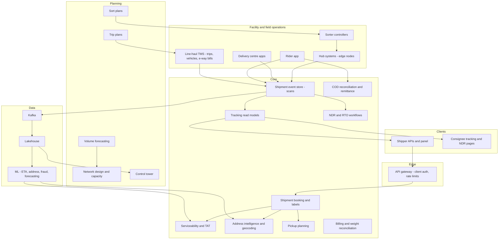
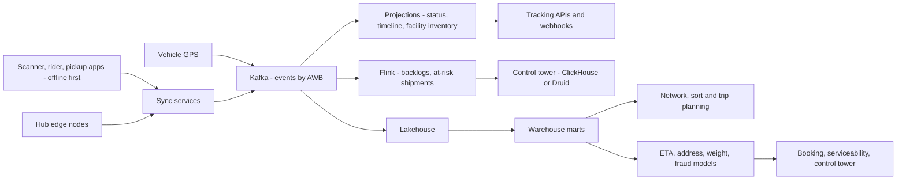

# I12. Logistics & Supply Chain

!!! abstract "Chapter at a glance"
    **Sector:** Logistics · **Format:** system design walkthrough (no code) · **Reader bands:** B1 → B4 · **Builds on:** [Ch 47](../05-case-studies/47-delivery-dispatch-and-live-tracking.md) (last-mile dispatch, tracking), [Ch 15](../02-distributed-core/15-event-driven-architecture-cqrs-and-event-sourcing.md) (events), [I01](i01-amazon-style-global-marketplace.md) (fulfilment), [I02b](i02b-flipkart-how-it-works.md) (network overview)

    **What you get:** the design of an **express parcel and freight network** in India, like Delhivery, Blue Dart or Ecom Express, serving e-commerce companies, D2C brands and enterprises. It adds the **supply chain planning** those shippers need. It covers:

    - **the parcel's journey:**
        - booking via API;
        - pickup, first mile and **hub-and-spoke sortation** with automated sorters;
        - **line-haul** by road and air, and bagging and manifests;
        - last mile, **failed deliveries (NDR)** and **returns (RTO)**;
        - **COD remittance** to sellers;
        - **weight disputes**;
    - **network operations:** the serviceability and turnaround (TAT) matrix, capacity planning, sort plans, trip planning, control tower;
    - **freight (PTL/FTL)**, e-way bills and vehicle tracking;
    - **supply chain planning for shippers:** demand forecasting, inventory optimisation, WMS and TMS;
    - **the algorithms:** address geocoding, facility location, sort plans, load planning (3D packing), middle-mile routing, ETA prediction, carrier allocation, weight discrepancy detection, safety stock, lost-shipment detection;
    - **the data platform** (scan events as an event store; tracking at huge read scale) and **tech stack**.

    **Reading time:** 85 min.

!!! warning "Sources and honesty"
    Indian logistics companies publish limited technical detail. This is a **reference design**. Regulations such as GST e-way bills, FASTag, motor vehicle rules, and dangerous goods rules for air are summarised with **VERIFY**.

---

## 1. The System in One Page

### 1.1 What a logistics network does

**A shipper** (an online store) wants a parcel to go from its warehouse in Bhiwandi to a customer in a small town in Assam. It wants:

- a **promised delivery date**;
- **tracking**;
- **cash collected** if the customer pays on delivery;
- **the parcel back** if the customer refuses.

**The network** makes that happen for millions of parcels a day by:

- **consolidating** them into bags, trucks and flights;
- **sorting** them at hubs;
- **splitting** them back out to delivery agents.

### 1.2 Main systems

| System | What it does |
|---|---|
| **Client integration** | APIs and panels for shippers: create shipments, labels, pickups, tracking, returns, invoices |
| **Serviceability and TAT** | Which pincodes are served, which services (express, surface, COD), promised days |
| **Address intelligence** | Parse, validate and geocode Indian addresses; assign to delivery centres |
| **Pickup and first mile** | Schedule pickups, assign vehicles, scan at pickup |
| **Hub operations** | Inbound scan, sortation (manual or automated), bagging, outbound manifests |
| **Line-haul / TMS** | Trips between hubs: vehicles, routes, schedules, loading, tracking, e-way bills |
| **Last mile** | Delivery centre operations, rider assignment, proof of delivery, COD collection ([Ch 47](../05-case-studies/47-delivery-dispatch-and-live-tracking.md)) |
| **NDR and RTO** | Failed delivery handling, re-attempts, customer contact, returns to origin |
| **Reverse logistics** | Customer returns pickups with quality checks |
| **COD and finance** | Cash reconciliation, remittance to shippers, invoicing, weight reconciliation |
| **Tracking** | Shipment timelines for shippers and customers; notifications |
| **Control tower** | Network-wide visibility: backlogs, delays, exceptions, capacity |
| **Planning** | Network design, capacity, sort plans, trip plans, forecasting |
| **Data platform** | Scan events, performance analytics, ML |

### 1.3 Scale for this design (assumptions)

| Quantity | Value |
|---|---|
| Parcels per day | 3M normal, 8M on sale peaks |
| Pincodes served | ~18,000 (VERIFY) |
| Facilities | ~25 large sort hubs, ~300 intermediate hubs, ~3,000 delivery centres |
| Line-haul trips per day | ~20,000 truck trips (plus air) |
| Delivery agents | ~60,000 |
| Scan events per parcel | ~15–25 (pickup, hub in/out, bag, trip, delivery attempts) |
| Scan events per day | ~60M normal, 200M at peak |
| Tracking queries per day | ~100M (customers, shippers' systems polling) |

**Estimation highlights:**

- **Writes:** scan events at 200M/day are ~2,300/s average, with hub shift peaks ~10× that. That is manageable, but every scan must be **reliable** even from sites with poor connectivity.
- **Reads:** tracking reads dominate, at ~1,200/s average with spikes. They are served from **read models and caches**, not by recomputing timelines.
- **Sorting throughput:** a large automated hub sorts hundreds of thousands of parcels per shift. The sorter controller must decide each parcel's chute in milliseconds as it passes the scanner.

---

## 2. Requirements

### 2.1 Functional

1. Shippers create shipments via API (single or bulk) with consignee address, weight, dimensions, payment mode (prepaid/COD), declared value, and service type. They receive an **AWB number** (air waybill/tracking ID) and a label.
2. Serviceability and TAT checks per origin–destination–service.
3. Pickup scheduling and first-mile collection with scan-based handover.
4. Hub processing: inbound, sort, bag, outbound, with exception handling (damaged, misrouted, unreadable labels).
5. Line-haul trips with manifests, vehicle tracking and e-way bills where required (VERIFY thresholds).
6. Last-mile delivery with OTP or signature proof, COD collection (cash/UPI), failed-attempt reasons.
7. NDR workflow: notify the shipper and customer, take instructions (reattempt, change address, return), and re-attempt.
8. RTO: return undelivered parcels to origin with tracking.
9. Reverse pickups for customer returns, with doorstep checks.
10. COD remittance to shippers on schedule; invoicing; weight dispute handling.
11. Tracking pages, webhooks to shippers, and SMS/WhatsApp notifications to consignees.

### 2.2 Non-functional

| Attribute | Target |
|---|---|
| **Scan reliability** | No scan lost; offline-first capture at hubs and in the field |
| **Traceability** | Every parcel's custody chain complete: who had it, when, where |
| **Latency** | Sorter decisions < 50 ms per parcel; API shipment creation < 300 ms |
| **Tracking freshness** | A scan visible in tracking within a minute |
| **Availability** | Hub operations continue during central outages (local edge systems) |
| **Money accuracy** | COD collected = COD remitted (minus fees), reconciled daily |

---

## 3. High-Level Architecture

**Key decisions:**

| Decision | Choice | Why |
|---|---|---|
| **Shipment state** | **Event-sourced**: every scan is an immutable event; the current state and timeline are projections | Custody chain, disputes, analytics ([Ch 15](../02-distributed-core/15-event-driven-architecture-cqrs-and-event-sourcing.md)) |
| **Facility systems** | **Edge nodes** at hubs with local databases and sort plans; sync to central | Hubs must keep sorting when the WAN is down |
| **Mobile apps** | Offline-first with local queues and idempotent event IDs | Poor connectivity in the field |
| **Tracking** | Separate read models (per AWB timeline, per shipper views) with caches | Read-heavy, public-facing |
| **Planning** | Batch optimisation (nightly/weekly) producing plans consumed by operations | Complex solvers off the real-time path |

---

## 4. How It Works — A Parcel's Journey

Follow **AWB 123456789**: a ₹1,299 COD order from a D2C brand's warehouse in Bhiwandi (Maharashtra) to a customer in Jorhat (Assam).

### 4.1 Booking

1. **API call:** the brand's order system (or its shipping aggregator) calls **Create Shipment**: consignee name, phone, address, pincode, weight 0.8 kg, dimensions, COD ₹1,299, service "surface express".
2. **Serviceability:** is pincode 785001 served for COD on this service? What is the **TAT** from the origin cluster? The answer comes from a precomputed TAT matrix (§5.2).
3. **Address intelligence** (§6.1):
    - parse the free-text address;
    - geocode it to coordinates;
    - validate that the pincode matches the location;
    - **assign the delivery centre** and a delivery zone/beat.

    If the address is poor quality (no landmark, pincode mismatch), flag it for early correction via the consignee (a WhatsApp/SMS link).
4. **Routing:** the booking service assigns the AWB, computes the **planned route** (origin hub → Mumbai sort hub → Kolkata gateway → Guwahati hub → Jorhat delivery centre), and generates the **label** with barcode, AWB and sort codes.
5. **Response:** the shipment is created with a **promised date** and returned to the brand. The event `SHIPMENT_CREATED` is recorded.

### 4.2 Pickup and first mile

1. **Pickup planning:** pickup requests are grouped by client location and time window, and assigned to pickup vehicles by area (a VRP with pickup windows; [Ch 47](../05-case-studies/47-delivery-dispatch-and-live-tracking.md)).
2. **At the warehouse:** the pickup executive scans each parcel's AWB in the app. The **handover manifest** is signed digitally by both parties, and the scans become `PICKED_UP` events.
    - Parcels expected but not handed over are flagged. Parcels scanned but not booked are rejected, or booked on the spot.
3. **To the first hub:** the pickup vehicle returns to the origin hub, and the parcels are **inbound-scanned**.

### 4.3 Hub sortation

1. **Induction:** parcels are inducted onto an **automated sorter** (cross-belt or shoe sorter; VERIFY equipment types).
2. **Scan tunnel:** it reads barcodes, captures **dimensions and weight** (DWS: dimensioning, weighing, scanning) and takes images.
3. **Chute decision:** the sorter controller looks up the AWB's next destination in the **sort plan** (§6.3), e.g. "bag for Kolkata gateway", and sends the parcel to the corresponding chute within milliseconds.
4. **Bagging:** at the chute, parcels are **bagged**. A bag gets its own barcode, and the bag–parcel mapping is recorded (`BAGGED`).
5. **Manifest:** bags are loaded onto an outbound trip's vehicle and scanned (`BAG_LOADED`). The trip manifest lists bags and parcels.
6. **Exceptions:**
    - unreadable labels → manual scan station;
    - damaged parcels → photo and exception flow;
    - **weight discrepancy** (declared 0.8 kg, measured 1.6 kg) → the billing weight is updated with evidence images (§6.7);
    - misrouted parcels → re-sort.

### 4.4 Line-haul

1. **Trip plan:** a trip Mumbai hub → Kolkata gateway, departing 22:00, is planned from the **trip plan** (§6.4). The vehicle and driver are assigned, with GPS tracking via a device or driver app.
2. **Compliance:** the **e-way bill** is generated for the consignment where required (GST rules on goods value and movement; VERIFY thresholds and consolidated e-way bill processes). Toll crossings via FASTag can serve as tracking signals (VERIFY data availability).
3. **In transit:** trip events are recorded: departed, checkpoints, delays, arrival. The ETA to the next hub is predicted continuously (§6.5).
4. **Arrival:** bags are unloaded and scanned. Missing bags against the manifest trigger an exception.
5. **Onward legs:** Kolkata gateway → Guwahati hub (by road), then Guwahati → Jorhat. Each hub repeats inbound, sort (to the next hub or delivery centre) and outbound.

### 4.5 Last mile

1. **At the delivery centre:**
    - the bag is opened and parcels inbound-scanned (`AT_DELIVERY_CENTRE`);
    - the **beat planning** assigns parcels to riders by zone, with sequencing (route optimisation);
    - riders scan parcels into their bag (`OUT_FOR_DELIVERY`);
    - the consignee gets an SMS/WhatsApp: "Out for delivery today, ₹1,299 to be paid".
2. **Delivery:**
    - the rider navigates and calls the customer (masked number) if needed;
    - collects COD in cash or via **UPI QR** (dynamic QR for the exact amount, confirming payment in the app);
    - captures **OTP** or signature (`DELIVERED`).
3. **Failed attempt:**
    - the rider records a reason (customer unavailable, refused, address not found, asked to reschedule);
    - an NDR event goes to the **NDR workflow** (§4.6);
    - the parcel returns to the delivery centre.
4. **End of day:**
    - the rider **reconciles cash** at the delivery centre: cash handed over plus UPI collected = COD due for delivered parcels;
    - discrepancies are recorded against the rider;
    - the delivery centre deposits cash to the bank. Deposits are reconciled (§5.6).

### 4.6 NDR and RTO

1. **Notify:** the shipper is notified of the NDR (API webhook and panel). The consignee is contacted by automated IVR or WhatsApp to confirm intent and preferred time, or to correct the address.
2. **Instructions:** from the shipper or consignee, e.g. reattempt tomorrow, reattempt with an updated address, or return.
3. **Retry:** re-attempts up to a limit (e.g. 3; per shipper contract).
4. **RTO:** after the limit, or if the customer refuses, the parcel is marked **RTO** and travels back through the network to the origin (`RTO_IN_TRANSIT` … `RTO_DELIVERED`). The shipper receives it back and is charged RTO fees.
5. **Measurement:** the RTO rate by pincode, shipper, payment type and reason feeds shippers' COD risk models ([I02](i02-flipkart-style-sale-day-ecommerce.md) L2).

### 4.7 COD remittance and billing

1. **Remittance:** COD collected for delivered parcels is remitted to the shipper on an agreed schedule (e.g. T+2 after delivery), net of shipping charges if agreed. The remittance report lists every AWB with amounts.
2. **Billing:** shipping charges are based on **chargeable weight**, the greater of actual and **volumetric** weight (L × B × H / divisor; VERIFY divisors per service), zone (origin–destination distance class), COD fee, and RTO charges.
3. **Weight disputes:** the shipper may dispute a weight change. Evidence (DWS images, measurements) supports resolution.

---

## 5. Core Subsystems in Depth

### 5.1 Shipment event store

- **Every action is an event:** `created`, `picked_up`, `hub_in(hub)`, `sorted(chute)`, `bagged(bag)`, `loaded(trip)`, `trip_departed`, `trip_arrived`, `hub_out`, `out_for_delivery(rider)`, `delivery_attempted(reason)`, `delivered(pod)`, `rto_initiated`, and so on.
- **Each event** carries:
    - the AWB (or bag/trip ID, with bag events expanding to their parcels);
    - location (facility or GPS);
    - the actor (user/device);
    - device timestamp and server receipt time;
    - a **unique event ID** generated on the device, which makes offline retries idempotent.
- **Storage:** an append-only event log, partitioned by AWB (Kafka + a store like Cassandra, or partitioned PostgreSQL for recent data). Projections:
    - **current status** per AWB;
    - **timeline** for tracking;
    - **location of every bag and trip**;
    - **facility inventory** (what's physically in the hub now);
    - **exception queues**.
- **Out-of-order events:** device clocks and offline sync deliver events late. Projections order events by device timestamp, with sanity rules (can't be delivered before being out for delivery), and flag inconsistencies.

### 5.2 Serviceability and TAT matrix

- **Serviceability:** per pincode, which services (surface, express, air), COD allowed and the COD amount limit, reverse pickup allowed, heavy parcels, and **ODA** (out-of-delivery-area) surcharges.
- **TAT:** for each (origin cluster, destination pincode, service), the promised days. Computed from:
    - the network route;
    - trip schedules and cut-off times;
    - historical performance: the **P90 transit** of the lane, not the average.

    It is updated weekly or when the network changes.
- **Serving:** a precomputed table in a low-latency key-value store, answering millions of API checks per day in milliseconds.

### 5.3 Hub edge systems

- **Why:** a large hub runs 24×7 with sorters, scanners and hundreds of staff. A WAN outage must not stop sorting.
- **Edge node:**
    - a local database with the **sort plan**, expected inbound (manifests), and parcels currently in the hub;
    - local services for scanning apps and sorter controllers;
    - an event outbox that syncs to central when connected.
- **Sort plan distribution:** a new sort plan version is pushed from central before shift start and activated at a set time. The sorter controller keeps the active version in memory.

### 5.4 Line-haul TMS

- **Trips:** planned (from the trip plan) and ad hoc (extra capacity). Each trip has a vehicle (own, leased or market vehicle), driver, route, schedule, capacity, and seal numbers for security.
- **Vehicle tracking:** GPS from devices or driver apps, geofences for hubs, and alerts for delays, route deviations and long stops.
- **Loading:** bags and pallets are assigned to trips by destination and cut-off. **Load planning** (§6.6) maximises fill while respecting unloading order.
- **Cost:** per trip, fuel, tolls and driver payments; cost per kg per lane is a key metric.

### 5.5 Last mile

Covered in [Ch 47](../05-case-studies/47-delivery-dispatch-and-live-tracking.md): rider assignment, route sequencing and live tracking. Parcel-specific additions:

- **Beat planning:** delivery centres divide their area into beats. Parcels are assigned by geocoded location, and each rider's sequence is optimised.
- **Delivery windows:** customer-selected slots for some shippers.
- **POD capture:** OTP, signature or photo, with geotag validation (the delivery location is near the address geocode; mismatches are flagged for fake-delivery checks).

### 5.6 COD reconciliation

- **The chain:** rider → delivery centre → bank deposit → central account → remittance to shipper.
- **Ledgers:** per rider (cash due, submitted), per delivery centre (cash on hand, deposited), per shipper (COD collected, remitted), and UPI collections reconciled with payment gateway settlements.
- **Controls:**
    - daily reconciliation;
    - cash limits per rider and per delivery centre (security);
    - aging of unremitted amounts;
    - dispute handling ([Ch 45](../05-case-studies/45-payment-system.md) patterns).

### 5.7 Tracking and notifications

- **Read models:**
    - per AWB, the latest status, the timeline of customer-friendly events, and the expected delivery date;
    - updated from events within seconds, and cached at the edge for public tracking pages.
- **Webhooks to shippers** on status changes, with retries and signatures, so shippers stop polling ([Ch 40](../05-case-studies/40-notification-system.md)).
- **Consignee notifications:** shipped, out for delivery, delivered, attempted (with NDR options).

---

## 6. Algorithms

### 6.1 Address parsing and geocoding

- **Indian addresses:** free text, mixed languages and scripts, landmarks ("near Hanuman temple"), missing or wrong pincodes, local area names that don't appear on maps.
- **Pipeline:**
    1. **Normalisation:** case, abbreviations, transliteration.
    2. **Parsing** into components (house, building, street, locality, landmark, city, pincode) with a **sequence labelling model** trained on labelled addresses.
    3. **Geocoding:** match locality and landmark names against a gazetteer, and **historical delivery coordinates**. The best source is where riders actually delivered to similar addresses before.
    4. **Confidence scoring.**
    5. **Pincode validation:** does the geocode fall in the pincode polygon?
- **Clustering:** delivered GPS points for the same normalised address are clustered to learn exact locations over time.
- **Uses:** delivery centre assignment, beat planning, fake-delivery checks, address-quality nudges to consignees, and reseller detection for shippers ([I02](i02-flipkart-style-sale-day-ecommerce.md) L4).

### 6.2 Network design (facility location)

- **The question:** where should hubs and delivery centres be, and which pincodes should each serve, to minimise transport and facility costs while meeting TATs?
- **Model:** a **mixed-integer linear program**:
    - binary variables for opening facilities;
    - assignment variables for pincode → delivery centre → hub;
    - flow variables on lanes;
    - capacity constraints;
    - TAT constraints;
    - objective: fixed costs + variable handling costs + transport costs.
- **Scale:** solved with commercial or open solvers, with decomposition and heuristics for large instances. Run for strategic planning (quarterly), with scenarios for demand growth.

### 6.3 Sort plans

- **The input:** for each hub, destinations (next hubs or delivery centres) mapped to **chutes** on the sorter. There are more destinations than chutes, so some chutes combine destinations ("mixed bags" sorted again downstream).
- **The optimisation:**
    - assign high-volume destinations to dedicated chutes;
    - group low-volume destinations whose next hop is the same;
    - balance chute load so no chute overflows;
    - respect physical constraints (chute positions near their outbound docks).

    Solved by a greedy heuristic plus local search, or by integer programming, per shift pattern and volume forecast.
- **Versioning:** plans are versioned, pushed to the edge, and activated at shift boundaries.

### 6.4 Trip planning (middle mile)

- **The problem:** given forecast volume between hub pairs and time windows (hub cut-offs, arrival needed for downstream connections), choose the vehicles and routes (direct, or multi-stop milk runs) to minimise cost while meeting TATs.
- **Model:** a vehicle routing / service network design problem. Heuristics construct routes, and local search improves them. Capacity by weight and volume.
- **Daily adjustments:** **dynamic dispatch**: if actual volume exceeds plan, add vehicles; if lower, consolidate trips.

### 6.5 ETA and delay prediction

- **Shipment ETA:** predict delivery date and time from the current location, the remaining route, trip schedules, historical lane performance, hub backlogs, weather and festivals. A gradient-boosted model or a survival model per remaining leg.
- **Trip ETA:** GPS progress, road network travel times ([I05](i05-ride-hailing.md) §6.3), driver stops.
- **At-risk shipments** (likely to miss the promise) are flagged in the control tower for intervention: prioritise them in sorting, or move them to a faster service.

### 6.6 Load planning (3D bin packing)

- **The problem:** pack bags, cartons or pallets into a truck, maximising volume and weight utilisation.
- **Constraints:**
    - weight distribution;
    - stackability and fragility;
    - **unloading order** (last stop's cargo loaded first, i.e. last in, first out by stop).
- **Methods:** heuristics (layer-building, extreme-point placement, first-fit decreasing by volume), with visual loading plans for staff.
- **Measure:** fill rate per trip, a key cost lever.

### 6.7 Weight discrepancy detection

- **Compare** declared weight and dimensions with DWS measurements at first hub scan. Chargeable weight is max(actual, volumetric).
- **Flag** discrepancies above tolerance. Use **evidence images** and measurement confidence.
- **Pattern detection:** shippers who consistently under-declare. SKU-level learned weights ("this product ID usually weighs 1.4 kg") help predict and pre-empt disputes.

### 6.8 Carrier allocation (for shipping aggregators)

- **Aggregators** (platforms like Shiprocket that route shipments across many carriers) choose a carrier per shipment:
    - score each carrier by price, predicted TAT, **delivery success rate and RTO rate for the destination pincode**, COD remittance speed, and pickup reliability at the origin;
    - optimise the shipper's objective (cost vs speed vs success).
- **Learning:** multi-armed bandit exploration keeps estimates fresh per lane.

### 6.9 Lost and stuck shipment detection

- **Expected next event** per shipment state (e.g. after `hub_out` for trip X, expect `trip_arrived` at Y by time T).
- **Missing events** beyond a threshold → an exception.
- **Facility reconciliation:** expected inbound (from manifests) vs actual scans; parcels in the hub inventory not scanned for N hours.
- **Searches:** trigger hub searches (with last-known locations). Unresolved cases become lost claims.

### 6.10 Supply chain planning for shippers

- **Demand forecasting:** hierarchical forecasts by SKU, location and week, with promotions and seasonality. Probabilistic outputs (quantiles).
- **Inventory optimisation:**
    - **safety stock** per SKU per location = z × σ(demand during lead time), where z comes from the target service level;
    - **multi-echelon optimisation** (central warehouse + regional warehouses) places stock where it minimises total cost for a service level;
    - reorder points and quantities (EOQ with constraints) ([I04](i04-hospital-ehr-and-telemedicine.md) §6.8 uses the same logic for hospital supplies).
- **Allocation** of stock across marketplaces and warehouses by forecast demand. **Replenishment plans** feed purchase orders and inbound logistics.

---

## 7. Data Architecture

### 7.1 Operational stores

| Data | Store (reference) | Notes |
|---|---|---|
| Shipments (booking data) | PostgreSQL, partitioned by date | Client references, addresses (PII) |
| Events | Kafka + Cassandra/ScyllaDB (by AWB) or partitioned PostgreSQL | Append-only, idempotent IDs |
| Tracking read models | Redis/KV + CDN caching | Public reads |
| Serviceability/TAT | KV store with precomputed tables | Millisecond lookups |
| Hub edge DBs | PostgreSQL/SQLite on edge servers | Offline operation |
| Trips and vehicles | PostgreSQL + time-series store for GPS | TMS |
| COD ledgers | PostgreSQL with double-entry | Daily reconciliation |
| Address knowledge | Search index (OpenSearch) + geospatial DB (PostGIS) | Gazetteer, historical coordinates |

### 7.2 Lakehouse and analytics

- **Events and CDC** → Kafka → lakehouse (Iceberg/Hudi) → warehouse marts.
- **Facts:** shipments, events, attempts, trips, facility throughput per hour, rider productivity, COD collections, costs per lane.
- **Dimensions:** client, pincode (with geography, tier), facility, lane, vehicle, rider, service, date.
- **Key metrics:**
    - **on-time delivery** by lane and client;
    - first-attempt delivery rate;
    - RTO rate;
    - cost per shipment (first mile, hub, line-haul, last mile);
    - hub throughput and sorter utilisation;
    - trip fill rate;
    - COD remittance timeliness;
    - weight dispute rate;
    - lost shipment rate.
- **Control tower** dashboards come from near-real-time aggregates (Flink + ClickHouse/Druid): backlogs per hub, delayed trips, at-risk shipments.

### 7.3 Data flow

---

## 8. Tech Stack (reference choice)

| Layer | Choice | Notes |
|---|---|---|
| APIs and services | Java/Spring Boot or Go microservices | Client APIs at scale |
| Mobile apps | Native Android (rugged scanners run Android), offline-first local DB and sync | Field reliability |
| Edge at hubs | Small Kubernetes (k3s) or VM clusters with PostgreSQL | Local autonomy |
| Sorter integration | Industrial controller interfaces (PLC via vendor middleware) | Millisecond decisions |
| Events | Kafka; Cassandra/ScyllaDB for event history | High write, ordered per AWB |
| Databases | PostgreSQL (+ PostGIS), Redis | Operational data |
| Search | OpenSearch for addresses and shipments | Operations search |
| Streaming | Flink | Control tower aggregates |
| Real-time OLAP | ClickHouse or Druid | Dashboards |
| Lakehouse | Iceberg/Hudi + Spark + Trino | Analytics and ML |
| Optimisation | OR-Tools, commercial MILP solvers, custom heuristics | Network, sort and trip plans |
| ML | Python, feature store, MLflow | ETA, address, weights |
| Maps | Commercial map APIs + own geocoding data | Indian address coverage |
| Platform | Kubernetes, Terraform | Central services |

---

## 9. Security, Privacy & Compliance

- **Consignee data:** names, phones and addresses are PII. They are masked on labels where possible (phone masked, calls via proxy), restricted in apps, retained per policy, and subject to the DPDP Act (VERIFY).
- **Cash handling:** limits, secure deposits, audits.
- **Custody and theft:** seal numbers on trips, CCTV at hubs, scan-based custody, and investigation workflows for lost high-value parcels.
- **Regulatory:**
    - GST e-way bills for goods movement above thresholds (VERIFY);
    - dangerous goods restrictions for air (lithium batteries; VERIFY IATA/DGCA rules);
    - labour and vehicle regulations.
- **Client integrations:** API keys and OAuth, webhook signatures, rate limits.

---

## 10. Reliability & Operations

- **Offline-first everywhere:** scanners and apps store events locally and sync. Hubs run on edge nodes. Central outages delay tracking, not operations.
- **Peak readiness** (festive sales, [I02](i02-flipkart-style-sale-day-ecommerce.md)):
    - volume forecasts per lane;
    - temporary hubs and extra trips;
    - extra riders;
    - sort plans for peak;
    - pre-alerts from shippers (expected volumes);
    - capacity caps per shipper to protect the network.
- **Control tower** watches backlogs per hub and shift, delayed trips, at-risk shipments and NDR rates, with playbooks (divert trips, add shifts, move volume to air).
- **Data quality:** scans with wrong facility codes or clock errors corrupt projections. Validation rules at capture, plus reconciliation.
- **Weather and disruption:** floods and strikes reroute lanes; update the TAT matrix and shipper communication.

---

## 11. Key Trade-offs

| Decision | Chosen | Accepted cost |
|---|---|---|
| Shipment state | Event-sourced | Projection complexity; out-of-order handling |
| Facilities | Edge autonomy | Sync conflicts and version management |
| TAT promises | P90-based by lane | Conservative promises vs competitors |
| Sort plans | Batch-optimised per shift | Less adaptive to sudden volume shifts |
| Tracking | Read models + webhooks | Eventual consistency (seconds) |
| Planning | Heuristics + MILP offline | Not globally optimal in real time |

---

## 12. Interview Q&A

### Beginner B1

??? question "Q1 [B1] ⭐ Walk through a parcel's journey in an express network."

    **30-second answer:** Booking via API (AWB, label, promised date) → pickup scan → first hub inbound → sortation into bags by next destination → line-haul trips between hubs → destination delivery centre → rider out for delivery → delivered with OTP and COD, or failed attempt → NDR → reattempt or RTO; every step is a scan event.

    **Deep answer:** §4.

    **Trade-offs I'd call out:** Consolidation vs speed.

    **Follow-ups:**
    1. Why hubs? → Consolidation.
    2. Tracking? → Events.

    **Red flags:** Point-to-point vans for every parcel.

??? question "Q2 [B1] What is volumetric weight and why does it matter?"

    **30-second answer:** Light but bulky parcels take space, so carriers charge the greater of actual weight and volumetric weight (length × breadth × height ÷ a divisor), which affects shipper costs and requires measurement to resolve disputes.

    **Deep answer:** §4.7, §6.7.

    **Trade-offs I'd call out:** Measurement cost vs revenue.

    **Follow-ups:**
    1. Measurement? → DWS scanners.
    2. Disputes? → Evidence images.

    **Red flags:** Trusting declared weight.

??? question "Q3 [B1] What happens when delivery fails?"

    **30-second answer:** The rider records a reason; an NDR is raised to the shipper and customer; instructions (reattempt, new address, return) are collected; the parcel is re-attempted up to a limit or returned to origin (RTO).

    **Deep answer:** §4.6.

    **Trade-offs I'd call out:** Reattempt cost vs conversion.

    **Follow-ups:**
    1. Fake attempts? → GPS and call logs.
    2. RTO rate? → Key metric.

    **Red flags:** Silent returns.

??? question "Q4 [B1] How does parcel tracking work at scale?"

    **30-second answer:** Every scan is an event; projections maintain the latest status and a customer-friendly timeline per AWB in a cache; tracking pages read those; shippers receive webhooks instead of polling.

    **Deep answer:** §5.1, §5.7.

    **Trade-offs I'd call out:** Freshness vs cost.

    **Follow-ups:**
    1. Offline scans? → Late events.
    2. Public pages? → CDN caching.

    **Red flags:** Querying all scans per page view.

### Intermediate B2

??? question "Q5 [B2] ⭐ Why model shipments as event streams?"

    **30-second answer:** Every physical action is a fact with a time, place and actor; an append-only log gives a complete custody chain for disputes and analytics, supports offline devices with idempotent events, and lets different projections (status, timeline, facility inventory) serve different needs.

    **Deep answer:** §5.1; [Ch 15](../02-distributed-core/15-event-driven-architecture-cqrs-and-event-sourcing.md).

    **Trade-offs I'd call out:** Out-of-order handling.

    **Follow-ups:**
    1. Bag events? → Expand to parcels.
    2. Corrections? → New events.

    **Red flags:** Updating a status column only.

??? question "Q6 [B2] How do you compute and serve delivery promises (TAT)?"

    **30-second answer:** Per origin cluster, destination pincode and service, compute days from the route, trip schedules and cut-offs, calibrated to the lane's historical P90 transit; precompute into a key-value table for millisecond lookups; update with network changes and disruptions.

    **Deep answer:** §5.2.

    **Trade-offs I'd call out:** Conservative vs competitive promises.

    **Follow-ups:**
    1. Festive peaks? → Adjust.
    2. Floods? → Lane updates.

    **Red flags:** Average transit times.

??? question "Q7 [B2] How do hubs keep working when the network is down?"

    **30-second answer:** Edge nodes at each hub hold sort plans, manifests and hub inventory locally, serve scanners and sorter controllers, and queue events in an outbox that syncs to central when connectivity returns.

    **Deep answer:** §5.3.

    **Trade-offs I'd call out:** Edge operations cost.

    **Follow-ups:**
    1. Sort plan updates? → Versioned push.
    2. Conflicts? → Idempotent events.

    **Red flags:** Central calls per scan.

??? question "Q8 [B2] How does COD money flow and get reconciled?"

    **30-second answer:** Riders collect cash or UPI, reconcile with the delivery centre daily, the delivery centre deposits to the bank, collections are reconciled with bank and gateway data, and remittances go to shippers per AWB on schedule — each step tracked in ledgers with limits and aging.

    **Deep answer:** §5.6.

    **Trade-offs I'd call out:** Remittance speed vs float.

    **Follow-ups:**
    1. Rider shortfall? → Ledger and recovery.
    2. UPI? → Gateway settlement.

    **Red flags:** Spreadsheet reconciliation.

??? question "Q9 [B2] How would you handle messy Indian addresses?"

    **30-second answer:** Normalise and parse with a trained sequence model, geocode using a gazetteer and historical delivery coordinates, validate pincode against location, score confidence, and nudge consignees to correct low-confidence addresses before dispatch.

    **Deep answer:** §6.1.

    **Trade-offs I'd call out:** Model accuracy vs coverage.

    **Follow-ups:**
    1. Landmarks? → Gazetteer.
    2. Learning? → Delivered GPS clusters.

    **Red flags:** Relying only on pincode.

### Senior B3

??? question "Q10 [B3] ⭐ How do you design a hub's sort plan?"

    **30-second answer:** Map destinations to chutes: dedicated chutes for high-volume destinations, grouped chutes for low-volume ones sharing a next hop, balanced chute loads, physical constraints near outbound docks — optimised per shift from forecasts, versioned and pushed to the edge for activation at shift change.

    **Deep answer:** §6.3.

    **Trade-offs I'd call out:** Mixed bags need resorting downstream.

    **Follow-ups:**
    1. Volume shifts? → Mid-shift overrides.
    2. Chute overflow? → Balancing.

    **Red flags:** Static sort plans for years.

??? question "Q11 [B3] How would you detect lost or stuck shipments?"

    **30-second answer:** Define the expected next event per state with time windows, flag shipments missing them, reconcile manifests vs inbound scans per facility and trip, age hub inventory without scans, trigger searches with last-known locations, and escalate to lost claims.

    **Deep answer:** §6.9.

    **Trade-offs I'd call out:** False alarms vs losses.

    **Follow-ups:**
    1. Bag-level loss? → Many parcels.
    2. Theft? → Seals, CCTV.

    **Red flags:** Customer complaints as the detection mechanism.

??? question "Q12 [B3] How do you plan middle-mile trips?"

    **30-second answer:** From lane volume forecasts and hub time windows, solve a vehicle routing/service network design problem with capacity by weight and volume, using heuristics and local search; adjust daily by adding or consolidating trips based on actual volumes; measure fill rate and on-time performance.

    **Deep answer:** §6.4.

    **Trade-offs I'd call out:** Cost vs TAT.

    **Follow-ups:**
    1. Milk runs? → Multi-stop.
    2. Market vehicles? → Spot capacity.

    **Red flags:** One truck per lane regardless of volume.

??? question "Q13 [B3] How would a shipping aggregator choose carriers per shipment?"

    **30-second answer:** Score each carrier on price, predicted TAT, delivery success and RTO rates for the destination pincode, remittance speed and pickup reliability at origin; optimise the shipper's objective, with bandit exploration to keep lane estimates fresh.

    **Deep answer:** §6.8.

    **Trade-offs I'd call out:** Cost vs success.

    **Follow-ups:**
    1. Cold lanes? → Priors by region.
    2. Carrier outages? → Remove quickly.

    **Red flags:** Cheapest carrier always.

??? question "Q14 [B3] How do you predict and prevent missed delivery promises?"

    **30-second answer:** Predict ETA per remaining leg from lane history, trip progress, hub backlogs, weather and festivals; flag at-risk shipments in the control tower; intervene by prioritising sorting, switching to faster lanes or proactive customer communication.

    **Deep answer:** §6.5.

    **Trade-offs I'd call out:** Intervention cost.

    **Follow-ups:**
    1. Model? → Gradient boosting/survival.
    2. Metrics? → On-time rate.

    **Red flags:** Discovering delays when customers complain.

### Architect B4

??? question "Q15 [B4] ⭐ Design an express logistics platform end to end."

    **30-second answer:** Client APIs for booking with serviceability, TAT and address intelligence; offline-first field apps and hub edge nodes producing idempotent scan events; an event store with projections for tracking, facility inventory and exceptions; TMS for trips and e-way bills; last-mile dispatch; NDR/RTO and COD workflows; planning (network, sort, trips, forecasts) offline; a control tower from streaming aggregates; a lakehouse for analytics and ML.

    **Deep answer:** §3–§7.

    **Trade-offs I'd call out:** Edge autonomy vs central control.

    **Follow-ups:**
    1. Peak? → Forecast-driven capacity.
    2. Biggest risk? → Data quality of scans.

    **Red flags:** A CRUD app with a status column.

??? question "Q16 [B4] How would you decide where to build new hubs?"

    **30-second answer:** A facility location MILP with open/assign/flow variables, capacities and TAT constraints, minimising fixed plus variable costs across demand scenarios; validate with simulation, real estate constraints and phased rollout.

    **Deep answer:** §6.2.

    **Trade-offs I'd call out:** Model fidelity vs solve time.

    **Follow-ups:**
    1. Growth uncertainty? → Scenarios.
    2. Automation? → Hub type choice.

    **Red flags:** Opening hubs where competitors are.

??? question "Q17 [B4] How do you prepare the network for a festive sale?"

    **30-second answer:** Volume forecasts per lane from shippers' pre-alerts and history, temporary hubs, peak sort plans, extra trips and riders, shipper capacity caps, TAT adjustments, control-tower playbooks and daily reviews during the peak.

    **Deep answer:** §10.

    **Trade-offs I'd call out:** Idle capacity after peak.

    **Follow-ups:**
    1. Caps? → Protect the network.
    2. Air? → For premium lanes.

    **Red flags:** Business as usual planning.

??? question "Q18 [B4] How would you build supply chain planning for a D2C brand?"

    **30-second answer:** Hierarchical probabilistic demand forecasts by SKU and location, safety stock from service levels and lead-time variability, multi-echelon placement across warehouses, replenishment plans into purchase orders and inbound logistics, and allocation across marketplaces — measured by fill rate, inventory turns and stock-outs.

    **Deep answer:** §6.10.

    **Trade-offs I'd call out:** Service level vs working capital.

    **Follow-ups:**
    1. Promotions? → Uplift features.
    2. New SKUs? → Similar-item priors.

    **Red flags:** Reordering on gut feel.

??? question "Q19 [B4] What makes logistics data platforms tricky?"

    **30-second answer:** Events come from offline devices with unreliable clocks, physical-world errors (wrong scans, missing scans), bag and trip hierarchies, and long-running shipments — so validation, reconciliation, idempotency and careful projections matter as much as scale.

    **Deep answer:** §5.1, §7.

    **Trade-offs I'd call out:** Strict validation vs operational friction.

    **Follow-ups:**
    1. Clock skew? → Server receipt times plus sanity rules.
    2. Hierarchies? → Bag expansion.

    **Red flags:** Trusting device timestamps blindly.

??? question "Q20 [B4] Compare a 3PL network with a marketplace's captive logistics."

    **30-second answer:** A 3PL serves many shippers with varied data quality, contracts and SLAs, so APIs, serviceability, billing and disputes are central; a captive network (like a marketplace's own) integrates tightly with order and inventory systems and can optimise end to end — both share hubs, sort plans, trips, last mile and event tracking.

    **Deep answer:** [I01](i01-amazon-style-global-marketplace.md), [I02b](i02b-flipkart-how-it-works.md) vs this chapter.

    **Trade-offs I'd call out:** Flexibility vs integration.

    **Follow-ups:**
    1. Aggregators? → Carrier choice layer.
    2. Shared tech? → Events, planning.

    **Red flags:** Identical designs.

---

## 13. Summary

1. **A parcel's life is a chain of custody events.** An event store with projections gives tracking, facility inventory and exceptions.
2. **Hubs are autonomous at the edge,** running sort plans that are optimised offline and pushed per shift. Apps are offline-first.
3. **Planning drives cost:** network design (MILP), sort plans, trip plans, load planning. **Prediction drives service:** TAT, ETA, at-risk shipments.
4. **India-specific depth:** address intelligence, COD cash chains, NDR/RTO workflows, e-way bills.
5. **The data platform** turns scans into control-tower visibility and ML. **Supply chain planning** extends the same data to shippers' inventory.

### Related chapters

- [Ch 47 — Delivery Dispatch & Live Tracking](../05-case-studies/47-delivery-dispatch-and-live-tracking.md) · [Ch 15 — Event-Driven Architecture](../02-distributed-core/15-event-driven-architecture-cqrs-and-event-sourcing.md) · [I01 — Amazon-Style Marketplace](i01-amazon-style-global-marketplace.md) · [I02 — Flipkart-Style Sale Day](i02-flipkart-style-sale-day-ecommerce.md) · [Ch 45 — Payments](../05-case-studies/45-payment-system.md)
- Next in this tab: [I13 — Online Exams & Live Classes](i13-online-exams-and-live-classes.md).
