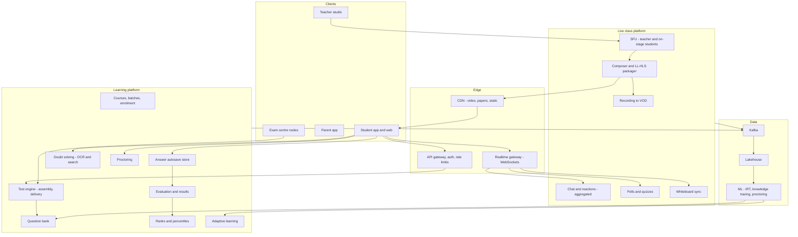
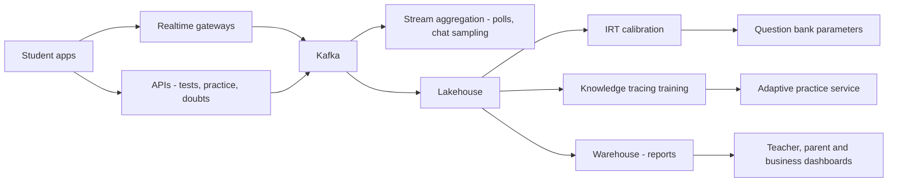

# I13. Online Exams & Live Classes

!!! abstract "Chapter at a glance"
    **Sector:** Education (EdTech and national testing) · **Format:** system design walkthrough (no code) · **Reader bands:** B1 → B4 · **Builds on:** [I06](i06-video-streaming-and-live-cricket.md) (streaming), [Ch 41](../05-case-studies/41-chat-customer-rider-messaging.md) (chat), [Ch 51](../05-case-studies/51-real-time-analytics-and-top-k.md) (top-K), [Ch 59](../07-interview/59-interview-qa-bank.md) L4 (spaced repetition)

    **What you get:** two connected systems.

    **1. A large EdTech platform:**

    - **live classes** where one teacher teaches up to 100,000 students with chat, polls, doubts and a shared whiteboard;
    - recorded lectures, courses and subscriptions;
    - **test series** with timers, autosave, instant results and all-India ranks;
    - **adaptive practice** and **doubt solving** from a photo of a question;
    - parent reports.

    **2. A national high-stakes computer-based test (CBT) in the style of large entrance exams:**

    - question paper security;
    - exam centres with local servers;
    - response capture;
    - **normalisation across multiple shifts** (percentiles);
    - results for over a million candidates;
    - remote proctoring for online exams.

    **Also covered:**

    - **the algorithms:** item response theory, computerised adaptive testing, knowledge tracing, paper assembly under a blueprint, percentile normalisation, collusion detection, proctoring anomaly detection, leaderboards at scale, live-class fan-out and aggregation;
    - **the data platform** (learning analytics) and **tech stack**.

    **Reading time:** 85 min.

!!! warning "Sources and honesty"
    - National testing agencies publish their **normalisation methodology** (e.g. percentile scores for multi-shift exams). Summaries here are marked **VERIFY**.
    - Details of exam centre operations and security are only partly public.
    - EdTech companies' internal systems aren't public.
    - This is a **reference design**. Children's data needs special care under the DPDP Act (**VERIFY** rules).

---

## 1. The System in One Page

### 1.1 Two very different load shapes

| | Live class | Mock test at 10 am Sunday | National CBT |
|---|---|---|---|
| **Concurrency** | 100k students in one class; thousands of classes a day | 500k students start one test at once | ~1M candidates over several shifts at centres |
| **Hard part** | Low latency to 100k, interaction at scale | Everyone starts, saves and submits at the same time | Security, fairness, zero data loss, normalisation |
| **Failure impact** | Poor experience | Anger, lost trust | Legal challenges, re-exams |

### 1.2 Main systems

| System | What it does |
|---|---|
| **Identity and profiles** | Students (often minors), parents, teachers, roles |
| **Catalogue and enrolment** | Courses, batches, schedules, subscriptions, payments |
| **Live class platform** | Teacher broadcast, student viewing, chat, polls, doubts, whiteboard, recordings |
| **Content and VOD** | Lecture recordings, notes, PDFs; streaming ([I06](i06-video-streaming-and-live-cricket.md)) |
| **Question bank** | Questions with metadata (topic, difficulty, IRT parameters), versions, media |
| **Test engine** | Test assembly, delivery, timers, autosave, submission, evaluation, results, ranks |
| **Adaptive learning** | Learner model, practice recommendations, spaced revision |
| **Doubt solving** | Photo → OCR → search similar solved questions → human tutor fallback |
| **Proctoring** | Webcam/mic monitoring, browser lockdown, anomaly flags, review |
| **CBT centre system** | Local servers, secure paper delivery, candidate verification, response sync |
| **Results and normalisation** | Scores, percentiles, ranks, answer key challenges |
| **Notifications and parent reports** | Class reminders, test results, progress |
| **Data platform** | Learning analytics, content quality, ML |

### 1.3 Scale for this design (assumptions)

| Quantity | Value |
|---|---|
| Registered learners | 30M; 3M daily active |
| Live classes per day | 5,000; largest class 100k concurrent |
| Chat messages in a big class | Up to 5k/s at peak moments |
| All-India mock test | 500k concurrent candidates, 3 hours, 90 questions |
| Answer saves in a mock | Each candidate saves ~2 times per minute → ~17k saves/s average, higher bursts |
| Test submissions | 500k within the last 5 minutes (auto-submit at time end) |
| National CBT | ~1M+ candidates across ~10 shifts at ~500 centres (VERIFY actual numbers) |

**Estimation highlights:**

- **Live class video:** 100k viewers × 1 Mbps = 100 Gbps from the CDN. That is fine for CDNs, but only if the class is delivered as a **stream** (HLS/LL-HLS) to most viewers. It cannot be done by making 100k WebRTC connections to an SFU cluster (§5.1).
- **Test start:** 500k candidates fetching the paper at 10:00:00 is a flash crowd.
    - Pre-download encrypted papers before the start.
    - Release the decryption key at the start time, one small request each, or served by a signed time-based key.
- **Test end:** 500k submissions in a few minutes, i.e. ~2–5k/s. Answers are already autosaved, so "submit" is just a marker, and **evaluation is asynchronous**.

---

## 2. Requirements

### 2.1 EdTech functional

1. Browse courses and batches; enrol; pay (subscriptions, EMIs, UPI).
2. Join live classes with ~2–5 s latency (interactive enough for polls and doubts); ask questions in chat; answer polls; raise hand (selected students go on stage).
3. Watch recordings shortly after class; download notes.
4. Take tests (practice, chapter tests, all-India mock tests) with timers, section rules, question palette, mark-for-review, autosave; get results, solutions and analysis; see all-India rank and percentile.
5. Adaptive practice: personalised question sets; revision reminders.
6. Doubt solving: photo of a question → instant solution if similar exists → tutor chat otherwise.
7. Parent dashboards; teacher dashboards for class engagement.

### 2.2 National CBT functional

1. Registration, fee payment, admit cards with centre and shift.
2. Secure delivery of question papers to centres. Candidate verification (biometrics/photo; VERIFY).
3. A reliable exam in centres with local servers, whatever the internet or power conditions.
4. Response capture with audit, and upload to central.
5. Provisional answer keys, challenges, final keys, scoring, **normalisation across shifts**, results, ranks.
6. Online (remote-proctored) variants for some exams, with proctoring.

### 2.3 Non-functional

| Attribute | Target |
|---|---|
| **Live latency** | 2–5 s glass-to-glass for mass viewers; < 500 ms for on-stage participants |
| **Test durability** | No answer ever lost once the candidate sees "saved" |
| **Timer integrity** | Server-authoritative timing; client clock manipulation can't add time |
| **Security** | Papers unseen before start; no tampering with responses; audit everything |
| **Fairness** | Equal conditions across shifts; normalisation methodology applied consistently |
| **Availability** | Test windows are fixed-time events; plan for zero downtime during them |
| **Privacy** | Minors' data protected; proctoring recordings with consent and limited retention |

---

## 3. High-Level Architecture

**Key decisions:**

| Decision | Choice | Why |
|---|---|---|
| **Live delivery** | Hybrid: WebRTC/SFU for the teacher and on-stage students; **LL-HLS/CMAF via CDN** for the mass audience | WebRTC to 100k viewers is costly and hard to scale; streaming scales cheaply with 2–5 s latency |
| **Chat at scale** | Sampled/aggregated fan-out, not every message to everyone | 5k msgs/s × 100k viewers is impossible and unreadable |
| **Test delivery** | Pre-download encrypted paper; key release at start; autosave each answer; submit is a marker | Removes start and end spikes, protects against disconnects |
| **Timing** | Server-authoritative start and end; client shows a countdown synced to server time | Prevents clock tampering ([I02](i02-flipkart-style-sale-day-ecommerce.md) L1) |
| **Evaluation** | Asynchronous, idempotent, per candidate | Handles 500k submissions calmly |
| **CBT centres** | Local server per centre with encrypted papers and local response storage, synced centrally | Survive internet loss; security |

---

## 4. How It Works — Journeys End to End

### 4.1 Journey 1: a live physics class for 60,000 students

1. **Before class:**
    - enrolled students get a reminder 15 minutes before;
    - the class page loads from the CDN;
    - the app fetches a **join token** (entitlement check: is the student in this batch or subscription?).
2. **Teacher goes live:**
    - the teacher's studio app sends camera, screen/tablet and audio over **WebRTC** to an **SFU**;
    - a **composer** mixes the teacher video and slides/whiteboard into one layout, or keeps them as separate tracks;
    - it encodes an ABR ladder and packages **LL-HLS (CMAF chunks)**;
    - the CDN serves **60,000 students**. Latency is ~2–5 s, while mobile viewers on 3G get lower renditions ([I06](i06-video-streaming-and-live-cricket.md) §6.3).
3. **Whiteboard:**
    - strokes are sent as **vector events** (not video) over WebSockets, and rendered on devices;
    - this is crisp at any resolution and needs little bandwidth;
    - it is synced with the video timeline via timestamps.
4. **Chat** (§5.2):
    - students send messages to the **chat service** through WebSocket gateways;
    - messages are moderated (profanity filters, rate limits per student);
    - the service **samples** what to fan out: every student sees a manageable stream (e.g. 5 messages/s), with teacher and moderator messages and "top questions" pinned;
    - all messages are stored for the teacher and moderators to see and search.
5. **Doubts:** students can mark a message as a doubt. Similar doubts are clustered (text similarity), and moderators surface the top clusters to the teacher.
6. **Polls:** the teacher launches a poll ("What is the SI unit of force?").
    - 60,000 answers arrive in 20 seconds (~3k/s);
    - **aggregated in memory** per option, and the running result is broadcast every second;
    - individual answers are stored for analytics and student reports.
7. **Hand raise:** the teacher invites a student on stage. That student joins the **SFU** with WebRTC for sub-second interaction, and their video is composed into the stream for everyone else.
8. **After class:** the recording (the composed stream, or tracks plus whiteboard events for interactive playback) is packaged as **VOD** within minutes. Attendance, watch time, poll accuracy and doubts go to analytics.

### 4.2 Journey 2: an all-India mock test at 10 am Sunday

1. **Before the test:**
    - the test is **assembled** from the question bank according to a **blueprint**: sections, topics, difficulty distribution, marks scheme (§6.3);
    - variants may be created (shuffled order, different question sets of equal difficulty) to reduce copying;
    - from 9:30, registered students' apps **pre-download the encrypted test package** from the CDN: questions, images, instructions. Downloads spread over 30 minutes.
2. **Start:**
    - at 10:00:00 (server time), the app requests the **decryption key** and a **start token**. The server records the **start time** for that candidate;
    - late joiners get the time remaining for their window, per test rules;
    - key requests are small, and served by a scaled, cached key service.
3. **During the test:**
    - each answer change is **autosaved**: `(candidate, test, question, answer, client sequence, client time)` goes to the autosave service. It is written to a durable store and acknowledged, showing "saved";
    - if offline, answers queue locally and sync when the connection returns, with sequence numbers resolving order (§6.8);
    - **the timer** shows a countdown synced to server time. The server's recorded start plus duration defines the end, regardless of the client clock.
4. **End:**
    - at the end time the app auto-submits: a small "submitted" marker plus any unsynced answers. The server rejects answers timestamped after the end (with tolerance for network delay, per rules);
    - candidates who lost connectivity have their last synced answers evaluated. Their buffered answers are accepted if their sequence and time prove they were answered before the end (policy).
5. **Evaluation:**
    - asynchronous workers score each candidate per the marks scheme (+4/−1, partial marks for multi-correct; VERIFY exam patterns), idempotently;
    - within minutes, **results**: score, section scores, time analysis, accuracy by topic.
6. **Ranks:**
    - all-India rank and percentile among 500k candidates come from a score distribution (§6.6);
    - ranks become final after a cut-off time, when late submissions and re-evaluations are done.

### 4.3 Journey 3: a national CBT at an exam centre

1. **Weeks before:**
    - the question papers for each shift are set by experts, reviewed and stored encrypted;
    - **centres** are prepared: networked computers, a **local server**, power backup, CCTV, and a biometric or photo verification set-up (VERIFY specific procedures).
2. **Day before or morning of:**
    - the **encrypted paper** for the shift is downloaded to the local server;
    - the **decryption key** is released only shortly before the exam starts, through a secure channel. Keys may be split among officials (VERIFY procedures).
3. **Candidate entry:** verified by admit card, photo and biometrics. Each is assigned a computer, which boots into a **locked-down exam client** (no other apps, no internet).
4. **During the exam:**
    - each candidate's responses are saved to the **local server** continuously, with a local audit log (every click with a timestamp);
    - the local server replicates to a second local disk or server (VERIFY);
    - if a computer fails, the candidate moves to a spare, and the session resumes from the server with remaining time preserved.
5. **After the shift:**
    - response files are **encrypted and signed**, then uploaded to central over the network (or physically transported if needed);
    - central verifies checksums and signatures, and reconciles counts: candidates present vs response files.
6. **Keys and scoring:**
    - **provisional answer keys** and candidates' response sheets are published;
    - candidates can **challenge** keys, for a fee, within a window;
    - experts review; **final keys** are published;
    - scoring runs.
7. **Normalisation:** multiple shifts had different papers, so raw scores are converted to **percentile scores within each shift** (§6.5). Merit lists are formed from the normalised scores per the methodology (VERIFY the agency's published rules, including tie-breaking).
8. **Results:** published for a million candidates on one day, via a CDN-cached results site with candidate login. Expect traffic spikes of tens of thousands of requests per second (pre-generated result documents).

### 4.4 Journey 4: remote-proctored online exam

1. **Setup:** the candidate installs a lockdown browser or app. It checks the environment: a single screen, no virtual machines, no screen sharing or remote desktop tools.
2. **Identity:** face photo matched to the registration photo, and ID document capture.
3. **Room scan:** a 360° camera sweep of the room.
4. **During the exam:**
    - **AI proctoring** analyses webcam and microphone streams at the edge or server (§6.7): face absent, multiple faces, gaze away repeatedly, voices, mobile phone detected, tab switching attempts;
    - events are flagged with timestamps and short clips;
    - **live proctors** monitor many candidates (e.g. 1:20) with AI flags prioritised, and can message or terminate.
5. **Review:** flags are reviewed after the exam, and decisions are recorded with evidence. Recordings are retained for a limited period per policy and consent (VERIFY).

### 4.5 Journey 5: adaptive practice and doubts

1. **Adaptive practice:** a student opens "Practice: Kinematics".
    - The **learner model** estimates mastery per concept (§6.2).
    - The recommender picks questions near the student's ability, "just hard enough", mixing weak concepts and spaced revision of earlier ones ([Ch 59](../07-interview/59-interview-qa-bank.md) L4 principle).
    - Each answer updates mastery immediately.
2. **Doubt solving:** the student photographs a question from a textbook.
    - **OCR** handles printed text and math notation (math OCR to LaTeX).
    - Math-aware text embeddings are used for **semantic search** over millions of solved questions.
    - If a near-duplicate exists with high confidence, the student sees the solution video and steps instantly.
    - Otherwise the doubt goes to a **tutor queue** (chat), with subject routing and SLA.

---

## 5. Core Subsystems in Depth

### 5.1 Live class delivery at scale

- **Why hybrid:**
    - **WebRTC via SFUs** gives sub-second latency but needs server resources per viewer and complex scaling;
    - **LL-HLS via CDN** gives 2–5 s latency and scales to millions at low cost;
    - classes need low latency only for the teacher and a few on-stage students.
- **Small classes** (up to a few hundred) can be all-WebRTC for full interactivity. **Big classes** use the hybrid.
- **Synchronising interaction with video delay:**
    - a poll the teacher launches at time T arrives at viewers' screens with the video at T + 3 s;
    - send poll events with a **video timestamp**, so clients show the poll when their playback reaches that moment;
    - the same applies to whiteboard events.
- **Teacher-side reliability:** the teacher's upload is the single point of failure. Use a backup encoder path, an internet quality check before class, and fallback to audio + whiteboard if the video uplink degrades.

### 5.2 Chat and interaction at 100k

- **Ingest:** WebSocket gateways (sharded by connection) → chat service partitioned by class → storage (append-only per class).
- **Fan-out:**
    - never broadcast every message to every viewer;
    - the **class room service** selects a stream per interval: teacher and moderator messages always; a **sample** of student messages (rate-limited per interval); "highlighted" doubts;
    - the selected stream is broadcast via gateways, one message per interval per connection batch.
- **Reactions and poll votes** are aggregated as counts per interval ([I06](i06-video-streaming-and-live-cricket.md) §6.8).
- **Moderation:** profanity and spam filters, per-user rate limits, slow mode, bans.
- **Doubt clustering:** embed doubt messages, cluster them online (incremental clustering), and show the teacher a ranked list of clusters with counts.

### 5.3 Question bank

- **Each question** has:
    - text (with LaTeX), images, options, correct answers;
    - solution (text/video);
    - topic tags (syllabus hierarchy);
    - difficulty labels;
    - **IRT parameters** (§6.1);
    - exposure counts;
    - version history;
    - review status (created → reviewed → approved → retired).
- **Search and assembly:** index by topic, difficulty, type and exposure, for assembly and practice.
- **Quality loop:** item statistics from tests (difficulty, discrimination, distractor analysis) flag bad questions: ambiguous, wrong key, or too easy or hard.

### 5.4 Test engine and autosave

- **Test definitions:** sections, timers (overall and per section), navigation rules, marking schemes, question pools or fixed papers, variants.
- **Delivery package:** encrypted per test (and per variant), downloadable in advance. The key is released at start. Optional per-candidate watermarking of content deters leaks.
- **Autosave store:**
    - writes keyed by (test, candidate, question) with the **highest sequence number wins**;
    - partitioned by candidate;
    - a durable, replicated key-value store (e.g. Cassandra/ScyllaDB/DynamoDB-style) handles high write rates;
    - acknowledgements only after a durable write.
- **Submission:** a marker plus a final flush. Evaluation is triggered via an event.
- **Evaluation:** idempotent per candidate. Recomputable if the answer key changes (§4.3 step 6), so keep responses separately from scores.

### 5.5 Results, ranks and analytics

- **Per-candidate results:** score, section-wise breakdown, time spent per question, accuracy by topic, comparison to toppers and averages.
- **Ranks:** computed from the score distribution after the test window closes (§6.6), and published once stable.
- **Teacher and parent reports:** batch performance, weak topics, attendance, engagement.

### 5.6 CBT centre system

- **Local server:**
    - receives the encrypted paper;
    - holds decryption keys only at exam time;
    - serves the exam client to all terminals;
    - stores responses with an audit trail;
    - replicates locally;
    - uploads signed response packages after the shift.
- **Exam client:** locked-down OS image, no internet, timer from the local server, and seamless resume on terminal failure.
- **Monitoring:** central dashboards show centre readiness (downloads done, clocks synced, terminals up), candidates present, and upload status after shifts. CCTV and observers are part of the process (VERIFY).

---

## 6. Algorithms

### 6.1 Item response theory (IRT)

- **The model:** the probability that a student with ability θ answers item i correctly. In the **3-parameter logistic (3PL)** model:

    > P(correct | θ) = c_i + (1 − c_i) / (1 + e^(−a_i(θ − b_i)))

    where:
    - **b_i** is difficulty;
    - **a_i** is discrimination (how sharply the item separates abilities);
    - **c_i** is the guessing floor (e.g. ~0.25 for four options).
- **Calibration:** estimate item parameters from many students' responses by maximum likelihood (EM / marginal maximum likelihood) or Bayesian methods.
- **Ability estimation:** estimate θ for each student from their responses.
- **Uses:** scores comparable across different question sets; question quality checks; adaptive testing; better practice recommendations.

### 6.2 Knowledge tracing

- **Bayesian Knowledge Tracing (BKT):** per concept, a hidden "mastered or not" state, with parameters for:
    - initial knowledge;
    - learning rate (probability of learning after each attempt);
    - slip (wrong answer despite mastery);
    - guess (right answer without mastery).

    After each answer, update P(mastered) by Bayes' rule.
- **Deep knowledge tracing:** sequence models over the student's full interaction history predict the next answer's correctness across concepts.
- **Uses:** mastery bars in the app; choosing the next question; deciding when to revise (spaced repetition, with intervals growing as mastery holds).

### 6.3 Test assembly under a blueprint

- **Constraints:**
    - number of questions per topic and section;
    - difficulty distribution (e.g. 30% easy, 50% medium, 20% hard, or a target test information curve with IRT);
    - question types;
    - no overlapping or duplicate concepts;
    - exposure limits (don't reuse recent questions);
    - variants with equal difficulty.
- **Methods:**
    - **integer programming** (select binary x_i for each question to satisfy constraints and hit target information);
    - or greedy heuristics with repair.

    Parallel forms (variants) are generated so their test characteristic curves match.

### 6.4 Computerised adaptive testing (CAT)

- **Loop:**
    1. Start with a medium item.
    2. After each answer, update θ.
    3. Choose the next item with **maximum information** at the current θ, subject to content constraints and exposure control (randomisation among top items).
    4. Stop when the standard error is small enough, or after a maximum number of items.
- **Benefits:** shorter tests with equal precision. Used in some standardised exams (VERIFY which).

### 6.5 Percentile normalisation across shifts

- **The problem:** a multi-shift exam uses different papers per shift. One shift may be harder, so raw scores aren't comparable.
- **Percentile method** (as published by some national agencies; VERIFY details):
    - within each shift, a candidate's **percentile score** = 100 × (number of candidates in that shift with raw score ≤ the candidate's score) / (total candidates in the shift);
    - computed to several decimal places;
    - merit is based on percentile scores, with tie-breaking rules;
    - the assumption is that ability distributions are similar across shifts, so candidates are randomly allocated to shifts.
- **Alternatives:** equipercentile equating, and IRT-based equating using common (anchor) items, which is more robust if shift populations differ.
- **Systems view:**
    - sort each shift's scores;
    - compute the cumulative distribution;
    - map each candidate's score;
    - publish with full precision and audit;
    - make it reproducible from stored responses and final keys.

### 6.6 Ranking half a million candidates

- **Scores are discrete** (e.g. −90 to 360), so ranks come from a **count histogram**: rank(score) = 1 + number of candidates with a higher score. This is O(number of distinct scores) and trivially fast, even for millions.
- **Live leaderboard during a test window:**
    - maintain counts per score bucket in a sharded counter store ([Ch 51](../05-case-studies/51-real-time-analytics-and-top-k.md));
    - a candidate's provisional rank = the sum of counts above their score;
    - top-100 lists from a sorted set.
- **Ties:** break by time taken, accuracy, or sectional scores per test rules.

### 6.7 Proctoring anomaly detection

- **Signals:**
    - face detection (none, multiple);
    - face match drift (a different person);
    - head pose and gaze away (away for longer than N seconds, repeatedly);
    - object detection (phone, book);
    - audio (speech detection, multiple voices);
    - screen events (focus loss, attempts to open apps).
- **Scoring:** a weighted sum of events over time windows with decay; thresholds for a live proctor alert vs a post-exam review.
- **Fairness:** tune for lighting and skin tone variations, network conditions and disabilities. Always have human review before penalties.

### 6.8 Autosave ordering

- **Per question, the client increments a sequence number** for each change. The server stores the answer with the **highest sequence** (last write by sequence, not by arrival order).
- **Offline queue replay** sends changes in order. The server ignores stale ones.
- **The end-time rule:** changes with client sequence after the recorded end, or arriving after end + grace, are rejected (policy).
- **Evidence:** the audit log stores every change for disputes.

### 6.9 Collusion and cheating detection

- **Answer similarity:** pairs of candidates with unusually many identical **wrong** answers (shared wrong answers are much stronger evidence than shared right ones).
    - Statistical indices compare to the expected overlap given their abilities.
    - Compute within centres, labs, or IP subnets to limit pair counts.
- **Timing patterns:** answers entered at identical times across candidates, or extremely fast correct answers on hard items (possible leak).
- **Score jumps:** sudden large improvements vs history (EdTech mock tests).
- **Outcome:** flags → review → action per rules. Evidence only, never automatic penalties for high-stakes exams.

---

## 7. Data Architecture

### 7.1 Operational stores

| Data | Store (reference) | Notes |
|---|---|---|
| Users, enrolments, payments | PostgreSQL | Minors: guardian consent records |
| Live class state (rooms, participants) | In-memory + Redis | Ephemeral |
| Chat and doubts | Append-only per class (Kafka + Cassandra) | Searchable for moderators |
| Question bank | PostgreSQL + object storage (images, videos) + OpenSearch | Versioned |
| Test packages | Object storage + CDN (encrypted) | Keys in KMS |
| Autosaved answers | Distributed KV (Cassandra/ScyllaDB/DynamoDB) partitioned by candidate | High write rates |
| Results and ranks | PostgreSQL + cached result pages | Read spikes |
| Proctoring media | Object storage with short retention | Access-controlled |
| CBT centre data | Local server DB + signed packages centrally | Chain of custody |

### 7.2 Learning analytics

- **Events** (video watched, pauses and rewinds, attempts, answers with time taken, doubts, poll responses, test results) → Kafka → lakehouse → warehouse.
- **Models:** IRT calibration jobs, knowledge tracing training, dropout/churn prediction, content quality analytics (which lecture segments cause rewinds), teacher effectiveness metrics (engagement, outcomes).
- **Dashboards:** for teachers (batch), parents (child), content teams (question quality) and business (retention, conversion).

### 7.3 Data flow

---

## 8. Tech Stack (reference choice)

| Layer | Choice | Notes |
|---|---|---|
| Live media | WebRTC SFU (LiveKit, mediasoup, Janus) + encoder/packager for LL-HLS; CDN | Hybrid delivery |
| Realtime | WebSocket gateways (Go/Elixir/Node) + Redis pub/sub or NATS | Chat, polls, whiteboard |
| Services | Java/Kotlin (Spring Boot) or Go | Test engine, catalogue |
| Autosave store | Cassandra/ScyllaDB or DynamoDB | Write-heavy, partitioned |
| Databases | PostgreSQL, Redis | Core data |
| Search | OpenSearch with vector search | Questions and doubts |
| OCR and ML | Math OCR models, embeddings (Python/PyTorch), model serving | Doubts, proctoring |
| Streaming | Kafka, Flink | Aggregations |
| Lakehouse | Iceberg + Spark + Trino | Analytics |
| Psychometrics | IRT libraries (Python/R), custom calibration jobs | Question calibration |
| Apps | Native Android (low-end friendly), web | India's device mix |
| CBT centres | Hardened Linux images, local servers, signed packages | Security |

---

## 9. Security, Privacy & Compliance

- **Children's data:** verifiable parental consent, no tracking-based advertising to children, and limits on behavioural monitoring under the DPDP Act (VERIFY rules for children's data).
- **Exam integrity:**
    - encrypted papers;
    - just-in-time keys;
    - access logs;
    - watermarking;
    - lockdown clients;
    - CCTV at centres;
    - chain-of-custody for response data;
    - penalties for leaks under applicable public examination laws (e.g. anti-cheating legislation for public exams; VERIFY).
- **Proctoring:** transparent disclosure and consent, minimal data, short retention, human review, and accommodations for disabilities.
- **Payments and refunds:** clear refund policies for courses (consumer protection; VERIFY), and EMI and loan disclosures when financing courses.

---

## 10. Reliability & Operations

- **Fixed-time events:**
    - mock tests and national exams are scheduled, so **pre-scale** and pre-download;
    - rehearse with load tests at full concurrency;
    - freeze changes on test days.
- **Graceful handling of disconnects:** autosave and local queues, resume with remaining time, and server-authoritative timers.
- **Live classes:**
    - pre-class teacher connectivity checks;
    - backup encoder paths;
    - a degraded mode (audio + whiteboard);
    - CDN capacity for the day's schedule.
- **Results day:** pre-generate result pages; serve via CDN with login tokens; queue traffic if needed.
- **CBT centres:** readiness dashboards, spare terminals, power backups, and contingency plans for centre failures (rescheduling candidates; VERIFY policies).

---

## 11. Key Trade-offs

| Decision | Chosen | Accepted cost |
|---|---|---|
| Live delivery | WebRTC for stage, LL-HLS for audience | 2–5 s delay for most viewers |
| Chat | Sampled fan-out | Not every message visible to everyone |
| Test start | Pre-download + key release | Complexity; security of pre-positioned content |
| Autosave | Per-answer durable writes | Higher write load |
| Normalisation | Percentiles within shifts (as mandated) | Assumes comparable shift populations |
| Adaptive learning | IRT + knowledge tracing | Calibration data needed |
| Proctoring | AI flags + human review | Cost; privacy concerns |

---

## 12. Interview Q&A

### Beginner B1

??? question "Q1 [B1] ⭐ How would you stream a live class to 100,000 students?"

    **30-second answer:** The teacher sends video over WebRTC to an SFU; it's composed, encoded into an ABR ladder and packaged as low-latency HLS served by a CDN to the audience with 2–5 s latency; only on-stage students use WebRTC; whiteboard and polls travel as small events over WebSockets.

    **Deep answer:** §4.1, §5.1.

    **Trade-offs I'd call out:** Latency vs scale and cost.

    **Follow-ups:**
    1. Why not WebRTC for all? → Server cost per viewer.
    2. Poll sync? → Video timestamps.

    **Red flags:** One video call with 100k participants.

??? question "Q2 [B1] How do you make sure a student's answers aren't lost in an online test?"

    **30-second answer:** Autosave each answer change to a durable, replicated store with a sequence number; show "saved" only after acknowledgement; queue locally when offline and sync later; submission just marks the end.

    **Deep answer:** §4.2, §5.4, §6.8.

    **Trade-offs I'd call out:** Write load vs safety.

    **Follow-ups:**
    1. Conflicts? → Highest sequence wins.
    2. Browser crash? → Resume from server.

    **Red flags:** Save everything at submit.

??? question "Q3 [B1] Why should test timers be server-authoritative?"

    **30-second answer:** Client clocks can be wrong or manipulated; the server records each candidate's start and computes the end, while the client shows a countdown synced to server time; late answers are rejected per rules.

    **Deep answer:** §4.2 step 3, §6.8.

    **Trade-offs I'd call out:** Network delays need tolerance.

    **Follow-ups:**
    1. Late joiners? → Remaining time rules.
    2. Disconnects? → Pause policies.

    **Red flags:** Trusting the browser clock.

??? question "Q4 [B1] How is an all-India rank computed?"

    **30-second answer:** After the test window closes, count how many candidates scored higher using a histogram of scores (scores are discrete), apply tie-break rules, and compute percentiles; provisional ranks can update live from bucket counts.

    **Deep answer:** §6.6.

    **Trade-offs I'd call out:** Live vs final ranks.

    **Follow-ups:**
    1. Ties? → Rules.
    2. Scale? → Histogram is tiny.

    **Red flags:** Sorting all candidates on every request.

### Intermediate B2

??? question "Q5 [B2] ⭐ How do you handle 500,000 students starting a test at the same second?"

    **30-second answer:** Pre-download the encrypted paper from the CDN over the preceding 30 minutes, then release a small decryption key and start token at start time from a scaled key service; record server-side start times; late joiners get remaining time.

    **Deep answer:** §4.2, §5.4.

    **Trade-offs I'd call out:** Security of pre-positioned papers.

    **Follow-ups:**
    1. Key leak? → Per-test keys, short window.
    2. Images? → In the package.

    **Red flags:** Everyone downloads the paper at 10:00.

??? question "Q6 [B2] How would you design chat for a class of 100k?"

    **30-second answer:** WebSocket gateways → chat service partitioned by class → append-only storage; moderation and rate limits; fan out only a sampled stream plus teacher and moderator messages and pinned doubts; aggregate reactions; cluster doubts for the teacher.

    **Deep answer:** §5.2.

    **Trade-offs I'd call out:** Completeness vs readability.

    **Follow-ups:**
    1. Spam? → Slow mode, bans.
    2. Search? → Moderator tools.

    **Red flags:** Broadcasting every message.

??? question "Q7 [B2] What is item response theory and why use it?"

    **30-second answer:** A model of the probability of a correct answer as a function of student ability and item parameters (difficulty, discrimination, guessing); it makes scores comparable across different question sets, reveals bad questions, and powers adaptive testing and practice.

    **Deep answer:** §6.1.

    **Trade-offs I'd call out:** Calibration data needs.

    **Follow-ups:**
    1. 3PL? → Adds guessing.
    2. Calibration? → EM/MML.

    **Red flags:** Difficulty as percent correct only.

??? question "Q8 [B2] How does doubt solving from a photo work?"

    **30-second answer:** Math-aware OCR turns the photo into text and LaTeX, an embedding model searches millions of solved questions for near-duplicates, high-confidence matches return solutions instantly, and others go to a tutor queue routed by subject.

    **Deep answer:** §4.5.

    **Trade-offs I'd call out:** False matches vs speed.

    **Follow-ups:**
    1. Handwriting? → Harder OCR.
    2. Confidence? → Thresholds.

    **Red flags:** Keyword search only.

??? question "Q9 [B2] How do you assemble a fair test from a question bank?"

    **30-second answer:** Define a blueprint (topics, sections, difficulty or target information curve, question types, exposure limits) and select questions via integer programming or heuristics, generating equal-difficulty variants when needed.

    **Deep answer:** §6.3.

    **Trade-offs I'd call out:** Variety vs comparability.

    **Follow-ups:**
    1. Variants? → Matched curves.
    2. Exposure? → Limits.

    **Red flags:** Random selection.

### Senior B3

??? question "Q10 [B3] ⭐ How do you normalise scores across multiple exam shifts?"

    **30-second answer:** Compute percentile scores within each shift — 100 × candidates with score ≤ yours ÷ total in shift — to high precision and rank on those, as some national agencies do (VERIFY); alternatives are equipercentile or IRT equating with anchor items; make it reproducible from stored responses and final keys.

    **Deep answer:** §6.5.

    **Trade-offs I'd call out:** Assumption of comparable shift populations.

    **Follow-ups:**
    1. Key challenges? → Rescore before normalising.
    2. Ties? → Rules.

    **Red flags:** Comparing raw scores across shifts.

??? question "Q11 [B3] How would you build adaptive practice?"

    **30-second answer:** Estimate mastery per concept with knowledge tracing (BKT or deep models) and ability with IRT; choose next questions near the learner's ability, mixing weak concepts and spaced revision; update after each answer; evaluate by learning gains, not engagement alone.

    **Deep answer:** §6.2, §4.5.

    **Trade-offs I'd call out:** Challenge vs frustration.

    **Follow-ups:**
    1. Cold start? → Diagnostic test.
    2. Revision timing? → Spaced repetition.

    **Red flags:** Random practice sets.

??? question "Q12 [B3] How do you detect collusion in online tests?"

    **30-second answer:** Compare answer patterns within centres, labs or networks, focusing on shared wrong answers relative to expected overlap given abilities; look at synchronised timing and implausibly fast correct answers on hard items; flag for human review with evidence.

    **Deep answer:** §6.9.

    **Trade-offs I'd call out:** False positives.

    **Follow-ups:**
    1. Pair explosion? → Limit to groups.
    2. Leaks? → Timing plus score jumps.

    **Red flags:** Auto-penalising similarity.

??? question "Q13 [B3] Design remote proctoring."

    **30-second answer:** Lockdown client with environment checks, identity verification and room scan, on-device or server AI detecting absence, multiple faces, gaze, objects and voices, weighted scoring with live proctor alerts and post-exam review, consent and short retention, fairness tuning and human decisions.

    **Deep answer:** §4.4, §6.7.

    **Trade-offs I'd call out:** Integrity vs privacy and fairness.

    **Follow-ups:**
    1. Bandwidth? → Edge inference, snapshots.
    2. Accessibility? → Accommodations.

    **Red flags:** Fully automated disqualification.

??? question "Q14 [B3] How do you keep polls and whiteboard in sync with a delayed video stream?"

    **30-second answer:** Timestamp interactive events with the video timeline (not wall clock) and have clients display them when playback reaches that timestamp; aggregate poll results server-side and broadcast periodically.

    **Deep answer:** §5.1.

    **Trade-offs I'd call out:** Slight delay for everyone.

    **Follow-ups:**
    1. On-stage students? → Real-time path.
    2. Recording? → Replay events.

    **Red flags:** Popping polls before the teacher is seen asking.

### Architect B4

??? question "Q15 [B4] ⭐ Design a national computer-based test system."

    **30-second answer:** Encrypted papers pre-positioned on hardened local centre servers with just-in-time key release, locked-down terminals, continuous local response saving with audit and replication, signed upload after shifts, provisional keys and challenges, scoring, percentile normalisation across shifts, and CDN-served results — with readiness monitoring and contingencies.

    **Deep answer:** §4.3, §5.6, §6.5.

    **Trade-offs I'd call out:** Centre infrastructure cost vs control.

    **Follow-ups:**
    1. Internet loss? → Local operation.
    2. Terminal failure? → Resume.

    **Red flags:** Exam served from a central website to centres.

??? question "Q16 [B4] How would you scale an EdTech platform for exam season?"

    **30-second answer:** Forecast concurrency for tests and classes, pre-scale APIs, autosave stores and realtime gateways, pre-position test packages and schedule CDN capacity, stagger non-essential jobs, and rehearse with full-concurrency load tests.

    **Deep answer:** §10.

    **Trade-offs I'd call out:** Idle cost.

    **Follow-ups:**
    1. Result day? → Pre-generated pages.
    2. Live classes? → Schedule-aware capacity.

    **Red flags:** Reactive autoscaling only.

??? question "Q17 [B4] What data platform would you build for learning analytics?"

    **30-second answer:** Events from classes, videos, practice and tests into Kafka and a lakehouse; IRT calibration and knowledge tracing training jobs feeding the question bank and adaptive service; warehouse marts for teacher, parent and business dashboards; content quality analytics; strict handling of minors' data.

    **Deep answer:** §7.

    **Trade-offs I'd call out:** Insight vs privacy.

    **Follow-ups:**
    1. Consent? → Guardian records.
    2. Model governance? → Validation.

    **Red flags:** Using children's data for ads.

??? question "Q18 [B4] How would you evaluate whether adaptive learning actually works?"

    **30-second answer:** Randomised experiments comparing learning outcomes (post-test gains, exam results), not just engagement; control for prior ability; measure retention over time; watch for unintended effects like frustration or dropout.

    **Deep answer:** §6.2.

    **Trade-offs I'd call out:** Long feedback loops.

    **Follow-ups:**
    1. Proxy metrics? → Mastery predictions.
    2. Ethics? → Fair access.

    **Red flags:** Time spent as the success metric.

??? question "Q19 [B4] What are the security risks of online exams, and the countermeasures?"

    **30-second answer:** Paper leaks (encryption, JIT keys, access logs, watermarking), impersonation (identity checks, face match), device cheating (lockdown clients, proctoring), collusion (answer similarity analytics), tampering with responses (signed packages, audit logs), and insider risk (separation of duties).

    **Deep answer:** §9, §6.7, §6.9.

    **Trade-offs I'd call out:** Friction vs integrity.

    **Follow-ups:**
    1. Insiders? → Key splitting.
    2. Evidence? → Audit trails.

    **Red flags:** Security by obscurity.

??? question "Q20 [B4] Compare live classes with live sports streaming."

    **30-second answer:** Both use ABR streaming via CDNs; classes need two-way interaction (polls, doubts, on-stage students) synced to a delayed stream, smaller audiences per stream but many concurrent streams, and teacher-side uplink reliability — sports needs extreme single-event scale, ads and rights.

    **Deep answer:** [I06](i06-video-streaming-and-live-cricket.md) vs this chapter.

    **Trade-offs I'd call out:** Interaction vs scale.

    **Follow-ups:**
    1. Shared tech? → Packaging, CDN.
    2. Different? → WebRTC stage.

    **Red flags:** Identical designs.

---

## 13. Summary

1. **Live classes are hybrid:** WebRTC for the teacher and on-stage students, LL-HLS via CDN for the audience. Chat is sampled; polls and whiteboard are events synced to video time.
2. **Online tests** remove the start and end spikes with pre-downloaded encrypted papers, key release at start, per-answer autosave and asynchronous evaluation. Timers are server-authoritative.
3. **High-stakes CBTs** rely on local centre servers, just-in-time keys, audit trails, signed uploads, answer key challenges and **percentile normalisation** across shifts.
4. **Psychometrics and ML** (IRT, CAT, knowledge tracing, blueprint assembly) make tests fair and practice adaptive. Integrity uses collusion analytics and proctoring with human review.
5. **Children's privacy** and exam integrity are design constraints, not add-ons.

### Related chapters

- [I06 — Video Streaming](i06-video-streaming-and-live-cricket.md) · [Ch 41 — Chat](../05-case-studies/41-chat-customer-rider-messaging.md) · [Ch 51 — Real-time Analytics](../05-case-studies/51-real-time-analytics-and-top-k.md) · [Ch 59 — Interview Q&A Bank](../07-interview/59-interview-qa-bank.md) · [I07 — Messaging & Social](i07-messaging-and-social-feed.md)
- Next in this tab: [I14 — National Digital ID & Vaccination-Scale Registration](i14-national-digital-id-and-vaccination-registration.md).
