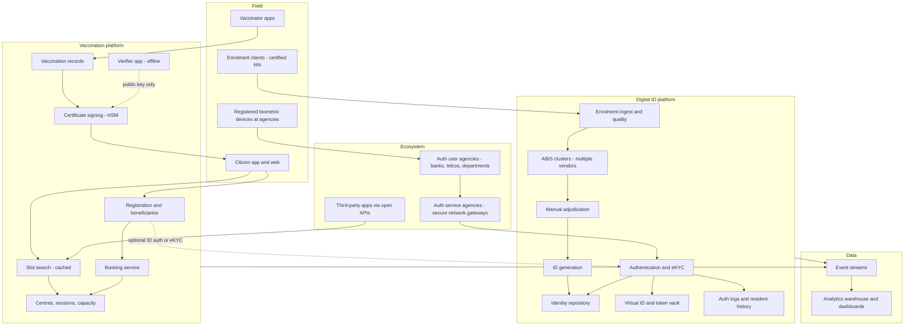
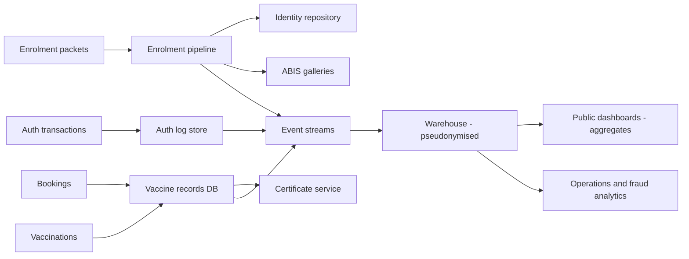

# I14. National Digital ID & Vaccination-Scale Registration

!!! abstract "Chapter at a glance"
    **Sector:** government and public digital infrastructure. **Format:** a system design walkthrough with no code. **Reader bands:** B1 → B4.

    **Builds on:**

    - [I03](i03-core-banking-and-upi.md) (UPI and national rails)
    - [Ch 36](../04-architect/36-compliance-governance-and-data-residency.md) (compliance)
    - [Ch 48](../05-case-studies/48-delivery-slot-booking-and-capacity.md) (slot booking)
    - [Ch 39](../05-case-studies/39-distributed-rate-limiter.md) (rate limiting)

    This chapter covers two connected population-scale systems.

    **1. A national digital identity platform**, in the style of India's Aadhaar:

    - enrolment of more than a billion residents, with demographic and biometric capture;
    - biometric **de-duplication**, so each person gets exactly one ID;
    - online **authentication** (fingerprint, iris, face, OTP) at hundreds of millions of requests a day;
    - **eKYC** with consent;
    - virtual IDs and tokenisation for privacy;
    - the ecosystem of registered agencies and devices.

    **2. A vaccination-scale registration and certificate platform**, in the style of CoWIN:

    - registering hundreds of millions of people in weeks;
    - booking slots at centres, with flash crowds when new age groups open;
    - recording each dose at the centre, sometimes offline;
    - issuing **digitally signed QR certificates** that anyone can verify offline;
    - dashboards for supply and coverage.

    Also covered: the **algorithms** (biometric matching and de-duplication at scale, liveness detection, identity token design, slot allocation under scarcity, bot defence, signature schemes for verifiable credentials), the **data platform** and the **tech stack**.

    **Reading time:** 85 min.

!!! warning "Sources and honesty"
    - The architecture of India's Aadhaar and CoWIN has been partly described in public documents, talks and regulations. Those details are marked **"publicly described (VERIFY)"**.
    - The legal framework cited here is marked **VERIFY**: the Aadhaar Act and its regulations, Supreme Court judgments on its permitted uses, and the DPDP Act.
    - Everything else is a **reference design** for a population-scale identity and registration system. It is not a description of any government's actual implementation.

---

## 1. The System in One Page

### 1.1 Why population-scale public systems are different

| Aspect | Commercial platform | National public platform |
|---|---|---|
| Users | Customers who chose you | **Everyone**, including people with no smartphone, low literacy or worn fingerprints |
| Failure | Lost revenue | A person denied rations, a pension or a vaccine |
| Traffic | Business peaks | Policy-driven flash crowds ("registrations open at 4 pm for 18–44") |
| Trust | Brand | **Legal mandate, privacy, audit, courts** |
| Integration | Your apps | Thousands of banks, telcos and government departments |
| Longevity | Years | Decades, for identities that last a lifetime |

### 1.2 Main systems

**Digital ID**

| System | What it does |
|---|---|
| Enrolment client | Captures demographics, photo, 10 fingerprints and 2 irises at an enrolment centre, signed and encrypted on the device |
| Enrolment server | Receives packets, runs quality checks and manual review, then **de-duplication** against everyone already enrolled |
| ABIS (automated biometric identification system) | 1:N biometric search across more than a billion records |
| ID generation | Issues a random, non-meaningful 12-digit number with a checksum after de-dup passes |
| Identity repository | The master record, with a history of updates |
| Authentication service | 1:1 match of a given ID plus biometric or OTP, answered yes/no |
| eKYC | With resident consent, returns the demographics and photo to a regulated entity |
| Virtual ID and tokens | Revocable alias IDs and per-agency tokens, so the real number need not be shared or stored |
| Ecosystem management | Registered agencies, device certification, licence keys, audit |
| Resident self-service | Update address, lock biometrics, see auth history |

**Vaccination registration**

| System | What it does |
|---|---|
| Registration | Mobile OTP login, beneficiaries linked to a phone (up to N per phone), ID document details |
| Centre and session management | Centres, vaccines, daily sessions with capacity, age groups, dose numbers |
| Slot search and booking | Search by pincode or district, book a slot, reschedule |
| Vaccinator app | Verify the beneficiary at the centre, record the dose (works offline) |
| Certificate service | Signed certificate with a QR code, available instantly |
| Verification | Anyone scans the QR and checks the signature offline |
| Supply and dashboards | Doses administered, coverage by region, wastage, adverse events (AEFI) |
| Open APIs | Third-party apps can show availability and download certificates |

### 1.3 Scale (assumptions for this design, with public orders of magnitude marked VERIFY)

| Quantity | Value |
|---|---|
| Identities | ~1.3B+ (publicly reported order of magnitude, VERIFY) |
| Biometric template gallery | 1.3B × (10 fingers + 2 irises + face) |
| Enrolments and updates | Hundreds of thousands to over a million a day |
| Authentication | Tens of crores (hundreds of millions) of transactions a month, with daily peaks over 100M (VERIFY) |
| Vaccine registrations | Hundreds of millions within months; tens of millions on peak days |
| Slot-search traffic at a new release | Millions of requests per minute, heavy bot traffic |
| Vaccinations recorded | Peak days of tens of millions of doses (a peak above 20M a day was publicly reported, VERIFY) |
| Certificates | Billions of doses, each with a signed certificate |

**Estimation highlights**

- **De-dup cost:**
    - Comparing one new enrollee against 1.3B people with 10 fingers + 2 irises is ~1.3B × several comparisons each, per enrolment.
    - At 1M enrolments a day, that is on the order of 10^15 comparisons a day.
    - This is only feasible with **fast template matchers** (e.g. iris codes compared with bit operations), **indexing/binning** to prune candidates, and a **massive parallel cluster**.
    - Historically this was spread across **multiple independent ABIS vendors** (publicly described, VERIFY).
- **Authentication:**
    - 100M auths a day averages ~1,200/s, with peaks of perhaps 5–10k/s.
    - Each is a **1:1 match**: fetch this person's template and compare. That is cheap.
    - The hard parts are latency across the country, availability and security.
- **Vaccine slot booking:**
    - A release of 1M slots with 50M people trying means slot demand far exceeds supply.
    - The design goal is to be **fair and not crash**. Serving everyone is impossible.

---

## 2. Requirements

### 2.1 Functional: digital ID

1. Enrol a resident with demographic and biometric data, operator and verifier signatures, and supporting documents (or an "introducer" for people without documents, VERIFY).
2. De-duplicate: never issue two IDs to one person, and flag suspected duplicates for manual adjudication.
3. Generate a unique random ID. Deliver the ID letter and a digital copy.
4. Authenticate: yes/no answers for an ID plus a biometric, OTP or demographic data, within a few seconds.
5. eKYC: with consent (biometric or OTP), share limited attributes with regulated entities.
6. Updates: address, mobile number, biometric refresh (for children, at mandatory ages, VERIFY).
7. Privacy features:
    - a virtual ID that can be regenerated;
    - biometric locking;
    - an authentication history visible to the resident;
    - tokenised references for agencies (UID tokens), so agencies do not store the ID number.
8. Ecosystem:
    - onboarding of authentication user agencies and KYC agencies;
    - certified capture devices (registered devices, which encrypt and sign on the device);
    - audits.

### 2.2 Functional: vaccination platform

1. Register with mobile OTP. Add beneficiaries using an ID document number, age and name.
2. Browse centres, see availability by age group, vaccine and dose, and book or cancel.
3. Walk-in registration at centres (the assisted mode).
4. Vaccinator records the dose with batch number and time, captures AEFI, and schedules the next dose due date.
5. Instant certificate by SMS link and download: verifiable and tamper-evident, with an international-travel format (ICAO/EU-compatible variants, VERIFY).
6. Open APIs (public read-only availability, protected booking and certificate APIs).
7. Dashboards: doses by region, age and vaccine, stock and wastage, and centre utilisation.

### 2.3 Non-functional

| Attribute | Target |
|---|---|
| Availability | 99.9%+ for authentication (people wait at ration shops and bank counters), with graceful degradation |
| Auth latency | < 1–2 s end to end at the agency, even on rural networks |
| De-dup accuracy | Extremely low false match rate (no wrong merges) and low false non-match rate (duplicates caught) |
| Inclusion | Fallbacks for people whose biometrics fail (iris, face, OTP, exception handling) |
| Privacy | Data minimisation, purpose limitation, no central tracking of the purpose of authentication (VERIFY what is logged) |
| Security | End-to-end encryption from device to server, HSMs, signed packets, zero trust |
| Fairness under scarcity | No advantage for bots, spread demand, transparent rules |
| Verifiability | Certificates verifiable offline by anyone, forever |
| Openness | Open standards and APIs so the ecosystem can build on top ("digital public infrastructure") |

---

## 3. High-Level Architecture

### Key decisions

| Decision | Choice | Why |
|---|---|---|
| ID number | Random, non-meaningful, with a checksum | No information leaks from the number itself, and it never needs re-issuing (publicly described, VERIFY) |
| Minimal data | Store only what is needed: demographics, photo, biometrics. No caste, religion or income (VERIFY) | Privacy, and less to protect |
| Authentication response | **Yes/no** only (plus eKYC with consent), never raw biometrics | Minimises exposure |
| Biometric security | Encrypted and signed **at the capture device** (registered devices) | Stops replay and tampering between device and server |
| De-dup | Multiple independent ABIS vendors, with results combined | Accuracy and no vendor lock-in (publicly described, VERIFY) |
| Federated ecosystem | Agencies connect via licensed gateways (ASAs), not directly | Controlled access and accountability |
| Vaccine slot search | Heavily cached, read-only, open APIs, rate-limited | Absorbs flash crowds and bots |
| Certificates | **Digitally signed QR** (verifiable credential), verifiable offline | Trust without calling the server |

---

## 4. How It Works: End-to-End Journeys

### 4.1 Journey 1: enrolling a resident

1. **At an enrolment centre**, run by a registrar's agency with a certified operator:
    - the operator logs in with their own biometric;
    - the resident gives name, date of birth, gender, address, optional mobile and email, and supporting documents (or verification by an introducer/head of family where rules allow, VERIFY);
    - the kit captures a photo, 10 fingerprints and 2 irises, with **quality checks at capture** (retake a poor-quality finger; record exceptions for missing fingers or eyes).
2. **Packet creation:**
    - demographics, biometrics and document scans are bundled into an **enrolment packet**;
    - the packet is **encrypted with the ID authority's public key** and signed by the operator and supervisor;
    - it is stored on the kit and uploaded when connected, with an **enrolment ID** receipt handed to the resident;
    - the kit may be offline for days in remote areas, so packets carry timestamps and signatures.
3. **At central ingest:**
    - decrypt the packet in a secure zone;
    - validate the signatures, operator and device;
    - run **quality and fraud checks** (operator anomalies, duplicate packets);
    - run **demographic de-dup** as a quick filter.
4. **Biometric de-dup (1:N):**
    - templates (fingerprint minutiae, iris codes, face embeddings) are extracted;
    - they are searched against the entire gallery by **ABIS**, possibly more than one vendor, whose results are fused (§6.1–6.3).
    - Outcomes:
        - **unique** → proceed;
        - **clear duplicate** → reject, and tell the resident they already have an ID;
        - **ambiguous** (possible match with low confidence) → **manual adjudication**, where trained experts compare images.
5. **ID generation:**
    - generate a random 12-digit number, excluding certain patterns, with a Verhoeff checksum (publicly described, VERIFY);
    - write to the **identity repository**;
    - add templates to the ABIS galleries and the authentication template store;
    - send a letter by post and make an electronic download available.
6. **Timeline:** days to weeks, since the heavy compute and manual adjudication are batch pipelines with queues.

### 4.2 Journey 2: fingerprint authentication at a ration shop

1. The fair-price shop operator enters the resident's ID (or scans the QR code on the card). The resident places a finger on a **registered device (RD)**.
2. The device:
    - captures the fingerprint;
    - checks **liveness** as supported;
    - builds the **PID block** (biometric data plus timestamp);
    - **encrypts** it with a session key, which is itself encrypted with the ID authority's public key;
    - **signs** it with the device's private key (certified device, with the key in secure hardware);
    - so the application software never sees raw biometrics.
3. The shop's application (the **AUA**, e.g. the food department's system) builds the auth request (ID or VID/token, PID block, AUA code, licence key, transaction ID) and signs it with the AUA's key.
4. The request goes through an **ASA**, a licensed network gateway with secure leased lines, to the ID authority's **authentication service**.
5. The authentication service:
    - validates the AUA and ASA licences and signatures, the device certificate and the timestamp (preventing replay);
    - decrypts the PID in an **HSM-backed** secure environment;
    - **looks up the templates** for that ID (1:1);
    - matches them (fingerprint matcher, with thresholds tuned for 1:1);
    - responds **Yes/No** with an error code, signed. There is no personal data unless eKYC was requested.
6. **Logging:**
    - the authority logs the transaction: which AUA, time, result, device, **without the purpose of the transaction** (publicly described, VERIFY);
    - the resident can see their authentication history.
7. **Failure paths:**
    - retry with another finger, then an iris or face, then OTP to the registered mobile;
    - or a **manual exception** with officer approval.
    - Worn fingerprints (manual labourers, the elderly) are the classic inclusion issue, so the design must support fallbacks.
8. **Performance:** a template lookup from a key-value store, plus a match in milliseconds. End-to-end latency is dominated by the network and device.

### 4.3 Journey 3: eKYC to open a bank account

1. The bank (a **KUA**, a KYC user agency) asks the customer for consent for eKYC.
2. The customer authenticates by biometric or OTP. The request includes an eKYC flag and consent.
3. On success, the authority returns **signed and encrypted** demographics and photo to the bank:
    - the bank verifies the signature;
    - the signed record is equivalent to a verified document, if permitted by regulation (VERIFY RBI/PMLA rules on Aadhaar eKYC eligibility).
4. **Privacy features:**
    - the bank may receive a **token** instead of storing the ID number;
    - reference keys go into a **vault** with restricted access;
    - offline KYC options (a signed XML/QR the resident downloads and shares, without an online auth, VERIFY) avoid central logging altogether.

### 4.4 Journey 4: vaccine registration and the 4 pm flash crowd

1. **Registration** (days before):
    - enter a mobile number and receive an OTP (via an SMS gateway, with rate limits);
    - add up to N beneficiaries with an ID proof type and number, name, birth year and gender;
    - where an ID is used, optional demographic auth or de-dup on (ID type, number) ensures one registration per person.
2. **Release announced:** "slots for 18–44 open at 4 pm". Millions wait with the page open, and bot scripts poll the APIs.
3. **At 4 pm, slot search:**
    - search by district or pincode for a date range;
    - **responses are cached** per district and date with short TTLs (tens of seconds) at the CDN and in service caches;
    - the public API is **rate-limited per IP** and the available counts are approximate;
    - the protected booking API needs an OTP login token.
4. **Booking:**
    - the user selects a session and slot and passes a **CAPTCHA** (bot defence);
    - the booking service **atomically decrements capacity** for (session, dose) using a conditional update: "if available ≥ 1, decrement and create the appointment" ([Ch 48](../05-case-studies/48-delivery-slot-booking-and-capacity.md)).
    - If a slot is gone, the user gets "fully booked" and the search refreshes.
    - Rules are enforced: one active appointment per beneficiary, correct age group, dose interval.
5. **Confirmation:** an appointment slip goes out by SMS, and the centre's list is updated.
6. **What goes wrong without design:**
    - the database melts from search traffic;
    - bots grab all slots in seconds;
    - users see stale "available" counts and fail repeatedly;
    - the OTP service is overwhelmed.

    Mitigations are covered in §5.6 and §6.6.

### 4.5 Journey 5: vaccination at the centre and the certificate

1. **Verification:** the beneficiary arrives. The vaccinator app (on a tablet or phone) searches the appointment by reference or mobile number and verifies the ID proof photo, or registers a walk-in on the spot.
2. **Record the dose:**
    - vaccine name, batch number, dose number, vaccinator ID, centre and time;
    - the next dose due date is computed automatically.
    - **If offline**, the app stores records locally with signatures and syncs later. The certificate is then generated after sync.
3. **Certificate:**
    - the certificate service creates a record: beneficiary name, birth year or age, gender, ID reference (masked), vaccine, dose, date, centre and certificate ID;
    - it **digitally signs** it (§6.7) with the programme's private key kept in an **HSM**;
    - it encodes the signed payload in a **QR code**, rendered as a PDF;
    - the beneficiary receives an SMS with a download link, also available via partner apps and digital document lockers (VERIFY).
4. **Verification anywhere:**
    - a verifier app, at an airport, office or hotel, scans the QR code;
    - it checks the **signature with the published public key, offline**;
    - it displays the details. Tampering invalidates the signature.
    - This is a **verifiable credential** pattern (W3C VC-like; publicly described as based on an open-source credentialing platform, VERIFY).
5. **Post-vaccination:** adverse events (AEFI) are reported and flow to surveillance. Second-dose reminders go out on the due date.

### 4.6 Journey 6: resident privacy controls

1. The resident logs in to self-service with an OTP.
2. **Biometric lock:** the resident locks biometric authentication, so any biometric auth fails until they unlock it temporarily. This guards against fingerprint spoofing.
3. **Virtual ID:** the resident generates a VID, a random 16-digit alias mapped to the ID, which can be revoked and regenerated. Agencies accept the VID instead of the ID number.
4. **Auth history:** the resident sees which agency authenticated them and when, which helps detect misuse.

---

## 5. Core Subsystems in Depth

### 5.1 Enrolment pipeline

- **Stages:** ingest → decrypt → validate → quality → demographic de-dup → biometric de-dup → adjudication → ID generation → print/dispatch.
- Each stage is a **queue-driven worker pool** with idempotency by enrolment ID, so it is re-runnable.
- **Backpressure:** the ABIS has finite capacity, so the ingest queue absorbs bursts (enrolment drives).
- **Operator fraud detection:** patterns such as many enrolments with the same biometrics under different names, or many exceptions (missing fingers) from one operator, lead to suspension.
- **Rejections and reasons** are sent back to the resident via the enrolment ID status.

### 5.2 ABIS: 1:N search at population scale

- **Gallery partitioning:** billions of templates are split across many nodes. Each node holds a shard **in memory** for speed.
- **Search:** a query template is broadcast to all shards, which compare in parallel. The top-k candidates by score go to a combiner.
- **Multi-modal fusion:** fingerprint, iris and face scores are combined (score-level fusion) for final decisions (§6.3).
- **Multi-vendor:** gallery subsets or full copies across vendors. Decisions compare or combine results, and disagreements go to manual adjudication (publicly described, VERIFY).
- **Throughput tuning:** binning/indexing narrows candidates (e.g. fingerprint pattern classes, iris code prefilters), and hardware (SIMD/GPU) speeds up matching.

### 5.3 Authentication service

- **Stateless front ends** validate signatures, licences and replay (timestamp window plus transaction ID de-dup).
- The **template store** is a key-value lookup from the ID (or its token) to the templates. It is replicated across data centres, and templates are encrypted at rest.
- **Matching engines** run a 1:1 match per modality with configurable thresholds.
- **Active-active data centres:** the authority publicly describes multiple DCs (VERIFY), and ASAs route to the nearest healthy DC.
- **Rate limits and quotas** apply per AUA. Anomaly detection covers the pattern of failures per device or agency.
- The **response** is signed (so an AUA can prove the result) and includes a response code for audit.

### 5.4 Token vault and virtual IDs

- **VID:** a random 16-digit alias that maps to the ID. A resident can have one active VID at a time. A new one revokes the old.
- **UID tokens:** a per-AUA/KUA token derived from the ID, so different agencies cannot link records by a common identifier.
- **Reference key vault** at agencies: they must store ID numbers only in an HSM-backed vault, referenced by a random reference key elsewhere in their systems (VERIFY the regulation).

### 5.5 Registered device ecosystem

- **Certification:** device models are certified, and each device has a key pair provisioned in secure hardware. Its certificate is signed by the manufacturer's CA, which is trusted by the authority.
- **Management server:** device keys rotate, and compromised devices are revoked.
- **Result:** biometrics are encrypted inside the device. Host applications never see or replay raw biometrics.

### 5.6 Vaccine platform under flash crowds

- **Separate read and write paths:**
    - search is served from **pre-computed availability snapshots** per district and date, refreshed every few seconds from the bookings DB;
    - snapshots are pushed to a cache and the CDN;
    - booking hits the primary with atomic operations.
- **Protect the core:**
    - rate limits at the edge (IP, token);
    - a CAPTCHA on booking;
    - OTP throttles;
    - WAF bot signatures;
    - a **cap on booking attempts** per user per minute.
- **Spread demand:**
    - publish release schedules by state;
    - release in batches;
    - allow centre-specific timings;
    - notification-based access (a queue or waiting room at release time, with random admission among those present at T0, which is fairer than "fastest click wins").
- **Consistency:** the capacity counter in the DB is the source of truth. The cache may say "available" while the booking fails, so the UI explains this and refreshes.
- **Open APIs:** the public read API lets ecosystem apps show availability. It is rate-limited, and some data is delayed to reduce bot advantage (VERIFY actual policies).

### 5.7 Certificate issuance and verification

- **Signing service:** stateless workers call an **HSM** with keys rotated per policy. Signatures are compact (ECDSA/EdDSA), so they fit in a QR code.
- **Key distribution:** public keys are published with key IDs. Verifier apps embed them and update periodically.
- **Revocation:** rare, for fraudulent records. The verifier can check a revocation list when online.
- **Formats:** national format plus interoperable formats for travel (e.g. EU DCC-compatible or ICAO, VERIFY).
- **Corrections:** for errors in name or date, re-issue with a new certificate ID. The old certificate is marked superseded.

---

## 6. Algorithms

### 6.1 Fingerprint matching

- **Features:** **minutiae**, meaning ridge endings and bifurcations, each with position and angle. A good fingerprint has ~40–100 minutiae.
- **Matching:**
    - align two minutiae sets (rotation, translation, distortion);
    - count the corresponding minutiae within tolerance;
    - compute a similarity score.
    - Algorithms use local structures (minutia triplets, cylinder codes) for alignment-free matching.
- **Standards:** ISO/IEC 19794-2 minutiae templates enable interoperability across vendors.
- **Quality:** NFIQ-style quality scores at capture drive retakes, since poor quality means higher error rates.

### 6.2 Iris and face matching

- **Iris (Daugman's method):**
    - segment the iris;
    - normalise it to a rectangle (rubber-sheet model);
    - apply Gabor filters;
    - produce a ~2,048-bit **iris code** with a mask;
    - compare two codes by **fractional Hamming distance**, using XOR, AND masks and popcount;
    - a small distance means the same eye.
    - This is extremely fast (bit operations) and very discriminating, which makes it ideal for 1:N de-dup at a billion scale.
- **Face:** deep CNN embeddings (e.g. 512-dim) compared by cosine similarity. These are used for 1:1 face auth and as an additional modality in fusion. Accuracy varies with lighting, age and pose, so thresholds need care.

### 6.3 De-duplication decision and fusion

- **Per candidate**, compute scores for each modality: 10 fingers, 2 irises, face.
- **Fusion:**
    - normalise the scores (z-score or likelihood ratios);
    - combine them (sum, or a weighted/logistic model trained on known genuine and impostor pairs).
- **Thresholds:**
    - above the high threshold → duplicate;
    - below the low threshold → unique;
    - in between → **manual adjudication**.
- **Error rates:**
    - the False Match Rate (FMR) and False Non-Match Rate (FNMR) trade off;
    - at 1:N with N = 1B, even an FMR of 10^−10 per comparison gives ~0.1 false candidates per search, so thresholds must be extremely strict, with multi-modal fusion to keep FNMR low.
    - Public reports have cited very low de-dup error rates (VERIFY).
- **Special cases:** twins (iris differs even for identical twins, while face may not), children (biometrics change, so updates are needed), and people with missing biometrics (use the available modalities with stricter manual checks).

### 6.4 Liveness detection (presentation attack detection)

- **Attacks:** silicone or gelatin fake fingers, printed irises, photos or videos of faces, masks, deepfakes.
- **Defences:**
    - **hardware** (multispectral sensors, pulse detection, temperature);
    - **software** (texture analysis, distortion patterns for fingers; challenge-response for face such as blink, head turn, or passive CNN-based liveness);
    - device certification requiring a PAD level (VERIFY);
    - plus a **biometric lock** for residents.

### 6.5 ID number design

- **Random generation:** sample uniformly from the valid space, excluding patterns (e.g. not starting with 0 or 1, VERIFY), and check for no collision with issued IDs.
- **Verhoeff checksum:** detects all single-digit errors and all adjacent transpositions, the typical typing errors. It is better than Luhn for transpositions.
- **Why random:** no information leakage (no birth date or region encoded), no re-issue when details change, and hard to guess sequential IDs.

### 6.6 Fair slot allocation under scarcity

- **Naive approach:** first come, first served at 4 pm, which rewards bots and people with fast internet.
- **Better approaches:**
    - **Randomised lottery among those present:** everyone who registers interest in a window gets a random position in a queue, then books in order. This is fair across connection speeds.
    - **Rate-limited booking tokens:** issue a booking token per user per window, and each booking needs a token plus a CAPTCHA.
    - **Staggered releases** by region or age, with published schedules to spread load.
    - **Priority rules** set by policy: health workers first, then the elderly, those with comorbidities, and so on.
    - **Reservation holds:** hold a slot briefly (e.g. 2 minutes) while the user confirms. Release it on timeout.
- **Capacity counters:** an atomic decrement per session. For very hot sessions, partition capacity into buckets (as in inventory sharding in [I02](i02-flipkart-style-sale-day-ecommerce.md)).

### 6.7 Verifiable credential signing

- **Payload:** canonical JSON (or CBOR) of the certificate fields.
- **Signature:** ECDSA P-256 or Ed25519 over the canonical bytes, then embedded with a key ID.
- **Encoding:** compress (e.g. zlib), then base45/base64, then the QR code. The EU DCC uses COSE, CBOR and base45 (publicly documented; the Indian format was publicly described as a signed VC in JSON-LD, VERIFY).
- **Verification:** the verifier recomputes the canonical form and checks the signature with the public key. No network is needed.
- **Selective disclosure (advanced):** future credentials may let the holder reveal only "vaccinated: yes" and not their name or age (BBS+ signatures, SD-JWT).

### 6.8 Bot and abuse detection

- **Signals:**
    - request rates per IP, token and device;
    - automation fingerprints (headless browsers, missing JS signals);
    - timing regularity;
    - many beneficiaries from one account;
    - OTP request bursts.
- **Response:** step-up challenges (CAPTCHA), throttling, token revocation and temporary blocks, with monitoring for false positives.

---

## 7. Data Architecture

### 7.1 Operational stores

| Data | Store (reference) | Notes |
|---|---|---|
| Enrolment packets | Encrypted object storage, retained per policy | Evidence |
| Identity repository | Partitioned RDBMS/NoSQL with strict access, versioned records | Master data |
| Biometric templates | In-memory ABIS galleries plus an encrypted template KV store for 1:1 | Separated from demographics |
| Raw biometric images | Offline encrypted archive (for re-extraction with better algorithms) | Tight access |
| Auth logs | Append-only store, time-partitioned, retained per regulation (VERIFY) | Audit, resident history |
| Token vault | HSM-backed | Mapping IDs to VIDs/tokens |
| Vaccine registrations and appointments | Sharded RDBMS (by state or district) | Booking consistency |
| Availability snapshots | Redis/cache + CDN | Read path |
| Vaccination records | Sharded RDBMS + event stream | Source for certificates |
| Certificates | Object storage (PDF) + signed payload records | Re-download |

### 7.2 Analytics and dashboards

- **Events:** enrolments, auths (aggregated), registrations, bookings, doses, AEFI → streams → warehouse.
- **Public dashboards:** doses by state, age, gender and vaccine per day, with near-real-time counters that update every few minutes.
- **Operational analytics:**
    - centre utilisation and wastage;
    - stock forecasts (links to [I12](i12-logistics-and-supply-chain.md) cold chain, e.g. eVIN-style vaccine logistics, VERIFY);
    - auth failure rates by region and device (inclusion monitoring);
    - operator fraud patterns.
- **Privacy:**
    - aggregates only for public use;
    - differential privacy or small-cell suppression for fine-grained stats;
    - strict separation of identity data from analytics (pseudonymous IDs).

### 7.3 Data flow

---

## 8. Tech Stack

| Layer | Publicly described (VERIFY) | Reference choice |
|---|---|---|
| Core platform (ID) | Open-source, scale-out architecture: Java, Hadoop/HBase-era big data stack, MySQL, messaging queues, commodity hardware, multiple ABIS vendors (from public talks, VERIFY) | Java/Go services, Kafka, Cassandra/HBase-like stores, K8s, HSMs |
| Biometrics | Commercial ABIS vendors; ISO template standards | Multi-vendor ABIS, ISO/IEC 19794, NFIQ, PAD |
| Crypto | PKI, HSMs, signed and encrypted XML/JSON APIs | HSM (FIPS 140-2/3), PKI, mTLS |
| Vaccination platform | Cloud-hosted, microservices; certificates on an open-source credentialing platform (VERIFY) | Spring Boot/Go microservices, PostgreSQL sharded, Redis, CDN, WAF |
| Signing | Digitally signed QR certificates | ECDSA/Ed25519 in an HSM, W3C VC, EU DCC compat |
| Messaging | SMS gateways for OTP | Multi-provider SMS with failover |
| Analytics | Public dashboards | Kafka → lakehouse (Iceberg/Spark/Trino) → BI |
| Clients | Enrolment kits, Android vaccinator app | Android with offline storage, signed sync |

---

## 9. Security, Privacy & Compliance

- **Legal basis (VERIFY):**
    - the Aadhaar Act, 2016 and its regulations;
    - Supreme Court judgments on privacy as a fundamental right (2017) and on Aadhaar (2018), which limit mandatory use of Aadhaar and private-sector authentication (VERIFY the current scope and amendments);
    - the DPDP Act, 2023 for personal data processing;
    - IT Act rules;
    - health data rules for vaccination records and the national digital health ecosystem.
- **Data minimisation:** collect only the fields needed. No purpose logging of authentication, and store only what audit requires (VERIFY).
- **Security architecture:**
    - end-to-end encryption from capture device to server;
    - HSMs for keys;
    - data centre security;
    - a tiered network (ASA leased lines);
    - separation of duties;
    - audits by independent agencies;
    - a security operations centre.
- **Resident controls:** biometric lock, VID, auth history, and grievance redressal.
- **Inclusion safeguards:** no denial of service for authentication failure where the law provides exceptions (VERIFY), fallback modes, and monitoring of failure rates by region.
- **Vaccination:**
    - consent at vaccination;
    - health data protection;
    - no public exposure of individual records;
    - certificates showing minimal data (masked ID).

---

## 10. Reliability & Operations

- **Authentication as critical infrastructure:**
    - active-active data centres;
    - capacity for peak (month-start pension and ration distribution days);
    - graceful degradation (OTP-only if biometric matching is overloaded, policy-dependent).
- **Enrolment:** queues absorb spikes, and batch ABIS processing capacity is planned against enrolment drives.
- **Vaccination launches:**
    - load test for 10–50× the expected crowd;
    - cache everything readable;
    - freeze changes before release;
    - scale OTP gateways with multiple SMS providers;
    - war room;
    - public communication of status.
- **Offline-first field apps:** enrolment kits and vaccinator apps store and forward with signatures, since rural connectivity is intermittent.
- **Observability:**
    - auth success and failure by modality, region, device model and AUA;
    - ABIS queue depth;
    - booking success rates;
    - certificate generation lag.

---

## 11. Key Trade-offs

| Decision | Chosen | Accepted cost |
|---|---|---|
| Biometric de-dup | Multi-modal, multi-vendor, manual adjudication | Enormous compute and cost; slower enrolment |
| Auth response | Yes/no only | Agencies must use eKYC (with consent) for data |
| Central auth vs offline | Online auth, plus offline signed XML/QR options | Connectivity dependence for online |
| Tokens and VIDs | Unlinkable identifiers per agency | Complexity for agencies |
| Slot booking | Cached search, atomic booking, bot defences | Stale availability; CAPTCHA friction |
| Fairness | Staggered releases and randomisation | Less "instant" gratification |
| Certificates | Offline verifiable signatures | Key management and rotation complexity |
| Inclusion vs security | Fallbacks (OTP, exceptions) | Weaker assurance in fallback paths |

---

## 12. Interview Q&A

### Beginner B1

??? question "Q1 [B1] ⭐ What is the difference between 1:1 authentication and 1:N identification?"

    **30-second answer:** 1:1 authentication compares a biometric against the templates of one claimed identity — "is this person who they say they are?" — and is cheap. 1:N identification searches the whole gallery — "is this person already enrolled?" — which at a billion people needs massive parallel matching, pruning and strict thresholds.

    **Deep answer:** §4.1, §4.2, §5.2, §6.3.

    **Trade-offs I'd call out:** Error rates scale with N.

    **Follow-ups:**
    1. Which is used where? → De-dup vs auth.
    2. Why is 1:N harder? → False matches grow with N.

    **Red flags:** Using 1:N for every authentication.

??? question "Q2 [B1] Why is the ID number random instead of encoding birth date or region?"

    **30-second answer:** A random number leaks nothing about the person, never changes when their details change, and can't be guessed sequentially; a Verhoeff checksum catches typing errors.

    **Deep answer:** §6.5.

    **Trade-offs I'd call out:** Not human-meaningful.

    **Follow-ups:**
    1. Verhoeff vs Luhn? → Transpositions.
    2. Collisions? → Check at generation.

    **Red flags:** Sequential IDs.

??? question "Q3 [B1] How does someone verify a vaccination certificate without calling a server?"

    **30-second answer:** The certificate data is digitally signed with the programme's private key and encoded in a QR; the verifier app has the public key, recomputes the canonical data and checks the signature offline; any tampering breaks the signature.

    **Deep answer:** §4.5, §6.7.

    **Trade-offs I'd call out:** Key rotation and revocation.

    **Follow-ups:**
    1. Revocation? → Lists when online.
    2. QR size? → Compact signatures, compression.

    **Red flags:** A QR that's just a URL to a lookup page, with no signature.

??? question "Q4 [B1] What happens when a person's fingerprints don't match?"

    **30-second answer:** Retry with another finger, then iris or face, then OTP to the registered mobile, then a manual exception process — biometric failure (worn fingerprints, elderly) must never mean denial of essential services.

    **Deep answer:** §4.2 step 7, §9.

    **Trade-offs I'd call out:** Security vs inclusion.

    **Follow-ups:**
    1. Monitoring? → Failure rates by region.
    2. Children? → Biometric updates.

    **Red flags:** Biometric-only with no fallback.

### Intermediate B2

??? question "Q5 [B2] ⭐ How would you handle 50 million people trying to book 1 million vaccine slots at 4 pm?"

    **30-second answer:** Serve search from cached availability snapshots via CDN, protect booking with rate limits, CAPTCHA and OTP tokens, decrement capacity atomically per session, stagger releases, and consider a randomised waiting room so fast connections and bots don't win.

    **Deep answer:** §4.4, §5.6, §6.6.

    **Trade-offs I'd call out:** Staleness and friction vs stability and fairness.

    **Follow-ups:**
    1. Stale counts? → UI refresh, explain.
    2. Hot sessions? → Bucketed counters.

    **Red flags:** Letting search hit the primary DB.

??? question "Q6 [B2] How are biometrics protected between the fingerprint scanner and the server?"

    **30-second answer:** Certified registered devices encrypt the biometric inside the device with a session key wrapped by the authority's public key, sign it with the device's private key, and include a timestamp; the host application never sees raw biometrics and the server rejects replays.

    **Deep answer:** §4.2, §5.5.

    **Trade-offs I'd call out:** Device certification cost.

    **Follow-ups:**
    1. Compromised device? → Revoke certificate.
    2. Replay? → Timestamp and transaction ID.

    **Red flags:** Sending raw fingerprint images over HTTPS from an app.

??? question "Q7 [B2] Why use virtual IDs and per-agency tokens?"

    **30-second answer:** So agencies don't store or share the real ID number, and different agencies can't link their records through a common identifier; VIDs are revocable aliases, tokens are agency-specific derivations kept in vaults.

    **Deep answer:** §4.6, §5.4.

    **Trade-offs I'd call out:** Integration complexity.

    **Follow-ups:**
    1. Rotation? → New VID revokes old.
    2. Vault? → HSM-backed.

    **Red flags:** One global identifier stored everywhere.

??? question "Q8 [B2] How does iris matching work, and why is it good for de-duplication?"

    **30-second answer:** The iris is normalised and encoded into a ~2,048-bit code; two codes are compared by masked fractional Hamming distance using XOR and popcount, which is extremely fast and highly discriminating, making billion-scale 1:N search feasible.

    **Deep answer:** §6.2.

    **Trade-offs I'd call out:** Capture requires cooperative subjects and good devices.

    **Follow-ups:**
    1. Twins? → Different irises.
    2. Speed? → Bit operations, SIMD.

    **Red flags:** Treating iris like face embeddings.

??? question "Q9 [B2] How do you design the vaccinator app for poor connectivity?"

    **30-second answer:** Offline-first: download the day's appointments, record doses locally with signatures and sequence numbers, sync when connected with idempotent uploads, and generate certificates after sync; walk-ins registered locally with later de-dup.

    **Deep answer:** §4.5, §10.

    **Trade-offs I'd call out:** Delayed certificates; duplicates.

    **Follow-ups:**
    1. Conflicts? → Server rules.
    2. Device loss? → Encrypted storage.

    **Red flags:** Online-only field apps.

### Senior B3

??? question "Q10 [B3] ⭐ Design biometric de-duplication for a billion people."

    **30-second answer:** Extract templates for fingers, irises and face; shard the gallery in memory across many nodes; broadcast each query, compare in parallel with pruning, fuse multi-modal scores, use strict high/low thresholds with manual adjudication in between, and run multiple vendors for accuracy and resilience — all as a queued batch pipeline.

    **Deep answer:** §5.1, §5.2, §6.1–6.3.

    **Trade-offs I'd call out:** Cost vs accuracy; enrolment latency.

    **Follow-ups:**
    1. FMR at scale? → Per-search false candidates.
    2. Algorithm upgrades? → Re-extract from raw images.

    **Red flags:** A database index on fingerprints.

??? question "Q11 [B3] How do you choose biometric thresholds?"

    **30-second answer:** From labelled genuine and impostor score distributions, plot FMR vs FNMR (DET curves) and choose operating points for the use: 1:N de-dup needs extremely low per-comparison FMR because N is huge; 1:1 auth balances inclusion (FNMR) with security; add a manual-review band.

    **Deep answer:** §6.3.

    **Trade-offs I'd call out:** Inclusion vs fraud.

    **Follow-ups:**
    1. Demographic differentials? → Test per group.
    2. Drift? → Monitor.

    **Red flags:** One threshold for everything.

??? question "Q12 [B3] How would you build the authentication service for 10k requests per second nationwide?"

    **30-second answer:** Stateless validators behind licensed gateways, signature and replay checks, HSM-backed decryption, a replicated template KV store keyed by ID or token, fast 1:1 matchers, active-active data centres, per-agency quotas, signed yes/no responses and append-only audit logs.

    **Deep answer:** §5.3.

    **Trade-offs I'd call out:** Latency vs security layers.

    **Follow-ups:**
    1. DC failure? → Gateway routing.
    2. Hot keys? → None, per-person lookups.

    **Red flags:** Returning biometric data in responses.

??? question "Q13 [B3] How do you make certificate signing keys safe and manageable?"

    **30-second answer:** Keep private keys in HSMs, sign via a stateless service with audit, publish public keys with key IDs, rotate keys on a schedule while old keys remain valid for verification, support revocation lists, and plan compromise response (re-issue under a new key).

    **Deep answer:** §5.7.

    **Trade-offs I'd call out:** Verifier updates.

    **Follow-ups:**
    1. Formats? → Interop standards.
    2. Offline verifiers? → Embedded keys.

    **Red flags:** Keys in application config.

??? question "Q14 [B3] How would you prevent bots from grabbing all the vaccine slots?"

    **30-second answer:** OTP-authenticated booking, CAPTCHA at booking, rate limits per IP, token and device, automation fingerprinting, capped attempts, delayed public availability data, and a randomised waiting room at release time.

    **Deep answer:** §6.6, §6.8.

    **Trade-offs I'd call out:** Friction for real users.

    **Follow-ups:**
    1. False positives? → Step-up, not block.
    2. Ecosystem apps? → Rate-limited open APIs.

    **Red flags:** Relying on CAPTCHA alone.

### Architect B4

??? question "Q15 [B4] ⭐ Design a national digital identity system from scratch."

    **30-second answer:** Minimal data, random IDs, certified offline-capable enrolment with signed encrypted packets, multi-modal multi-vendor biometric de-dup with adjudication, a yes/no authentication service via licensed gateways and certified devices, eKYC with consent, VIDs and tokens for unlinkability, resident controls and audit logs, legal safeguards and inclusion fallbacks.

    **Deep answer:** §2–§6, §9.

    **Trade-offs I'd call out:** Utility vs privacy; inclusion vs assurance.

    **Follow-ups:**
    1. Surveillance risk? → No purpose logging, tokens.
    2. Ecosystem? → Open APIs, licensing.

    **Red flags:** A central database that every agency queries for full profiles.

??? question "Q16 [B4] What privacy risks does a national ID create, and how would you mitigate them?"

    **30-second answer:** Profiling by linking records across agencies, function creep, breaches and exclusion; mitigate with data minimisation, unlinkable per-agency tokens and VIDs, yes/no responses, no purpose logging, consent-based eKYC, offline verification options, strong legal limits, independent audits and resident visibility of use.

    **Deep answer:** §5.4, §9.

    **Trade-offs I'd call out:** Convenience for agencies.

    **Follow-ups:**
    1. Breach at an agency? → Vault rules.
    2. Legal checks? → Courts, regulator.

    **Red flags:** Security only, no governance.

??? question "Q17 [B4] How would you run a mass vaccination platform end to end?"

    **30-second answer:** Registration with OTP and ID de-dup, centre and session management, cached slot search and atomic booking, walk-in support, an offline-first vaccinator app, instant signed QR certificates, open APIs for the ecosystem, supply and coverage dashboards, and heavy launch operations (load tests, staggered releases, bot defence, multi-provider OTP).

    **Deep answer:** §4.4, §4.5, §5.6, §5.7, §10.

    **Trade-offs I'd call out:** Speed of launch vs robustness.

    **Follow-ups:**
    1. International travel? → Interop formats.
    2. Corrections? → Re-issue.

    **Red flags:** Same database for search, booking and analytics.

??? question "Q18 [B4] What is 'digital public infrastructure' and how does it change system design?"

    **30-second answer:** Shared, open, interoperable rails (identity, payments, data sharing, credentials) that private and public actors build on; design emphasises open APIs and standards, minimal centralisation, federated participants, consent, certification of ecosystem components and governance — the platform enables rather than owns every application.

    **Deep answer:** §3, links to [I03](i03-core-banking-and-upi.md).

    **Trade-offs I'd call out:** Control vs ecosystem growth.

    **Follow-ups:**
    1. Examples? → ID, UPI, credentials.
    2. Risks? → Concentration.

    **Red flags:** Building every app inside the platform.

??? question "Q19 [B4] How would you upgrade biometric algorithms for a billion enrolled people?"

    **30-second answer:** Keep raw images in an encrypted archive, re-extract templates with the new algorithm in batch, run both old and new matchers in parallel (shadow mode) and compare decisions, recalibrate thresholds on labelled data, switch gradually by vendor or modality, and keep rollback.

    **Deep answer:** §5.2, §7.1.

    **Trade-offs I'd call out:** Storage and compute cost.

    **Follow-ups:**
    1. Templates only? → Can't upgrade.
    2. Vendor change? → ISO standards.

    **Red flags:** Discarding raw images.

??? question "Q20 [B4] How do you balance inclusion and security in national authentication?"

    **30-second answer:** Measure failure rates by region, age, occupation and device; offer multiple modalities and OTP fallback; keep manual exception processes with audit; tune thresholds per use-case risk; improve devices and liveness; and never let authentication failure silently deny entitlements.

    **Deep answer:** §4.2, §9, §10.

    **Trade-offs I'd call out:** Fraud through fallbacks.

    **Follow-ups:**
    1. Risk-based auth? → Use-case thresholds.
    2. Feedback loop? → Grievances.

    **Red flags:** Treating the false rejection rate as the user's problem.

---

## 13. Summary

1. **Population-scale public systems** serve everyone, face policy-driven flash crowds and are bound by law, privacy and inclusion as much as by scale.
2. **Digital ID** separates **1:N de-duplication** (a massive batch biometric pipeline with fusion, multi-vendor matching and manual adjudication) from **1:1 authentication** (a fast yes/no with device-level encryption, licensed gateways and audit).
3. **Privacy by design** means random IDs, minimal data, yes/no responses, VIDs and per-agency tokens, consent-based eKYC and resident controls.
4. **Vaccination platforms** survive flash crowds with cached search, atomic booking, bot defences and staggered releases, and build trust with **offline-verifiable signed certificates**.
5. **Algorithms:** minutiae matching, iris codes with Hamming distance, face embeddings, score fusion and thresholds, liveness detection, Verhoeff checksums, fair allocation under scarcity, and verifiable credential signatures.

### Related chapters

- [I03: Core Banking & UPI](i03-core-banking-and-upi.md)
- [Ch 36: Compliance & Data Residency](../04-architect/36-compliance-governance-and-data-residency.md)
- [Ch 48: Slot Booking](../05-case-studies/48-delivery-slot-booking-and-capacity.md)
- [Ch 39: Rate Limiter](../05-case-studies/39-distributed-rate-limiter.md)
- [I04: Hospital EHR](i04-hospital-ehr-and-telemedicine.md)
- [I12: Logistics](i12-logistics-and-supply-chain.md)
- Next in this tab: [I15 — Multiplayer Gaming & Leaderboards](i15-multiplayer-gaming-and-leaderboards.md).
