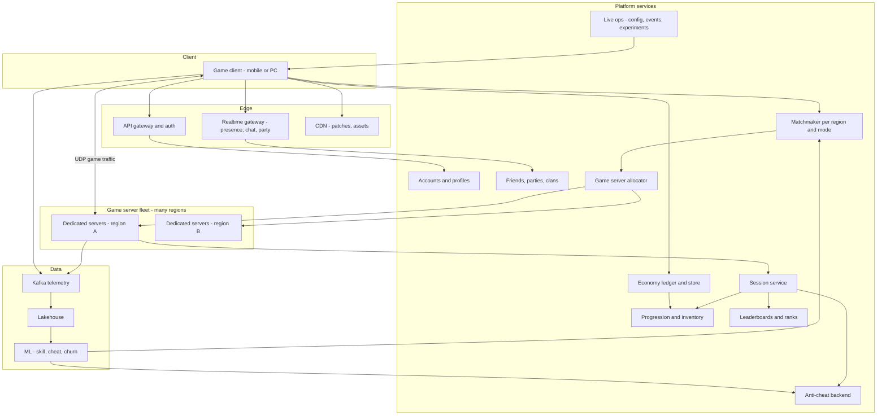
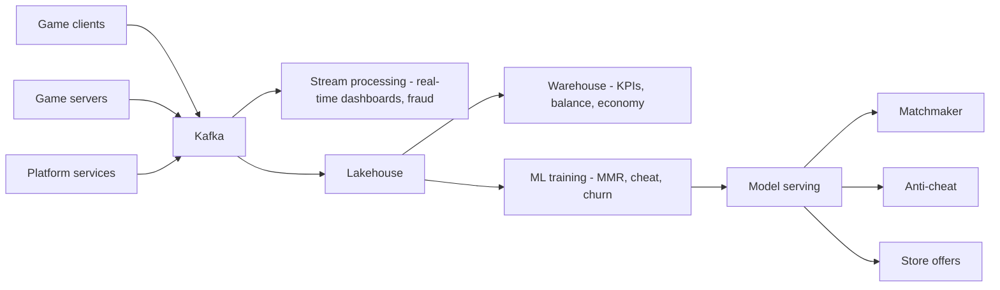

# I15. Multiplayer Gaming & Leaderboards

!!! abstract "Chapter at a glance"
    **Sector:** gaming (mobile and PC online multiplayer, casual and competitive) · **Format:** system design walkthrough with no code · **Reader bands:** B1 → B4

    **Builds on:** [Ch 51](../05-case-studies/51-real-time-analytics-and-top-k.md) (top-K), [Ch 44](../05-case-studies/44-distributed-cache.md) (cache), [Ch 41](../05-case-studies/41-chat-customer-rider-messaging.md) (chat), [I13](i13-online-exams-and-live-classes.md) (live events)

    **What you get:** a reference platform for a popular online multiplayer game. Think a battle-royale or team shooter on mobile, plus casual PvP (player-versus-player) games. The platform covers:

    - accounts and login;
    - **matchmaking** by skill and latency;
    - **dedicated game servers** allocated worldwide;
    - real-time **netcode**: authoritative server, client prediction, lag compensation and rollback;
    - parties, friends, voice and chat;
    - **leaderboards**: global, regional, friends and seasonal, for tens of millions of players;
    - progression, inventory and the in-game **economy** and store;
    - **anti-cheat**;
    - live ops, with events, seasons and remote config.

    It also explains **the algorithms** (Elo/Glicko/TrueSkill ratings, the matchmaking queue, server tick and interest management, lag compensation, leaderboard ranking at scale, anti-cheat detection, loot and drop fairness) and the **data platform and tech stack**.

    **Reading time:** 80 min.

!!! warning "Sources and honesty"
    - Some netcode techniques have been described publicly in developer talks and blogs, including Valve's lag compensation, rollback in fighting games and Overwatch's GDC talks. These are marked **"publicly described (VERIFY)"**.
    - India's rules on online gaming changed significantly in 2025. The Promotion and Regulation of Online Gaming Act, 2025 addresses real-money games (**VERIFY** its current status and rules). This chapter designs a **free-to-play game with in-app purchases, not real-money gaming**.
    - Everything else is a **reference design**.

---

## 1. The System in One Page

### 1.1 What makes games different

| Aspect | Typical web app | Real-time multiplayer game |
|---|---|---|
| Latency | 100s of ms is fine | **< 50–100 ms round trip** matters. Jitter ruins play |
| State | Request/response | **Continuous shared simulation** at 20–60 ticks per second |
| Consistency | Strong or eventual | **Server-authoritative** world with client-side prediction |
| Load shape | Diurnal | Diurnal plus **launch days, season starts, events** with 10× spikes |
| Adversaries | Fraudsters | **Cheaters** with full control of their client |
| Fun | n/a | Fair matches, short queues. Business metrics depend on them |

### 1.2 Main systems

| System | What it does |
|---|---|
| **Identity and accounts** | Login (guest, phone, social, platform accounts), profiles, linking, bans |
| **Social** | Friends, parties, clans, presence, chat, voice |
| **Matchmaking** | Queues players by mode, skill, region and party. Forms balanced matches |
| **Game server fleet** | Dedicated servers per match, allocated in many regions, autoscaled |
| **Game server (the simulation)** | Authoritative game loop, netcode, hit detection, match results |
| **Session/lobby service** | Match lifecycle, reconnects, spectators |
| **Progression and inventory** | XP, levels, battle pass, unlocked items, loadouts |
| **Economy and store** | Currencies, purchases, offers, receipts, refunds |
| **Leaderboards and ranks** | Seasonal ranked tiers, global and regional boards, friends boards |
| **Anti-cheat** | Client integrity, server validation, statistical detection, reports and bans |
| **Live ops** | Events, remote config, A/B tests, news, push |
| **Telemetry and analytics** | Match events, performance, retention, monetisation |

### 1.3 Scale for this design (assumptions)

| Quantity | Value |
|---|---|
| Registered players | 100M; 20M daily active |
| Peak concurrent users (CCU) | 3M |
| Players per match | 100 (battle royale) or 10 (5v5) |
| Concurrent matches | ~30k–100k |
| Match length | 20–30 min (BR), 10 min (casual) |
| Server tick rate | 30 Hz (BR), 60 Hz (competitive shooter) |
| Leaderboard | 20M entries per season, updated after every match |
| Telemetry events | ~5M events/s at peak |

**Estimation highlights:**

- **Game server capacity:** one process runs one BR match of 100 players at 30 Hz, using about 1–2 cores.
    - 3M CCU in BR gives 30k matches, which is roughly 30k–60k cores worldwide at peak.
    - That fleet has to be **elastic**, and it is the biggest infrastructure cost.
- **Bandwidth per player:** 30 snapshots/s × ~500 bytes (after delta compression) is ~15 KB/s, or 120 kbps down.
    - 3M players need ~360 Gbps of egress from game servers.
    - Egress from game servers is a real cost item.
- **Match results:** 30k matches ending every ~25 minutes is ~20 results/s. Each result updates up to 100 players, so ~2k leaderboard updates/s on average and more at the top of the hour.
- **Matchmaking:** 3M players cycling every ~25 minutes means ~2k players/s entering queues. Queues are per region and mode.

---

## 2. Requirements

### 2.1 Functional

1. **Accounts.** Log in, link devices, keep progress across devices, and let parents set controls for minors.
2. **Social.** Friends, invites, parties of up to 4, clans, text and voice chat, and presence ("in match").
3. **Matchmaking.**
    - Queue for a mode, solo or as a party.
    - Get a fair match (similar skill) with low latency, within about 30–60 s.
    - Backfill disconnected slots in some modes.
4. **Gameplay.**
    - Smooth movement and shooting that feels responsive.
    - Fair hit registration.
    - Reconnect after a disconnect.
    - Spectating, and replays for some modes.
5. **Results.** A match summary, then XP, rank changes, rewards and leaderboard updates.
6. **Leaderboards.** Global, country, friends and clan boards; seasonal and all-time; "my rank" and "players around me".
7. **Economy.** Buy currency through app stores or payment gateways. Buy items, a battle pass and bundles. Receive gifts, promotions and refunds.
8. **Anti-cheat.** Detect and ban cheats; let players report; handle appeals.
9. **Live ops.** Timed events, new modes, config changes without an app update, and staged rollout of content.

### 2.2 Non-functional

| Attribute | Target |
|---|---|
| **In-match latency** | Players matched to a server with < 60–80 ms RTT where possible |
| **Server tick stability** | Frame time below the tick budget (33 ms at 30 Hz) with headroom |
| **Matchmaking time** | P50 < 30 s, P95 < 90 s (relaxed at low population) |
| **Availability** | Login, matchmaking and store at 99.9%+. A single match can fail without a global impact |
| **Economy correctness** | No duplicate grants, no lost purchases, and an audit of every currency movement |
| **Leaderboard freshness** | Rank updated within seconds of match end |
| **Fairness** | Balanced matches, cheat-free play, transparent odds for random rewards (VERIFY local rules) |
| **Cost** | Game server fleet cost per CCU hour kept under budget |

---

## 3. High-Level Architecture

**Key decisions:**

| Decision | Choice | Why |
|---|---|---|
| **Game topology** | **Dedicated authoritative servers** (not peer-to-peer) | Cheating resistance, fairness, no host advantage |
| **Transport** | UDP with a custom reliability layer (or QUIC/ENet-style) | TCP head-of-line blocking hurts real time |
| **Fleet** | Container-based fleet management (e.g. Kubernetes + Agones, or managed services) across clouds and bare metal | Elasticity plus low latency near players |
| **Matchmaking** | Regional matchmakers with skill + latency + party rules, and expanding search windows | Fair and fast |
| **Economy** | Double-entry ledger of currencies and items, with idempotent grants | Money-like correctness |
| **Leaderboards** | Sharded in-memory sorted sets for the top and near-rank, plus bucketed approximations for global percentile | Fast "my rank" at 20M+ |
| **Live ops** | Remote config and feature flags, content via CDN | Change the game without store updates |

---

## 4. How It Works — Journeys End to End

### 4.1 Journey 1: from app open to match start

1. **App open.**
    - The client checks its version against remote config and downloads updated content (maps, skins) from the CDN in the background.
    - It logs in with a device ID, phone OTP or a platform account, and receives a session token.
    - Presence connects over a WebSocket.
2. **Home screen.**
    - The profile, inventory, battle pass progress, events (from live ops) and store offers load.
    - Offers may be personalised through experiments.
3. **Party up.**
    - Friends accept an invite and a party is formed in the social service.
    - The party leader chooses a mode and queues. The whole party enters matchmaking as one ticket with the members' ratings.
4. **Latency probing.** The client pings a set of region endpoints (quality-of-service beacons) and reports RTTs to the matchmaker. Candidate regions are those under the latency threshold.
5. **Matchmaking** (§6.2).
    - The ticket enters queues for eligible regions.
    - The matchmaker groups tickets into a balanced match: similar ratings, parties matched to parties where possible, and team balance by total rating.
    - The acceptable skill range widens as wait time grows.
6. **Allocation.**
    - Once the match is formed, the allocator requests a **ready game server** in the chosen region from the fleet manager, which keeps a warm buffer.
    - The server gets the match config (map, mode, player IDs, teams) and one-time **join tokens** for each player.
7. **Connect.**
    - Clients receive the server IP:port and a join token, and connect over UDP.
    - The server validates tokens, loads players' loadouts from progression (or from the match config) and starts the pre-game lobby, where players drop in.

### 4.2 Journey 2: inside a match — the game loop

1. **Client input.** Each client frame (60 fps), the client samples input (movement, aim, fire) and sends **input commands** to the server, tagged with a sequence number and client timestamp. Batches of inputs are sent 30–60 times per second.
2. **Client prediction.**
    - The client **applies its own inputs immediately** to its local copy of its own character, so movement feels instant.
    - It keeps a history of inputs not yet acknowledged.
3. **Server tick.** At 30 Hz the authoritative server:
    1. Collects inputs from all players.
    2. Simulates movement with the game's physics and validates it (speed limits, collisions, no walking through walls).
    3. Processes shots with **lag compensation** (§6.4).
    4. Applies damage, deaths and item pickups.
    5. Updates the storm/zone.
    6. Produces the new world state.
4. **Snapshots to clients.**
    - The server sends each client a snapshot of relevant state: its own authoritative position and entities in its **area of interest** (§6.5).
    - Snapshots are **delta-compressed** against the last acknowledged snapshot.
5. **Reconciliation.** When the client receives the authoritative state for its own character, it rewinds to that state and **replays unacknowledged inputs**. Small differences are smoothed; big ones snap (the player feels "rubber-banding").
6. **Other players' rendering.** Clients render other players **slightly in the past** (e.g. 100 ms interpolation buffer) between two snapshots, for smooth movement despite packet jitter.
7. **Hit registration.**
    - When a player fires, the client may show hit effects immediately (optimistic), but the **server decides**.
    - Lag compensation rewinds other players to where the shooter saw them.
8. **Events and telemetry.** Kills, deaths, damage, item use and positions (sampled) are streamed to telemetry. Suspicious patterns are flagged for anti-cheat.

### 4.3 Journey 3: match end, rewards and leaderboards

1. **Match ends.**
    - The server computes results: placement, kills, damage, survival time, team outcome.
    - It sends a **signed match result** to the session service.
2. **Session service.**
    - Validates the result: signature, known server, match ID not already processed (**idempotency**).
    - Publishes a `MatchCompleted` event.
3. **Consumers** (asynchronous, each idempotent by match ID and player):
    - **Ratings**: update each player's skill rating (§6.1) and ranked points or tier.
    - **Progression**: XP, battle pass progress, mission completions.
    - **Economy**: rewards such as soft currency and loot drops, credited through the **ledger**.
    - **Leaderboards**: update seasonal scores (§6.6).
    - **Anti-cheat**: statistical checks on the performance (§6.7).
    - **Analytics**: the match record goes to the lakehouse.
4. **Client summary.** The client shows XP gained, rank change and rewards, typically within 1–3 s via a push over the realtime gateway.
5. **Server teardown.** The game server uploads a replay (if recorded), cleans up and returns to the fleet (or is recycled).

### 4.4 Journey 4: buying the battle pass

1. The player taps "Buy Battle Pass (950 gems)". They have 500 gems, so they buy a gem pack for ₹449 through the **app store** (Google Play/App Store billing) or a payment gateway on PC (UPI/cards; VERIFY store policies for India).
2. The store completes payment and the client receives a **receipt**.
3. The client sends the receipt to the **economy service**:
    - The service verifies it with the store's server API.
    - It checks the transaction ID has not been used before (**idempotency**, stopping replayed receipts).
    - It credits gems in the **ledger**: debit "store revenue clearing", credit "player gems wallet".
4. The player buys the battle pass. The economy service atomically:
    - debits 950 gems from the wallet;
    - grants the battle pass entitlement in inventory.

    This happens in one transaction, or as a saga with compensation.
5. **Refunds.** Store notifications (refund or chargeback) arrive through webhooks. The service **claws back** currency, going negative if already spent (policy), and flags abuse.
6. **Audit.** Every currency movement is a ledger entry with a reason, which supports support-team investigations and finance reconciliation with store reports.

### 4.5 Journey 5: a cheater and the ban wave

1. A player uses an aimbot. It reads game memory, and the client-side anti-cheat module may detect known signatures or tampering.
2. **Server-side**, statistical signals appear:
    - inhumanly fast target acquisition;
    - headshot rate far above the rating norm;
    - tracking through walls;
    - impossible reaction times.

    The **anti-cheat model** (§6.7) scores the player per match.
3. **Player reports** add evidence. A replay or kill-cam clip goes to a review queue.
4. **Action.**
    - High-confidence detection leads to the account being flagged. Bans are often held for a **ban wave**, so cheat makers don't learn which change caused detection.
    - Devices or hardware IDs may be banned for repeat offenders.
    - Affected matches may have rating changes rolled back for victims.
5. **Appeals** go through a support process with evidence.

### 4.6 Journey 6: a season launch

1. **Weeks before.** New content (map, skins, battle pass) is built and delivered via the CDN in a patch.
    - Pre-download is enabled days before, which spreads the bandwidth load.
2. **Launch hour.**
    - Remote config flips the season at a scheduled time.
    - Ranked tiers soft-reset (§6.1) and new leaderboards open.
    - CCU spikes 2–3× as lapsed players return.
3. **Capacity.** The fleet is pre-scaled with extra warm servers per region, and matchmakers scale.
    - The login service has **queueing** ("You are #12,340 in queue") to protect the backend if needed.
4. **Monitoring.** Watch queue times, match start failures, crash rates on new content, store purchase success and economy anomalies (an exploit granting infinite currency).
    - Kill switches exist for features and store items.

---

## 5. Core Subsystems in Depth

### 5.1 Game server fleet management

- **Fleet per region.** Pools of VMs or bare-metal machines, each running several game server processes (containers).
    - **States:** Ready (warm, waiting), Allocated (match assigned), Shutdown.
- **Buffer autoscaling.**
    - Keep a buffer of Ready servers (e.g. 10–20% or a fixed count) per region and mode.
    - Scale nodes up as the buffer depletes. Scale down by draining nodes without matches.
    - **Never kill a node with active matches.**
- **Hybrid capacity.** Bare metal or reserved instances for baseline load, cloud VMs for peaks, and spot instances only for short matches or with graceful handling (VERIFY cost trade-offs).
- **Tooling.** Kubernetes + Agones (open source), or managed services such as GameLift or PlayFab Multiplayer Servers (VERIFY product names and capabilities).
- **Health.** Servers report tick timing and player count. The allocator avoids unhealthy nodes, and crashed matches notify the session service to compensate players (e.g. no rank loss).

### 5.2 Matchmaking service

- **Tickets.** `(ticket ID, player IDs, mode, ratings, party size, region RTTs, preferences, created time)`.
- **Pools.** Per (region, mode, maybe platform). Tickets can be in several regional pools until matched.
- **Match function.** Runs every ~1 s over each pool and forms matches that meet the constraints (§6.2).
    - **Frameworks:** Open Match (open source) separates the match function from the infrastructure (VERIFY).
- **Backfill.** Replace leavers in ongoing matches (casual modes).
- **Low-population handling.** Widen skill ranges, merge regions, add bots for casual modes (commonly done in mobile BR games; VERIFY for any specific title).

### 5.3 Netcode and the authoritative server

- **The server holds the truth.** Clients send **inputs, not state** ("I pressed forward", not "I am at x,y"), so they can't teleport.
- **Validation.** Movement speed, fire rate, ammo, cooldowns and line-of-sight are all checked on the server.
- **Reliability over UDP.**
    - Unreliable channel for snapshots (latest wins).
    - Reliable-ordered channel for important events (chat, item purchases in-match).
    - ACK bitfields in packet headers.
- **Bandwidth control.** Delta compression, quantisation (positions to cm precision, angles to 16 bits), interest management, and priority for nearby entities.
- **Tick budget.** Profile the server loop. At 100 players, physics, hit detection and replication must fit inside 33 ms with headroom. Spatial partitioning speeds up queries.

### 5.4 Economy ledger

- **Double-entry.** Every movement has matching debit and credit entries, per currency: hard (purchased) gems and soft (earned) coins. Hard currency may need **separate accounting** of paid vs free portions, for revenue recognition and regulations (VERIFY).
- **Idempotency keys.** Store transaction IDs, match IDs and grant IDs. Retries never double-grant.
- **Inventory.** Entitlements such as skins and battle pass tiers are recorded with their source (purchase, reward, gift) and time.
- **Exploit containment.**
    - Anomaly detection on currency velocity (an account earning 100× normal).
    - Per-account limits.
    - Rollback tooling.

### 5.5 Leaderboards

- **Types:**
    - global;
    - regional/country;
    - friends;
    - clan;
    - seasonal (reset each season) vs lifetime;
    - event-specific (time-boxed).
- **Operations:**
    - update a score (after a match);
    - get the top N;
    - get "my rank";
    - get neighbours ("players around me");
    - get friends' ranks.
- **Implementation:** see §6.6.

### 5.6 Social, presence and chat

- **Presence.** Heartbeats over WebSocket to a presence store (Redis with TTL). Friends subscribe to changes.
- **Parties.** A small state machine (invite, join, leave, leader). Party state is kept on a party service shard and pushed to members.
- **Chat.** Similar to [Ch 41](../05-case-studies/41-chat-customer-rider-messaging.md), with moderation, filters and reporting, plus stricter settings for minors.
- **Voice.** In-match team voice is carried by the game server or a separate voice SFU (Vivox-style services; VERIFY). Features include push-to-talk and mute and report.

### 5.7 Live ops and remote config

- **Config service.** Versioned JSON configs (drop rates, event schedules, balance tweaks, store layout), targeted by segment (country, platform, app version, experiment arm).
    - Clients fetch at login and on push.
    - Config reaches game servers at match start.
- **Experiments.** A/B tests for store offers, onboarding and matchmaking parameters, with guardrail metrics (retention, match quality).
- **Kill switches.** For buggy items, exploits, or modes causing crashes.

---

## 6. Algorithms

### 6.1 Skill rating systems

- **Elo.**
    - Expected score E_A = 1 / (1 + 10^((R_B − R_A)/400)).
    - After a match, R_A ← R_A + K(S_A − E_A).
    - Simple, and designed for 1v1.
- **Glicko / Glicko-2.**
    - Adds **rating deviation (RD)**, the uncertainty. New or returning players have high RD, so their ratings move fast. RD shrinks with play and grows with inactivity.
    - Glicko-2 adds volatility.
- **TrueSkill** (published by Microsoft Research).
    - Bayesian: each player has skill ~ N(μ, σ²).
    - Supports **teams and multi-player free-for-all** (placements in a battle royale).
    - Updates via factor graphs and message passing.
    - The displayed "conservative" skill is μ − 3σ.
    - TrueSkill 2 adds factors such as individual performance and quitting (publicly described; VERIFY).
- **Battle royale adaptation.**
    - Treat placement as a ranking of teams, and update pairwise or with a TrueSkill-style multi-team update.
    - Kills may add a performance factor.
- **Visible rank vs hidden MMR.**
    - Ranked tiers (Bronze → Diamond) are points-based for motivation, with win streak bonuses.
    - The hidden MMR is used for matchmaking.
    - At season start, soft-reset visible ranks (compress toward the mean) and raise the RD.

### 6.2 Matchmaking algorithm

- **Goal:** form matches that minimise a cost combining:
    - skill disparity (within and across teams);
    - latency (all players under the threshold to the chosen region);
    - wait time (a penalty that grows as players wait);
    - party composition (premades vs solos);
    - other constraints (platform, input device, language).
- **Typical approach:**
    1. Sort the pool by rating. Candidate groups come from windows around each ticket.
    2. Each ticket's **acceptable window expands over time**, e.g. ±50 MMR at 0 s, ±150 at 30 s, ±300 at 60 s.
    3. Greedily form matches starting from the **oldest tickets**, which guards against starvation.
    4. For team balance, assign players to teams to minimise the difference in total (or mean) skill. This is a partitioning heuristic: sort by skill and alternate snake-draft (1-2-2-1), or run a small search.
- **Battle royale:** 100 players is a large match, so skill matching is looser. Use broad skill brackets, fill by time, and region is critical.
- **Evaluation:** measure predicted match quality (e.g. the TrueSkill draw probability) against actual outcomes, and queue times by skill band. Top players wait longest.

### 6.3 Client prediction and reconciliation

- **Prediction.** The client runs the same movement code locally on its inputs. The server's authoritative state arrives later with the last processed input sequence number.
- **Reconciliation.**
    - Set the local state to the server state at sequence N.
    - Re-apply inputs N+1 onwards.
    - If the result differs from the displayed state by a small error, smooth over a few frames; otherwise snap.
- **Entity interpolation.** Other players are rendered by interpolating between buffered snapshots at a render time slightly behind the latest (e.g. 2 snapshot intervals). This handles jitter; extrapolation is used only briefly on packet loss.

### 6.4 Lag compensation

- **Problem:** the shooter sees enemies where they were ~RTT/2 + interpolation delay ago. Without compensation, players have to aim ahead.
- **Server-side rewind** (publicly described for Source engine games; VERIFY):
    1. The server keeps a history of each player's hitboxes for the last ~1 s.
    2. When a shot command arrives, it estimates the time the shooter saw (current time − shooter latency − interpolation delay).
    3. It **rewinds** other players' hitboxes to that time, performs the ray cast and restores them.
- **Trade-off:** "shot behind cover". The victim reaches cover on their screen but still dies, because the shooter saw them earlier.
    - **Cap the rewind** (e.g. 200 ms) to limit the advantage of high-ping players.
- **Rollback netcode** (fighting games, 1v1):
    - Clients simulate with predicted remote inputs.
    - When the actual inputs arrive, they roll back and re-simulate frames.
    - This needs deterministic simulation and fast re-simulation (GGPO-style; publicly described).

### 6.5 Interest management

- **Problem:** 100 players × 1000s of entities. Sending everything to everyone is too much bandwidth, and it leaks information to wallhacks.
- **Spatial partitioning.** A grid or quadtree over the map. Each client receives entities in nearby cells, with priority by distance and relevance.
- **Visibility culling.** Don't send enemies the client cannot possibly see (occlusion checks). This reduces what wallhack cheats can reveal.
- **Update frequency by priority.** Nearby enemies every tick; distant vehicles every few ticks.

### 6.6 Leaderboard ranking at scale

- **Redis sorted sets** (ZADD/ZREVRANK/ZREVRANGE) handle the top-N and rank for millions of entries in O(log N).
    - One sorted set with 20M members is feasible on a large node (memory ~ a few GB). It is a hot key for writes, though.
- **Scaling beyond one node.**
    - **Shard by score ranges.** Keep a small **count index** (how many players are in each shard or score bucket).
        - Rank = (players in higher buckets) + (rank within the bucket).
        - Updates move a player between buckets.
    - **Or shard by player hash, with approximate global rank:**
        - maintain a **histogram of scores** (bucket counts) globally, updated incrementally;
        - rank ≈ sum of counts above the player's score, plus an estimate within the bucket;
        - show exact ranks only for the top 10k (a separate exact sorted set) and percentiles for everyone else ("Top 3%").
- **Friends leaderboards.** Fetch friends' scores directly (a small N) and sort per request. Cache per user for a short TTL.
- **Seasonal resets.** Create a new board keyed by season ID. Archive the old one to storage.
- **Ties.** Encode the tie-break in the score, e.g. score × 10^10 + (MAX_TS − achieved time), so earlier achievers rank higher.
- **Integrity.** Only server-validated results update boards. Anti-cheat can remove entries.

### 6.7 Anti-cheat detection

- **Layers:**
    1. **Prevention by design:** server authority, input validation, interest management (don't send hidden enemies).
    2. **Client integrity:**
        - anti-tamper and obfuscation;
        - integrity checks;
        - detection of known cheat software signatures, debuggers, emulators and rooted devices (with care for false positives);
        - on PC, kernel-level anti-cheat is used by some titles (controversial; VERIFY).
    3. **Server-side statistics:** features per player per match:
        - headshot ratio;
        - reaction time (time from an enemy becoming visible to aim on target);
        - aim snap angles;
        - accuracy vs distance;
        - tracking through occluders;
        - kill/death ratio vs MMR expectations.

        Models (gradient-boosted trees, sequence models over aim trajectories) score **deviation from human distributions**.
    4. **Reports and review:** weight reports by the reporter's accuracy history.
- **Response policy:** confidence thresholds, delayed ban waves, shadow pools (cheaters matched with cheaters), hardware or device bans, and appeals.

### 6.8 Random rewards and drop fairness

- **Loot drop tables** with configured probabilities, served by the server (never computed on the client).
- **Pity systems:** a guarantee within N attempts (a counter per player), or increasing probability after failures ("bad luck protection").
- **Disclosure:** publish odds where required, and consider regulations on paid random items (loot boxes) by country (VERIFY).
- **Auditability:** log RNG seeds and outcomes per grant for dispute resolution.

---

## 7. Data Architecture

### 7.1 Operational stores

| Data | Store (reference) | Notes |
|---|---|---|
| Accounts, profiles | PostgreSQL/MySQL sharded, or DynamoDB-style | Low latency lookup |
| Presence, parties, sessions | Redis | TTLs |
| Matchmaking pools | In-memory in the matchmaker (+ Redis for coordination) | Ephemeral |
| Match results | Kafka + Cassandra/ScyllaDB (by player, time) | Match history |
| Progression, inventory | NoSQL document per player + event log | Frequent writes |
| Economy ledger | PostgreSQL (sharded by player), append-only | Strong correctness |
| Leaderboards | Redis sorted sets (+ histograms), snapshots to object storage | Seasonal archives |
| Replays | Object storage + CDN | Retention policy |
| Config | Versioned store + CDN | Remote config |

### 7.2 Telemetry and analytics

- **Events:** client performance (FPS, crashes, RTT), gameplay (kills, deaths, positions sampled), economy (purchases, grants, spends), social, and funnel steps.
    - These flow to **Kafka** and then to the **lakehouse**.
- **Game analytics:**
    - weapon balance (win rates, time-to-kill by weapon);
    - heatmaps of deaths by map location;
    - match quality (stomps vs close games);
    - queue times;
    - server performance.
- **Business analytics:** DAU/MAU, retention cohorts (D1/D7/D30), ARPDAU, conversion, and churn prediction for re-engagement offers.
- **ML:** MMR models, the cheat detector, churn and LTV prediction, offer personalisation, toxicity detection in chat.

### 7.3 Data flow

---

## 8. Tech Stack (reference choice)

| Layer | Choice | Notes |
|---|---|---|
| **Game engine and server** | Unreal Engine/Unity (C++/C#), dedicated server builds, custom UDP netcode or engine replication | Engine choice drives netcode |
| **Fleet** | Kubernetes + Agones, or managed services (GameLift, PlayFab), across multi-cloud and bare metal | Near-player regions |
| **Matchmaking** | Open Match or custom (Go/Java) | Pluggable match functions |
| **Backend services** | Go/Java/Kotlin/C#, gRPC | Accounts, economy, social |
| **Realtime gateway** | WebSockets (Go/Elixir/Node) + Redis/NATS | Presence, party |
| **Datastores** | PostgreSQL, DynamoDB/ScyllaDB, Redis | See §7 |
| **Streaming and analytics** | Kafka, Flink, Iceberg/Delta + Spark, Trino/BigQuery/Snowflake | Telemetry |
| **Anti-cheat** | Commercial (Easy Anti-Cheat, BattlEye) + custom server-side ML (VERIFY products) | Layers |
| **Payments** | App store billing, PC payment gateways | Receipts verified server-side |
| **Voice** | Vivox/Agora-style services or custom SFU (VERIFY) | Team voice |
| **CDN** | Multi-CDN for patches and assets | Launch days |

---

## 9. Security, Privacy & Compliance

- **Account security:** OTP or platform logins, device binding, suspicious login detection, and recovery flows.
- **Minors:**
    - age gates and parental controls (spend limits, chat restrictions, playtime);
    - DPDP Act consent for children's data (VERIFY rules);
    - platform policies (app store age ratings).
- **Payments:** receipt verification, fraud detection (stolen cards, chargeback abuse), and refund handling.
- **Regulation (VERIFY):**
    - India's 2025 online gaming law and rules, which affect real-money games, promotion and registration of games;
    - rules on loot box disclosures in some countries;
    - GST treatment of in-app purchases;
    - consumer protection on virtual goods.
- **Content moderation:** chat filters, reporting, toxicity models, and bans for harassment.
- **DDoS protection:** game servers' UDP ports are DDoS targets. Use provider DDoS protection, relay networks that hide server IPs, and per-connection rate limits.

---

## 10. Reliability & Operations

- **Blast radius:** a single game server crash affects one match. Compensate those players (no rank loss) and auto-report the crash with dumps.
- **Platform services:**
    - **Login and matchmaking are critical path**, so run them multi-region.
    - Use degraded modes: if leaderboards are down, still play, and queue updates for later.
- **Launch readiness:** load tests with bots simulating CCU, pre-scaled fleets, login queues, CDN pre-warming, kill switches and war rooms.
- **Economy incidents:**
    - detect exploit spikes quickly;
    - disable offending items;
    - roll back via ledger reversals with player communication.
- **Observability:**
    - tick-time histograms per server build;
    - packet loss and RTT by region and ISP;
    - queue time by skill band;
    - match start success rate;
    - crash rates by device;
    - purchase success;
    - leaderboard update lag.

---

## 11. Key Trade-offs

| Decision | Chosen | Accepted cost |
|---|---|---|
| **Topology** | Dedicated authoritative servers | Server cost vs P2P |
| **Lag compensation** | Rewind with cap | "Shot behind cover" |
| **Tick rate** | 30 Hz BR, 60 Hz competitive | Cost vs responsiveness |
| **Matchmaking** | Expanding skill windows | Some unbalanced matches for low wait |
| **Leaderboards** | Exact top, approximate rest | Most players see percentiles |
| **Anti-cheat bans** | Delayed ban waves | Cheaters play longer |
| **Economy** | Ledger with idempotency | Engineering effort like a bank |
| **Fleet** | Warm buffer | Idle servers cost money |

---

## 12. Interview Q&A

### Beginner B1

??? question "Q1 [B1] ⭐ Why do competitive online games use authoritative dedicated servers?"

    **30-second answer:** The server holds the true game state and validates every input, so clients can't cheat by sending fake positions or damage; it also removes host advantage and NAT problems of peer-to-peer.

    **Deep answer:** §5.3.

    **Trade-offs I'd call out:** Server cost.

    **Follow-ups:**
    1. When is P2P fine? → Casual co-op.
    2. What do clients send? → Inputs only.

    **Red flags:** Trusting client-reported hits.

??? question "Q2 [B1] How would you build a leaderboard for a million players?"

    **30-second answer:** A Redis sorted set keyed by season: ZADD to update after each match, ZREVRANGE for the top N, ZREVRANK for my rank, with snapshots to storage — only server-validated scores update it.

    **Deep answer:** §6.6.

    **Trade-offs I'd call out:** Memory on one node.

    **Follow-ups:**
    1. Ties? → Encode the timestamp.
    2. Friends? → Fetch and sort.

    **Red flags:** SQL ORDER BY on every request.

??? question "Q3 [B1] Why do games use UDP instead of TCP?"

    **30-second answer:** Real-time state is time-sensitive — a lost old snapshot is useless once a newer one arrives; TCP would block newer data behind retransmissions; games add their own reliability only for messages that need it.

    **Deep answer:** §5.3.

    **Trade-offs I'd call out:** Must build reliability.

    **Follow-ups:**
    1. QUIC? → Possible.
    2. NAT? → Server has public IP.

    **Red flags:** HTTP polling for gameplay.

??? question "Q4 [B1] What is Elo and how does it update after a match?"

    **30-second answer:** Each player has a rating; the expected result against an opponent comes from the rating difference; after the match, rating moves by K × (actual − expected), so upsets move ratings more.

    **Deep answer:** §6.1.

    **Trade-offs I'd call out:** No uncertainty, 1v1 focus.

    **Follow-ups:**
    1. Team games? → TrueSkill.
    2. New players? → Glicko RD.

    **Red flags:** Win counts as skill.

### Intermediate B2

??? question "Q5 [B2] ⭐ Design matchmaking for a 5v5 game."

    **30-second answer:** Tickets (solo or party) with ratings and region pings go into regional pools; every second a match function forms groups within skill windows that widen with wait time, oldest first, then balances teams by total skill; the allocator assigns a warm server and players get join tokens.

    **Deep answer:** §4.1, §5.2, §6.2.

    **Trade-offs I'd call out:** Quality vs wait.

    **Follow-ups:**
    1. Parties vs solos? → Weighting.
    2. Top players? → Longer waits.

    **Red flags:** Random matching.

??? question "Q6 [B2] Explain client-side prediction and reconciliation."

    **30-second answer:** The client applies its own inputs immediately for responsiveness and remembers them; when authoritative state arrives with the last processed input, it resets to that state and replays unacknowledged inputs, smoothing small corrections.

    **Deep answer:** §6.3.

    **Trade-offs I'd call out:** Rubber-banding on mismatch.

    **Follow-ups:**
    1. Other players? → Interpolation.
    2. Determinism? → Shared movement code.

    **Red flags:** Waiting for the server before moving.

??? question "Q7 [B2] How do you make sure in-game purchases are never lost or duplicated?"

    **30-second answer:** Verify store receipts server-side, use the store transaction ID as an idempotency key, credit currency through a double-entry ledger, grant entitlements atomically with the debit, and handle refund webhooks with clawbacks.

    **Deep answer:** §4.4, §5.4.

    **Trade-offs I'd call out:** Complexity.

    **Follow-ups:**
    1. Client says purchased? → Don't trust.
    2. Reconciliation? → Store reports.

    **Red flags:** Client-side currency balances.

??? question "Q8 [B2] How do you autoscale game servers?"

    **30-second answer:** Keep a buffer of warm Ready servers per region and mode, add nodes when the buffer drops, drain nodes without active matches when scaling down, pre-scale for launches, and mix reserved or bare-metal baseline with cloud burst.

    **Deep answer:** §5.1.

    **Trade-offs I'd call out:** Idle cost vs match start time.

    **Follow-ups:**
    1. Spot? → Short matches only.
    2. Crashes? → Compensate players.

    **Red flags:** Killing nodes with active matches.

??? question "Q9 [B2] How do you handle the season-launch spike?"

    **30-second answer:** Pre-download content days before, pre-scale fleets and matchmakers, pre-warm CDNs, flip the season via remote config, protect login with a queue, and watch dashboards with kill switches ready.

    **Deep answer:** §4.6, §10.

    **Trade-offs I'd call out:** Over-provisioning cost.

    **Follow-ups:**
    1. Exploits? → Economy monitors.
    2. Crashes? → Staged rollout.

    **Red flags:** A patch download at launch minute.

### Senior B3

??? question "Q10 [B3] ⭐ Explain lag compensation and its trade-offs."

    **30-second answer:** The server keeps a short history of hitboxes, and on a shot rewinds other players to where the shooter saw them (now − latency − interpolation delay), casts the ray, then restores; it makes aiming fair for the shooter but causes "died behind cover" for the victim, so cap the rewind window.

    **Deep answer:** §6.4.

    **Trade-offs I'd call out:** Shooter vs victim fairness.

    **Follow-ups:**
    1. High ping abuse? → Cap.
    2. Rollback? → Fighting games.

    **Red flags:** Client-decided hits.

??? question "Q11 [B3] How do you scale a leaderboard to 50 million players with 'my rank'?"

    **30-second answer:** Exact sorted set for the top 10k; for everyone else maintain a score histogram (bucket counts) updated incrementally, rank ≈ count above plus estimate within bucket and show percentile; or shard by score range with a count index; friends boards computed per request; seasonal keys and archives.

    **Deep answer:** §6.6.

    **Trade-offs I'd call out:** Exactness vs cost.

    **Follow-ups:**
    1. Hot updates? → Batch.
    2. Removing cheaters? → Update counts.

    **Red flags:** One giant sorted set with no plan for writes.

??? question "Q12 [B3] How does TrueSkill differ from Elo, and why would you use it?"

    **30-second answer:** TrueSkill models skill as a Gaussian with mean and uncertainty, supports teams and multi-team placements, updates via Bayesian message passing, and matches on conservative skill — better for team and battle royale games and new players.

    **Deep answer:** §6.1.

    **Trade-offs I'd call out:** Complexity.

    **Follow-ups:**
    1. Season resets? → Raise σ.
    2. Individual performance? → Extensions.

    **Red flags:** Elo for 100-player BR as is.

??? question "Q13 [B3] Design anti-cheat for a mobile shooter."

    **30-second answer:** Server authority and validation, interest management to hide unseen enemies, client integrity checks for tampering, emulators and root, server-side statistical models on aim and reaction features, weighted player reports with replay review, delayed ban waves and appeals.

    **Deep answer:** §6.7.

    **Trade-offs I'd call out:** False positives.

    **Follow-ups:**
    1. Emulator players? → Separate pools.
    2. Why delay bans? → Hide detection.

    **Red flags:** Client-only anti-cheat.

??? question "Q14 [B3] How do you reduce bandwidth for a 100-player match?"

    **30-second answer:** Interest management (spatial grid, visibility), delta compression against acknowledged snapshots, quantisation of positions and angles, priority-based update rates, and sending inputs rather than state upstream.

    **Deep answer:** §5.3, §6.5.

    **Trade-offs I'd call out:** CPU vs bandwidth.

    **Follow-ups:**
    1. Egress cost? → Big item.
    2. Packet loss? → Unreliable snapshots.

    **Red flags:** Full state broadcast every tick.

### Architect B4

??? question "Q15 [B4] ⭐ Design the backend for a battle royale game with 3M concurrent players."

    **30-second answer:** Accounts, social and presence services; regional matchmakers with latency probing and skill windows; an allocator over Agones-style fleets with warm buffers in many regions; authoritative 30 Hz servers with prediction, lag compensation and interest management; async match-result pipeline to ratings, progression, ledger, leaderboards and anti-cheat; telemetry to Kafka and a lakehouse; live ops config.

    **Deep answer:** §3–§6.

    **Trade-offs I'd call out:** Cost vs latency coverage.

    **Follow-ups:**
    1. Region choice? → Pings.
    2. Crashed matches? → Compensation.

    **Red flags:** One region or one giant server.

??? question "Q16 [B4] How would you design the in-game economy to be exploit-resistant?"

    **30-second answer:** A server-authoritative double-entry ledger with idempotent grants and purchases, separate paid and free currency accounting, limits and velocity anomaly detection, config-driven drop tables on the server, kill switches for items and rollback tooling via reversal entries.

    **Deep answer:** §5.4, §6.8.

    **Trade-offs I'd call out:** Friction for legitimate edge cases.

    **Follow-ups:**
    1. Duplication bug? → Reversal and bans.
    2. Refund abuse? → Clawbacks.

    **Red flags:** Balances in the client save file.

??? question "Q17 [B4] What data platform would you build for a live game?"

    **30-second answer:** Client, server and service events into Kafka; stream processing for live dashboards and fraud; a lakehouse with warehouse marts for KPIs, balance, economy and match quality; ML for MMR, cheat detection, churn and offers; experiment analysis with guardrails.

    **Deep answer:** §7.

    **Trade-offs I'd call out:** Telemetry cost vs insight.

    **Follow-ups:**
    1. Sampling? → Positions.
    2. Privacy? → Minors.

    **Red flags:** No telemetry on crashes and RTT.

??? question "Q18 [B4] How do you decide the tick rate and server region footprint?"

    **30-second answer:** Tick rate balances responsiveness against CPU and bandwidth cost per match (competitive modes justify 60+ Hz); region footprint follows player distribution and RTT targets, with enough population per region to keep queues short — merge regions at low population.

    **Deep answer:** §1.3, §6.2.

    **Trade-offs I'd call out:** Latency vs queue time vs cost.

    **Follow-ups:**
    1. India? → Mumbai, Chennai, Delhi regions.
    2. Measure? → RTT telemetry.

    **Red flags:** Max tick everywhere.

??? question "Q19 [B4] How would you run live ops safely?"

    **30-second answer:** Versioned remote config with targeting, staged rollouts and experiments with guardrail metrics, scheduled content activation, kill switches for items and modes, economy anomaly monitors, and rollback of configs.

    **Deep answer:** §5.7.

    **Trade-offs I'd call out:** Speed vs safety.

    **Follow-ups:**
    1. Config validation? → Schemas.
    2. Server config? → At match start.

    **Red flags:** Shipping balance changes via app updates only.

??? question "Q20 [B4] Compare a game backend with a ride-hailing or trading backend."

    **30-second answer:** All match supply and demand in real time (matchmaking ~ dispatch ~ order matching) and need low latency; games uniquely run a continuous authoritative simulation per match with netcode and face adversarial clients, while their economy needs banking-grade ledgers like trading.

    **Deep answer:** [I05](i05-ride-hailing.md), [I08](i08-stockbroking-platform.md).

    **Trade-offs I'd call out:** Different consistency models.

    **Follow-ups:**
    1. Shared patterns? → Ledgers, queues.
    2. Unique? → Netcode.

    **Red flags:** Treating a game server as a stateless web service.

---

## 13. Summary

1. **Authoritative dedicated servers** plus **client prediction, interpolation and lag compensation** make games feel responsive and stay fair.
2. **Matchmaking** balances skill (Elo/Glicko/TrueSkill), latency, party makeup and wait time. Skill windows widen as players wait.
3. **Fleet management** keeps warm servers near players and scales for launches and seasons. Server CPU and egress are the main costs.
4. **Leaderboards** use exact sorted sets for the top and histograms or percentiles at scale. Only server-validated results count.
5. **The economy** is a double-entry ledger with idempotent grants. **Anti-cheat** is layered: design, client integrity, statistics and reports.

### Related chapters

- [Ch 51 — Real-time Analytics & Top-K](../05-case-studies/51-real-time-analytics-and-top-k.md)
- [Ch 44 — Distributed Cache](../05-case-studies/44-distributed-cache.md)
- [Ch 41 — Chat](../05-case-studies/41-chat-customer-rider-messaging.md)
- [I05 — Ride-Hailing](i05-ride-hailing.md)
- [I08 — Stockbroking](i08-stockbroking-platform.md)
- Next in this tab: [I16 — Smart Metering & IoT Telemetry](i16-smart-metering-and-iot-telemetry.md).
