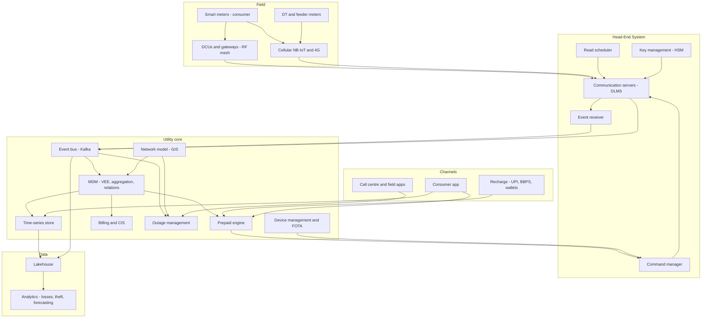
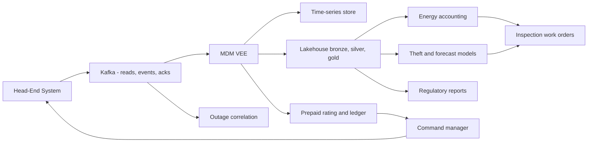

# I16. Smart Metering & IoT Telemetry

!!! abstract "Chapter at a glance"
    **Sector:** energy and utilities (electricity distribution), and IoT telemetry more generally. **Format:** a system design walkthrough with no code. **Reader bands:** B1 → B4.

    **Builds on:**

    - [I11](i11-telecom-billing-and-charging.md): rating, charging and prepaid balances
    - [I12](i12-logistics-and-supply-chain.md): forecasting
    - [Ch 51](../05-case-studies/51-real-time-analytics-and-top-k.md): streaming aggregation
    - [Ch 50](../05-case-studies/50-distributed-job-scheduler.md): schedulers

    **What you get:** an **Advanced Metering Infrastructure (AMI)** platform for a power distribution company (DISCOM) with 25 million smart meters, most of them **prepaid**. The chapter covers:

    - meter connectivity: RF mesh, cellular NB-IoT/4G and PLC;
    - the **Head-End System (HES)**, which talks DLMS/COSEM to meters;
    - the **Meter Data Management (MDM)** system, with validation, estimation and editing (VEE);
    - billing and **prepaid balance with remote disconnect and reconnect**;
    - outage detection, power quality and **theft detection**;
    - firmware-over-the-air (FOTA) updates;
    - load forecasting and demand response;
    - an energy-accounting data platform.

    It also explains the **algorithms**: interval data validation and gap estimation, time-of-day tariff rating, prepaid balance projection, outage inference, theft and anomaly detection, transformer energy balancing, load forecasting, staged OTA rollout and read scheduling. It closes with the **tech stack**.

    **Reading time:** 80 min.

!!! warning "Sources and honesty"
    The following are marked **VERIFY** and should be checked against current official documents before you rely on them:

    - India's smart meter programme under the **Revamped Distribution Sector Scheme (RDSS)** and the **AMISP** (AMI Service Provider) model
    - Standards such as **IS 16444** (smart meters) and **IS 15959** (DLMS companion spec)
    - CEA regulations and state electricity regulatory commission (SERC) supply codes, which set rules on prepaid disconnection timing

    Everything else is a **reference design**.

---

## 1. The System in One Page

### 1.1 What a smart meter platform does

- A traditional meter is read by a person once a month.
- A **smart meter**:
    - records energy every **15 or 30 minutes** (load profile);
    - records voltage, current, power factor and events (tamper, power fail, cover open);
    - sends all of this to the utility **automatically**;
    - can be **disconnected or reconnected remotely** through a built-in relay;
    - supports **prepaid** mode, where the consumer recharges like a mobile SIM and supply is cut when the balance runs out (with rules about when).
- For the utility this means:
    - accurate billing without meter readers;
    - fewer billing disputes;
    - faster detection of outages and theft;
    - better collections through prepaid;
    - energy accounting per transformer and feeder to find **AT&C losses** (aggregate technical and commercial losses).

### 1.2 Main systems

| System | What it does |
|---|---|
| **Smart meters** | Measure and store interval data and events. Relay for connect/disconnect. Communication module |
| **Network** | RF mesh with data concentrator units (DCUs)/gateways, or direct cellular (NB-IoT/4G), or PLC |
| **Head-End System (HES)** | Manages meter communications: schedules reads, sends commands (disconnect, tariff update, time sync), receives pushed events, manages keys |
| **Meter Data Management (MDM)** | Stores and **validates** interval data, estimates gaps, aggregates for billing, maintains meter–consumer–transformer relationships |
| **Billing and CIS** | Customer information system: accounts, tariffs, postpaid bills, payments |
| **Prepaid engine** | Real-time balance, deductions, low-balance alerts, disconnect/reconnect decisions |
| **Recharge channels** | App, UPI, wallets, BBPS, counters |
| **Outage management (OMS)** | Detects outages from "last gasp" events, groups them, dispatches crews |
| **Network model (GIS)** | Feeders, transformers, consumers. The connectivity used for energy accounting |
| **Analytics** | Losses, theft, forecasting, consumer insights, regulatory reports |
| **Device management** | Firmware versions, OTA campaigns, configuration, inventory |
| **Consumer app** | Daily usage, balance, recharge, alerts, complaints |

### 1.3 Scale for this design (assumptions)

| Quantity | Value |
|---|---|
| Meters | 25M (mostly single-phase residential); 50k DCUs; 200k distribution transformers (DT meters); 5k feeder meters |
| Interval data | 15-minute load profile → 96 intervals/day per meter, several channels each (kWh import/export, voltage, current) |
| Daily readings | 25M × 96 × ~4 channels ≈ **10B values/day** |
| Daily billing snapshots | 25M midnight registers |
| Events | Power fail/restore, tamper, relay operations: tens of millions per day, with bursts during storms |
| Prepaid recharges | ~1M/day, with peaks around month start and evenings |
| Commands | Disconnect/reconnect: hundreds of thousands a day at peak (VERIFY rules on timing) |

**Estimation highlights:**

- **Ingest rate.** 10B values per day is about 115k values per second on average. Reads are **scheduled in batches** (e.g. hourly or four times a day), so peaks are 5–10× higher.
- **Storage.**
    - At ~12 bytes per compressed value, the raw volume is ~120 GB/day, or ~44 TB/year before replication.
    - Time-series compression (delta-of-delta, Gorilla-style) reduces this further.
    - Retain detailed data for several years, because regulators often require it (VERIFY).
- **Storm events.**
    - When a feeder trips, every meter on it sends a "last gasp" power-fail event at the same instant: 10k events in a second from one feeder.
    - A regional storm can produce millions of events in minutes.
    - The event pipeline must absorb these bursts and **correlate** them rather than create a million outage tickets.
- **Network constraints.**
    - RF mesh bandwidth is small, often tens of kbps shared across a DCU's meters.
    - Reading 1,000 meters' full load profile through one DCU must be scheduled carefully.
    - You cannot poll everything every minute.

---

## 2. Requirements

### 2.1 Functional

1. **Meter data collection.**
    - Daily billing profile (midnight registers).
    - Load profile (15 or 30 min).
    - Instantaneous parameters on demand.
    - Events pushed in near real time (power fail, tamper).
2. **Commands.**
    - Remote disconnect/reconnect.
    - Time sync.
    - Tariff/TOD schedule updates.
    - Load limit settings.
    - Mode change (prepaid/postpaid).
    - Firmware updates.
3. **VEE.** Validate readings, **estimate** missing or invalid data, allow audited **manual edits**.
4. **Billing.**
    - Postpaid bills with slab and time-of-day tariffs, fixed charges, taxes and subsidies.
    - Net metering for rooftop solar (import/export).
5. **Prepaid.**
    - Recharge through many channels, credited in real time.
    - Daily deductions.
    - Balance and days-remaining projection.
    - Low-balance alerts.
    - Disconnect after grace, under regulatory rules (no disconnection at night or on holidays, and emergency credit where mandated; VERIFY).
    - Automatic reconnect on recharge within minutes.
6. **Outages.** Detect outages from meter events, identify the affected transformer or feeder, notify consumers, track restoration and compute reliability indices (SAIFI/SAIDI).
7. **Energy accounting.** Compare the energy input at the feeder and DT against the sum of consumer meters, to compute losses by area and flag theft hotspots.
8. **Consumer app.** Usage graphs, bill and balance, recharge, alerts, complaints.
9. **Device management.** Inventory, installation workflows (meter swap, mapping to consumer and DT), FOTA campaigns, configuration audits.

### 2.2 Non-functional

| Attribute | Target |
|---|---|
| **Data completeness** | e.g. > 98–99% of meters with daily data delivered within 24 h, and load profile similar (SLA-driven in AMISP contracts; VERIFY) |
| **Latency** | Events ingested in < 1 min. Reconnect command executed within minutes of a recharge |
| **Correctness** | Billing-grade accuracy with a full audit of estimates and edits |
| **Safety** | Disconnects only when policy allows. Never mass-disconnect because of a bug |
| **Security** | Per-meter keys, encrypted and authenticated DLMS, no unauthorised commands |
| **Scalability** | 25M+ meters and growing. Bursts during storms |
| **Interoperability** | Multiple meter makes through standard DLMS/COSEM. HES–MDM integration through standard interfaces |
| **Retention** | Years of interval data for disputes and regulatory audits (VERIFY) |

---

## 3. High-Level Architecture

**Key decisions**

| Decision | Choice | Why |
|---|---|---|
| Protocol | DLMS/COSEM (IEC 62056) with the national companion spec (IS 15959; VERIFY) | Multi-vendor interoperability |
| Network | Mixed: RF mesh in dense urban areas, cellular in sparse or rural areas and for DT meters | Coverage vs cost |
| HES vs MDM split | HES owns communication. MDM owns data truth | Swap vendors independently |
| Ingest | HES publishes to Kafka. Consumers (MDM, OMS, prepaid) read independently | Decoupling, replay |
| Storage | Time-series DB or a columnar store for interval data, relational for master data | Fit the access patterns |
| Prepaid | Utility-side balance (a "smart prepaid" meter reporting consumption), not balance in the meter | Easy tariff changes, central control |
| Commands | An idempotent, rate-limited command queue with policy checks | Safety at scale |

---

## 4. How It Works — End-to-End Journeys

### 4.1 Journey 1: a day of meter data

1. **Inside the meter.** Every 15 minutes it records the block load profile: kWh import, kWh export, average voltage, average current. The data is stored in the meter's memory, which holds days to weeks of intervals. At midnight it snapshots the **daily billing registers**.
2. **Communication paths.**
    - **RF mesh:** the meter's radio forms a mesh with neighbours. Data hops to a DCU on a pole, and the DCU backhauls over 4G to the HES.
    - **Cellular:** an NB-IoT or 4G module talks to the HES directly (APN/VPN).
3. **Read schedule** (§6.8).
    - The HES scheduler plans reads to fit network capacity. Daily profiles go out after midnight in waves.
    - Load profile is read every 4–8 hours in batches.
    - Some meters are configured to **push** data at set times, with jitter so they don't all send at once.
4. **The HES talks DLMS.**
    - It opens an association with the meter using security suite keys.
    - It reads the COSEM objects (OBIS codes identify each quantity, e.g. 1.0.1.8.0.255 for active import energy).
    - It receives encrypted and authenticated responses.
5. **The HES publishes raw readings** to Kafka (`meter.reads.raw`) with meter ID, OBIS code, timestamp, value, quality flags and read time.
6. **MDM VEE** (§6.1). The MDM consumes readings and validates them:
    - **Checks:** timestamps in range, no negative consumption on cumulative registers, spike checks, interval sum vs register delta, and more.
    - **Gaps are estimated** (§6.2) and flagged as estimated.
    - Validated data is written to the **time-series store**. Daily aggregates feed billing and prepaid.
7. **Missing meters.** Meters not read by the target time get retries, and are reported in communication-health dashboards (by DCU, area and vendor). Persistent failures create field tickets.
8. **Consumer view.** The next morning the app shows yesterday's usage by hour, plus a comparison with similar homes.

### 4.2 Journey 2: a prepaid recharge and reconnection

1. **Disconnection.** Priya's balance fell below zero yesterday evening. Under the regulatory rules the system **did not disconnect at night** (VERIFY the exact rule). It disconnected this morning at 10:00 after a grace period, and sent her SMS and app alerts before and after.
2. **Recharge.** Priya recharges ₹500 by UPI in the app. The payment gateway confirms, and the **prepaid engine** credits her balance idempotently, using the payment reference.
3. **Reconnect decision.** The balance is now above the reconnection threshold. The engine creates a **reconnect command** for her meter, with the reason `recharge` and a reference.
4. **Command manager** (§5.5). The command passes policy checks: meter ID valid, not flagged for tamper, reconnect allowed.
    - It is queued with high priority.
    - The HES sends a DLMS action to the **disconnect-control object**.
5. **The meter's relay closes** and power is restored. The meter confirms the relay status, and the HES publishes `RelayStatusChanged(connected)`.
6. **Notification.** The engine marks the command complete and sends "Power reconnected" to Priya, typically within minutes.
7. **Failure handling.** If the meter is unreachable (for example, the RF mesh is weak), the command retries with backoff. After a timeout it escalates to a field visit. Priya sees "Reconnection in progress" and can call the helpline.

### 4.3 Journey 3: daily prepaid deduction

1. **Consumption.** After midnight the MDM publishes validated daily consumption for each prepaid meter, broken down by time-of-day slot.
2. **Rating** (§6.3). The prepaid engine calculates the charges:
    - energy charges by slab and TOD rate;
    - fixed charges pro-rated per day;
    - electricity duty and taxes;
    - subsidies (e.g. free units for eligible consumers under state schemes; VERIFY).

    It then **deducts** the total from the balance and records ledger entries.
3. **Balance projection** (§6.4). Days remaining are estimated from recent consumption. If fewer than N days remain, a low-balance alert goes out.
4. **Negative balance.** If the balance goes negative, the case enters the **disconnect workflow**:
    - check the policy windows (time of day, holidays, emergency credit);
    - then schedule a disconnect command in the next allowed window.
5. **Near real-time mode.** Some utilities deduct more frequently (hourly) using load profile data, which gives faster balance feedback. Daily finalisation reconciles against the validated data.

### 4.4 Journey 4: a transformer trips in a storm

1. **Last gasp.** A distribution transformer's fuse blows at 19:42. Its 300 consumer meters lose power, and each **sends a "last gasp" power-fail event**. This works on cellular meters with a supercapacitor, and on RF meters when the mesh survives. Some events are lost because the mesh nodes are down too.
2. **Ingest.** The HES receives thousands of events within seconds and publishes them to `meter.events`.
3. **OMS correlation** (§6.5).
    - The OMS groups events by time window and **network topology** from GIS (the meters on the same DT).
    - If more than X% of meters under a DT report power-fail within a minute, it **infers a DT-level outage**. Meters with no event are inferred as affected too.
    - If multiple DTs on one feeder fail together, it escalates to a **feeder-level outage**.
    - Individual power-fail events are suppressed into one outage ticket.
4. **Response.**
    - A crew is dispatched with the DT's location.
    - Consumers get an SMS: "Outage in your area, crew assigned, estimated restoration 21:00".
    - Call-centre agents see the known outage when customers call.
5. **Restoration.** When power returns, the meters send **power-restore** events. The OMS verifies restoration (a "ping" of a sample of meters) and closes the ticket. If some meters are still off, that suggests a nested outage (a single service line), and a new ticket is created.
6. **Reliability indices.** Outage durations per consumer feed **SAIDI and SAIFI** for regulatory reporting.

### 4.5 Journey 5: catching electricity theft

1. **Energy balance.** Each DT has its own meter.
    - Every day, energy accounting compares DT output with the **sum of its consumers' consumption** (after VEE).
    - It adjusts for expected technical losses (§6.7).
    - A DT with 25% unexplained loss is flagged.
2. **Consumer-level anomalies** under flagged DTs (§6.6):
    - a sudden drop in consumption without a matching seasonal pattern;
    - **tamper events** (cover open, magnetic tamper, neutral disturbance, reverse current);
    - consumption far below similar homes;
    - zero consumption while the neighbouring meters show usage.
3. **Scoring and inspection.** A model ranks the suspect consumers. An inspection team visits with a mobile app, and findings are recorded.
4. **Feedback.** The inspection results (theft found or not) are fed back to retrain the model.

### 4.6 Journey 6: a firmware update to 2 million meters

1. **The fix.** A meter vendor releases firmware that fixes a clock drift bug. The utility tests it in the lab, then on a **pilot group** of 1,000 meters in a test area.
2. **Staged campaign** (§6.9).
    - Waves go 1% → 5% → 20% → 100%.
    - Each wave has **health gates**: meters come back online after the update, read success rates stay stable, no increase in errors or tamper events.
    - Waves are paused automatically if the gates fail.
3. **Bandwidth.** Firmware images (hundreds of KB) are sent over a constrained RF mesh.
    - Use **multicast or broadcast** image transfer where supported (DLMS image transfer).
    - Schedule during low-traffic hours.
    - Transfer blocks with resume support.
4. **Activation.** The image is verified by signature on the meter, then activated at a scheduled time. The meter reports its new version, and the device management inventory is updated.
5. **Rollback.** A failed activation falls back to the previous image where the meter supports dual banks.

---

## 5. Core Subsystems in Depth

### 5.1 Head-End System

- **Communication servers** keep DLMS sessions over TCP or UDP (for cellular), or via the DCUs. They scale horizontally, and meters are partitioned across servers.
- **The scheduler** holds job queues per network segment (DCU, cell), respecting capacity, priorities (commands above reads), time windows and retries.
- **Security**:
    - DLMS security suites for authentication and encryption, with per-meter keys (global unicast encryption key, authentication key, master key);
    - keys stored in an **HSM** and rotated;
    - meters are provisioned at the factory with keys shared through a secure key exchange (VERIFY standard practices).
- **Multi-vendor adapters** cover the vendor quirks in DLMS implementations and conformance to the companion spec.
- **Outputs** go to Kafka: raw reads, events and command acknowledgements.

### 5.2 MDM

- **Master data:** meters, consumers, service points, DT and feeder relationships (from GIS/CIS), meter swaps with effective dates, and multipliers (CT/PT ratios for large consumers).
- **VEE engine:** a rules pipeline per reading type (§6.1–6.2), with audit of every estimate and edit.
- **Aggregation:**
    - daily and monthly consumption;
    - TOD buckets;
    - DT and feeder aggregates for energy accounting;
    - peak demand (max demand in a billing period).
- **Interfaces:** standard messages (IEC 61968-9 CIM-based; VERIFY) towards the HES and billing.

### 5.3 Time-series storage

- **Shape of the data:** key = (meter ID, channel), value = (timestamp, value, quality flag).
- **Access patterns:**
    - **write** in batches after reads;
    - **read** one meter's range (app, disputes);
    - **aggregate** across millions of meters for a time range (analytics).
- **Options:**
    - a time-series DB (TimescaleDB, InfluxDB, Cassandra with time buckets) for per-meter queries;
    - columnar lakehouse tables (Parquet/Iceberg, partitioned by date and region) for analytics.

    Many utilities use both: hot recent data in the TSDB, and everything in the lakehouse.
- **Corrections:** re-estimation or late reads replace values, with a version and quality flag. Analytics must use the latest validated version.

### 5.4 Prepaid engine

- **Ledger** per consumer account: recharges (credits), deductions (debits), adjustments, and emergency credit.
    - Double-entry, idempotent by reference ([I11](i11-telecom-billing-and-charging.md) patterns).
- **Balance state:**
    - current balance;
    - last deduction time;
    - projected days;
    - disconnect status;
    - grace and emergency credit flags.
- **Disconnect policy engine:**
    - rules on allowed windows (e.g. working hours only, no holidays), notice periods and exemptions (medical priority consumers, where policies exist);
    - all encoded as configurable rules per state (VERIFY state regulations).
- **Reconnect SLA:** recharge → reconnect in minutes. The recharge path must be highly available.

### 5.5 Command manager (safety-critical)

- **Commands:** disconnect, reconnect, load limit, tariff update, time sync, firmware.
- **Guardrails:**
    - **Rate limits** per area and in total. A software bug must not disconnect 1M homes, so there is a **global circuit breaker** on the disconnect rate.
    - **Two-person approval** for bulk commands.
    - **Policy checks** per command: the consumer's status, balance, time window.
    - **Idempotency:** a command ID ensures repeats do nothing.
    - Verification of the **resulting relay state**.
    - A full audit trail: who or what initiated the command, why, and when.
- **Priority:** reconnects above disconnects above reads.

### 5.6 Outage management

- Event correlation with GIS topology (§6.5).
- A crew management and dispatch app.
- Integration with SCADA for feeder-level trips at substations, which is more authoritative than meter events.
- Consumer communications.
- Reliability index computation.

### 5.7 Device management

- **Inventory:** meter serial, make, model, firmware, communication module, installation details and photos.
- **Configuration audits:** the actual settings read from the meter vs the desired settings (tariff schedule, profile interval, push schedules). Mismatches are fixed with commands.
- **FOTA campaigns:** staged rollout with health gates (§6.9).
- **Communication health:** per meter and per DCU, including the last successful read and signal quality.

---

## 6. Algorithms

### 6.1 VEE validation rules

- **Timestamp checks:** within an expected window, and no future timestamps. Clock drift beyond a tolerance flags the meter for a time sync.
- **Cumulative register checks:** kWh registers must be non-decreasing unless the meter was replaced (a meter swap event).
- **Interval vs register consistency:** the sum of the day's intervals should equal the midnight register delta, within tolerance.
- **Spike and high/low limits:** consumption above the connected load × time, or zero consumption while the voltage shows supply present.
- **Pattern checks:** usage far outside the consumer's historical distribution, flagged for review rather than auto-corrected.
- **Event context:** intervals overlapping a power failure should show zero consumption, which is valid and not a gap.

### 6.2 Estimation of missing or invalid data

- **Short gaps** (a few intervals): linear interpolation between neighbouring intervals. When registers are available, **distribute the known register delta** across the missing intervals using the typical shape.
- **Long gaps** (days):
    - use **historical profile matching**: the same weekday and season, scaled to recent consumption;
    - or use similar consumers (same tariff and area) as a template.
- **Billing estimates:** if no register data exists at the billing date, estimate from the average daily usage, and true up when real data arrives.
- **Always** record the method, the version and a flag. Estimated data can be replaced by actual data later.

### 6.3 Tariff rating with time-of-day and slabs

- **Inputs:**
    - consumption split by TOD slots (peak, normal, off-peak), from the load profile;
    - the tariff: slabs per month (0–100 units at rate A, 101–200 at B, and so on), TOD surcharges or rebates, fixed charges per kW of sanctioned load, duties, subsidies.
- **Monthly postpaid rating:** apply the slabs to the monthly total, then apply TOD adjustments per slot, then fixed charges, duty and subsidy.
- **Daily prepaid:** slabs are monthly, so the daily deduction allocates slabs **incrementally**. Track the units consumed so far this month and charge each day's units at the slab rates they fall into. This ensures the month's total equals the postpaid calculation.
- **Net metering:** export units offset import, per regulations (net vs gross metering; VERIFY state rules).

### 6.4 Prepaid balance projection

- **Daily burn rate** comes from an exponentially weighted moving average of recent days' charges. Add a seasonal adjustment (summer AC load) and weekday or weekend patterns.
- **Days remaining** = balance ÷ projected daily charge. Alert when it is below 3 days, and again below 1 day.
- **Emergency credit:** if configured, a small credit allows supply during non-disconnect windows, and is recovered on the next recharge.

### 6.5 Outage inference from events

- **Grouping:** cluster power-fail events by time (e.g. 60 s windows) and by topology node (DT, feeder section).
- **Upstream inference:**
    - if the fraction of meters under a node reporting a failure exceeds a threshold, infer that the node is out;
    - recurse upward: if multiple child nodes are out, infer the parent.

    This is similar to fault localisation in trees.
- **Missing events:** the mesh may be down, so use **pings** to sample meters and confirm their status.
- **Restoration:** power-restore events clear nodes. Nested outages are detected when some meters remain off.
- **Noise:** individual meter failures (a tripped home MCB) don't escalate without a threshold. Momentary interruptions (less than 5 minutes) are counted separately (MAIFI).

### 6.6 Theft and anomaly detection

- **Features per consumer:**
    - consumption trend breaks (change-point detection);
    - the ratio to peers' consumption (same tariff, area, sanctioned load);
    - tamper event counts;
    - neutral current vs phase current imbalance;
    - reverse energy;
    - load profile shape anomalies (flat night usage, for example);
    - zero consumption while voltage is present.
- **Models:**
    - rules for strong signals (magnet tamper);
    - **isolation forest** or autoencoders for unsupervised anomaly scoring;
    - supervised gradient-boosted models trained on inspection outcomes.
- **Prioritisation:** combine the consumer score with **DT-level loss** from the energy balance. Inspection capacity is limited, so rank by expected recovery.

### 6.7 Energy accounting and technical loss

- For each DT and each day:
    - **Loss** = DT output energy − Σ consumer energy (after VEE, with consistent time windows and multipliers).
    - **Technical loss estimate** = transformer losses plus line losses. Estimate it with a load-flow approximation (I²R using the current profiles) or typical percentages by network type.
    - **Commercial loss** ≈ loss − technical loss.
- **Data quality prerequisites:**
    - correct **consumer-to-DT mapping** (a frequent source of false alarms, since GIS mapping errors are common);
    - complete readings;
    - meter swaps handled.

    Detect mapping errors with **voltage correlation**: meters on the same DT show correlated voltage profiles, so a meter whose voltage correlates better with another DT is probably mis-mapped.

### 6.8 Read scheduling under network constraints

- **Capacity model:** each DCU or cell sector has a throughput budget. Each read job has a size (daily profile is small; load profile for 8 hours is medium; firmware is large).
- **Scheduling:**
    - a bin-packing and priority scheduler over time slots;
    - randomised jitter for pushes, so meters don't synchronise;
    - failed reads retry later with backoff.
- **Adaptive:** meters with poor links are read less often and in larger batches, and meters that repeatedly fail are flagged for field checks.

### 6.9 Staged OTA rollout

- **Waves** with health gates. Each gate checks metrics against a control group:
    - reconnect rate after reboot;
    - read success;
    - error events;
    - clock accuracy.
- **Automatic pause** if any metric degrades beyond thresholds, with statistical tests to avoid noise-driven pauses.
- **Diversity:** include different vendors, hardware revisions and network types in the early waves, to surface issues early.

### 6.10 Load forecasting and demand response

- **Short-term load forecasting** per feeder, DT and system:
    - inputs are historical load, weather (temperature, humidity), calendar (holidays, festivals) and special events;
    - models are gradient boosting or deep sequence models;
    - forecast horizons run from 15 minutes to a day ahead.
- **Uses:**
    - power purchase planning (day-ahead markets);
    - DT overload alerts;
    - planning for EV charging growth.
- **Demand response:**
    - send TOD price signals, or ask enrolled consumers to reduce load;
    - load limiting via meter settings in emergencies (policy);
    - measure the response against a baseline (e.g. the average of similar days).

---

## 7. Data Architecture

### 7.1 Operational stores

| Data | Store (reference) | Notes |
|---|---|---|
| Raw reads and events | Kafka (retained for days) + raw zone in the lakehouse | Replay for re-processing |
| Validated interval data | TSDB (recent) + Iceberg/Parquet (all history) | Versioned values |
| Master data (meters, consumers, topology) | PostgreSQL + GIS (PostGIS) | Effective-dated relationships |
| Prepaid ledger and balances | PostgreSQL (sharded by account) | Idempotent |
| Billing | CIS database | Monthly bills |
| Commands and audit | PostgreSQL + append-only audit log | Safety |
| Outages | OMS database | Reliability indices |
| Device inventory and firmware | PostgreSQL + object storage for images | Signed images |

### 7.2 Analytics platform

- **Lakehouse:**
    - **bronze:** raw reads and events;
    - **silver:** validated interval data joined with master data;
    - **gold:** DT and feeder energy balances, consumer daily usage, outage stats, collections.
- **Workloads:**
    - daily energy accounting;
    - theft scoring;
    - forecasting;
    - regulatory reports (reliability indices, loss reports, smart meter performance for scheme monitoring; VERIFY RDSS reporting requirements);
    - consumer insights (usage comparisons).
- **Stream analytics:** real-time outage dashboards, command success rates, prepaid disconnect and reconnect monitoring.

### 7.3 Data flow

---

## 8. Tech Stack (reference choice)

| Layer | Choice | Notes |
|---|---|---|
| Meters and protocol | DLMS/COSEM smart meters per IS 16444 and IS 15959 (VERIFY) | Multi-vendor |
| Network | RF mesh (IEEE 802.15.4g/Wi-SUN-style), NB-IoT/4G modules, DCUs | Mixed |
| HES | Vendor HES or custom (Java/Go) with DLMS libraries, HSM | Often supplied by the AMISP |
| Ingest | Kafka (or MQTT brokers for push-based IoT feeding Kafka) | Burst absorption |
| Stream processing | Flink or Kafka Streams | VEE and correlation |
| MDM | Commercial MDM products or custom services (Java/Spring) | VEE rules |
| Time-series | TimescaleDB, Cassandra, or InfluxDB; plus an Iceberg lakehouse | Hot and cold |
| Core services | Java/Spring Boot, PostgreSQL | Prepaid, commands |
| GIS | PostGIS, utility GIS products | Topology |
| Analytics | Spark, Trino, BI dashboards; Python ML | Losses, theft, forecasts |
| Channels | Mobile app, UPI/BBPS integrations | Recharges |

---

## 9. Security, Privacy & Compliance

- **Critical infrastructure.** Remote disconnect is a powerful capability, and a compromised HES could disconnect a city. Mitigations:
    - network segmentation;
    - HSM-backed per-meter keys;
    - signed commands;
    - rate limits and circuit breakers;
    - two-person approval for bulk actions;
    - a SOC with ICS/OT monitoring;
    - CERT-In directions and sectoral cybersecurity guidelines (VERIFY CEA cyber security regulations for the power sector).
- **Firmware integrity.** Signed images are verified on the meter. There is a secure boot chain where supported.
- **Privacy.** 15-minute consumption reveals household routines (when people are at home, sleeping or travelling). Controls:
    - purpose limitation;
    - access controls;
    - aggregation for analytics;
    - consent for third-party sharing;
    - DPDP Act obligations (VERIFY).
- **Consumer protection.** Prepaid disconnection rules, notices and grievance processes follow the Electricity (Rights of Consumers) Rules and the SERC regulations (VERIFY).

---

## 10. Reliability & Operations

- **Burst handling.**
    - Kafka absorbs storm events.
    - The OMS correlation scales horizontally by region.
    - Dashboards prioritise feeder-level outages.
- **Degraded modes.**
    - If the HES is unreachable from the prepaid engine, **pause disconnects** (fail safe towards supply) but continue accepting recharges.
    - Queue reconnects with high priority when the path recovers.
- **Data completeness monitoring.**
    - Read success by DCU, area, vendor and firmware.
    - SLAs with the AMISP.
    - Automatic field tickets.
- **Clock sync.** Meters need accurate time for TOD billing and interval alignment. Schedule regular time sync commands and alert on drift.
- **Change management.** Tariff changes (new financial year) are configured, tested on sample accounts and scheduled. FOTA goes out in staged waves.

---

## 11. Key Trade-offs

| Decision | Chosen | Accepted cost |
|---|---|---|
| Prepaid balance | Central (utility-side) | Depends on communication for timely disconnect and reconnect |
| Network | Mixed RF and cellular | Operational complexity |
| Load profile interval | 15 min | Data volume and privacy |
| Estimation | Automatic VEE with flags | Estimates may be wrong until trued up |
| Disconnect safety | Rate limits and policy gates | Slower collections enforcement |
| Outage detection | Meter events + topology + SCADA | Needs accurate GIS mapping |
| Storage | TSDB + lakehouse | Two copies |
| Theft detection | Models + inspections | Inspection capacity limits |

---

## 12. Interview Q&A

### Beginner B1

??? question "Q1 [B1] ⭐ What are the HES and the MDM in a smart metering system?"

    **30-second answer:** The Head-End System talks to meters over the network (DLMS), schedules reads, sends commands and receives events; the Meter Data Management system validates, estimates and stores the data, maintains meter-consumer-network relationships, and feeds billing, prepaid and analytics.

    **Deep answer:** §1.2, §5.1, §5.2.

    **Trade-offs I'd call out:** A clear split enables vendor swaps.

    **Follow-ups:**
    1. Who owns data truth? → MDM.
    2. Why Kafka between? → Decoupling.

    **Red flags:** Billing directly from raw HES reads.

??? question "Q2 [B1] How does a prepaid smart meter reconnect after a recharge?"

    **30-second answer:** The payment credits the balance idempotently, the prepaid engine sees the balance above the threshold and issues a reconnect command, the command manager checks policy and sends a DLMS action via the HES, the meter's relay closes and confirms, and the consumer is notified.

    **Deep answer:** §4.2.

    **Trade-offs I'd call out:** Communication dependence.

    **Follow-ups:**
    1. Meter unreachable? → Retries, field visit.
    2. Double recharge? → Idempotency.

    **Red flags:** Reconnect only at the next daily batch.

??? question "Q3 [B1] Why validate meter data before billing?"

    **30-second answer:** Reads can be missing, duplicated, have wrong timestamps, spikes or register resets from meter swaps; billing on bad data creates disputes, so VEE checks, estimates gaps with flags, and audits edits.

    **Deep answer:** §6.1, §6.2.

    **Trade-offs I'd call out:** Estimates vs delays.

    **Follow-ups:**
    1. True-up? → Replace with actuals.
    2. Audit? → Version and method.

    **Red flags:** Silent corrections.

??? question "Q4 [B1] How much data do 25 million smart meters generate?"

    **30-second answer:** 96 intervals a day × a few channels × 25M ≈ 10 billion values a day, around 100k+ values per second on average with big batch peaks — tens of TB a year before compression, so time-series compression and partitioned storage matter.

    **Deep answer:** §1.3.

    **Trade-offs I'd call out:** Interval length vs volume.

    **Follow-ups:**
    1. Retention? → Years.
    2. Compression? → Delta encoding.

    **Red flags:** One row per reading in an OLTP DB forever.

### Intermediate B2

??? question "Q5 [B2] ⭐ How do you detect outages from smart meters without creating a million tickets?"

    **30-second answer:** Ingest last-gasp events into Kafka, group them by time window and network topology from GIS, infer DT- or feeder-level outages when a threshold fraction of child meters fails, confirm with pings and SCADA, create one outage ticket, and close it on restore events, detecting nested outages.

    **Deep answer:** §4.4, §6.5.

    **Trade-offs I'd call out:** Topology accuracy.

    **Follow-ups:**
    1. Missing events? → Pings.
    2. Momentary? → MAIFI.

    **Red flags:** One ticket per meter event.

??? question "Q6 [B2] How would you estimate missing interval data?"

    **30-second answer:** Short gaps: interpolate or distribute the known register delta across missing intervals using a typical shape; long gaps: scale historical same-weekday profiles or peer templates; always flag estimates with method and version and replace with actuals when they arrive.

    **Deep answer:** §6.2.

    **Trade-offs I'd call out:** Accuracy vs timeliness.

    **Follow-ups:**
    1. Power failure intervals? → Zero is valid.
    2. Billing impact? → True-up.

    **Red flags:** Filling zeros.

??? question "Q7 [B2] How do you rate slab tariffs daily for prepaid consumers?"

    **30-second answer:** Track month-to-date units, and charge each day's units at the slab rates they fall into incrementally, plus TOD adjustments and pro-rated fixed charges, so the month's deductions equal the postpaid calculation.

    **Deep answer:** §6.3.

    **Trade-offs I'd call out:** Complexity vs fairness.

    **Follow-ups:**
    1. Tariff change mid-month? → Effective dates.
    2. Subsidies? → Free units first.

    **Red flags:** Charging every day at the lowest slab.

??? question "Q8 [B2] How do you schedule reads over a constrained RF mesh?"

    **30-second answer:** Model throughput per DCU or cell, prioritise commands over reads, batch load profile reads, spread push schedules with jitter, retry with backoff, and read poor-link meters less often in bigger batches.

    **Deep answer:** §6.8.

    **Trade-offs I'd call out:** Freshness vs capacity.

    **Follow-ups:**
    1. Storms? → Commands first.
    2. Firmware? → Off-peak.

    **Red flags:** Polling all meters every minute.

??? question "Q9 [B2] What makes remote disconnect safe at scale?"

    **30-second answer:** Policy checks per command (balance, time windows, exemptions), idempotent command IDs, rate limits per area and globally with a circuit breaker, two-person approval for bulk actions, verification of the resulting relay state, and a full audit trail.

    **Deep answer:** §5.5.

    **Trade-offs I'd call out:** Slower enforcement.

    **Follow-ups:**
    1. Bug disconnects many? → Breaker.
    2. HES down? → Fail safe.

    **Red flags:** A batch job that disconnects everyone below zero instantly.

### Senior B3

??? question "Q10 [B3] ⭐ How would you find electricity theft using smart meter data?"

    **30-second answer:** Compute daily DT energy balances (DT meter minus consumers minus estimated technical loss) to find high-loss areas, then score consumers under them using tamper events, consumption trend breaks, peer comparison and profile anomalies with rules plus unsupervised and supervised models, and prioritise inspections, feeding results back.

    **Deep answer:** §4.5, §6.6, §6.7.

    **Trade-offs I'd call out:** Inspection capacity; mapping errors.

    **Follow-ups:**
    1. Mis-mapping? → Voltage correlation.
    2. Label scarcity? → Inspections.

    **Red flags:** Flagging every low-usage consumer.

??? question "Q11 [B3] How would you roll out firmware to 2 million meters safely?"

    **30-second answer:** Lab test, a pilot, then staged waves with health gates against a control group (reconnects, read success, errors, clock accuracy), automatic pauses, diverse early waves, multicast image transfer off-peak with resume, signed images, and dual-bank rollback.

    **Deep answer:** §4.6, §6.9.

    **Trade-offs I'd call out:** Speed vs risk.

    **Follow-ups:**
    1. Bandwidth? → Multicast.
    2. Bricked meters? → Rollback, field.

    **Red flags:** Push to all at once.

??? question "Q12 [B3] How do you store and query years of interval data?"

    **30-second answer:** Recent data in a time-series DB keyed by meter and channel for per-meter queries; all history in a lakehouse partitioned by date and region for analytics; version values for corrections; compress with time-series encodings.

    **Deep answer:** §5.3, §7.

    **Trade-offs I'd call out:** Two copies.

    **Follow-ups:**
    1. Late corrections? → Versions.
    2. Disputes? → Per-meter queries.

    **Red flags:** Everything in one relational table.

??? question "Q13 [B3] How do you detect consumers mapped to the wrong transformer?"

    **30-second answer:** Meters on the same transformer see correlated voltage fluctuations; compute correlations between each meter's voltage profile and its DT's (or neighbours') and flag meters that correlate better with another DT, then verify in the field and fix GIS.

    **Deep answer:** §6.7.

    **Trade-offs I'd call out:** Needs voltage profiles.

    **Follow-ups:**
    1. Impact? → Energy accounting.
    2. Phase identification? → Similar method.

    **Red flags:** Trusting GIS blindly.

??? question "Q14 [B3] How do you handle a storm with millions of events?"

    **30-second answer:** Kafka absorbs bursts, OMS correlation scales by region with topology-based grouping, commands get priority over reads, dashboards focus on feeder-level outages, pings confirm status, and consumer notifications are batched per outage.

    **Deep answer:** §4.4, §10.

    **Trade-offs I'd call out:** Latency of inference.

    **Follow-ups:**
    1. Duplicate events? → Idempotency.
    2. Prepaid disconnects? → Pause during storms.

    **Red flags:** Synchronous processing of each event into the OMS DB.

### Architect B4

??? question "Q15 [B4] ⭐ Design an AMI platform for 25 million prepaid meters."

    **30-second answer:** Mixed RF mesh and cellular network, HES with DLMS, HSM keys, scheduler and command manager; Kafka as the backbone; MDM with VEE, TSDB and lakehouse; a prepaid engine with ledger, policy-driven disconnects and fast reconnects; OMS with topology correlation; device management and FOTA; analytics for losses, theft and forecasting — with safety guardrails on commands.

    **Deep answer:** §3–§7.

    **Trade-offs I'd call out:** Central prepaid vs meter-side.

    **Follow-ups:**
    1. Vendor lock-in? → Standards.
    2. SLAs? → Completeness.

    **Red flags:** No command safety.

??? question "Q16 [B4] What are the cybersecurity risks of smart metering and your mitigations?"

    **30-second answer:** Mass disconnect via a compromised HES, malicious firmware, key theft, spoofed data and privacy leaks; mitigate with segmentation, HSM per-meter keys, signed commands and firmware, rate limits and breakers, bulk approvals, OT security monitoring, and privacy controls on interval data.

    **Deep answer:** §9.

    **Trade-offs I'd call out:** Operational friction.

    **Follow-ups:**
    1. Insider? → Two-person rule.
    2. Supply chain? → Firmware signing.

    **Red flags:** Shared keys across meters.

??? question "Q17 [B4] How would you build energy accounting for a DISCOM?"

    **30-second answer:** Accurate topology (consumer–DT–feeder with effective dates), complete validated consumption, DT and feeder meters, daily balances with technical loss estimates, data quality checks (mapping via voltage correlation), and dashboards and work orders for high-loss areas.

    **Deep answer:** §6.7, §7.2.

    **Trade-offs I'd call out:** Data quality dependence.

    **Follow-ups:**
    1. Technical loss? → Load flow.
    2. Regulators? → Reports.

    **Red flags:** Monthly spreadsheets.

??? question "Q18 [B4] How is IoT telemetry for meters different from generic IoT telemetry?"

    **30-second answer:** Billing-grade correctness and audit, regulated commands with physical consequences (disconnect), constrained networks, multi-vendor standardised protocols, long device lifetimes (10+ years), and topology-aware analytics; generic IoT often favours best-effort metrics and MQTT.

    **Deep answer:** Throughout.

    **Trade-offs I'd call out:** Rigor vs agility.

    **Follow-ups:**
    1. MQTT use? → Push ingest.
    2. Digital twins? → Network model.

    **Red flags:** Treating meter data like app metrics.

??? question "Q19 [B4] How would you forecast load and use it?"

    **30-second answer:** Short-term forecasts per feeder and system from history, weather and calendar using gradient boosting or sequence models; use them for day-ahead power purchase, DT overload alerts, demand response baselines and planning for EVs and rooftop solar.

    **Deep answer:** §6.10.

    **Trade-offs I'd call out:** Weather forecast error.

    **Follow-ups:**
    1. Solar? → Net load.
    2. Festivals? → Calendar features.

    **Red flags:** Last year's same day only.

??? question "Q20 [B4] What happens to prepaid when the communication network fails?"

    **30-second answer:** Keep accepting recharges and crediting balances; pause disconnects (fail safe towards supply); queue reconnects with priority; estimate consumption from history and true up later; monitor communication health and dispatch field crews for persistent failures.

    **Deep answer:** §10, §5.4.

    **Trade-offs I'd call out:** Revenue leakage vs consumer harm.

    **Follow-ups:**
    1. Meter-side balance? → Alternative design.
    2. SLA? → AMISP.

    **Red flags:** Disconnecting meters you can't reconnect.

---

## 13. Summary

1. **Smart metering** replaces manual reads with 15-minute interval data, events and remote commands. It is the backbone for accurate billing, prepaid collections, outage detection and loss reduction.
2. **The HES** handles communication (DLMS, scheduling, keys, commands). **The MDM** owns data truth (VEE, estimation, topology, aggregation). Kafka connects them to prepaid, the OMS and analytics.
3. **Prepaid** is a central ledger with slab and TOD rating. Disconnects are policy-driven and rate-limited, and reconnects must be fast.
4. **Analytics** turns data into action: energy accounting per DT, theft scoring, outage inference from topology, and forecasting.
5. **Safety and security** matter more than usual because commands switch real power. Use circuit breakers, approvals, signed firmware and HSM keys.

### Related chapters

- [I11 — Telecom Billing](i11-telecom-billing-and-charging.md)
- [I12 — Logistics](i12-logistics-and-supply-chain.md)
- [Ch 51 — Real-time Analytics](../05-case-studies/51-real-time-analytics-and-top-k.md)
- [Ch 50 — Job Scheduler](../05-case-studies/50-distributed-job-scheduler.md)
- [I14 — National Digital ID](i14-national-digital-id-and-vaccination-registration.md)
- Next in this tab: [I17 — Hotel & Homestay Booking](i17-hotel-and-homestay-booking.md).
