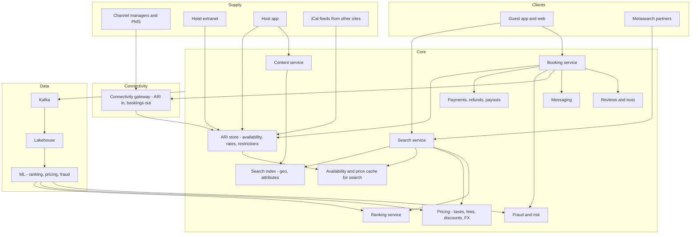
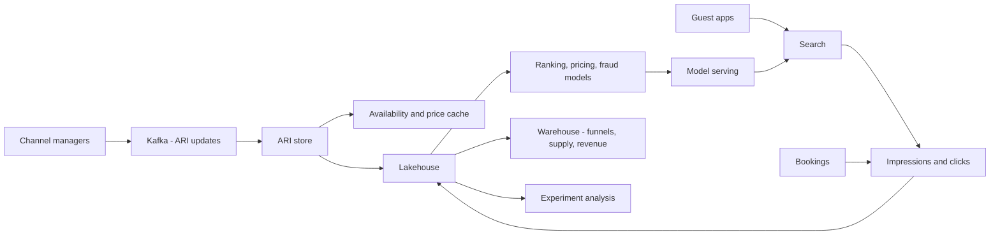

# I17. Hotel & Homestay Booking

!!! abstract "Chapter at a glance"
    **Sector:** hospitality and online travel (OTA hotels plus a homestay marketplace) · **Format:** system design walkthrough (no code) · **Reader bands:** B1 → B4

    **Builds on:**

    - [I10](i10-travel-and-railway-ticketing.md): travel search and inventory
    - [Ch 42](../05-case-studies/42-search-autocomplete.md): search
    - [Ch 43](../05-case-studies/43-home-feed-and-recommendations.md): ranking
    - [Ch 45](../05-case-studies/45-payment-system.md): payments
    - [Ch 49](../05-case-studies/49-pricing-promotions-and-coupons.md): pricing

    **What you get:** a reference platform that combines an **online travel agency for hotels** (like Booking.com, MakeMyTrip or Agoda) with a **homestay marketplace** (like Airbnb). It covers:

    - **supply onboarding**: hotels via channel managers, and hosts listing homes;
    - **the availability calendar and rate plans** (room types, meal plans, refundable and non-refundable rates);
    - **search** by city, area or map, with dates and guests, at millions of searches an hour;
    - **ranking and personalisation**;
    - **dynamic pricing** and host price suggestions;
    - **booking with holds and payments** (pay now, pay at hotel, part-pay);
    - **overbooking and channel sync** problems;
    - cancellations and refunds, reviews and trust, host payouts, guest–host messaging, and fraud.

    It also explains **the algorithms**: calendar representation and date-range availability, geo search, learning-to-rank and embeddings, price elasticity and revenue management, overbooking control, review integrity, fraud detection and duplicate-listing detection. It ends with the **data platform** and **tech stack**.

    **Reading time:** 80 min.

!!! warning "Sources and honesty"
    - Some practices have been described publicly in engineering blogs and papers. Examples are Airbnb's search ranking and listing embeddings (KDD papers), Booking.com's experimentation culture, and the use of channel managers and the OTA connectivity standards (OpenTravel/HTNG). These are marked **"publicly described (VERIFY)"**.
    - India-specific rules are marked **VERIFY**: GST slabs on room tariffs, guest registration requirements (Form C for foreign nationals), and the Consumer Protection (E-commerce) Rules.
    - Everything else is a **reference design**.

---

## 1. The System in One Page

### 1.1 Two kinds of supply

| | Hotels (OTA) | Homestays (marketplace) |
|---|---|---|
| **Inventory** | Many identical rooms per room type, with allotments | Usually one unit (the whole home or a room) |
| **Where truth lives** | The hotel's **PMS / channel manager**. The OTA is one of many channels | **The platform's calendar**, plus iCal sync with other sites |
| **Pricing** | Rate plans set by revenue managers, with parity rules | Set by hosts, often with platform price suggestions |
| **Confirmation** | Instant, usually | Instant book, or a **request-to-book** that the host accepts |
| **Trust** | Brand and star rating | **Reviews, verification, photos, host responsiveness** |
| **Money** | Commission, merchant or agency model | Guest service fee plus host fee, held until check-in |

### 1.2 Main systems

| System | What it does |
|---|---|
| **Supply onboarding** | Hotel contracting, content (photos, amenities), host listing creation, verification |
| **Content service** | Property details, room types, photos, amenities, policies, translations |
| **Inventory and rates (ARI)** | **Availability, rates, inventory** per property × room type × rate plan × date |
| **Channel connectivity** | Receives ARI updates from channel managers and PMSs, and sends bookings back |
| **Search** | Location, dates and guests in; available properties with prices out, fast |
| **Ranking** | Orders results by relevance, conversion likelihood, quality and business rules |
| **Pricing** | Taxes, fees, discounts, member prices, currency, plus dynamic pricing and host suggestions |
| **Booking** | Hold, pay, confirm, vouchers, modifications, cancellations |
| **Payments and payouts** | Guest payments, refunds, host and hotel payouts, commission invoicing |
| **Messaging** | Guest–host chat with moderation and translation |
| **Reviews and trust** | Verified-stay reviews, fraud and fake review detection, safety |
| **Customer support** | Cases, relocations when overbooked, refunds |
| **Data platform** | Analytics, experiments, ML for ranking, pricing and fraud |

### 1.3 Scale for this design (assumptions)

| Quantity | Value |
|---|---|
| Properties | 2M hotels and homes, plus 5M homestay listings |
| Room types × rate plans per hotel | ~10–50 |
| Calendar horizon | 365–500 days |
| ARI cells | ~2M × 20 × 400 ≈ **16 billion** (property × room × rate plan × date) |
| ARI updates | Millions per hour, with peaks when revenue managers bulk-update |
| Searches | 5M per hour at peak (~1,400/s), each with 1,000s of candidate properties |
| Look-to-book ratio | ~1,000:1 or higher |
| Bookings | ~1.5M room nights a day |

**Estimation highlights:**

- **Search cost.** One search in a big city (e.g. Goa for 3 nights, 2 adults) must:
    - filter thousands of properties by availability on every night;
    - price each one (rate plans × nights × taxes);
    - rank them;
    - all within ~300–500 ms.

    At ~1,400 searches/s, that is ~1–5M property evaluations per second. You need **precomputed availability and price summaries** in memory, not database queries per property.
- **ARI write volume.**
    - Each channel manager update ("set rate for 2027-01-10 to 2027-01-20 to ₹6,500") can touch hundreds of cells.
    - Millions of updates an hour means hundreds of millions of cell changes.
    - The write path must be efficient: compact representations and range updates.
- **Look-to-book ratio.**
    - Most traffic is search, so the read path dominates.
    - You also need **cheap, approximate answers** for search, with **exact checks** at booking (§5.4).

---

## 2. Requirements

### 2.1 Functional

1. **Supply.**
    - Hotels connect through channel managers (two-way XML/JSON APIs) or an extranet.
    - Hosts create listings with photos, amenities, house rules and a calendar.
    - The platform verifies hosts and properties.
2. **Search.**
    - Inputs: destination (city, area, landmark, map box), dates, guests, rooms.
    - Filters: price, stars, amenities, free cancellation, property type, rating.
    - Sorts: recommended, price, distance, rating.
    - Map view, flexible dates, and autocomplete.
3. **Property page.** Content, room types with rate plans and prices for the dates, policies, reviews, a map and the host profile.
4. **Booking.**
    - Select rooms and rate plan, enter guest details, pay (pay now, pay at hotel, part-pay, EMI), then get confirmation and a voucher.
    - Homestays support request-to-book with a host response window (e.g. 24 h).
5. **Modifications and cancellations.** Apply the policy of the rate plan or listing, compute refunds, and sync changes to the hotel or host calendar.
6. **Messaging** between guest and host or hotel, before and after booking.
7. **Reviews.** Only verified stays can review. Reviews are double-blind for homestays: both sides are revealed together or after a deadline (publicly described for Airbnb; VERIFY).
8. **Payouts.**
    - Hosts are paid after check-in (minus fees).
    - Hotels on the merchant model are paid per invoice cycle. Hotels on the agency model collect from guests and pay commission.
9. **Support.** Relocation when a property is overbooked, refunds, and safety issues.

### 2.2 Non-functional

| Attribute | Target |
|---|---|
| **Search latency** | P95 < 500 ms for a city search |
| **Price accuracy** | The price shown on search matches the booking price for > 99% of bookings ("price mismatch" rate tracked) |
| **Availability accuracy** | Booking failure ("sold out at booking") < 1–2% |
| **No double bookings** | For single-unit homestays, never. For hotels, overbooking only if the hotel allows it |
| **ARI freshness** | Updates from channel managers reflected in search within seconds to minutes |
| **Availability** | Search and booking 99.95% |
| **Payments** | Exactly-once charges and refunds. PCI-DSS. RBI rules for card storage and tokenisation (VERIFY) |
| **Compliance** | Taxes on invoices (GST by tariff slab; VERIFY), guest registration data where required |

---

## 3. High-Level Architecture

### Key decisions

| Decision | Choice | Why |
|---|---|---|
| ARI model | Per property × room type × rate plan × date, with **range updates** and restrictions (min stay, closed to arrival/departure) | Matches how hotels sell |
| Search path | **Two stages**: candidate retrieval from the geo/attribute index, then availability and price from an in-memory cache, then ranking | Latency at a high look-to-book ratio |
| Booking path | Exact availability check and **hold** on the ARI store (or a live check with the hotel), then payment, then confirmation | Correctness at booking |
| Truth for hotels | The channel manager or PMS. The OTA keeps a synchronised copy | Many channels sell the same rooms |
| Truth for homestays | The platform calendar, with iCal import and export | Single unit, so no double booking |
| Ranking | ML learning-to-rank on conversion, with business rules | Revenue and guest satisfaction |
| Payments | Merchant model (OTA collects) plus agency model (pay at hotel), and escrow-like timing for homestays | Flexibility, trust |

---

## 4. How It Works — Journeys End to End

### 4.1 Journey 1: a hotel updates prices and inventory

1. **The hotel side.** The revenue manager at a Goa resort raises prices for the New Year week in their **PMS or channel manager**. The channel manager pushes the update to every connected OTA.
    - The message is an ARI update in OTA standard messages (e.g. `OTA_HotelRateAmountNotifRQ`, `OTA_HotelAvailNotifRQ`; publicly documented OpenTravel schemas; VERIFY specific partner APIs).
    - Example: room type "Deluxe Sea View", rate plan "Breakfast included, refundable", dates 28 Dec – 2 Jan, rate ₹18,000, min stay 3 nights, 4 rooms available.
2. **Connectivity gateway.**
    - Authenticates the partner.
    - Validates the message: known property and room mapping, sane dates and amounts.
    - Acknowledges quickly.
    - Writes the update to a **Kafka topic per property partition**, so updates for one property stay in order.
3. **ARI service.**
    - Consumes the update and applies the **range update** to the ARI store (§6.1).
    - Records the update source and timestamp, and keeps the last update per cell to resolve out-of-order messages.
4. **Search cache refresh.**
    - The change emits `AriChanged(property, dates)`.
    - The **availability and price cache** recomputes summaries for that property, such as the cheapest available price per night per occupancy and a flag for whether min-stay rules allow a stay.
    - The update reaches the search nodes within seconds.
5. **Monitoring.** Partners with high error rates or mapping problems are flagged. Stale properties (no updates for a long time) are shown carefully or re-synced through a full refresh request.

### 4.2 Journey 2: searching for a stay in Goa

1. **Query.** Anita searches "North Goa, 29 Dec – 1 Jan, 2 adults" in the app. Autocomplete resolves "North Goa" to a region polygon.
2. **Candidate retrieval** from the search index (OpenSearch/Elasticsearch-style):
    - **geo filter**: properties inside the polygon or map bounding box;
    - **static filters**: property type, amenities, stars;
    - result: ~3,000 candidates.
3. **Availability and price** (§5.3).
    - For each candidate, the search service asks the **in-memory availability/price cache**, sharded by property: "is there a room for 2 adults for each night 29, 30, 31 Dec, satisfying min stay and closed-to-arrival rules, and what is the cheapest total price?"
    - The cache keeps per-property, per-date compact arrays, so each check takes microseconds (§6.1).
    - About 1,200 properties are available.
4. **Pricing.** The pricing service applies taxes (GST by tariff slab; VERIFY), platform fees, member discounts, coupons where eligible, and currency conversion, giving a **display price** that includes taxes as regulations and UX require.
5. **Ranking** (§6.3).
    - The ranking service scores the 1,200 properties with features such as quality, conversion history, price competitiveness, distance to the area centre, review score, Anita's past preferences (e.g. she books boutique stays), and listing embeddings.
    - Business rules apply: sponsored placements are labelled, and diversity rules keep one brand from dominating.
6. **Response.** The top 30 results go back with prices and badges ("Free cancellation", "Only 2 left"). The map view loads pins for the visible bounding box.
7. **Logging.** The impressions (what was shown, in which position) are logged to Kafka for ranking model training and experiments.

### 4.3 Journey 3: booking a hotel room

1. **Room selection.** Anita opens a property page.
    - The service fetches **detailed rates** for the dates: all room types and rate plans, with policies.
    - For some partners the page does a **live availability call** to the channel manager or supplier API to get exact prices (§6.6), because cache staleness matters.
2. **She picks** "Deluxe Sea View, breakfast included, free cancellation until 26 Dec" at ₹54,000 + taxes for 3 nights.
3. **Booking initiation.** The booking service:
    - re-prices exactly (price mismatch check: if the price has changed, it shows the new price and asks Anita to accept);
    - places a **hold** on inventory, decrementing the allotment atomically in the ARI store for each night (§5.4), or creates a pending reservation with the partner for live-connected hotels;
    - runs fraud checks (§6.7).
4. **Payment.** Anita chooses pay now by UPI.
    - Payment is processed with an idempotency key ([Ch 45](../05-case-studies/45-payment-system.md)).
    - On success the booking moves to **CONFIRMED**.
    - Or she picks "pay at hotel": a card guarantee may be required, or no payment for trusted users or partners.
5. **Delivery to the hotel.**
    - The booking is sent to the channel manager or PMS via the connectivity gateway (`OTA_HotelResNotifRQ`).
    - The hotel's system acknowledges with its own confirmation number.
    - If delivery fails, it retries with alerts. Undelivered bookings are critical: the guest could arrive with no reservation.
6. **Confirmation.** Anita gets an email, SMS and app voucher with the hotel's confirmation number and the cancellation policy. The **invoice** includes GST details.
7. **After booking.** Reminders, pre-check-in details (ID upload, arrival time), and messaging with the hotel.

### 4.4 Journey 4: booking a homestay with request-to-book

1. **Search.** Rahul finds a villa for 6 guests in Coorg. The host requires **request-to-book**.
2. **Request.**
    - Rahul sends a request with a message about trip purpose and guests.
    - The platform **pre-authorises** his payment method, holding the amount where supported, or collects payment that will be refunded if the request is declined.
    - The calendar dates are **tentatively blocked** for the response window (24 h).
3. **The host** sees Rahul's profile (verification status, past reviews) and accepts. The booking is confirmed and the payment is captured.
4. **Calendar sync.** The dates are blocked on the platform calendar, and the iCal export updates. Other sites the host uses import the iCal and block the dates within their polling interval, which can take hours (§6.5).
5. **Payout.** The host is paid **24 hours after check-in** (publicly described practice for some marketplaces; VERIFY), minus the host fee, through bank transfer. Guests are protected if the listing isn't as described.
6. **Reviews.** After checkout both sides have 14 days to review. Reviews are revealed together or at the deadline, so neither side retaliates.

### 4.5 Journey 5: overbooking at check-in

1. **The cause.** A hotel sells its last room on two channels within a minute, before channel sync completes. Both bookings are confirmed.
2. **Detection.** The hotel's PMS flags the overbooking, and the hotel tells the OTA (or the guest arrives and there's no room).
3. **Relocation policy.**
    - The OTA's support system finds a **comparable or better property nearby** at the same price, and the OTA or the hotel pays the difference.
    - It arranges transport and notifies the guest proactively if the problem is known in advance.
4. **Accountability.** The OTA records the incident against the hotel. Repeated overbookings affect ranking and lead to penalties.
5. **Prevention.**
    - Faster ARI sync.
    - Allotment buffers (sell only N−1 of the last rooms on some channels).
    - Live availability checks at booking for high-demand dates.

### 4.6 Journey 6: cancellation and refund

1. **Request.** Anita cancels on 20 Dec. The rate plan allowed free cancellation until 26 Dec, so she gets a full refund.
2. **The booking service:**
    - applies the policy;
    - computes the refund (minus any non-refundable fees, per policy and regulations);
    - sends a cancellation to the hotel (`OTA_CancelRQ`) and gets an acknowledgement;
    - **releases inventory** (re-increments the allotment), or the hotel's next ARI update reflects it;
    - triggers the refund through the payment service (UPI refunds take minutes to days; VERIFY timelines).
3. **Non-refundable rates.** No refund, though the platform may help with exceptions (illness, disasters) per policy.
4. **Homestays.** Policies are set by the host from platform templates (flexible, moderate, strict). Extenuating circumstances policies cover disasters (VERIFY specific platform policies).

---

## 5. Core Subsystems in Depth

### 5.1 ARI data model

- **Entities:**
    - **property → room types** (Deluxe, Suite), each with max occupancy, beds and physical inventory;
    - **rate plans** per room type (Room only, Breakfast, Non-refundable, Member rate, Long stay), each with a cancellation policy, meal plan, occupancy-based prices and derived rules (e.g. member rate = base − 10%).
- **Per date per room type:** **inventory** (rooms available to sell), **sold count**, and a **stop-sell** flag.
- **Per date per rate plan:**
    - **price** by occupancy (1 adult, 2 adults, extra adult or child);
    - **restrictions**: min/max length of stay, closed to arrival (CTA), closed to departure (CTD), advance purchase windows.
- **Derived rates.** Some rate plans derive from a parent ("Breakfast = Room only + ₹800/person"). They are stored as rules and computed at read time or materialised in the cache.
- **Storage.**
    - A wide-column or key-value store keyed by (property, room type, rate plan) with **date-indexed arrays or bitmaps** for the horizon (§6.1).
    - Or a relational table partitioned by property, with a row per date. That is simpler, but heavier at 16B cells.

### 5.2 Content service

- Property details, room types and photos, amenities (taxonomy), policies, location and translations.
- Hosts edit through the app. Hotels update through the extranet or content APIs.
- **Photo pipeline:** upload, then resize and compress, then quality and duplicate checks, then a CDN ([Ch 52](../05-case-studies/52-object-storage-and-media-pipeline.md)).
- **Quality scoring:** photo count and quality, description completeness, amenity accuracy. This feeds ranking.

### 5.3 Search: two-stage retrieval

- **Stage 1: candidate retrieval** from an **inverted plus geo index**:
    - geo (geohash/BKD tree for bounding boxes, polygons, distance);
    - attributes (type, stars, amenities);
    - text (name, area).
    - The index updates when content changes, which is rare compared with ARI.
- **Stage 2: availability and pricing.**
    - An **in-memory cache** sharded by property ID holds, per property, compact per-date structures: availability count per room type, the lowest price per occupancy per date, and restriction flags.
    - The search service fans out to the shards for its candidates (scatter–gather) and gets back available properties with a lead price (cheapest total for the stay).
- **Stage 3: ranking and pagination.** Score, sort and return the top N. Cache whole query results briefly (e.g. 1–5 minutes) for popular city + date combinations.
- **Map search.** Re-query on map pan with a bounding box. Cluster pins at low zoom.

### 5.4 Booking service and inventory holds

- **State machine:** INITIATED → HELD → PAYMENT_PENDING → CONFIRMED → (MODIFIED) → CANCELLED or CHECKED_IN → COMPLETED. Failure paths go to EXPIRED or FAILED.
- **Hold.**
    - An atomic conditional decrement per night: `if inventory − sold ≥ rooms then sold += rooms`, all nights in one transaction for the property partition.
    - Or a reservation record with a TTL (e.g. 15 minutes) that the cache counts as unavailable.
    - Expired holds are released by a sweeper.
- **Homestays.** The calendar is a single unit, so a conditional write on all dates is enough: block the dates only if they are all free. Use **optimistic concurrency** (a version on the calendar) or a lock per listing.
- **Live-connected hotels.** Call the supplier's booking API. The response decides success. On timeout, query the status before retrying, to avoid duplicate reservations.
- **Idempotency** on client requests, payment callbacks and supplier calls.

### 5.5 Channel connectivity

- **Inbound ARI:** push from channel managers. There are thousands of partners with varied reliability. Use queues and per-partner rate limits.
- **Outbound bookings:** reservations, modifications and cancellations, with retries, acknowledgements and a dead-letter queue with alerts.
- **Mapping:** the OTA's room and rate IDs ↔ the partner's IDs. Mapping errors cause wrong prices, so validate with rules and alert on anomalies.
- **Rate parity monitoring:** compare prices across channels. Parity clauses are subject to competition law in some jurisdictions (VERIFY CCI rulings in India).

### 5.6 Payments, payouts and commission

- **Merchant model:** the OTA charges the guest, pays the hotel net of commission on a cycle, and issues invoices.
- **Agency model:** the guest pays the hotel. The OTA invoices the hotel for commission monthly. **Pay-at-hotel no-shows** need card guarantees or policies.
- **Homestays:**
    - The platform collects the full amount.
    - Funds are held until check-in, then the payout is released.
    - Refunds are handled with policy and guarantees.
    - A **double-entry ledger** tracks guest payments, fees, host payables and refunds ([I03](i03-core-banking-and-upi.md), [I11](i11-telecom-billing-and-charging.md)).
- **Taxes:** GST on the room tariff and on platform services; TCS/TDS obligations for e-commerce operators (VERIFY).

### 5.7 Reviews and trust

- **Verified stays only.** Reviews are linked to completed bookings.
- **Ratings:** sub-ratings (cleanliness, location, value, communication), aggregated with **Bayesian averaging** so a few reviews don't dominate.
- **Fake review detection** (§6.8).
- **Safety:** identity verification for hosts and guests, reporting, and a 24/7 safety line.
- **Listing quality:** duplicate listing detection, and fake or scam listings (e.g. stolen photos).

---

## 6. Algorithms

### 6.1 Calendar representation and date-range queries

- **Per room type:** an array indexed by day offset from today, holding available counts (16-bit integers). A 500-day horizon is 1 KB per room type.
- **Stay check:**
    - for check-in day d and N nights, require `min(available[d … d+N−1]) ≥ rooms`;
    - also check the rate plan restrictions: min stay at arrival date ≤ N, no CTA on d, no CTD on d+N.
    - N is small, so a scan is fast. For long stays or flexible-date searches, **sparse tables or segment trees** answer range-min queries in O(1)/O(log n).
- **Homestays:** a **bitmap** of booked days. The stay is available if `(bitmap AND mask[d … d+N−1]) == 0`. This is a word-level AND, and extremely fast.
- **Price for a stay:** the sum over nights of the price for that occupancy, plus extra-guest charges, and length-of-stay discounts (weekly, monthly). Precompute **prefix sums** per rate plan for quick totals.
- **Flexible dates** ("weekend in March"): evaluate a few candidate windows with the same structures.

### 6.2 Geo search

- **Index:** a geohash or BKD tree (Lucene geo points) for bounding box, polygon and distance queries.
- **Ranking distance:** distance to the searched landmark or area centroid, or **"distance to popular points"** learned from bookings.
- **Area boundaries:** neighbourhood polygons are curated, or learned from where people search and book.

### 6.3 Ranking: learning to rank

- **Objective:** maximise bookings (and guest satisfaction) per search, with the result position bias modelled.
- **Features:**
    - **listing**: price relative to the area's typical price, review score and count, photo quality, cancellation policy, host response rate, past CTR/CVR;
    - **query**: destination, dates, guests, lead time, length of stay;
    - **user**: past bookings, price sensitivity, preferred property types;
    - **context**: device, locale.
- **Models:**
    - Gradient-boosted trees (LambdaMART) for pairwise or listwise ranking, then deep neural networks.
    - Airbnb publicly described moving from GBDT to neural networks, and using **listing embeddings** learned from click sessions (word2vec-style, where listings are "words" and sessions are "sentences") for similar-listing and real-time personalisation (KDD 2018/2019 papers; VERIFY).
- **Training data:**
    - impressions with clicks and bookings;
    - correction for **position bias** (inverse propensity weighting, or randomised exploration);
    - booked listings as positives, with clicked-but-not-booked as weaker signals.
- **Online evaluation:** A/B tests on conversion and revenue, with guardrails on cancellations and guest satisfaction. Booking.com publicly emphasises large-scale experimentation (VERIFY).
- **Business layer:** sponsored listings (labelled), diversity, fairness to new listings (a **cold-start boost** with exploration), and demotion for poor quality or high cancellations.

### 6.4 Dynamic pricing and revenue management

- **Hotels (classic revenue management):**
    - forecast demand per date from booking pace (bookings on the books vs the same time last year), events and seasonality;
    - set prices to maximise **RevPAR** (revenue per available room);
    - **length-of-stay controls** (min stay at peak), and **overbooking levels** (§6.6).
    - This often runs in the hotel's RMS. The OTA provides market insights.
- **Homestay price suggestions** (publicly described as "Smart Pricing" by Airbnb; VERIFY):
    - predict the **booking probability** at different prices for each night, from listing features, seasonality, lead time, local demand (searches for those dates) and competitor prices;
    - pick the price that maximises expected revenue within the host's min/max;
    - **price elasticity** is estimated from historical data and experiments.
- **Platform discounts:** member prices and coupons, with budget control ([Ch 49](../05-case-studies/49-pricing-promotions-and-coupons.md)).

### 6.5 Calendar sync and double-booking prevention

- **iCal sync:** hosts listing on multiple sites export and import iCal feeds. Polling intervals (often hours) create **double-booking windows**.
- **Mitigations:**
    - more frequent polling for active listings;
    - **API-based channel sync** (real-time) where available;
    - a buffer (block same-day bookings until synced);
    - **conflict detection**: when an imported event overlaps an existing booking, alert the host immediately and run the cancellation or rebooking workflow.

### 6.6 Overbooking control (hotels)

- **Why hotels overbook:** cancellations and no-shows leave rooms empty, so they sell beyond capacity by an amount based on expected no-shows.
- **The model:** choose the overbooking level k to maximise expected revenue. The revenue from extra bookings is weighed against the **cost of walking a guest** (relocation, goodwill). Use no-show and cancellation distributions by date, segment and rate plan (non-refundable rates have fewer no-shows).
- **Classic approach:** a newsvendor-style calculation: overbook while P(show-ups > capacity) × walk cost < the expected revenue of the extra room.
- **OTA role:** respect the hotel's overbooking settings, keep extra-channel buffers on scarce inventory, and run live checks for the last rooms.

### 6.7 Fraud detection

- **Payment fraud:** stolen cards booking high-value stays (often last-minute bookings in popular cities).
- **Account takeover:** loyalty points theft.
- **Host scams:** fake listings, or off-platform payment requests ("pay me directly").
- **Signals:**
    - device and IP reputation;
    - velocity;
    - the mismatch between card country, IP and destination;
    - lead time and booking value;
    - new accounts;
    - **message text classifiers** that detect requests for off-platform payment or contact details.
- **Actions:** step-up authentication (3DS, ID verification), holds, cancellation and refund, and listing takedown.

### 6.8 Review integrity and aggregation

- **Bayesian average:** score = (C × m + Σ ratings) / (C + n), where m is the prior mean and C the prior weight. This avoids a single 5-star review ranking at the top.
- **Fake review detection:**
    - text similarity across reviews;
    - reviewer graphs (rings of accounts reviewing each other);
    - bursts of reviews;
    - review sentiment vs ratings mismatch;
    - verified-stay requirement.
- **Review summarisation:** aspect-based sentiment (cleanliness, staff, location) shown as highlights. LLM-based summaries with grounding to actual reviews.

### 6.9 Duplicate property detection

- **The problem:** the same hotel arrives via multiple suppliers or channel managers, and the same home is listed twice.
- **Matching:**
    - name similarity (fuzzy match, transliteration);
    - address normalisation;
    - **geo distance**;
    - phone and website matches;
    - photo perceptual hashes.
- **Resolution:** merge into one canonical property with multiple supply sources (for an aggregator OTA), or flag the duplicate listing.

---

## 7. Data Architecture

### 7.1 Operational stores

| Data | Store (reference) | Notes |
|---|---|---|
| Content | PostgreSQL + object storage (photos) + CDN | Versioned |
| ARI | Cassandra/ScyllaDB or a sharded KV store with date arrays; relational for extranet edits | Range updates |
| Search index | OpenSearch/Elasticsearch | Geo and attributes |
| Availability/price cache | In-memory sharded service (Redis or custom) | Rebuilt from ARI |
| Bookings | PostgreSQL sharded by booking ID, with a secondary index by user and property | Strong consistency |
| Payments and ledger | PostgreSQL, append-only ledger | Reconciliation |
| Messages | Cassandra | Moderation |
| Reviews | PostgreSQL + search index | Aggregates cached |
| Events | Kafka | Impressions, clicks, bookings |

### 7.2 Analytics and ML

- **Lakehouse:** search logs (queries, impressions with positions), clicks, bookings, cancellations, ARI snapshots, prices, reviews.
- **Warehouse marts:**
    - conversion funnels by city and device;
    - supply health (properties with stale ARI);
    - price competitiveness vs other channels;
    - partner performance (overbookings, delivery failures);
    - revenue and commission.
- **ML:** ranking models, embeddings, demand forecasting and price suggestions, fraud models, review integrity, duplicate detection, photo quality.
- **Experimentation:** a platform for thousands of concurrent A/B tests, with consistent assignment and metrics pipelines.

### 7.3 Data flow

---

## 8. Tech Stack (reference choice)

| Layer | Choice | Notes |
|---|---|---|
| **Services** | Java/Kotlin (Spring Boot), Go for high-throughput search fan-out | |
| **Search** | OpenSearch/Elasticsearch; custom in-memory availability service (Java/C++/Rust) | Two-stage |
| **Datastores** | PostgreSQL, Cassandra/ScyllaDB, Redis | |
| **Streaming** | Kafka, Flink | ARI propagation, real-time features |
| **ML** | Python, XGBoost/LightGBM, TensorFlow/PyTorch, feature store, model serving | Ranking, pricing |
| **Lakehouse** | Iceberg/Delta, Spark, Trino; BI | Analytics |
| **Connectivity** | OpenTravel/HTNG XML, partner REST APIs, iCal | Channel managers |
| **Payments** | Payment gateways (UPI, cards, wallets, EMI), tokenisation | RBI rules (VERIFY) |
| **Media** | Object storage + image service + CDN | Photos |
| **Publicly described (VERIFY)** | Airbnb: Java/Kotlin services, Kafka, Elasticsearch-based search, ML ranking with embeddings. Booking.com: large Perl legacy moving to Java, a heavy experimentation platform, MySQL | From public talks and blogs |

---

## 9. Security, Privacy & Compliance

- **Payments:**
    - PCI-DSS;
    - card tokenisation (RBI card-on-file rules; VERIFY);
    - 3DS;
    - refunds within mandated timelines (VERIFY).
- **Guest data:**
    - ID documents collected for check-in (hotels must record guest details; foreigners need Form C reporting by hotels; VERIFY);
    - minimal storage, encryption, and limited retention;
    - DPDP Act obligations.
- **Consumer protection:**
    - transparent total prices including taxes and fees;
    - clear cancellation policies;
    - grievance officer requirements under the E-commerce Rules (VERIFY);
    - drip pricing and dark patterns guidelines (VERIFY CCPA guidelines on dark patterns).
- **Safety:**
    - host and guest verification;
    - anti-discrimination policies;
    - messaging moderation (off-platform payment requests);
    - emergency support.
- **Competition law:** rate parity clauses and platform practices have been reviewed by competition authorities in several countries, including India (VERIFY).

---

## 10. Reliability & Operations

- **Search degradation.** If the availability cache shard is slow, return results without the slow shard's properties rather than failing. If ranking is down, fall back to a simpler sort.
- **Booking path.** Highest priority: separate capacity, circuit breakers on partner calls, and a status query before retry.
- **Booking delivery monitoring.** Alerts for undelivered bookings, and a manual phone or email fallback to hotels.
- **Peak seasons.** New Year and long weekends bring traffic spikes and supply scarcity. Pre-scale, warm caches and watch price mismatch rates.
- **Partner reliability.** Per-partner circuit breakers, plus marking properties as "on request" when their live checks fail.
- **Observability:**
    - search latency per stage;
    - price mismatch rate;
    - sold-out-at-booking rate;
    - overbooking incidents;
    - ARI lag per partner;
    - payment success;
    - refund lag.

---

## 11. Key Trade-offs

| Decision | Chosen | Accepted cost |
|---|---|---|
| Search availability | Cached summaries | Occasional price mismatch or sold-out at booking |
| Live checks | Only at the property page or booking for some partners | Latency, partner load |
| Hotel truth | The channel manager | Sync lag causes overbookings |
| Homestay calendar | Platform truth + iCal | Sync windows with other sites |
| Ranking | ML for conversion + rules | Complexity, position bias |
| Pricing suggestions | Advisory for hosts | Hosts may ignore them |
| Overbooking | Allowed per hotel settings | Relocation costs |
| Payout timing | After check-in | Hosts wait longer |

---

## 12. Interview Q&A

### Beginner B1

??? question "Q1 [B1] ⭐ How would you represent room availability for a hotel?"

    **30-second answer:** Per property, room type and date store inventory and sold counts, and per rate plan and date store prices by occupancy and restrictions (min stay, closed to arrival/departure); keep them as compact date-indexed arrays so a stay check is a min over the nights.

    **Deep answer:** §5.1, §6.1.

    **Trade-offs I'd call out:** Storage vs query speed.

    **Follow-ups:**
    1. Homestays? → Bitmaps.
    2. Horizon? → ~1 year+.

    **Red flags:** One row per booking and counting overlaps on every search.

??? question "Q2 [B1] How do you prevent two guests booking the same homestay for the same dates?"

    **30-second answer:** The platform calendar is the source of truth; booking does a conditional write that blocks all dates only if all are free (optimistic concurrency or a per-listing lock); holds expire if payment fails; iCal and API sync to other sites.

    **Deep answer:** §5.4, §6.5.

    **Trade-offs I'd call out:** Sync windows with other sites.

    **Follow-ups:**
    1. Request-to-book? → Tentative block.
    2. iCal conflict? → Alert host.

    **Red flags:** Check then write without atomicity.

??? question "Q3 [B1] Why does a search price sometimes differ from the booking price?"

    **30-second answer:** Search uses cached availability and price summaries for speed; between search and booking the hotel may change rates or sell rooms, so booking re-prices exactly and asks the user to accept changes — platforms track the mismatch rate.

    **Deep answer:** §4.3, §11.

    **Trade-offs I'd call out:** Speed vs exactness.

    **Follow-ups:**
    1. Reduce it? → Faster ARI propagation.
    2. Live checks? → For some partners.

    **Red flags:** Charging a different price silently.

??? question "Q4 [B1] How would you show a property's average rating fairly?"

    **30-second answer:** Use a Bayesian average that blends the property's ratings with a prior so properties with few reviews aren't over- or under-ranked; show sub-ratings and only verified-stay reviews.

    **Deep answer:** §6.8.

    **Trade-offs I'd call out:** New properties start near the prior.

    **Follow-ups:**
    1. Fake reviews? → Detection.
    2. Recency? → Weighting.

    **Red flags:** A raw mean with one review.

### Intermediate B2

??? question "Q5 [B2] ⭐ Design hotel search that answers in under 500 ms."

    **30-second answer:** Stage 1: geo and attribute index retrieves candidates; stage 2: scatter-gather to an in-memory availability/price cache sharded by property for stay checks and lead prices; stage 3: pricing (taxes, discounts) and ML ranking; cache popular queries briefly; log impressions.

    **Deep answer:** §4.2, §5.3.

    **Trade-offs I'd call out:** Staleness vs latency.

    **Follow-ups:**
    1. Map search? → Bounding boxes.
    2. Flexible dates? → Window checks.

    **Red flags:** Querying the ARI database per candidate.

??? question "Q6 [B2] How do ARI updates from channel managers flow through the system?"

    **30-second answer:** Partners push standard ARI messages to a connectivity gateway, which validates, maps IDs and writes to Kafka partitioned by property; the ARI service applies range updates with ordering checks; change events refresh the search cache within seconds.

    **Deep answer:** §4.1, §5.5.

    **Trade-offs I'd call out:** Partner reliability.

    **Follow-ups:**
    1. Out of order? → Timestamps per cell.
    2. Bad mappings? → Validation.

    **Red flags:** Synchronous DB writes from partner calls with no queue.

??? question "Q7 [B2] What happens when a booking can't be delivered to the hotel?"

    **30-second answer:** Retry with backoff via the connectivity gateway, query status before re-sending to avoid duplicates, alert operations when undelivered past a threshold, and fall back to phone or email confirmation — an undelivered booking is a guest with no room.

    **Deep answer:** §4.3 step 5, §10.

    **Trade-offs I'd call out:** Manual ops cost.

    **Follow-ups:**
    1. Idempotency? → Booking IDs.
    2. Hotel down? → On-request mode.

    **Red flags:** Fire-and-forget delivery.

??? question "Q8 [B2] How do cancellation policies affect the booking system?"

    **30-second answer:** Each rate plan or listing carries a policy (free until X, partial, non-refundable); the booking stores a snapshot of the policy at booking time; cancellation computes refunds from it, notifies the supplier, releases inventory and triggers refunds idempotently.

    **Deep answer:** §4.6.

    **Trade-offs I'd call out:** Policy complexity.

    **Follow-ups:**
    1. Policy changes later? → Snapshot.
    2. Disasters? → Exceptions.

    **Red flags:** Looking up the current policy at cancellation time.

??? question "Q9 [B2] How do you detect duplicate properties from multiple suppliers?"

    **30-second answer:** Normalise names and addresses, compare geo distance, phone and website, use fuzzy name similarity and photo perceptual hashes, and merge high-confidence matches into a canonical property with multiple supply sources.

    **Deep answer:** §6.9.

    **Trade-offs I'd call out:** False merges.

    **Follow-ups:**
    1. Manual review? → Borderline.
    2. Transliteration? → Normalise.

    **Red flags:** Matching on exact names only.

### Senior B3

??? question "Q10 [B3] ⭐ How would you build ranking for a stays marketplace?"

    **30-second answer:** Learning-to-rank on impression logs with bookings as positives and position-bias correction; features from listing quality, price competitiveness, reviews, query and user context; listing embeddings from click sessions for personalisation; online A/B tests on conversion with guardrails; business rules for sponsored labels, diversity and new-listing exploration.

    **Deep answer:** §6.3.

    **Trade-offs I'd call out:** Revenue vs guest satisfaction.

    **Follow-ups:**
    1. Cold start? → Boost plus exploration.
    2. Bias? → Propensity weighting.

    **Red flags:** Sorting by commission.

??? question "Q11 [B3] How would you suggest prices to homestay hosts?"

    **30-second answer:** Model booking probability per night as a function of price using listing features, seasonality, lead time, local search demand and competitor prices; estimate elasticity from data and experiments; choose the price maximising expected revenue within host bounds; explain suggestions.

    **Deep answer:** §6.4.

    **Trade-offs I'd call out:** Host trust and occupancy vs rate.

    **Follow-ups:**
    1. Events? → Demand signals.
    2. Last-minute? → Lead time.

    **Red flags:** Copying the average price nearby.

??? question "Q12 [B3] Why do hotels overbook, and how should an OTA handle it?"

    **30-second answer:** Hotels overbook to offset no-shows and cancellations, choosing a level where expected extra revenue exceeds expected walk cost; OTAs respect hotel settings, buffer scarce inventory, do live checks for last rooms, and have relocation workflows and partner scorecards.

    **Deep answer:** §4.5, §6.6.

    **Trade-offs I'd call out:** Revenue vs guest experience.

    **Follow-ups:**
    1. Non-refundable? → Fewer no-shows.
    2. Penalties? → Ranking.

    **Red flags:** Ignoring overbooking.

??? question "Q13 [B3] How do you keep calendars in sync across multiple listing sites?"

    **30-second answer:** Prefer real-time API connections; otherwise iCal import and export with frequent polling for active listings, a short buffer for near-term dates, and conflict detection that alerts hosts and triggers rebooking workflows.

    **Deep answer:** §6.5.

    **Trade-offs I'd call out:** Polling cost vs risk.

    **Follow-ups:**
    1. Who wins conflicts? → First confirmed.
    2. Guest impact? → Rebooking.

    **Red flags:** Daily iCal polling only.

??? question "Q14 [B3] How would you detect fraud in stays bookings?"

    **30-second answer:** Payment risk scoring with device, IP, velocity, card-country mismatch, lead time and value; account takeover detection; message classifiers for off-platform payment requests; listing scam detection with photo hashes; step-up verification, holds and takedowns.

    **Deep answer:** §6.7.

    **Trade-offs I'd call out:** Friction vs loss.

    **Follow-ups:**
    1. Host scams? → Verification.
    2. Chargebacks? → Evidence.

    **Red flags:** No message monitoring.

### Architect B4

??? question "Q15 [B4] ⭐ Design a hotel and homestay booking platform end to end."

    **30-second answer:** Supply onboarding and content; ARI store with range updates fed by channel managers, extranet and hosts; two-stage search with geo index and in-memory availability/price cache; ML ranking and pricing; booking service with atomic holds, live checks where needed and idempotent payments; supplier delivery; payouts via ledger; reviews and trust; Kafka to a lakehouse for analytics and experiments.

    **Deep answer:** §3–§7.

    **Trade-offs I'd call out:** Freshness vs latency vs cost.

    **Follow-ups:**
    1. Scale? → Look-to-book.
    2. Truth? → Hotels vs homes.

    **Red flags:** One database for everything.

??? question "Q16 [B4] How do you handle a 1000:1 look-to-book ratio economically?"

    **30-second answer:** Make the read path cheap: precomputed availability and price summaries in memory, brief query caching, rate-limited metasearch traffic, live supplier checks only at the property page or booking, and cost-aware caching for supplier APIs.

    **Deep answer:** §1.3, §5.3.

    **Trade-offs I'd call out:** Staleness.

    **Follow-ups:**
    1. Metasearch? → Quotas.
    2. Supplier cost? → Cache their responses.

    **Red flags:** A live supplier call per search result.

??? question "Q17 [B4] What data platform would you build for a travel marketplace?"

    **30-second answer:** Search impressions, clicks, bookings, ARI snapshots and prices into Kafka and a lakehouse; marts for funnels, supply health, price competitiveness and partner performance; ML for ranking, pricing, fraud and reviews; a large-scale experimentation platform with consistent assignment.

    **Deep answer:** §7.

    **Trade-offs I'd call out:** Logging cost.

    **Follow-ups:**
    1. Position bias? → Logged positions.
    2. Privacy? → Minimisation.

    **Red flags:** No impression logging.

??? question "Q18 [B4] What compliance issues matter for an Indian stays platform?"

    **30-second answer:** GST on room tariffs and platform fees, TCS/TDS for e-commerce operators, guest registration (Form C for foreigners), card tokenisation and refund timelines, consumer protection e-commerce rules with grievance officers and transparent pricing, dark pattern guidelines and DPDP data protection — all to VERIFY against current rules.

    **Deep answer:** §9.

    **Trade-offs I'd call out:** Friction.

    **Follow-ups:**
    1. Drip pricing? → Show totals.
    2. ID data? → Retention limits.

    **Red flags:** Hidden fees at checkout.

??? question "Q19 [B4] How would you migrate from cached-only availability to live supplier checks for some partners?"

    **30-second answer:** Classify partners by price mismatch and sold-out rates, enable live checks at the property page and booking for the worst ones behind feature flags, add supplier caches and circuit breakers, measure conversion and latency in A/B tests, and push partners to faster ARI push.

    **Deep answer:** §5.3, §5.5.

    **Trade-offs I'd call out:** Latency and partner cost.

    **Follow-ups:**
    1. Timeouts? → Fallback to cache.
    2. Metrics? → Mismatch rate.

    **Red flags:** Live checks for all partners on search.

??? question "Q20 [B4] Compare hotel booking with railway ticketing."

    **30-second answer:** Both sell date-bound perishable inventory with holds and payments; railways have a single owner and extreme flash crowds (Tatkal) with quotas and waitlists, while hotels have distributed truth across channel managers, rich rate plans, ranking and pricing competition, and overbooking practices.

    **Deep answer:** [I10](i10-travel-and-railway-ticketing.md) vs this chapter.

    **Trade-offs I'd call out:** Centralised vs distributed truth.

    **Follow-ups:**
    1. Waitlists? → Railways.
    2. Parity? → Hotels.

    **Red flags:** Identical designs.

---

## 13. Summary

1. **ARI** (availability, rates and inventory per property × room type × rate plan × date) is the heart of the system. Store it compactly, with range updates and restrictions.
2. **Search is two-stage**: geo and attribute retrieval, then in-memory availability and price summaries, then ML ranking. This makes a 1000:1 look-to-book ratio affordable.
3. **Booking is exact**: re-price, place atomic holds or live supplier reservations, take idempotent payments, and deliver reliably to the hotel.
4. **Truth differs by supply type.** The channel manager is the truth for hotels, which leads to sync lag and overbooking handling. The platform calendar is the truth for homestays, with iCal and API sync.
5. **Algorithms**: date-range checks with arrays, bitmaps and prefix sums; learning-to-rank with embeddings; price suggestions from elasticity; overbooking control; Bayesian review averages; fraud and duplicate detection.

### Related chapters

- [I10 — Travel & Railway Ticketing](i10-travel-and-railway-ticketing.md)
- [Ch 42 — Search](../05-case-studies/42-search-autocomplete.md)
- [Ch 43 — Recommendations](../05-case-studies/43-home-feed-and-recommendations.md)
- [Ch 45 — Payments](../05-case-studies/45-payment-system.md)
- [Ch 49 — Pricing & Coupons](../05-case-studies/49-pricing-promotions-and-coupons.md)
- Next in this tab: [I18 — Food Delivery](i18-food-delivery.md).
