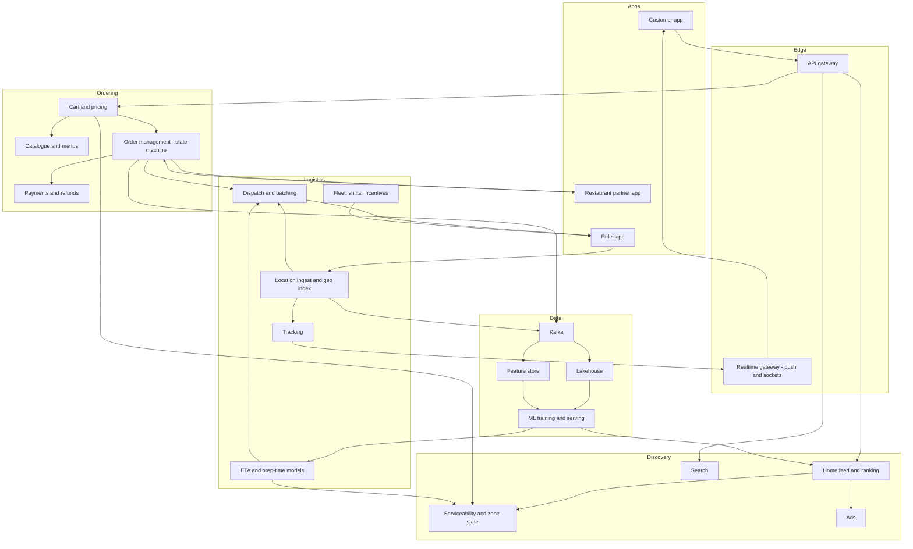
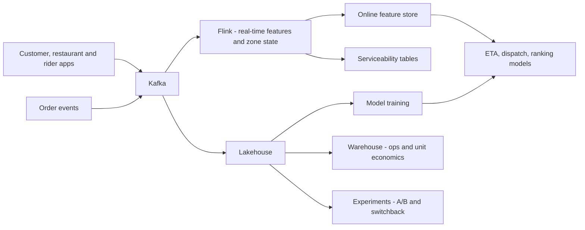

# I18. Food Delivery

!!! abstract "Chapter at a glance"
    **Sector:** food delivery and quick commerce. **Format:** system design walkthrough, no code. **Reader bands:** B1 → B4.

    **Builds on:**

    - [Ch 47](../05-case-studies/47-delivery-dispatch-and-live-tracking.md) (dispatch and tracking)
    - [Ch 41](../05-case-studies/41-chat-customer-rider-messaging.md) (chat)
    - [Ch 43](../05-case-studies/43-home-feed-and-recommendations.md) (feed)
    - [Ch 49](../05-case-studies/49-pricing-promotions-and-coupons.md) (pricing)
    - [I05](i05-ride-hailing.md) (marketplace matching)
    - [I12](i12-logistics-and-supply-chain.md) (last mile)

    **What you get:** a reference platform in the style of Swiggy, Zomato or DoorDash. Three sides meet on it: **customers, restaurants and delivery partners**. The chapter covers:

    - restaurant onboarding and menus;
    - discovery and the personalised home feed, search and ads;
    - **serviceability and ETA promises** shown before ordering;
    - the cart, pricing, fees and offers;
    - the order lifecycle, from restaurant acceptance to **prep-time prediction**, **dispatch and batching**, live tracking, delivery and ratings;
    - payments, refunds and **settlements**;
    - **peak-hour surge management**, including dinner rush, rain and cricket finals;
    - a quick-commerce variant with 10-minute grocery delivery from dark stores.

    It explains the **algorithms**: ETA decomposition, prep-time models, dispatch assignment and batching, delivery-partner positioning, surge and demand shaping, ranking, fraud and refund abuse, and quick-commerce slotting. It ends with the **data platform** and **tech stack**.

    **Reading time:** 85 min.

!!! warning "Sources and honesty"
    - Swiggy, Zomato, DoorDash and Uber Eats have published engineering blogs on ETA prediction, dispatch, prep-time models and their data platforms. Claims taken from these are marked **"publicly described (VERIFY)"**.
    - The following India regulations are marked **VERIFY**:
        - FSSAI requirements for restaurant listing;
        - GST on restaurant services through e-commerce operators (Section 9(5));
        - the Social Security Code and state laws on gig workers (e.g. Rajasthan, Karnataka);
        - ONDC.
    - Everything else is a **reference design**.

---

## 1. The System in One Page

### 1.1 Why food delivery is hard

Food delivery is a **three-sided real-time marketplace with perishable goods**:

- **Customers** expect delivery in 30 minutes or less, and they expect the ETA they were promised.
- **Restaurants** cook with variable prep times, which depend on kitchen load, the dish and staff.
- **Delivery partners** (riders) are independent and move around the city. Their supply varies by hour, weather and incentives.
- **Food degrades with time**: cold food means a bad rating. Riders shouldn't wait at restaurants, and food shouldn't wait for riders.
- **Demand is extremely peaky**:
    - lunch from 12:30 to 14:00;
    - dinner from 19:30 to 22:30;
    - rain spikes it further;
    - big matches spike it even more.

Every decision trades off **customer speed, rider utilisation and restaurant efficiency**.

### 1.2 Main systems

| System | What it does |
|---|---|
| Restaurant onboarding and catalogue | Restaurant details, FSSAI licence, menus, items, variants, add-ons, availability, timings |
| Restaurant partner app | Accept or reject orders, mark items out of stock, mark ready, manage hours, see payouts |
| Discovery | Home feed, collections, search, filters, ads |
| Serviceability | Can this restaurant deliver to this address now? With what ETA and fee? |
| Cart and pricing | Item prices, packaging, delivery fee, surge fee, platform fee, taxes, offers, membership |
| Order management | Order state machine, notifications, cancellations |
| Prep-time and ETA | Predicts food-ready time and delivery time, and keeps updating them |
| Dispatch | Assigns riders to orders and batches orders |
| Rider app and fleet | Shifts, login, location, navigation, earnings, incentives |
| Tracking | Live map, ETA updates, rider–customer calls through masked numbers |
| Payments and settlements | Customer payments, refunds, restaurant settlements, rider payouts |
| Support | Missing items, spills, late orders, refunds, chat |
| Ratings and reviews | Restaurant, rider and dish ratings |
| Ads and growth | Sponsored listings, offers funded by restaurants or the platform |
| Data platform | Analytics, ML features, experimentation |

### 1.3 Scale for this design (assumptions)

| Quantity | Value |
|---|---|
| Cities | 500+ |
| Restaurants | 250k active |
| Active delivery partners at peak | 300k online at dinner peak |
| Orders | 3M/day; peak ~600 orders/s at 20:30 (rain days 1.5–2×) |
| Home feed loads | 50M/day; ~3k/s at peak |
| Rider location pings | 300k riders × 1 ping / 4 s = 75k pings/s |
| Order state events | ~20 per order → 60M/day |
| Dispatch decisions | Every few seconds per zone, each over hundreds of orders and riders |

**Estimation highlights**

- **Feed cost.** Each feed call must know, for the customer's location:
    - which restaurants are serviceable right now (open, within radius, rider availability);
    - their ETAs and fees;
    - personalised ranking.

    That is **several hundred restaurants evaluated in < 300 ms**. Serviceability and ETA must come from precomputed, zone-level signals refreshed every minute or so, not computed fresh per request.
- **Dispatch.**
    - 600 orders/s nationwide spread across ~1,500 zones is ~0.4 orders/s per zone on average.
    - Hot zones (Koramangala at 20:30) see 5–10 orders/s with hundreds of riders nearby.
    - Batch assignment every 10–30 seconds per zone keeps the optimisation problem small (§6.4).
- **Location ingestion.** 75k pings/s goes through a **geo-indexed in-memory store** for "riders near X". Pings are also streamed to Kafka for tracking and analytics.

---

## 2. Requirements

### 2.1 Functional

1. **Discovery.** Customers browse restaurants that deliver to their address, with ETA, fees, ratings and offers. They can search dishes or restaurants and filter (veg, rating, delivery time, offers).
2. **Menu.** Shows items with variants and add-ons, availability (out of stock, time-based menus) and pricing.
3. **Cart and checkout.**
    - Totals cover item prices, packaging, delivery fee, surge, platform fee, GST and offers.
    - The address is validated and the ETA promise shown.
    - Payment options are UPI, cards, wallets and cash on delivery (COD).
4. **Order flow.**
    1. Order placed.
    2. Restaurant accepts, with a prep-time estimate.
    3. Rider assigned.
    4. Rider reaches the restaurant.
    5. Food ready and picked up.
    6. Out for delivery.
    7. Delivered.

    Customers get live tracking and ETA updates throughout.
5. **Changes.** Customers can cancel before the restaurant accepts, or later under policy with fees. Restaurants can reject orders or mark items unavailable, which triggers substitution or a partial refund.
6. **Rider flows.**
    - Log in to a shift.
    - Receive an assignment and accept it, or have it auto-accepted with a rejection limit.
    - Navigate to the restaurant.
    - Pick up with an OTP or order ID check.
    - Deliver, with an OTP for high-value orders.
    - Collect COD cash and track earnings.
7. **Support.** Self-serve resolution for missing or wrong items and late delivery, with images, refunds or credits, and escalation.
8. **Ratings** for restaurants and riders, plus dish-level ratings.
9. **Settlements.**
    - Restaurant payouts with commission and taxes deducted, on a weekly or more frequent cycle.
    - Rider payouts made up of per-order pay, incentives and tips.

### 2.2 Non-functional

| Attribute | Target |
|---|---|
| ETA accuracy | e.g. 85–90% of orders delivered within the promised window, with mean absolute error of a few minutes |
| Feed latency | P95 < 300 ms |
| Order placement | P95 < 1 s; exactly-once payment and order creation |
| Dispatch latency | Rider assigned within ~1–2 minutes of acceptance (or timed to food readiness, §6.4) |
| Tracking freshness | Rider location on the customer's map updated every few seconds |
| Availability | Order placement and the restaurant and rider apps at 99.95%; graceful degradation at peak |
| Peak handling | 2× normal peak on rain days without collapsing ETAs |
| Fairness | Rider earnings transparency; restaurant ranking rules disclosed |

---

## 3. High-Level Architecture

### Key decisions

| Decision | Choice | Why |
|---|---|---|
| Geography | City → zones (hexagons, e.g. H3, or polygons) for supply, demand and serviceability | Bounded optimisation and local signals |
| Serviceability | Precomputed per (restaurant, customer hexagon) and refreshed every minute with zone stress | Fast feed and honest ETAs |
| ETA | Decomposed: dispatch wait, rider to restaurant, prep remaining, pickup wait, travel to customer, last mile; ML per component | Explainable, updatable |
| Dispatch | Batch optimisation every few seconds per zone, timed to food readiness | Riders don't wait, food doesn't wait |
| Order state | Event-sourced state machine with Kafka events | Many consumers, audit |
| Peak control | Zone-level levers: radius shrink, surge fees, longer ETAs, hiding far restaurants, rider incentives | Keeps promises at peak |
| Location | In-memory geo index for live riders plus Kafka for history | Fast nearest-rider queries |

---

## 4. How It Works — Journeys End to End

### 4.1 Journey 1: opening the app at 8:15 pm

1. **Location.** The app sends the customer's location (GPS or saved address). The server maps it to a **hexagon** (H3 resolution ~8–9) and to a delivery **zone**.
2. **Serviceability** (§5.2). The serviceability service returns the restaurants that can deliver to this hexagon now. For each one it applies:
    - **open** (timings, holiday, and whether it is currently accepting orders);
    - **distance or travel time** within the restaurant's radius, which shrinks when the zone is stressed;
    - **ETA estimate**: precomputed restaurant-to-hexagon travel time plus current prep-time and dispatch-delay signals;
    - **delivery fee**: base by distance, surge by zone stress, waived for members or by offers.

    This is a lookup into precomputed tables refreshed every ~1 minute by stream jobs.
3. **Feed assembly** (§6.6). The feed service:
    - takes the serviceable set (~400 restaurants);
    - scores each one for this user with a ranking model (cuisine affinity, past orders, price band, rating, ETA, offers, freshness);
    - mixes in **ads**: sponsored slots labelled and auctioned ([Ch 43](../05-case-studies/43-home-feed-and-recommendations.md));
    - builds widgets such as "Order again", "Top picks for you", "Under 30 mins" and offer carousels.
4. **Response.** The feed is returned in ~200 ms. Images come from the CDN. Impressions are logged.
5. **Rain mode.** If it's raining in this zone, the feed may:
    - show fewer far restaurants;
    - show higher fees and ETAs;
    - show a banner: "High demand due to rain, delivery may take longer".

### 4.2 Journey 2: placing an order

1. **Menu.** Sameer opens a biryani restaurant and adds Chicken Biryani (full) with extra raita. The menu service shows availability, which the restaurant can toggle out of stock in real time.
2. **Cart.** The cart service prices the order (§5.4):
    - items and add-ons;
    - packaging charges;
    - delivery fee (distance and surge);
    - platform fee;
    - GST: restaurant services through e-commerce operators at 5%, with the platform collecting and paying under Section 9(5) (VERIFY);
    - offers (restaurant-funded "50% off up to ₹100", platform coupons, membership);
    - final total and **ETA promise**.
3. **Checkout.**
    - Address confirmation; a pin drop helps the rider.
    - Payment by UPI: the payment intent is created with an idempotency key. On success the **order is created** in the PLACED state.
    - With COD, the order is created directly, with risk checks such as COD limits for new users or risky addresses.
4. **Order event.** `OrderPlaced` is published to Kafka. Consumers react:
    - restaurant notification;
    - ETA service (initial prediction);
    - dispatch (pre-planning);
    - analytics.
5. **Customer screen.** "Waiting for restaurant to accept" with the ETA.

### 4.3 Journey 3: restaurant acceptance and prep

1. **Notification.** The restaurant's partner app (a tablet at the counter) rings loudly with the order details.
2. **Acceptance.**
    - The staff accept within ~1–3 minutes and the app suggests a **prep time**, e.g. 18 minutes, which they can adjust.
    - Auto-accept is available for reliable restaurants.
    - **Timeout or rejection** triggers an attempt to call the restaurant. If that fails, the order is cancelled with a full refund, and the restaurant is penalised in ranking or reliability scores.
3. **Prep-time prediction** (§6.2).
    - The platform's model predicts the actual **food-ready time** from:
        - the restaurant's history;
        - the items;
        - current kitchen load (open orders at that restaurant);
        - time of day;
        - the staff's entered estimate.
    - Restaurants often under- or over-estimate, so the model corrects for it.
4. **Mark ready.** The restaurant taps "Food ready" when packed. This signal is noisy (some mark ready early to look good), so models also use rider wait times to calibrate.
5. **Item out of stock.** The restaurant marks an item unavailable. The customer gets a prompt to choose a substitute or accept a partial refund, with a timeout default.

### 4.4 Journey 4: dispatch and pickup

1. **Timing.** Dispatch wants the rider to **arrive at the restaurant just as the food is ready**:
    - if the rider is early, they wait, which wastes rider time and capacity;
    - if they are late, the food waits and gets cold, and the ETA is missed.

    Dispatch therefore plans an assignment around **(predicted ready time − rider travel time)**.
2. **Batch optimisation** (§6.4). Every ~10–20 s in each zone, the dispatcher:
    - collects unassigned orders and available riders: idle riders, and riders finishing a delivery nearby ("chained");
    - computes costs (travel time to restaurant, wait at restaurant, delay to the customer vs promise, rider fairness);
    - solves an **assignment problem** (Hungarian / min-cost matching, or heuristics);
    - considers **batching**: two orders from the same or nearby restaurants going in the same direction can share a rider if neither customer's ETA suffers too much.
3. **Offer to the rider.**
    - The rider app shows the order (restaurant, distance, estimated earnings) and the rider accepts.
    - **Rejections or timeouts** send the order back to the pool, with a higher priority.
4. **Pickup.**
    - The rider navigates to the restaurant and is geofenced on arrival ("arrived at restaurant").
    - Food is handed over, the rider confirms the order ID and items, and the status becomes PICKED_UP.
    - **Rider wait time** at the restaurant is recorded. It is a key signal for prep-time models.
5. **Delivery.**
    - The rider navigates to the customer, and the live location streams to the customer's map (§5.6).
    - The ETA is recomputed continuously from remaining route time plus a **last-mile** estimate (building access, finding the flat, apartment security).
    - Contact uses masked phone calls or chat.
    - **Delivered**: confirmed by geofence plus the rider tap. High-value orders may require a delivery OTP.
6. **After delivery.**
    - Rating prompts go to the customer.
    - Rider earnings are updated.
    - The rider becomes available, often already pre-assigned to a next order nearby.

### 4.5 Journey 5: the rain spike at 8:30 pm

1. **Detection.**
    - Order rates in Bengaluru zones jump 60% in 10 minutes.
    - Rider supply drops, because some riders log off in heavy rain.
    - Travel times increase. Zone stress, measured as open orders per available rider, crosses thresholds.
2. **Automatic levers**, per zone, in a **graduated** order (§6.5):
    1. **ETA inflation:** show honest, longer ETAs so promises aren't broken.
    2. **Rain or surge fee:** this funds rider incentives and tempers demand.
    3. **Rider incentives:** "Rain bonus ₹30/order for the next 2 hours" pushed to offline riders nearby.
    4. **Serviceability radius shrink:** restaurants far from customers are hidden.
    5. **Batching more aggressively:** two orders per rider where routes align.
    6. **Throttle:** pause orders from restaurants with long prep backlogs. In extreme cases, show "Not accepting orders in your area right now".
3. **Monitoring.** Ops dashboards show zone stress, ETA breaches and rider supply. City ops can override the levers manually.
4. **Recovery.** As the rain stops, the levers relax gradually (hysteresis) to avoid oscillation.

### 4.6 Journey 6: a missing item complaint

1. **Complaint.** Sameer reports "raita missing" in the app's help section, with a photo option.
2. **Self-serve resolution.** A rule and risk engine decides:
    - **instant refund** for low-value items when the customer is trustworthy (low complaint history);
    - **escalation to an agent** when the risk is high (frequent complaints, high-value claims).
3. **Refund.** Issued to the source (UPI or card) or as platform credits, depending on the customer's choice and policy.
4. **Attribution.** The cost is attributed to the restaurant (packing error) or the rider (tampering), based on evidence and patterns. It affects the restaurant's settlement through deductions, per contract, or its quality score.
5. **Abuse detection** (§6.8): repeat complainers, linked accounts and photo reuse are flagged.

### 4.7 Journey 7: quick commerce (10-minute groceries)

1. **Dark stores.** Small warehouses within ~2–3 km of customers hold ~5–8k SKUs. Each store serves a tight polygon.
2. **Order.** The customer orders milk, bread and chips. Serviceability shows a "10 mins" ETA, available only if the store has stock and pickers and riders are available.
3. **Picking.**
    - The order drops to the **store's picking system**.
    - The pick route is optimised by slotting, since fast movers sit near the packing station (§6.9).
    - Picking takes ~2 minutes and packing ~1 minute.
4. **Dispatch.** Riders wait at the store, so assignment is instant. Delivery takes ~5–7 minutes over short distances.
5. **Inventory.**
    - Real-time stock per store.
    - **Demand forecasting** per SKU per store per hour drives replenishment from the mother warehouse ([I12](i12-logistics-and-supply-chain.md)).
    - Stock-outs hide items from the app immediately.

---

## 5. Core Subsystems in Depth

### 5.1 Geo model: zones and hexagons

- **Hexagons:** the H3 grid (open-sourced by Uber) at a resolution where each cell is about 0.1–0.7 km². It is used for:
    - demand and supply counts;
    - serviceability tables;
    - ETA features (travel time between hexes);
    - surge.
- **Zones:** operational areas (polygons) made of hexes, each with its own rider fleet, ops team and lever settings.
- **Travel time matrix:** hex-to-hex travel times by time of day, learned from rider GPS traces, plus live traffic adjustments.

### 5.2 Serviceability and zone state

- **Inputs, refreshed every 30–60 s by stream jobs:**
    - restaurant status (open, accepting, current prep backlog);
    - zone stress (orders per available rider, rider wait times, ETA breach rate);
    - rain flags and weather;
    - lever settings (radius, fees).
- **Precomputed table:** per (restaurant, customer hexagon) it holds:
    - serviceable or not;
    - ETA band;
    - delivery fee;
    - distance.

    Restaurants × nearby hexes is a manageable size, e.g. 250k × ~300 hexes ≈ 75M entries, held in Redis or an in-memory KV keyed by hex.
- **Consistency:** the cart **re-checks** serviceability and fees at checkout, so the customer always sees a fresh promise before paying.

### 5.3 Catalogue and menus

- **Structure:**
    - restaurant → menu categories → items;
    - items carry variants (half/full), add-on groups (min/max choices), dietary tags, images, prices and tax category;
    - availability windows (breakfast menu) and out-of-stock flags.
- **Updates:** restaurants edit through the partner app or POS integrations (some POS systems push menus and stock). Changes are versioned. The cart validates against the current version.
- **Search index:** dishes and restaurants are indexed with synonyms ("biriyani" = "biryani"), transliteration (Hindi or Kannada typed in English) and spell correction ([Ch 42](../05-case-studies/42-search-autocomplete.md)).

### 5.4 Cart and pricing

- **Components:**
    - item subtotal;
    - packaging;
    - delivery fee (distance-based, plus surge, minus member waiver);
    - small-cart fee;
    - platform fee;
    - GST (per tax rules);
    - discounts with funding attribution (restaurant-funded vs platform-funded);
    - tip (optional, passed fully to the rider).
- **Offer engine** ([Ch 49](../05-case-studies/49-pricing-promotions-and-coupons.md)): eligibility rules, stacking rules, budget caps and per-user limits.
- **Price snapshot:** the final breakdown is stored with the order for invoices, settlements and refunds.

### 5.5 Order management

- **State machine:**
    - PLACED → ACCEPTED → (RIDER_ASSIGNED) → FOOD_READY → PICKED_UP → DELIVERED;
    - with branches: REJECTED, CANCELLED_BY_CUSTOMER / RESTAURANT / PLATFORM, UNDELIVERED (customer not reachable), and so on.
- **Event-sourced:** each transition is an event. Consumers include notifications, tracking, ETA, settlements, support and analytics.
- **Timers:** acceptance timeout, food-ready overdue, rider-not-assigned alerts, delivery overdue. These are scheduled timers ([Ch 50](../05-case-studies/50-distributed-job-scheduler.md)) that trigger escalations.
- **Idempotency:** client retries, payment callbacks and rider app retries over flaky networks all carry idempotency keys and state-transition guards.

### 5.6 Location and tracking

- **Ingest:**
    - rider apps send GPS every ~4 s while on a trip, less often when idle;
    - batches are uploaded when the network is poor;
    - the server applies **map matching** (snap to road), filters outliers and detects spoofing ([I05](i05-ride-hailing.md)).
- **Live geo index:** an in-memory index (H3 cells or a geohash) of available riders, queried by dispatch for "riders within X minutes of the restaurant".
- **Customer tracking:**
    - the rider's position is pushed through the realtime gateway every few seconds;
    - the client animates smoothly between points;
    - for privacy, it is shown only during the active order.

### 5.7 Fleet, shifts and incentives

- **Riders:**
    - log in to slots or shifts (some platforms use slot booking for guaranteed earnings windows);
    - get zone assignments;
    - get incentive programmes (orders completed in the peak window, rain bonuses, weekly targets).
- **Earnings:** base pay per order plus distance pay, wait-time pay, incentives and tips. Earnings are transparent in the app.
- **Supply planning:**
    - forecast demand per zone per 30 minutes;
    - compute the required riders from expected orders × time per order ÷ batching factor;
    - recruit and incentivise to fill gaps.

### 5.8 Settlements

- **Restaurants:** order value minus commission, payment gateway fees, restaurant-funded discounts and penalties, minus TDS/TCS (VERIFY). Paid on a weekly cycle or faster (some platforms offer daily payouts).
- **Riders:** daily or weekly payouts. COD cash collected by riders is reconciled against their earnings: deposit or deduction.
- **Ledger:** double-entry, per order and per party, with reconciliation against payment gateway reports ([I03](i03-core-banking-and-upi.md)).

---

## 6. Algorithms

### 6.1 ETA decomposition

- **Total ETA** = t_accept + t_dispatch + max(t_rider_to_restaurant, t_prep_remaining) + t_pickup + t_travel_to_customer + t_last_mile.
- Each term has its own model with its own features. For example:
    - **t_travel**: the hex-to-hex travel time matrix, plus route distance, time of day, weather and live zone speed;
    - **t_last_mile**: learned per building or society from history (gated communities, high-rises);
    - **t_prep**: §6.2.
- **Prediction targets:** a **distribution**, via quantile regression. The **promise** shown to the customer is a conservative quantile (e.g. P80), while dispatch planning uses the median.
- **Continuous updates:** after each event (accept, rider assigned, picked up), recompute with the actual times known so far. Tell the customer if the ETA moves materially.
- **Public descriptions:** DoorDash and Swiggy have published about ETA models using gradient boosting and deep learning, with multi-stage predictions (VERIFY).

### 6.2 Prep-time prediction

- **Features:**
    - restaurant;
    - number and type of items (biryani is quick to serve; pizza needs baking time);
    - open orders at the restaurant (kitchen load);
    - time of day and day of week;
    - the staff-entered prep estimate;
    - the restaurant's historical bias between entered and actual times.
- **Labels:**
    - true food-ready time is not directly observed, because the "mark ready" tap is noisy;
    - use **rider arrival and pickup times**: if the rider waited, food was ready later than arrival; if the food waited, it was ready earlier, estimated from the "ready" tap or pickup time;
    - this is a censored-data problem, handled with survival-style or censored-regression techniques.
- **Use:** time the rider assignment so arrival ≈ ready time (§6.4). Dynamic updates come from the restaurant's real-time load.

### 6.3 Dispatch cost function

For an assignment of rider r to order o, the cost combines:

- **rider travel time** to the restaurant;
- **expected rider wait** = max(0, ready_time − arrival_time). This wastes rider capacity;
- **expected food wait** = max(0, arrival_time − ready_time). This cools the food and delays the customer;
- **customer delay vs promise**: the penalty grows steeply after the promised time;
- **rider fairness**: spread orders across riders, and avoid giving long trips to riders near the end of their shift;
- **chaining benefit**: a rider finishing a nearby delivery is "available soon" at a known location.

### 6.4 Assignment and batching

- **Batch matching:**
    - every Δt (10–30 s) per zone, build a bipartite graph of orders × riders, including soon-available riders;
    - edge costs come from §6.3;
    - solve **min-cost bipartite matching** with the Hungarian algorithm (O(n³), fine for a few hundred) or auction algorithms and greedy heuristics at bigger sizes.
- **Delayed assignment:**
    - don't assign immediately if food will take 20 minutes. Wait until the "latest good assign time" (ready time − travel time − buffer);
    - this keeps riders free for urgent orders. It is a rolling-horizon decision.
- **Batching (two or more orders per rider):**
    - candidate pairs share the same or a nearby restaurant, have ready times within a few minutes, and have customers in a similar direction;
    - evaluate the **insertion cost**: the extra delay for each order compared with solo delivery, which must stay under thresholds and promises;
    - this is a vehicle-routing problem with pickup and delivery and time windows (VRPPDTW) for small sets, solved heuristically.
- **Rejections:** riders can decline. Model the acceptance probability (distance, pay, rider history) in the cost, so likely-rejected offers aren't made.
- **Public descriptions:** Swiggy and DoorDash have blogged about batch dispatch optimisation and assignment timing (VERIFY).

### 6.5 Surge and demand shaping

- **Zone stress metric:** for example, (open unassigned orders + expected orders next 15 minutes) ÷ (available riders + riders becoming free in 15 minutes), alongside ETA breach rates.
- **Levers**, by escalating thresholds:
    1. ETA inflation.
    2. Surge fee (a capped step function).
    3. Rider incentives (push to nearby offline riders).
    4. Radius shrink.
    5. Restaurant throttling.
    6. Order pausing.
- **Control loop:** a PID-like or rule-based controller with **hysteresis**, so levers don't flap. Experiment carefully, since surge affects both customer trust and rider earnings.
- **Rider repositioning:** suggest that idle riders move to hexes with predicted demand, using heatmaps in the rider app.

### 6.6 Discovery ranking

- **Candidates:** serviceable restaurants, plus dish-level candidates for search.
- **Model:** a multi-objective learning-to-rank model. It predicts P(click), P(order | click) and expected satisfaction (a good rating, no complaint). It is combined with ETA and price fit, plus diversity and freshness.
- **Features:**
    - user cuisine affinity and embeddings;
    - restaurant quality (rating, complaint rate, acceptance rate);
    - ETA;
    - offers;
    - time-of-day fit (breakfast places in the morning);
    - repeat behaviour ("Order again").
- **Ads blending:** sponsored candidates from an auction (bid × predicted CTR × quality), placed in fixed or labelled slots with relevance thresholds.
- **New restaurants:** cold-start exploration slots.

### 6.7 Demand forecasting and supply planning

- **Forecast** orders per zone per 15–30 minutes for the next day and the next hour, using:
    - history and seasonality;
    - weather forecasts;
    - holidays and festivals;
    - events (cricket matches);
    - marketing campaigns.
- **Use:** rider shift planning, incentive budgets, restaurant prep readiness alerts, and quick-commerce replenishment.

### 6.8 Fraud and abuse

- **Customer refund abuse:** frequent "missing item" claims, linked accounts (device, phone, address, payment instrument graph), photo reuse (perceptual hash). The response is a risk score that gates instant refunds.
- **COD fraud:** fake orders and repeated refusals at the door. The response is COD limits per risk tier.
- **Rider fraud:** GPS spoofing (mock locations, impossible jumps), marking delivered without delivering, collusion with customers on claims. Detect with sensor consistency and pattern models.
- **Restaurant fraud:** fake orders to farm ratings or offers. Use graph analysis of customers, devices and restaurants.
- **Promo abuse:** multiple accounts for new-user offers. Use device fingerprinting and account linking.

### 6.9 Quick-commerce algorithms

- **Store slotting:** place fast-moving SKUs near the packing station, grouped by co-purchase affinity, to minimise pick path length.
- **Pick routing:** a short path through the store (a TSP heuristic on the aisle graph) and batch picking of multiple orders.
- **Replenishment:** a forecast per SKU per store per hour, a safety stock for the service level, and constraints from mother warehouse truck schedules.
- **Serviceability promise:** 10 minutes only if stock is available and the picker and rider queues are short. Otherwise show a longer promise or hide the store.

---

## 7. Data Architecture

### 7.1 Operational stores

| Data | Store (reference) | Notes |
|---|---|---|
| Users, addresses | PostgreSQL/MySQL sharded | Geocoded addresses |
| Restaurants, menus | PostgreSQL + search index + cache | Versioned menus |
| Serviceability tables | Redis/in-memory KV by hex | Refreshed every minute |
| Orders | Sharded RDBMS (by order ID) + event log in Kafka | State machine |
| Live rider locations | In-memory geo index (Redis geo or custom) | Ephemeral |
| Location history | Kafka → Cassandra/lakehouse | Analytics, disputes |
| Payments and ledger | PostgreSQL, append-only | Reconciliation |
| Ratings and reviews | PostgreSQL + aggregates | Quality scores |
| Quick-commerce inventory | Per-store DB with real-time stock | Reservations at checkout |

### 7.2 Analytics and ML platform

- **Events:** feed impressions, clicks, carts, orders, state transitions, rider pings, ETAs predicted vs actual, support tickets.
- **Feature store** (online and offline):
    - real-time features (restaurant open orders, zone stress, rider wait times in the last 15 minutes) computed by **Flink**;
    - batch features (restaurant historical prep times, user affinities) computed by Spark.
- **ML models:** ETA components, prep time, ranking, ads CTR, surge forecasting, fraud, demand forecasting, rider acceptance probability.
- **Warehouse marts:**
    - orders and GMV by city and zone;
    - delivery performance (ETA accuracy, delays by component);
    - rider utilisation and earnings;
    - restaurant performance;
    - unit economics (contribution margin per order).
- **Experimentation:**
    - A/B tests on ranking and fees;
    - **switchback experiments** for dispatch and surge, where whole zones alternate treatments over time windows. This is needed because marketplace interventions interfere across users (publicly described by DoorDash; VERIFY).

### 7.3 Data flow

---

## 8. Tech Stack (reference choice)

| Layer | Choice | Notes |
|---|---|---|
| Services | Java/Kotlin (Spring Boot), Go for high-throughput location and dispatch | |
| Realtime | WebSockets/MQTT gateways, push notifications | Tracking, restaurant alerts |
| Geo | H3, OSRM/Valhalla or commercial routing, map matching | Travel times |
| Datastores | PostgreSQL/MySQL, Redis, Cassandra/ScyllaDB, DynamoDB-like stores | |
| Search | Elasticsearch/OpenSearch | Dishes, restaurants |
| Streaming | Kafka, Flink | Features, zone state |
| ML | Python, XGBoost/LightGBM, PyTorch/TensorFlow, feature store, model serving | ETA, ranking |
| Optimisation | Custom Hungarian/auction solvers, OR-Tools for routing experiments | Dispatch |
| Lakehouse | Spark, Iceberg/Delta/Hudi, Trino/Presto, Snowflake/BigQuery | Analytics |
| Publicly described (VERIFY) | Swiggy: Java/Go microservices, Kafka, ML platform for ETA and assignment. Zomato: AWS, Go/Java/PHP history, real-time features with Flink. DoorDash: Kotlin microservices, Kafka, Flink, switchback testing | From engineering blogs |

---

## 9. Security, Privacy & Compliance

- **Food safety:** an FSSAI licence is required for listing restaurants, and displayed (VERIFY).
- **Tax:** GST on restaurant services through e-commerce operators is collected and paid by the platform (Section 9(5), VERIFY). TCS/TDS on settlements. Invoices per order.
- **Gig workers:**
    - the Code on Social Security includes gig and platform workers (VERIFY notification status);
    - state laws (e.g. Rajasthan's 2023 act, Karnataka's ordinance or act; VERIFY) may require registration, welfare fees and transparency on algorithms and payouts.

    Designs should support **earnings transparency, grievance redressal and data on working hours**.
- **Consumer protection:** transparent fees (no drip pricing), clear cancellation and refund policies, grievance officers, and dark patterns guidelines (VERIFY).
- **Privacy:**
    - masked phone numbers;
    - rider locations shown only during active orders;
    - customer addresses visible to riders only during delivery;
    - DPDP Act compliance.
- **Payments:** PCI-DSS, tokenisation and RBI rules (VERIFY).
- **Rider safety:** SOS button, insurance, and **no penalties that encourage unsafe speeding**. Avoid ETAs that pressure riders unrealistically, a point raised publicly about 10-minute delivery (VERIFY).

---

## 10. Reliability & Operations

- **Peak readiness:**
    - pre-scale for dinner and events;
    - load-test order placement;
    - protect the critical path (place order, restaurant notification, dispatch, tracking);
    - shed non-critical features (recommendation widgets) first.
- **Degraded modes:**
    - if the ETA model fails, fall back to heuristic ETAs from zone averages;
    - if dispatch optimisation is slow, fall back to a greedy nearest-rider assignment;
    - if the restaurant app is offline, fall back to automated calls (IVR).
- **City ops centre:** dashboards per zone (stress, breach rates, rider supply), manual levers and incident playbooks for rain, festivals and outages.
- **Observability:**
    - order funnel conversion;
    - acceptance times;
    - rider assignment delay;
    - rider wait at restaurants;
    - ETA error by component;
    - complaint rates;
    - refund costs;
    - payment success.
- **Restaurant reliability:** acceptance rate, cancellation rate, prep accuracy and complaint rate are fed back into ranking and onboarding.

---

## 11. Key Trade-offs

| Decision | Chosen | Accepted cost |
|---|---|---|
| ETA promise | Conservative quantile | Some lost orders from longer ETAs |
| Dispatch timing | Delayed assignment until near food-ready | Risk if prep predictions are wrong |
| Batching | When delay is within thresholds | Some customers wait a bit longer |
| Peak levers | Graduated surge, radius shrink, throttle | Lost demand, customer annoyance |
| Refunds | Instant for low-risk customers | Some abuse losses |
| Serviceability | Precomputed every minute | Slight staleness; re-check at checkout |
| Experimentation | Switchback for marketplace levers | Slower, noisier results |
| Quick commerce | Dark stores near customers | High fixed costs, limited assortment |

---

## 12. Interview Q&A

### Beginner B1

??? question "Q1 [B1] ⭐ What are the steps of a food delivery order?"

    **30-second answer:** Order placed and paid, restaurant accepts with a prep time, a rider is assigned timed to food readiness, rider picks up, delivers with live tracking, and the order is rated and settled — each step is a state transition event consumed by notifications, tracking, ETA and settlements.

    **Deep answer:** §4.2–4.4, §5.5.

    **Trade-offs I'd call out:** Many failure branches.

    **Follow-ups:**
    1. Restaurant doesn't accept? → Timeout, refund.
    2. Customer unreachable? → Undelivered flow.

    **Red flags:** Synchronous calls across every party in one request.

??? question "Q2 [B1] How do you show which restaurants can deliver to me right now?"

    **30-second answer:** Map the customer location to a hexagon and look up a precomputed serviceability table per (restaurant, hex) refreshed every minute from restaurant status, distance, zone stress and fees; re-check at checkout.

    **Deep answer:** §4.1, §5.2.

    **Trade-offs I'd call out:** Freshness vs speed.

    **Follow-ups:**
    1. Rain? → Radius shrink.
    2. Size? → Tens of millions of entries.

    **Red flags:** Computing routes for 400 restaurants per feed load.

??? question "Q3 [B1] How is live rider tracking built?"

    **30-second answer:** The rider app sends GPS every few seconds; the server snaps to roads and filters noise, updates an in-memory geo index and streams positions to the customer through a realtime gateway; the client animates between points; ETA is recomputed as the rider moves.

    **Deep answer:** §5.6.

    **Trade-offs I'd call out:** Battery and data vs freshness.

    **Follow-ups:**
    1. Poor network? → Batched uploads.
    2. Spoofing? → Detection.

    **Red flags:** The customer app polling the database.

??? question "Q4 [B1] Why does the delivery fee change in the rain?"

    **30-second answer:** Demand rises and rider supply falls; a surge fee funds rider incentives and tempers demand so ETAs stay honest — part of graduated zone-level levers.

    **Deep answer:** §4.5, §6.5.

    **Trade-offs I'd call out:** Customer trust.

    **Follow-ups:**
    1. Caps? → Yes.
    2. Riders benefit? → Incentives.

    **Red flags:** Unbounded surge.

### Intermediate B2

??? question "Q5 [B2] ⭐ How would you predict delivery ETA?"

    **30-second answer:** Decompose it into acceptance, dispatch, max(rider-to-restaurant, prep remaining), pickup, travel to customer and last mile; model each with ML (quantile regression) using features like restaurant load, travel time matrices, weather and building history; promise a conservative quantile and update after each event.

    **Deep answer:** §6.1.

    **Trade-offs I'd call out:** Promise vs conversion.

    **Follow-ups:**
    1. Why decompose? → Explainable, updatable.
    2. Last mile? → Building-level learning.

    **Red flags:** Distance ÷ speed.

??? question "Q6 [B2] How do you predict restaurant prep time when 'food ready' taps are unreliable?"

    **30-second answer:** Use restaurant, items, kitchen load, time of day and staff estimate as features, and derive labels from rider arrival and pickup times treating them as censored observations (rider waited vs food waited); correct each restaurant's bias.

    **Deep answer:** §6.2.

    **Trade-offs I'd call out:** Label noise.

    **Follow-ups:**
    1. New restaurant? → Category priors.
    2. Real-time load? → Open orders.

    **Red flags:** Trusting the tap.

??? question "Q7 [B2] How do you price a cart?"

    **30-second answer:** Item and add-on prices, packaging, distance and surge delivery fee, platform fee, GST per rules, offers with eligibility and stacking rules and funding attribution, optional tip; store a price snapshot with the order for invoices and settlements.

    **Deep answer:** §5.4.

    **Trade-offs I'd call out:** Transparency.

    **Follow-ups:**
    1. Who funds discounts? → Attribution.
    2. Re-check? → At checkout.

    **Red flags:** Recomputing prices at refund time.

??? question "Q8 [B2] What happens when a restaurant marks an item out of stock after ordering?"

    **30-second answer:** Notify the customer with substitution options or a partial refund with a timeout default, update the order and price snapshot, adjust the settlement, and track restaurant reliability.

    **Deep answer:** §4.3 step 5.

    **Trade-offs I'd call out:** Customer friction.

    **Follow-ups:**
    1. Whole order fails? → Cancel and refund.
    2. Prevent? → Real-time stock toggles.

    **Red flags:** Silent removal.

??? question "Q9 [B2] How do you handle missing-item complaints without being exploited?"

    **30-second answer:** Self-serve refunds gated by a risk score built from complaint history, account linking graphs, order value and photo checks; instant for low-risk, agent review for high-risk; attribute costs to restaurant or rider by evidence.

    **Deep answer:** §4.6, §6.8.

    **Trade-offs I'd call out:** Good customers' experience vs loss.

    **Follow-ups:**
    1. Linked accounts? → Graph.
    2. Photo reuse? → Hashing.

    **Red flags:** Unconditional refunds.

### Senior B3

??? question "Q10 [B3] ⭐ Design dispatch for food delivery."

    **30-second answer:** Per zone every 10–30 s, collect unassigned orders and available or soon-available riders, compute costs from travel, rider wait, food wait, promise delay, fairness and acceptance probability, delay assignment until near food-ready, solve min-cost matching, evaluate batching via insertion cost, offer to riders and re-pool on rejection; fall back to greedy under load.

    **Deep answer:** §4.4, §6.3, §6.4.

    **Trade-offs I'd call out:** Optimality vs latency.

    **Follow-ups:**
    1. Why not immediate? → Rider idle wait.
    2. Batching rules? → Delay thresholds.

    **Red flags:** Always nearest rider immediately.

??? question "Q11 [B3] How do you manage a demand spike when it rains?"

    **30-second answer:** Measure zone stress and apply graduated levers — honest ETAs, surge fees, rider incentives, radius shrink, more batching, restaurant throttling, pausing — with hysteresis and ops overrides; recover gradually.

    **Deep answer:** §4.5, §6.5.

    **Trade-offs I'd call out:** Lost orders vs broken promises.

    **Follow-ups:**
    1. Flapping? → Hysteresis.
    2. Rider safety? → No speed pressure.

    **Red flags:** Accepting every order and missing every ETA.

??? question "Q12 [B3] How do you test changes to dispatch or surge?"

    **30-second answer:** Marketplace interventions interfere across users, so use switchback experiments — alternate treatment and control by zone and time window — plus simulation on historical data before launch, with metrics on ETA accuracy, rider utilisation, cost and conversion.

    **Deep answer:** §7.2.

    **Trade-offs I'd call out:** Noisier results.

    **Follow-ups:**
    1. Why not user A/B? → Shared riders.
    2. Simulation? → Replays.

    **Red flags:** User-level A/B for dispatch.

??? question "Q13 [B3] How would you rank restaurants in the home feed?"

    **30-second answer:** Multi-objective learning-to-rank predicting click, order and satisfaction, combined with ETA, price fit, offers, quality and time-of-day fit, user embeddings and repeat behaviour, plus labelled ads from an auction, diversity and cold-start exploration.

    **Deep answer:** §6.6.

    **Trade-offs I'd call out:** Ads vs relevance.

    **Follow-ups:**
    1. Bad restaurants? → Quality demotion.
    2. New ones? → Exploration.

    **Red flags:** Ranking by commission or ad spend only.

??? question "Q14 [B3] How do you detect rider GPS spoofing?"

    **30-second answer:** Check for mock-location flags, impossible speeds and jumps, mismatch between GPS and network or sensor data, deliveries marked without approaching the customer, and patterns across riders; apply holds and reviews.

    **Deep answer:** §6.8.

    **Trade-offs I'd call out:** False positives in poor GPS areas.

    **Follow-ups:**
    1. Map matching? → Helps.
    2. Penalties? → Review first.

    **Red flags:** Trusting client location blindly.

### Architect B4

??? question "Q15 [B4] ⭐ Design a food delivery platform for 3 million orders a day."

    **30-second answer:** Hex and zone geo model; precomputed serviceability; personalised feed and search; cart and pricing with offers; event-sourced order management; prep and ETA models; batch dispatch with delayed assignment and batching; live tracking; graduated peak levers; ledgers for settlements; Kafka, Flink features and a lakehouse with switchback experiments.

    **Deep answer:** §3–§7.

    **Trade-offs I'd call out:** Speed vs utilisation vs cost.

    **Follow-ups:**
    1. Bottleneck? → Dispatch at peak.
    2. Unit economics? → Batching, fees.

    **Red flags:** No zone model.

??? question "Q16 [B4] How do you improve unit economics without hurting customers?"

    **30-second answer:** Increase rider utilisation through better prep prediction and delayed assignment, batching within delay thresholds, demand shaping, reducing refunds via quality and fraud controls, optimising offer spend with targeting and budgets, and measuring contribution margin per order by zone.

    **Deep answer:** §6, §7.2.

    **Trade-offs I'd call out:** Speed vs cost.

    **Follow-ups:**
    1. Fees? → Transparency.
    2. Rider earnings? → Fairness.

    **Red flags:** Cutting rider pay only.

??? question "Q17 [B4] What real-time data platform would you build?"

    **30-second answer:** Kafka for all app and order events, Flink for real-time features (restaurant load, zone stress, rider waits) into an online feature store and serviceability tables, a lakehouse for training and analytics, model serving for ETA, dispatch and ranking, and an experimentation platform supporting switchbacks.

    **Deep answer:** §7.

    **Trade-offs I'd call out:** Cost of real-time.

    **Follow-ups:**
    1. Training–serving skew? → Same feature definitions.
    2. Late events? → Watermarks.

    **Red flags:** Only daily batch features.

??? question "Q18 [B4] How is quick commerce different from restaurant delivery?"

    **30-second answer:** The platform controls the supply node (dark store) — so prep becomes picking with slotting and pick routing, inventory and replenishment forecasting become core, riders wait at stores for instant assignment, distances are short, and the 10-minute promise depends on stock and queue checks.

    **Deep answer:** §4.7, §6.9.

    **Trade-offs I'd call out:** Fixed costs, limited assortment.

    **Follow-ups:**
    1. Stock accuracy? → Real-time reservations.
    2. Safety? → Realistic ETAs.

    **Red flags:** Reusing restaurant prep models.

??? question "Q19 [B4] How would you design for gig worker regulations and fairness?"

    **30-second answer:** Transparent earnings breakdowns, explainable assignment and incentive rules, grievance workflows, records of working hours and earnings for welfare contributions, safety features and insurance, no penalties that encourage unsafe driving, and auditability of algorithms where laws require (VERIFY).

    **Deep answer:** §9, §5.7.

    **Trade-offs I'd call out:** Flexibility vs obligations.

    **Follow-ups:**
    1. Data retention? → For audits.
    2. Incentives? → Clear rules.

    **Red flags:** Opaque deactivation.

??? question "Q20 [B4] Compare food delivery with ride-hailing."

    **30-second answer:** Both match moving supply with demand in real time using geo indexes, ETAs and surge; food delivery adds a third party (restaurant) with uncertain prep time, perishable goods, batching across orders and timing assignments to readiness, while ride-hailing matches people directly with pickup immediacy and pooling constraints.

    **Deep answer:** [I05](i05-ride-hailing.md) vs this chapter.

    **Trade-offs I'd call out:** Prep uncertainty.

    **Follow-ups:**
    1. Shared tech? → Geo, dispatch.
    2. Unique? → Prep models.

    **Red flags:** Treating restaurants as passengers.

---

## 13. Summary

1. Food delivery is a **three-sided, real-time marketplace with perishable goods**. Every decision balances customer speed, rider utilisation and restaurant efficiency.
2. **Hexagons and zones** organise the city for serviceability, ETAs, surge and dispatch. Serviceability is precomputed and re-checked at checkout.
3. **ETA is decomposed** into parts. **Prep-time models** learn from rider wait signals. Dispatch **delays assignment until near food-ready** and batches orders within delay limits.
4. **Peak handling** uses graduated zone levers with hysteresis. Marketplace changes are tested with **switchback experiments**.
5. **Settlements, refunds and fraud** need ledgers and risk scoring. Quick commerce adds dark-store picking, slotting and replenishment.

### Related chapters

- [Ch 47 — Delivery Dispatch & Live Tracking](../05-case-studies/47-delivery-dispatch-and-live-tracking.md)
- [Ch 48 — Delivery Slot Booking](../05-case-studies/48-delivery-slot-booking-and-capacity.md)
- [Ch 49 — Pricing & Coupons](../05-case-studies/49-pricing-promotions-and-coupons.md)
- [I05 — Ride-Hailing](i05-ride-hailing.md)
- [I12 — Logistics](i12-logistics-and-supply-chain.md)
- This is the last design in the Industry tab. Return to the [Industry Designs index](index.md).
