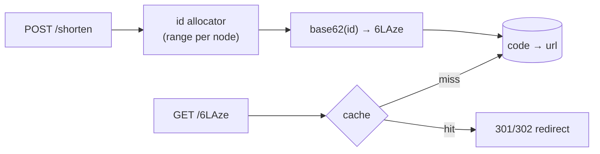

# 1. URL Shortener Core: Base62 & Id Allocation

<span class="level l1">L1</span> ★★☆ · Base62 encode/decode, id allocation, custom aliases, overflow safety

## Problem

> Implement the core of a URL shortener: turn a numeric id into a short **base62** code and back, deduplicate long URLs,
> support **custom aliases** without collisions, and resolve codes for redirects.

## Key idea

Don't hash and hope for no collisions. **Allocate a unique id** (a DB sequence, or per-node ranges from a counter service), then
**base62-encode** it. Seven characters cover 62⁷ ≈ 3.5 trillion URLs. Custom aliases live in the same keyspace and are claimed
atomically (`putIfAbsent` here; `INSERT ... ON CONFLICT` in a DB). Reads dominate (about 100:1), so `resolve` is a key lookup
behind a cache.



## Solution

```java title="UrlShortener.java"
--8<-- "coding-interview/src/UrlShortener.java"
```

## Walkthrough

| Code | Why |
|---|---|
| `sb.append(ALPHABET.charAt((int) (id % 62))); id /= 62; ... reverse()` | Repeated division gives the digits least significant first, so reverse at the end. |
| `Math.multiplyExact(id, 62) + digit` | Decoding user-supplied codes must detect overflow. A 20-character code would wrap around silently with plain `*`. |
| `new Shortener(100_000_000L)` | Starting high avoids 1–2 character codes. Sequential codes are guessable, so if that matters, encode `id XOR secret` or shuffle the bits. |
| `urlToCode.computeIfAbsent(url, ...)` | The same long URL returns the same code (optional, and it needs a reverse index). Some products deliberately create a new code per user for analytics. |
| `codeToUrl.putIfAbsent(alias, url) != null → taken` | An atomic claim of the custom alias. |

## Complexity

| Approach | Time | Space |
|---|---|---|
| encode / decode | O(code length) | O(1) |
| shorten / resolve | O(1) map ops | O(URLs) |

## Run it

```bash
java coding-interview/src/UrlShortener.java      # JDK 21+ single-file launcher, no build needed
```

```text
--8<-- "coding-interview/outputs/UrlShortener.txt"
```

## Common mistakes

* Using a hash of the URL (MD5 truncated to 7 characters) without handling collisions. With billions of URLs, birthday collisions are certain.
* A single global counter as a bottleneck. Hand each node a block of ids (for example 1,000) at a time.
* Not validating the target URL, which turns the service into an open-redirect and phishing tool.
* Always returning 301. Browsers cache it permanently, so you lose click analytics. Use 302 if you need to count clicks.

## Follow-up questions

??? question "How do you scale id generation across regions?"
    Give each region or node its own range (a range allocator in ZooKeeper or a DB), or use Snowflake-style ids (problem 5). Base62 of a 64-bit Snowflake id is about 11 characters, which is longer but needs no coordination.

??? question "How would you expire links and clean up?"
    Store `expires_at`. The redirect path checks it (and the cache TTL is capped at it). A background job or DynamoDB/Cassandra TTL deletes expired rows. Don't reuse codes for a long time after they expire, to avoid confusion.
