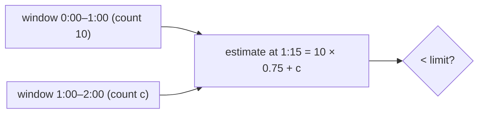

# 2. Sliding-Window Rate Limiter (Log vs Counter)

<span class="level l2">L2</span> ★★☆ · Fixed-window burst problem, sliding log, weighted sliding counter

## Problem

> Limit each user to **N requests per rolling minute**. Show why a fixed window allows **2× bursts** at the boundary, then
> implement an **exact sliding log** and a **memory-cheap sliding counter**, and compare them.

## Key idea

**Sliding log** keeps the timestamp of every accepted request: exact, but O(N) memory per user (in Redis, a sorted set).
**Sliding counter** keeps only the current and previous fixed-window counts and estimates
`previous × overlap + current`: O(1) memory and slightly approximate. That's what Cloudflare runs at its scale. (Token bucket, which
allows controlled bursts, is in the microservice playbook.)



## Solution

```java title="SlidingWindowRateLimiter.java"
--8<-- "coding-interview/src/SlidingWindowRateLimiter.java"
```

## Walkthrough

| Code | Why |
|---|---|
| `while (log.peekFirst() <= nowMs - windowMs) log.pollFirst()` | Evict expired timestamps before counting. The deque stays sorted because time only increases. |
| `long windowStart = nowMs - Math.floorMod(nowMs, windowMs)` | Align to fixed windows. `floorMod` handles negative timestamps correctly. |
| `s[2] = (windowStart - s[0] == windowMs) ? s[1] : 0` | On rollover, the old current count becomes the previous one, unless a whole window was skipped, in which case the previous count is 0. |
| `double estimated = s[2] * overlap + s[1]` | Weight the previous window by how much of it still falls inside the rolling window. |
| `sliding counter allowed 11` | An honest approximation: at the boundary the previous 10 count as 9.98, so one extra request gets through. It assumes the previous window's traffic was uniform. |

## Complexity

| Approach | Time | Space |
|---|---|---|
| sliding log | O(1) amortised | O(limit) per user |
| sliding counter | O(1) | O(1) per user |
| fixed window | O(1) | O(1) but 2× bursts |

## Run it

```bash
java coding-interview/src/SlidingWindowRateLimiter.java      # JDK 21+ single-file launcher, no build needed
```

```text
--8<-- "coding-interview/outputs/SlidingWindowRateLimiter.txt"
```

## Common mistakes

* A fixed window. Clients can send 2N within a second around each boundary.
* Read-then-write in Redis without atomicity. Use a Lua script or `MULTI`, or two app servers will each allow the last slot.
* Using the client's clock. Use the server's or Redis's time (`TIME`).
* One global limiter key for all users, which creates a hot key. Shard by user id.

## Follow-up questions

??? question "How do you rate-limit across 50 gateway instances?"
    Use a central store (Redis) with an atomic script per request, or local limiters each with N/instances (cheap, approximate), or local token buckets refilled from a central budget periodically. Choose by how strictly the limit must hold.

??? question "What should the response look like?"
    `429 Too Many Requests` with `Retry-After` and `RateLimit-Limit` / `RateLimit-Remaining` / `RateLimit-Reset` headers, so well-behaved clients back off precisely.
