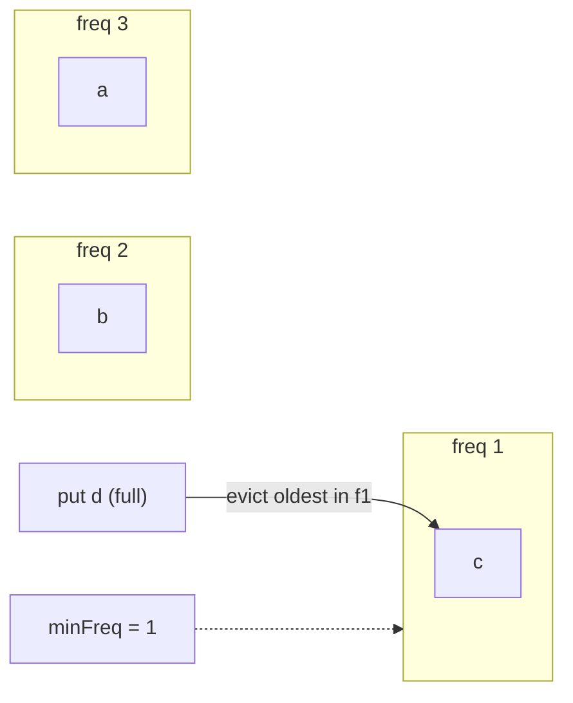
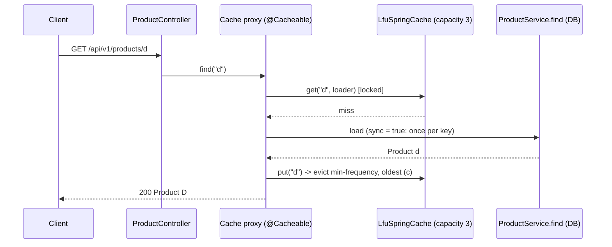

# 3. LFU Cache in O(1)

<span class="level l3">L3</span> ★★★ · Frequency buckets of `LinkedHashSet`, `minFreq` tracking, scan resistance

## Problem

> Implement an LFU cache with **O(1)** `get` and `put`. Evict the **least frequently** used key, and break ties by **least recently** used.
> Show why LFU resists a one-off scan that would flush an LRU cache.

## Key idea

Keep a map of **frequency → keys in LRU order** (`LinkedHashSet`), each key's count, and the current **minimum frequency**.
A hit moves the key from bucket `f` to `f+1`, which is O(1). Eviction takes the oldest key in bucket `minFreq`, also O(1). A new key
always resets `minFreq` to 1.



## Solution

```java title="LfuCache.java"
--8<-- "coding-interview/src/LfuCache.java"
```

## Walkthrough

| Code | Why |
|---|---|
| `Map<Integer, LinkedHashSet<K>> buckets` | A `LinkedHashSet` gives O(1) add, remove and "oldest" (`iterator().next()`), which is the LRU tie-break inside a frequency. |
| `if (bucket.isEmpty()) { buckets.remove(f); if (minFreq == f) minFreq = f + 1; }` | `minFreq` can only rise by one on a touch. No scan is needed. |
| `minFreq = 1 (in put of a new key)` | New keys have frequency 1, which is always the minimum. |
| `for 100 keys: hot.put("scan-" + i, i) → hot key still cached` | The scan keys all have frequency 1 and evict each other, while the hot key (frequency 6) survives. An LRU cache would have lost it. |

## Complexity

| Approach | Time | Space |
|---|---|---|
| get / put / evict | O(1) | O(capacity) |

## Run it

```bash
java coding-interview/src/LfuCache.java      # JDK 21+ single-file launcher, no build needed
```

```text
--8<-- "coding-interview/outputs/LfuCache.txt"
```

## Solve it with Spring Boot 4

The interview class plugs into **Spring's cache abstraction** as a custom `Cache`, so any method can use it with
`@Cacheable`. The same `CacheManager` also registers a **Caffeine** cache, which is what you would actually run: its
W-TinyLFU policy is an LFU with an admission filter and frequency decay.



=== "Spring Cache adapter"

    ```java title="LfuSpringCache.java"
    --8<-- "coding-interview/spring-boot/src/main/java/com/sdp/ci/p03lfu/LfuSpringCache.java"
    ```

=== "CacheManager"

    ```java title="CacheConfig.java"
    --8<-- "coding-interview/spring-boot/src/main/java/com/sdp/ci/p03lfu/CacheConfig.java"
    ```

=== "@Cacheable service"

    ```java title="ProductService.java"
    --8<-- "coding-interview/spring-boot/src/main/java/com/sdp/ci/p03lfu/ProductService.java"
    ```

=== "LFU core"

    ```java title="LfuCache.java"
    --8<-- "coding-interview/spring-boot/src/main/java/com/sdp/ci/p03lfu/LfuCache.java"
    ```

### Run it as a service

The integration test [`LfuCacheIT.java`](https://github.com/khiruashish/system-design-playbook/blob/main/coding-interview/spring-boot/src/test/java/com/sdp/ci/p03lfu/LfuCacheIT.java) drives the API against a
real Redis. This is its transcript (`>` request, `<` response):

```text
--8<-- "coding-interview/spring-boot/outputs/LfuCacheSpringBoot.txt"
```

### What changes from the interview version

| Interview | Production (Spring Boot 4) |
|---|---|
| single-threaded class | one `ReentrantLock` (a `get` also mutates frequency buckets, so reads need it too) |
| callers call `get`/`put` | `@Cacheable(sync = true)`: concurrent misses load once (no cache stampede) |
| no invalidation | `@CacheEvict` on writes |
| pure LFU (old popular items stick forever) | Caffeine **W-TinyLFU**: frequency sketch with ageing + LRU window. Prefer it in production |

For a cache shared by many instances, put Redis behind the same abstraction (`spring.cache.type=redis`, eviction policy
`allkeys-lfu`) and keep Caffeine as a small L1.

## Common mistakes

* Using a heap for eviction. That's O(log n) and needs a decrease-key operation.
* Forgetting to update `minFreq` when the minimum bucket empties.
* Pure LFU without ageing: yesterday's hot item stays forever. Production policies (W-TinyLFU in Caffeine) decay counts.

## Follow-up questions

??? question "LRU vs LFU vs W-TinyLFU?"
    LRU is simple and adapts to recency, but it's flushed by scans. LFU resists scans but adapts slowly and needs ageing. W-TinyLFU (Caffeine) admits new items only if their approximate frequency (from a Count-Min sketch) beats the eviction victim's, plus a small LRU window for bursts. It's close to optimal on real workloads.

??? question "What eviction policies does Redis offer?"
    `allkeys-lru`, `allkeys-lfu` (approximate: an 8-bit log counter with decay), the `volatile-*` variants that only evict keys with a TTL, and `noeviction`. Redis samples keys instead of keeping exact structures, to save memory.
