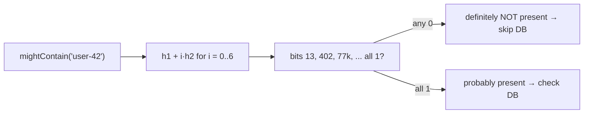
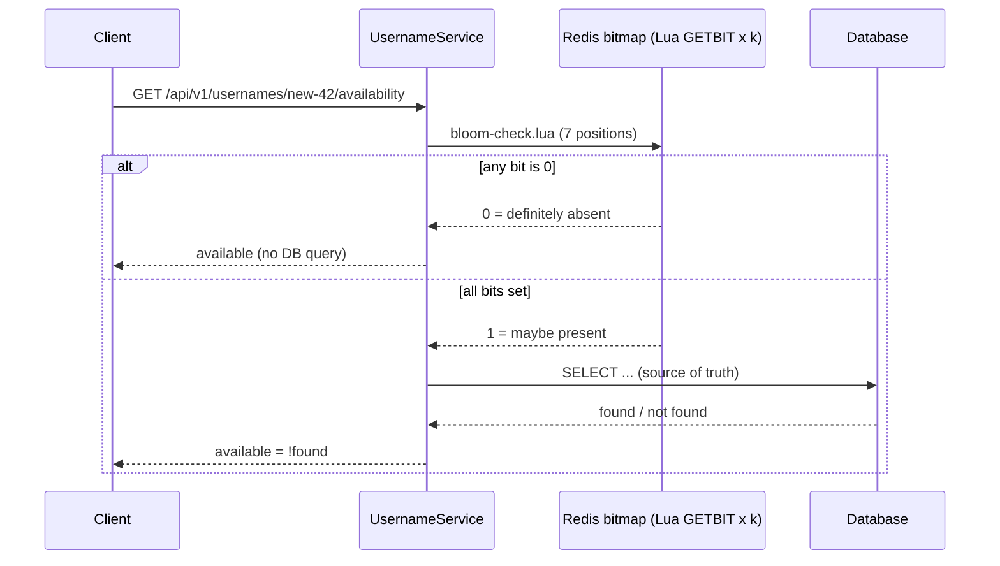

# 4. Bloom Filter: Sizing & Measured False Positives

<span class="level l2">L2</span> ★★☆ · `BitSet`, optimal m and k, double hashing, no false negatives

## Problem

> Answer "has this username / URL / key been seen?" for 100k (or 1 billion) items in a fraction of the memory a set would use,
> with **no false negatives** and about **1% false positives**. Size it from the target error rate and verify it empirically.

## Key idea

Use `m` bits and `k` hash functions. `add` sets k bits; `mightContain` checks them, and if any is 0 the item is **definitely absent**.
For n items and a target rate p: **m = −n·ln p / (ln 2)²**, **k = (m/n)·ln 2**, which is about 9.6 bits and 7 hashes per item for 1%.
Two base hashes simulate all k (`h1 + i·h2`, Kirsch–Mitzenmacher). It's used in front of databases (Cassandra, HBase, RocksDB SSTables)
to skip disk reads for keys that are certainly absent.



## Solution

```java title="BloomFilter.java"
--8<-- "coding-interview/src/BloomFilter.java"
```

## Walkthrough

| Code | Why |
|---|---|
| `m = ceil(-n ln p / (ln 2)^2); k = round(m/n · ln 2)` | Size from requirements. The output shows 958,506 bits (117 KB) and k = 7 for 100k items at 1%. |
| `Math.floorMod(h[0] + i * h[1], (long) m)` | Double hashing: k indexes from 2 hashes, with no measurable loss in accuracy. |
| `return new long[]{h1, h2 \| 1}` | Forcing `h2` to be odd avoids degenerate cases where `h2` shares factors with `m`. |
| `measured false-positive rate ... 0.91%` | Measured against 100k *unseen* items, close to the 1% target. The test asserts the bound as well as printing it. |

## Complexity

| Approach | Time | Space |
|---|---|---|
| add / mightContain | O(k) | m bits ≈ 1.44 · n · log₂(1/p) |

## Run it

```bash
java coding-interview/src/BloomFilter.java      # JDK 21+ single-file launcher, no build needed
```

```text
--8<-- "coding-interview/outputs/BloomFilter.txt"
```

## Solve it with Spring Boot 4

The bit array becomes a **Redis bitmap** shared by all instances, and each add/check is **one Lua call** that sets or
tests the k bits atomically. The service uses it as a guard: *definitely not present* skips the database entirely.



=== "Check (Lua)"

    ```lua title="bloom-check.lua"
    --8<-- "coding-interview/spring-boot/src/main/resources/scripts/bloom-check.lua"
    ```

=== "Add (Lua)"

    ```lua title="bloom-add.lua"
    --8<-- "coding-interview/spring-boot/src/main/resources/scripts/bloom-add.lua"
    ```

=== "Filter"

    ```java title="RedisBloomFilter.java"
    --8<-- "coding-interview/spring-boot/src/main/java/com/sdp/ci/p04bloom/RedisBloomFilter.java"
    ```

=== "Sizing & hashing"

    ```java title="BloomMath.java"
    --8<-- "coding-interview/spring-boot/src/main/java/com/sdp/ci/p04bloom/BloomMath.java"
    ```

=== "Service"

    ```java title="UsernameService.java"
    --8<-- "coding-interview/spring-boot/src/main/java/com/sdp/ci/p04bloom/UsernameService.java"
    ```

### Run it as a service

The integration test [`BloomFilterIT.java`](https://github.com/khiruashish/system-design-playbook/blob/main/coding-interview/spring-boot/src/test/java/com/sdp/ci/p04bloom/BloomFilterIT.java) drives the API against a
real Redis. This is its transcript (`>` request, `<` response):

```text
--8<-- "coding-interview/spring-boot/outputs/BloomFilterSpringBoot.txt"
```

### What changes from the interview version

| Interview | Production (Spring Boot 4) |
|---|---|
| `BitSet` in one JVM | Redis bitmap (~11.7 KB for 10,000 items at 1%) shared by every instance |
| k separate bit operations | one Lua script per add/check: atomic, one round trip |
| filter only | **write-through** on register, so the filter can never produce a false negative |
| fixed size | rebuild into a bigger key when inserts exceed n (or use RedisBloom's scalable `BF.RESERVE ... EXPANSION`) |

The measured false-positive rate (0.90% at the design load) matches the 1% target, and the database saw 90 queries instead of 10,000.

## Common mistakes

* Expecting deletes to work. Clearing a bit can remove other items. Use a Counting Bloom filter or a Cuckoo filter.
* Under-sizing. Inserting more than n items makes the FPR grow fast. Rebuild, or use a scalable Bloom filter.
* Using `String.hashCode()` with k simple variants. Correlated hashes raise the FPR.

## Follow-up questions

??? question "Where does a Bloom filter sit in a read path?"
    In front of an expensive lookup that usually misses: per-SSTable filters in LSM databases, "username taken?" checks, crawler "URL already seen?" checks, CDN "is this object cached anywhere?" checks. A negative answer skips the I/O entirely.

??? question "Bloom vs Cuckoo filter?"
    Cuckoo filters support delete, have better lookup locality, and use less space at low FPRs (below about 3%). Inserts can fail when the table is nearly full. Bloom filters are simpler and their inserts never fail.
