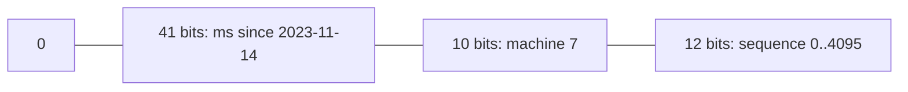
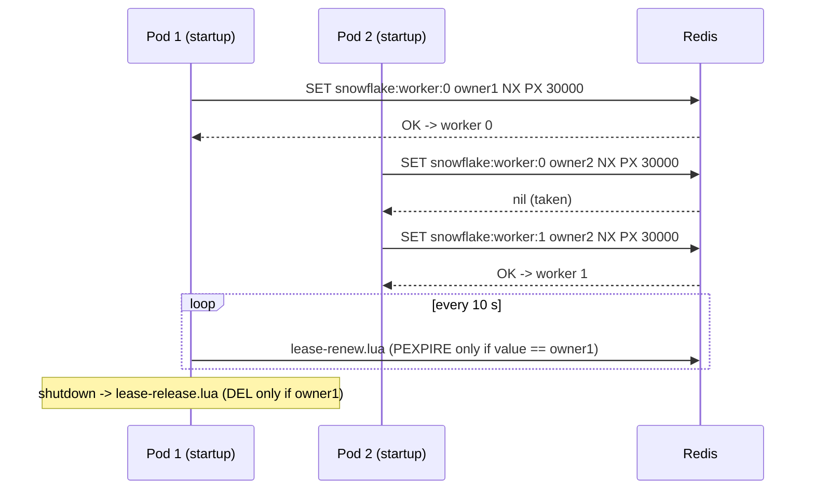

# 5. Snowflake: Distributed Unique Ids

<span class="level l2">L2</span> ★★☆ · Bit layout, sequence per millisecond, clock-backwards handling

## Problem

> Generate **unique, roughly time-ordered 64-bit ids** on many machines with no coordination per id. Handle 4,096+ ids
> in the same millisecond, and the clock **moving backwards** (an NTP step).

## Key idea

Pack **41 bits of milliseconds** since a custom epoch (about 69 years), **10 bits of machine id** (1,024 nodes) and **12 bits of sequence**
(4,096 per ms per node) into one `long`. Ids sort by time, are unique as long as machine ids are unique, and fit B-tree indexes better
than random UUIDs. If the clock goes backwards, **refuse** to generate (or wait) rather than risk duplicates.



## Solution

```java title="SnowflakeId.java"
--8<-- "coding-interview/src/SnowflakeId.java"
```

## Walkthrough

| Code | Why |
|---|---|
| `((now - EPOCH) << 22) \| (machineId << 12) \| sequence` | The layout. Time is in the high bits, so numeric order roughly equals time order. |
| `sequence = (sequence + 1) & MAX_SEQUENCE; if (sequence == 0) wait for next ms` | Within one millisecond, increment. If all 4,096 are used, spin until the next millisecond. |
| `if (now < lastMs) throw ...` | Clock went backwards (an NTP step, VM migration). Generating anyway could repeat ids. Options: refuse, wait it out for small skews, or use a logical clock. |
| `LongSupplier clock` | An injected clock lets the test produce exact ids and simulate an NTP step. The 100k-id concurrency test uses the real clock. |

## Complexity

| Approach | Time | Space |
|---|---|---|
| next() | O(1) (synchronized) | O(1) |

## Run it

```bash
java coding-interview/src/SnowflakeId.java      # JDK 21+ single-file launcher, no build needed
```

```text
--8<-- "coding-interview/outputs/SnowflakeId.txt"
```

## Solve it with Spring Boot 4

The interview solution takes the worker id as a parameter. In a real deployment **that is the hard part**: twenty pods
must never share one. Each instance **leases** a free worker id from Redis at startup (`SET NX PX`), renews it on a
schedule, and releases it on shutdown. If it loses the lease, it must stop issuing ids.



=== "Worker-id lease"

    ```java title="WorkerIdLease.java"
    --8<-- "coding-interview/spring-boot/src/main/java/com/sdp/ci/p05snowflake/WorkerIdLease.java"
    ```

=== "Generator"

    ```java title="SnowflakeIdGenerator.java"
    --8<-- "coding-interview/spring-boot/src/main/java/com/sdp/ci/p05snowflake/SnowflakeIdGenerator.java"
    ```

=== "Config & renewal"

    ```java title="SnowflakeConfig.java"
    --8<-- "coding-interview/spring-boot/src/main/java/com/sdp/ci/p05snowflake/SnowflakeConfig.java"
    ```

=== "Renew (Lua)"

    ```lua title="lease-renew.lua"
    --8<-- "coding-interview/spring-boot/src/main/resources/scripts/lease-renew.lua"
    ```

=== "Controller"

    ```java title="IdController.java"
    --8<-- "coding-interview/spring-boot/src/main/java/com/sdp/ci/p05snowflake/IdController.java"
    ```

### Run it as a service

The integration test [`SnowflakeIT.java`](https://github.com/khiruashish/system-design-playbook/blob/main/coding-interview/spring-boot/src/test/java/com/sdp/ci/p05snowflake/SnowflakeIT.java) drives the API against a
real Redis. This is its transcript (`>` request, `<` response):

```text
--8<-- "coding-interview/spring-boot/outputs/SnowflakeSpringBoot.txt"
```

### What changes from the interview version

| Interview | Production (Spring Boot 4) |
|---|---|
| `workerId` constructor argument | **leased** from Redis with TTL, renewed by `@Scheduled`, released by `destroyMethod` |
| `System.currentTimeMillis()` | injected `Clock`; refuse to issue ids if the clock jumps back more than 5 ms |
| single thread | `synchronized` `nextId()` (4,096 ids/ms per instance). 200,000 ids from 8 virtual threads were all unique |
| `long` result | returned as **strings** in JSON (JavaScript loses precision above 2^53) |

Alternatives to name: Kubernetes **StatefulSet ordinal** as the worker id (no Redis needed), or UUIDv7 when 128 bits are acceptable.

## Common mistakes

* Duplicate machine ids after auto-scaling. Assign them from ZooKeeper or etcd, a DB lease, or the pod's ordinal in a StatefulSet.
* Ignoring clock-backwards events, which produce silent duplicates.
* Assuming ids are *strictly* time-ordered across machines. They're only roughly ordered (clock skew), so don't use them as an event-ordering guarantee.
* Exposing them publicly when the business volume is sensitive. Ids reveal creation time and give a rough rate.

## Follow-up questions

??? question "Snowflake vs UUIDv4 vs UUIDv7 vs DB sequences?"
    UUIDv4: no coordination, but random, so it fragments B-tree indexes, and it's 128-bit. UUIDv7: time-ordered 128-bit, standardised, a good default today. DB sequences: simple, but a bottleneck across regions. Snowflake: compact 64-bit and time-ordered, but needs machine-id management.

??? question "How do you get more than 4,096 ids per ms per node?"
    Reallocate bits (fewer machine bits, more sequence bits), run more generators per node with distinct machine ids, or batch-allocate ids to callers.
