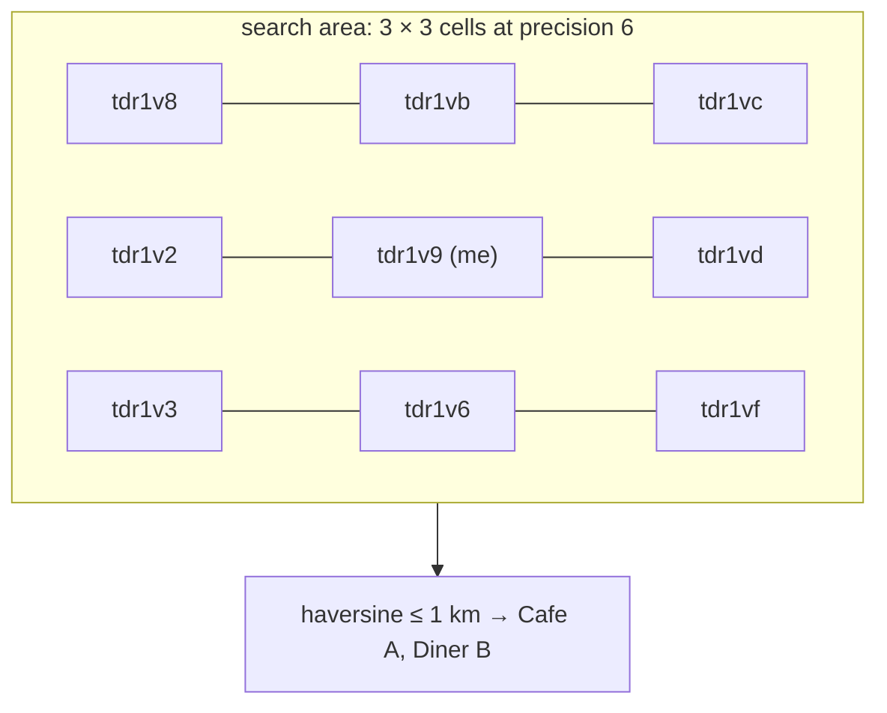

# 6. Geohash: "Restaurants Near Me"

<span class="level l3">L3</span> ★★★ · Bit interleaving, base32, neighbour cells, haversine filter

## Problem

> Given restaurant locations, find those **within 1 km** of a user. Encode coordinates so that nearby points share a key prefix and can be
> indexed with an ordinary B-tree or hash. Handle points just across a **cell boundary**.

## Key idea

Geohash repeatedly **bisects longitude and latitude alternately**, one bit per step, and writes the bits in base32. Points that share a prefix
are in the same cell (6 characters ≈ 1.2 km × 0.6 km). Two nearby points can sit on opposite sides of a boundary and share no prefix,
so **search the user's cell plus its 8 neighbours**, then filter by real distance (haversine).



## Solution

```java title="Geohash.java"
--8<-- "coding-interview/src/Geohash.java"
```

## Walkthrough

| Code | Why |
|---|---|
| `if (v >= mid) { ch = (ch << 1) \| 1; r[0] = mid; } else { ch <<= 1; r[1] = mid; }` | Each bit halves the current range. Even bits are longitude, odd bits latitude. |
| `if (++bit == 5) { hash.append(BASE32.charAt(ch)); ... }` | Every 5 bits become one base32 character (no a, i, l, o). |
| `cellAndNeighbours: step ± one cell height/width from the centre` | Computing neighbours by re-encoding offset points is simple and handles wrap-around. Lookup tables are faster but error-prone. |
| `((lon + dx * w + 540) % 360) - 180` | Wrap across the ±180° antimeridian. |
| `encode(57.64911, 10.40744, 11).equals("u4pruydqqvj")` | Checked against the reference example from the geohash spec. |

## Complexity

| Approach | Time | Space |
|---|---|---|
| encode | O(precision) | O(1) |
| nearby search | 9 index lookups + O(candidates) | - |

## Run it

```bash
java coding-interview/src/Geohash.java      # JDK 21+ single-file launcher, no build needed
```

```text
--8<-- "coding-interview/outputs/Geohash.txt"
```

## Common mistakes

* Searching only the user's own cell, which misses places 10 m away across the boundary.
* Choosing the precision without considering the radius. The cell must be at least as large as the search radius, or 9 cells won't cover it.
* Comparing distances in degrees. One degree of longitude shrinks with latitude, so use haversine.
* Hot cells in dense cities. Split adaptively (quadtree) or use precision that varies with density.

## Follow-up questions

??? question "Geohash vs quadtree vs S2/H3?"
    Geohash is a string prefix that works with any key-value store or B-tree, but its cells are rectangles that are distorted near the poles. A quadtree adapts to density (it splits busy areas) but is an in-memory structure. S2 (Google) and H3 (Uber) use spherical or hexagonal cells with uniform neighbours, which is better for ride-hailing and analytics.

??? question "How would you do this in PostGIS or Redis?"
    PostGIS: a `geography` column, a GiST index, and `ST_DWithin(location, me, 1000)`. Redis: `GEOADD`, then `GEOSEARCH ... BYRADIUS 1 km`. Internally it's a 52-bit geohash stored as a sorted-set score.
