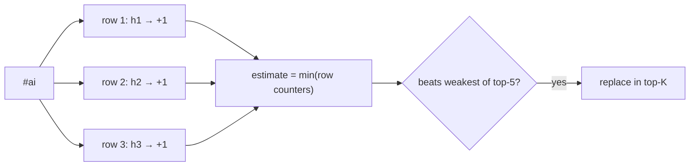
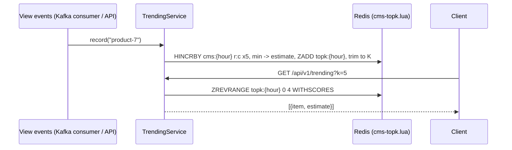

# 7. Trending Top-K: Count-Min Sketch + Heap

<span class="level l3">L3</span> ★★★ · Count-Min Sketch, error bounds, streaming top-K

## Problem

> Find the **top 5 trending hashtags** in a stream of 315,000 events with about 50,000 distinct tags, using **fixed memory**
> that doesn't grow with the number of distinct tags. Prove the estimates stay within the theoretical error bound.

## Key idea

A **Count-Min Sketch** is a `d × w` grid of counters. Each item increments one counter per row; the estimate is the **minimum** across rows.
It **never underestimates**, and overestimates by at most **ε·N** with probability **1 − δ** (`w = e/ε`, `d = ln(1/δ)`).
Pair it with a **size-K candidate set**: after each update, an item enters if its estimate beats the weakest member.



## Solution

```java title="HeavyHitters.java"
--8<-- "coding-interview/src/HeavyHitters.java"
```

## Walkthrough

| Code | Why |
|---|---|
| `width = ceil(e / epsilon); depth = ceil(ln(1 / delta))` | ε = 0.0005 and δ = 0.001 give 5,437 × 7 counters, independent of the number of distinct items. |
| `min over rows` | Collisions only ever add counts, so the smallest counter is the tightest upper bound. |
| `if (members.containsKey(item) \|\| members.size() < k) ... else replace weakest` | Candidate tracking. The O(k) scan is fine for small k; use a heap with an index map for large k. |
| `check(estimate - exact <= 0.0005 * total)` | The test asserts the ε·N bound for every trending tag. The output shows +12 to +35 on counts of thousands. |

## Complexity

| Approach | Time | Space |
|---|---|---|
| update | O(d) | O(d·w) counters, fixed |
| top-K maintenance | O(k) per update here (O(log k) with an indexed heap) | O(k) |

## Run it

```bash
java coding-interview/src/HeavyHitters.java      # JDK 21+ single-file launcher, no build needed
```

```text
--8<-- "coding-interview/outputs/HeavyHitters.txt"
```

## Solve it with Spring Boot 4

The sketch lives in a **Redis hash per hourly window** (`row:col` → count) and a **top-K sorted set** beside it. One Lua call
increments the d counters, takes the minimum as the estimate, and updates the top-K, all atomically. Old windows expire on their own.



=== "Sketch + top-K (Lua)"

    ```lua title="cms-topk.lua"
    --8<-- "coding-interview/spring-boot/src/main/resources/scripts/cms-topk.lua"
    ```

=== "Service"

    ```java title="TrendingService.java"
    --8<-- "coding-interview/spring-boot/src/main/java/com/sdp/ci/p07trending/TrendingService.java"
    ```

=== "Controller"

    ```java title="TrendingController.java"
    --8<-- "coding-interview/spring-boot/src/main/java/com/sdp/ci/p07trending/TrendingController.java"
    ```

### Run it as a service

The integration test [`TrendingIT.java`](https://github.com/khiruashish/system-design-playbook/blob/main/coding-interview/spring-boot/src/test/java/com/sdp/ci/p07trending/TrendingIT.java) drives the API against a
real Redis. This is its transcript (`>` request, `<` response):

```text
--8<-- "coding-interview/spring-boot/outputs/HeavyHittersSpringBoot.txt"
```

### What changes from the interview version

| Interview | Production (Spring Boot 4) |
|---|---|
| `long[d][w]` + `PriorityQueue` | Redis hash (5 x 2,000 counters) + sorted set, shared by all consumers |
| one stream forever | **per-hour windows** with TTL; "last hour" = current window (or sum the last 2 for sliding) |
| separate increment and heap update | one Lua script: no lost updates between instances |

Measured: max overcount **3** against the bound e/w·N = 28, and the top 5 matched the exact counts. At very high event
rates, pre-aggregate in the consumer (count locally for 1 s, then one `HINCRBY` per item) to cut Redis calls.

## Common mistakes

* Using the sketch for rare items. The *relative* error is large when the true count is small compared with N.
* Never decaying. "Trending" means recent, so use time-bucketed sketches (one per minute, summed over a window) or exponential decay.
* Hashing with correlated functions across rows, which defeats the min-of-rows trick.

## Follow-up questions

??? question "How would you compute trending over the last hour across many servers?"
    Each server keeps per-minute sketches. Sketches are **mergeable** (cell-wise add), so a reducer sums the last 60 minutes from all servers, then picks the top-K from the merged candidates. This is a classic Flink or Kafka Streams job.

??? question "Count-Min vs Space-Saving / Misra-Gries?"
    Space-Saving keeps exactly k counters and directly gives heavy hitters with a guaranteed error, but it isn't as easily mergeable. Count-Min answers point queries for *any* item and merges trivially.
