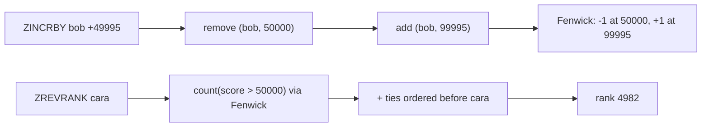

# 8. Leaderboard: Ranks, Top-N, Neighbours

<span class="level l2">L2</span> ★★☆ · Ordered set, Fenwick tree for ranks, Redis sorted-set semantics

## Problem

> Build a game leaderboard with 10,000+ players: **increment** a score, get a player's **rank**, the **top N**, and the players
> **around** a given player. Ties are broken deterministically. These are the operations of a Redis sorted set.

## Key idea

An **ordered set** of `(score desc, name)` gives top-N and neighbours by walking from a position. Rank needs "how many are ahead of
me?". Walking the set is O(n), so keep a **Fenwick (binary indexed) tree** of counts per score for O(log S) prefix sums. Redis
does this with a skip list whose links carry span counts.



## Solution

```java title="Leaderboard.java"
--8<-- "coding-interview/src/Leaderboard.java"
```

## Walkthrough

| Code | Why |
|---|---|
| `Comparator.comparingLong(Entry::score).reversed().thenComparing(Entry::player)` | A total order, which a `TreeSet` needs. Without the tie-break, equal scores would be treated as duplicates and dropped. |
| `ranking.remove(new Entry(player, old)); ... ranking.add(new Entry(player, now))` | To update an ordered element, remove it with its **old** key and re-insert it. Mutating a key inside a `TreeSet` corrupts the set. |
| `countAtMost(MAX_SCORE) - countAtMost(s)` | Players with a strictly higher score, using two O(log S) Fenwick prefix sums. |
| `ranking.headSet(me, false).descendingSet().stream().limit(radius)` | The neighbours above, nearest first. `tailSet` gives the ones below. |
| `check(all.get(rank - 1).player().equals(...))` | The fast rank is cross-checked against the position in the fully ordered list. |

## Complexity

| Approach | Time | Space |
|---|---|---|
| update | O(log n + log S) | O(n + S) |
| rank | O(log S) + ties | - |
| top-N / around | O(log n + N) | - |

## Run it

```bash
java coding-interview/src/Leaderboard.java      # JDK 21+ single-file launcher, no build needed
```

```text
--8<-- "coding-interview/outputs/Leaderboard.txt"
```

## Common mistakes

* Sorting the whole list on every query (O(n log n)), which falls over at millions of players.
* Leaving ties ambiguous, so ranks jump around between refreshes.
* Changing a score in place inside the ordered structure.
* A single global sorted set for 100M players. Shard by region or league, and compute global top-N by merging the shards' top-Ns.

## Follow-up questions

??? question "How do you get the rank of a player among 500 million?"
    An exact rank needs a global ordered index. Shard by score range (each shard knows its count, so rank = counts of higher shards + local rank), or use approximate ranks from a score histogram, which is often enough when you show "top 3%".

??? question "Daily, weekly and all-time boards?"
    Keep separate sorted sets per period (`lb:2025-01-01`) with TTLs. Use `ZUNIONSTORE` to build the weekly board from the daily ones, or update all three on each score event.
