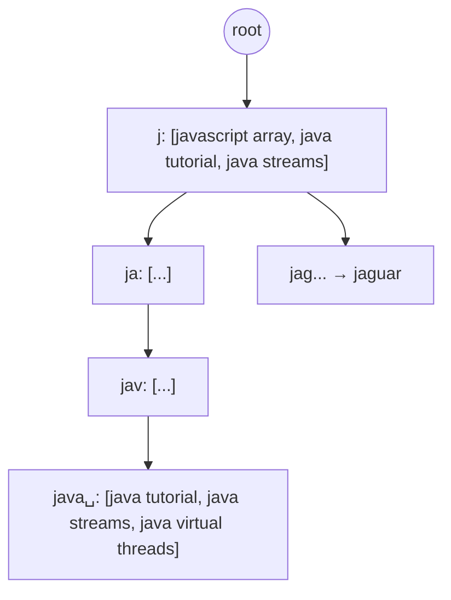
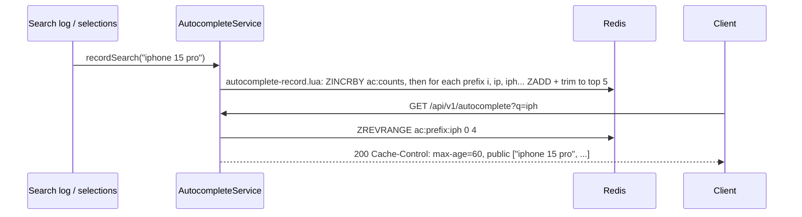

# 9. Autocomplete: Trie with Cached Top-K

<span class="level l2">L2</span> ★★☆ · Trie, top-K per node, read-optimised writes

## Problem

> For a search box, return the **3 most popular** past queries that start with what the user has typed, on **every keystroke**,
> fast. Popularity changes as users search, and trending queries should rise.

## Key idea

A **trie** maps each prefix to a node. A DFS of the whole subtree on every keystroke is too slow for short prefixes like "j", so
**cache the top-K at every node**. A read is then O(prefix length). A write updates the top-K along its path (O(L · K log K)).
Reads outnumber writes enormously, so this trade-off is right.



## Solution

```java title="AutocompleteTrie.java"
--8<-- "coding-interview/src/AutocompleteTrie.java"
```

## Walkthrough

| Code | Why |
|---|---|
| `List<String> topK = new ArrayList<>()  // cached per node` | This is the key design choice: pay on writes so each read is a single lookup. |
| `for (Node p : path) updateTopK(p, q)` | A search updates every prefix node from the root to its last character. |
| `list.sort(by count desc, then text); if (size > K) remove last` | Re-rank this node's candidates. K is tiny (3–10), so sorting is cheap. |
| `check(t.suggest(p).equals(t.suggestByDfs(p)))` | The cached answer is verified against a brute-force DFS for several prefixes. |

## Complexity

| Approach | Time | Space |
|---|---|---|
| suggest | O(prefix length) | - |
| record | O(L · K log K) | O(total chars + nodes · K) |
| DFS alternative | O(subtree) per keystroke | - |

## Run it

```bash
java coding-interview/src/AutocompleteTrie.java      # JDK 21+ single-file launcher, no build needed
```

```text
--8<-- "coding-interview/outputs/AutocompleteTrie.txt"
```

## Solve it with Spring Boot 4

Each trie node becomes a **small sorted set per prefix** that holds only that prefix's **top K** terms (the "cached top-K per node"
from the solution). A lookup is a single `ZREVRANGE`. All the work happens on write, in one Lua script, and responses carry
`Cache-Control` so a CDN can absorb the read traffic.



=== "Record (Lua)"

    ```lua title="autocomplete-record.lua"
    --8<-- "coding-interview/spring-boot/src/main/resources/scripts/autocomplete-record.lua"
    ```

=== "Service"

    ```java title="AutocompleteService.java"
    --8<-- "coding-interview/spring-boot/src/main/java/com/sdp/ci/p09autocomplete/AutocompleteService.java"
    ```

=== "Controller"

    ```java title="AutocompleteController.java"
    --8<-- "coding-interview/spring-boot/src/main/java/com/sdp/ci/p09autocomplete/AutocompleteController.java"
    ```

### Run it as a service

The integration test [`AutocompleteIT.java`](https://github.com/khiruashish/system-design-playbook/blob/main/coding-interview/spring-boot/src/test/java/com/sdp/ci/p09autocomplete/AutocompleteIT.java) drives the API against a
real Redis. This is its transcript (`>` request, `<` response):

```text
--8<-- "coding-interview/spring-boot/outputs/AutocompleteSpringBoot.txt"
```

### What changes from the interview version

| Interview | Production (Spring Boot 4) |
|---|---|
| trie nodes with a top-K list | one Redis sorted set per prefix (≤ 10 characters), holding at most K terms |
| update on every keystroke | update from the **search log** (submitted queries), ideally batched |
| no normalisation | lower-case, trim, collapse spaces; filter for prefixes longer than 10 characters |
| no caching | `Cache-Control: public, max-age=60`. Most prefixes are shared by millions of users |

Memory is bounded: prefixes × K entries. Add per-user personalisation as a second, small set merged at read time, and
remove offensive terms through a deny-list filter on write.

## Common mistakes

* A DFS on every keystroke for one-letter prefixes, which can mean millions of nodes.
* Updating the trie synchronously on every search at Google scale. Aggregate counts offline (hourly or daily) and rebuild or swap the tries, with a small real-time layer for trending queries.
* Ignoring normalisation (case, whitespace, accents) and offensive-content filtering.

## Follow-up questions

??? question "How would you serve this to 100k QPS?"
    Shard the trie by the first one or two characters, replicate it, and keep it in memory. Put a CDN or edge cache in front for very common prefixes. The client debounces keystrokes (about 100 ms) and caches responses per prefix.

??? question "How do you personalise suggestions?"
    Blend global top-K candidates with the user's own history and context (location, language) in a re-ranking step. The trie supplies candidates; a small model or scoring function orders them.
