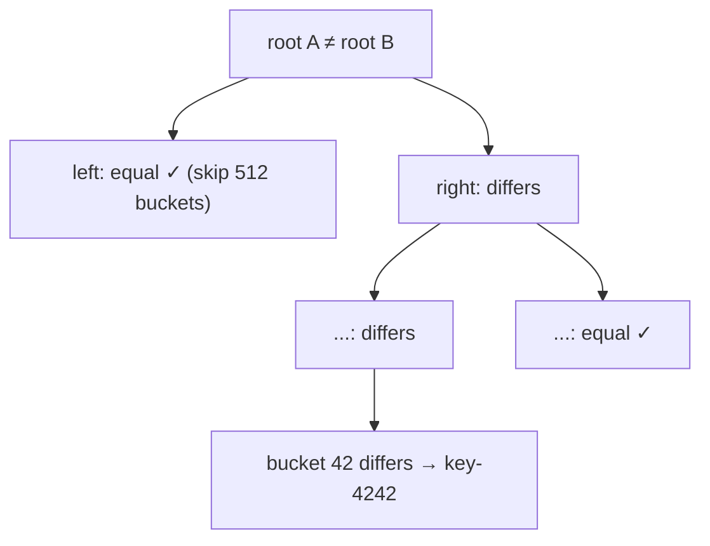
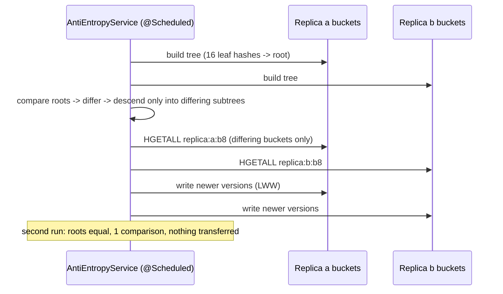

# 10. Merkle Tree: Replica Anti-Entropy

<span class="level l3">L3</span> ★★★ · Hash tree over key buckets, top-down diff, O(log n) comparisons

## Problem

> Two replicas each hold 100,000 keys. A few writes were missed. Find **exactly which keys differ** while exchanging as few hashes as
> possible. Sending all the data, or even all the per-key hashes, is too expensive.

## Key idea

Split the key space into buckets and hash each bucket's contents (the leaves). Each parent is `hash(left ‖ right)`. If the **roots
match**, the replicas are identical. Otherwise descend **only into subtrees whose hashes differ**. With d differences in B buckets,
that's about O(d · log B) comparisons. Cassandra repair, DynamoDB, Git and blockchains all use this.



## Solution

```java title="MerkleTree.java"
--8<-- "coding-interview/src/MerkleTree.java"
```

## Walkthrough

| Code | Why |
|---|---|
| `buckets.get(lo).forEach((k, v) -> sb.append(k)...)  // TreeMap` | Leaves hash a **sorted** serialisation, so the same contents always give the same hash on both replicas. |
| `new Node(sha256(l.hash, r.hash), l, r, lo, hi)` | A parent hash commits to everything below it. Any change at a leaf changes every ancestor up to the root. |
| `if (Arrays.equals(a.hash, b.hash)) return;` | Pruning: equal subtrees are skipped entirely, which is where the savings come from. |
| `hash comparisons: 37 (vs 1024 leaf hashes)` | Two differing buckets out of 1,024 took 37 comparisons. |

## Complexity

| Approach | Time | Space |
|---|---|---|
| build | O(n) hashing | O(B) nodes |
| diff | O(d · log B) comparisons | O(log B) recursion |

## Run it

```bash
java coding-interview/src/MerkleTree.java      # JDK 21+ single-file launcher, no build needed
```

```text
--8<-- "coding-interview/outputs/MerkleTree.txt"
```

## Solve it with Spring Boot 4

Each replica's keys are split into **16 bucket hashes in Redis**, so a Merkle leaf is one bucket and repairing a leaf
reads only that bucket. The service compares two replicas top-down, repairs the differing buckets with last-writer-wins,
and can run on a schedule (`ci.anti-entropy.enabled=true`).



=== "Anti-entropy"

    ```java title="AntiEntropyService.java"
    --8<-- "coding-interview/spring-boot/src/main/java/com/sdp/ci/p10merkle/AntiEntropyService.java"
    ```

=== "Merkle tree"

    ```java title="MerkleTree.java"
    --8<-- "coding-interview/spring-boot/src/main/java/com/sdp/ci/p10merkle/MerkleTree.java"
    ```

=== "Replica store"

    ```java title="ReplicaStore.java"
    --8<-- "coding-interview/spring-boot/src/main/java/com/sdp/ci/p10merkle/ReplicaStore.java"
    ```

=== "Controller & job"

    ```java title="AntiEntropyController.java"
    --8<-- "coding-interview/spring-boot/src/main/java/com/sdp/ci/p10merkle/AntiEntropyController.java"
    ```

### Run it as a service

The integration test [`MerkleIT.java`](https://github.com/khiruashish/system-design-playbook/blob/main/coding-interview/spring-boot/src/test/java/com/sdp/ci/p10merkle/MerkleIT.java) drives the API against a
real Redis. This is its transcript (`>` request, `<` response):

```text
--8<-- "coding-interview/spring-boot/outputs/MerkleTreeSpringBoot.txt"
```

### What changes from the interview version

| Interview | Production (Spring Boot 4) |
|---|---|
| two in-memory maps | replica data in bucketed Redis hashes; a leaf = a bucket you can fetch alone |
| diff only | **repair** with last-writer-wins by version, written to whichever side is behind |
| run once | `@Scheduled` job, enabled per environment with `@ConditionalOnProperty` |

Result: 4 of 16 buckets differed, so 495 of 2,002 key copies were read instead of all of them, and a second run needed one
comparison. In a real cluster each node maintains its own tree incrementally and only **hashes** cross the network until a
differing leaf is found (Cassandra repair, Dynamo anti-entropy, Riak AAE).

## Common mistakes

* Bucketing by insertion order instead of by key. The two replicas then bucket differently and everything appears to differ.
* Rebuilding the whole tree on every write. Update the leaf and its ancestors incrementally, or rebuild periodically for repair runs.
* Too few buckets, so each differing bucket still means shipping many keys. Too many buckets inflate the tree. Tune B to the expected divergence.

## Follow-up questions

??? question "How does Cassandra use this?"
    `nodetool repair` builds Merkle trees per token range on each replica, exchanges them, and streams only the differing ranges. Incremental repair marks repaired SSTables so later runs cover only new data.

??? question "Merkle trees vs read repair vs hinted handoff?"
    Hinted handoff replays writes missed during short outages. Read repair fixes the keys you happen to read. Merkle-tree anti-entropy finds *all* divergence, including cold keys nobody reads. You need all three for convergence.
