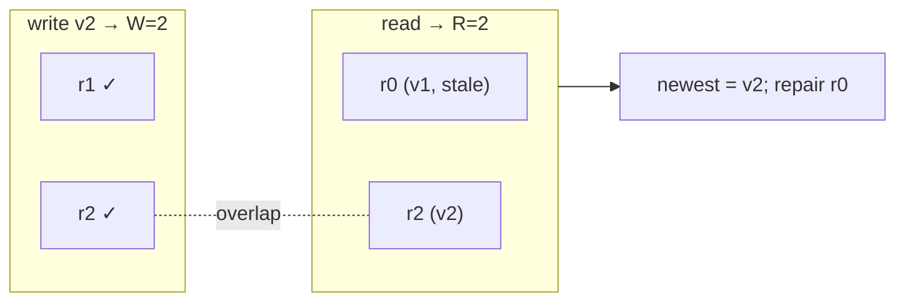

# 11. Quorum Replication: R + W > N

<span class="level l3">L3</span> ★★★ · Tunable consistency, versioned values, read repair, availability

## Problem

> Simulate Dynamo-style replication with **N replicas**, write quorum **W** and read quorum **R**. Show that **R + W > N** gives
> reads the latest acknowledged write, that weaker settings can read stale data, and how failures affect availability.

## Key idea

When **R + W > N**, every read set **overlaps** every write set in at least one replica, so the highest-versioned value seen is the
latest acknowledged write. The read also **repairs** stale replicas it saw. With **R + W ≤ N** you get lower latency and higher
availability, but stale reads become possible. Each operation needs enough live replicas to reach its quorum.



## Solution

```java title="QuorumReplication.java"
--8<-- "coding-interview/src/QuorumReplication.java"
```

## Walkthrough

| Code | Why |
|---|---|
| `Versioned(value, ++clock)` | Each write carries a version, and reads pick the maximum. Real systems use per-key vector clocks or hybrid logical clocks, because one counter isn't available in a distributed cluster. |
| `for (int i : reachableOrder) ... if (++acks == w) return true` | The write succeeds once W replicas acknowledge. The rest are updated later (or not, as in the demo, which leaves r0 stale). |
| `if (v == null \|\| v.version() < newest.version()) { rep.data.put(key, newest); repairs.add(rep.name); }` | Read repair: the read path fixes the stale replicas it touched. |
| `N=3 W=1 R=1 → read v1` | The read set {r0} and write set {r1} don't overlap, so the read is stale. It's the cost of the fastest settings. |
| `2 of 3 down: write ok? false` | With W=2, two failures make writes unavailable. That's the CAP trade-off in a single line. |

## Complexity

| Approach | Time | Space |
|---|---|---|
| write / read | O(N) messages, waits for W / R | N copies |

## Run it

```bash
java coding-interview/src/QuorumReplication.java      # JDK 21+ single-file launcher, no build needed
```

```text
--8<-- "coding-interview/outputs/QuorumReplication.txt"
```

## Solve it with Spring Boot 4

A coordinator fans out every request to **N replica services over HTTP** with `RestClient`, on **virtual threads**, and
answers as soon as **W** writes or **R** reads succeed within the timeout. Reads return the newest version and **read-repair**
stale replicas. In the test, the replicas are real HTTP endpoints that can be taken down, so failures behave like separate nodes.

```mermaid
sequenceDiagram
    participant C as Client
    participant Q as QuorumCoordinator
    participant A as replica a
    participant B as replica b
    participant R3 as replica c
    C->>Q: PUT /api/v1/kv/cart:42 {"3 items"}
    par fan-out (virtual threads)
      Q->>A: PUT v2
      Q->>B: PUT v2
      Q->>R3: PUT v2
    end
    A-->>Q: 200
    B-->>Q: 200
    Q-->>C: 200 {acks: 2} (W reached; c's call continues in background)
    C->>Q: GET /api/v1/kv/cart:42 (a down)
    Q->>B: GET -> v2
    Q->>R3: GET -> v1 (stale)
    Q->>R3: PUT v2 (read repair)
    Q-->>C: {"3 items", repaired: [c]}
```

=== "Coordinator"

    ```java title="QuorumCoordinator.java"
    --8<-- "coding-interview/spring-boot/src/main/java/com/sdp/ci/p11quorum/QuorumCoordinator.java"
    ```

=== "Replica node"

    ```java title="ReplicaNodeController.java"
    --8<-- "coding-interview/spring-boot/src/main/java/com/sdp/ci/p11quorum/ReplicaNodeController.java"
    ```

=== "Properties"

    ```java title="QuorumProperties.java"
    --8<-- "coding-interview/spring-boot/src/main/java/com/sdp/ci/p11quorum/QuorumProperties.java"
    ```

=== "Client config"

    ```java title="QuorumConfig.java"
    --8<-- "coding-interview/spring-boot/src/main/java/com/sdp/ci/p11quorum/QuorumConfig.java"
    ```

### Run it as a service

The integration test [`QuorumIT.java`](https://github.com/khiruashish/system-design-playbook/blob/main/coding-interview/spring-boot/src/test/java/com/sdp/ci/p11quorum/QuorumIT.java) drives the API against a
real Redis. This is its transcript (`>` request, `<` response):

```text
--8<-- "coding-interview/spring-boot/outputs/QuorumSpringBoot.txt"
```

### What changes from the interview version

| Interview | Production (Spring Boot 4) |
|---|---|
| replicas are objects in a list | separate services called over HTTP with connect/read **timeouts** |
| sequential calls | parallel fan-out on **virtual threads**; return at W/R successes, don't wait for the slowest replica |
| version counter | per-coordinator monotonic version (LWW). Real systems use vector clocks or hybrid logical clocks |
| failure = exception | `503 ProblemDetail` "write quorum not met" (safe to retry: the replica only accepts newer versions) |
| validated in code | `QuorumProperties` rejects invalid N/W/R at startup |

**Two things the test exposed** (see the [Spring Boot overview](spring-boot.md#lessons-the-tests-taught-they-apply-to-interviews-too)):
a 200 ms timeout fails on a cold JVM, and the N − W calls still in flight can update a "stale" replica after the
coordinator has answered. Missing pieces you should name: **hinted handoff** for writes to down nodes, and sloppy quorums.

## Common mistakes

* Thinking R + W > N gives linearizability. It doesn't on its own: concurrent writes, sloppy quorums and clock-based versions can still misbehave.
* Last-write-wins with wall-clock timestamps, which silently drops concurrent updates. Use vector clocks plus application merge, or CRDTs.
* Forgetting that a failed quorum write may still have reached *some* replicas, so it may appear later. Clients must treat a failed write as "unknown", not "didn't happen".

## Follow-up questions

??? question "Sloppy quorum and hinted handoff?"
    If home replicas are down, a sloppy quorum writes to other healthy nodes, which keep a *hint* and hand the data back when the home replica returns. Availability goes up, but R + W > N no longer guarantees overlap with the home replicas.

??? question "How do Cassandra's consistency levels map to this?"
    `ONE`, `QUORUM`, `ALL` per query, plus `LOCAL_QUORUM` (a quorum within one data centre) for multi-region setups. A common choice is `LOCAL_QUORUM` for both reads and writes with RF = 3, which gives strong consistency within a DC and survives one node failure.
