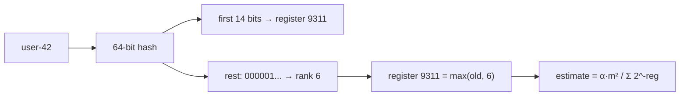
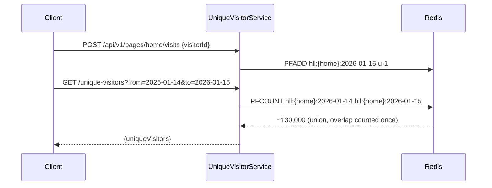

# 12. HyperLogLog: Count Distinct in 16 KB

<span class="level l3">L3</span> ★★★ · Leading-zero ranks, harmonic mean, small-range correction, mergeable

## Problem

> Count **unique daily visitors** across a billion events on many servers. Use **kilobytes** instead of gigabytes, accept about 1%
> error, and be able to **merge** counts from different servers or days without double counting.

## Key idea

Hash each item. The first `p` bits choose one of `m = 2^p` registers. Each register keeps the **maximum position of the first 1-bit**
seen in the remaining bits, because a run of k leading zeros happens about once per 2^k distinct items. The estimate is a bias-corrected
**harmonic mean** over the registers, with **linear counting** for small sets. A **merge** is the register-wise maximum. The standard
error is **1.04 / √m**, about 0.81% for m = 16,384.



## Solution

```java title="HyperLogLog.java"
--8<-- "coding-interview/src/HyperLogLog.java"
```

## Walkthrough

| Code | Why |
|---|---|
| `int idx = (int) (h >>> (64 - p)); long rest = h << p;` | Split the hash: the top p bits select the register, the rest supply the leading-zero count. |
| `Long.numberOfLeadingZeros(rest) + 1` | The rank is the position of the first 1-bit. A hardware instruction makes this O(1). |
| `alpha * m * m / sum` | The harmonic mean of `2^register` dampens outlier registers, which is the "Hyper" improvement over LogLog. |
| `if (e <= 2.5 * m && zeros > 0) e = m * log(m / zeros)` | Small-range correction (linear counting). The output shows an exact 100 for 100 distinct items. |
| `registers[i] = max(registers[i], other.registers[i])` | Merging is lossless and order-independent, so you can combine shards or days (`PFMERGE`). |

## Complexity

| Approach | Time | Space |
|---|---|---|
| add | O(1) | m registers (16 KB for p = 14) |
| estimate | O(m) | - |
| merge | O(m) | - |

## Run it

```bash
java coding-interview/src/HyperLogLog.java      # JDK 21+ single-file launcher, no build needed
```

```text
--8<-- "coding-interview/outputs/HyperLogLog.txt"
```

## Solve it with Spring Boot 4

Redis has HyperLogLog built in: **`PFADD`** per visit and **`PFCOUNT`** per query, about **12 KB per key** whatever the
cardinality, with 0.81% standard error. One key per page per day; `PFCOUNT k1 k2 …` unions days on the fly with no double counting.



=== "Service"

    ```java title="UniqueVisitorService.java"
    --8<-- "coding-interview/spring-boot/src/main/java/com/sdp/ci/p12hll/UniqueVisitorService.java"
    ```

=== "Controller"

    ```java title="UniqueVisitorController.java"
    --8<-- "coding-interview/spring-boot/src/main/java/com/sdp/ci/p12hll/UniqueVisitorController.java"
    ```

### Run it as a service

The integration test [`HyperLogLogIT.java`](https://github.com/khiruashish/system-design-playbook/blob/main/coding-interview/spring-boot/src/test/java/com/sdp/ci/p12hll/HyperLogLogIT.java) drives the API against a
real Redis. This is its transcript (`>` request, `<` response):

```text
--8<-- "coding-interview/spring-boot/outputs/HyperLogLogSpringBoot.txt"
```

### What changes from the interview version

| Interview | Production (Spring Boot 4) |
|---|---|
| 2^14 registers in an array | Redis HLL string (sparse when small, 12,304 bytes dense), shared by every instance |
| merge two sketches | `PFCOUNT` over many keys (or `PFMERGE` into a weekly key) |
| add one at a time | `PFADD` is variadic: batch 1,000 ids per call when back-filling |
| no key layout | `hll:{page}:{date}`: the `{page}` hash tag keeps a page's days on one cluster slot for multi-key `PFCOUNT` |

Measured: 0.17% error for 100,000 visitors and 0.36% for the two-day union, both well inside the 3σ ≈ 2.4% band.

## Common mistakes

* A weak hash (for example `String.hashCode`). HyperLogLog depends on uniformly distributed bits.
* Adding counts from different servers. That double counts users seen by both. Merge the sketches instead.
* Expecting intersections to be accurate. Inclusion-exclusion on HLLs has large errors; use MinHash or Theta sketches for intersections.

## Follow-up questions

??? question "How does Redis store HLL in 12 KB?"
    16,384 registers × 6 bits = 12 KB in the dense encoding. Small cardinalities use a sparse run-length encoding of a few hundred bytes, switching to dense as the count grows.

??? question "Where would you use HyperLogLog in a design?"
    Unique visitors per page per day, distinct search queries, unique IPs per minute for DDoS detection, and cardinality estimates in query planners (Presto, BigQuery `APPROX_COUNT_DISTINCT`).
