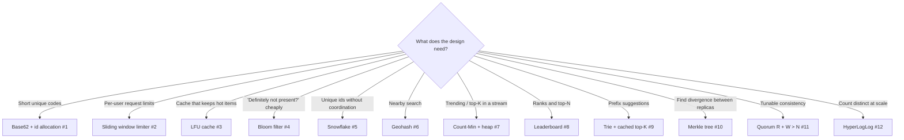

# Coding Interview: 12 System-Design Data Structures

Senior system-design loops increasingly include a **"now code the core of it"** round: the base62 encoder behind the URL
shortener, the sliding-window limiter, the Bloom filter in front of the database, the geohash behind "near me", the sketch
behind "trending". This tab has the twelve data structures that come up most. Each is a **runnable, self-checking**
Java file in [`coding-interview/src`](https://github.com/khiruashish/system-design-playbook/tree/main/coding-interview/src)
that asserts its own results (including the **error bounds** of the probabilistic structures), prints `PASS`, and is run
by CI on every change. The output on each page is real.

Each page connects the code to the design: **where it sits** in the architecture, **what it costs** in memory and time,
and **what the production version** (Redis, Cassandra, Elasticsearch...) adds.

Each page follows the same structure:

1. **Problem**: the statement as an interviewer would give it.
2. **Key idea**: the shape of the solution before any code, with a diagram.
3. **Solution**: the complete, runnable code (included from the repository, so it is exactly what CI ran).
4. **Walkthrough**: the important lines and *why* they are written that way.
5. **Complexity**: time and space for each approach.
6. **Run it**: the command and its real output.
7. **Common mistakes** and **follow-up questions** with answers.

## Problem map

| # | Problem | What it tests | Level | Difficulty |
|---|---|---|---|---|
| 1 | [URL Shortener Core: Base62 & Id Allocation](01-url-shortener.md) | Base62 encode/decode, id allocation, custom aliases, overflow safety | <span class="level l1">L1</span> | ★★☆ |
| 2 | [Sliding-Window Rate Limiter (Log vs Counter)](02-sliding-window-limiter.md) | Fixed-window burst problem, sliding log, weighted sliding counter | <span class="level l2">L2</span> | ★★☆ |
| 3 | [LFU Cache in O(1)](03-lfu-cache.md) | Frequency buckets of `LinkedHashSet`, `minFreq` tracking, scan resistance | <span class="level l3">L3</span> | ★★★ |
| 4 | [Bloom Filter: Sizing & Measured False Positives](04-bloom-filter.md) | `BitSet`, optimal m and k, double hashing, no false negatives | <span class="level l2">L2</span> | ★★☆ |
| 5 | [Snowflake: Distributed Unique Ids](05-snowflake-ids.md) | Bit layout, sequence per millisecond, clock-backwards handling | <span class="level l2">L2</span> | ★★☆ |
| 6 | [Geohash: "Restaurants Near Me"](06-geohash.md) | Bit interleaving, base32, neighbour cells, haversine filter | <span class="level l3">L3</span> | ★★★ |
| 7 | [Trending Top-K: Count-Min Sketch + Heap](07-heavy-hitters.md) | Count-Min Sketch, error bounds, streaming top-K | <span class="level l3">L3</span> | ★★★ |
| 8 | [Leaderboard: Ranks, Top-N, Neighbours](08-leaderboard.md) | Ordered set, Fenwick tree for ranks, Redis sorted-set semantics | <span class="level l2">L2</span> | ★★☆ |
| 9 | [Autocomplete: Trie with Cached Top-K](09-autocomplete.md) | Trie, top-K per node, read-optimised writes | <span class="level l2">L2</span> | ★★☆ |
| 10 | [Merkle Tree: Replica Anti-Entropy](10-merkle-tree.md) | Hash tree over key buckets, top-down diff, O(log n) comparisons | <span class="level l3">L3</span> | ★★★ |
| 11 | [Quorum Replication: R + W > N](11-quorum.md) | Tunable consistency, versioned values, read repair, availability | <span class="level l3">L3</span> | ★★★ |
| 12 | [HyperLogLog: Count Distinct in 16 KB](12-hyperloglog.md) | Leading-zero ranks, harmonic mean, small-range correction, mergeable | <span class="level l3">L3</span> | ★★★ |

Levels: <span class="level l1">L1</span> 0–2 yrs · <span class="level l2">L2</span> 2–5 yrs · <span class="level l3">L3</span> 5–10 yrs · <span class="level l4">L4</span> 10+ yrs / architect.

## Which technique fits? (the interviewer's hidden question)



## How to answer a coding round

1. **Anchor it in the design**: "this sits in the redirect service's hot path, so the lookup must be O(1) and cacheable".
2. **State the budget**: memory per item, operations per second, acceptable error. Probabilistic structures are chosen *because* of these numbers.
3. **Code the core** and keep the I/O out. A map stands in for Redis or the DB, and the interviewer wants the algorithm.
4. **Verify with numbers**: measured error vs the theoretical bound, keys moved, comparisons made. Each solution prints them.
5. **Name the production equivalent** and what it adds: persistence, sharding, replication, TTLs.

## Run every solution

```bash
coding-interview/run-all.sh          # runs all 12, writes outputs/
coding-interview/run-all.sh --check  # what CI runs: fails on any failure or changed output
```

## Then ship it: Spring Boot 4 versions

Every page also has a **"Solve it with Spring Boot 4"** section: the same problem as a production service in one
**Spring Boot 4.1** application, with state in **Redis** (atomic Lua scripts, GEO, sorted sets, HyperLogLog), REST APIs with
`ProblemDetail` errors, virtual threads, and an integration test against a real Redis whose transcript is shown on the page.
Start with the [Spring Boot 4 overview](spring-boot.md) for the stack, the interview-to-production mapping, and how to run it.

```bash
docker run -d -p 6379:6379 redis:7
coding-interview/spring-boot/check-outputs.sh --check   # what CI runs: 12 integration tests + transcript comparison
```
