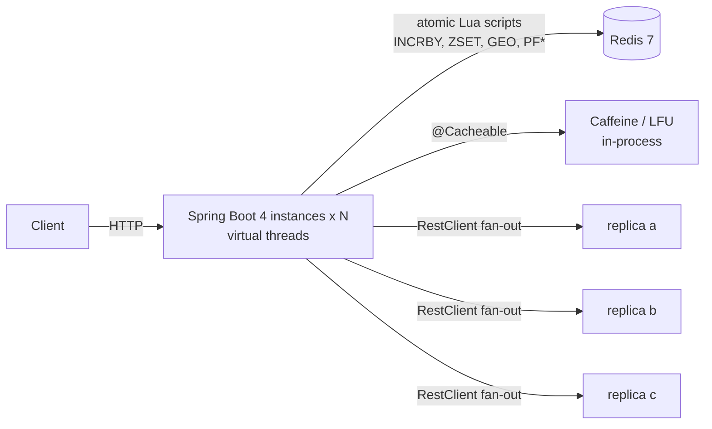

# Solving the Problems with Spring Boot 4

The single-file solutions answer **"code the core"**. The follow-up in a senior loop is usually **"now ship it"**:
*where does the state live when you run 20 instances, what happens on a race between two servers, what does the API look like,
how do you test it?* This page and the **"Solve it with Spring Boot 4"** section on every problem page answer that with one
real Spring Boot application in
[`coding-interview/spring-boot`](https://github.com/khiruashish/system-design-playbook/tree/main/coding-interview/spring-boot).

Every solution is an HTTP API backed by **real Redis**, covered by an integration test that runs against a real Redis
server (no mocks), and the **output shown on each page is that test's transcript**, which CI regenerates and compares on every change.

## Stack

| | Version / choice | Why |
|---|---|---|
| Spring Boot | **4.1.2** (Spring Framework 7.0, Jackson 3) | latest stable 4.x |
| Java | 21 (works on 25) | virtual threads, records, pattern matching |
| State | Redis 7 via Spring Data Redis + Lettuce | shared across instances; atomic Lua scripts |
| Local cache | Caffeine (W-TinyLFU) + the hand-written LFU as a Spring `Cache` | |
| HTTP client | `RestClient` on the JDK `HttpClient`, with timeouts | quorum fan-out |
| Errors | RFC 9457 `ProblemDetail` (`spring.mvc.problemdetails.enabled`) | consistent 4xx/5xx bodies |
| Validation | Jakarta Bean Validation + Spring MVC method validation | 400 on bad input |
| Concurrency | `spring.threads.virtual.enabled=true`, virtual-thread executors | blocking code that scales |
| Ops | Actuator health/metrics, `@Scheduled` jobs | |

## From interview code to production service

| # | Interview core (`src/*.java`) | Spring Boot 4 service | Where the state lives | Key Spring pieces |
|---|---|---|---|---|
| 1 | base62 + counter | `POST /api/v1/urls`, `GET /s/{code}` (302) | Redis `INCRBY` id blocks, `SET NX` aliases | `@Cacheable` (Caffeine), `@ConfigurationProperties` |
| 2 | sliding log / counter in a `HashMap` | `HandlerInterceptor` → 429 + `Retry-After` | Redis sorted set / counters via **Lua** | `WebMvcConfigurer`, `RedisScript` |
| 3 | O(1) LFU class | any `@Cacheable` method | in-process | custom `Cache` (`AbstractValueAdaptingCache`), `CacheManager` |
| 4 | `BitSet` Bloom filter | username availability check | Redis bitmap (`SETBIT`/`GETBIT` in Lua) | `@Service` write-through |
| 5 | Snowflake bit layout | `GET /api/v1/ids` | worker id **lease** in Redis (`SET NX PX`, renew, release) | `@Bean(destroyMethod)`, `@Scheduled` |
| 6 | geohash + neighbours | `GET /api/v1/restaurants/near` | Redis GEO (`GEOADD`/`GEOSEARCH`) | `GeoOperations`, method validation |
| 7 | Count-Min + heap | `POST/GET /api/v1/trending` | Redis hash sketch + top-K zset per hour (Lua) | injected `Clock` |
| 8 | ordered set + Fenwick | leaderboard top-N / rank / neighbours | Redis sorted set | `ZSetOperations` |
| 9 | trie with cached top-K | `GET /api/v1/autocomplete` | one top-K zset per prefix (Lua) | `Cache-Control` for CDN caching |
| 10 | Merkle diff | anti-entropy endpoint + scheduled job | replica buckets as Redis hashes | `@Scheduled`, `@ConditionalOnProperty` |
| 11 | quorum simulation | `PUT/GET /api/v1/kv/{key}` coordinator | replica nodes over **real HTTP** | `RestClient`, virtual threads, timeouts |
| 12 | HyperLogLog | unique visitors per page/day | Redis `PFADD`/`PFCOUNT` | `HyperLogLogOperations` |



## Project layout

```text
coding-interview/spring-boot/
├── pom.xml                         spring-boot-starter-parent 4.1.2, Java 21
├── check-outputs.sh                run tests; compare transcripts with outputs/ (CI uses --check)
├── outputs/                        the transcripts shown in the docs
└── src/
    ├── main/java/com/sdp/ci/
    │   ├── common/                 Clock bean, ProblemDetail helper
    │   ├── p01shortener/ … p12hll/ one package per problem: service, controller, config
    └── main/resources/
        ├── application.yml         Redis, virtual threads, ProblemDetail, ci.* properties
        └── scripts/*.lua           the atomic parts (rate limit, Bloom, CMS top-K, autocomplete, leases)
```

## Run it

```bash
docker run -d --name redis -p 6379:6379 redis:7          # or: redis-server
cd coding-interview/spring-boot
mvn spring-boot:run      # http://localhost:8080
./check-outputs.sh       # 12 integration tests against Redis; writes outputs/
```

```bash
curl -i -X POST localhost:8080/api/v1/urls -H 'Content-Type: application/json' -d '{"url":"https://example.com/hello"}'
curl -i localhost:8080/s/1
curl -s localhost:8080/api/v1/restaurants/near?lat=12.97\&lon=77.59\&km=3
```

## How the tests work

* `@SpringBootTest` + `@AutoConfigureMockMvc` (Boot 4 package `org.springframework.boot.webmvc.test.autoconfigure`) with
  the **whole application** against **real Redis**; `FLUSHDB` before each test.
* A `@Primary MutableClock` replaces the `Clock` bean, so windows, versions and Snowflake timestamps are deterministic.
* The quorum test starts the real server on a fixed port, so the coordinator calls replicas **over HTTP**.
* Each test writes a request/response transcript; `check-outputs.sh --check` fails CI if a test fails or a transcript changes.

## Lessons the tests taught (they apply to interviews too)

??? question "Why did a 200 ms quorum timeout make the first write fail?"
    The first request hits a cold JVM (servlet initialisation, JIT, new HTTP connections) and all three replica calls exceeded
    200 ms, so the coordinator correctly answered `503: 0/2 acks`. Timeouts must cover p99 latency **including warm-up**, and
    production services warm up (or fail readiness) before taking traffic. The test profile uses 2 s.

??? question "Why did read repair sometimes find nothing to repair?"
    A write returns after **W** acks, but the other **N − W** requests are still in flight and can land later, so the "stale"
    replica had already caught up. That is how Dynamo-style stores converge. The coordinator now exposes an `inFlight()`
    count (a good gauge to export), and the test waits for it to reach zero before failing a replica.

??? question "Why did invalid query parameters return 500 instead of 400?"
    A class-level `@Validated` makes Spring wrap the controller in a validation proxy that throws `ConstraintViolationException`
    (500 unless you map it). Without it, Spring MVC's **built-in method validation** (Framework 6.1+) validates `@RequestParam`
    constraints and returns a 400 `ProblemDetail`.

??? question "Why are Snowflake ids returned as strings?"
    JavaScript numbers are doubles: integers above 2^53 lose precision, and a 63-bit Snowflake id would be silently corrupted in a browser.
